## Introducción  
  
La criptografía moderna permite proteger la información mediante mecanismos que proporcionan **confidencialidad, integridad, autenticación y no repudio**. Aunque estas propiedades están relacionadas, cada una responde a una necesidad diferente y requiere técnicas criptográficas específicas.  
  
La **criptografía de curva elíptica (ECC)** permite trabajar con claves públicas y privadas de manera eficiente. A partir de sus operaciones matemáticas es posible establecer secretos compartidos, como ocurre en el protocolo **Elliptic Curve Diffie-Hellman (ECDH)**.  
  
Ahora bien, proteger la confidencialidad de un mensaje no garantiza necesariamente que este no haya sido modificado. Para comprobar su integridad se utilizan mecanismos como los **Message Authentication Codes (MAC)** y las **funciones hash criptográficas**, entre las que destacan SHA-256 y SHA-512.  
  
Finalmente, las **firmas digitales** permiten verificar el origen de un mensaje y proporcionar evidencia criptográfica de su autoría. Las **autoridades certificadoras (CA)** complementan este mecanismo al establecer una relación verificable entre una identidad y una clave pública.  
  
Estos conceptos forman parte de una misma estructura de seguridad: establecer claves, proteger información, comprobar su integridad y verificar la identidad de quienes participan en una comunicación.  
  
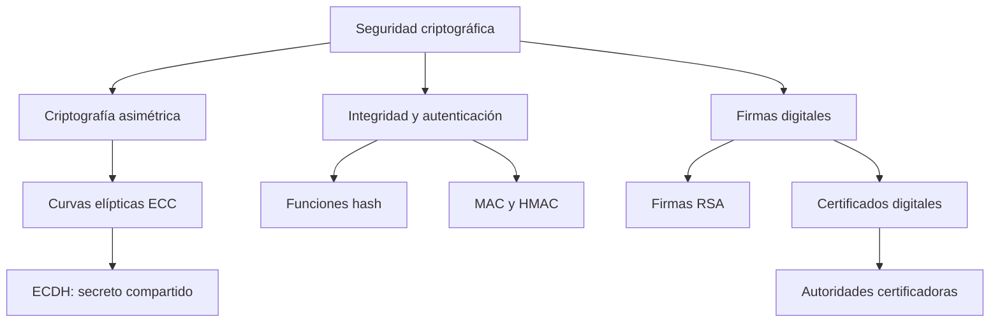
  
---  
  
## Criptografía de curva elíptica  
  
La **Elliptic Curve Cryptography (ECC)** es una familia de técnicas de criptografía asimétrica que utiliza las propiedades matemáticas de las curvas elípticas para realizar operaciones con claves públicas y privadas.  
  
Su principal ventaja consiste en proporcionar niveles elevados de seguridad mediante claves considerablemente más pequeñas que las utilizadas por otros sistemas asimétricos, como RSA.  
  
Por ejemplo, una clave ECC de aproximadamente **256 bits** proporciona un nivel de seguridad comparable al de una clave RSA de **3072 bits**, considerando ataques clásicos conocidos y parámetros apropiados.  
  
Esta diferencia permite reducir los recursos necesarios para almacenar claves, transmitir información y realizar operaciones criptográficas.  
  
ECC se utiliza en diferentes aplicaciones:  
  
- **TLS:** establecimiento seguro de claves en comunicaciones de red.  
- **Firmas digitales:** autenticación e integridad de información.  
- **Criptomonedas:** autorización de transacciones mediante firmas basadas en curvas elípticas.  
- **Dispositivos móviles e IoT:** operaciones criptográficas con recursos limitados.  
- **VPN:** establecimiento de secretos compartidos.  
- **Correo electrónico seguro:** protección mediante sistemas compatibles con criptografía asimétrica.  
  
Es importante distinguir que **ECC no es un algoritmo único de cifrado**. Es una estructura matemática sobre la que pueden construirse diferentes mecanismos criptográficos, como ECDH para acordar claves y ECDSA para generar firmas digitales.  
  
### Fundamento matemático de las curvas elípticas:  
  
Para comprender las curvas elípticas, primero resulta útil considerar algunas ecuaciones geométricas conocidas.  
  
La ecuación de una circunferencia centrada en el origen es:  
  
$$  
x^2+y^2=r^2  
$$  
  
En donde $r$ representa el radio.  
  
Cada pareja de coordenadas $(x,y)$ que satisface esta ecuación pertenece a la circunferencia.  
  
Una generalización consiste en introducir coeficientes:  
  
$$  
ax^2+by^2=c  
$$  
  
Para valores positivos apropiados de $a$, $b$ y $c$, esta ecuación representa una elipse.  
  
Sin embargo, **una curva elíptica criptográfica no es una elipse**. Su nombre tiene un origen matemático diferente y su ecuación habitual pertenece a otra familia de curvas algebraicas.  
  
Sobre los números reales, una curva elíptica puede expresarse mediante:  
  
$$  
y^2=x^3+ax+b  
$$  
  
En donde $a$ y $b$ son coeficientes que determinan la forma de la curva.  
  
Esta ecuación permite representar gráficamente una curva continua. No obstante, en criptografía las operaciones no se realizan normalmente sobre todos los números reales, sino sobre un **campo finito**.  
  
### Curvas elípticas sobre campos finitos:  
  
Un campo finito contiene una cantidad limitada de elementos sobre los cuales pueden realizarse operaciones aritméticas.  
  
Uno de los campos utilizados en criptografía es:  
  
$$  
GF(p)=\mathbb{Z}_p  
$$  
  
En donde $p$ es un número primo.  
  
Los elementos de este campo son:  
  
$$  
\mathbb{Z}_p=\{0,1,2,\ldots,p-1\}  
$$  
  
Las operaciones se realizan utilizando aritmética modular. Esto significa que sus resultados se reducen módulo $p$.  
  
Una curva elíptica sobre este campo puede definirse mediante:  
  
$$  
\boxed{y^2\equiv x^3+ax+b\pmod p}  
$$  
  
Con:  
  
$$  
a,b,x,y\in\mathbb{Z}_p  
$$  
  
Para esta forma de la ecuación se considera $p>3$.  
  
A diferencia de una curva sobre números reales, una curva sobre un campo finito está formada por un conjunto discreto de puntos.  
  
Por ejemplo, si:  
  
$$  
p=17  
$$  
  
las coordenadas posibles pertenecen al conjunto:  
  
$$  
\{0,1,2,\ldots,16\}  
$$  
  
No todas las combinaciones de coordenadas pertenecen a la curva. Solamente se consideran aquellas que satisfacen su ecuación modular.  
  
Además, se incluye un elemento especial denominado **punto en el infinito**, representado por $\mathcal O$. Este elemento funciona como identidad de la operación de suma de puntos.  
  
### Condición de no singularidad:  
  
Para que una curva elíptica sea válida, debe satisfacer una condición de **no singularidad**.  
  
En su forma habitual:  
  
$$  
\boxed{4a^3+27b^2\not\equiv0\pmod p}  
$$  
  
Esta condición evita que la curva presente singularidades algebraicas que impedirían definir adecuadamente la estructura de grupo utilizada por ECC.  
  
Por lo tanto, no basta con elegir cualquier valor para los coeficientes $a$ y $b$.  
  
Una curva criptográfica debe satisfacer tanto su ecuación como las propiedades matemáticas necesarias para efectuar las operaciones entre puntos.  
  
---  
  
## Operaciones sobre curvas elípticas  
  
La criptografía de curva elíptica depende principalmente de dos operaciones: la **suma de puntos** y la **duplicación de puntos**.  
  
Estas operaciones permiten construir la multiplicación escalar, que constituye uno de los fundamentos de ECC.  
  
### Suma de puntos:  
  
Supóngase que existen dos puntos pertenecientes a una curva elíptica:  
  
$$  
P=(x_1,y_1)  
$$  
  
$$  
Q=(x_2,y_2)  
$$  
  
La suma consiste en obtener un tercer punto:  
  
$$  
R=P+Q  
$$  
  
Sobre los números reales, esta operación puede interpretarse geométricamente.  
  
Primero se traza una recta que pasa por $P$ y $Q$. La recta intersecta nuevamente la curva en un tercer punto.  
  
Después, este tercer punto se refleja respecto al eje horizontal para obtener $R$.  
  
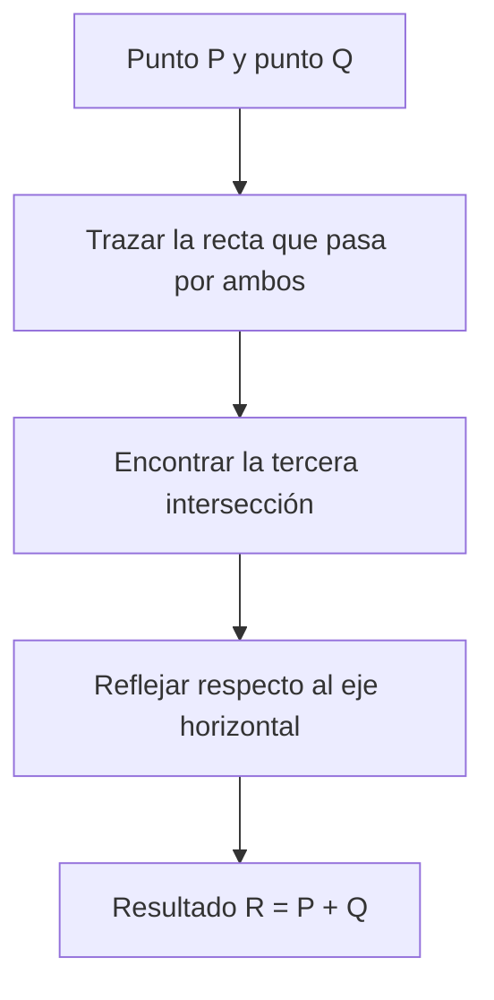
  
En un campo finito no existe una curva continua sobre la cual puedan trazarse rectas de la misma manera. Sin embargo, las mismas relaciones algebraicas permiten calcular el resultado mediante aritmética modular.  
  
Para dos puntos distintos con $x_1\not\equiv x_2\pmod p$, primero se calcula la pendiente:  
  
$$  
s=(y_2-y_1)(x_2-x_1)^{-1}\pmod p  
$$  
  
Después se calculan las coordenadas del resultado:  
  
$$  
\boxed{x_3=s^2-x_1-x_2\pmod p}  
$$  
  
$$  
\boxed{y_3=s(x_1-x_3)-y_1\pmod p}  
$$  
  
En donde:  
  
- $s$ representa la pendiente modular.  
- $(x_1,y_1)$ y $(x_2,y_2)$ son los puntos originales.  
- $(x_3,y_3)$ corresponde al punto resultante.  
- $(x_2-x_1)^{-1}$ representa el inverso multiplicativo módulo $p$.  
  
La existencia del inverso multiplicativo es fundamental. En aritmética modular, la división se realiza multiplicando por el inverso del denominador.  
  
Si dos puntos poseen la misma coordenada $x$ y coordenadas $y$ opuestas módulo $p$, su suma es el punto en el infinito:  
  
$$  
P+(-P)=\mathcal O  
$$  
  
### Duplicación de puntos:  
  
La duplicación ocurre cuando se suma un punto consigo mismo.  
  
$$  
R=P+P=2P  
$$  
  
Geométricamente, la recta que pasa por dos puntos diferentes se sustituye por una **recta tangente** en $P$.  
  
La tangente permite localizar otra intersección con la curva, que posteriormente se refleja para obtener $2P$.  
  
La principal diferencia matemática se encuentra en el cálculo de la pendiente:  
  
$$  
\boxed{s=(3x_1^2+a)(2y_1)^{-1}\pmod p}  
$$  
  
Las coordenadas resultantes se calculan mediante:  
  
$$  
x_3=s^2-2x_1\pmod p  
$$  
  
$$  
y_3=s(x_1-x_3)-y_1\pmod p  
$$  
  
Cuando $y_1=0$, la duplicación produce el punto en el infinito, porque el punto es su propio inverso.  
  
### Multiplicación escalar:  
  
Una vez definidas las operaciones anteriores, puede realizarse la multiplicación de un punto por un número entero.  
  
$$  
kP=\underbrace{P+P+\cdots+P}_{k\text{ veces}}  
$$  
  
Por ejemplo:  
  
$$  
3P=P+P+P  
$$  
  
$$  
4P=2P+2P  
$$  
  
Esta operación es fundamental para la criptografía asimétrica.  
  
Se considera relativamente eficiente calcular $Q=kP$ cuando se conocen $k$ y $P$. Sin embargo, para parámetros criptográficos adecuados, recuperar $k$ conociendo únicamente $P$ y $Q$ resulta computacionalmente difícil.  
  
Este problema se denomina **Elliptic Curve Discrete Logarithm Problem (ECDLP)**.  
  
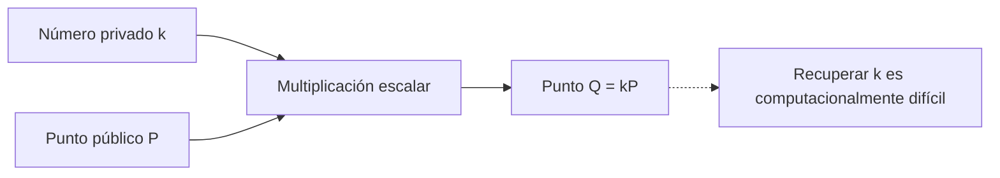
  
La dificultad del problema no significa que sea matemáticamente imposible invertir la operación, sino que no se conocen algoritmos clásicos eficientes para resolverla en curvas criptográficas apropiadas y suficientemente grandes.  
  
---  
  
## Ejemplo de operaciones en una curva elíptica  
  
Considérese la curva:  
  
$$  
\boxed{E:y^2\equiv x^3+2x+2\pmod{17}}  
$$  
  
En este caso:  
  
$$  
p=17,\qquad a=2,\qquad b=2  
$$  
  
Se utiliza el punto:  
  
$$  
P=(5,1)  
$$  
  
El objetivo consiste en calcular:  
  
$$  
2P=P+P  
$$  
  
### Cálculo de la pendiente:  
  
Debido a que se está duplicando el punto, se utiliza:  
  
$$  
s=(3x_1^2+a)(2y_1)^{-1}\pmod p  
$$  
  
Sustituyendo:  
  
$$  
s=(3(5)^2+2)(2(1))^{-1}\pmod{17}  
$$  
  
$$  
s=77\cdot2^{-1}\pmod{17}  
$$  
  
Para calcular el inverso de $2$ módulo $17$, se busca un número que satisfaga:  
  
$$  
2z\equiv1\pmod{17}  
$$  
  
El valor es:  
  
$$  
z=9  
$$  
  
Porque:  
  
$$  
2(9)=18\equiv1\pmod{17}  
$$  
  
Por lo tanto:  
  
$$  
s=77(9)\pmod{17}  
$$  
  
$$  
\boxed{s=13}  
$$  
  
### Cálculo de las coordenadas:  
  
La primera coordenada es:  
  
$$  
x_3=s^2-x_1-x_2\pmod p  
$$  
  
$$  
x_3=13^2-5-5\pmod{17}  
$$  
  
$$  
x_3=159\pmod{17}  
$$  
  
$$  
\boxed{x_3=6}  
$$  
  
La segunda coordenada es:  
  
$$  
y_3=s(x_1-x_3)-y_1\pmod p  
$$  
  
$$  
y_3=13(5-6)-1\pmod{17}  
$$  
  
$$  
y_3=-14\pmod{17}  
$$  
  
$$  
\boxed{y_3=3}  
$$  
  
Por lo tanto:  
  
$$  
\boxed{2P=(6,3)}  
$$  
  
### Verificación del resultado:  
  
Para comprobar que el punto pertenece a la curva, sus coordenadas deben satisfacer:  
  
$$  
y^2\equiv x^3+2x+2\pmod{17}  
$$  
  
Sustituyendo:  
  
$$  
3^2\equiv6^3+2(6)+2\pmod{17}  
$$  
  
$$  
9\equiv230\pmod{17}  
$$  
  
Como:  
  
$$  
230\equiv9\pmod{17}  
$$  
  
el punto obtenido es válido.  
  
### Orden del grupo:  
  
Para esta curva, el conjunto completo de puntos, incluyendo $\mathcal O$, contiene $19$ elementos.  
  
El punto $P=(5,1)$ genera el grupo y posee orden $19$.  
  
Esto significa que:  
  
$$  
19P=\mathcal O  
$$  
  
Algunos múltiplos del punto son:  
  
| Multiplicación | Punto resultante |  
|---|---|  
| $P$ | $(5,1)$ |  
| $2P$ | $(6,3)$ |  
| $3P$ | $(10,6)$ |  
| $4P$ | $(3,1)$ |  
| $5P$ | $(9,16)$ |  
| $6P$ | $(16,13)$ |  
| $7P$ | $(0,6)$ |  
| $8P$ | $(13,7)$ |  
| $9P$ | $(7,6)$ |  
| $10P$ | $(7,11)$ |  
| $11P$ | $(13,10)$ |  
| $12P$ | $(0,11)$ |  
| $13P$ | $(16,4)$ |  
| $14P$ | $(9,1)$ |  
| $15P$ | $(3,16)$ |  
| $16P$ | $(10,11)$ |  
| $17P$ | $(6,14)$ |  
| $18P$ | $(5,16)$ |  
| $19P$ | $\mathcal O$ |  
  
La estructura es cíclica porque los múltiplos de $P$ recorren todos los puntos del grupo.  
  
Además, el inverso de un múltiplo $kP$ puede calcularse mediante:  
  
$$  
-(kP)=(19-k)P  
$$  
  
Por ejemplo:  
  
$$  
P+18P=\mathcal O  
$$  
  
$$  
2P+17P=\mathcal O  
$$  
  
En general, el inverso de un punto $(x,y)$ es:  
  
$$  
\boxed{-(x,y)=(x,-y\bmod p)}  
$$  
  
Esta propiedad será importante para comprender cómo diferentes participantes pueden obtener el mismo secreto mediante operaciones sobre una curva elíptica.  
  
---  
  
## Elliptic Curve Diffie-Hellman  
  
**Elliptic Curve Diffie-Hellman (ECDH)** es un protocolo de acuerdo de claves que permite a dos participantes calcular un secreto compartido sin transmitir directamente sus claves privadas.  
  
El protocolo utiliza la multiplicación escalar sobre una curva elíptica.  
  
Supóngase que Alice y Bob desean establecer una clave para proteger sus comunicaciones.  
  
Ambos conocen públicamente los parámetros de una curva:  
  
- Un número primo $p$.  
- Una curva elíptica $E$.  
- Un punto base $P$.  
- El orden $n$ del punto base.  
  
Cada participante genera una clave privada y calcula su correspondiente clave pública.  
  
### Generación de las claves:  
  
Alice selecciona una clave privada:  
  
$$  
a  
$$  
  
Y calcula su clave pública:  
  
$$  
\boxed{A=aP}  
$$  
  
Bob selecciona otra clave privada:  
  
$$  
b  
$$  
  
Y calcula:  
  
$$  
\boxed{B=bP}  
$$  
  
Las claves públicas $A$ y $B$ pueden intercambiarse mediante un canal inseguro.  
  
Las claves privadas $a$ y $b$ deben mantenerse secretas.  
  
### Obtención del secreto compartido:  
  
Alice recibe la clave pública de Bob y calcula:  
  
$$  
T_{AB}=aB  
$$  
  
Como:  
  
$$  
B=bP  
$$  
  
se obtiene:  
  
$$  
T_{AB}=a(bP)  
$$  
  
Bob realiza la operación equivalente utilizando la clave pública de Alice:  
  
$$  
T_{BA}=bA  
$$  
  
Debido a que:  
  
$$  
A=aP  
$$  
  
entonces:  
  
$$  
T_{BA}=b(aP)  
$$  
  
Por las propiedades de la multiplicación escalar:  
  
$$  
\boxed{a(bP)=b(aP)=abP}  
$$  
  
Por lo tanto, ambos participantes obtienen exactamente el mismo punto de la curva sin intercambiar sus claves privadas.  
  
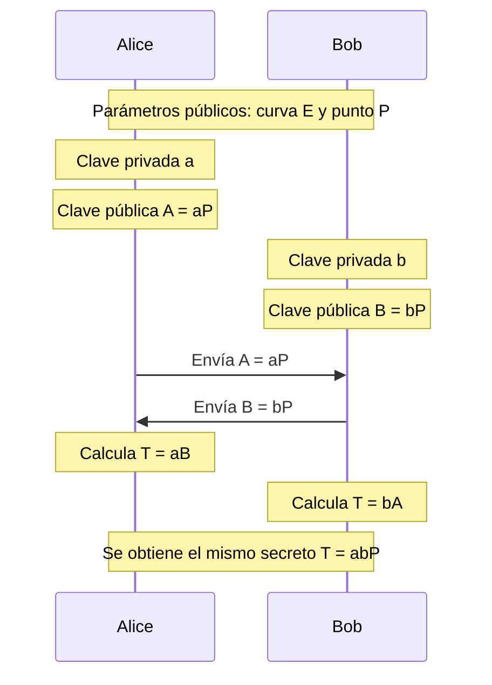
  
Un observador puede conocer $P$, $A$ y $B$. Sin embargo, obtener el secreto compartido a partir de estos valores resulta computacionalmente difícil cuando se utilizan parámetros criptográficos apropiados.  
  
Esta propiedad está relacionada con el problema Diffie-Hellman sobre curvas elípticas.  
  
### Ejemplo práctico:  
  
Considérese nuevamente:  
  
$$  
E:y^2\equiv x^3+2x+2\pmod{17}  
$$  
  
Con punto base:  
  
$$  
P=(5,1)  
$$  
  
Y orden:  
  
$$  
n=19  
$$  
  
Alice selecciona:  
  
$$  
a=3  
$$  
  
Su clave pública será:  
  
$$  
A=3P  
$$  
  
De acuerdo con los múltiplos calculados:  
  
$$  
\boxed{A=(10,6)}  
$$  
  
Bob selecciona:  
  
$$  
b=10  
$$  
  
Su clave pública será:  
  
$$  
B=10P  
$$  
  
$$  
\boxed{B=(7,11)}  
$$  
  
Después de intercambiar las claves públicas, Alice calcula:  
  
$$  
T_{AB}=3B  
$$  
  
$$  
T_{AB}=3(10P)  
$$  
  
$$  
T_{AB}=30P  
$$  
  
Como el punto posee orden $19$:  
  
$$  
30P=11P  
$$  
  
Por lo tanto:  
  
$$  
\boxed{T_{AB}=(13,10)}  
$$  
  
Bob calcula:  
  
$$  
T_{BA}=10A  
$$  
  
$$  
T_{BA}=10(3P)  
$$  
  
$$  
T_{BA}=30P  
$$  
  
Y obtiene:  
  
$$  
\boxed{T_{BA}=(13,10)}  
$$  
  
Ambos han generado el mismo secreto compartido:  
  
$$  
\boxed{T=(13,10)}  
$$  
  
La siguiente tabla resume el intercambio:  
  
| Elemento | Alice | Bob |  
|---|---|---|  
| Clave privada | $a=3$ | $b=10$ |  
| Clave pública | $A=(10,6)$ | $B=(7,11)$ |  
| Clave pública recibida | $(7,11)$ | $(10,6)$ |  
| Operación | $3B$ | $10A$ |  
| Secreto obtenido | $(13,10)$ | $(13,10)$ |  
  
Este ejemplo utiliza números pequeños exclusivamente para mostrar las operaciones matemáticas. En una aplicación real, estos parámetros no ofrecen seguridad criptográfica.  
  
### Derivación de una clave de sesión:  
  
El punto compartido obtenido mediante ECDH no suele utilizarse directamente como clave de cifrado.  
  
Primero se procesa mediante una **Key Derivation Function (KDF)**, que transforma el material secreto en claves adecuadas para otros algoritmos.  
  
Por ejemplo, a partir de:  
  
$$  
T=(13,10)  
$$  
  
puede utilizarse la coordenada:  
  
$$  
x_{AB}=13  
$$  
  
La coordenada se codifica en una secuencia de bytes siguiendo un formato acordado.  
  
Si se representa mediante cuatro bytes:  
  
```text  
00 00 00 0D  
```  
  
puede combinarse con información adicional, como valores aleatorios públicos denominados **nonces**.  
  
Conceptualmente:  
  
$$  
K_{AB}=\operatorname{KDF}(x_{AB},N_A,N_B)  
$$  
  
En donde:  
  
- $x_{AB}$ es el material secreto derivado de ECDH.  
- $N_A$ es un nonce asociado con Alice.  
- $N_B$ es un nonce asociado con Bob.  
- $K_{AB}$ es la clave de sesión resultante.  
  
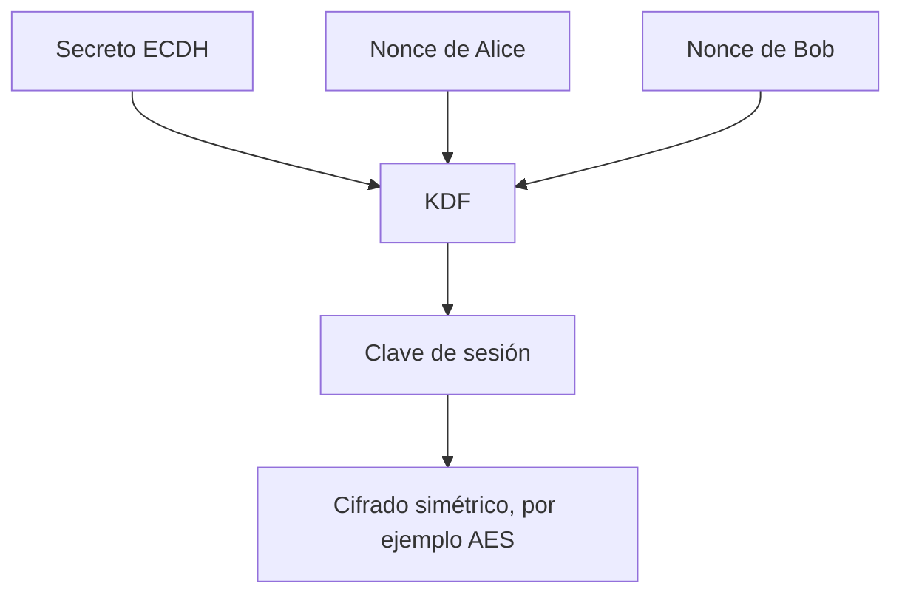
  
Una implementación correcta debe especificar la codificación de las entradas, la función de derivación y la información de contexto utilizada. No debe suponerse que concatenar valores y aplicar directamente SHA-256 equivale siempre a una KDF segura.  
  
Además, **ECDH por sí solo no autentica a los participantes**. Si las claves públicas pueden sustituirse durante el intercambio, un atacante podría realizar un ataque de intermediario.  
  
Por esta razón, ECDH suele combinarse con firmas digitales, certificados u otros mecanismos de autenticación.  
  
---  
  
## Autenticación de mensajes  
  
La **autenticación de mensajes** es un mecanismo criptográfico utilizado para verificar que un mensaje procede de una fuente autorizada y que su contenido no ha sido modificado.  
  
Para comprender su importancia, conviene distinguir diferentes propiedades de seguridad.  
  
| Propiedad | Objetivo |  
|---|---|  
| Confidencialidad | Evitar que terceros conozcan el contenido |  
| Integridad | Detectar modificaciones no autorizadas |  
| Autenticación de origen | Verificar que el mensaje fue generado por una entidad autorizada |  
| No repudio | Proporcionar evidencia verificable que dificulte negar una acción o autoría |  
  
El cifrado se utiliza principalmente para proteger la confidencialidad.  
  
Sin embargo, **el cifrado por sí solo no garantiza necesariamente integridad ni autenticación**. Estas propiedades deben proporcionarse mediante mecanismos apropiados, como cifrado autenticado, MAC o firmas digitales.  
  
Los dos mecanismos fundamentales relacionados con la autenticación de mensajes son:  
  
- **Message Authentication Code (MAC).**  
- **Funciones hash criptográficas**, utilizadas dentro de construcciones de autenticación como HMAC y firmas digitales.  
  
Aunque ambos pueden producir valores de longitud fija, sus propiedades y aplicaciones son diferentes.  
  
---  
  
## Message Authentication Code  
  
Un **Message Authentication Code (MAC)** es un valor criptográfico calculado a partir de un mensaje y una clave secreta compartida.  
  
Su objetivo es permitir que el receptor verifique la integridad del mensaje y su procedencia de alguien que conoce la clave.  
  
La operación puede representarse mediante:  
  
$$  
\boxed{T=C(K,M)}  
$$  
  
En donde:  
  
- $T$ es el código de autenticación resultante.  
- $C$ es la función MAC.  
- $K$ es la clave secreta compartida.  
- $M$ es el mensaje original.  
  
A diferencia de una función hash ordinaria, un MAC necesita una clave secreta.  
  
### Funcionamiento de un MAC:  
  
Supóngase que Alice y Bob comparten una clave secreta $K$.  
  
Alice desea enviar el mensaje $M$.  
  
Primero calcula:  
  
$$  
T=\operatorname{MAC}(K,M)  
$$  
  
Después transmite el mensaje junto con su código de autenticación.  
  
Bob recibe ambos elementos y calcula nuevamente:  
  
$$  
T'=\operatorname{MAC}(K,M)  
$$  
  
Si el código calculado coincide con el recibido, el mensaje supera la verificación de autenticidad e integridad.  
  
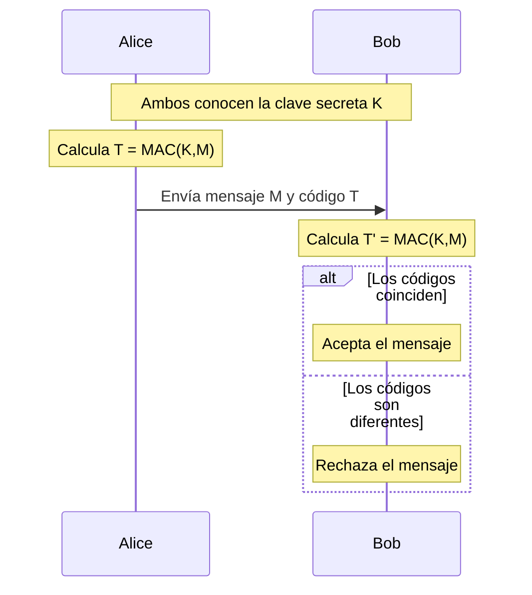
  
La seguridad del mecanismo depende de que un atacante no pueda generar un código válido sin conocer la clave secreta.  
  
Por lo tanto, modificar el mensaje obliga a producir un nuevo MAC válido.  
  
### Propiedades de un MAC:  
  
Un MAC presenta varias características importantes.  
  
**Depende del mensaje y de la clave:** cambiar cualquiera de los dos debe modificar el código de autenticación de una manera criptográficamente impredecible.  
  
**No necesita ser reversible:** su propósito no es recuperar el mensaje original, sino comprobar su autenticidad.  
  
**Genera una etiqueta de longitud definida:** aunque el mensaje pueda tener diferentes tamaños, el resultado sigue el tamaño establecido por el algoritmo, salvo truncamientos permitidos.  
  
**Utiliza criptografía simétrica:** ambas partes comparten la misma clave.  
  
Esta última característica implica una limitación importante.  
  
Si Alice y Bob conocen la misma clave, cualquiera de los dos puede generar un MAC válido.  
  
En consecuencia, un MAC permite autenticar mensajes frente a terceros que desconocen la clave, pero **no proporciona por sí solo no repudio frente a los participantes que comparten el secreto**.  
  
### MAC basado en cifradores de bloques:  
  
Un MAC puede construirse utilizando algoritmos de cifrado simétrico.  
  
Una construcción histórica utiliza el modo **Cipher Block Chaining (CBC)** para procesar los bloques de un mensaje y obtener una etiqueta de autenticación.  
  
Por ejemplo, el Data Authentication Algorithm (DAA) utilizaba técnicas relacionadas con DES-CBC.  
  
Sin embargo, emplear directamente el último bloque de un cifrado CBC no siempre produce un MAC seguro para mensajes de longitud variable.  
  
Las construcciones modernas, como **CMAC**, introducen reglas adicionales que permiten obtener garantías criptográficas apropiadas.  
  
---  
  
## Funciones hash criptográficas  
  
Una **función hash criptográfica** transforma un mensaje de longitud variable en un valor de longitud fija denominado **hash**, **resumen** o **message digest**.  
  
Se representa mediante:  
  
$$  
\boxed{h=H(M)}  
$$  
  
En donde:  
  
- $M$ representa el mensaje original.  
- $H$ es la función hash.  
- $h$ es el resumen producido.  
  
Por ejemplo, una función SHA-256 produce un resumen de:  
  
$$  
256\text{ bits}=32\text{ bytes}  
$$  
  
Esto ocurre independientemente de que el mensaje original contenga unas pocas letras o una gran cantidad de información, siempre que se encuentre dentro de los límites admitidos por el algoritmo.  
  
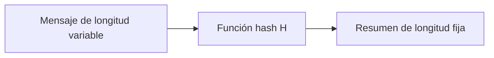
  
El hash puede entenderse como una **huella digital criptográfica** del contenido.  
  
Si dos participantes calculan el hash de un mismo mensaje, utilizando la misma función, obtendrán exactamente el mismo resultado.  
  
Ahora bien, un cambio en el mensaje normalmente produce un resumen diferente.  
  
### Propiedades de seguridad:  
  
Una función hash criptográfica debe cumplir varias propiedades.  
  
#### Eficiencia:  
  
Debe ser posible calcular el resumen de un mensaje de manera eficiente.  
  
Esto permite procesar documentos, archivos y comunicaciones de gran tamaño.  
  
#### Resistencia a la preimagen:  
  
Dado un resumen:  
  
$$  
h=H(M)  
$$  
  
debe resultar computacionalmente difícil encontrar un mensaje $M$ que produzca ese valor.  
  
Esta propiedad no significa que recuperar un mensaje sea matemáticamente imposible, sino que hacerlo debe requerir una cantidad de trabajo impracticable.  
  
#### Resistencia a la segunda preimagen:  
  
Dado un mensaje conocido $M_1$, debe resultar difícil encontrar otro mensaje diferente $M_2$ tal que:  
  
$$  
H(M_1)=H(M_2)  
$$  
  
#### Resistencia a colisiones:  
  
Debe resultar difícil encontrar cualquier pareja de mensajes distintos que produzcan el mismo resumen:  
  
$$  
\boxed{H(M_1)=H(M_2),\qquad M_1\neq M_2}  
$$  
  
Las colisiones existen necesariamente porque la función transforma un conjunto enorme de mensajes posibles en un conjunto finito de resultados.  
  
La seguridad consiste en que encontrar estas colisiones sea computacionalmente difícil.  
  
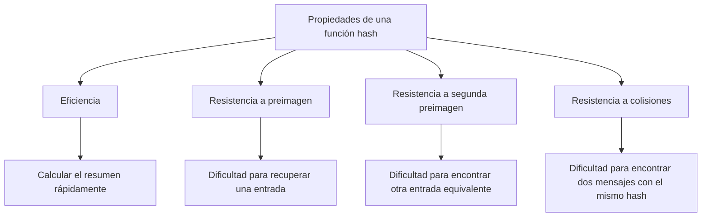
  
### Hash e integridad de mensajes:  
  
Supóngase que Alice envía:  
  
$$  
M  
$$  
  
junto con su resumen:  
  
$$  
h=H(M)  
$$  
  
Bob puede calcular nuevamente el hash del mensaje recibido y comparar ambos valores.  
  
Si los resúmenes son diferentes, existe evidencia de que el contenido cambió.  
  
Sin embargo, **un hash sin protección no proporciona autenticación criptográfica**.  
  
Un atacante que pueda modificar el mensaje también podría calcular un nuevo hash y sustituir ambos valores.  
  
Por esta razón, para autenticar el origen del contenido se necesitan mecanismos adicionales, como HMAC o firmas digitales.  
  
---  
  
## Funciones hash basadas en XOR  
  
Una construcción sencilla permite comprender el procesamiento de mensajes por bloques utilizando la operación XOR.  
  
Supóngase que un mensaje se divide en bloques de igual longitud:  
  
$$  
M=C_1\parallel C_2\parallel\cdots\parallel C_n  
$$  
  
En donde $\parallel$ representa concatenación.  
  
Un resumen elemental podría calcularse mediante:  
  
$$  
\boxed{h=C_1\oplus C_2\oplus\cdots\oplus C_n}  
$$  
  
El operador $\oplus$ representa **XOR**, cuya salida es $1$ cuando los bits comparados son diferentes.  
  
| Bit A | Bit B | $A\oplus B$ |  
|---|---|---|  
| 0 | 0 | 0 |  
| 0 | 1 | 1 |  
| 1 | 0 | 1 |  
| 1 | 1 | 0 |  
  
###### Ejemplo:  
  
Considérense tres bloques de cuatro bits:  
  
$$  
C_1=1010  
$$  
  
$$  
C_2=1100  
$$  
  
$$  
C_3=0110  
$$  
  
El resumen se calcula mediante:  
  
$$  
h=1010\oplus1100\oplus0110  
$$  
  
Primero:  
  
$$  
1010\oplus1100=0110  
$$  
  
Después:  
  
$$  
0110\oplus0110=0000  
$$  
  
Por lo tanto:  
  
$$  
\boxed{h=0000}  
$$  
  
Este mecanismo muestra cómo varios bloques pueden combinarse en un solo resultado.  
  
No obstante, **XOR por sí solo no constituye una función hash criptográficamente segura**.  
  
Su estructura permite construir colisiones fácilmente. Por ejemplo, intercambiar el orden de los bloques no modifica el resultado.  
  
Las funciones criptográficas reales utilizan estructuras mucho más complejas que combinan operaciones lógicas, aritmética modular y transformaciones internas.  
  
---  
  
## Secure Hash Algorithm  
  
La familia **Secure Hash Algorithm (SHA)** reúne diferentes funciones hash criptográficas estandarizadas por el National Institute of Standards and Technology (**NIST**).  
  
Estas funciones permiten producir resúmenes utilizados en mecanismos de integridad, autenticación y firmas digitales.  
  
### SHA-1 y MD5:  
  
**SHA-1** produce resúmenes de:  
  
$$  
160\text{ bits}  
$$  
  
Procesa bloques de:  
  
$$  
512\text{ bits}  
$$  
  
Por su parte, **MD5** procesa bloques de 512 bits y produce resúmenes de:  
  
$$  
128\text{ bits}  
$$  
  
MD5 forma parte de una familia de algoritmos desarrollados por Ron Rivest, junto con MD2 y MD4.  
  
Ambos algoritmos poseen importancia histórica, pero actualmente presentan debilidades criptográficas conocidas.  
  
En particular, **MD5 y SHA-1 no deben utilizarse cuando se necesita resistencia moderna a colisiones**, como ocurre en la generación de firmas digitales.  
  
### Familia SHA-2:  
  
SHA-2 incluye varias funciones con diferentes longitudes de resumen:  
  
- SHA-224.  
- SHA-256.  
- SHA-384.  
- SHA-512.  
  
Estas funciones mantienen una estructura general de procesamiento por bloques, aunque presentan diferencias en sus parámetros internos.  
  
| Algoritmo | Resumen | Bloque | Tamaño de palabra | Rondas |  
|---|---:|---:|---:|---:|  
| SHA-1 | 160 bits | 512 bits | 32 bits | 80 |  
| SHA-224 | 224 bits | 512 bits | 32 bits | 64 |  
| SHA-256 | 256 bits | 512 bits | 32 bits | 64 |  
| SHA-384 | 384 bits | 1024 bits | 64 bits | 80 |  
| SHA-512 | 512 bits | 1024 bits | 64 bits | 80 |  
  
El tamaño del resumen no debe confundirse con el tamaño del bloque.  
  
El **bloque** determina cuántos bits del mensaje se procesan en una etapa de compresión.  
  
El **resumen** representa la cantidad de bits producidos al finalizar el algoritmo.  
  
### SHA-3:  
  
SHA-3 fue estandarizado mediante **FIPS 202** en 2015.  
  
Aunque ofrece variantes con longitudes de resumen comparables a SHA-2, utiliza una estructura interna diferente.  
  
SHA-2 emplea construcciones basadas en funciones de compresión, mientras que SHA-3 utiliza una construcción denominada **sponge**.  
  
La estructura sponge absorbe bloques de información y posteriormente extrae los bits del resumen.  
  
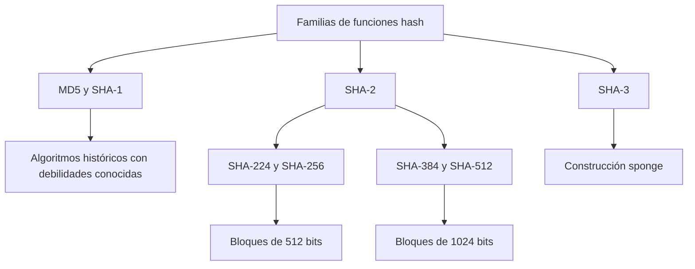
  
SHA-2 y SHA-3 son alternativas modernas, pero su desempeño relativo depende de la implementación y del hardware disponible.  
  
---  
  
## Estructura general de una función hash segura  
  
Muchas funciones hash procesan el mensaje mediante una secuencia de bloques.  
  
El mensaje se divide en:  
  
$$  
M=Y_1\parallel Y_2\parallel\cdots\parallel Y_L  
$$  
  
En donde:  
  
- $Y_i$ representa el bloque $i$.  
- $L$ representa el número total de bloques.  
- $CV_i$ representa el valor intermedio de encadenamiento.  
- $IV$ representa el valor inicial.  
- $f$ representa la función de compresión.  
  
El procesamiento comienza con:  
  
$$  
\boxed{CV_0=IV}  
$$  
  
Después, cada bloque modifica el estado anterior:  
  
$$  
\boxed{CV_i=f(CV_{i-1},Y_i)}  
$$  
  
Para:  
  
$$  
1\leq i\leq L  
$$  
  
Finalmente, el resumen se obtiene a partir del último estado:  
  
$$  
\boxed{H(M)=CV_L}  
$$  
  
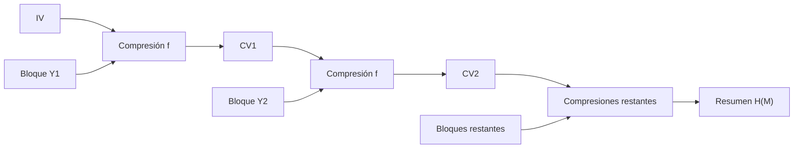
  
Esta representación muestra cómo cada bloque contribuye al estado que utilizará el siguiente.  
  
Por lo tanto, el resumen final depende del procesamiento encadenado de todo el mensaje.  
  
La función de compresión debe diseñarse cuidadosamente para evitar que un atacante pueda manipular los bloques y producir resúmenes equivalentes de manera sencilla.  
  
---  
  
## Generación de resúmenes mediante SHA-512  
  
**SHA-512** es una función de la familia SHA-2 que produce resúmenes de 512 bits.  
  
Su funcionamiento puede organizarse en cuatro etapas principales:  
  
1. Preparación del mensaje.  
2. Inicialización del estado.  
3. Procesamiento mediante la función de compresión.  
4. Generación del resumen final.  
  
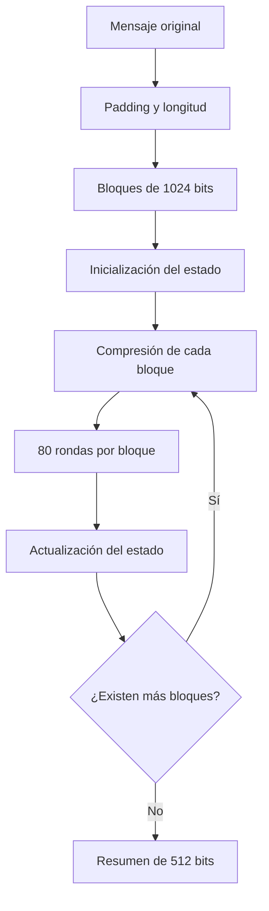
  
### Preparación del mensaje:  
  
SHA-512 procesa mensajes en bloques de:  
  
$$  
1024\text{ bits}  
$$  
  
Sin embargo, el mensaje original no necesariamente tiene una longitud múltiplo de 1024.  
  
Por esta razón, se aplica una operación denominada **padding** o relleno.  
  
El proceso consiste en añadir:  
  
- Un bit con valor $1$.  
- Una cantidad determinada de bits con valor $0$.  
- Una representación de 128 bits de la longitud original.  
  
La cantidad de ceros debe satisfacer:  
  
$$  
\boxed{\ell+1+k\equiv896\pmod{1024}}  
$$  
  
En donde:  
  
- $\ell$ representa la longitud original del mensaje en bits.  
- $1$ representa el bit añadido.  
- $k$ representa la cantidad de ceros.  
- $896$ permite reservar los últimos 128 bits del bloque para la longitud.  
  
El mensaje preparado debe tener una longitud total múltiplo de 1024 bits.  
  
### Ejemplo de padding:  
  
Supóngase que se desea calcular el resumen SHA-512 del mensaje:  
  
```text  
abc  
```  
  
Cada carácter se representa mediante un byte.  
  
Como el mensaje contiene tres caracteres:  
  
$$  
\ell=3(8)=24\text{ bits}  
$$  
  
La ecuación del padding es:  
  
$$  
24+1+k=896  
$$  
  
Despejando:  
  
$$  
\boxed{k=871}  
$$  
  
Por lo tanto, se añaden:  
  
- Los 24 bits originales.  
- Un bit con valor $1$.  
- 871 bits con valor $0$.  
- 128 bits para representar la longitud original.  
  
La longitud final es:  
  
$$  
24+1+871+128=1024  
$$  
  
Así, el mensaje queda representado mediante un único bloque de 1024 bits.  
  
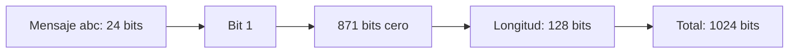
  
El padding no constituye cifrado. Su función es preparar el mensaje para el algoritmo y garantizar que la longitud original se incorpore al procesamiento.  
  
### Inicialización del estado:  
  
SHA-512 utiliza un estado interno de:  
  
$$  
512\text{ bits}  
$$  
  
Este estado se divide en ocho palabras de 64 bits:  
  
$$  
a,b,c,d,e,f,g,h  
$$  
  
Los valores iniciales se derivan matemáticamente de las partes fraccionarias de las raíces cuadradas de los primeros ocho números primos.  
  
| Palabra | Valor inicial hexadecimal |  
|---|---|  
| $a$ | `6A09E667F3BCC908` |  
| $b$ | `BB67AE8584CAA73B` |  
| $c$ | `3C6EF372FE94F82B` |  
| $d$ | `A54FF53A5F1D36F1` |  
| $e$ | `510E527FADE682D1` |  
| $f$ | `9B05688C2B3E6C1F` |  
| $g$ | `1F83D9ABFB41BD6B` |  
| $h$ | `5BE0CD19137E2179` |  
  
Estos valores forman el **Initialization Vector (IV)**.  
  
No se generan aleatoriamente para cada mensaje. Son constantes públicas definidas por el algoritmo.  
  
### Procesamiento de bloques:  
  
Cada bloque de 1024 bits se divide inicialmente en:  
  
$$  
16\text{ palabras de }64\text{ bits}  
$$  
  
Porque:  
  
$$  
16(64)=1024  
$$  
  
A partir de estas palabras se construye una secuencia de 80 palabras:  
  
$$  
W_0,W_1,\ldots,W_{79}  
$$  
  
Las primeras dieciséis proceden directamente del bloque.  
  
Para las restantes se utilizan operaciones de rotación, desplazamiento, XOR y suma modular.  
  
La expansión puede expresarse como:  
  
$$  
W_t=  
\begin{cases}  
M_t, & 0\leq t\leq15\\  
\sigma_1(W_{t-2})+W_{t-7}+\sigma_0(W_{t-15})+W_{t-16}\pmod{2^{64}}, & 16\leq t\leq79  
\end{cases}  
$$  
  
Las funciones utilizadas son:  
  
$$  
\sigma_0(x)=  
\operatorname{ROTR}^{1}(x)  
\oplus  
\operatorname{ROTR}^{8}(x)  
\oplus  
\operatorname{SHR}^{7}(x)  
$$  
  
$$  
\sigma_1(x)=  
\operatorname{ROTR}^{19}(x)  
\oplus  
\operatorname{ROTR}^{61}(x)  
\oplus  
\operatorname{SHR}^{6}(x)  
$$  
  
En donde:  
  
- $\operatorname{ROTR}$ representa una rotación circular hacia la derecha.  
- $\operatorname{SHR}$ representa un desplazamiento lógico hacia la derecha.  
- $\oplus$ representa XOR.  
  
La diferencia principal es que una rotación conserva todos los bits, mientras que un desplazamiento descarta aquellos que salen del extremo.  
  
### Función de compresión:  
  
SHA-512 ejecuta **80 rondas por bloque**.  
  
Cada ronda utiliza:  
  
- Ocho palabras de estado de 64 bits.  
- Una palabra $W_t$ derivada del mensaje.  
- Una constante $K_t$.  
- Operaciones lógicas y aritméticas.  
  
Las constantes $K_t$ se derivan de las partes fraccionarias de las raíces cúbicas de los primeros 80 números primos.  
  
Entre las operaciones utilizadas se encuentran:  
  
$$  
\operatorname{AND},\quad  
\operatorname{XOR},\quad  
\operatorname{ROTR},\quad  
\operatorname{SHR}  
$$  
  
También se utiliza suma módulo:  
  
$$  
2^{64}  
$$  
  
Esto significa que los resultados aritméticos se mantienen dentro de palabras de 64 bits.  
  
Durante cada ronda, los ocho valores internos se actualizan y mezclan con información del bloque.  
  
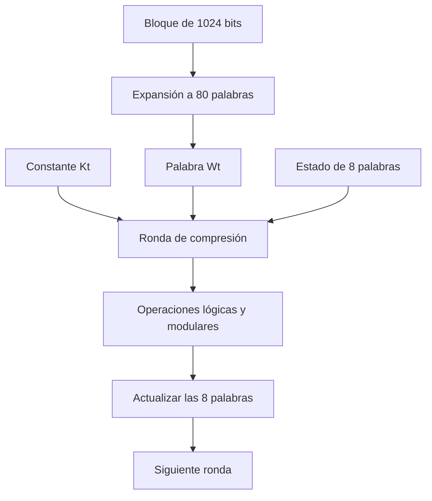
  
El objetivo de estas transformaciones es mezclar progresivamente la información del mensaje dentro del estado criptográfico.  
  
### Generación del resultado:  
  
Después de completar las 80 rondas de un bloque, las palabras resultantes se combinan con el estado anterior mediante suma módulo $2^{64}$.  
  
Conceptualmente:  
  
$$  
H_i=\operatorname{SUM}_{64}(H_{i-1},S_i)  
$$  
  
En donde:  
  
- $H_{i-1}$ es el estado anterior.  
- $S_i$ representa las ocho palabras obtenidas al finalizar las rondas.  
- $\operatorname{SUM}_{64}$ indica suma palabra por palabra módulo $2^{64}$.  
  
El estado actualizado se utiliza para procesar el siguiente bloque.  
  
Una vez procesados todos los bloques, se concatenan las ocho palabras finales:  
  
$$  
\boxed{H(M)=H_0\parallel H_1\parallel\cdots\parallel H_7}  
$$  
  
El resultado contiene:  
  
$$  
8(64)=512\text{ bits}  
$$  
  
La seguridad de SHA-512 no depende de mantener secretas estas operaciones. Su diseño es público y la seguridad procede de las propiedades criptográficas de toda la construcción.  
  
---  
  
## HMAC y CMAC  
  
Los códigos de autenticación pueden construirse utilizando diferentes primitivas criptográficas.  
  
Dos mecanismos importantes son **HMAC** y **CMAC**.  
  
### HMAC:  
  
**Hash-based Message Authentication Code (HMAC)** es una construcción que utiliza una función hash criptográfica junto con una clave secreta.  
  
Su propósito es proporcionar integridad y autenticación de origen.  
  
A diferencia de un hash ordinario, el resultado depende de una clave que solamente conocen las entidades autorizadas.  
  
La construcción estándar puede expresarse como:  
  
$$  
\boxed{  
\operatorname{HMAC}(K,M)=  
H\left(  
(K'\oplus opad)  
\parallel  
H((K'\oplus ipad)\parallel M)  
\right)  
}  
$$  
  
En donde:  
  
- $K'$ es la clave adaptada al tamaño de bloque de la función hash.  
- $M$ es el mensaje.  
- $ipad$ es un patrón fijo de relleno interno.  
- $opad$ es un patrón fijo de relleno externo.  
- $H$ es la función hash.  
- $\parallel$ representa concatenación.  
  
La estructura utiliza dos aplicaciones de la función hash y combina la clave con dos patrones diferentes.  
  
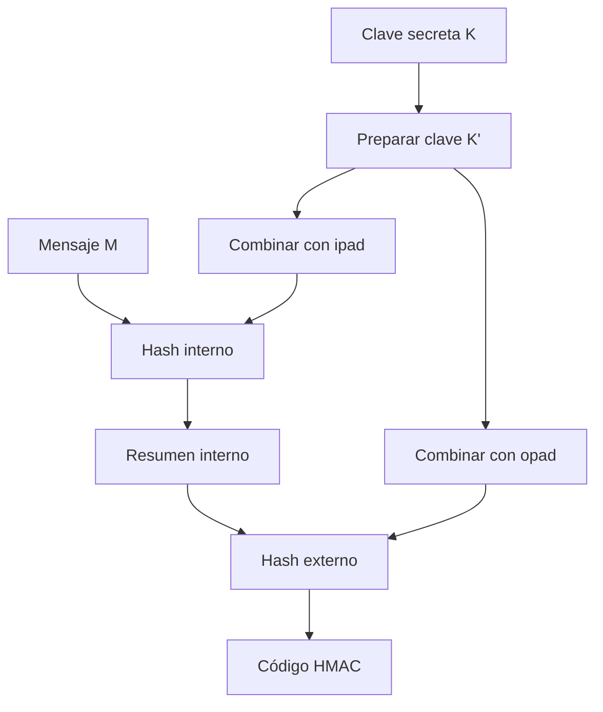
  
Por ejemplo, **HMAC-SHA-256** utiliza SHA-256 como función hash interna.  
  
El resultado puede servir para autenticar mensajes intercambiados entre participantes que comparten una clave secreta.  
  
No debe confundirse HMAC con la simple concatenación de una clave y un mensaje antes de aplicar cualquier hash. HMAC posee una estructura específica diseñada para ofrecer garantías de seguridad.  
  
### CMAC:  
  
**Cipher-based Message Authentication Code (CMAC)** construye un MAC utilizando un cifrador de bloques simétrico.  
  
Por ejemplo, puede utilizar AES como primitiva subyacente.  
  
A diferencia de HMAC, que se fundamenta en una función hash, CMAC utiliza operaciones relacionadas con un cifrador de bloques.  
  
| Característica | HMAC | CMAC |  
|---|---|---|  
| Primitiva principal | Función hash | Cifrador de bloques |  
| Ejemplo | HMAC-SHA-256 | AES-CMAC |  
| Requiere clave secreta | Sí | Sí |  
| Proporciona integridad | Sí | Sí |  
| Autenticación de origen | Sí | Sí |  
| No repudio por sí solo | No | No |  
  
Ambos mecanismos permiten autenticar mensajes, pero ninguno proporciona confidencialidad por sí mismo.  
  
---  
  
## Firmas digitales  
  
Una **firma digital** es un mecanismo criptográfico que permite verificar la autenticidad e integridad de un mensaje mediante criptografía asimétrica.  
  
Su funcionamiento se basa en un par de claves:  
  
- Una **clave privada**, utilizada por el propietario para generar firmas.  
- Una **clave pública**, utilizada por terceros para verificar las firmas.  
  
A diferencia de un MAC, la clave utilizada para verificar no necesita mantenerse secreta.  
  
Esto permite que diferentes participantes comprueben una firma sin adquirir la capacidad de crear nuevas firmas válidas.  
  
### Propiedades de una firma digital:  
  
Una firma digital correctamente implementada proporciona tres propiedades fundamentales.  
  
**Autenticación:** permite comprobar que la firma fue generada mediante la clave privada correspondiente a una clave pública determinada.  
  
**Integridad:** permite detectar modificaciones del mensaje firmado.  
  
**No repudio:** puede proporcionar evidencia verificable de autoría, especialmente cuando la identidad del firmante está vinculada de manera confiable con su clave pública.  
  
El no repudio no depende exclusivamente del algoritmo matemático. También requiere proteger la clave privada, comprobar la identidad del titular y, cuando sea necesario, incorporar mecanismos confiables de tiempo y evidencia.  
  
### Diferencia entre MAC y firma digital:  
  
| Característica | MAC | Firma digital |  
|---|---|---|  
| Tipo de criptografía | Simétrica | Asimétrica |  
| Generación | Clave secreta compartida | Clave privada |  
| Verificación | Misma clave secreta | Clave pública |  
| Integridad | Sí | Sí |  
| Autenticación de origen | Sí | Sí |  
| Verificación por terceros | Limitada por la clave compartida | Sí |  
| No repudio | No por sí solo | Puede proporcionarlo con garantías adicionales |  
  
La diferencia más importante consiste en que **un MAC utiliza una clave compartida, mientras que una firma digital separa la capacidad de firmar de la capacidad de verificar**.  
  
---  
  
## Funcionamiento de una firma digital  
  
Supóngase que Bob desea enviar un mensaje firmado a Alice.  
  
Bob dispone de un par de claves:  
  
$$  
K_B^-  
$$  
  
$$  
K_B^+  
$$  
  
En donde:  
  
- $K_B^-$ representa su clave privada.  
- $K_B^+$ representa su clave pública.  
  
### Generación de la firma:  
  
Primero se calcula el resumen del mensaje:  
  
$$  
h=H(M)  
$$  
  
Después se utiliza un algoritmo de firma con la clave privada:  
  
$$  
\boxed{s=\operatorname{Sign}(K_B^-,h)}  
$$  
  
Bob transmite:  
  
$$  
(M,s)  
$$  
  
Alice recibe el mensaje y la firma correspondiente.  
  
### Verificación de la firma:  
  
Alice calcula el resumen del mensaje recibido:  
  
$$  
h'=H(M)  
$$  
  
Después utiliza la clave pública de Bob para verificar la firma:  
  
$$  
\boxed{\operatorname{Verify}(K_B^+,h',s)}  
$$  
  
Si la verificación es correcta, Alice acepta que la firma corresponde al mensaje y a la clave pública utilizada.  
  
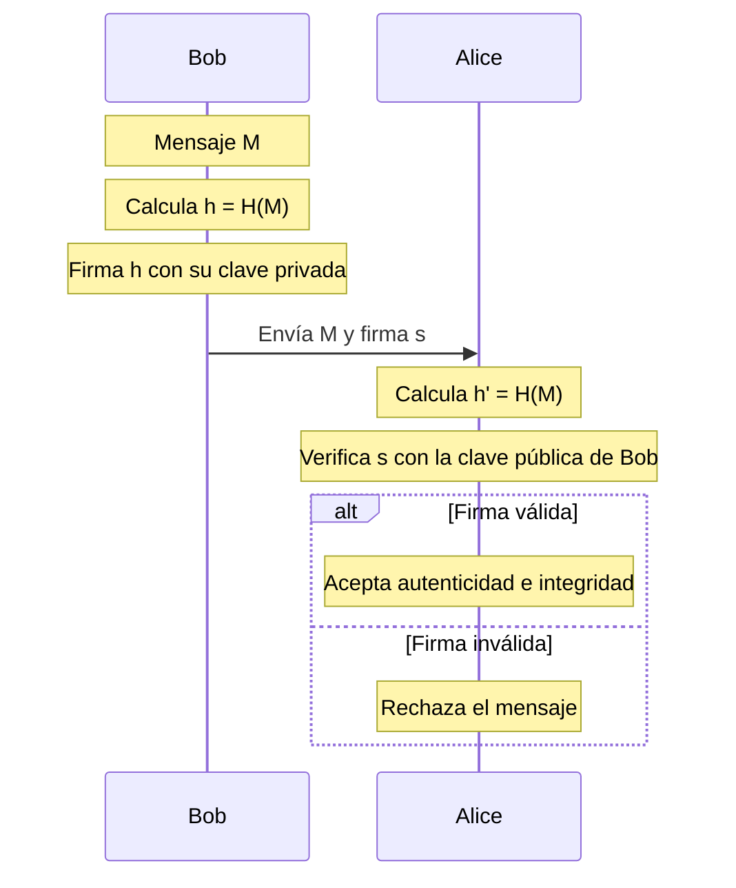
  
En la mayoría de los sistemas de firma, el mensaje original no se cifra mediante la clave privada.  
  
Se utiliza una operación específica de firma sobre una representación del resumen del mensaje.  
  
Esto evita confundir la **firma digital** con el **cifrado asimétrico**.  
  
---  
  
## Firma digital mediante RSA  
  
RSA puede utilizarse tanto para cifrado asimétrico como para firmas digitales, aunque cada aplicación requiere un esquema apropiado.  
  
Para comprender el fundamento matemático de una firma RSA, se considera el mecanismo elemental basado en exponenciación modular.  
  
### Generación de claves RSA:  
  
Se seleccionan dos números primos:  
  
$$  
p,\qquad q  
$$  
  
Se calcula:  
  
$$  
\boxed{n=pq}  
$$  
  
Y la función de Euler:  
  
$$  
\boxed{\varphi(n)=(p-1)(q-1)}  
$$  
  
Después se elige un exponente público $e$ que sea coprimo con $\varphi(n)$.  
  
Finalmente, se calcula el exponente privado $d$ de manera que:  
  
$$  
\boxed{ed\equiv1\pmod{\varphi(n)}}  
$$  
  
La clave pública es:  
  
$$  
K^+=(e,n)  
$$  
  
La clave privada contiene:  
  
$$  
K^-=(d,n)  
$$  
  
En una implementación real también deben protegerse los factores primos y utilizarse tamaños de clave adecuados.  
  
### Generación y verificación:  
  
En el modelo matemático elemental, un valor representativo del mensaje $h$ se firma mediante:  
  
$$  
\boxed{s=h^d\pmod n}  
$$  
  
La verificación consiste en calcular:  
  
$$  
\boxed{h'=s^e\pmod n}  
$$  
  
La firma resulta válida cuando:  
  
$$  
h'=h  
$$  
  
La operación funciona por las relaciones matemáticas existentes entre los exponentes público y privado.  
  
Sin embargo, las firmas RSA reales no deben implementar directamente esta exponenciación sobre un mensaje o hash sin codificación segura.  
  
Los esquemas modernos, como **RSA-PSS**, aplican procedimientos específicos de codificación y aleatorización para evitar vulnerabilidades.  
  
---  
  
## Ejemplo de firma digital RSA  
  
Supóngase que Bob desea firmar el valor:  
  
$$  
x=4  
$$  
  
Para simplificar las operaciones se utilizan números primos pequeños.  
  
### Generación de las claves:  
  
Bob selecciona:  
  
$$  
p=3,\qquad q=11  
$$  
  
Calcula:  
  
$$  
n=pq=3(11)  
$$  
  
$$  
\boxed{n=33}  
$$  
  
Después:  
  
$$  
\varphi(n)=(3-1)(11-1)  
$$  
  
$$  
\varphi(n)=2(10)  
$$  
  
$$  
\boxed{\varphi(n)=20}  
$$  
  
Se selecciona el exponente público:  
  
$$  
e=3  
$$  
  
El exponente privado debe satisfacer:  
  
$$  
3d\equiv1\pmod{20}  
$$  
  
Un valor válido es:  
  
$$  
d=7  
$$  
  
Porque:  
  
$$  
3(7)=21\equiv1\pmod{20}  
$$  
  
Las claves son:  
  
$$  
\boxed{K^+=(3,33)}  
$$  
  
$$  
\boxed{K^-=(7,33)}  
$$  
  
### Generación de la firma:  
  
Bob desea firmar:  
  
$$  
x=4  
$$  
  
Utilizando el esquema matemático elemental:  
  
$$  
s=x^d\pmod n  
$$  
  
$$  
s=4^7\pmod{33}  
$$  
  
El resultado es:  
  
$$  
\boxed{s=16}  
$$  
  
Bob transmite el mensaje y la firma:  
  
$$  
\boxed{(x,s)=(4,16)}  
$$  
  
### Verificación de la firma:  
  
Alice conoce la clave pública de Bob:  
  
$$  
(e,n)=(3,33)  
$$  
  
Utiliza el valor de la firma para calcular:  
  
$$  
x'=s^e\pmod n  
$$  
  
$$  
x'=16^3\pmod{33}  
$$  
  
$$  
\boxed{x'=4}  
$$  
  
Como:  
  
$$  
x'=x  
$$  
  
la firma supera la verificación matemática.  
  
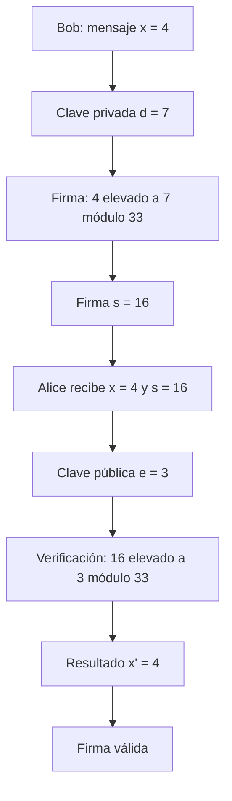
  
El ejemplo demuestra por qué la clave privada permite generar una firma que puede comprobarse mediante la clave pública.  
  
No obstante, estos números son demasiado pequeños para proporcionar seguridad y el procedimiento representa únicamente el fundamento algebraico de RSA.  
  
En un sistema real se firma una representación codificada de un resumen criptográfico mediante un esquema seguro.  
  
---  
  
## Autoridades certificadoras  
  
La utilización de firmas digitales introduce un problema fundamental: **¿cómo puede comprobarse que una clave pública pertenece realmente a una persona o entidad determinada?**  
  
Supóngase que Alice desea verificar un mensaje firmado por Bob.  
  
Para hacerlo necesita la clave pública de Bob.  
  
Sin embargo, si un atacante pudiera sustituir esa clave por otra, Alice podría verificar una firma utilizando una identidad equivocada.  
  
Las **Certification Authorities (CA)** o autoridades certificadoras permiten resolver este problema mediante certificados digitales.  
  
### Función de una autoridad certificadora:  
  
Una CA es una entidad que establece una asociación verificable entre una identidad y una clave pública.  
  
Por ejemplo, una entidad $E$ puede representar:  
  
- Una persona.  
- Una organización.  
- Un servidor.  
- Un dispositivo de red.  
- Un servicio digital.  
  
La CA utiliza procedimientos de validación para comprobar la información que debe asociarse con la clave pública.  
  
Después emite un **certificado digital firmado**.  
  
El certificado contiene información relacionada con la identidad, la clave pública, el emisor y las condiciones de validez.  
  
### Proceso de emisión de un certificado:  
  
Supóngase que Bob desea obtener un certificado para su clave pública.  
  
Primero genera su par de claves y presenta la información necesaria a una autoridad certificadora.  
  
La CA verifica la identidad o el control correspondiente, de acuerdo con el tipo de certificado.  
  
Después crea un certificado que contiene la clave pública de Bob y otros datos de identificación.  
  
Finalmente, la CA firma digitalmente el certificado mediante su propia clave privada.  
  
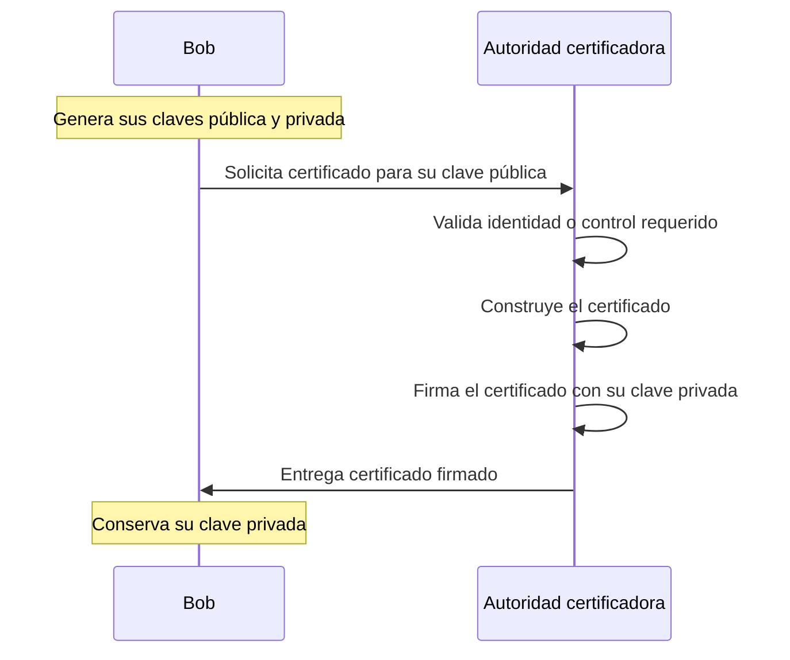
  
La firma de la CA permite comprobar que el certificado fue emitido por una autoridad cuya clave pública se considera confiable.  
  
### Verificación de un certificado:  
  
Supóngase que Alice necesita utilizar la clave pública de Bob.  
  
Alice obtiene el certificado correspondiente.  
  
Después realiza las comprobaciones necesarias utilizando la clave pública de la CA y, cuando corresponda, la cadena de certificación.  
  
Si el certificado es válido y establece la identidad esperada, Alice puede utilizar la clave pública contenida en él.  
  
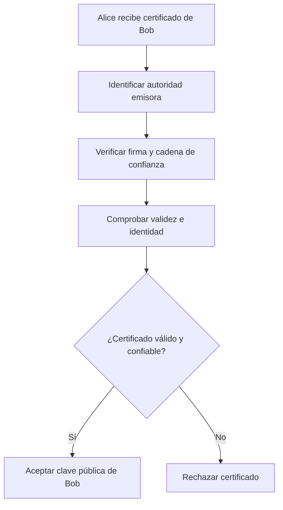
  
La verificación debe contemplar diferentes aspectos:  
  
- La firma del certificado.  
- La confianza en la CA emisora.  
- El periodo de validez.  
- La identidad o nombre que se desea autenticar.  
- Las restricciones de uso de la clave.  
- El estado de revocación, cuando corresponda.  
  
Por lo tanto, no basta con extraer una clave pública de un certificado y comprobar únicamente su firma.  
  
### Infraestructura de clave pública:  
  
El conjunto de mecanismos que permite emitir, distribuir, administrar y verificar certificados se conoce como **Public Key Infrastructure (PKI)**.  
  
Una PKI puede incluir:  
  
- Autoridades certificadoras raíz.  
- Autoridades certificadoras intermedias.  
- Certificados de entidades finales.  
- Políticas de emisión y validación.  
- Mecanismos de revocación y renovación.  
  
Las autoridades raíz representan puntos de confianza.  
  
Una autoridad intermedia puede emitir certificados bajo la autoridad de otra CA, creando una cadena de confianza.  
  
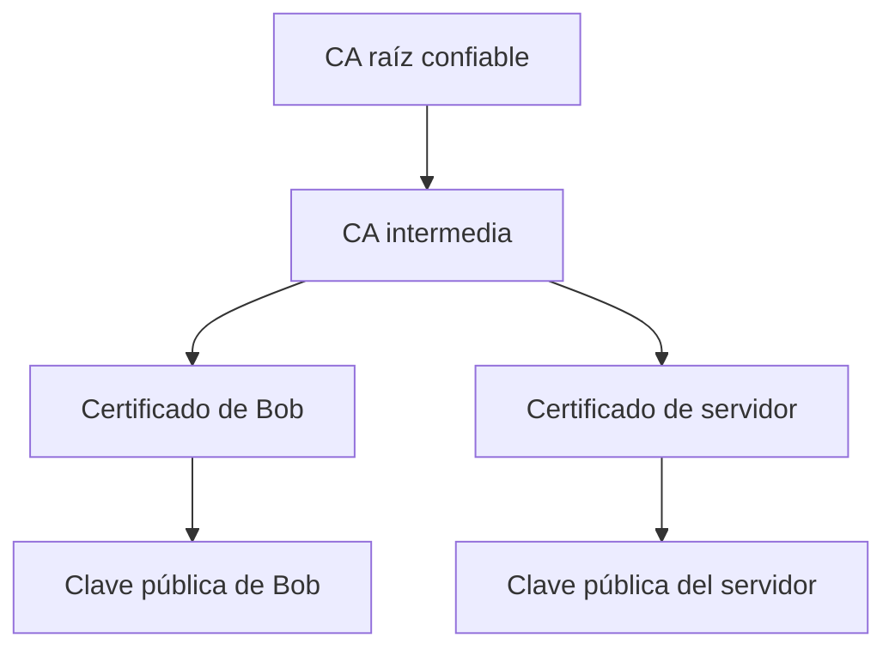
  
Esto permite que un sistema confíe en una clave pública a partir de una cadena de certificados, sin necesidad de conocer personalmente al propietario de cada clave.  
  
---  
  
## Relación entre ECC, ECDH, hash y firmas digitales  
  
Los mecanismos anteriores no funcionan necesariamente de manera aislada.  
  
En una comunicación segura pueden utilizarse conjuntamente para resolver diferentes problemas.  
  
Por ejemplo, supóngase que Alice desea establecer una comunicación confidencial y autenticada con un servidor.  
  
Primero necesita comprobar la identidad del servidor mediante un certificado digital.  
  
Después puede utilizar ECDH para acordar un secreto compartido.  
  
A partir de ese secreto se derivan claves de sesión mediante una KDF.  
  
Finalmente, estas claves pueden utilizarse con un algoritmo de cifrado autenticado para proteger los mensajes.  
  
Las funciones hash también pueden intervenir en el proceso de derivación de claves, autenticación o firma de información.  
  
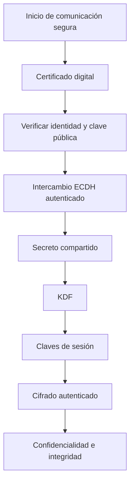
  
Cada mecanismo proporciona una función específica.  
  
| Mecanismo | Función principal |  
|---|---|  
| ECC | Fundamento matemático para operaciones asimétricas |  
| ECDH | Establecer un secreto compartido |  
| KDF | Derivar claves a partir de material secreto |  
| Función hash | Calcular un resumen criptográfico |  
| MAC / HMAC | Autenticar mensajes mediante una clave compartida |  
| Firma digital | Verificar firmas mediante claves públicas |  
| Certificado digital | Vincular una clave pública con una identidad |  
| CA | Emitir y respaldar certificados digitales |  
| Cifrado autenticado | Proteger confidencialidad e integridad de los datos |  
  
Es importante observar que una función hash no reemplaza una firma digital, del mismo modo que ECDH no reemplaza un mecanismo de autenticación.  
  
La seguridad de una comunicación depende de **combinar correctamente los mecanismos**, no simplemente de utilizar algoritmos criptográficos individuales.  
  
---  
  
## Ideas principales  
  
### Criptografía de curva elíptica:  
  
ECC utiliza operaciones matemáticas sobre puntos de curvas elípticas definidas en campos finitos.  
  
Su ecuación habitual es:  
  
$$  
y^2\equiv x^3+ax+b\pmod p  
$$  
  
La curva debe satisfacer la condición de no singularidad:  
  
$$  
4a^3+27b^2\not\equiv0\pmod p  
$$  
  
La operación fundamental es la multiplicación escalar:  
  
$$  
Q=kP  
$$  
  
Calcular $Q$ a partir de $k$ y $P$ es eficiente. Recuperar $k$ a partir de $P$ y $Q$ constituye un problema computacionalmente difícil para parámetros seguros.  
  
### Suma y duplicación de puntos:  
  
La suma de puntos distintos utiliza:  
  
$$  
s=(y_2-y_1)(x_2-x_1)^{-1}\pmod p  
$$  
  
La duplicación utiliza:  
  
$$  
s=(3x_1^2+a)(2y_1)^{-1}\pmod p  
$$  
  
En ambos casos, las coordenadas resultantes se obtienen mediante:  
  
$$  
x_3=s^2-x_1-x_2\pmod p  
$$  
  
$$  
y_3=s(x_1-x_3)-y_1\pmod p  
$$  
  
Para duplicación se considera $x_2=x_1$ en la expresión de $x_3$.  
  
### ECDH:  
  
ECDH permite que dos participantes obtengan un secreto compartido mediante:  
  
$$  
\boxed{a(bP)=b(aP)=abP}  
$$  
  
Las claves privadas nunca necesitan transmitirse.  
  
El secreto obtenido normalmente se procesa mediante una KDF para generar claves de sesión.  
  
ECDH por sí solo no proporciona autenticación frente a ataques de intermediario.  
  
### MAC y funciones hash:  
  
Un MAC depende de un mensaje y una clave secreta:  
  
$$  
T=\operatorname{MAC}(K,M)  
$$  
  
Proporciona integridad y autenticación de origen a quienes comparten la clave.  
  
Una función hash transforma un mensaje en un resumen:  
  
$$  
h=H(M)  
$$  
  
Las propiedades importantes son resistencia a preimagen, segunda preimagen y colisiones.  
  
Un hash ordinario no proporciona autenticación por sí solo.  
  
### SHA-512:  
  
SHA-512 produce un resumen de:  
  
$$  
512\text{ bits}  
$$  
  
Procesa bloques de:  
  
$$  
1024\text{ bits}  
$$  
  
Utiliza palabras de 64 bits y ejecuta 80 rondas por bloque.  
  
Su preparación incorpora el mensaje, un bit de valor $1$, ceros de relleno y una representación de 128 bits de la longitud original.  
  
### HMAC y CMAC:  
  
HMAC utiliza una función hash y una clave secreta.  
  
CMAC utiliza un cifrador de bloques simétrico.  
  
Ambos proporcionan autenticación e integridad mediante criptografía simétrica, pero no ofrecen no repudio por sí solos.  
  
### Firmas digitales:  
  
Una firma se genera con una clave privada y se verifica con la clave pública correspondiente.  
  
Permite comprobar la integridad del contenido firmado y su vinculación con una clave.  
  
En el fundamento matemático elemental de RSA:  
  
$$  
s=h^d\pmod n  
$$  
  
$$  
h'=s^e\pmod n  
$$  
  
Las implementaciones reales requieren esquemas seguros, como RSA-PSS.  
  
### Autoridades certificadoras:  
  
Una CA establece una relación verificable entre una identidad y una clave pública mediante certificados digitales firmados.  
  
El certificado permite obtener una clave pública y comprobar su vínculo con la identidad declarada, siempre que se valide correctamente la cadena de confianza y las condiciones del certificado.  
  
---  
  
## Conclusión  
  
La criptografía moderna utiliza diferentes mecanismos especializados para proteger las comunicaciones. La criptografía de curva elíptica permite realizar operaciones asimétricas eficientes y constituye el fundamento de protocolos como ECDH, mediante los cuales dos participantes pueden establecer un secreto compartido sin revelar sus claves privadas.  
  
Sin embargo, obtener un secreto compartido no garantiza por sí solo la autenticidad de los participantes. Para conseguir comunicaciones seguras se necesitan mecanismos complementarios que permitan verificar las identidades y detectar modificaciones no autorizadas.  
  
Las funciones hash permiten representar mensajes mediante resúmenes de longitud fija. A partir de estas funciones pueden construirse mecanismos como HMAC, capaces de autenticar mensajes mediante claves compartidas. SHA-512 demuestra cómo un algoritmo criptográfico puede procesar información de gran tamaño utilizando padding, operaciones binarias, aritmética modular y funciones de compresión.  
  
Las firmas digitales incorporan una propiedad adicional al separar la clave utilizada para firmar de aquella utilizada para verificar. Esto permite comprobar firmas sin compartir la capacidad de generarlas. Los certificados digitales y las autoridades certificadoras complementan este mecanismo al establecer relaciones confiables entre las claves públicas y las identidades de sus propietarios.  
  
Por lo tanto, la seguridad criptográfica no depende de un único algoritmo. Se obtiene mediante la combinación correcta de **acuerdo de claves, derivación de claves, cifrado autenticado, funciones hash, firmas digitales y certificados**, cada uno responsable de proporcionar propiedades específicas dentro de una comunicación segura.  