## Introducción  
  
La seguridad de las comunicaciones en Internet requiere mecanismos que permitan **autenticar a los participantes, distribuir claves criptográficas y proteger la información durante su transmisión**. Estos mecanismos son especialmente importantes cuando dos entidades necesitan comunicarse sin haber establecido previamente una relación de confianza.  
  
Uno de los problemas fundamentales consiste en determinar si una clave pública realmente pertenece a la entidad que afirma poseerla. Para resolverlo, se utilizan las **infraestructuras de clave pública (PKI)**, los **certificados digitales X.509** y las **autoridades certificadoras (CA)**. Por otra parte, en redes administradas pueden utilizarse sistemas de autenticación centralizada como **Kerberos**, que permiten acceder a diferentes servicios mediante credenciales y tickets.  
  
Estos mecanismos se relacionan directamente con **Transport Layer Security (TLS)**, el protocolo utilizado para establecer comunicaciones seguras en aplicaciones como HTTPS. TLS combina autenticación, negociación de algoritmos criptográficos, establecimiento de claves y protección de los datos transmitidos.  
  
Para comprender su funcionamiento, es necesario distinguir las etapas de una comunicación segura: primero se establece una conexión, después se autentican las entidades y se acuerdan los mecanismos criptográficos, posteriormente se generan las claves de sesión y finalmente se transmiten registros protegidos mediante cifrado y mecanismos de integridad.  
  
---  
  
## Autenticación en redes mediante Kerberos  
  
**Kerberos** es un protocolo de autenticación de red desarrollado originalmente en el Massachusetts Institute of Technology (MIT). Su objetivo consiste en permitir que usuarios y servicios se autentiquen mediante un sistema centralizado de confianza.  
  
En lugar de enviar constantemente las credenciales del usuario a cada servidor, Kerberos utiliza **tickets criptográficos** que permiten demostrar que una entidad ha sido autenticada previamente.  
  
Este mecanismo es especialmente útil en organizaciones que administran numerosos usuarios, equipos y servicios.  
  
### Componentes de Kerberos:  
  
Kerberos utiliza tres participantes principales:  
  
- **Usuario o cliente:** entidad que desea acceder a un servicio.  
- **Key Distribution Center (KDC):** servidor de confianza encargado de autenticar usuarios y distribuir información criptográfica.  
- **Servidor de servicios:** sistema que proporciona el recurso solicitado.  
  
El KDC se divide lógicamente en dos servicios:  
  
**Authentication Server (AS):** comprueba la identidad inicial del usuario y proporciona un Ticket Granting Ticket.  
  
**Ticket Granting Server (TGS):** utiliza ese ticket inicial para emitir tickets específicos que permiten acceder a servicios determinados.  
  
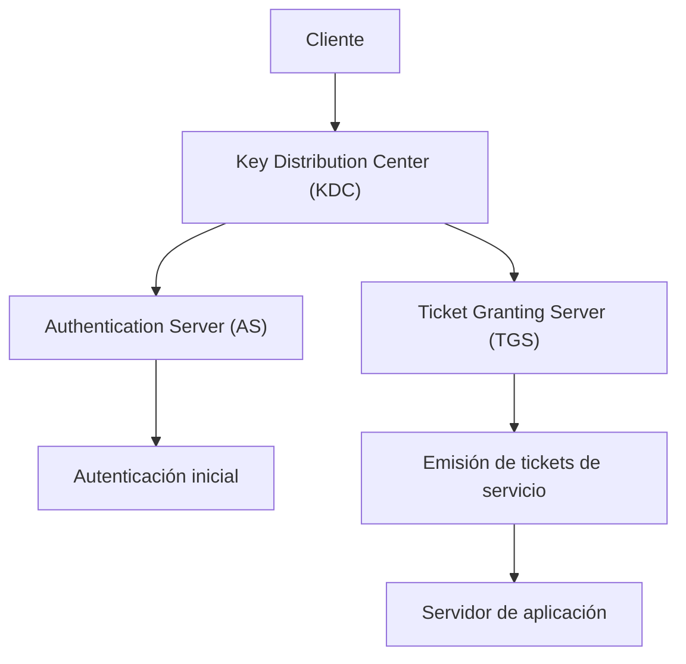
  
El KDC funciona como una entidad de confianza porque conoce o administra el material criptográfico necesario para emitir tickets que los servidores pueden verificar.  
  
### Funcionamiento de Kerberos:  
  
El proceso puede comprenderse mediante tres etapas principales.  
  
#### Autenticación inicial:  
  
Supóngase que Alice desea acceder a un servicio de una organización.  
  
Primero solicita autenticarse ante el AS.  
  
Después de comprobar la información correspondiente, el AS entrega un **Ticket Granting Ticket (TGT)** y material de sesión protegido.  
  
El TGT permite demostrar posteriormente que Alice ya completó la autenticación inicial.  
  
#### Solicitud de acceso a un servicio:  
  
Cuando Alice necesita acceder a un servidor específico, presenta su TGT al TGS.  
  
El TGS verifica la solicitud y genera un **ticket de servicio**, destinado al servidor correspondiente.  
  
Este ticket contiene información que permite al servidor reconocer la autorización criptográfica asociada con la sesión.  
  
#### Acceso al servidor:  
  
Alice presenta el ticket de servicio al servidor de destino.  
  
El servidor verifica el ticket y la prueba criptográfica asociada con la sesión antes de permitir el acceso.  
  
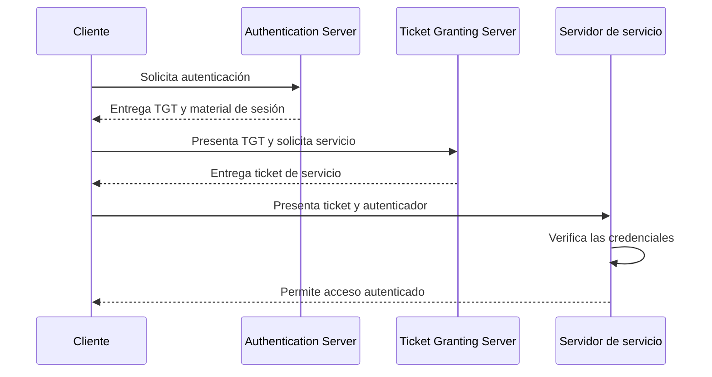
  
### Importancia de los tickets:  
  
Los tickets permiten reducir la necesidad de transmitir repetidamente las credenciales originales del usuario.  
  
Además, tienen una vigencia limitada y están protegidos criptográficamente.  
  
Kerberos también utiliza información temporal para limitar ataques de repetición, en los que un atacante intenta reutilizar mensajes de autenticación anteriores.  
  
Por esta razón, la sincronización de los relojes entre los participantes es importante.  
  
Kerberos **proporciona autenticación**, mientras que la decisión de autorizar una operación concreta también depende de las políticas de acceso del servicio.  
  
---  
  
## Administración y distribución de claves criptográficas  
  
Uno de los principales desafíos de la criptografía consiste en distribuir correctamente las claves necesarias para establecer comunicaciones seguras.  
  
Este problema aparece tanto en criptografía simétrica como en criptografía asimétrica, pero tiene características diferentes.  
  
### Distribución de claves secretas:  
  
En criptografía simétrica, Alice y Bob necesitan conocer una misma clave secreta:  
  
$$  
K_{AB}  
$$  
  
Esta clave se utiliza para realizar operaciones criptográficas compartidas.  
  
El problema consiste en establecerla sin permitir que un atacante la descubra.  
  
Si Alice simplemente transmite la clave mediante un canal inseguro, un observador podría obtenerla y utilizarla para comprometer las comunicaciones.  
  
Por lo tanto, se necesita un mecanismo seguro de distribución o establecimiento de claves.  
  
Kerberos representa una solución centralizada basada en una entidad confiable.  
  
Otra posibilidad consiste en utilizar mecanismos de acuerdo de claves, como Diffie-Hellman o ECDH.  
  
### Distribución de claves públicas:  
  
En criptografía asimétrica, cada entidad posee un par de claves:  
  
$$  
(K^+,K^-)  
$$  
  
En donde:  
  
- $K^+$ representa la clave pública.  
- $K^-$ representa la clave privada.  
  
La clave pública puede distribuirse libremente porque su seguridad no depende de mantenerla secreta.  
  
Sin embargo, aparece un problema diferente: **comprobar que una clave pública realmente pertenece a la entidad esperada**.  
  
Supóngase que Alice desea comunicarse con Bob.  
  
Alice necesita conocer la clave pública de Bob, pero todavía no tiene una manera confiable de comprobar su procedencia.  
  
### Distribución mediante correo electrónico:  
  
Una posibilidad consiste en enviar la clave pública como parte de un correo electrónico.  
  
Por ejemplo, Bob podría adjuntar su clave pública a un mensaje dirigido a Alice.  
  
El problema es que un atacante llamado Eve podría falsificar el remitente y enviar su propia clave pública haciéndose pasar por Bob.  
  
Alice podría aceptar la clave equivocada y utilizarla para proteger información destinada a Bob.  
  
Esto permitiría que Eve realizara operaciones criptográficas bajo una identidad falsa.  
  
### Distribución mediante un sitio web:  
  
Otra posibilidad consiste en publicar la clave pública en un sitio web.  
  
Sin embargo, si un atacante logra comprometer el sitio, manipular la resolución DNS o redirigir a Alice hacia una página fraudulenta, podría sustituir la clave publicada.  
  
Por lo tanto, **publicar una clave pública no garantiza automáticamente su autenticidad**.  
  
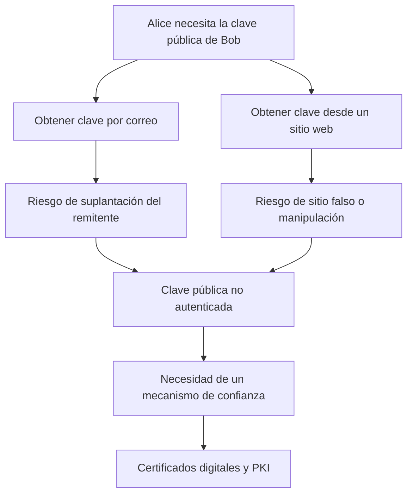
  
La solución consiste en utilizar un mecanismo que permita vincular criptográficamente una identidad con una clave pública verificable.  
  
---  
  
## Infraestructura de clave pública  
  
La **Public Key Infrastructure (PKI)** es el conjunto de tecnologías, personas, políticas y procedimientos utilizados para crear, administrar, almacenar, distribuir, validar y revocar certificados digitales basados en criptografía asimétrica.  
  
Su objetivo principal es permitir que los participantes obtengan claves públicas de manera confiable.  
  
La PKI no es simplemente un servidor que almacena certificados. Es una infraestructura completa que administra el ciclo de vida de las identidades criptográficas.  
  
### Componentes fundamentales:  
  
Una infraestructura PKI puede incluir los siguientes elementos:  
  
| Componente | Función |  
|---|---|  
| Certification Authority (CA) | Emite y firma certificados digitales |  
| Registration Authority (RA) | Participa en la validación de identidades y solicitudes |  
| Certificado digital | Vincula una identidad con una clave pública |  
| Repositorio de certificados | Facilita el almacenamiento y distribución |  
| Certificate Revocation List (CRL) | Informa sobre certificados revocados |  
| Políticas y procedimientos | Definen las condiciones de emisión y confianza |  
  
La **autoridad certificadora** representa uno de los componentes principales porque firma los certificados emitidos.  
  
La autoridad de registro puede encargarse de comprobar información del solicitante antes de que se autorice la emisión.  
  
### Funciones de una PKI:  
  
La infraestructura administra diferentes operaciones durante la existencia de un certificado.  
  
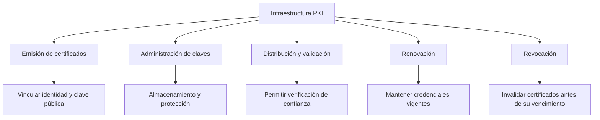
  
La revocación es especialmente importante cuando una clave privada ha sido comprometida.  
  
Aunque el certificado todavía no haya alcanzado su fecha de vencimiento, debe existir una forma de informar que ya no debe considerarse confiable.  
  
---  
  
## Certificados digitales X.509  
  
**X.509** es un estándar que define el formato de los certificados digitales de clave pública.  
  
Este estándar pertenece a las recomendaciones de la International Telecommunication Union (ITU-T) y se utiliza ampliamente en infraestructuras PKI.  
  
Una de sus aplicaciones más importantes es la autenticación de servidores mediante TLS, especialmente en conexiones HTTPS.  
  
La utilidad de X.509 consiste en establecer una representación común para que diferentes sistemas puedan interpretar, intercambiar y verificar certificados digitales.  
  
### Estructura de un certificado X.509:  
  
Un certificado contiene diversos campos que describen su identidad, validez y características criptográficas.  
  
| Campo | Significado |  
|---|---|  
| Version | Versión del formato X.509 |  
| Serial Number | Número de serie asignado por el emisor |  
| Signature Algorithm | Algoritmo utilizado para firmar el certificado |  
| Issuer | Identidad de la entidad emisora |  
| Validity Period | Periodo durante el cual el certificado es válido |  
| Subject | Identidad asociada con el certificado |  
| Subject Public Key Info | Información de la clave pública |  
| Issuer Unique Identifier | Identificador opcional del emisor |  
| Subject Unique Identifier | Identificador opcional del sujeto |  
| Extensions | Restricciones y propiedades adicionales |  
| Signature | Firma digital de la autoridad emisora |  
  
La firma de la CA protege la integridad de los campos que forman parte de la información certificada.  
  
Si un atacante modifica la clave pública o cualquiera de los datos firmados, la verificación criptográfica deja de ser válida.  
  
### Identificación mediante nombres distinguidos:  
  
X.509 puede utilizar nombres distinguidos relacionados con la estructura de directorios X.500.  
  
Estos nombres describen diferentes atributos de una entidad.  
  
Por ejemplo, supóngase que Bob trabaja en el departamento de préstamos de una institución llamada Money Bank.  
  
Su nombre distinguido podría representarse como:  
  
```text  
/C=US/O=Money Bank/OU=Loan/CN=Bob  
```  
  
Los componentes tienen el siguiente significado:  
  
| Atributo | Nombre | Valor del ejemplo |  
|---|---|---|  
| `C` | Country | US |  
| `O` | Organization | Money Bank |  
| `OU` | Organizational Unit | Loan |  
| `CN` | Common Name | Bob |  
  
Esta estructura permite representar información sobre la entidad de una manera organizada.  
  
Ahora bien, en certificados TLS modernos, la identidad del servidor suele verificarse principalmente mediante la extensión **Subject Alternative Name (SAN)**, que puede contener nombres DNS u otras identidades reconocidas.  
  
### Generación de un certificado:  
  
Supóngase que Bob desea obtener un certificado para su clave pública.  
  
Primero genera su par de claves y presenta una solicitud a la autoridad certificadora.  
  
La CA comprueba la información necesaria y construye la parte del certificado que será firmada.  
  
Posteriormente calcula una representación criptográfica de esta información y genera una firma utilizando su clave privada.  
  
Conceptualmente:  
  
$$  
h=H(TBS)  
$$  
  
$$  
s=\operatorname{Sign}(K_{CA}^-,h)  
$$  
  
En donde:  
  
- $TBS$ es la información del certificado que debe firmarse.  
- $H$ es una función hash criptográfica.  
- $K_{CA}^-$ es la clave privada de la CA.  
- $s$ es la firma digital.  
  
El certificado final contiene la información certificada, el identificador del algoritmo de firma y la firma correspondiente.  
  
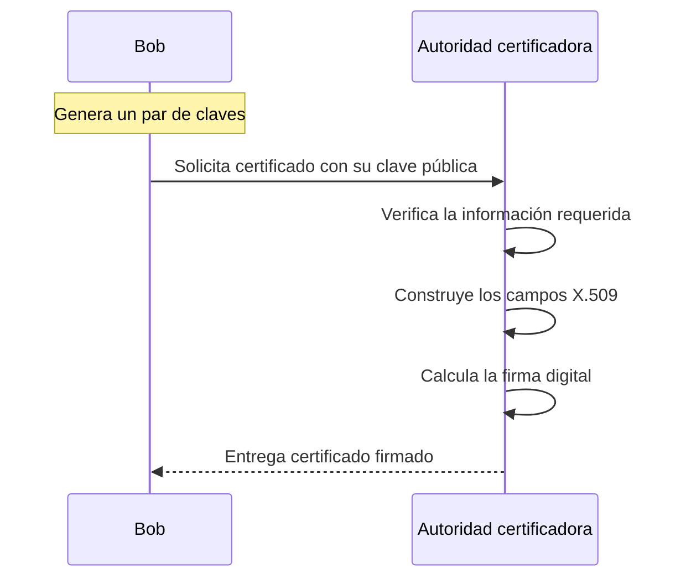
  
La firma permite verificar que los datos del certificado no han sido modificados desde su emisión.  
  
X.509 no obliga a utilizar exclusivamente RSA ni un único algoritmo hash. El formato admite diferentes algoritmos de firma reconocidos y sus correspondientes identificadores.  
  
### Verificación de un certificado:  
  
Cuando Alice recibe el certificado de Bob, necesita comprobar que puede confiar en él.  
  
Para ello, verifica la firma del emisor mediante una clave pública confiable.  
  
Además, debe comprobar que el certificado corresponde a la identidad esperada, que se encuentra dentro de su periodo de validez y que su uso está permitido.  
  
La firma válida confirma la integridad criptográfica del certificado, pero **no sustituye las demás comprobaciones de identidad y confianza**.  
  
---  
  
## Modelos de confianza en PKI  
  
Una sola autoridad certificadora encargada de emitir todos los certificados del mundo sería difícil de administrar y representaría un punto de fallo extremadamente importante.  
  
Por esta razón, las infraestructuras PKI pueden organizarse mediante diferentes modelos de confianza.  
  
Los dos modelos principales son el **modelo jerárquico** y el **modelo de malla**.  
  
### Modelo jerárquico:  
  
En una PKI jerárquica existe una autoridad certificadora raíz denominada **Root CA**.  
  
Esta autoridad puede emitir certificados para otras autoridades certificadoras subordinadas.  
  
Las autoridades subordinadas emiten certificados para usuarios, servidores y otras entidades.  
  
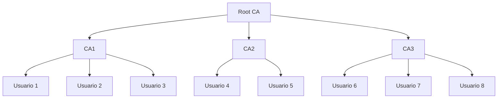
  
La ventaja principal de este modelo consiste en que un usuario puede confiar en diferentes certificados utilizando una cantidad reducida de claves públicas raíz.  
  
Esto permite construir **cadenas de certificación**.  
  
### Cadena de certificación:  
  
Supóngase que el Usuario 1 desea obtener una copia verificada de la clave pública del Usuario 3.  
  
Ambos pertenecen a una estructura donde CA1 ha emitido sus certificados y la Root CA ha emitido el certificado de CA1.  
  
El Usuario 1 conoce previamente y considera confiable la clave pública de la Root CA.  
  
El Usuario 3 proporciona una cadena que contiene:  
  
```text  
Root CA → CA1 → Usuario 3  
```  
  
El procedimiento consiste en verificar progresivamente los certificados.  
  
1. El Usuario 1 verifica el certificado de CA1 mediante la clave pública de la Root CA.  
2. Obtiene la clave pública de CA1 a partir del certificado validado.  
3. Utiliza esa clave para verificar el certificado del Usuario 3.  
4. Obtiene la clave pública del Usuario 3 a partir del certificado validado.  
  
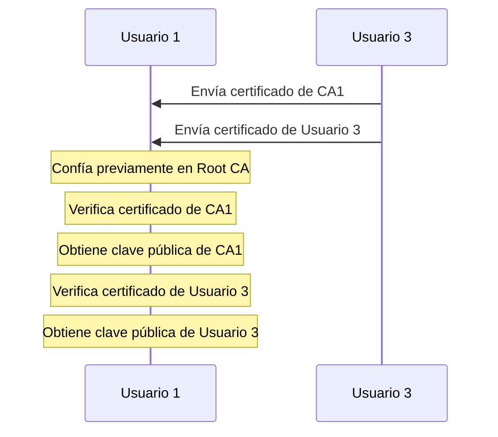
  
La validación también debe considerar fechas, restricciones, identidad y otros requisitos aplicables.  
  
El modelo permite que la confianza se extienda desde una autoridad raíz conocida hacia entidades certificadas por autoridades subordinadas.  
  
### Modelo de malla:  
  
En el **modelo de malla (Mesh Model)** pueden existir varias autoridades raíz independientes.  
  
Estas autoridades establecen relaciones mediante **certificación cruzada**, también denominada *cross-certification*.  
  
Cada autoridad puede emitir un certificado que respalda la clave pública de otra autoridad.  
  
Esto permite construir relaciones de confianza entre diferentes infraestructuras PKI.  
  
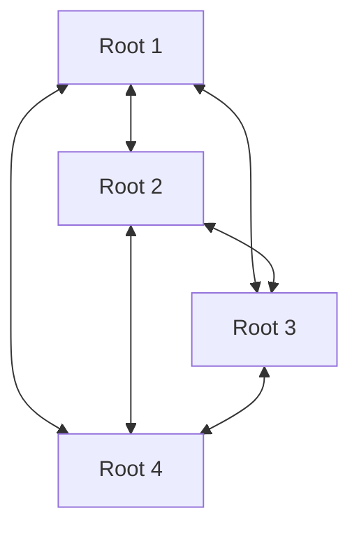
  
Si se considera una malla completamente conectada con $N$ autoridades y se requiere un certificado dirigido por cada relación de confianza, el número total de certificados cruzados es:  
  
$$  
\boxed{N(N-1)}  
$$  
  
###### Ejemplo:  
  
Supóngase que existen cuatro autoridades raíz:  
  
$$  
N=4  
$$  
  
El número de certificados necesarios en una malla dirigida completamente conectada sería:  
  
$$  
N(N-1)=4(4-1)  
$$  
  
$$  
\boxed{12\text{ certificados}}  
$$  
  
Esto muestra una limitación importante: conforme aumenta el número de autoridades, también aumenta la cantidad de relaciones que deben administrarse.  
  
En la práctica pueden utilizarse topologías parciales y acuerdos de confianza específicos para evitar la complejidad de una malla completamente conectada.  
  
---  
  
## Revocación de certificados  
  
La fecha de vencimiento de un certificado indica hasta cuándo puede utilizarse bajo condiciones normales.  
  
Sin embargo, pueden existir situaciones que obliguen a invalidarlo antes de esa fecha.  
  
Por ejemplo, si la clave privada de un servidor queda comprometida, el certificado correspondiente ya no debe considerarse confiable.  
  
Para resolver este problema se utilizan mecanismos de revocación.  
  
### Certificate Revocation List:  
  
Una **Certificate Revocation List (CRL)** es una lista firmada publicada por una autoridad certificadora que identifica certificados revocados.  
  
Los sistemas pueden consultar la CRL para determinar si un certificado continúa siendo aceptable.  
  
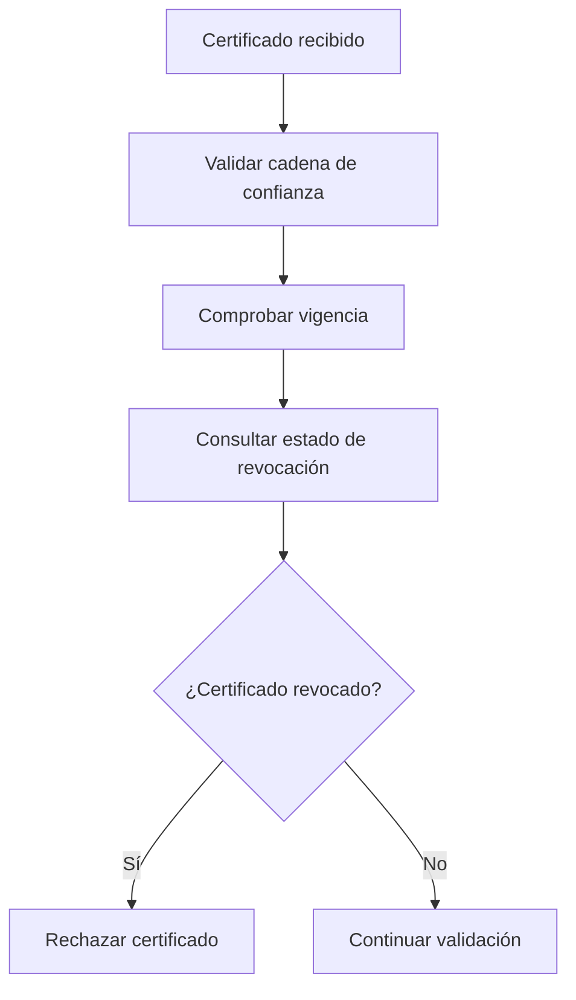
  
Además de CRL, existen mecanismos como **Online Certificate Status Protocol (OCSP)**, que permiten consultar información sobre el estado de revocación de certificados.  
  
La revocación es parte del ciclo de vida de una PKI, junto con la emisión, renovación, almacenamiento y distribución.  
  
---  
  
## Seguridad web mediante SSL y TLS  
  
La Web se utiliza para transmitir información sensible mediante aplicaciones bancarias, comercio electrónico, servicios gubernamentales y sistemas empresariales.  
  
Debido a que Internet funciona sobre redes que no necesariamente son confiables, resulta necesario proteger las comunicaciones entre clientes y servidores.  
  
Los protocolos **Secure Sockets Layer (SSL)** y **Transport Layer Security (TLS)** fueron desarrollados para proporcionar seguridad a las comunicaciones.  
  
TLS es el sucesor de SSL y constituye el mecanismo moderno utilizado para proteger conexiones HTTPS.  
  
### Propiedades de seguridad:  
  
TLS busca proporcionar tres propiedades fundamentales:  
  
**Confidencialidad:** impedir que un observador pueda leer el contenido protegido de los mensajes.  
  
**Integridad:** detectar modificaciones no autorizadas durante la transmisión.  
  
**Autenticación:** permitir que el cliente compruebe la identidad del servidor y, cuando se configure, que el servidor autentique al cliente.  
  
Estas propiedades no garantizan por sí mismas la disponibilidad del servicio frente a ataques como DDoS.  
  
Por lo tanto, TLS protege principalmente la seguridad criptográfica de la comunicación, mientras que la disponibilidad requiere otros mecanismos complementarios.  
  
### Relación entre HTTP, HTTPS y TLS:  
  
HTTP es un protocolo de aplicación utilizado para intercambiar solicitudes y respuestas web.  
  
HTTPS utiliza HTTP sobre una conexión protegida mediante TLS.  
  
En conexiones HTTPS tradicionales basadas en TCP, la organización conceptual es:  
  
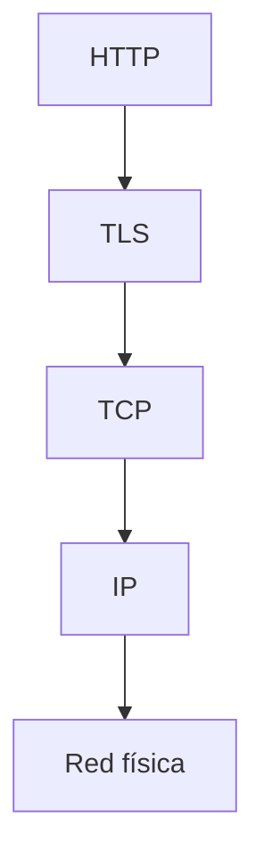
  
TLS se sitúa entre la aplicación y el transporte.  
  
Esto permite que una aplicación utilice mecanismos criptográficos sin tener que implementar directamente todos los detalles del cifrado y la autenticación.  
  
En implementaciones que utilizan HTTP/3, la comunicación emplea QUIC sobre UDP, con mecanismos TLS 1.3 integrados en el establecimiento de la conexión.  
  
---  
  
## Evolución de SSL y TLS  
  
Los protocolos de seguridad web han evolucionado para incorporar mejoras criptográficas y eliminar mecanismos vulnerables.  
  
La evolución general es:  
  
| Protocolo | Año | Estado |  
|---|---|---|  
| SSL 1.0 | 1994 | No publicado |  
| SSL 2.0 | 1995 | Obsoleto |  
| SSL 3.0 | 1996 | Obsoleto |  
| TLS 1.0 | 1999 | Obsoleto |  
| TLS 1.1 | 2006 | Obsoleto |  
| TLS 1.2 | 2008 | Utilizado y vigente |  
| TLS 1.3 | 2018 | Versión moderna |  
  
SSL 3.0 fue documentado posteriormente mediante RFC 6101.  
  
TLS 1.2 se especifica en RFC 5246, mientras que TLS 1.3 se define en RFC 8446.  
  
Las versiones antiguas fueron abandonadas debido a debilidades criptográficas y limitaciones de diseño.  
  
En aplicaciones modernas se recomienda utilizar TLS 1.3 cuando sea posible, manteniendo TLS 1.2 únicamente con configuraciones criptográficas adecuadas cuando se requiere compatibilidad.  
  
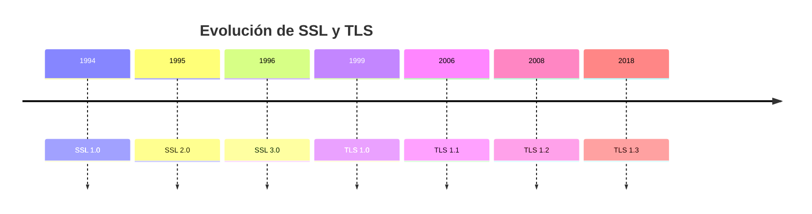
  
Una diferencia importante es que TLS 1.3 simplifica la negociación criptográfica y elimina numerosos algoritmos y mecanismos heredados.  
  
---  
  
## Establecimiento de un canal seguro mediante SSL/TLS  
  
El establecimiento de una comunicación protegida requiere completar distintas operaciones antes de transmitir datos de aplicación.  
  
En el modelo clásico de SSL/TLS, el proceso puede dividirse en cuatro etapas:  
  
1. **Handshake:** negociación y autenticación.  
2. **Key Derivation:** generación de claves de sesión.  
3. **Data Transfer:** transmisión de registros protegidos.  
4. **Connection Closure:** cierre controlado de la comunicación.  
  
Estas etapas representan una visión conceptual del funcionamiento de las conexiones seguras.  
  
### Handshake:  
  
El **handshake** es el procedimiento mediante el cual el cliente y el servidor acuerdan los parámetros criptográficos de una conexión.  
  
Durante este intercambio pueden realizarse las siguientes operaciones:  
  
- Negociación de la versión del protocolo.  
- Selección de algoritmos criptográficos.  
- Autenticación del servidor mediante certificados.  
- Establecimiento de un secreto compartido.  
- Verificación de que ambas partes poseen las claves correctas.  
  
En determinadas configuraciones también se autentica al cliente mediante un certificado.  
  
### Pre-Master Secret:  
  
En algunos mecanismos históricos de establecimiento de claves basados en RSA, el cliente genera un valor secreto denominado **Pre-Master Secret (PMS)**.  
  
Posteriormente utiliza la clave pública del servidor para cifrar ese valor.  
  
Conceptualmente:  
  
$$  
EMS=E_{K_S^+}(PMS)  
$$  
  
En donde:  
  
- $PMS$ es el secreto generado por el cliente.  
- $K_S^+$ es la clave pública del servidor.  
- $EMS$ representa el secreto cifrado.  
  
El servidor utiliza su clave privada para recuperar el PMS:  
  
$$  
PMS=D_{K_S^-}(EMS)  
$$  
  
Una vez que ambas partes conocen el PMS, pueden derivar el material criptográfico necesario para proteger la conexión.  
  
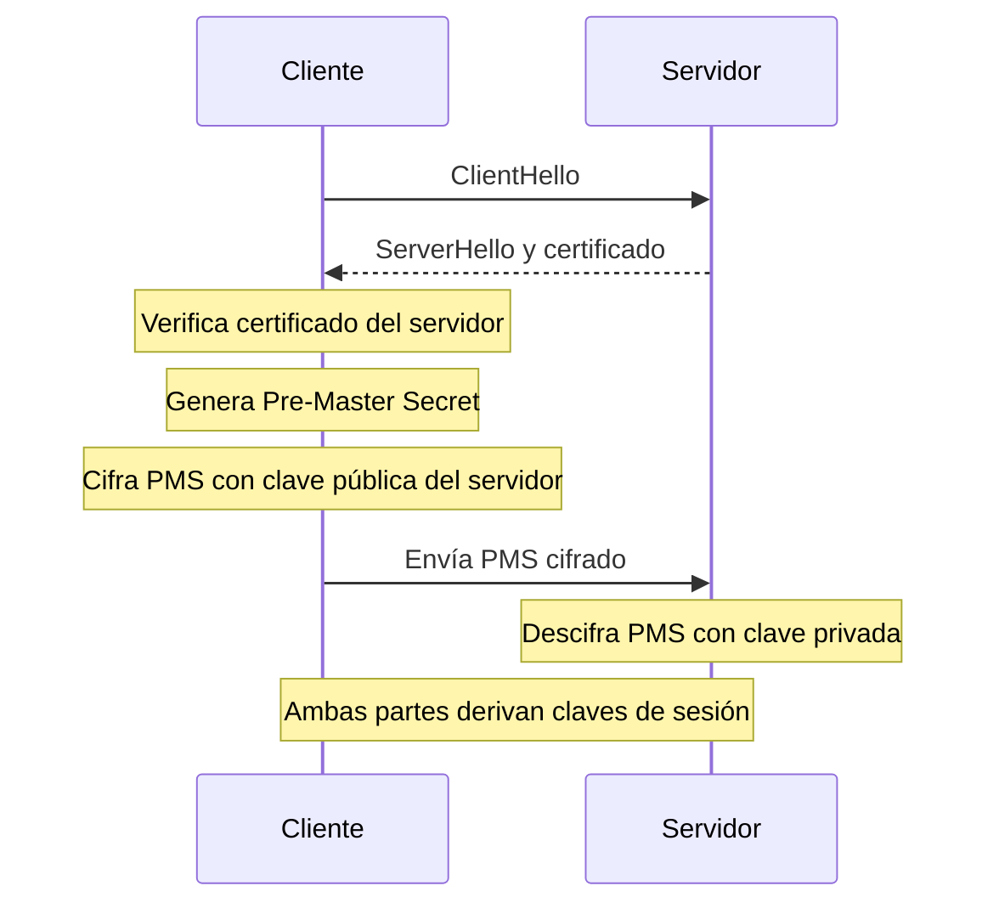
  
Este procedimiento explica el intercambio RSA utilizado históricamente en algunas versiones de SSL/TLS.  
  
**TLS 1.3 no utiliza este intercambio RSA de claves**. Sus mecanismos modernos de establecimiento de secretos se basan principalmente en intercambios efímeros de Diffie-Hellman, como ECDHE, y pueden incorporar claves previamente compartidas.  
  
---  
  
## Derivación de claves de sesión  
  
Una vez establecido un secreto compartido, el cliente y el servidor necesitan obtener las claves que utilizarán para proteger los mensajes.  
  
No es conveniente emplear una misma clave para todas las operaciones criptográficas.  
  
Por ejemplo, utilizar una clave independiente para el cifrado y otra para la autenticación permite separar funciones y reducir riesgos derivados del uso compartido del material criptográfico.  
  
Para generar las claves se utiliza una **Key Derivation Function (KDF)**.  
  
### Funcionamiento de una KDF:  
  
Una KDF transforma material secreto y otros parámetros en claves criptográficas.  
  
En un modelo simplificado, puede representarse mediante:  
  
$$  
\boxed{K_{MS}=f(PMS,R_C,R_S)}  
$$  
  
En donde:  
  
- $PMS$ representa el secreto inicial.  
- $R_C$ representa un valor aleatorio del cliente.  
- $R_S$ representa un valor aleatorio del servidor.  
- $f$ es la función de derivación.  
- $K_{MS}$ representa material de claves derivado.  
  
Los valores aleatorios participan en la generación de material diferente para distintas sesiones.  
  
En protocolos reales, la KDF debe seguir una construcción definida por el estándar correspondiente, y no simplemente concatenar valores y aplicar cualquier función hash.  
  
### Generación de cuatro claves:  
  
En el modelo clásico que utiliza cifrado y MAC independientes, se derivan cuatro claves principales:  
  
$$  
K_C,\quad M_C,\quad K_S,\quad M_S  
$$  
  
Cada una cumple una función específica.  
  
| Clave | Función | Dirección |  
|---|---|---|  
| $K_C$ | Cifrado de datos | Cliente → Servidor |  
| $M_C$ | Autenticación mediante MAC | Cliente → Servidor |  
| $K_S$ | Cifrado de datos | Servidor → Cliente |  
| $M_S$ | Autenticación mediante MAC | Servidor → Cliente |  
  
Por ejemplo, $K_C$ podría utilizarse con AES para cifrar información enviada por el cliente, mientras que $M_C$ podría utilizarse con HMAC-SHA256 para autenticar los mensajes correspondientes.  
  
El servidor utiliza las claves equivalentes para proteger las respuestas enviadas hacia el cliente.  
  
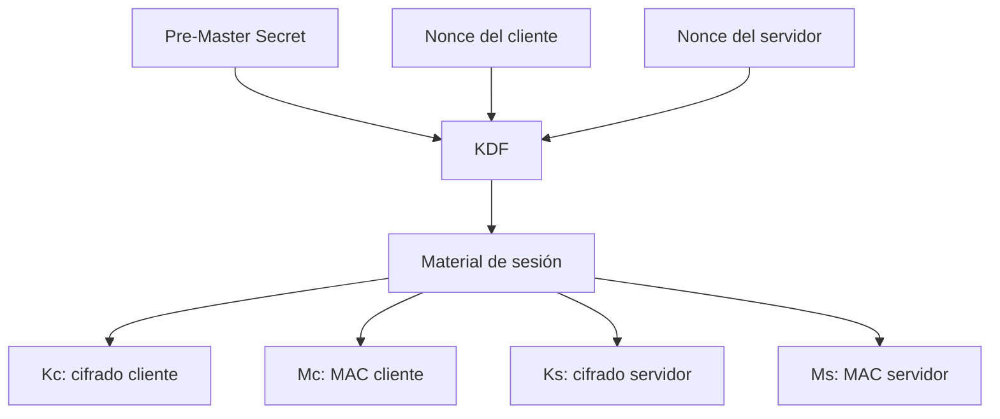
  
Esta separación de claves representa el funcionamiento clásico de suites que utilizan mecanismos independientes de cifrado y autenticación.  
  
En TLS moderno, las suites con **Authenticated Encryption with Associated Data (AEAD)**, como AES-GCM, proporcionan confidencialidad e integridad dentro de una construcción de cifrado autenticado. Por ello, no requieren una clave HMAC separada para cada registro.  
  
---  
  
## Nonces y protección contra ataques de repetición  
  
Un **nonce** es un valor utilizado en una operación criptográfica para aportar unicidad o frescura.  
  
Su nombre procede de la expresión *number used once*.  
  
En los protocolos de autenticación, los nonces ayudan a evitar que un atacante reutilice mensajes capturados previamente.  
  
### Ataque de repetición:  
  
Supóngase que Alice se autentica ante Bob mediante un intercambio válido.  
  
Un atacante observa la comunicación y guarda los mensajes transmitidos.  
  
Posteriormente intenta reproducirlos para hacer creer a Bob que Alice está iniciando una nueva sesión.  
  
Este comportamiento se conoce como **Replay Attack**.  
  
Si el protocolo no comprueba la frescura de los mensajes, podría aceptar información antigua como si perteneciera a una sesión actual.  
  
### Protección mediante nonces:  
  
El protocolo puede incorporar valores nuevos en cada sesión.  
  
Cuando se utiliza una KDF, los nonces también pueden contribuir a producir material criptográfico diferente.  
  
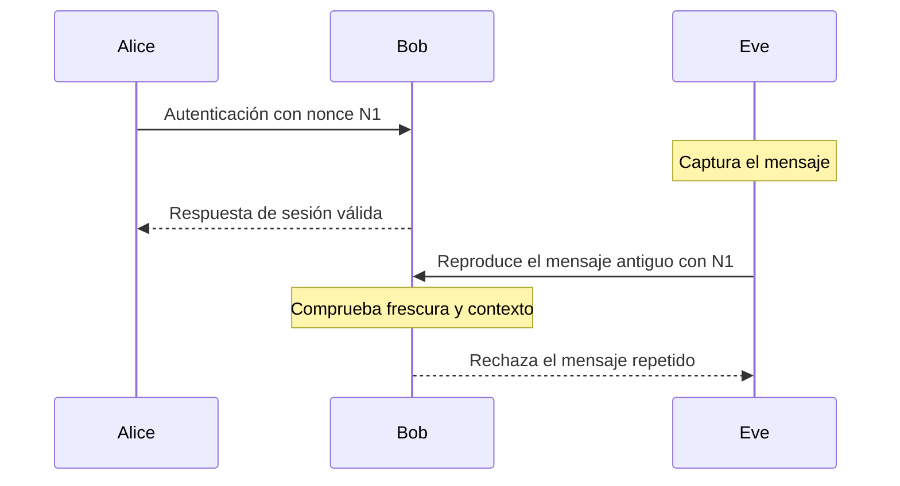
  
Los nonces no proporcionan protección automáticamente por el simple hecho de existir. Deben utilizarse dentro de mecanismos que los vinculen criptográficamente con la sesión y que permitan detectar repeticiones.  
  
---  
  
## Cipher Suites en SSL/TLS  
  
Una **Cipher Suite** es un conjunto de algoritmos criptográficos utilizado para establecer las propiedades de seguridad de una conexión.  
  
Durante el handshake, el cliente presenta las configuraciones que soporta y el servidor selecciona una opción compatible.  
  
En TLS 1.2 y versiones anteriores, las suites pueden describir diferentes componentes:  
  
- Algoritmo de intercambio de claves.  
- Algoritmo de autenticación o firma.  
- Algoritmo de cifrado simétrico.  
- Función hash o mecanismo de autenticación.  
  
### Intercambio de claves:  
  
El intercambio de claves permite que los participantes establezcan material secreto compartido.  
  
Entre los mecanismos conocidos se encuentran:  
  
| Algoritmo | Característica |  
|---|---|  
| RSA Key Exchange | Transporte de secreto mediante RSA |  
| DH | Acuerdo de claves Diffie-Hellman |  
| DHE | Diffie-Hellman con claves efímeras |  
| ECDH | Diffie-Hellman sobre curvas elípticas |  
| ECDHE | ECDH con claves efímeras |  
| PSK | Clave previamente compartida |  
  
La letra **E** en DHE y ECDHE hace referencia a *Ephemeral*.  
  
Esto significa que se utilizan claves temporales para establecer secretos de sesión.  
  
### Forward Secrecy:  
  
Una de las ventajas de los intercambios efímeros es que pueden proporcionar **Forward Secrecy**.  
  
Esta propiedad significa que el compromiso posterior de una clave privada de autenticación de larga duración no permite recuperar automáticamente los secretos de sesiones anteriores que se hayan registrado.  
  
Para ello, los secretos efímeros deben generarse y protegerse correctamente.  
  
ECDHE combina la eficiencia de las curvas elípticas con el uso de claves temporales.  
  
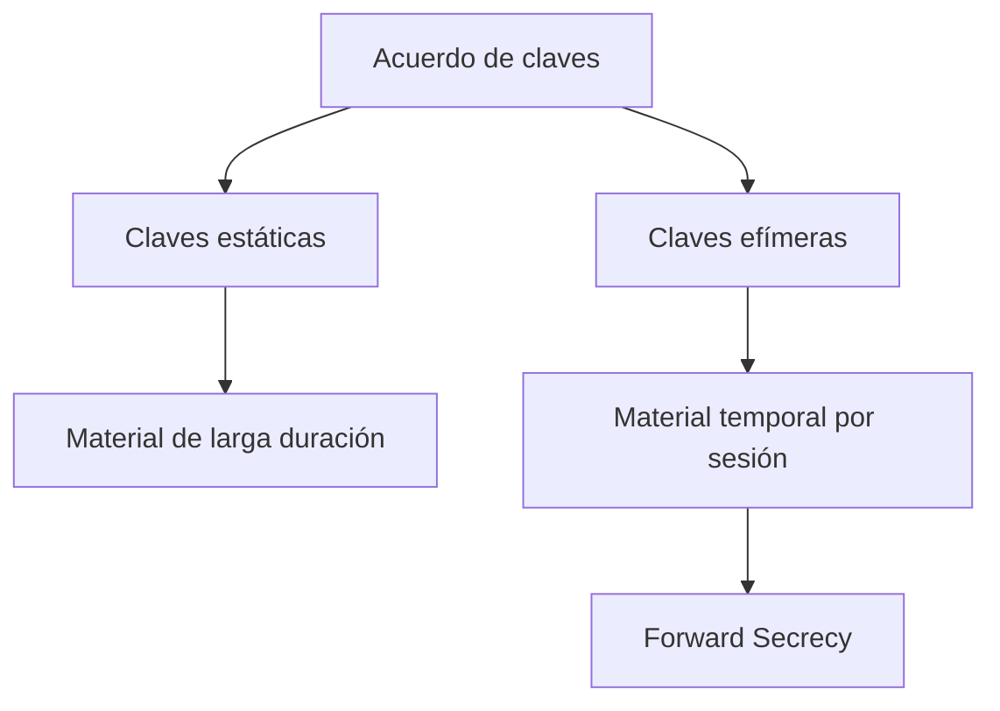
  
### Algoritmos de autenticación:  
  
En las suites históricas de TLS pueden aparecer algoritmos como:  
  
- RSA.  
- ECDSA.  
- DSA.  
  
Estos algoritmos se utilizan para comprobar firmas digitales u otras pruebas criptográficas relacionadas con la autenticidad.  
  
No deben confundirse con los algoritmos de cifrado del contenido.  
  
### Algoritmos de cifrado:  
  
Después del establecimiento de claves, la información de aplicación se protege mediante cifrado simétrico.  
  
Entre los algoritmos históricos y modernos se encuentran:  
  
- AES.  
- 3DES.  
- RC4.  
- RC2.  
  
Sin embargo, RC4, RC2 y 3DES pertenecen a tecnologías heredadas que no deben seleccionarse para nuevas configuraciones TLS.  
  
AES continúa siendo uno de los algoritmos simétricos más importantes.  
  
Puede utilizarse con diferentes modos de operación, como CBC o GCM, aunque las configuraciones modernas prefieren modos de cifrado autenticado.  
  
### Ejemplo de Cipher Suite:  
  
Considérese la siguiente suite de TLS 1.2:  
  
```text  
TLS_ECDHE_RSA_WITH_AES_128_GCM_SHA256  
```  
  
Sus componentes pueden interpretarse de la siguiente manera:  
  
| Componente | Significado |  
|---|---|  
| `TLS` | Protocolo de seguridad |  
| `ECDHE` | Intercambio de claves efímeras sobre curvas elípticas |  
| `RSA` | Autenticación mediante firma RSA |  
| `AES_128` | AES con clave de 128 bits |  
| `GCM` | Modo de cifrado autenticado |  
| `SHA256` | Función hash asociada con la construcción criptográfica de la suite |  
  
Otro ejemplo es:  
  
```text  
TLS_ECDHE_ECDSA_WITH_AES_256_CBC_SHA384  
```  
  
En este caso:  
  
- ECDHE establece el secreto de sesión.  
- ECDSA participa en la autenticación.  
- AES-256 cifra los datos.  
- CBC representa el modo de cifrado.  
- SHA-384 participa en la construcción criptográfica correspondiente.  
  
En TLS 1.3, los nombres de las suites son más sencillos porque el intercambio de claves y la autenticación se negocian de manera separada.  
  
Un ejemplo es:  
  
```text  
TLS_AES_256_GCM_SHA384  
```  
  
---  
  
## Protocolo de handshake SSL/TLS  
  
El handshake permite establecer las condiciones criptográficas necesarias antes de transmitir información de aplicación.  
  
Una de sus funciones principales es negociar los algoritmos que ambas partes pueden utilizar.  
  
### ClientHello:  
  
El cliente inicia el procedimiento enviando un mensaje denominado **ClientHello**.  
  
Este mensaje puede incluir información sobre:  
  
- Versiones soportadas.  
- Suites criptográficas compatibles.  
- Valores aleatorios.  
- Extensiones del protocolo.  
- Parámetros necesarios para el establecimiento de claves.  
  
El cliente comunica sus capacidades para que el servidor seleccione una configuración compatible.  
  
### ServerHello:  
  
El servidor responde mediante **ServerHello**.  
  
En las variantes clásicas, este mensaje indica la versión y los parámetros criptográficos seleccionados.  
  
Dependiendo de la versión y del mecanismo de autenticación, el servidor también transmite su certificado y otros mensajes necesarios.  
  
### Certificado del servidor:  
  
El cliente recibe el certificado y verifica la cadena de confianza.  
  
Esta operación permite comprobar que la clave pública utilizada para autenticar al servidor se encuentra vinculada con la identidad esperada.  
  
Una firma válida del certificado no es suficiente si el nombre del servidor no coincide o si la cadena no conduce a una autoridad confiable.  
  
### Intercambio de claves:  
  
Después de validar la información necesaria, ambas partes establecen el secreto compartido utilizando el mecanismo negociado.  
  
En una configuración histórica basada en RSA, el cliente transmite un Pre-Master Secret cifrado con la clave pública del servidor.  
  
En configuraciones basadas en DHE o ECDHE, las partes intercambian valores públicos y calculan el secreto mediante sus respectivos valores privados.  
  
### Finalización del handshake:  
  
Una vez derivadas las claves, los participantes intercambian mensajes que permiten verificar que el establecimiento de la conexión se completó correctamente.  
  
Los mensajes **Finished** proporcionan una comprobación criptográfica del estado del handshake.  
  
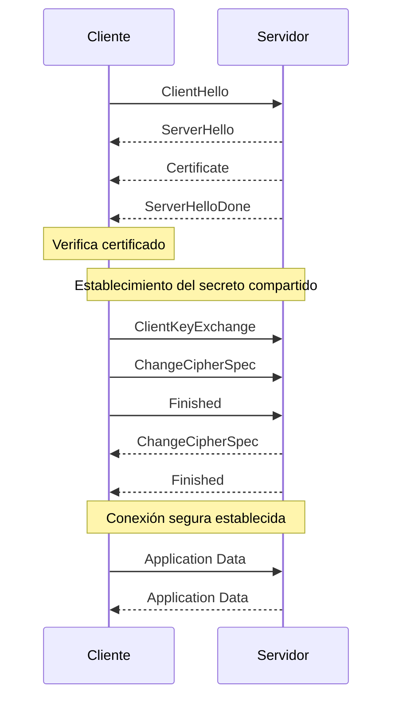
  
Este diagrama representa un intercambio clásico de TLS 1.2 basado en RSA, no el flujo de TLS 1.3.  
  
En TLS 1.3 cambia la secuencia de mensajes y gran parte del handshake se protege criptográficamente antes que en versiones anteriores.  
  
---  
  
## Capas y subprotocolos de SSL/TLS  
  
El funcionamiento clásico de SSL/TLS puede comprenderse mediante una organización de protocolos.  
  
El **Record Protocol** proporciona el mecanismo general para transportar información protegida.  
  
Sobre él funcionan diferentes subprotocolos de control.  
  
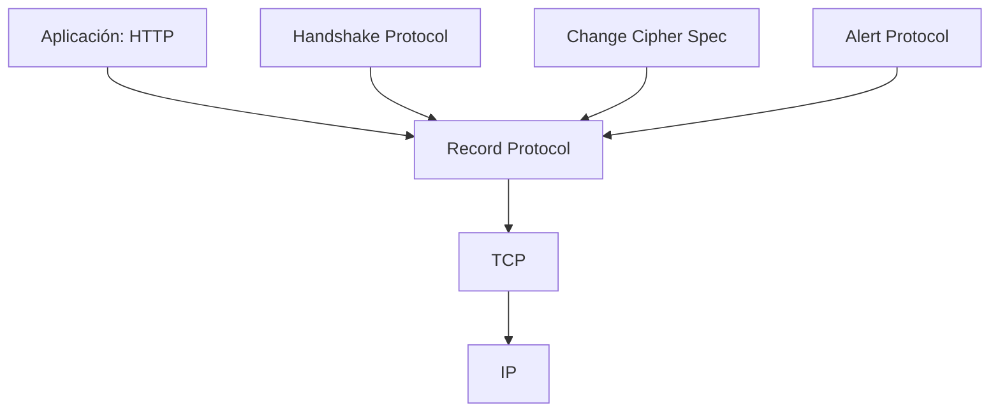
  
### Handshake Protocol:  
  
Se encarga de negociar los parámetros criptográficos de la comunicación.  
  
Sus funciones incluyen la selección de algoritmos, la autenticación y el establecimiento de material secreto.  
  
### Change Cipher Spec Protocol:  
  
En las versiones clásicas de SSL/TLS, este protocolo indica que los mensajes posteriores utilizarán las claves y parámetros criptográficos negociados.  
  
Su papel es especialmente visible en los handshakes de TLS 1.2 y versiones anteriores.  
  
TLS 1.3 administra la transición a la protección criptográfica de manera diferente.  
  
### Alert Protocol:  
  
Permite comunicar condiciones relacionadas con la seguridad o el estado de la conexión.  
  
Entre sus aplicaciones se encuentran las notificaciones de error y el cierre de una sesión.  
  
### Record Protocol:  
  
El Record Protocol se encarga de transportar los datos de aplicación y los mensajes de control.  
  
En configuraciones históricas con cifrado y MAC separados, sus operaciones principales incluyen:  
  
- Fragmentar los datos.  
- Calcular un código de autenticación.  
- Cifrar la información.  
- Construir el registro.  
- Transmitirlo al receptor.  
  
En TLS moderno, estas funciones se realizan utilizando mecanismos de cifrado autenticado.  
  
---  
  
## Transferencia de datos mediante registros  
  
Después del handshake, los datos de aplicación se transmiten mediante el **Record Protocol**.  
  
En lugar de proteger una secuencia ilimitada de bytes como una sola unidad, el protocolo organiza la información en registros.  
  
Esto permite procesar los datos progresivamente.  
  
### Fragmentación:  
  
Supóngase que una aplicación desea transmitir un mensaje de gran tamaño.  
  
El protocolo divide los datos en fragmentos.  
  
El límite clásico de contenido en texto claro por registro es:  
  
$$  
2^{14}\text{ bytes}  
$$  
  
Esto equivale a:  
  
$$  
\boxed{16\,384\text{ bytes}=16\text{ KiB}}  
$$  
  
Cada fragmento puede procesarse y protegerse de manera independiente.  
  
### Generación de un MAC:  
  
En las suites históricas que utilizan un MAC separado, el código puede depender de diferentes campos:  
  
$$  
\boxed{  
MAC=\operatorname{HMAC}  
(K_M,\ Seq\parallel Type\parallel Version\parallel Length\parallel Data)  
}  
$$  
  
En donde:  
  
- $K_M$ es la clave de autenticación.  
- $Seq$ es el número de secuencia.  
- $Type$ identifica el tipo de contenido.  
- $Version$ representa la versión del protocolo.  
- $Length$ representa la longitud.  
- $Data$ representa los datos protegidos.  
  
El número de secuencia permite vincular cada registro con su posición dentro de la comunicación.  
  
Esto contribuye a detectar alteraciones en el orden esperado de los registros.  
  
### Cifrado del registro:  
  
En una construcción clásica de tipo MAC-then-Encrypt, primero se obtiene el MAC y después se cifra el fragmento junto con la información de autenticación.  
  
Conceptualmente:  
  
$$  
C=E_K(Data\parallel MAC)  
$$  
  
Posteriormente se transmite una cabecera junto con el contenido cifrado.  
  
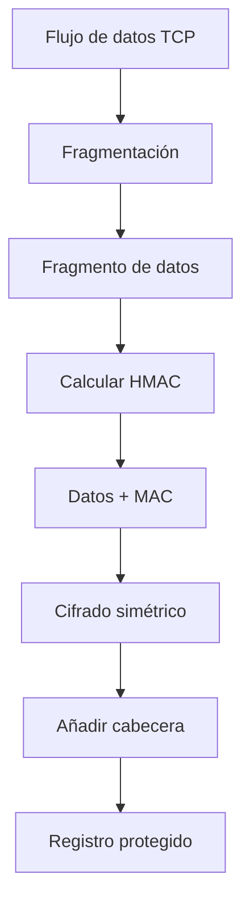
  
Este procedimiento describe el modelo clásico utilizado por determinadas suites SSL/TLS.  
  
En las suites modernas AEAD, el cifrado y la autenticación se integran dentro de una única operación criptográfica, por lo que no se añade un HMAC independiente al contenido.  
  
---  
  
## Formato de un registro SSL/TLS  
  
El formato clásico de un registro contiene una cabecera seguida del contenido protegido.  
  
Los campos principales de la cabecera son:  
  
| Campo | Tamaño | Función |  
|---|---:|---|  
| Content Type | 1 byte | Identificar el tipo de contenido |  
| Protocol Version | 2 bytes | Identificar la versión del protocolo |  
| Length | 2 bytes | Indicar la longitud del fragmento transmitido |  
  
Por lo tanto, la cabecera clásica tiene una longitud de:  
  
$$  
1+2+2=5\text{ bytes}  
$$  
  
Puede representarse de la siguiente manera:  
  
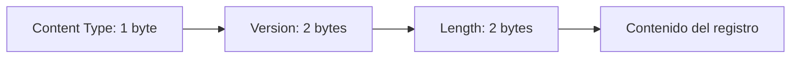
  
La cabecera permite que el receptor determine cómo interpretar los datos que siguen.  
  
### Tipos de contenido:  
  
Los valores clásicos más importantes son:  
  
| Valor | Content Type |  
|---|---|  
| 20 | `change_cipher_spec` |  
| 21 | `alert` |  
| 22 | `handshake` |  
| 23 | `application_data` |  
  
Por ejemplo, un registro con tipo 22 transporta mensajes del handshake.  
  
Un registro con tipo 23 transporta datos de aplicación o, en TLS 1.3, puede funcionar como contenedor externo de contenido cifrado.  
  
### Diferencia entre cabecera y contenido protegido:  
  
En el modelo clásico, la cabecera se transmite de manera visible para permitir interpretar el registro.  
  
El contenido interno puede estar cifrado y autenticado.  
  
Esto significa que **TLS no oculta necesariamente toda la información observable de la conexión**.  
  
Un observador todavía puede conocer información como direcciones IP, puertos, tamaños aproximados y temporización de los paquetes.  
  
La protección principal se aplica al contenido de la comunicación y a los elementos criptográficos definidos por el protocolo.  
  
---  
  
## Cierre de una conexión SSL/TLS  
  
Una conexión segura necesita un procedimiento para indicar que la transmisión ha terminado correctamente.  
  
En SSL/TLS clásico se utilizan mensajes de alerta, como **close_notify**.  
  
Este mensaje informa al otro participante que no se enviarán más datos de aplicación dentro de la conexión TLS.  
  
Después pueden utilizarse los mecanismos de cierre del transporte subyacente.  
  
En conexiones basadas en TCP, esto puede implicar segmentos con el indicador FIN.  
  
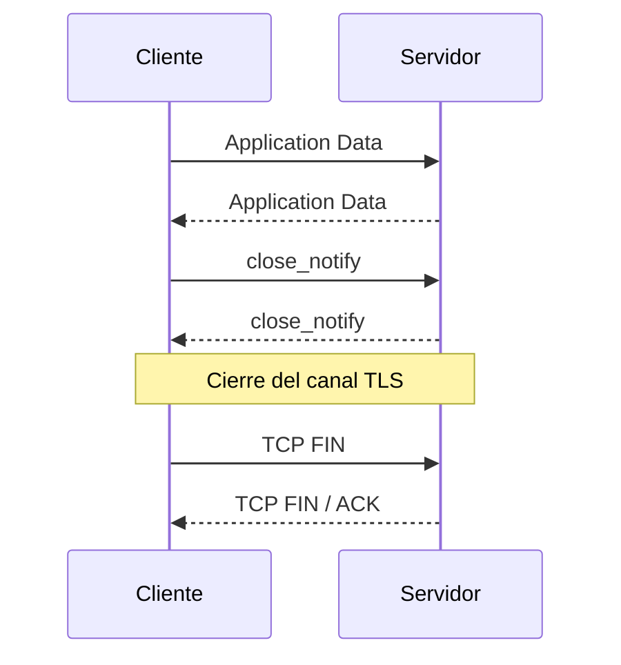
  
La secuencia exacta de cierre puede variar según la implementación y las condiciones de la conexión.  
  
El cierre criptográfico ayuda a distinguir una finalización controlada de una interrupción inesperada.  
  
---  
  
## Análisis de tráfico SSL/TLS  
  
El tráfico de una conexión segura puede estudiarse mediante herramientas de análisis de paquetes, como Wireshark.  
  
Estas herramientas permiten observar distintos niveles de información:  
  
- Direcciones IP.  
- Puertos de origen y destino.  
- Números de secuencia TCP.  
- Longitudes de segmentos.  
- Mensajes de handshake visibles.  
- Tipos de registros TLS.  
  
Sin embargo, cuando la conexión ya se encuentra protegida, el contenido de aplicación no puede interpretarse directamente sin disponer del material criptográfico apropiado.  
  
### Identificación del cliente y servidor:  
  
Supóngase que un paquete posee:  
  
```text  
Source IP: 128.238.38.162  
Destination IP: 216.75.194.220  
Destination Port: 443  
```  
  
El puerto 443 se utiliza comúnmente para HTTPS.  
  
Si el paquete pertenece al establecimiento de una conexión iniciada desde la primera dirección hacia el servidor, puede identificarse:  
  
**Cliente:**  
  
```text  
128.238.38.162  
```  
  
**Servidor:**  
  
```text  
216.75.194.220  
```  
  
**Puerto del servidor:**  
  
```text  
443  
```  
  
La identificación debe realizarse considerando la dirección de la comunicación y el contexto de los paquetes, no únicamente el número de puerto.  
  
### Interpretación de números de secuencia TCP:  
  
TCP utiliza números de secuencia para identificar las posiciones de los bytes transmitidos.  
  
Si un segmento transporta datos y no contiene indicadores que consuman espacio adicional en la secuencia, el siguiente número esperado puede calcularse como:  
  
$$  
\boxed{Seq_{\text{siguiente}}=Seq_{\text{actual}}+Length}  
$$  
  
###### Ejemplo práctico:  
  
Supóngase que un segmento TCP tiene:  
  
$$  
Seq=79  
$$  
  
Y transporta:  
  
$$  
Length=204\text{ bytes}  
$$  
  
El siguiente segmento enviado por el mismo participante comenzará normalmente con:  
  
$$  
Seq_{\text{siguiente}}=79+204  
$$  
  
$$  
\boxed{Seq_{\text{siguiente}}=283}  
$$  
  
Por lo tanto, el siguiente byte de datos transmitido utilizará el número de secuencia 283.  
  
Los indicadores SYN y FIN también consumen una posición de secuencia, por lo que deben considerarse cuando aparecen.  
  
### Interpretación de un paquete de handshake:  
  
En una captura SSL/TLS clásica puede observarse un paquete que contiene varios mensajes o registros relacionados con el handshake.  
  
Por ejemplo:  
  
```text  
Client Key Exchange  
Change Cipher Spec  
Encrypted Handshake Message  
```  
  
Estos elementos indican que el cliente está participando en el establecimiento de las claves y en la transición hacia una comunicación protegida.  
  
En un intercambio histórico RSA, el mensaje **ClientKeyExchange** puede transportar un Pre-Master Secret cifrado.  
  
Esto no significa que el Master Secret se transmita directamente.  
  
El **Master Secret** se deriva posteriormente a partir del Pre-Master Secret y otros valores del handshake.  
  
### Interpretación hexadecimal:  
  
Las herramientas de análisis pueden mostrar el contenido de los paquetes como una secuencia de bytes hexadecimales.  
  
Cada byte se representa mediante dos dígitos hexadecimales.  
  
Por ejemplo:  
  
```text  
BC  
```  
  
Representa un byte cuyo valor decimal es:  
  
$$  
11(16)+12=188  
$$  
  
Mientras que:  
  
```text  
29  
```  
  
Representa:  
  
$$  
2(16)+9=41  
$$  
  
En un ejemplo de intercambio RSA puede identificarse una secuencia de bytes correspondiente al secreto cifrado, comenzando en:  
  
```text  
BC  
```  
  
Y terminando en:  
  
```text  
29  
```  
  
Estos valores únicamente describen bytes observados en una captura particular.  
  
No representan valores constantes del protocolo ni permiten recuperar directamente el secreto original.  
  
Además, al analizar estos campos es importante distinguir la longitud de las estructuras de handshake, las longitudes de los registros y el contenido criptográfico transportado.  
  
---  
  
## Relación entre autenticación, PKI y TLS  
  
Kerberos, PKI y TLS resuelven problemas relacionados con la confianza y la protección de comunicaciones, pero sus funciones no son idénticas.  
  
**Kerberos** utiliza una entidad central de confianza para autenticar usuarios y emitir tickets.  
  
**PKI** utiliza certificados digitales y firmas criptográficas para vincular identidades con claves públicas.  
  
**TLS** utiliza mecanismos de autenticación y establecimiento de claves para construir un canal de comunicación protegido.  
  
```mermaid  
flowchart TD  
A["Seguridad de comunicaciones"] --> B["Autenticación"]  
A --> C["Administración de confianza"]  
A --> D["Protección de datos"]  
  
B --> E["Kerberos"]  
C --> F["PKI"]  
F --> G["Certificados X.509"]  
  
D --> H["TLS"]  
G --> H  
  
H --> I["Handshake"]  
H --> J["Derivación de claves"]  
H --> K["Record Protocol"]  
  
I --> L["Autenticación y negociación"]  
J --> M["Claves de sesión"]  
K --> N["Confidencialidad e integridad"]  
```  
  
En una organización, Kerberos puede utilizarse para autenticar usuarios que acceden a servicios internos.  
  
Al mismo tiempo, una aplicación web puede utilizar TLS para proteger el canal de comunicación.  
  
Una PKI puede proporcionar los certificados necesarios para autenticar los servidores.  
  
Por lo tanto, estas tecnologías pueden complementarse dentro de una arquitectura de seguridad.  
  
---  
  
## Ideas principales  
  
### Kerberos:  
  
Kerberos es un sistema de autenticación centralizada basado en tickets.  
  
Sus componentes principales son el cliente, el KDC y los servidores de servicios.  
  
El KDC contiene los servicios AS y TGS.  
  
El TGT permite solicitar tickets adicionales sin tener que repetir completamente la autenticación inicial.  
  
### Distribución de claves:  
  
En criptografía simétrica, el problema principal consiste en establecer una clave secreta compartida.  
  
En criptografía asimétrica, el problema principal consiste en comprobar que una clave pública pertenece realmente a la identidad esperada.  
  
La distribución de claves públicas sin autenticación puede permitir ataques de suplantación.  
  
### PKI:  
  
La infraestructura de clave pública administra certificados y relaciones de confianza.  
  
Sus funciones incluyen emisión, almacenamiento, distribución, renovación, verificación y revocación.  
  
Una CA firma certificados para vincular identidades con claves públicas.  
  
### X.509:  
  
X.509 define el formato de los certificados digitales de clave pública.  
  
Los campos importantes incluyen emisor, sujeto, clave pública, periodo de validez, algoritmo de firma, extensiones y firma digital.  
  
La validación requiere comprobar tanto la firma como la identidad y las condiciones de confianza.  
  
### Modelos de confianza:  
  
El modelo jerárquico utiliza una Root CA y autoridades subordinadas.  
  
Las cadenas de certificados permiten obtener claves públicas verificadas a partir de una autoridad raíz confiable.  
  
En una malla completamente conectada de $N$ autoridades, si se requiere una certificación dirigida entre cada pareja de autoridades, se necesitan:  
  
$$  
N(N-1)  
$$  
  
certificados cruzados.  
  
### TLS:  
  
TLS protege las comunicaciones proporcionando confidencialidad, integridad y autenticación.  
  
HTTPS utiliza TLS para proteger el intercambio de información web.  
  
TLS 1.3 es la versión moderna, mientras que SSL y las versiones TLS antiguas se consideran obsoletas.  
  
### Handshake:  
  
El handshake permite negociar los algoritmos, autenticar las entidades y establecer material secreto compartido.  
  
En los mecanismos clásicos basados en RSA, el cliente transmite un Pre-Master Secret cifrado.  
  
En mecanismos modernos como ECDHE, los participantes calculan un secreto compartido mediante un intercambio de claves efímeras.  
  
### Derivación de claves:  
  
Una KDF transforma material secreto en claves de sesión.  
  
En el modelo clásico con cifrado y MAC independientes pueden generarse:  
  
$$  
K_C,\quad M_C,\quad K_S,\quad M_S  
$$  
  
Cada clave protege una operación o dirección de comunicación específica.  
  
### Cipher Suites:  
  
Una Cipher Suite representa los algoritmos utilizados para proteger una conexión.  
  
En TLS 1.2 puede incluir información sobre intercambio de claves, autenticación, cifrado y hash.  
  
ECDHE permite establecer secretos utilizando claves efímeras y puede proporcionar Forward Secrecy.  
  
### Record Protocol:  
  
El Record Protocol organiza la información en registros protegidos.  
  
El tamaño máximo clásico de un fragmento de texto claro es:  
  
$$  
2^{14}=16\,384\text{ bytes}  
$$  
  
Los registros contienen cabeceras y datos protegidos mediante los mecanismos criptográficos negociados.  
  
### Análisis TCP:  
  
Los números de secuencia permiten identificar las posiciones de los bytes transmitidos.  
  
Para un segmento ordinario que transporta datos:  
  
$$  
Seq_{\text{siguiente}}=Seq_{\text{actual}}+Length  
$$  
  
Un segmento con secuencia 79 y 204 bytes de datos produce:  
  
$$  
\boxed{Seq_{\text{siguiente}}=283}  
$$  
  
---  
  
## Conclusión  
  
La seguridad de Internet depende de mecanismos capaces de establecer relaciones de confianza entre entidades que necesitan comunicarse mediante redes potencialmente inseguras. Kerberos proporciona autenticación centralizada mediante tickets, mientras que PKI utiliza certificados digitales y autoridades certificadoras para establecer relaciones verificables entre identidades y claves públicas.  
  
El estándar X.509 permite representar esta información mediante un formato común. Los modelos jerárquicos y de malla organizan las relaciones de confianza entre autoridades, mientras que los mecanismos de revocación permiten invalidar certificados que ya no deben utilizarse.  
  
SSL y TLS incorporan estos conceptos en el establecimiento de canales seguros. Durante el handshake se negocian algoritmos, se autentican entidades y se establece material secreto compartido. Posteriormente, una función de derivación genera las claves necesarias para proteger la comunicación.  
  
El Record Protocol se encarga de organizar y proteger los datos transmitidos, utilizando mecanismos de cifrado e integridad adecuados para la versión y la suite criptográfica seleccionadas. Los números de secuencia, registros y mensajes de control permiten mantener el estado de la comunicación y detectar determinadas alteraciones.  
  
Finalmente, el análisis de tráfico permite comprender cómo estos mecanismos aparecen en comunicaciones reales. Aunque el contenido cifrado no puede interpretarse directamente sin las claves apropiadas, los encabezados de transporte y los mensajes visibles del protocolo permiten estudiar el establecimiento, funcionamiento y cierre de una conexión.  
  
Por lo tanto, **la seguridad de una comunicación no depende únicamente de cifrar los datos**, sino de autenticar correctamente a las entidades, distribuir y verificar las claves, negociar algoritmos seguros y mantener la integridad de los mensajes durante toda la sesión.  