## Introducción  
  
La seguridad de las comunicaciones no se limita a proteger las conexiones entre navegadores y servidores. También es necesario garantizar que los mensajes de correo electrónico permanezcan confidenciales, que las redes inalámbricas impidan accesos no autorizados y que los paquetes IP puedan atravesar redes públicas sin comprometer su contenido.  
  
Para resolver estos problemas se utilizan diferentes tecnologías criptográficas. **Pretty Good Privacy (PGP)** y **Secure/Multipurpose Internet Mail Extensions (S/MIME)** permiten proteger el correo electrónico mediante cifrado, firmas digitales y mecanismos de administración de claves. Por otra parte, los protocolos **WEP, WPA, WPA2 y WPA3** representan la evolución de los mecanismos utilizados para autenticar dispositivos y proteger las comunicaciones Wi-Fi.  
  
Finalmente, **Internet Protocol Security (IPsec)** proporciona seguridad directamente en la capa de red. A diferencia de las soluciones que protegen aplicaciones específicas, IPsec permite proteger datagramas IP entre computadoras, routers y otros dispositivos. Esta característica lo convierte en una tecnología fundamental para construir **Virtual Private Networks (VPN)**.  
  
Aunque estas tecnologías operan en diferentes niveles, comparten objetivos criptográficos: proporcionar confidencialidad, integridad, autenticación y protección frente a determinadas formas de manipulación o repetición de mensajes.  
  
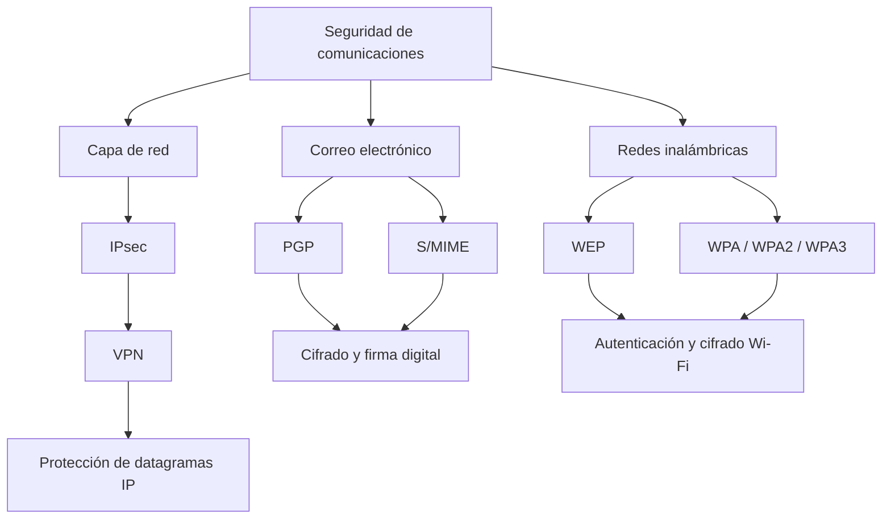
  
---  
  
## Seguridad del correo electrónico  
  
El correo electrónico es uno de los servicios de comunicación más utilizados en Internet. Permite intercambiar mensajes y archivos entre usuarios que pueden encontrarse en diferentes organizaciones y redes.  
  
Sin embargo, el correo electrónico tradicional no garantiza por sí mismo que el contenido permanezca confidencial de extremo a extremo.  
  
Un mensaje puede atravesar varios servidores antes de llegar a su destinatario. Aunque las conexiones entre estos servidores puedan estar protegidas mediante TLS, esto no significa necesariamente que el contenido permanezca cifrado frente a los propios proveedores de correo.  
  
Por esta razón, existen mecanismos específicos para proteger el contenido de los mensajes.  
  
### Propiedades de seguridad:  
  
Los sistemas de seguridad de correo electrónico buscan proporcionar cuatro propiedades principales.  
  
| Propiedad | Objetivo | Mecanismo habitual |  
|---|---|---|  
| Confidencialidad | Evitar que terceros lean el mensaje | Cifrado simétrico y criptografía asimétrica |  
| Autenticación | Comprobar la identidad criptográfica del remitente | Firmas digitales |  
| Integridad | Detectar modificaciones del contenido | Funciones hash y firmas |  
| No repudio | Proporcionar evidencia verificable de autoría | Firmas digitales |  
  
Estas propiedades no son equivalentes.  
  
Por ejemplo, un correo puede estar cifrado para que solamente Bob pueda leerlo, pero eso no demuestra necesariamente que Alice haya sido quien lo envió.  
  
De manera similar, un correo puede estar firmado digitalmente para verificar su origen, pero continuar siendo legible por cualquier intermediario si no se cifra.  
  
Por lo tanto, **cifrado y firma digital son mecanismos complementarios**.  
  
### PGP y S/MIME:  
  
Los dos enfoques principales para proteger el contenido del correo electrónico son **PGP** y **S/MIME**.  
  
**Pretty Good Privacy (PGP)** es una tecnología desarrollada originalmente por Phil Zimmermann en 1991. Permite proteger mensajes mediante cifrado, firmas digitales y administración de claves públicas. Sus formatos y operaciones se encuentran representados actualmente por estándares y herramientas compatibles con OpenPGP.  
  
**Secure/Multipurpose Internet Mail Extensions (S/MIME)** es un conjunto de estándares de seguridad de correo que incorpora mecanismos criptográficos similares, pero se integra con la infraestructura de mensajes MIME y utiliza habitualmente certificados X.509.  
  
| Característica | PGP / OpenPGP | S/MIME |  
|---|---|---|  
| Aplicación | Seguridad de mensajes y archivos | Seguridad de correo MIME |  
| Confidencialidad | Cifrado híbrido | Cifrado híbrido |  
| Integridad | Firmas digitales | Firmas digitales |  
| Autenticación | Claves públicas verificadas | Certificados y firmas |  
| Administración de confianza | Verificación de claves e identidades | Habitualmente PKI y autoridades certificadoras |  
| Entornos frecuentes | Uso personal y comunidades técnicas | Entornos empresariales y organizaciones |  
  
Ambos mecanismos pueden proporcionar funcionalidades equivalentes de seguridad, aunque difieren en la manera de representar mensajes y administrar la confianza en las claves.  
  
---  
  
## Pretty Good Privacy  
  
**Pretty Good Privacy (PGP)** combina diferentes operaciones criptográficas para proteger los mensajes.  
  
Su característica principal es que no depende de un único algoritmo. Utiliza una combinación de criptografía simétrica, criptografía asimétrica, funciones hash y firmas digitales.  
  
PGP puede proporcionar:  
  
- **Autenticación e integridad:** mediante firmas digitales.  
- **Confidencialidad:** mediante cifrado simétrico.  
- **Compresión:** para reducir el tamaño de la información antes de cifrarla.  
- **Compatibilidad con correo electrónico:** mediante codificación Radix-64.  
- **Segmentación y reconstrucción:** para manejar mensajes extensos cuando corresponde.  
  
Estas operaciones pueden utilizarse conjuntamente o de forma independiente, dependiendo de las propiedades de seguridad que se necesiten.  
  
### Cifrado híbrido:  
  
PGP utiliza un esquema de **cifrado híbrido**, que combina las ventajas de la criptografía simétrica y la asimétrica.  
  
La criptografía simétrica es eficiente para cifrar grandes cantidades de información. Sin embargo, requiere que ambas partes dispongan de una clave secreta.  
  
La criptografía asimétrica permite proteger o establecer esa clave sin que el remitente y el destinatario tengan que compartir previamente un secreto.  
  
Por lo tanto, en una operación típica de cifrado PGP:  
  
1. Se genera una clave simétrica de sesión.  
2. El mensaje se cifra utilizando esa clave.  
3. La clave de sesión se protege mediante un mecanismo de clave pública del destinatario.  
4. Se transmiten el mensaje cifrado y la información necesaria para recuperar la clave de sesión.  
  
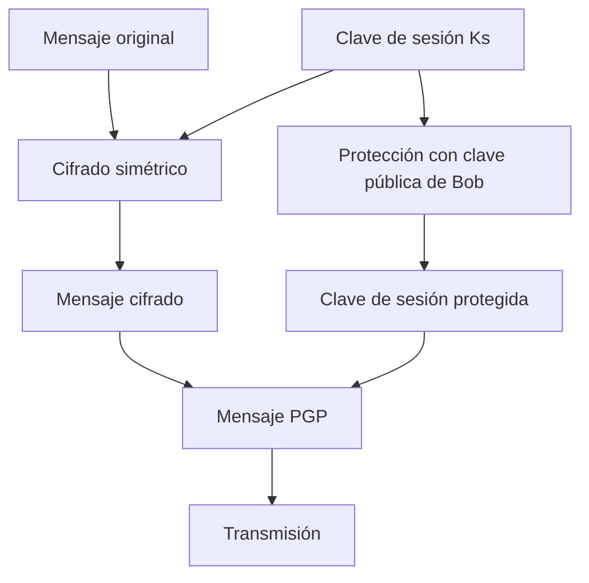
  
La principal ventaja es que la mayor parte del procesamiento del mensaje se realiza mediante cifrado simétrico, mientras que la criptografía asimétrica se utiliza para proteger el material necesario para descifrarlo.  
  
---  
  
## Firma digital y cifrado mediante PGP  
  
Supóngase que Alice desea enviar un correo electrónico a Bob.  
  
Alice necesita proporcionar simultáneamente:  
  
- Confidencialidad.  
- Autenticación del remitente.  
- Integridad del contenido.  
  
Para ello, utiliza tres claves diferentes:  
  
| Clave | Propietario o finalidad |  
|---|---|  
| $K_A^-$ | Clave privada de Alice para firmar |  
| $K_B^+$ | Clave pública de Bob para proteger la clave de sesión |  
| $K_S$ | Clave simétrica de sesión para cifrar el mensaje |  
  
La operación puede dividirse en tres etapas: firma, cifrado y recuperación.  
  
### Generación de la firma:  
  
Alice comienza con el mensaje:  
  
$$  
M  
$$  
  
Calcula su resumen mediante una función hash criptográfica:  
  
$$  
\boxed{h=H(M)}  
$$  
  
Después utiliza su clave privada para generar una firma digital:  
  
$$  
\boxed{S=\operatorname{Sign}(K_A^-,h)}  
$$  
  
La firma se vincula con el mensaje original.  
  
Conceptualmente, se obtiene:  
  
$$  
M\parallel S  
$$  
  
En donde $\parallel$ representa la concatenación o combinación estructurada de los elementos.  
  
La firma permite que Bob compruebe posteriormente que el contenido recibido corresponde al contenido firmado y que la firma fue generada mediante la clave privada asociada con Alice.  
  
### Compresión y cifrado del mensaje:  
  
Después de generar la firma, PGP puede comprimir el mensaje firmado.  
  
La operación se representa conceptualmente mediante:  
  
$$  
C=\operatorname{Compress}(M\parallel S)  
$$  
  
Posteriormente Alice genera una clave simétrica de sesión:  
  
$$  
K_S  
$$  
  
Y cifra el contenido comprimido:  
  
$$  
\boxed{E_M=E_{K_S}(C)}  
$$  
  
En donde:  
  
- $E_M$ representa el contenido cifrado.  
- $E_{K_S}$ representa el cifrado simétrico mediante la clave de sesión.  
- $C$ representa el contenido comprimido.  
  
### Protección de la clave de sesión:  
  
La clave de sesión también debe llegar a Bob.  
  
Sin embargo, enviarla directamente permitiría que cualquier observador que la obtuviera pudiera descifrar el mensaje.  
  
Por esta razón, Alice utiliza la clave pública de Bob para protegerla.  
  
En un esquema conceptual basado en cifrado asimétrico:  
  
$$  
\boxed{E_K=E_{K_B^+}(K_S)}  
$$  
  
La operación concreta depende del algoritmo de clave pública utilizado por PGP. Algunos mecanismos cifran o encapsulan la clave, mientras que otros utilizan acuerdos de claves.  
  
Finalmente, Alice transmite un mensaje PGP que contiene:  
  
$$  
\boxed{E_M\parallel E_K}  
$$  
  
Es decir, el contenido cifrado y la información protegida de la clave de sesión.  
  
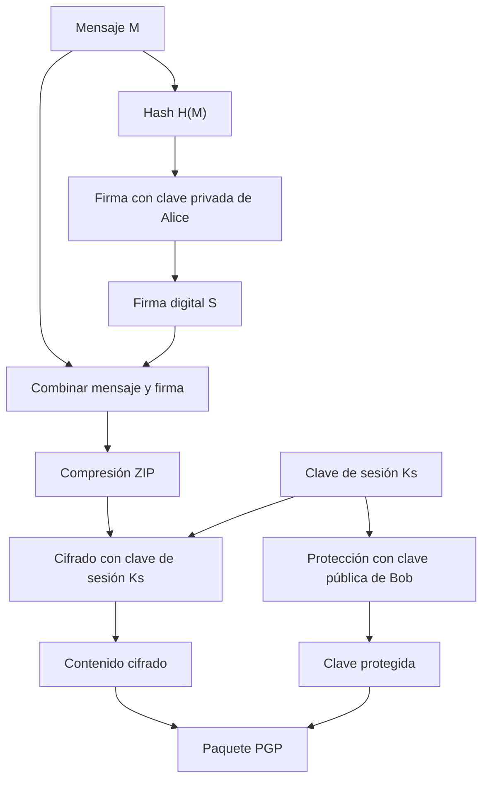
  
### Recuperación y verificación:  
  
Cuando Bob recibe el mensaje, primero utiliza su clave privada para recuperar la clave de sesión, siguiendo el mecanismo de clave pública utilizado.  
  
Después descifra el contenido mediante la clave simétrica obtenida.  
  
Conceptualmente:  
  
$$  
C=D_{K_S}(E_M)  
$$  
  
Posteriormente descomprime el contenido para recuperar el mensaje original y su firma.  
  
Bob calcula nuevamente:  
  
$$  
h'=H(M)  
$$  
  
Y verifica la firma mediante la clave pública de Alice:  
  
$$  
\boxed{\operatorname{Verify}(K_A^+,h',S)}  
$$  
  
Si la verificación es correcta, Bob obtiene evidencia criptográfica de que el mensaje corresponde al contenido firmado.  
  
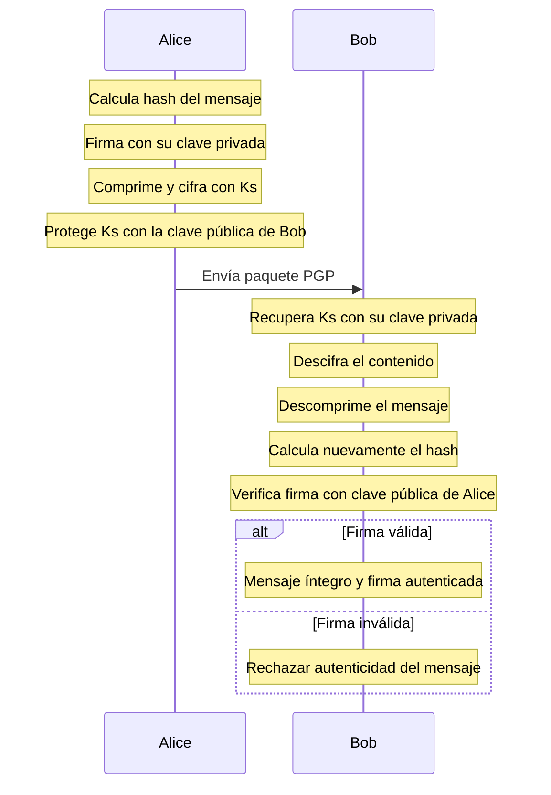
  
La verificación de la firma presupone que Bob conoce de manera confiable la clave pública de Alice. Si esa clave no ha sido autenticada, un atacante podría intentar sustituirla por otra.  
  
---  
  
## Compresión de mensajes en PGP  
  
PGP puede comprimir la información después de generar la firma digital y antes de aplicar el cifrado.  
  
La compresión tiene dos objetivos principales.  
  
Primero, permite reducir la cantidad de información que debe transmitirse.  
  
Segundo, elimina parte de la redundancia presente en el texto original, reduciendo ciertos patrones repetitivos antes de cifrar.  
  
Sin embargo, la compresión no sustituye al cifrado ni garantiza seguridad criptográfica por sí misma.  
  
### Algoritmo ZIP y técnica LZ77:  
  
La compresión puede utilizar técnicas relacionadas con **Lempel-Ziv 1977 (LZ77)**, desarrollada por Abraham Lempel y Jacob Ziv.  
  
La idea fundamental consiste en identificar secuencias repetidas dentro de un mensaje.  
  
En lugar de almacenar nuevamente una secuencia completa, el algoritmo puede representar su aparición mediante una referencia a información que ya fue procesada.  
  
Una referencia puede contener:  
  
- Un desplazamiento que indica dónde se encuentra la secuencia anterior.  
- Una longitud que indica cuántos caracteres deben reproducirse.  
  
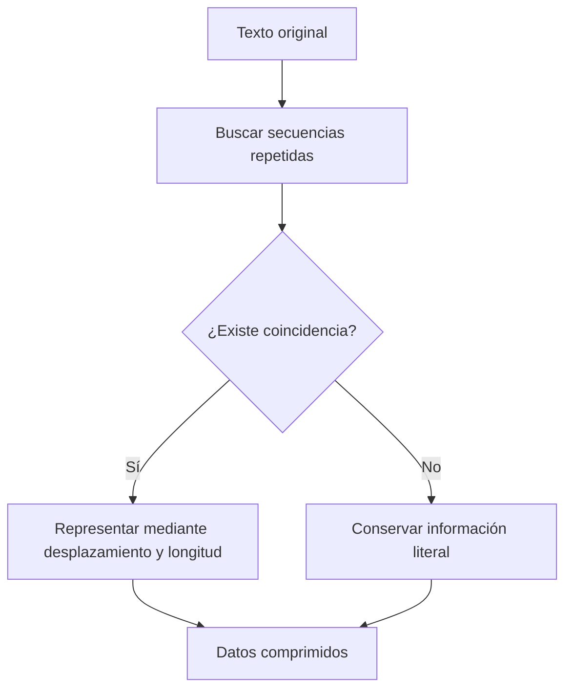
  
### Ejemplo de compresión:  
  
Supóngase que se tiene el mensaje:  
  
```text  
the brown fox jumped over the brown foxy jumping frog  
```  
  
Este mensaje contiene una secuencia repetida:  
  
```text  
the brown fox  
```  
  
Una técnica de compresión puede aprovechar la repetición almacenando una referencia a la primera aparición.  
  
Además, otras coincidencias parciales pueden representarse mediante nuevas referencias.  
  
Considérese un mensaje original de:  
  
$$  
53\text{ bytes}  
$$  
  
Su tamaño en bits es:  
  
$$  
53(8)=424\text{ bits}  
$$  
  
En un ejemplo simplificado de codificación, el resultado comprimido contiene:  
  
- 35 bytes de información literal.  
- Dos referencias de 14 bits cada una.  
  
Por lo tanto:  
  
$$  
L_C=35(8)+2(14)  
$$  
  
$$  
\boxed{L_C=308\text{ bits}}  
$$  
  
La razón de compresión es:  
  
$$  
R=\frac{L_{\text{original}}}{L_{\text{comprimido}}}  
$$  
  
Sustituyendo:  
  
$$  
R=\frac{424}{308}  
$$  
  
$$  
\boxed{R\approx1.38}  
$$  
  
Esto significa que el tamaño original es aproximadamente 1.38 veces el tamaño comprimido.  
  
La reducción relativa es:  
  
$$  
\frac{424-308}{424}\times100\%  
$$  
  
$$  
\boxed{27.36\%}  
$$  
  
Es importante observar que este cálculo representa un ejemplo simplificado de codificación. El tamaño real de un archivo comprimido también puede incluir cabeceras y otras estructuras necesarias para su reconstrucción.  
  
### Orden de las operaciones:  
  
En una operación habitual de PGP, el orden es:  
  

  
Comprimir antes de cifrar es importante porque el cifrado seguro produce información con una apariencia estadística cercana a datos aleatorios.  
  
Por lo tanto, intentar comprimir información ya cifrada normalmente ofrece poco beneficio.  
  
Además, la compresión de información que combina secretos con contenido controlado por atacantes puede introducir riesgos de canales laterales en determinados sistemas. Por ello, debe distinguirse entre el funcionamiento histórico del mecanismo y las decisiones de seguridad de una implementación.  
  
---  
  
## Compatibilidad de PGP con el correo electrónico  
  
Los mensajes PGP pueden contener datos binarios, como contenido cifrado, firmas y material criptográfico.  
  
Sin embargo, los sistemas históricos de correo electrónico fueron diseñados principalmente para transportar texto.  
  
Por esta razón, PGP utiliza una representación textual denominada **ASCII Armor**, basada en la codificación Radix-64.  
  
### Funcionamiento de Radix-64:  
  
Radix-64 representa información binaria mediante caracteres imprimibles.  
  
Su funcionamiento es similar al de Base64.  
  
La operación divide los datos en bloques de:  
  
$$  
3\text{ bytes}=24\text{ bits}  
$$  
  
Cada bloque de 24 bits se divide en cuatro grupos de seis bits:  
  
$$  
24=4(6)  
$$  
  
Cada grupo de seis bits puede representar un valor entre:  
  
$$  
0\leq x\leq63  
$$  
  
Por lo tanto, se necesitan 64 símbolos diferentes.  
  
El alfabeto utilizado contiene:  
  
- Letras mayúsculas `A-Z`.  
- Letras minúsculas `a-z`.  
- Dígitos `0-9`.  
- Símbolos `+` y `/`.  
  
El carácter `=` se utiliza como relleno cuando el número de bytes no completa un grupo de tres.  
  
### Ejemplo de codificación:  
  
Considérese la secuencia hexadecimal:  
  
```text  
23 5C 91  
```  
  
Su representación binaria es:  
  
```text  
00100011 01011100 10010001  
```  
  
Al unir los 24 bits y dividirlos en grupos de seis se obtiene:  
  
```text  
001000 110101 110010 010001  
```  
  
Estos grupos representan los valores decimales:  
  
$$  
8,\quad53,\quad50,\quad17  
$$  
  
Según el alfabeto Base64:  
  
| Decimal | Carácter |  
|---|---|  
| 8 | `I` |  
| 53 | `1` |  
| 50 | `y` |  
| 17 | `R` |  
  
Por lo tanto:  
  
$$  
\boxed{\text{235C91}\rightarrow\text{I1yR}}  
$$  
  
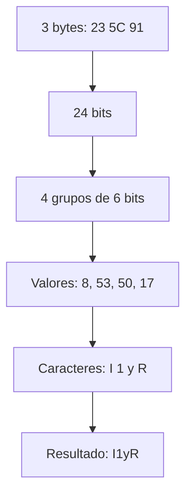
  
### Codificación con relleno:  
  
Cuando la longitud de los datos no es múltiplo de tres bytes, se utilizan caracteres de relleno.  
  
Por ejemplo, para los bytes:  
  
```text  
14 FB 9C 03 D9  
```  
  
La representación Base64 es:  
  
```text  
FPucA9k=  
```  
  
El último grupo contiene información equivalente a dos bytes y requiere un carácter `=`.  
  
Si solamente se utilizan:  
  
```text  
14 FB 9C 03  
```  
  
El resultado es:  
  
```text  
FPucAw==  
```  
  
En este caso, el último grupo representa un solo byte y necesita dos caracteres de relleno.  
  
### Representación ASCII Armor:  
  
Un mensaje PGP puede presentarse mediante una estructura textual como:  
  
```text  
-----BEGIN PGP MESSAGE-----  
  
[Contenido codificado en Radix-64]  
  
-----END PGP MESSAGE-----  
```  
  
Esta representación permite transportar información binaria utilizando caracteres compatibles con sistemas de correo y herramientas de texto.  
  
**Radix-64 no proporciona confidencialidad.** Es una codificación reversible, no un algoritmo de cifrado.  
  
La protección criptográfica procede de las operaciones realizadas antes de aplicar esta codificación.  
  
---  
  
## Seguridad en redes inalámbricas  
  
Las redes inalámbricas permiten que los dispositivos se comuniquen mediante ondas de radio sin necesidad de una conexión física.  
  
Esta característica facilita la movilidad, pero también introduce riesgos importantes.  
  
A diferencia de una conexión por cable, las señales inalámbricas pueden ser recibidas por otros dispositivos que se encuentren dentro de su alcance.  
  
Por lo tanto, una red Wi-Fi necesita mecanismos que impidan que terceros puedan acceder a sus servicios o interpretar las comunicaciones protegidas.  
  
### Wardriving:  
  
El término **Wardriving** describe la actividad de recorrer una zona para identificar redes inalámbricas disponibles.  
  
Esta actividad puede utilizarse legítimamente para realizar inventarios, estudios de cobertura y auditorías de seguridad autorizadas.  
  
Durante una exploración pueden identificarse características como:  
  
- Nombres de redes o SSID.  
- Puntos de acceso disponibles.  
- Intensidad de la señal.  
- Protocolos de seguridad anunciados.  
- Redes abiertas o configuraciones antiguas.  
  
Detectar una red inalámbrica no implica disponer de autorización para conectarse o interceptar su tráfico.  
  
La diferencia entre una auditoría legítima y una actividad no autorizada depende del permiso y del alcance establecido.  
  
### Riesgos de las redes Wi-Fi:  
  
Los principales riesgos incluyen la interceptación de señales, la suplantación de puntos de acceso, la autenticación insuficiente y el uso de protocolos criptográficos vulnerables.  
  
Estos problemas motivaron la evolución de los mecanismos de seguridad inalámbrica.  
  
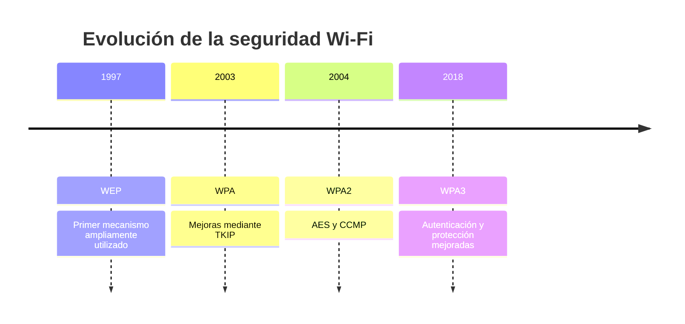
  
---  
  
## Evolución de WEP, WPA, WPA2 y WPA3  
  
Los protocolos de seguridad Wi-Fi han evolucionado para corregir debilidades criptográficas y mejorar la autenticación de dispositivos.  
  
| Protocolo | Tecnología principal | Característica |  
|---|---|---|  
| WEP | RC4 y CRC-32 | Diseño antiguo con vulnerabilidades graves |  
| WPA | TKIP y RC4 | Solución de transición para mejorar WEP |  
| WPA2 | AES-CCMP | Protección criptográfica considerablemente más robusta |  
| WPA3 | SAE y suites modernas como AES-CCMP o GCMP | Mejoras en autenticación y seguridad |  
  
WEP y WPA con TKIP se consideran tecnologías heredadas y no deben utilizarse como mecanismos de seguridad para redes nuevas.  
  
WPA2 continúa siendo ampliamente utilizado, mientras que WPA3 incorpora mejoras adicionales.  
  
### WPA-Personal:  
  
**WPA-Personal** está diseñado para redes pequeñas, domésticas y de oficinas reducidas.  
  
En sus variantes basadas en WPA2, utiliza una contraseña o clave previamente compartida, conocida como **Pre-Shared Key (PSK)**.  
  
Este modelo no necesita un servidor central de autenticación.  
  
Los dispositivos utilizan información derivada de la contraseña compartida para establecer claves criptográficas de comunicación.  
  
### WPA-Enterprise:  
  
**WPA-Enterprise** está orientado a organizaciones que necesitan autenticar usuarios o dispositivos de manera individual.  
  
Se basa en mecanismos de autenticación de red como **IEEE 802.1X**.  
  
En una implementación habitual, la infraestructura incorpora un servidor de autenticación RADIUS.  
  
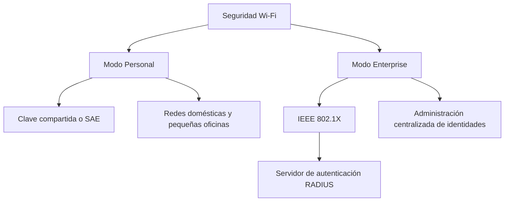
  
La diferencia principal es que el modelo Personal utiliza credenciales compartidas o acuerdos de autenticación basados en contraseña, mientras que Enterprise permite mecanismos de autenticación administrados de manera centralizada.  
  
En WPA3-Personal se utiliza **Simultaneous Authentication of Equals (SAE)**, que mejora el establecimiento de claves basado en contraseñas y ofrece resistencia frente a ciertos ataques de diccionario fuera de línea.  
  
---  
  
## Wired Equivalent Privacy  
  
**Wired Equivalent Privacy (WEP)** fue uno de los primeros mecanismos de seguridad utilizados en redes IEEE 802.11.  
  
Su objetivo consistía en proporcionar un nivel de protección comparable al de una red cableada.  
  
Sin embargo, su diseño presenta debilidades fundamentales relacionadas con la administración de claves, los vectores de inicialización y los mecanismos de integridad.  
  
### Autenticación mediante desafío:  
  
Uno de los mecanismos utilizados por WEP era la autenticación mediante una clave compartida.  
  
El procedimiento puede resumirse de la siguiente manera.  
  
Primero, un dispositivo solicita autenticarse ante el punto de acceso inalámbrico.  
  
Después, el punto de acceso genera un desafío aleatorio y lo transmite al dispositivo.  
  
El dispositivo cifra el desafío utilizando la clave WEP compartida y devuelve el resultado.  
  
Finalmente, el punto de acceso comprueba la respuesta utilizando la misma clave.  
  
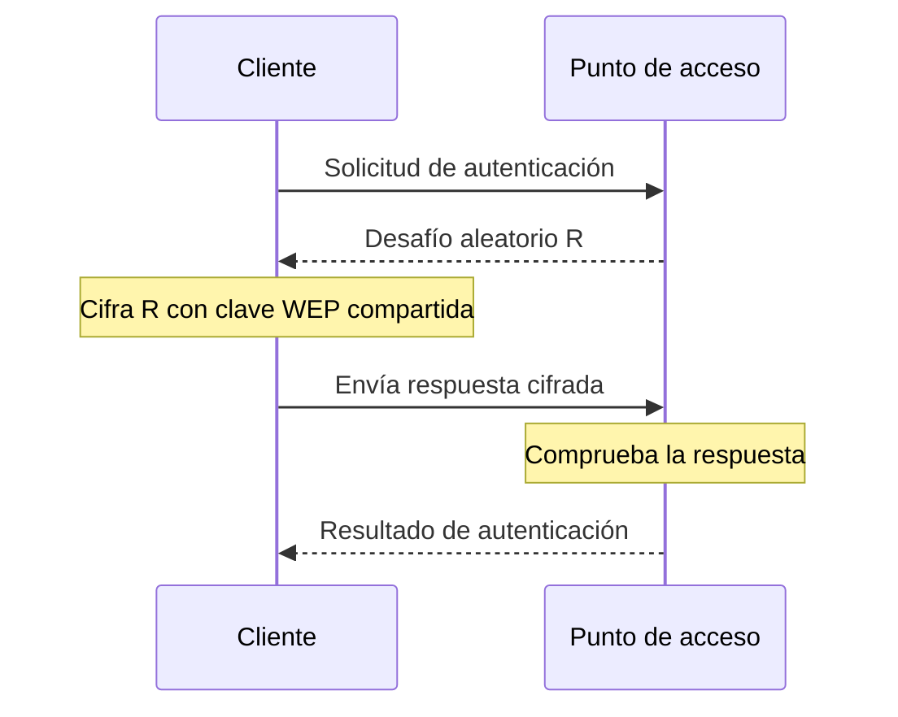
  
Conceptualmente, la respuesta puede representarse como:  
  
$$  
C=E_K(R)  
$$  
  
En donde:  
  
- $R$ es el desafío aleatorio.  
- $K$ es la clave secreta compartida.  
- $E_K$ representa el mecanismo de cifrado.  
  
El problema principal es que **conocer la clave compartida no permite identificar de manera individual al dispositivo**.  
  
Además, el mecanismo de desafío-respuesta de WEP expone información que puede facilitar ataques relacionados con su construcción criptográfica.  
  
### Problemas de administración de claves:  
  
WEP no proporciona un mecanismo robusto de distribución y renovación automática de claves.  
  
En muchas configuraciones, numerosos dispositivos utilizan la misma clave durante periodos prolongados.  
  
Esto genera diferentes problemas:  
  
- El compromiso de la clave afecta a todos los dispositivos que la comparten.  
- Es difícil atribuir acciones a usuarios individuales.  
- La renovación de claves puede requerir cambios manuales.  
- El uso prolongado de una clave incrementa la exposición a debilidades criptográficas.  
  
Estas limitaciones contribuyeron a que WEP fuera sustituido por mecanismos posteriores.  
  
---  
  
## Cifrado de datos mediante WEP  
  
WEP utiliza el cifrador de flujo **RC4** para proteger los datos transmitidos.  
  
Su mecanismo combina una clave secreta compartida con un vector de inicialización.  
  
### Clave secreta y vector de inicialización:  
  
En una configuración WEP de 128 bits nominales, se utilizan:  
  
$$  
K_S=104\text{ bits}  
$$  
  
Y un vector de inicialización:  
  
$$  
IV=24\text{ bits}  
$$  
  
La combinación tiene una longitud total de:  
  
$$  
104+24=128\text{ bits}  
$$  
  
Sin embargo, estos 128 bits no representan 128 bits de secreto independiente, porque el vector de inicialización se transmite de manera pública.  
  
El valor compuesto se utiliza como entrada para RC4:  
  
$$  
K_{\text{RC4}}=IV\parallel K_S  
$$  
  
La operación produce una secuencia de bytes denominada **keystream** o flujo de claves.  
  
### Operación de cifrado:  
  
WEP utiliza XOR para combinar cada byte de datos con el byte correspondiente del keystream.  
  
La operación es:  
  
$$  
\boxed{c_i=d_i\oplus k_i^{IV}}  
$$  
  
En donde:  
  
- $d_i$ es el byte original.  
- $k_i^{IV}$ es el byte del keystream generado a partir de la clave y el IV.  
- $c_i$ es el byte cifrado.  
  
El receptor puede recuperar el texto original aplicando nuevamente XOR con el mismo keystream:  
  
$$  
d_i=c_i\oplus k_i^{IV}  
$$  
  
Esto funciona porque:  
  
$$  
(a\oplus b)\oplus b=a  
$$  
  
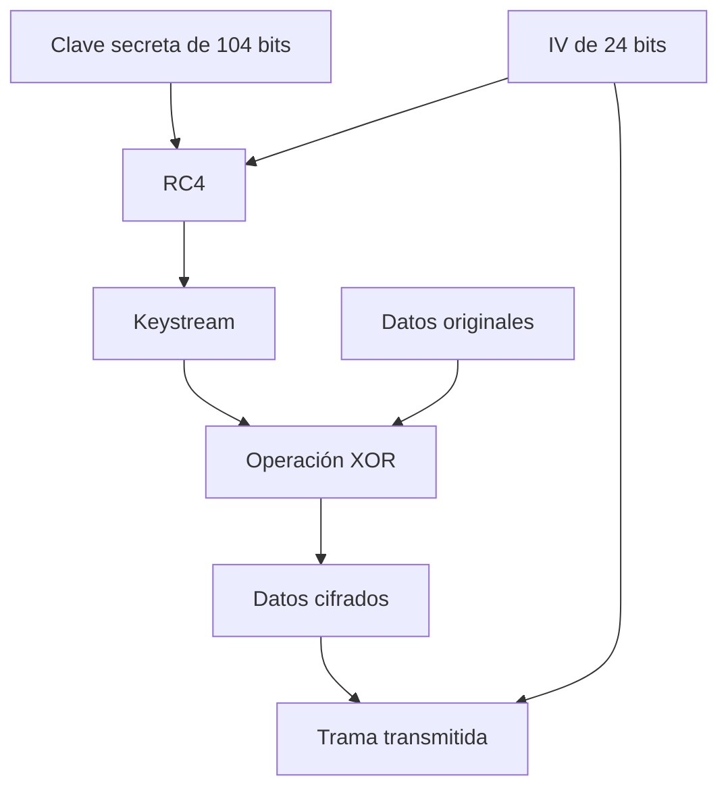
  
### Protección de integridad mediante CRC-32:  
  
Antes de cifrar la información, WEP calcula un **Integrity Check Value (ICV)** mediante CRC-32.  
  
El resultado ocupa:  
  
$$  
32\text{ bits}=4\text{ bytes}  
$$  
  
El ICV se añade al mensaje original:  
  
$$  
M'=M\parallel CRC32(M)  
$$  
  
Después se cifra mediante RC4:  
  
$$  
C=M'\oplus KS  
$$  
  
En donde $KS$ representa el keystream.  
  
El problema es que **CRC-32 no es un mecanismo criptográfico de autenticación**.  
  
Fue diseñado principalmente para detectar errores accidentales de transmisión, no modificaciones realizadas por un atacante.  
  
Debido a sus propiedades algebraicas y a la maleabilidad de XOR, WEP no ofrece una protección de integridad equivalente a un MAC criptográfico seguro.  
  
### Por qué falla WEP:  
  
WEP presenta varias debilidades estructurales.  
  
**IV demasiado pequeño:** el vector de inicialización de 24 bits puede repetirse cuando se transmite una cantidad considerable de tráfico.  
  
**Reutilización de keystream:** utilizar el mismo flujo de claves para cifrar mensajes diferentes puede revelar relaciones entre sus contenidos.  
  
**Debilidades de RC4:** la forma en que WEP utiliza RC4 permite explotar características estadísticas del cifrador y de su inicialización.  
  
**Integridad insuficiente:** CRC-32 no proporciona resistencia criptográfica frente a modificaciones deliberadas.  
  
**Administración limitada de claves:** la reutilización de claves compartidas incrementa el riesgo de compromiso.  
  
Por lo tanto, WEP no debe utilizarse para proteger redes inalámbricas actuales.  
  
---  
  
## WPA, WPA2 y WPA3  
  
Los protocolos posteriores a WEP introdujeron mejoras en la administración de claves, el cifrado y la autenticación.  
  
### WPA y TKIP:  
  
**Wi-Fi Protected Access (WPA)** fue desarrollado como una tecnología de transición para mejorar la seguridad de WEP.  
  
Uno de sus componentes fundamentales fue **Temporal Key Integrity Protocol (TKIP)**.  
  
TKIP incorporó mecanismos para mejorar el uso de claves, ampliar la información de secuenciación y proporcionar controles adicionales frente a determinadas manipulaciones.  
  
Sin embargo, todavía dependía de RC4 y actualmente se considera obsoleto.  
  
### WPA2 y CCMP:  
  
**WPA2** introdujo el uso de **Counter Mode with CBC-MAC Protocol (CCMP)**, basado en AES.  
  
CCMP proporciona confidencialidad y autenticación mediante una construcción de cifrado autenticado.  
  
El mecanismo combina:  
  
- Counter Mode para cifrar.  
- CBC-MAC para autenticar.  
  
Esto representa una mejora fundamental frente al uso de RC4 y CRC-32 en WEP.  
  
### WPA3:  
  
**WPA3** incorpora mecanismos más modernos de autenticación y protección.  
  
En WPA3-Personal, SAE reemplaza el intercambio de autenticación basado en PSK utilizado en WPA2-Personal.  
  
También existen perfiles empresariales con requisitos criptográficos más elevados.  
  
La selección exacta de algoritmos depende del modo y del perfil utilizado; no debe interpretarse que todas las redes WPA3 utilizan necesariamente el mismo tamaño de clave o la misma función hash.  
  
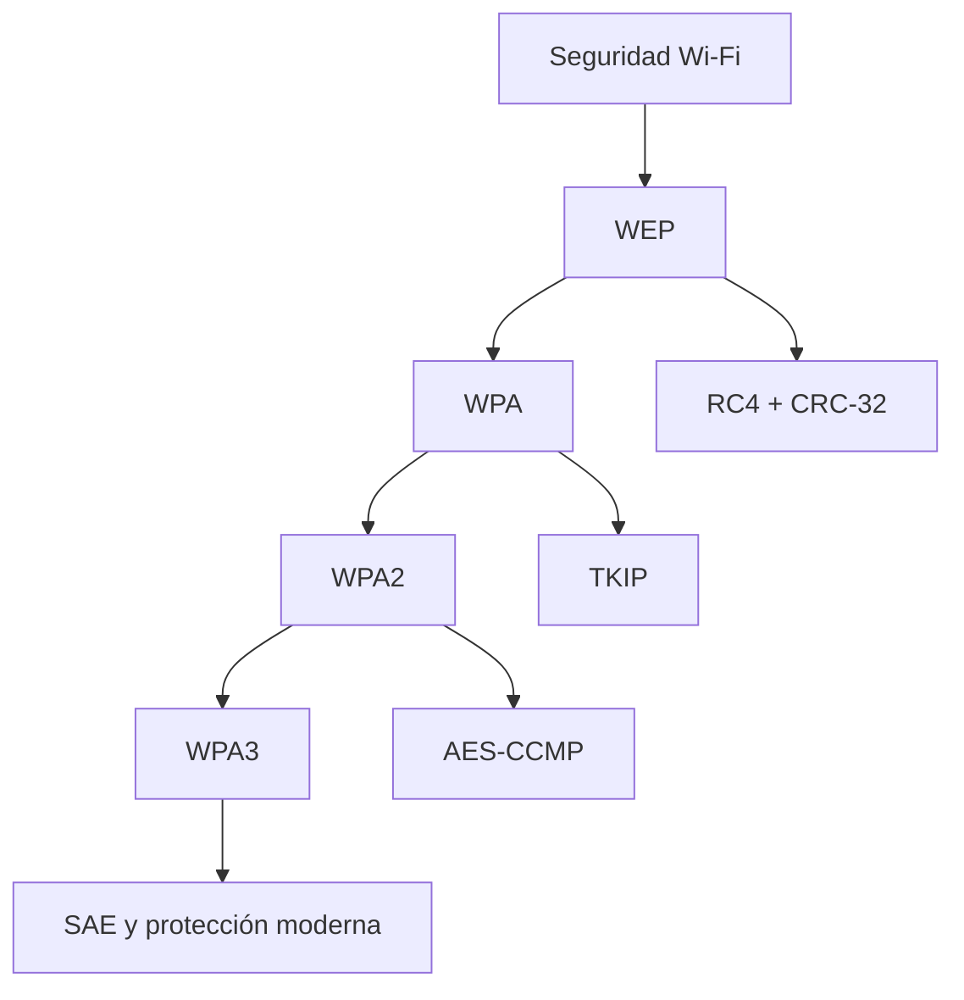
  
La evolución muestra una transición desde mecanismos de cifrado con debilidades estructurales hacia construcciones criptográficas que integran mejor autenticación, confidencialidad e integridad.  
  
---  
  
## Internet Protocol Security  
  
**Internet Protocol Security (IPsec)** es un conjunto de protocolos que proporciona mecanismos de seguridad para las comunicaciones en la capa de red.  
  
Su principal característica es que protege datagramas IP, independientemente de la aplicación que haya generado la información.  
  
A diferencia de TLS, que normalmente protege comunicaciones de aplicación sobre un transporte, IPsec se integra con el procesamiento de paquetes IP.  
  
### Problemas de seguridad en IP:  
  
El protocolo IP tradicional proporciona mecanismos para direccionar y transportar datagramas entre redes.  
  
Sin embargo, no incorpora por sí mismo garantías criptográficas generales de autenticación, confidencialidad o integridad.  
  
Por esta razón, pueden existir distintos riesgos:  
  
- **IP spoofing:** falsificación de direcciones IP de origen.  
- **Sniffing:** observación de tráfico transmitido por la red.  
- **Modificación de paquetes:** alteración no autorizada de información.  
- **Replay attacks:** reutilización de paquetes capturados previamente.  
  
IPsec incorpora mecanismos para reducir estos riesgos cuando los paquetes se encuentran dentro del tráfico protegido por sus políticas de seguridad.  
  
### Servicios de IPsec:  
  
Los servicios principales incluyen:  
  
| Servicio | Función |  
|---|---|  
| Confidencialidad | Proteger el contenido mediante cifrado |  
| Integridad | Detectar modificaciones no autorizadas |  
| Autenticación de origen | Comprobar que el tráfico procede de un participante autorizado |  
| Protección antirrepetición | Detectar paquetes repetidos mediante mecanismos de secuenciación |  
| Administración de claves | Establecer y renovar material criptográfico |  
  
IPsec está estandarizado por la IETF y se describe mediante diferentes RFC.  
  
Una de sus principales especificaciones arquitectónicas es RFC 4301.  
  
### Entidades que pueden utilizar IPsec:  
  
IPsec puede establecer protección entre diferentes tipos de dispositivos.  
  
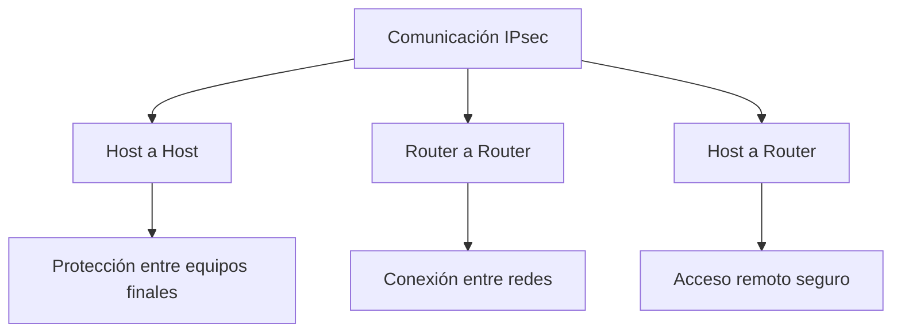
  
Una característica importante es que no todos los routers intermedios necesitan conocer IPsec.  
  
Solamente los extremos que procesan la protección IPsec deben disponer de las configuraciones y capacidades correspondientes.  
  
Los routers intermedios pueden continuar encaminando paquetes IP de manera convencional.  
  
---  
  
## Virtual Private Networks  
  
Una **Virtual Private Network (VPN)** permite establecer comunicaciones privadas sobre una infraestructura de red compartida, como Internet.  
  
Una VPN no necesita disponer de enlaces físicos dedicados entre todas las sedes.  
  
En su lugar, utiliza mecanismos criptográficos para proteger la información mientras atraviesa redes públicas.  
  
IPsec constituye una de las tecnologías utilizadas para construir estas conexiones.  
  
### VPN entre oficinas:  
  
Supóngase que una organización posee una oficina central y una sucursal.  
  
Ambas redes necesitan intercambiar información, pero están conectadas mediante Internet.  
  
Una posibilidad consiste en configurar dispositivos IPsec en los extremos de las redes.  
  
Los dispositivos establecen una conexión lógica protegida.  
  
Los equipos internos pueden transmitir información hacia la otra sede, mientras los gateways IPsec se encargan de proteger el tráfico que atraviesa Internet.  
  
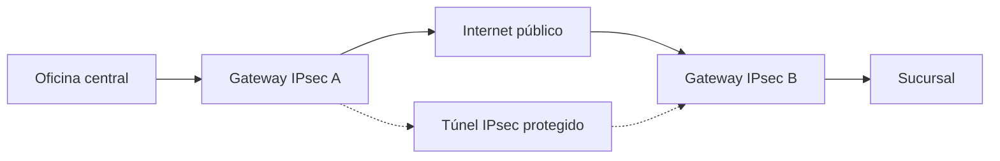
  
El tráfico interno de la organización puede viajar a través del túnel sin que los routers intermedios necesiten interpretar el contenido original.  
  
### VPN de acceso remoto:  
  
IPsec también puede utilizarse para permitir que un usuario remoto acceda a recursos de una organización.  
  
Por ejemplo, un empleado que utiliza una computadora portátil desde un hotel puede establecer una conexión IPsec con el gateway de su empresa.  
  

  
Esta arquitectura permite extender el acceso a recursos internos mediante una conexión protegida.  
  
Sin embargo, una VPN no convierte automáticamente en confiable al dispositivo remoto. La seguridad también depende de la autenticación, las políticas de acceso y el estado del equipo.  
  
---  
  
## Confidencialidad en la capa de red  
  
La confidencialidad en la capa de red consiste en proteger información contenida en datagramas IP para que no pueda ser interpretada por observadores no autorizados durante la transmisión.  
  
Supóngase que una computadora envía información de diferentes aplicaciones.  
  
El tráfico puede incluir:  
  
- Solicitudes web.  
- Mensajes de correo.  
- Transferencias de archivos.  
- Datos de protocolos de transporte.  
- Determinados mensajes de control o enrutamiento.  
  
Cuando el tráfico coincide con las políticas de protección IPsec, puede encapsularse y cifrarse antes de atravesar una red no confiable.  
  
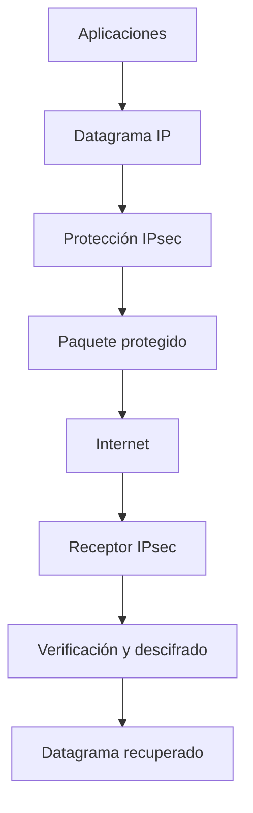
  
La información que permanece visible depende del modo y del protocolo IPsec utilizado.  
  
En particular, el cifrado no implica necesariamente ocultar todas las direcciones utilizadas para transportar el paquete.  
  
Por esta razón, es necesario distinguir los modos de operación de IPsec.  
  
---  
  
## Modos de operación de IPsec  
  
IPsec proporciona dos modos principales de operación:  
  
- **Transport Mode.**  
- **Tunnel Mode.**  
  
La diferencia fundamental se encuentra en qué parte del paquete IP recibe protección y cómo se representa el tráfico durante la transmisión.  
  
### Transport Mode:  
  
El **modo transporte** está diseñado principalmente para proteger la comunicación entre extremos que implementan IPsec.  
  
En este modo se conserva la cabecera IP original utilizada para encaminar el paquete.  
  
La protección se aplica principalmente a los datos de capas superiores.  
  
Una representación conceptual es:  
  
```text  
Paquete original:  
  
[IP Header][TCP/UDP Header][Data]  
  
Con ESP en modo transporte:  
  
[IP Header][ESP Header][Encrypted Payload][ESP Trailer][Authentication Data]  
```  
  
El contenido cifrado puede incluir la cabecera de transporte y los datos correspondientes.  
  
Sin embargo, la cabecera IP externa permanece disponible para que los routers puedan encaminar el paquete.  
  
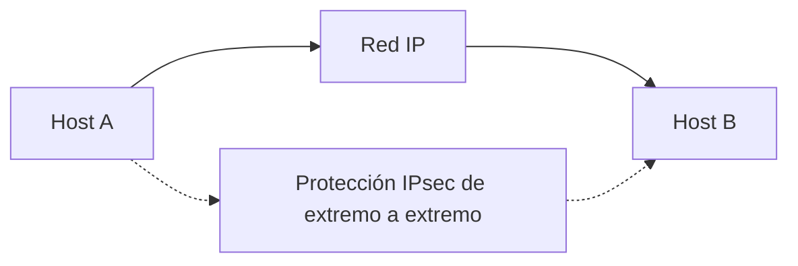
  
Este modo resulta útil cuando los propios sistemas finales administran la seguridad de la comunicación.  
  
### Tunnel Mode:  
  
El **modo túnel** protege el paquete IP original mediante encapsulación.  
  
El paquete completo se introduce dentro de otro paquete IP.  
  
Esto permite utilizar una nueva cabecera IP externa para transportar el contenido protegido a través de Internet.  
  
Conceptualmente:  
  
```text  
Paquete original:  
  
[Original IP Header][Original Payload]  
  
Con ESP en modo túnel:  
  
[New IP Header][ESP Header][Encrypted Original IP Packet][ESP Trailer][Authentication Data]  
```  
  
La nueva cabecera identifica los extremos externos del túnel.  
  
El paquete IP original permanece protegido dentro de la estructura encapsulada cuando se utiliza ESP con cifrado.  
  
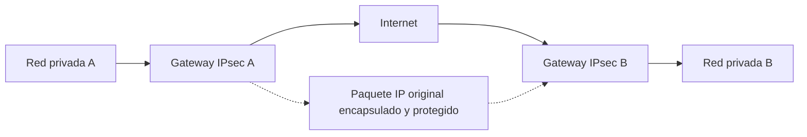
  
Este modo es especialmente importante para VPN de sitio a sitio.  
  
### Comparación entre modos:  
  
| Característica | Transport Mode | Tunnel Mode |  
|---|---|---|  
| Protección principal | Datos transportados por IP | Paquete IP interno completo |  
| Cabecera IP original | Permanece como cabecera externa | Queda encapsulada |  
| Nueva cabecera IP externa | No se añade normalmente | Sí |  
| Aplicación frecuente | Comunicación host a host | VPN y gateways |  
| Sobrecarga de encapsulación | Menor | Mayor |  
  
La elección del modo depende de la arquitectura de la red y de las políticas de seguridad.  
  
---  
  
## Protocolos AH y ESP  
  
IPsec utiliza diferentes protocolos para proporcionar servicios de seguridad.  
  
Los dos mecanismos fundamentales son:  
  
- **Authentication Header (AH).**  
- **Encapsulating Security Payload (ESP).**  
  
Aunque ambos pertenecen a IPsec, ofrecen propiedades diferentes.  
  
### Authentication Header:  
  
**AH** proporciona mecanismos de autenticación de origen e integridad mediante códigos criptográficos de autenticación.  
  
También puede incorporar protección contra ataques de repetición.  
  
Su característica más importante es que **AH no proporciona cifrado ni confidencialidad**.  
  
Por lo tanto, un paquete protegido mediante AH puede disponer de autenticación criptográfica sin que su contenido permanezca oculto.  
  
AH también puede autenticar determinados campos de la cabecera IP que no cambian durante el tránsito.  
  
### Encapsulating Security Payload:  
  
**ESP** puede proporcionar confidencialidad mediante cifrado.  
  
También puede proporcionar integridad, autenticación de origen y protección antirrepetición, dependiendo de los algoritmos y parámetros negociados.  
  
ESP se utiliza ampliamente para construir conexiones VPN.  
  
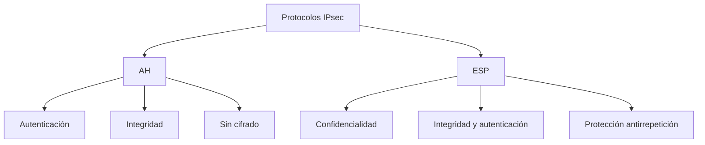
  
### Comparación de servicios:  
  
| Servicio | AH | ESP |  
|---|---|---|  
| Confidencialidad | No | Sí, cuando se utiliza cifrado |  
| Integridad | Sí | Sí, con autenticación habilitada |  
| Autenticación de origen | Sí | Sí, con autenticación habilitada |  
| Protección antirrepetición | Sí, cuando está configurada | Sí, cuando está configurada |  
| Uso habitual en VPN modernas | Poco frecuente | Muy frecuente |  
  
La principal ventaja de ESP es que permite combinar cifrado e integridad.  
  
En implementaciones modernas es habitual utilizar ESP con algoritmos de cifrado autenticado.  
  
---  
  
## AH y ESP en modo transporte y modo túnel  
  
AH y ESP pueden utilizarse en los modos transporte y túnel.  
  
La combinación determina qué información se protege.  
  
### AH en modo transporte:  
  
AH proporciona autenticación e integridad de los datos protegidos.  
  
También cubre determinados campos de la cabecera IP que pueden autenticarse de manera estable.  
  
No cifra el contenido.  
  
### ESP en modo transporte:  
  
ESP puede cifrar los datos transportados por IP.  
  
La cabecera IP externa permanece visible.  
  
Por ejemplo, en una conexión TCP protegida mediante ESP, la cabecera TCP y el contenido de aplicación pueden quedar dentro del área cifrada.  
  
### AH en modo túnel:  
  
AH encapsula y autentica un paquete IP interno completo, junto con los campos de la estructura externa que correspondan.  
  
Sin embargo, no proporciona confidencialidad.  
  
### ESP en modo túnel:  
  
ESP encapsula el paquete IP original y puede cifrarlo completamente.  
  
Esto permite ocultar las direcciones y los datos del paquete interno frente a observadores externos.  
  
La nueva cabecera IP permite encaminar el paquete entre los extremos del túnel.  
  
| Configuración | Protección principal |  
|---|---|  
| AH + Transporte | Integridad y autenticación del tráfico protegido |  
| ESP + Transporte | Cifrado y, normalmente, autenticación del contenido transportado |  
| AH + Túnel | Autenticación del paquete IP interno encapsulado |  
| ESP + Túnel | Confidencialidad e integridad del paquete IP interno |  
  
Por lo tanto, **ESP en modo túnel** resulta especialmente adecuado para conexiones VPN que necesitan proteger paquetes IP completos entre redes.  
  
---  
  
## Security Association  
  
Una **Security Association (SA)** es una asociación lógica que define los parámetros criptográficos utilizados para proteger tráfico mediante IPsec.  
  
Una SA establece qué servicios de seguridad deben aplicarse y con qué parámetros.  
  
Por ejemplo, puede especificar:  
  
- Protocolo de seguridad utilizado.  
- Algoritmos criptográficos.  
- Claves correspondientes.  
- Parámetros de secuenciación.  
- Información de identificación.  
- Tiempo de vida de la asociación.  
  
### Comunicación unidireccional:  
  
Una característica importante es que una SA de IPsec es **simplex**.  
  
Esto significa que protege tráfico en una sola dirección.  
  
Si Alice y Bob necesitan comunicarse mediante protección IPsec en ambas direcciones, normalmente se requieren dos asociaciones:  
  
$$  
SA_{A\rightarrow B}  
$$  
  
$$  
SA_{B\rightarrow A}  
$$  
  

  
Cada asociación puede tener sus propios parámetros y claves criptográficas.  
  
### Security Parameters Index:  
  
La identificación de una SA utiliza un campo denominado **Security Parameters Index (SPI)**.  
  
El SPI permite que el receptor determine qué asociación debe utilizar para procesar un paquete protegido.  
  
La identificación de una SA considera también el protocolo de seguridad y la dirección IP de destino correspondiente.  
  
El receptor utiliza esta información para localizar los parámetros criptográficos necesarios.  
  
```mermaid  
flowchart TD  
A["Paquete IPsec recibido"] --> B["Identificar SPI"]  
B --> C["Localizar Security Association"]  
C --> D["Obtener parámetros criptográficos"]  
D --> E["Verificar autenticidad"]  
E --> F["Descifrar si corresponde"]  
F --> G["Entregar contenido protegido"]  
```  
  
Las SA constituyen un elemento fundamental porque permiten que los extremos administren de manera consistente la seguridad aplicada al tráfico.  
  
---  
  
## Relación entre PGP, seguridad Wi-Fi e IPsec  
  
Las tecnologías estudiadas proporcionan seguridad en diferentes niveles de comunicación.  
  
PGP protege principalmente el contenido de mensajes y archivos.  
  
Los protocolos de seguridad Wi-Fi protegen las comunicaciones inalámbricas entre dispositivos y puntos de acceso.  
  
IPsec protege datagramas a nivel de red.  
  
Esta diferencia permite que puedan utilizarse simultáneamente.  
  
Por ejemplo, una computadora conectada mediante WPA3 podría establecer una VPN IPsec y enviar un correo cifrado mediante PGP.  
  
En este escenario, cada tecnología protege una parte diferente de la comunicación.  
  
```mermaid  
flowchart TD  
A["Correo protegido con PGP"] --> B["Tráfico IP"]  
B --> C["Túnel IPsec"]  
C --> D["Conexión Wi-Fi protegida"]  
D --> E["Red de acceso"]  
E --> F["Internet"]  
```  
  
La protección Wi-Fi actúa sobre el enlace inalámbrico.  
  
IPsec puede proteger el tráfico mientras atraviesa redes IP entre los extremos configurados.  
  
PGP mantiene protegido el contenido del mensaje incluso después de que este haya sido transportado hasta el sistema de correo del destinatario, siempre que se conserven las propiedades y claves correspondientes.  
  
### Comparación general:  
  
| Tecnología | Nivel principal | Función |  
|---|---|---|  
| PGP | Mensaje o aplicación | Cifrado y firmas de contenido |  
| S/MIME | Mensaje o aplicación | Seguridad de correo mediante MIME y certificados |  
| WEP | Enlace inalámbrico | Protección Wi-Fi obsoleta |  
| WPA/WPA2/WPA3 | Enlace inalámbrico | Autenticación y cifrado Wi-Fi |  
| IPsec | Red | Protección de datagramas IP |  
| VPN IPsec | Red | Comunicación privada mediante túneles |  
  
Ninguna de estas tecnologías reemplaza automáticamente a todas las demás.  
  
Su utilidad depende del tipo de información, la capa de comunicación y las entidades que deben protegerse.  
  
---  
  
## Ideas principales  
  
### Seguridad del correo electrónico:  
  
PGP y S/MIME permiten proporcionar confidencialidad, autenticación, integridad y mecanismos de firma digital a mensajes de correo electrónico.  
  
Ambos pueden utilizar cifrado híbrido, combinando criptografía simétrica y asimétrica.  
  
### Funcionamiento de PGP:  
  
PGP puede firmar el mensaje mediante la clave privada del remitente, comprimirlo y cifrarlo utilizando una clave simétrica de sesión.  
  
La clave de sesión se protege mediante un mecanismo de clave pública del destinatario.  
  
El receptor recupera la clave, descifra el mensaje y verifica la firma mediante la clave pública del remitente.  
  
### Compresión:  
  
PGP puede utilizar técnicas relacionadas con ZIP y LZ77.  
  
La compresión aprovecha secuencias repetidas para reducir el tamaño de la información.  
  
En un ejemplo de 424 bits que se reduce a 308 bits:  
  
$$  
R=\frac{424}{308}\approx1.38  
$$  
  
La compresión se aplica normalmente antes del cifrado.  
  
### Radix-64:  
  
Radix-64 permite representar datos binarios mediante caracteres imprimibles.  
  
Cada grupo de 24 bits se divide en cuatro grupos de seis bits.  
  
Por ejemplo:  
  
$$  
\boxed{\text{235C91}\rightarrow\text{I1yR}}  
$$  
  
Radix-64 es una codificación, no un mecanismo de cifrado.  
  
### Seguridad Wi-Fi:  
  
La evolución principal de los mecanismos inalámbricos es:  
  
$$  
\text{WEP}\rightarrow\text{WPA}\rightarrow\text{WPA2}\rightarrow\text{WPA3}  
$$  
  
WEP utiliza RC4 y CRC-32, pero presenta graves debilidades criptográficas.  
  
WPA introdujo mejoras mediante TKIP.  
  
WPA2 utiliza mecanismos modernos como AES-CCMP.  
  
WPA3 incorpora mejoras de autenticación y protección.  
  
### WPA-Personal y WPA-Enterprise:  
  
WPA-Personal se utiliza principalmente en redes pequeñas y no requiere necesariamente un servidor central de autenticación.  
  
WPA-Enterprise utiliza mecanismos como IEEE 802.1X y servidores de autenticación RADIUS.  
  
### Fallas de WEP:  
  
En una configuración nominal de 128 bits, WEP utiliza:  
  
$$  
104\text{ bits de clave}+24\text{ bits de IV}  
$$  
  
El cifrado se realiza mediante:  
  
$$  
\boxed{c_i=d_i\oplus k_i^{IV}}  
$$  
  
Las principales debilidades se relacionan con la reutilización de vectores de inicialización, el uso de RC4, la administración de claves y el uso de CRC-32 como comprobación de integridad.  
  
### IPsec:  
  
IPsec protege datagramas IP y puede proporcionar confidencialidad, integridad, autenticación y protección antirrepetición.  
  
Puede utilizarse entre computadoras, routers o combinaciones de ambos.  
  
### VPN:  
  
Una VPN IPsec permite proteger comunicaciones sobre redes públicas.  
  
Puede utilizarse para conectar diferentes oficinas o proporcionar acceso remoto a una red corporativa.  
  
### Modos de IPsec:  
  
El modo transporte protege principalmente el contenido transportado por IP, conservando la cabecera externa original.  
  
El modo túnel encapsula el paquete IP original dentro de un nuevo paquete.  
  
El modo túnel es especialmente importante para VPN.  
  
### AH y ESP:  
  
AH proporciona autenticación e integridad, pero no confidencialidad.  
  
ESP puede proporcionar cifrado y autenticación.  
  
ESP en modo túnel permite proteger el paquete IP interno completo.  
  
### Security Association:  
  
Una SA define los parámetros criptográficos utilizados para proteger una dirección de comunicación.  
  
Es una asociación simplex.  
  
Para establecer tráfico protegido en ambas direcciones normalmente se requieren dos SA diferentes.  
  
---  
  
## Conclusión  
  
La seguridad de las comunicaciones depende de aplicar mecanismos criptográficos en los niveles donde se encuentran los riesgos. El correo electrónico necesita protección del contenido y mecanismos de autenticación que permitan comprobar el origen y la integridad de los mensajes. PGP y S/MIME resuelven estas necesidades combinando criptografía simétrica, criptografía asimétrica, funciones hash y firmas digitales.  
  
PGP demuestra la importancia del cifrado híbrido, ya que permite utilizar la eficiencia de los algoritmos simétricos sin renunciar a las ventajas de la criptografía asimétrica para proteger las claves de sesión. La compresión y la codificación Radix-64 complementan este proceso al facilitar el almacenamiento y transporte de la información.  
  
En las redes inalámbricas, la evolución desde WEP hasta WPA3 muestra cómo las debilidades de diseño pueden comprometer un protocolo incluso cuando utiliza algoritmos de cifrado conocidos. La seguridad no depende únicamente de cifrar los datos, sino también de administrar correctamente las claves, utilizar valores de inicialización apropiados y proporcionar mecanismos criptográficos seguros de autenticación e integridad.  
  
Por su parte, IPsec extiende la protección a la capa de red, permitiendo asegurar datagramas IP sin depender de la aplicación que los haya generado. Sus modos transporte y túnel proporcionan diferentes alternativas de encapsulación, mientras que AH, ESP y las asociaciones de seguridad determinan las propiedades criptográficas aplicadas.  
  
Finalmente, estas tecnologías no son excluyentes. Una misma comunicación puede utilizar seguridad Wi-Fi, un túnel IPsec y cifrado de contenido mediante PGP. Cada mecanismo aporta protección en un nivel diferente, por lo que una arquitectura segura debe seleccionar y combinar sus componentes de acuerdo con los riesgos, los requisitos de autenticación y las necesidades de confidencialidad e integridad.  