## Introducción  
  
La seguridad informática busca proteger la información y las comunicaciones frente a accesos no autorizados, modificaciones, suplantaciones y otros ataques. Para conseguirlo, utiliza mecanismos criptográficos, protocolos de autenticación y sistemas de administración de claves.  
  
Los temas del parcial se relacionan mediante una idea fundamental: **no basta con cifrar la información para garantizar que una comunicación sea segura**. También es necesario verificar quién participa, comprobar que los mensajes no han cambiado y establecer las claves criptográficas de manera confiable.  
  
Los contenidos se organizan en tres áreas:  
  
1. **Fundamentos criptográficos:** curvas elípticas, ECDH, funciones hash, MAC, SHA-512 y firmas digitales.  
2. **Autenticación y protocolos de Internet:** Kerberos, PKI, certificados X.509, SSL/TLS y HTTPS.  
3. **Seguridad de comunicaciones:** PGP, S/MIME, seguridad Wi-Fi, IPsec y VPN.  
  
En cada área es importante comprender los conceptos, las operaciones matemáticas y las relaciones entre protocolos. El objetivo no consiste solamente en memorizar definiciones, sino en identificar qué mecanismo debe utilizarse en cada situación y explicar por qué proporciona determinada propiedad de seguridad.  
  
---  
  
## Propiedades fundamentales de seguridad  
  
Antes de estudiar los algoritmos y protocolos es necesario distinguir las propiedades que estos buscan proporcionar.  
  
### Confidencialidad:  
  
La **confidencialidad** impide que entidades no autorizadas conozcan el contenido de la información.  
  
Por ejemplo, cuando Alice envía un mensaje cifrado a Bob, un atacante que intercepte el contenido no debería poder interpretarlo sin las claves correspondientes.  
  
La confidencialidad se obtiene normalmente mediante **cifrado**, ya sea simétrico o asimétrico.  
  
### Integridad:  
  
La **integridad** permite detectar modificaciones no autorizadas de la información.  
  
Supóngase que Alice envía una transferencia de $500$ pesos y un atacante modifica el mensaje para indicar $5000$ pesos.  
  
Un mecanismo de integridad debe permitir que el receptor detecte la modificación.  
  
Las funciones hash, los MAC y las firmas digitales participan en diferentes mecanismos de comprobación de integridad.  
  
### Autenticación:  
  
La **autenticación** permite comprobar la identidad de una entidad o el origen de un mensaje.  
  
Por ejemplo, un certificado digital puede ayudar a comprobar que la clave pública utilizada en una conexión pertenece al servidor esperado.  
  
La autenticación también puede realizarse mediante contraseñas, tickets, claves compartidas o firmas digitales.  
  
### No repudio:  
  
El **no repudio** busca proporcionar evidencia verificable que dificulte que una entidad niegue haber realizado determinada operación.  
  
Las firmas digitales pueden contribuir a esta propiedad porque la capacidad de firmar está asociada con una clave privada.  
  
Sin embargo, la evidencia depende también de la protección de la clave, de su vinculación con una identidad y de las condiciones del sistema.  
  
### Diferencias fundamentales:  
  
| Mecanismo | Confidencialidad | Integridad | Autenticación | No repudio |  
|---|---|---|---|---|  
| Cifrado convencional | Sí | No necesariamente | No necesariamente | No |  
| Hash sin protección | No | Detecta cambios al comparar con un hash confiable | No | No |  
| MAC | No | Sí | Sí, entre quienes conocen la clave | No |  
| Firma digital | No | Sí | Sí | Puede contribuir |  
| Cifrado autenticado | Sí | Sí | Sí, respecto a la clave compartida | No |  
  
**Pregunta fundamental de examen:** ¿por qué una función hash no garantiza autenticación?  
  
Porque un atacante que modifica el mensaje también puede calcular un nuevo hash. Se necesita proteger criptográficamente el resumen o utilizar un mecanismo que dependa de una clave secreta.  
  
---  
  
## Criptografía simétrica y asimétrica  
  
La criptografía simétrica utiliza una misma clave secreta compartida para proteger y recuperar información.  
  
En un esquema conceptual:  
  
$$  
C=E_K(M)  
$$  
  
$$  
M=D_K(C)  
$$  
  
En donde:  
  
- $M$ es el mensaje.  
- $C$ es el texto cifrado.  
- $K$ es la clave secreta.  
- $E$ representa el cifrado.  
- $D$ representa el descifrado.  
  
AES es un ejemplo importante de algoritmo simétrico.  
  
La criptografía asimétrica utiliza un par de claves:  
  
$$  
(K^+,K^-)  
$$  
  
La clave pública puede distribuirse, mientras que la clave privada debe mantenerse secreta.  
  
Entre sus aplicaciones se encuentran el cifrado de claves, las firmas digitales y los mecanismos de acuerdo de claves.  
  
| Característica | Simétrica | Asimétrica |  
|---|---|---|  
| Claves | Secreto compartido | Pública y privada |  
| Rendimiento | Generalmente más eficiente para grandes datos | Generalmente más costosa |  
| Principal dificultad | Distribuir el secreto | Autenticar claves públicas |  
| Ejemplos | AES | RSA, ECC |  
  
En los sistemas modernos se utiliza frecuentemente **criptografía híbrida**, donde la criptografía asimétrica establece o protege una clave de sesión y la criptografía simétrica cifra el contenido.  
  
---  
  
## Elliptic Curve Cryptography  
  
**Elliptic Curve Cryptography (ECC)** utiliza operaciones matemáticas sobre puntos de curvas elípticas para construir mecanismos de criptografía asimétrica.  
  
Su principal ventaja es proporcionar niveles elevados de seguridad mediante claves relativamente pequeñas.  
  
Por ejemplo, una clave ECC de 256 bits puede proporcionar aproximadamente el nivel de seguridad clásico de una clave RSA de 3072 bits.  
  
Esta eficiencia resulta útil en TLS, firmas digitales, dispositivos móviles, sistemas IoT y aplicaciones de criptografía asimétrica.  
  
### Ecuación de una curva elíptica:  
  
La ecuación habitual de una curva elíptica es:  
  
$$  
y^2=x^3+ax+b  
$$  
  
Para aplicaciones criptográficas se utiliza normalmente un campo finito:  
  
$$  
\boxed{y^2\equiv x^3+ax+b\pmod p}  
$$  
  
En donde:  
  
- $p$ es un número primo.  
- $a$ y $b$ son parámetros de la curva.  
- $x$ y $y$ son las coordenadas de un punto.  
- Las operaciones se realizan módulo $p$.  
  
Por ejemplo:  
  
$$  
E:y^2\equiv x^3+2x+2\pmod{17}  
$$  
  
Esta curva utiliza el campo finito:  
  
$$  
\mathbb Z_{17}=\{0,1,\ldots,16\}  
$$  
  
Solamente pertenecen a la curva los puntos cuyas coordenadas satisfacen la ecuación modular.  
  
### Condición de no singularidad:  
  
Una curva debe satisfacer:  
  
$$  
\boxed{4a^3+27b^2\not\equiv0\pmod p}  
$$  
  
Esta condición garantiza que la curva no presente singularidades incompatibles con la estructura matemática utilizada.  
  
### Suma de puntos:  
  
Dados:  
  
$$  
P=(x_1,y_1)  
$$  
  
$$  
Q=(x_2,y_2)  
$$  
  
se busca calcular:  
  
$$  
R=P+Q  
$$  
  
Para puntos con coordenadas $x$ diferentes, la pendiente modular es:  
  
$$  
\boxed{s=(y_2-y_1)(x_2-x_1)^{-1}\pmod p}  
$$  
  
Las coordenadas resultantes se obtienen mediante:  
  
$$  
\boxed{x_3=s^2-x_1-x_2\pmod p}  
$$  
  
$$  
\boxed{y_3=s(x_1-x_3)-y_1\pmod p}  
$$  
  
En aritmética modular no se realiza una división convencional. El inverso multiplicativo permite efectuar la operación equivalente.  
  
### Duplicación de puntos:  
  
Cuando se desea calcular:  
  
$$  
2P=P+P  
$$  
  
la pendiente cambia a:  
  
$$  
\boxed{s=(3x_1^2+a)(2y_1)^{-1}\pmod p}  
$$  
  
Después se utilizan las mismas expresiones para calcular las coordenadas del resultado.  
  
### Ejemplo práctico:  
  
Considérese:  
  
$$  
E:y^2\equiv x^3+2x+2\pmod{17}  
$$  
  
Con:  
  
$$  
P=(5,1)  
$$  
  
Se desea calcular:  
  
$$  
2P  
$$  
  
La pendiente es:  
  
$$  
s=(3(5)^2+2)(2(1))^{-1}\pmod{17}  
$$  
  
Como:  
  
$$  
2^{-1}\equiv9\pmod{17}  
$$  
  
se obtiene:  
  
$$  
s=77(9)\pmod{17}  
$$  
  
$$  
\boxed{s=13}  
$$  
  
Primera coordenada:  
  
$$  
x_3=13^2-5-5\pmod{17}  
$$  
  
$$  
x_3=159\pmod{17}  
$$  
  
$$  
\boxed{x_3=6}  
$$  
  
Segunda coordenada:  
  
$$  
y_3=13(5-6)-1\pmod{17}  
$$  
  
$$  
y_3=-14\pmod{17}  
$$  
  
$$  
\boxed{y_3=3}  
$$  
  
Por lo tanto:  
  
$$  
\boxed{2P=(6,3)}  
$$  
  
### Multiplicación escalar:  
  
La operación principal de ECC consiste en multiplicar un punto por un número entero:  
  
$$  
kP=\underbrace{P+P+\cdots+P}_{k\text{ veces}}  
$$  
  
Por ejemplo:  
  
$$  
3P=P+P+P  
$$  
  
La seguridad depende de que calcular $Q=kP$ sea eficiente, mientras que recuperar $k$ conociendo $P$ y $Q$ sea computacionalmente difícil para parámetros seguros.  
  
Este problema se denomina **Elliptic Curve Discrete Logarithm Problem (ECDLP)**.  
  
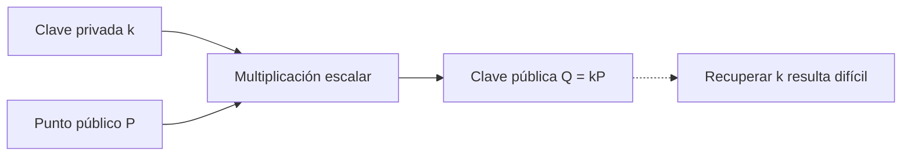
  
### Orden de un punto:  
  
Si un punto tiene orden $n$, entonces:  
  
$$  
nP=\mathcal O  
$$  
  
En donde $\mathcal O$ representa el punto en el infinito, que funciona como elemento identidad.  
  
Para el ejemplo de la curva sobre $\mathbb Z_{17}$:  
  
$$  
19P=\mathcal O  
$$  
  
Por lo tanto, los múltiplos de $P$ forman un grupo cíclico de orden 19.  
  
El inverso de $kP$ es:  
  
$$  
-(kP)=(n-k)P  
$$  
  
Por ejemplo:  
  
$$  
P+18P=\mathcal O  
$$  
  
**Para el examen:** debe distinguirse la suma de puntos, la duplicación y la multiplicación escalar. La diferencia principal entre las primeras dos operaciones es la fórmula de la pendiente.  
  
---  
  
## Elliptic Curve Diffie-Hellman  
  
**Elliptic Curve Diffie-Hellman (ECDH)** permite que dos participantes establezcan un secreto compartido mediante operaciones sobre curvas elípticas.  
  
El secreto no necesita transmitirse directamente.  
  
### Funcionamiento:  
  
Alice selecciona una clave privada:  
  
$$  
a  
$$  
  
Y calcula:  
  
$$  
A=aP  
$$  
  
Bob selecciona:  
  
$$  
b  
$$  
  
Y calcula:  
  
$$  
B=bP  
$$  
  
Las claves públicas $A$ y $B$ se intercambian.  
  
Alice calcula:  
  
$$  
T_{AB}=aB  
$$  
  
Bob calcula:  
  
$$  
T_{BA}=bA  
$$  
  
Como:  
  
$$  
a(bP)=b(aP)  
$$  
  
ambos obtienen:  
  
$$  
\boxed{T=abP}  
$$  
  
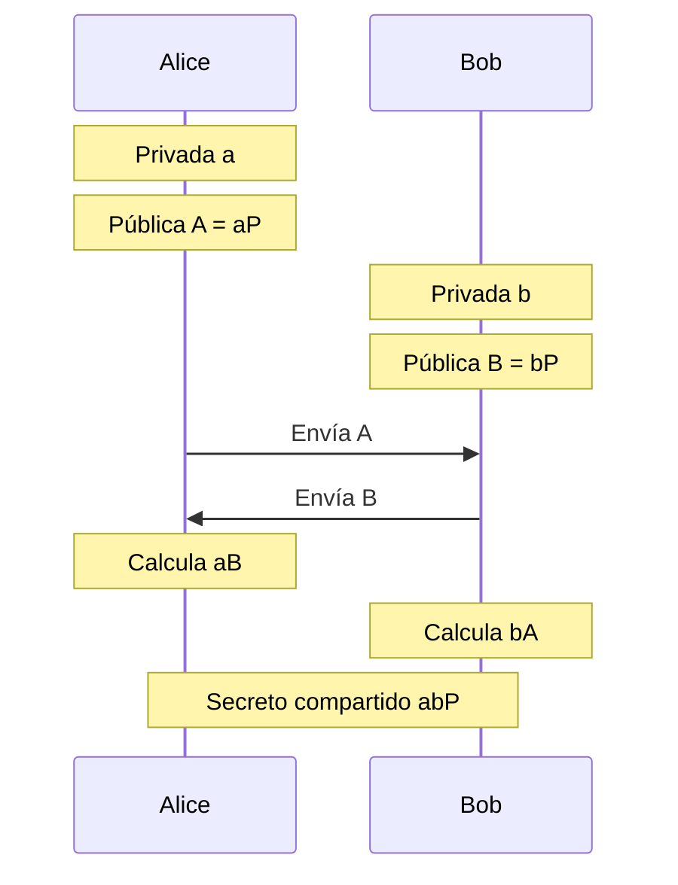
  
### Ejemplo práctico:  
  
Se utiliza:  
  
$$  
E:y^2\equiv x^3+2x+2\pmod{17}  
$$  
  
Con:  
  
$$  
P=(5,1)  
$$  
  
Alice elige:  
  
$$  
a=3  
$$  
  
Su clave pública es:  
  
$$  
A=3P=(10,6)  
$$  
  
Bob elige:  
  
$$  
b=10  
$$  
  
Su clave pública es:  
  
$$  
B=10P=(7,11)  
$$  
  
Alice calcula:  
  
$$  
3B=3(10P)=30P  
$$  
  
Como el grupo tiene orden 19:  
  
$$  
30P=11P  
$$  
  
Por lo tanto:  
  
$$  
\boxed{T=(13,10)}  
$$  
  
Bob calcula:  
  
$$  
10A=10(3P)=30P  
$$  
  
Y obtiene exactamente:  
  
$$  
\boxed{T=(13,10)}  
$$  
  
Ambos participantes disponen del mismo secreto.  
  
### Derivación de una clave de sesión:  
  
El punto compartido no suele utilizarse directamente como clave de AES.  
  
Se utiliza una **Key Derivation Function (KDF)** para generar una clave adecuada.  
  
Conceptualmente:  
  
$$  
K=\operatorname{KDF}(T,N_A,N_B)  
$$  
  
En donde $N_A$ y $N_B$ pueden representar nonces públicos.  
  
**Diferencia importante:** ECDH permite acordar un secreto, pero no autentica automáticamente a los participantes. Para evitar ataques de intermediario se necesita un mecanismo adicional de autenticación.  
  
---  
  
## Message Authentication Code  
  
Un **Message Authentication Code (MAC)** es un código criptográfico que depende de un mensaje y una clave secreta.  
  
Su función es proporcionar integridad y autenticación de origen.  
  
Se representa mediante:  
  
$$  
\boxed{T=\operatorname{MAC}(K,M)}  
$$  
  
En donde:  
  
- $K$ es una clave secreta compartida.  
- $M$ es el mensaje.  
- $T$ es el código de autenticación.  
  
### Funcionamiento:  
  
Supóngase que Alice y Bob comparten la clave $K$.  
  
Alice calcula:  
  
$$  
T=\operatorname{MAC}(K,M)  
$$  
  
Envía el mensaje junto con el código.  
  
Bob calcula:  
  
$$  
T'=\operatorname{MAC}(K,M)  
$$  
  
Si:  
  
$$  
T'=T  
$$  
  
la comprobación es correcta.  
  
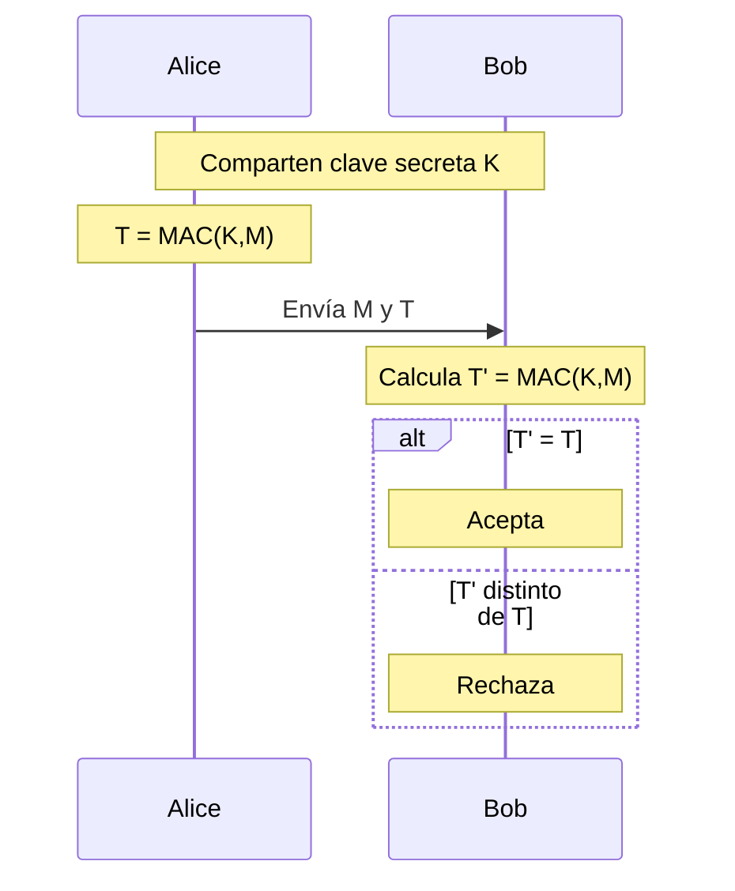
  
### Limitación del MAC:  
  
Un MAC no proporciona no repudio entre los participantes que conocen la clave.  
  
Si Alice y Bob comparten la misma clave secreta, ambos pueden generar códigos válidos.  
  
Por lo tanto, no resulta posible demostrar criptográficamente ante un tercero cuál de los dos generó un MAC determinado utilizando solamente ese código.  
  
---  
  
## Funciones hash criptográficas  
  
Una **función hash** transforma un mensaje de longitud variable en un resumen de longitud fija.  
  
$$  
\boxed{h=H(M)}  
$$  
  
El resultado también se denomina **Message Digest**.  
  
Por ejemplo, SHA-256 produce un resumen de 256 bits, independientemente de que la entrada contenga unas pocas letras o un archivo grande dentro de los límites admitidos.  
  
### Propiedades fundamentales:  
  
**Resistencia a preimagen:** dado $h$, debe resultar difícil encontrar un mensaje $M$ que produzca ese hash.  
  
**Resistencia a segunda preimagen:** dado un mensaje $M_1$, debe resultar difícil encontrar otro mensaje $M_2$ con el mismo resumen.  
  
**Resistencia a colisiones:** debe resultar difícil encontrar dos mensajes diferentes que produzcan el mismo hash.  
  
Una colisión cumple:  
  
$$  
H(M_1)=H(M_2)  
$$  
  
Con:  
  
$$  
M_1\neq M_2  
$$  
  
Las colisiones son matemáticamente inevitables, pero encontrarlas debe resultar computacionalmente difícil.  
  
### Hash simple mediante XOR:  
  
Un ejemplo elemental consiste en dividir un mensaje en bloques:  
  
$$  
C_1,C_2,\ldots,C_n  
$$  
  
Y calcular:  
  
$$  
h=C_1\oplus C_2\oplus\cdots\oplus C_n  
$$  
  
El operador XOR produce $1$ cuando los bits son diferentes.  
  
| A | B | $A\oplus B$ |  
|---|---|---|  
| 0 | 0 | 0 |  
| 0 | 1 | 1 |  
| 1 | 0 | 1 |  
| 1 | 1 | 0 |  
  
Este mecanismo permite comprender el procesamiento de información por bloques, pero no constituye un hash criptográfico seguro porque resulta sencillo producir colisiones.  
  
---  
  
## Algoritmos SHA  
  
La familia **Secure Hash Algorithm (SHA)** incluye funciones hash estandarizadas.  
  
### MD5 y SHA-1:  
  
MD5 produce:  
  
$$  
128\text{ bits}  
$$  
  
SHA-1 produce:  
  
$$  
160\text{ bits}  
$$  
  
Ambos presentan debilidades conocidas y no deben utilizarse para aplicaciones modernas que requieran resistencia a colisiones.  
  
### SHA-2:  
  
La familia SHA-2 incluye:  
  
- SHA-224.  
- SHA-256.  
- SHA-384.  
- SHA-512.  
  
| Algoritmo | Hash | Bloque | Rondas |  
|---|---:|---:|---:|  
| SHA-1 | 160 bits | 512 bits | 80 |  
| SHA-224 | 224 bits | 512 bits | 64 |  
| SHA-256 | 256 bits | 512 bits | 64 |  
| SHA-384 | 384 bits | 1024 bits | 80 |  
| SHA-512 | 512 bits | 1024 bits | 80 |  
  
### SHA-3:  
  
SHA-3 fue estandarizado en 2015.  
  
Utiliza una estructura diferente a SHA-2, denominada **sponge construction**.  
  
La diferencia no consiste únicamente en el tamaño del hash, sino en su funcionamiento interno.  
  
---  
  
## Estructura general de una función hash  
  
Muchas funciones hash procesan el mensaje mediante bloques y una función de compresión.  
  
El estado comienza con un valor inicial:  
  
$$  
CV_0=IV  
$$  
  
Después se actualiza con cada bloque:  
  
$$  
\boxed{CV_i=f(CV_{i-1},Y_i)}  
$$  
  
Finalmente:  
  
$$  
H(M)=CV_L  
$$  
  
En donde:  
  
- $IV$ es el valor inicial.  
- $CV_i$ es el estado intermedio.  
- $Y_i$ es el bloque procesado.  
- $f$ es la función de compresión.  
- $L$ es el número de bloques.  
  
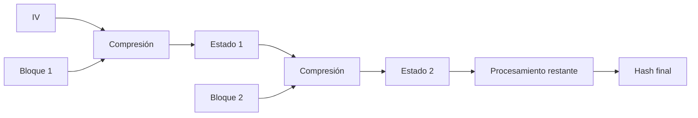
  
---  
  
## SHA-512  
  
SHA-512 produce resúmenes de:  
  
$$  
512\text{ bits}  
$$  
  
Procesa bloques de:  
  
$$  
1024\text{ bits}  
$$  
  
Utiliza ocho palabras internas de 64 bits y ejecuta 80 rondas de compresión por bloque.  
  
### Etapas del algoritmo:  
  
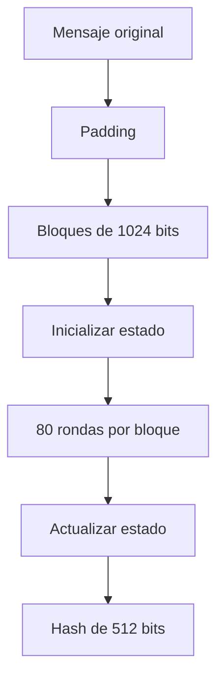
  
### Padding:  
  
El mensaje se prepara añadiendo:  
  
1. Un bit con valor $1$.  
2. Una cantidad de ceros.  
3. La longitud original representada mediante 128 bits.  
  
La ecuación es:  
  
$$  
\boxed{\ell+1+k\equiv896\pmod{1024}}  
$$  
  
En donde:  
  
- $\ell$ es la longitud original del mensaje en bits.  
- $k$ es la cantidad de ceros añadidos.  
  
### Ejemplo práctico:  
  
Se desea procesar el texto:  
  
```text  
abc  
```  
  
Contiene tres caracteres ASCII:  
  
$$  
\ell=3(8)=24  
$$  
  
La ecuación es:  
  
$$  
24+1+k=896  
$$  
  
Por lo tanto:  
  
$$  
\boxed{k=871}  
$$  
  
El mensaje preparado contiene:  
  
$$  
24+1+871+128=1024\text{ bits}  
$$  
  
Es decir, exactamente un bloque.  
  
### Inicialización:  
  
SHA-512 utiliza ocho palabras de 64 bits.  
  
Los valores iniciales proceden de las partes fraccionarias de las raíces cuadradas de los primeros ocho números primos.  
  
### Rondas de compresión:  
  
Cada bloque se divide inicialmente en 16 palabras de 64 bits.  
  
Después se expande a 80 palabras:  
  
$$  
W_0,W_1,\ldots,W_{79}  
$$  
  
Cada ronda utiliza:  
  
- Una palabra $W_t$.  
- Una constante $K_t$.  
- Operaciones AND, XOR, ROTR y SHR.  
- Sumas módulo $2^{64}$.  
  
Al terminar las 80 rondas, se actualiza el estado acumulado.  
  
El resultado final contiene ocho palabras de 64 bits:  
  
$$  
8(64)=512  
$$  
  
**Para el examen:** debe poder explicarse la diferencia entre tamaño de bloque, tamaño de resumen, padding, estado inicial y rondas de compresión.  
  
---  
  
## HMAC y CMAC  
  
**HMAC** es un mecanismo MAC construido mediante una función hash y una clave secreta.  
  
Por ejemplo:  
  
```text  
HMAC-SHA256  
```  
  
Utiliza SHA-256 dentro de una construcción criptográfica que incorpora una clave secreta.  
  
HMAC proporciona integridad y autenticación de origen entre participantes que comparten la clave.  
  
**CMAC** utiliza un cifrador de bloques, como AES, para construir un código de autenticación.  
  
| Característica | HMAC | CMAC |  
|---|---|---|  
| Primitiva | Hash | Cifrador de bloques |  
| Ejemplo | HMAC-SHA256 | AES-CMAC |  
| Requiere clave | Sí | Sí |  
| Proporciona autenticación | Sí | Sí |  
| Cifra el mensaje | No | No |  
  
La diferencia más importante es la primitiva criptográfica utilizada.  
  
---  
  
## Firmas digitales  
  
Una **firma digital** permite comprobar que un mensaje corresponde a una clave privada determinada y que su contenido firmado no ha sido modificado.  
  
La clave privada se utiliza para firmar.  
  
La clave pública se utiliza para verificar.  
  
### Generación de la firma:  
  
Bob calcula:  
  
$$  
h=H(M)  
$$  
  
Después genera:  
  
$$  
S=\operatorname{Sign}(K_B^-,h)  
$$  
  
Transmite:  
  
$$  
(M,S)  
$$  
  
Alice calcula nuevamente el hash y verifica la firma utilizando la clave pública de Bob.  
  
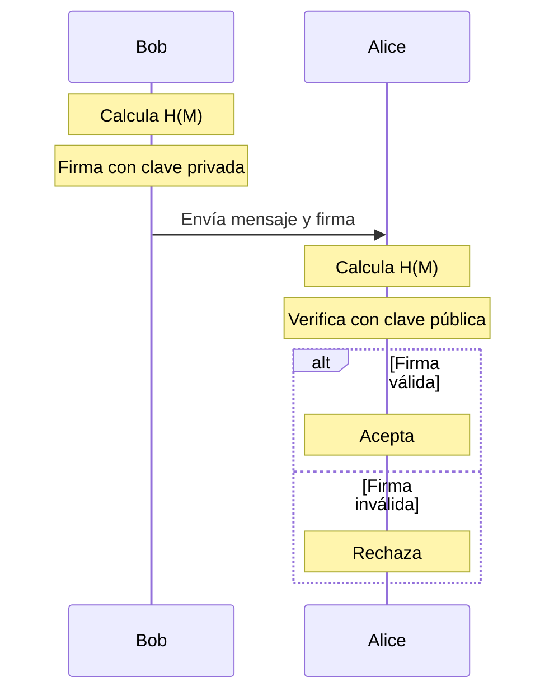
  
### Diferencia entre firma digital y cifrado:  
  
El cifrado busca que solamente las entidades autorizadas puedan conocer el mensaje.  
  
La firma busca proporcionar evidencia criptográfica sobre la autenticidad e integridad del contenido.  
  
Firmar no significa necesariamente cifrar.  
  
---  
  
## Firma digital RSA  
  
RSA puede utilizarse para generar firmas digitales.  
  
En una representación matemática elemental:  
  
$$  
s=h^d\pmod n  
$$  
  
La verificación utiliza:  
  
$$  
h'=s^e\pmod n  
$$  
  
En donde:  
  
- $d$ es el exponente privado.  
- $e$ es el exponente público.  
- $n$ es el módulo RSA.  
  
### Ejemplo práctico:  
  
Bob selecciona:  
  
$$  
p=3,\qquad q=11  
$$  
  
Calcula:  
  
$$  
n=pq=33  
$$  
  
$$  
\varphi(n)=(3-1)(11-1)=20  
$$  
  
Elige:  
  
$$  
e=3  
$$  
  
Calcula el inverso:  
  
$$  
ed\equiv1\pmod{20}  
$$  
  
Por lo tanto:  
  
$$  
d=7  
$$  
  
La clave pública es:  
  
$$  
(3,33)  
$$  
  
La privada es:  
  
$$  
(7,33)  
$$  
  
Se desea firmar:  
  
$$  
x=4  
$$  
  
La firma es:  
  
$$  
s=4^7\pmod{33}  
$$  
  
$$  
\boxed{s=16}  
$$  
  
Para verificar:  
  
$$  
x'=16^3\pmod{33}  
$$  
  
$$  
\boxed{x'=4}  
$$  
  
Como coincide con el valor original, la firma es matemáticamente válida en este ejemplo elemental.  
  
En aplicaciones reales se utilizan esquemas de firma seguros, como RSA-PSS, y claves mucho mayores.  
  
---  
  
## Autoridades certificadoras y PKI  
  
La criptografía asimétrica introduce un problema: ¿cómo comprobar que una clave pública pertenece realmente a la entidad que afirma poseerla?  
  
Una **Certification Authority (CA)** vincula una identidad con una clave pública mediante un certificado digital firmado.  
  
La **Public Key Infrastructure (PKI)** administra los certificados y las relaciones de confianza.  
  
Incluye:  
  
- Emisión de certificados.  
- Administración de claves.  
- Distribución.  
- Validación.  
- Renovación.  
- Revocación.  
  
### Certificados X.509:  
  
X.509 define un formato común para certificados digitales.  
  
Los campos principales son:  
  
| Campo | Función |  
|---|---|  
| Version | Versión del certificado |  
| Serial Number | Identificador del certificado |  
| Issuer | Autoridad emisora |  
| Subject | Entidad certificada |  
| Validity | Periodo de validez |  
| Public Key | Clave pública certificada |  
| Extensions | Restricciones y atributos |  
| Signature | Firma de la CA |  
  
El certificado permite comprobar que una autoridad confiable ha firmado la asociación entre una identidad y una clave pública.  
  
### Modelo jerárquico:  
  
Una PKI puede organizarse mediante una Root CA y autoridades subordinadas.  
  
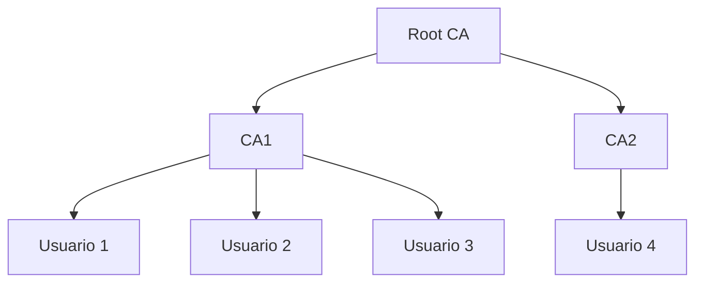
  
Si el Usuario 1 confía en la Root CA, puede verificar el certificado de CA1.  
  
Después puede utilizar la clave pública validada de CA1 para verificar el certificado del Usuario 3.  
  
Esto se denomina **cadena de certificación**.  
  
### Modelo de malla:  
  
En una malla, diferentes autoridades pueden establecer relaciones de certificación cruzada.  
  
Para una malla dirigida completamente conectada:  
  
$$  
\boxed{N(N-1)}  
$$  
  
representa el número de certificaciones necesarias.  
  
Con cuatro autoridades:  
  
$$  
4(4-1)=12  
$$  
  
### Revocación:  
  
Un certificado puede invalidarse antes de su vencimiento.  
  
Las **Certificate Revocation Lists (CRL)** permiten informar qué certificados han sido revocados.  
  
También existen mecanismos de consulta de estado, como OCSP.  
  
**Para el examen:** debe comprenderse cómo una cadena de certificados permite obtener una clave pública confiable a partir de una Root CA conocida.  
  
---  
  
## Kerberos  
  
**Kerberos** es un protocolo de autenticación centralizada basado en tickets.  
  
Utiliza tres componentes principales:  
  
- Cliente.  
- Key Distribution Center (KDC).  
- Servidor de servicios.  
  
El KDC contiene:  
  
**Authentication Server (AS):** realiza la autenticación inicial.  
  
**Ticket Granting Server (TGS):** emite tickets para servicios específicos.  
  
### Funcionamiento:  
  
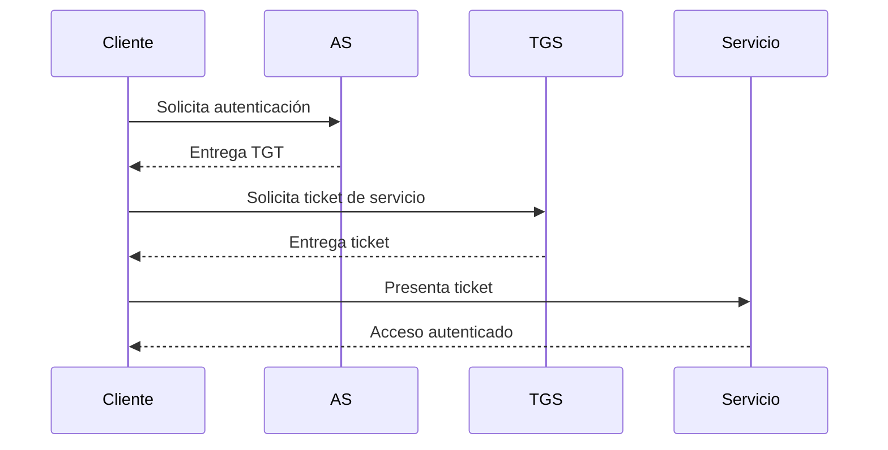
  
El **Ticket Granting Ticket (TGT)** permite solicitar tickets adicionales sin repetir completamente el proceso de autenticación inicial.  
  
Los tickets tienen una validez limitada y están protegidos criptográficamente.  
  
Kerberos también utiliza información temporal para reducir ataques de repetición.  
  
---  
  
## SSL, TLS y HTTPS  
  
**Transport Layer Security (TLS)** protege comunicaciones entre aplicaciones y servicios de red.  
  
HTTPS utiliza TLS para proteger el tráfico HTTP.  
  
Sus propiedades principales son:  
  
- Confidencialidad.  
- Integridad.  
- Autenticación.  
  
TLS no garantiza por sí mismo disponibilidad frente a ataques DDoS.  
  
### Evolución:  
  
| Protocolo | Año | Estado |  
|---|---|---|  
| SSL 2.0 | 1995 | Obsoleto |  
| SSL 3.0 | 1996 | Obsoleto |  
| TLS 1.0 | 1999 | Obsoleto |  
| TLS 1.1 | 2006 | Obsoleto |  
| TLS 1.2 | 2008 | Vigente |  
| TLS 1.3 | 2018 | Moderno |  
  
### Handshake:  
  
Durante el handshake:  
  
1. El cliente inicia la conexión.  
2. Se negocian los algoritmos criptográficos.  
3. El servidor presenta información para autenticarse.  
4. Se establece material secreto compartido.  
5. Se derivan claves de sesión.  
6. Se verifica que la negociación terminó correctamente.  
  
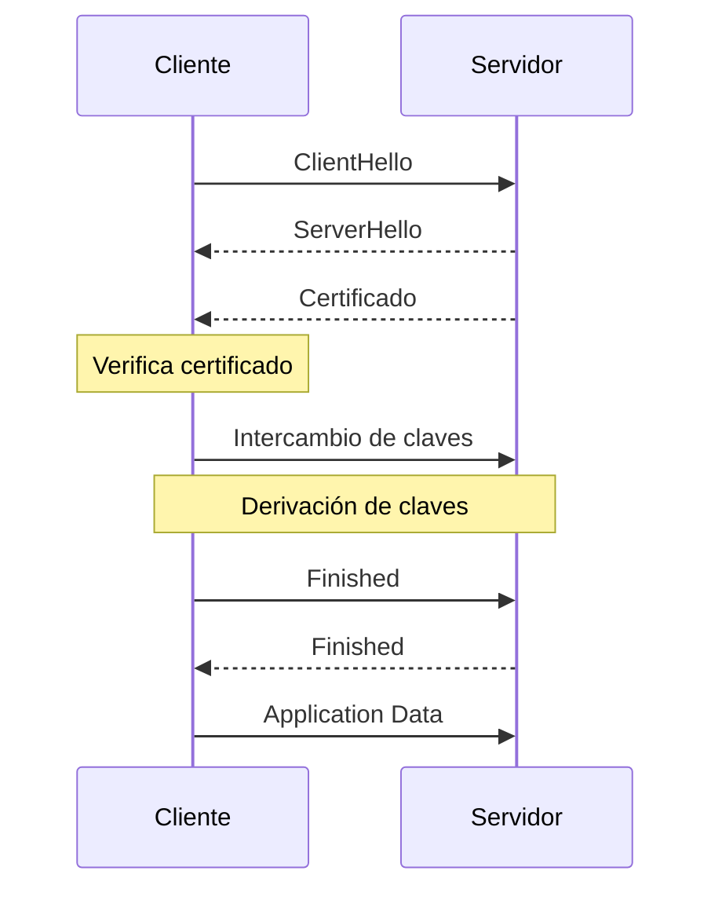
  
La secuencia exacta depende de la versión TLS.  
  
### Pre-Master Secret:  
  
En mecanismos históricos basados en RSA, el cliente genera un **Pre-Master Secret (PMS)** y lo cifra con la clave pública del servidor.  
  
El servidor lo recupera utilizando su clave privada.  
  
El PMS participa en la derivación de las claves de sesión.  
  
TLS 1.3 no utiliza este mecanismo de intercambio RSA.  
  
### Key Derivation:  
  
En un modelo clásico puede representarse:  
  
$$  
K_{MS}=f(PMS,R_C,R_S)  
$$  
  
En donde los valores aleatorios contribuyen a generar material diferente para cada sesión.  
  
En suites antiguas con cifrado y MAC independientes pueden obtenerse cuatro claves:  
  
| Clave | Uso |  
|---|---|  
| $K_C$ | Cifrado cliente → servidor |  
| $M_C$ | MAC cliente → servidor |  
| $K_S$ | Cifrado servidor → cliente |  
| $M_S$ | MAC servidor → cliente |  
  
Las suites modernas AEAD integran cifrado y autenticación sin necesitar un HMAC independiente por registro.  
  
---  
  
## Cipher Suites  
  
Una **Cipher Suite** define una combinación de algoritmos criptográficos utilizada en TLS.  
  
En TLS 1.2 puede incluir intercambio de claves, autenticación, cifrado y hash.  
  
Por ejemplo:  
  
```text  
TLS_ECDHE_RSA_WITH_AES_128_GCM_SHA256  
```  
  
Se interpreta como:  
  
| Componente | Significado |  
|---|---|  
| ECDHE | Intercambio efímero de claves |  
| RSA | Autenticación mediante firma RSA |  
| AES-128 | Cifrado simétrico |  
| GCM | Cifrado autenticado |  
| SHA256 | Función hash asociada |  
  
### DHE y ECDHE:  
  
La letra E significa **Ephemeral**.  
  
Indica el uso de claves temporales en el acuerdo de claves.  
  
Esto permite obtener **Forward Secrecy**, propiedad que dificulta descifrar sesiones anteriores incluso si posteriormente se compromete una clave privada de autenticación de larga duración.  
  
---  
  
## TLS Record Protocol  
  
El **Record Protocol** organiza los datos de aplicación en registros.  
  
En el funcionamiento clásico:  
  
1. Se fragmentan los datos.  
2. Se calcula un MAC cuando la suite lo requiere.  
3. Se cifra el contenido.  
4. Se añade la cabecera.  
5. Se transmite el registro.  
  
El tamaño clásico máximo del fragmento de texto claro es:  
  
$$  
\boxed{2^{14}=16\,384\text{ bytes}}  
$$  
  
### Cabecera de registro:  
  
| Campo | Tamaño |  
|---|---|  
| Content Type | 1 byte |  
| Version | 2 bytes |  
| Length | 2 bytes |  
  
La cabecera tiene cinco bytes.  
  
### Tipos de contenido:  
  
| Tipo | Valor |  
|---|---|  
| Change Cipher Spec | 20 |  
| Alert | 21 |  
| Handshake | 22 |  
| Application Data | 23 |  
  
### MAC clásico de registro:  
  
Una representación conceptual es:  
  
$$  
MAC=\operatorname{HMAC}(K_M,Seq\parallel Type\parallel Version\parallel Length\parallel Data)  
$$  
  
El número de secuencia contribuye a detectar repeticiones y modificaciones del orden esperado.  
  
### Cierre:  
  
Una conexión TLS puede utilizar el mensaje:  
  
```text  
close_notify  
```  
  
Para comunicar un cierre controlado del canal criptográfico.  
  
Después puede cerrarse la conexión TCP correspondiente.  
  
---  
  
## Análisis de paquetes TCP y TLS  
  
En una captura de tráfico pueden observarse direcciones IP, puertos, números de secuencia y mensajes de handshake visibles.  
  
### Identificación de servidor:  
  
El puerto 443 se utiliza normalmente para HTTPS.  
  
Por ejemplo:  
  
```text  
Servidor: 216.75.194.220  
Puerto: 443  
```  
  
### Número de secuencia:  
  
Si un segmento TCP transporta 204 bytes y comienza con:  
  
$$  
Seq=79  
$$  
  
El siguiente número de secuencia esperado para los datos será:  
  
$$  
Seq_{\text{siguiente}}=79+204  
$$  
  
$$  
\boxed{283}  
$$  
  
Esta fórmula se aplica a los bytes transportados, considerando por separado los indicadores SYN o FIN cuando aparecen.  
  
### Diferencia entre PMS y Master Secret:  
  
El **Pre-Master Secret** es material secreto inicial utilizado en ciertos mecanismos históricos de establecimiento de claves.  
  
El **Master Secret** se deriva posteriormente.  
  
Por lo tanto, observar un ClientKeyExchange con un secreto cifrado no significa que el Master Secret se haya transmitido directamente.  
  
---  
  
## Seguridad del correo electrónico: PGP y S/MIME  
  
**PGP** y **S/MIME** permiten proteger mensajes de correo mediante criptografía.  
  
PGP utiliza mecanismos compatibles con OpenPGP.  
  
S/MIME utiliza formatos relacionados con MIME y habitualmente certificados X.509.  
  
### Funcionamiento de PGP:  
  
Supóngase que Alice desea enviar un correo cifrado y firmado a Bob.  
  
Alice utiliza:  
  
- Su clave privada para firmar.  
- La clave pública de Bob para proteger la clave de sesión.  
- Una clave simétrica nueva para cifrar el contenido.  
  
El proceso típico es:  
  
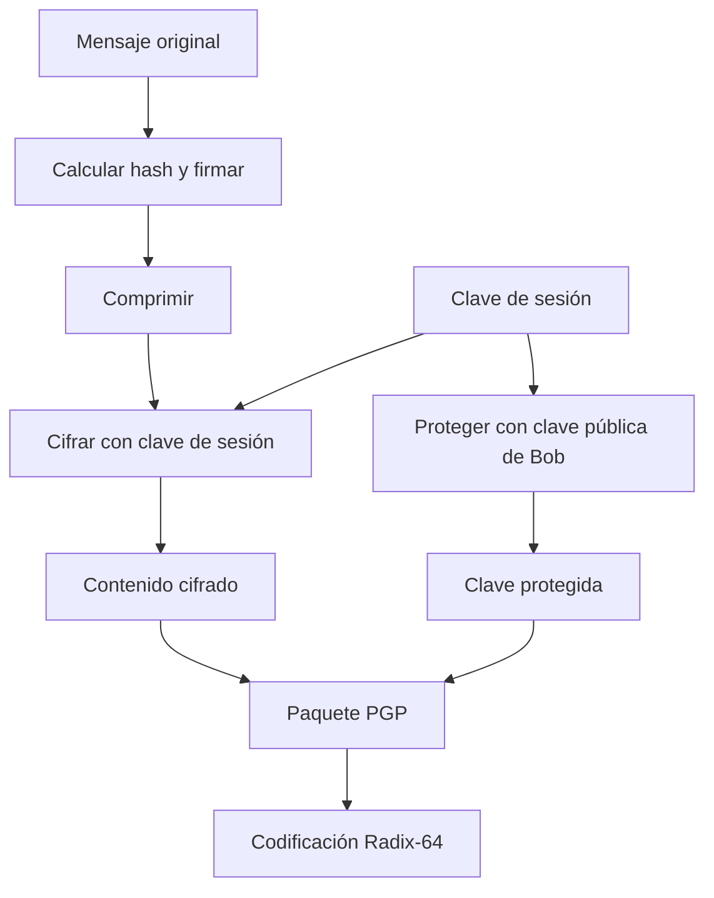
  
Bob recupera la clave de sesión, descifra el contenido, descomprime y verifica la firma mediante la clave pública de Alice.  
  
### Compresión:  
  
PGP puede utilizar técnicas relacionadas con ZIP y LZ77 para reducir patrones repetidos.  
  
Supóngase que un mensaje ocupa:  
  
$$  
53\text{ bytes}=424\text{ bits}  
$$  
  
Después de una codificación simplificada ocupa:  
  
$$  
35(8)+2(14)=308\text{ bits}  
$$  
  
La razón de compresión es:  
  
$$  
R=\frac{424}{308}  
$$  
  
$$  
\boxed{R\approx1.38}  
$$  
  
La reducción porcentual es:  
  
$$  
\frac{424-308}{424}\times100\%\approx27.36\%  
$$  
  
### Radix-64:  
  
Radix-64 permite representar información binaria mediante caracteres imprimibles.  
  
Cada tres bytes contienen:  
  
$$  
24\text{ bits}  
$$  
  
Se dividen en cuatro grupos de:  
  
$$  
6\text{ bits}  
$$  
  
Cada grupo corresponde a un carácter de un alfabeto de 64 símbolos.  
  
###### Ejemplo práctico:  
  
Para los bytes:  
  
```text  
23 5C 91  
```  
  
Su representación binaria es:  
  
```text  
00100011 01011100 10010001  
```  
  
Agrupando:  
  
```text  
001000 110101 110010 010001  
```  
  
Los valores decimales son:  
  
$$  
8,\ 53,\ 50,\ 17  
$$  
  
Que corresponden a:  
  
```text  
I1yR  
```  
  
Por lo tanto:  
  
$$  
\boxed{\text{235C91}\rightarrow\text{I1yR}}  
$$  
  
Radix-64 es una codificación, no un cifrado.  
  
---  
  
## Seguridad Wi-Fi: WEP, WPA, WPA2 y WPA3  
  
Las redes inalámbricas transmiten información mediante señales de radio que pueden recibirse dentro de su área de cobertura.  
  
Por esta razón, necesitan mecanismos de autenticación y cifrado.  
  
### Evolución:  
  
| Tecnología | Característica |  
|---|---|  
| WEP | RC4 y CRC-32; vulnerable |  
| WPA | TKIP; transición desde WEP |  
| WPA2 | AES-CCMP |  
| WPA3 | SAE y mecanismos modernos |  
  
### WPA-Personal:  
  
Se utiliza principalmente en redes domésticas y pequeñas oficinas.  
  
WPA2-Personal utiliza una clave previamente compartida, mientras que WPA3-Personal utiliza SAE.  
  
### WPA-Enterprise:  
  
Utiliza mecanismos de autenticación centralizada mediante IEEE 802.1X y, habitualmente, servidores RADIUS.  
  
Se utiliza principalmente en organizaciones.  
  
---  
  
## WEP y sus vulnerabilidades  
  
**Wired Equivalent Privacy (WEP)** fue un mecanismo antiguo de seguridad Wi-Fi.  
  
Utiliza RC4 para cifrar información.  
  
### Clave e IV:  
  
Una configuración WEP nominal de 128 bits utiliza:  
  
$$  
104\text{ bits de clave secreta}  
$$  
  
Y:  
  
$$  
24\text{ bits de IV}  
$$  
  
La combinación tiene:  
  
$$  
104+24=128\text{ bits}  
$$  
  
Sin embargo, el IV se transmite públicamente.  
  
### Cifrado:  
  
RC4 genera un keystream y cada byte se cifra mediante XOR:  
  
$$  
\boxed{c_i=d_i\oplus k_i^{IV}}  
$$  
  
En donde:  
  
- $d_i$ es el byte original.  
- $k_i^{IV}$ es el byte del flujo de claves.  
- $c_i$ es el byte cifrado.  
  
### Integrity Check Value:  
  
WEP calcula un CRC-32 sobre los datos.  
  
El resultado ocupa:  
  
$$  
32\text{ bits}=4\text{ bytes}  
$$  
  
Sin embargo, CRC-32 no es un MAC criptográfico.  
  
Está diseñado para detectar errores accidentales, no modificaciones deliberadas.  
  
### Por qué falla WEP:  
  
Los problemas fundamentales son:  
  
- Vector de inicialización demasiado pequeño.  
- Posible reutilización de keystream.  
- Debilidades del uso de RC4.  
- Integridad basada en CRC-32.  
- Administración insuficiente de claves.  
  
**Para el examen:** debe explicarse por qué WEP es inseguro incluso aunque utilice una clave secreta y cifrado.  
  
---  
  
## IPsec  
  
**Internet Protocol Security (IPsec)** proporciona mecanismos de seguridad para datagramas IP.  
  
Puede utilizarse entre:  
  
- Dos hosts.  
- Dos routers.  
- Un host y un router.  
  
Sus servicios incluyen:  
  
- Confidencialidad.  
- Integridad.  
- Autenticación de origen.  
- Protección antirrepetición.  
- Administración de claves.  
  
IP tradicional no proporciona por sí mismo estas garantías criptográficas.  
  
### Aplicación en VPN:  
  
Una **Virtual Private Network (VPN)** permite conectar redes privadas mediante Internet.  
  
IPsec puede proteger el tráfico que atraviesa una red pública.  
  

  
Solamente los extremos de la conexión IPsec necesitan aplicar las operaciones criptográficas correspondientes.  
  
Los routers intermedios pueden seguir encaminando paquetes IP convencionales.  
  
---  
  
## Modos de IPsec  
  
IPsec proporciona dos modos principales.  
  
### Transport Mode:  
  
Protege principalmente el contenido transportado por IP.  
  
La cabecera IP original permanece como cabecera externa para permitir el encaminamiento.  
  
Representación conceptual:  
  
```text  
[IP Header][ESP Header][Encrypted Payload][ESP Trailer][Authentication Data]  
```  
  
Se utiliza frecuentemente para comunicaciones entre hosts.  
  
### Tunnel Mode:  
  
Encapsula el paquete IP original dentro de otro paquete.  
  
Representación conceptual:  
  
```text  
[New IP Header][ESP Header][Encrypted Original IP Packet][ESP Trailer][Authentication Data]  
```  
  
Este modo permite proteger el paquete IP interno completo mediante ESP con cifrado.  
  
Se utiliza frecuentemente para VPN.  
  
### Comparación:  
  
| Característica | Transporte | Túnel |  
|---|---|---|  
| Cabecera IP original | Externa | Encapsulada |  
| Nueva cabecera IP | Normalmente no | Sí |  
| Protección | Principalmente datos transportados | Paquete IP interno |  
| Uso frecuente | Host a host | VPN |  
  
---  
  
## AH y ESP  
  
IPsec utiliza dos protocolos importantes.  
  
### Authentication Header:  
  
**AH** proporciona autenticación e integridad.  
  
No proporciona cifrado ni confidencialidad.  
  
También puede incluir protección antirrepetición.  
  
### Encapsulating Security Payload:  
  
**ESP** puede proporcionar confidencialidad mediante cifrado.  
  
También puede proporcionar autenticación, integridad y protección antirrepetición.  
  
| Propiedad | AH | ESP |  
|---|---|---|  
| Confidencialidad | No | Sí, con cifrado |  
| Integridad | Sí | Sí, con autenticación |  
| Autenticación | Sí | Sí, con autenticación |  
| Protección antirrepetición | Sí, si se habilita | Sí, si se habilita |  
  
### Combinaciones importantes:  
  
**AH + Transporte:** autentica los datos protegidos y determinados campos de la cabecera IP.  
  
**ESP + Transporte:** cifra el contenido transportado por IP.  
  
**AH + Túnel:** autentica el paquete IP interno encapsulado.  
  
**ESP + Túnel:** puede cifrar y autenticar el paquete IP interno completo.  
  
ESP en modo túnel es especialmente importante para construir VPN.  
  
---  
  
## Security Association  
  
Una **Security Association (SA)** define los parámetros criptográficos utilizados para proteger una dirección de comunicación IPsec.  
  
Puede contener información sobre:  
  
- Algoritmos.  
- Claves.  
- Protocolo.  
- Identificadores.  
- Números de secuencia.  
- Tiempo de vida.  
  
### Asociación simplex:  
  
Una SA es unidireccional.  
  
Para una comunicación protegida en ambas direcciones se necesitan normalmente dos asociaciones:  
  
$$  
SA_{A\rightarrow B}  
$$  
  
$$  
SA_{B\rightarrow A}  
$$  
  
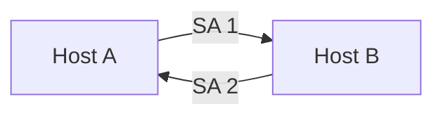
  
### Security Parameters Index:  
  
El **SPI** permite identificar la asociación de seguridad que debe utilizarse para procesar un paquete IPsec.  
  
El receptor utiliza el SPI junto con otros campos para localizar los parámetros criptográficos correspondientes.  
  
---  
  
## Comparación global de protocolos  
  
Cada tecnología opera en una parte distinta de la comunicación.  
  
| Tecnología | Función principal |  
|---|---|  
| ECC | Criptografía asimétrica mediante curvas elípticas |  
| ECDH | Acuerdo de secreto compartido |  
| SHA | Generación de resúmenes criptográficos |  
| MAC / HMAC | Integridad y autenticación mediante secreto compartido |  
| Firma digital | Autenticación verificable mediante clave pública |  
| PKI | Administración de certificados y confianza |  
| X.509 | Formato de certificados |  
| Kerberos | Autenticación mediante tickets |  
| TLS | Protección de comunicaciones de aplicación |  
| PGP | Cifrado y firmas de mensajes |  
| S/MIME | Protección de correo electrónico |  
| WPA2/WPA3 | Seguridad de redes Wi-Fi |  
| IPsec | Protección de datagramas IP |  
| VPN | Comunicación privada sobre redes compartidas |  
  
### Relación entre capas:  
  
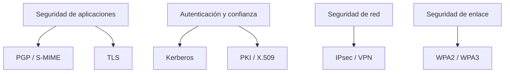
  
Una misma comunicación puede utilizar varios mecanismos simultáneamente.  
  
Por ejemplo, un usuario podría conectarse mediante WPA3, establecer una VPN IPsec y enviar un mensaje PGP.  
  
Cada mecanismo protegería una parte diferente del proceso.  
  
---  
  
## Ejercicios fundamentales para el examen  
  
Los ejercicios siguientes reúnen los procedimientos matemáticos y conceptuales más importantes.  
  
### Ejercicio de duplicación ECC:  
  
Dada:  
  
$$  
E:y^2\equiv x^3+2x+2\pmod{17}  
$$  
  
Y:  
  
$$  
P=(5,1)  
$$  
  
El resultado es:  
  
$$  
\boxed{2P=(6,3)}  
$$  
  
Debe poder justificarse utilizando la pendiente de duplicación y las coordenadas modulares.  
  
### Ejercicio de ECDH:  
  
Con:  
  
$$  
a=3,\qquad b=10  
$$  
  
Y:  
  
$$  
P=(5,1)  
$$  
  
Se obtienen:  
  
$$  
A=3P=(10,6)  
$$  
  
$$  
B=10P=(7,11)  
$$  
  
El secreto es:  
  
$$  
\boxed{T=abP=(13,10)}  
$$  
  
### Ejercicio de padding SHA-512:  
  
Para un mensaje de 24 bits:  
  
$$  
24+1+k=896  
$$  
  
Por lo tanto:  
  
$$  
\boxed{k=871}  
$$  
  
### Ejercicio de firma RSA:  
  
Con:  
  
$$  
p=3,\quad q=11,\quad e=3,\quad d=7  
$$  
  
Y:  
  
$$  
x=4  
$$  
  
La firma es:  
  
$$  
\boxed{s=16}  
$$  
  
La verificación produce:  
  
$$  
\boxed{x'=4}  
$$  
  
### Ejercicio de certificados cruzados:  
  
Para una malla completamente conectada con cuatro autoridades:  
  
$$  
N(N-1)=4(3)  
$$  
  
$$  
\boxed{12}  
$$  
  
### Ejercicio de compresión:  
  
Para 424 bits originales y 308 bits comprimidos:  
  
$$  
R=\frac{424}{308}  
$$  
  
$$  
\boxed{R\approx1.38}  
$$  
  
### Ejercicio de Radix-64:  
  
```text  
23 5C 91  
```  
  
Se convierte en:  
  
```text  
I1yR  
```  
  
### Ejercicio de número de secuencia TCP:  
  
Con:  
  
$$  
Seq=79  
$$  
  
Y:  
  
$$  
Length=204  
$$  
  
Se obtiene:  
  
$$  
\boxed{Seq_{\text{siguiente}}=283}  
$$  
  
---  
  
## Preguntas de razonamiento para el examen  
  
### ¿Por qué ECC puede utilizar claves más pequeñas que RSA?:  
  
Porque su seguridad se basa en un problema matemático diferente, el logaritmo discreto sobre curvas elípticas, que ofrece niveles elevados de dificultad frente a los algoritmos clásicos conocidos utilizando parámetros relativamente compactos.  
  
### ¿Por qué ECDH no proporciona autenticación por sí solo?:  
  
Porque un atacante podría sustituir las claves públicas intercambiadas si no existe un mecanismo que permita verificar su procedencia.  
  
### ¿Por qué un hash no es equivalente a un MAC?:  
  
Porque el hash no requiere una clave secreta, mientras que un MAC depende de una clave compartida que un atacante no debería conocer.  
  
### ¿Por qué un MAC no proporciona no repudio?:  
  
Porque los participantes que comparten la clave pueden generar códigos válidos.  
  
### ¿Por qué la firma digital utiliza una clave privada?:  
  
Porque la generación de la firma debe estar limitada al propietario de la clave, mientras que la verificación puede realizarse mediante la clave pública.  
  
### ¿Por qué se necesita PKI?:  
  
Porque distribuir una clave pública no garantiza que pertenezca a la identidad declarada.  
  
### ¿Para qué sirve el TGT de Kerberos?:  
  
Permite solicitar tickets para diferentes servicios después de completar la autenticación inicial.  
  
### ¿Por qué TLS necesita un handshake?:  
  
Porque debe negociar algoritmos, autenticar las entidades correspondientes y establecer las claves necesarias para proteger los datos.  
  
### ¿Por qué se utilizan diferentes claves para cifrado y MAC?:  
  
Para separar funciones criptográficas y evitar riesgos derivados de reutilizar una misma clave en operaciones incompatibles.  
  
### ¿Qué significa ECDHE?:  
  
Elliptic Curve Diffie-Hellman Ephemeral.  
  
Utiliza claves efímeras para establecer secretos compartidos y puede proporcionar Forward Secrecy.  
  
### ¿Por qué PGP utiliza cifrado híbrido?:  
  
Porque el cifrado simétrico es eficiente para proteger el contenido y la criptografía asimétrica permite proteger o establecer la clave de sesión.  
  
### ¿Por qué se utiliza Radix-64?:  
  
Para representar datos binarios mediante caracteres imprimibles compatibles con el transporte de correo.  
  
### ¿Por qué WEP es inseguro?:  
  
Por sus debilidades de inicialización, reutilización de keystream, uso de RC4, administración de claves y ausencia de un mecanismo criptográfico robusto de integridad.  
  
### ¿Cuál es la diferencia entre Transport Mode y Tunnel Mode?:  
  
Transport Mode protege principalmente el contenido transportado por IP.  
  
Tunnel Mode encapsula el paquete IP original dentro de un nuevo paquete, permitiendo protegerlo como unidad.  
  
### ¿Cuál es la diferencia entre AH y ESP?:  
  
AH proporciona autenticación e integridad sin cifrado.  
  
ESP puede proporcionar confidencialidad y autenticación.  
  
### ¿Por qué una comunicación IPsec bidireccional requiere dos SA?:  
  
Porque cada Security Association es unidireccional.  
  
---  
  
## Ideas principales  
  
**ECC** utiliza la multiplicación escalar sobre curvas elípticas. Sus operaciones fundamentales son la suma y la duplicación de puntos, y su seguridad se relaciona con la dificultad del logaritmo discreto elíptico.  
  
**ECDH** permite establecer un secreto compartido sin transmitir directamente las claves privadas. La relación esencial es:  
  
$$  
a(bP)=b(aP)=abP  
$$  
  
**Las funciones hash** transforman mensajes de longitud variable en resúmenes de longitud fija. Sus propiedades esenciales son resistencia a preimagen, segunda preimagen y colisiones.  
  
**MAC y HMAC** proporcionan integridad y autenticación mediante una clave secreta compartida. No proporcionan no repudio entre quienes conocen esa clave.  
  
**SHA-512** procesa bloques de 1024 bits, utiliza 80 rondas y produce resúmenes de 512 bits. El padding permite preparar mensajes de diferentes longitudes.  
  
**Las firmas digitales** utilizan una clave privada para firmar y una pública para verificar. Su autenticidad depende también de la confianza en la clave pública utilizada.  
  
**PKI y X.509** permiten administrar certificados y vincular identidades con claves públicas. Las cadenas de certificación permiten verificar certificados mediante autoridades raíz confiables.  
  
**Kerberos** utiliza tickets emitidos por un KDC para autenticar usuarios ante diferentes servicios.  
  
**TLS** establece canales protegidos mediante autenticación, negociación criptográfica, derivación de claves y transmisión de registros cifrados y autenticados.  
  
**PGP y S/MIME** protegen mensajes de correo electrónico. PGP puede combinar firma digital, compresión, cifrado híbrido y codificación Radix-64.  
  
**WEP** es inseguro debido a sus debilidades criptográficas. WPA2 y WPA3 incorporan mecanismos más robustos de autenticación y protección inalámbrica.  
  
**IPsec** protege datagramas IP. Sus modos transporte y túnel determinan cómo se encapsula y protege la información, mientras que AH y ESP establecen los servicios criptográficos utilizados.  
  
**Las VPN IPsec** permiten proteger comunicaciones entre redes o dispositivos remotos mediante infraestructura pública.  
  
---  
  
## Conclusión  
  
Los mecanismos de seguridad estudiados responden a diferentes necesidades, pero forman parte de una misma arquitectura criptográfica. ECC y ECDH permiten trabajar con claves públicas y establecer secretos compartidos, mientras que las funciones hash, los MAC y las firmas digitales proporcionan mecanismos de comprobación de integridad y autenticidad.  
  
Los certificados digitales y las infraestructuras PKI permiten resolver el problema de confianza en las claves públicas. Kerberos, por su parte, proporciona un enfoque centralizado de autenticación mediante tickets.  
  
TLS utiliza diferentes mecanismos criptográficos para establecer canales seguros entre aplicaciones. Su funcionamiento depende de negociar los algoritmos correctos, autenticar los participantes y derivar claves para proteger los registros transmitidos.  
  
PGP y S/MIME trasladan estas propiedades al contenido del correo electrónico. Los protocolos WPA2 y WPA3 proporcionan protección en redes inalámbricas, mientras que IPsec permite proteger datagramas y construir redes privadas virtuales.  
  
Para resolver correctamente los ejercicios del parcial, resulta fundamental identificar qué claves utiliza cada mecanismo, qué información se transmite, qué operaciones matemáticas se realizan y cuáles propiedades de seguridad proporciona cada protocolo.  
  
La relación más importante es que **la seguridad de una comunicación no depende de un único algoritmo, sino de la combinación adecuada de autenticación, establecimiento de claves, cifrado e integridad**.  