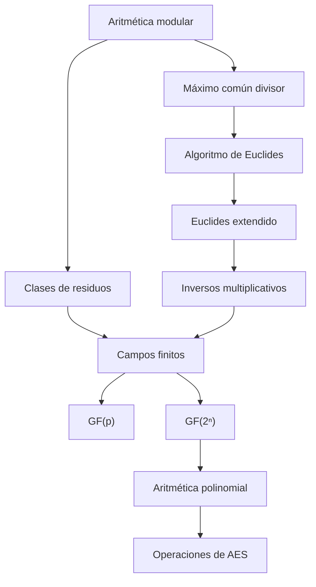
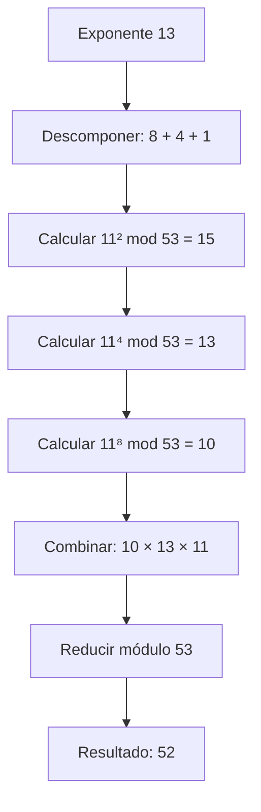
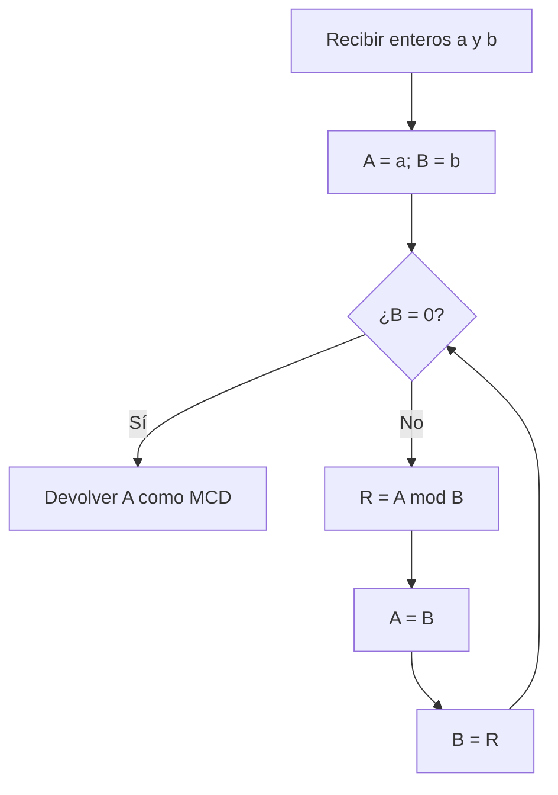
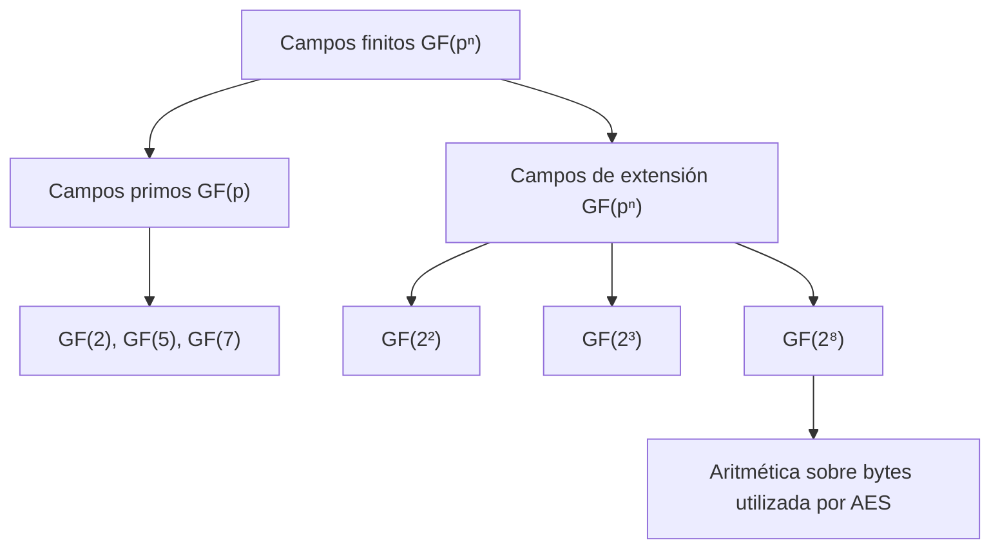
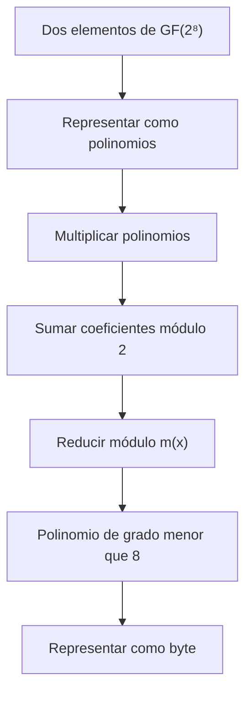
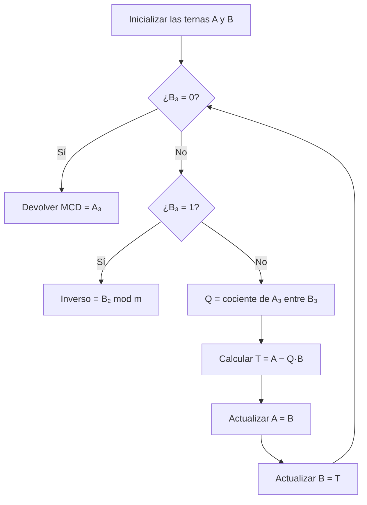
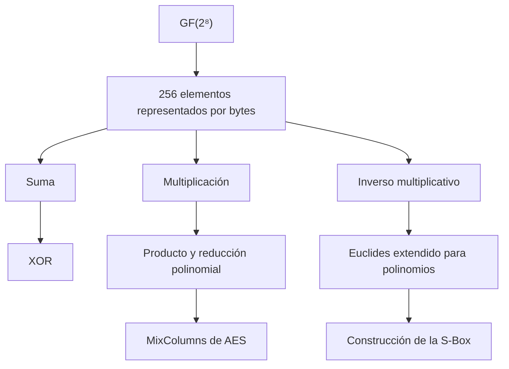

## Introducción

La **aritmética modular**, el **algoritmo de Euclides** y los **campos finitos de Galois** constituyen algunos de los fundamentos matemáticos más importantes de la criptografía moderna. Estas herramientas permiten realizar operaciones sobre conjuntos finitos de números y polinomios, calcular inversos multiplicativos y construir transformaciones reversibles para cifrar información.

Su importancia se observa especialmente en el **Advanced Encryption Standard (AES)**, algoritmo seleccionado para sustituir a DES y Triple DES. AES utiliza operaciones sobre bytes representados como elementos de un campo finito, por lo que su funcionamiento depende de comprender cómo se suman, multiplican y dividen elementos dentro de estructuras algebraicas especiales.

La selección de AES surgió de un proceso organizado por el **National Institute of Standards and Technology (NIST)**. En 1997 se convocó una evaluación pública de algoritmos criptográficos; en 1998 se aceptaron quince candidatos y posteriormente se seleccionaron cinco finalistas. En octubre de 2000 se eligió **Rijndael**, desarrollado por los criptógrafos belgas **Vincent Rijmen** y **Joan Daemen**. Finalmente, AES se publicó como el estándar FIPS 197 en noviembre de 2001.

Para comprender las operaciones que hacen posible este algoritmo, primero debe estudiarse la aritmética modular, que permite trabajar con residuos de divisiones. Posteriormente, el máximo común divisor y el algoritmo de Euclides permiten determinar cuándo dos números son relativamente primos y cuándo existe un inverso multiplicativo. Finalmente, los campos de Galois extienden estas ideas hacia los polinomios, proporcionando una estructura en la que pueden realizarse las operaciones necesarias para construir algoritmos criptográficos.

La relación entre los conceptos principales puede representarse mediante el siguiente esquema:

La idea fundamental es que la criptografía necesita operar con valores finitos sin perder las propiedades matemáticas que permiten recuperar la información original. Por ello, no basta con utilizar operaciones módulo cualquier número: también es necesario comprender cuándo esas operaciones forman un campo y cómo se construyen campos con una cantidad de elementos igual a una potencia de dos.

---

## Aritmética modular

La **aritmética modular** estudia las operaciones realizadas sobre los residuos que se obtienen al dividir números enteros entre un módulo positivo.

A diferencia de la aritmética ordinaria, donde los resultados pueden crecer indefinidamente, la aritmética modular permite representar cualquier entero mediante un valor comprendido entre $0$ y $n-1$.

### Operador módulo:

El operador módulo, representado mediante $\bmod$, devuelve el residuo de una división entera.

Se define a partir de:

$$
a=qn+b
$$

En donde:

- $a$ es el número que se desea dividir.
- $n$ es el módulo, con $n>0$.
- $q$ es el cociente entero.
- $b$ es el residuo.

El residuo debe satisfacer:

$$
\boxed{0\leq b<n}
$$

Por lo tanto:

$$
\boxed{a\bmod n=b}
$$

El cociente puede obtenerse mediante:

$$
q=\left\lfloor\frac{a}{n}\right\rfloor
$$

En donde $\lfloor x\rfloor$ representa el mayor entero menor o igual que $x$.

De esta manera, el residuo también puede expresarse como:

$$
\boxed{a\bmod n=a-n\left\lfloor\frac{a}{n}\right\rfloor}
$$

###### Ejemplo:

Considérese:

$$
11\bmod7
$$

La división entera es:

$$
11=1(7)+4
$$

Por lo tanto:

$$
\boxed{11\bmod7=4}
$$

Ahora bien, la operación también funciona con números negativos.

Supóngase:

$$
-11\bmod7
$$

Para obtener un residuo no negativo se utiliza:

$$
-11=(-2)(7)+3
$$

Por lo tanto:

$$
\boxed{-11\bmod7=3}
$$

En ambos casos, el residuo pertenece al conjunto:

$$
\{0,1,2,3,4,5,6\}
$$

### Congruencia modular:

Dos enteros son **congruentes módulo $n$** cuando producen el mismo residuo al dividirse entre $n$.

La congruencia se representa mediante:

$$
\boxed{a\equiv b\pmod n}
$$

Esto significa que:

$$
a\bmod n=b\bmod n
$$

Una forma equivalente de comprobarlo consiste en verificar que su diferencia sea divisible entre el módulo:

$$
\boxed{n\mid(a-b)}
$$

###### Ejemplo:

Considérese:

$$
100\equiv34\pmod{11}
$$

Se calculan los residuos:

$$
100\bmod11=1
$$

$$
34\bmod11=1
$$

Como ambos valores producen el mismo residuo, la congruencia es verdadera.

También puede comprobarse mediante la diferencia:

$$
100-34=66
$$

Y:

$$
66=6(11)
$$

Por lo tanto:

$$
\boxed{100\equiv34\pmod{11}}
$$

La congruencia permite considerar equivalentes a números que aparentemente son distintos, siempre que pertenezcan a una misma clase de residuos.

---

## Clases de residuos

Una **clase de residuos módulo $n$** contiene todos los enteros que producen el mismo residuo al dividirse entre $n$.

El conjunto de representantes de residuos se expresa mediante:

$$
\boxed{\mathbb Z_n=\{0,1,2,\ldots,n-1\}}
$$

Este conjunto contiene exactamente $n$ elementos.

Sin embargo, cada elemento representa una cantidad infinita de enteros congruentes entre sí.

### Ejemplo con módulo 7:

Para:

$$
n=7
$$

Se obtiene:

$$
\mathbb Z_7=\{0,1,2,3,4,5,6\}
$$

Todos los números enteros se pueden clasificar en siete clases de residuos.

Por ejemplo, la clase correspondiente al residuo $2$ contiene:

$$
\ldots,-12,-5,2,9,16,23,\ldots
$$

Esto ocurre porque:

$$
-12\bmod7=2
$$

$$
-5\bmod7=2
$$

$$
2\bmod7=2
$$

$$
9\bmod7=2
$$

Por lo tanto:

$$
\boxed{-12\equiv-5\equiv2\equiv9\pmod7}
$$

La distribución de algunos enteros en clases módulo $7$ puede organizarse mediante la siguiente tabla:

| Residuo 0 | Residuo 1 | Residuo 2 | Residuo 3 | Residuo 4 | Residuo 5 | Residuo 6 |
|---|---|---|---|---|---|---|
| $-7$ | $-6$ | $-5$ | $-4$ | $-3$ | $-2$ | $-1$ |
| $0$ | $1$ | $2$ | $3$ | $4$ | $5$ | $6$ |
| $7$ | $8$ | $9$ | $10$ | $11$ | $12$ | $13$ |
| $14$ | $15$ | $16$ | $17$ | $18$ | $19$ | $20$ |

Cada columna representa una clase de equivalencia.

### Interpretación:

La aritmética modular permite trabajar únicamente con los representantes de esas clases.

Por ejemplo, aunque el número $100$ sea mayor que $7$, dentro de la aritmética módulo $7$ puede reemplazarse por:

$$
100\bmod7=2
$$

Esto significa que las operaciones pueden simplificarse utilizando residuos pequeños, sin necesidad de conservar todos los valores originales.

Esta propiedad resulta especialmente útil cuando se realizan exponenciaciones con números muy grandes, como ocurre en numerosos algoritmos criptográficos.

---

## Operaciones de aritmética modular

La aritmética modular permite realizar suma, resta y multiplicación utilizando las propiedades habituales de las congruencias.

Una de sus ventajas es que los operandos pueden reducirse antes o después de efectuar la operación.

### Suma modular:

La suma modular satisface:

$$
\boxed{(a+b)\bmod n=[(a\bmod n)+(b\bmod n)]\bmod n}
$$

###### Ejemplo:

Se desea calcular:

$$
(11+15)\bmod8
$$

Primero se reducen los operandos:

$$
11\bmod8=3
$$

$$
15\bmod8=7
$$

Después:

$$
(3+7)\bmod8=10\bmod8
$$

Por lo tanto:

$$
\boxed{(11+15)\bmod8=2}
$$

El mismo resultado se obtiene sumando directamente:

$$
26\bmod8=2
$$

### Resta modular:

La resta satisface:

$$
\boxed{(a-b)\bmod n=[(a\bmod n)-(b\bmod n)]\bmod n}
$$

###### Ejemplo:

Se calcula:

$$
(11-15)\bmod8
$$

Reduciendo:

$$
(3-7)\bmod8
$$

$$
=-4\bmod8
$$

Por lo tanto:

$$
\boxed{(11-15)\bmod8=4}
$$

### Multiplicación modular:

La multiplicación satisface:

$$
\boxed{(ab)\bmod n=[(a\bmod n)(b\bmod n)]\bmod n}
$$

###### Ejemplo:

Se desea calcular:

$$
(11\times15)\bmod8
$$

Primero:

$$
11\bmod8=3
$$

$$
15\bmod8=7
$$

Después:

$$
(3\times7)\bmod8=21\bmod8
$$

Por lo tanto:

$$
\boxed{(11\times15)\bmod8=5}
$$

La reducción de operandos permite evitar operaciones con números innecesariamente grandes.

---

## Exponenciación modular

La **exponenciación modular** consiste en calcular el residuo de una potencia:

$$
\boxed{a^e\bmod n}
$$

Cuando el exponente es grande, calcular directamente $a^e$ puede producir un número con una enorme cantidad de dígitos.

Por esta razón se utilizan procedimientos que reducen los resultados intermedios.

Uno de los más importantes es la **exponenciación mediante cuadrados sucesivos**.

### Cuadrados sucesivos:

El método aprovecha la representación binaria del exponente.

Por ejemplo:

$$
13=8+4+1
$$

Por lo tanto:

$$
a^{13}=a^8a^4a
$$

Las potencias:

$$
a^2,\quad a^4,\quad a^8
$$

pueden calcularse elevando al cuadrado el resultado anterior y reduciendo módulo $n$ en cada paso.

###### Ejemplo práctico:

Se desea calcular:

$$
11^{13}\bmod53
$$

Primero:

$$
13=8+4+1
$$

Por lo tanto:

$$
11^{13}=11^8\times11^4\times11
$$

Se calculan las potencias necesarias.

Para la primera:

$$
11^1\bmod53=11
$$

La segunda potencia es:

$$
11^2=121
$$

Reduciendo:

$$
121\bmod53=15
$$

Después:

$$
11^4\bmod53=15^2\bmod53
$$

$$
225\bmod53=13
$$

Ahora:

$$
11^8\bmod53=13^2\bmod53
$$

$$
169\bmod53=10
$$

Finalmente se combinan:

$$
11^{13}\bmod53=(10\times13\times11)\bmod53
$$

$$
=1430\bmod53
$$

Por lo tanto:

$$
\boxed{11^{13}\bmod53=52}
$$

El procedimiento puede resumirse mediante:

El aspecto fundamental es que las reducciones intermedias conservan el resultado modular y evitan calcular la potencia completa.

---

## Inversos y propiedades de las operaciones modulares

Para comprender cuándo puede realizarse una división modular es necesario estudiar los inversos aditivos y multiplicativos.

### Inverso aditivo:

El **inverso aditivo** de $a$ es el elemento que produce cero al sumarse con $a$.

En aritmética ordinaria:

$$
a+(-a)=0
$$

En aritmética módulo $n$, el inverso aditivo satisface:

$$
\boxed{a+(-a)\equiv0\pmod n}
$$

###### Ejemplo:

En $\mathbb Z_8$, el inverso aditivo de $3$ es $5$, porque:

$$
3+5=8
$$

Y:

$$
8\bmod8=0
$$

Por lo tanto:

$$
\boxed{-3\equiv5\pmod8}
$$

Todos los elementos de $\mathbb Z_n$ tienen inverso aditivo.

### Inverso multiplicativo:

El **inverso multiplicativo** de $a$ es un elemento $a^{-1}$ que satisface:

$$
\boxed{aa^{-1}\equiv1\pmod n}
$$

A diferencia del inverso aditivo, el inverso multiplicativo no siempre existe.

Un entero tiene inverso multiplicativo módulo $n$ si y solo si es coprimo con el módulo:

$$
\boxed{\gcd(a,n)=1}
$$

###### Ejemplo:

Considérese el número $5$ módulo $8$.

Como:

$$
\gcd(5,8)=1
$$

Existe inverso multiplicativo.

Se observa que:

$$
5\times5=25
$$

Y:

$$
25\bmod8=1
$$

Por lo tanto:

$$
\boxed{5^{-1}\equiv5\pmod8}
$$

En cambio, el número $6$ no tiene inverso multiplicativo módulo $8$, porque:

$$
\gcd(6,8)=2
$$

### Cancelación en congruencias:

En una suma modular, es posible cancelar el mismo término en ambos lados.

Si:

$$
a+b\equiv a+c\pmod n
$$

Entonces:

$$
\boxed{b\equiv c\pmod n}
$$

Sin embargo, en una multiplicación modular la cancelación requiere una condición adicional.

Si:

$$
ab\equiv ac\pmod n
$$

Solo puede concluirse directamente que:

$$
b\equiv c\pmod n
$$

cuando:

$$
\boxed{\gcd(a,n)=1}
$$

###### Ejemplo:

Considérese:

$$
6\times3=18
$$

Y:

$$
6\times7=42
$$

Reduciendo módulo $8$:

$$
18\bmod8=2
$$

$$
42\bmod8=2
$$

Por lo tanto:

$$
6\times3\equiv6\times7\pmod8
$$

Sin embargo:

$$
3\not\equiv7\pmod8
$$

No se puede cancelar el factor $6$ porque:

$$
\gcd(6,8)=2
$$

El factor no tiene inverso multiplicativo.

En cambio, el factor $5$ sí puede cancelarse módulo $8$, porque:

$$
\gcd(5,8)=1
$$

La posibilidad de cancelar factores es una propiedad esencial para comprender la diferencia entre un anillo modular y un campo.

---

## Máximo común divisor y números coprimos

El **máximo común divisor (MCD)** de dos enteros es el mayor entero positivo que divide exactamente a ambos números.

Se representa mediante:

$$
\boxed{\gcd(a,b)}
$$

### Significado del MCD:

Supóngase que dos números comparten varios divisores.

El MCD identifica el mayor de ellos.

Por ejemplo:

$$
\gcd(18,12)=6
$$

Porque los divisores positivos de $18$ son:

$$
\{1,2,3,6,9,18\}
$$

Mientras que los divisores positivos de $12$ son:

$$
\{1,2,3,4,6,12\}
$$

El mayor divisor común es $6$.

### Números relativamente primos:

Dos enteros son **coprimos** o **relativamente primos** cuando su único divisor positivo común es $1$.

Formalmente:

$$
\boxed{\gcd(a,b)=1}
$$

Por ejemplo:

$$
\gcd(11,10)=1
$$

Esto significa que $11$ y $10$ son coprimos.

Es importante observar que dos números no necesitan ser individualmente primos para ser coprimos entre sí.

Por ejemplo:

$$
\gcd(8,15)=1
$$

Aunque ambos son números compuestos.

### Importancia:

La coprimalidad determina cuándo un elemento tiene inverso multiplicativo módulo $n$.

Por lo tanto, calcular el MCD permite responder una pregunta fundamental:

**¿Es posible realizar una división modular por un elemento determinado?**

La respuesta es afirmativa únicamente cuando dicho elemento posee inverso multiplicativo.

---

## Algoritmo de Euclides

El **algoritmo de Euclides** permite calcular el máximo común divisor de dos enteros mediante divisiones sucesivas.

Su fundamento es la igualdad:

$$
\boxed{\gcd(a,b)=\gcd(b,a\bmod b)}
$$

Esta propiedad significa que reemplazar el primer número por el segundo y el segundo por el residuo no modifica el máximo común divisor.

### Funcionamiento:

Se comienza con dos números:

$$
A=a
$$

$$
B=b
$$

Se calcula:

$$
R=A\bmod B
$$

Después se actualizan:

$$
A\leftarrow B
$$

$$
B\leftarrow R
$$

El procedimiento continúa hasta que:

$$
B=0
$$

En ese momento, el valor de $A$ corresponde al MCD.

### Ejemplos sencillos:

Para calcular:

$$
\gcd(55,22)
$$

Se obtiene:

$$
55=2(22)+11
$$

$$
22=2(11)+0
$$

Por lo tanto:

$$
\boxed{\gcd(55,22)=11}
$$

Para:

$$
\gcd(18,12)
$$

Se obtiene:

$$
18=1(12)+6
$$

$$
12=2(6)+0
$$

Por lo tanto:

$$
\boxed{\gcd(18,12)=6}
$$

Finalmente:

$$
\gcd(11,10)
$$

Produce:

$$
11=1(10)+1
$$

$$
10=10(1)+0
$$

Por lo tanto:

$$
\boxed{\gcd(11,10)=1}
$$

En el último caso, los números son coprimos.

### Por qué termina el algoritmo:

En cada iteración se obtiene un residuo que satisface:

$$
0\leq R<B
$$

Por lo tanto, los residuos disminuyen progresivamente.

Como no existe una sucesión infinita estrictamente decreciente de enteros no negativos, el algoritmo necesariamente termina.

---

## Ejemplo completo del algoritmo de Euclides

Considérese el cálculo:

$$
\gcd(1970,1066)
$$

Se aplican divisiones sucesivas.

Primero:

$$
1970=1(1066)+904
$$

Después:

$$
1066=1(904)+162
$$

La siguiente división es:

$$
904=5(162)+94
$$

Posteriormente:

$$
162=1(94)+68
$$

Continuando:

$$
94=1(68)+26
$$

$$
68=2(26)+16
$$

$$
26=1(16)+10
$$

$$
16=1(10)+6
$$

$$
10=1(6)+4
$$

$$
6=1(4)+2
$$

Finalmente:

$$
4=2(2)+0
$$

El último residuo distinto de cero es $2$.

Por lo tanto:

$$
\boxed{\gcd(1970,1066)=2}
$$

El proceso puede resumirse mediante:

| Dividendo $A$ | Divisor $B$ | Cociente $Q$ | Residuo $R$ |
|---|---|---|---|
| $1970$ | $1066$ | $1$ | $904$ |
| $1066$ | $904$ | $1$ | $162$ |
| $904$ | $162$ | $5$ | $94$ |
| $162$ | $94$ | $1$ | $68$ |
| $94$ | $68$ | $1$ | $26$ |
| $68$ | $26$ | $2$ | $16$ |
| $26$ | $16$ | $1$ | $10$ |
| $16$ | $10$ | $1$ | $6$ |
| $10$ | $6$ | $1$ | $4$ |
| $6$ | $4$ | $1$ | $2$ |
| $4$ | $2$ | $2$ | $0$ |

El resultado indica que los números comparten el factor $2$, por lo que no son coprimos.

El algoritmo de Euclides también puede extenderse para calcular inversos multiplicativos, una operación necesaria en la aritmética de campos finitos.

---

## Campos finitos y campos de Galois

Un **campo** es una estructura algebraica formada por un conjunto de elementos y dos operaciones, suma y multiplicación, que satisfacen determinadas propiedades.

Entre ellas se encuentran:

- Cerradura de las operaciones.
- Asociatividad y conmutatividad.
- Existencia de elementos neutros.
- Existencia de inversos aditivos.
- Existencia de inversos multiplicativos para los elementos distintos de cero.
- Propiedad distributiva.

La propiedad de los inversos multiplicativos es especialmente importante porque permite realizar divisiones entre elementos no nulos sin abandonar el campo.

### Campos finitos:

Un **campo finito** es un campo que contiene una cantidad finita de elementos.

También se conoce como **campo de Galois**, en honor al matemático Évariste Galois.

Se representa mediante:

$$
\boxed{GF(p^n)}
$$

En donde:

- $p$ es un número primo.
- $n$ es un entero positivo.
- $p^n$ es la cantidad de elementos del campo.

Por ejemplo:

$$
GF(5)
$$

contiene cinco elementos.

Mientras que:

$$
GF(2^3)
$$

contiene:

$$
2^3=8
$$

elementos.

Y:

$$
GF(2^8)
$$

contiene:

$$
2^8=256
$$

elementos.

### Clasificación de los campos utilizados:

### Importancia criptográfica:

Los campos finitos permiten realizar operaciones algebraicas bien definidas sobre conjuntos de tamaño limitado.

En criptografía aparecen especialmente los campos binarios porque sus elementos pueden representarse como secuencias de bits.

AES utiliza:

$$
\boxed{GF(2^8)}
$$

Esto permite trabajar con los $256$ valores posibles de un byte y realizar operaciones de suma, multiplicación e inversión.

---

## Por qué se necesitan campos finitos

Una pregunta importante es por qué no basta con utilizar simplemente la aritmética módulo una potencia de dos.

Supóngase que se trabaja con bloques de tres bits.

Existen:

$$
2^3=8
$$

valores posibles.

Una opción sería utilizar:

$$
\mathbb Z_8=\{0,1,2,3,4,5,6,7\}
$$

Sin embargo, la aritmética módulo $8$ no forma un campo.

### Problema de los inversos:

En $\mathbb Z_8$ se cumple:

$$
2\times4\equiv0\pmod8
$$

Aunque $2$ y $4$ son diferentes de cero.

Esto significa que existen divisores de cero.

Además, los elementos $2$, $4$ y $6$ no tienen inverso multiplicativo módulo $8$.

En general, únicamente los elementos coprimos con $8$ poseen inverso.

Estos son:

$$
\{1,3,5,7\}
$$

### Solución mediante GF(2³):

Un campo de Galois:

$$
GF(2^3)
$$

también contiene ocho elementos.

Sin embargo, utiliza operaciones diferentes, construidas mediante polinomios sobre $GF(2)$.

En esta estructura todos los elementos distintos de cero poseen inverso multiplicativo.

Por lo tanto, la división entre elementos no nulos siempre está definida.

La diferencia puede resumirse así:

| Propiedad | $\mathbb Z_8$ | $GF(2^3)$ |
|---|---|---|
| Cantidad de elementos | $8$ | $8$ |
| Representación posible | Enteros de $0$ a $7$ | Palabras de $3$ bits |
| Suma | Módulo $8$ | XOR |
| Multiplicación | Módulo $8$ | Multiplicación polinomial reducida |
| Inverso para todo elemento no nulo | No | Sí |
| Es un campo | No | Sí |

La diferencia fundamental no está en la cantidad de elementos, sino en las operaciones matemáticas definidas sobre ellos.

---

## Campos de Galois GF(p)

Cuando $p$ es primo, el conjunto:

$$
\mathbb Z_p=\{0,1,\ldots,p-1\}
$$

forma un campo si las operaciones de suma y multiplicación se realizan módulo $p$.

Este campo se representa mediante:

$$
\boxed{GF(p)}
$$

### Por qué el módulo debe ser primo:

Si $p$ es primo, todo entero $a$ que satisface:

$$
1\leq a<p
$$

es coprimo con $p$.

Por lo tanto:

$$
\gcd(a,p)=1
$$

Esto garantiza que cada elemento distinto de cero posee inverso multiplicativo.

En consecuencia, la división entre elementos no nulos puede expresarse mediante la multiplicación por sus inversos.

### Campo GF(2):

El campo más pequeño es:

$$
\boxed{GF(2)=\{0,1\}}
$$

Sus operaciones son suma y multiplicación módulo $2$.

La tabla de suma es:

| $+$ | $0$ | $1$ |
|---|---|---|
| $0$ | $0$ | $1$ |
| $1$ | $1$ | $0$ |

La tabla de multiplicación es:

| $\times$ | $0$ | $1$ |
|---|---|---|
| $0$ | $0$ | $0$ |
| $1$ | $0$ | $1$ |

Se observa que la suma en $GF(2)$ coincide con la operación lógica XOR.

Mientras que la multiplicación coincide con la operación lógica AND.

Por lo tanto:

$$
\boxed{\text{Suma en }GF(2)=\text{XOR}}
$$

$$
\boxed{\text{Multiplicación en }GF(2)=\text{AND}}
$$

### Inversos en GF(2):

El inverso aditivo de cero es cero:

$$
0+0=0
$$

El inverso aditivo de uno también es uno:

$$
1+1=0
$$

El único elemento distinto de cero es $1$, cuyo inverso multiplicativo es él mismo:

$$
1\times1=1
$$

Por lo tanto, $GF(2)$ satisface las propiedades necesarias de un campo.

---

## Ejemplos de GF(5) y GF(7)

Los campos $GF(5)$ y $GF(7)$ permiten comprender cómo funcionan las operaciones modulares cuando el módulo es primo.

### Campo GF(5):

Se define:

$$
GF(5)=\{0,1,2,3,4\}
$$

La suma y la multiplicación se realizan módulo $5$.

La tabla de suma es:

| $+$ | $0$ | $1$ | $2$ | $3$ | $4$ |
|---|---|---|---|---|---|
| $0$ | $0$ | $1$ | $2$ | $3$ | $4$ |
| $1$ | $1$ | $2$ | $3$ | $4$ | $0$ |
| $2$ | $2$ | $3$ | $4$ | $0$ | $1$ |
| $3$ | $3$ | $4$ | $0$ | $1$ | $2$ |
| $4$ | $4$ | $0$ | $1$ | $2$ | $3$ |

La tabla de multiplicación es:

| $\times$ | $0$ | $1$ | $2$ | $3$ | $4$ |
|---|---|---|---|---|---|
| $0$ | $0$ | $0$ | $0$ | $0$ | $0$ |
| $1$ | $0$ | $1$ | $2$ | $3$ | $4$ |
| $2$ | $0$ | $2$ | $4$ | $1$ | $3$ |
| $3$ | $0$ | $3$ | $1$ | $4$ | $2$ |
| $4$ | $0$ | $4$ | $3$ | $2$ | $1$ |

De esta tabla pueden identificarse los inversos multiplicativos.

Por ejemplo:

$$
2\times3\equiv1\pmod5
$$

Por lo tanto:

$$
\boxed{2^{-1}=3}
$$

También:

$$
4\times4=16
$$

Y:

$$
16\bmod5=1
$$

Por lo tanto:

$$
\boxed{4^{-1}=4}
$$

### Campo GF(7):

Se define:

$$
GF(7)=\{0,1,2,3,4,5,6\}
$$

Las operaciones se realizan módulo $7$.

Por ejemplo:

$$
5+6=11
$$

Reduciendo:

$$
11\bmod7=4
$$

Por lo tanto:

$$
\boxed{5+6=4}
$$

Dentro de $GF(7)$.

Para la multiplicación:

$$
3\times5=15
$$

$$
15\bmod7=1
$$

Por lo tanto:

$$
\boxed{3^{-1}=5}
$$

Los inversos multiplicativos de los elementos no nulos son:

| Elemento $a$ | Inverso $a^{-1}$ |
|---|---|
| $1$ | $1$ |
| $2$ | $4$ |
| $3$ | $5$ |
| $4$ | $2$ |
| $5$ | $3$ |
| $6$ | $6$ |

Todos los elementos diferentes de cero poseen inverso multiplicativo.

Esto demuestra que la aritmética módulo un número primo proporciona una estructura de campo.

---

## Campos de Galois GF(2ⁿ)

Los campos de la forma:

$$
\boxed{GF(2^n)}
$$

son especialmente importantes en criptografía porque contienen:

$$
2^n
$$

elementos.

Cada elemento puede representarse mediante una palabra binaria de $n$ bits.

Sin embargo, para definir correctamente sus operaciones, los elementos se interpretan como polinomios con coeficientes en:

$$
GF(2)
$$

### Representación polinomial:

Una palabra de $n$ bits representa un polinomio de grado menor que $n$:

$$
a(x)=a_{n-1}x^{n-1}+\cdots+a_2x^2+a_1x+a_0
$$

En donde:

$$
a_i\in\{0,1\}
$$

Cada bit de la palabra binaria corresponde al coeficiente de una potencia de $x$.

###### Ejemplo:

Considérese la palabra:

$$
10011001
$$

Sus bits corresponden a:

$$
1x^7+0x^6+0x^5+1x^4+1x^3+0x^2+0x+1
$$

Eliminando los términos con coeficiente cero:

$$
\boxed{x^7+x^4+x^3+1}
$$

Por lo tanto:

$$
\boxed{10011001\longleftrightarrow x^7+x^4+x^3+1}
$$

### Conversión de polinomio a binario:

El procedimiento inverso consiste en identificar qué potencias aparecen en el polinomio.

###### Ejemplo:

Considérese:

$$
p(x)=x^5+x^2+x
$$

Se desea representarlo mediante ocho bits.

Primero se completan los términos faltantes:

$$
p(x)=0x^7+0x^6+x^5+0x^4+0x^3+x^2+x+0
$$

Los coeficientes son:

$$
00100110
$$

Por lo tanto:

$$
\boxed{x^5+x^2+x\longleftrightarrow00100110}
$$

Esta representación permite utilizar operaciones binarias para efectuar cálculos algebraicos sobre polinomios.

---

## División de polinomios e irreducibilidad

Para construir campos de extensión se necesita comprender la división de polinomios.

La división polinomial funciona de manera semejante a la división entera.

Dados dos polinomios $f(x)$ y $g(x)$, con $g(x)\neq0$, existen un cociente $q(x)$ y un residuo $r(x)$ tales que:

$$
\boxed{f(x)=q(x)g(x)+r(x)}
$$

En donde:

$$
\deg r(x)<\deg g(x)
$$

cuando el residuo es distinto de cero.

### Residuo polinomial:

El residuo se representa mediante:

$$
\boxed{r(x)=f(x)\bmod g(x)}
$$

Si:

$$
r(x)=0
$$

se dice que $g(x)$ divide exactamente a $f(x)$.

### Polinomios irreducibles:

Un polinomio de grado positivo es **irreducible sobre un campo** cuando no puede expresarse como producto de dos polinomios de grados positivos menores que el suyo, ambos con coeficientes en ese campo.

La irreducibilidad depende del campo sobre el que se trabaje.

En $GF(2)$, los coeficientes únicamente pueden ser cero o uno.

###### Ejemplo:

Considérese:

$$
f(x)=x^2+1
$$

En $GF(2)$ se cumple:

$$
(x+1)^2=x^2+2x+1
$$

Como los coeficientes se calculan módulo $2$:

$$
2x=0
$$

Por lo tanto:

$$
(x+1)^2=x^2+1
$$

Así:

$$
\boxed{x^2+1=(x+1)(x+1)}
$$

Por lo tanto, $x^2+1$ es reducible sobre $GF(2)$.

### Importancia de la irreducibilidad:

Si se construye un campo mediante polinomios, el polinomio utilizado para reducir los productos debe ser irreducible.

Esto evita que aparezcan divisores de cero entre elementos no nulos y permite que cada uno tenga inverso multiplicativo.

Por ejemplo, AES utiliza el polinomio irreducible:

$$
\boxed{m(x)=x^8+x^4+x^3+x+1}
$$

Este polinomio permite definir la multiplicación dentro de:

$$
GF(2^8)
$$

---

## Construcción del campo GF(2²)

Para comprender las operaciones en los campos binarios de extensión, puede estudiarse primero el campo:

$$
GF(2^2)
$$

Este campo contiene:

$$
2^2=4
$$

elementos.

Sus representaciones binarias son:

$$
\boxed{\{00,01,10,11\}}
$$

Los polinomios correspondientes son:

| Binario | Polinomio |
|---|---|
| $00$ | $0$ |
| $01$ | $1$ |
| $10$ | $x$ |
| $11$ | $x+1$ |

Para construir el campo se utiliza el polinomio irreducible:

$$
\boxed{m(x)=x^2+x+1}
$$

### Reducción polinomial:

Como:

$$
x^2+x+1\equiv0\pmod{m(x)}
$$

Se obtiene:

$$
\boxed{x^2\equiv x+1}
$$

Esta relación permite reducir cualquier producto cuyo grado sea igual o superior a dos.

### Suma en GF(2²):

La suma corresponde a XOR.

Por ejemplo:

$$
10\oplus11=01
$$

En términos polinomiales:

$$
x+(x+1)=1
$$

La tabla completa es:

| $+$ | $00$ | $01$ | $10$ | $11$ |
|---|---|---|---|---|
| $00$ | $00$ | $01$ | $10$ | $11$ |
| $01$ | $01$ | $00$ | $11$ | $10$ |
| $10$ | $10$ | $11$ | $00$ | $01$ |
| $11$ | $11$ | $10$ | $01$ | $00$ |

### Multiplicación en GF(2²):

La multiplicación requiere realizar el producto polinomial y reducirlo mediante $m(x)$.

Por ejemplo:

$$
x\times x=x^2
$$

Como:

$$
x^2\equiv x+1
$$

Se obtiene:

$$
\boxed{10\times10=11}
$$

Otro ejemplo:

$$
x(x+1)=x^2+x
$$

Sustituyendo:

$$
(x+1)+x=1
$$

Por lo tanto:

$$
\boxed{10\times11=01}
$$

La tabla completa de multiplicación es:

| $\times$ | $00$ | $01$ | $10$ | $11$ |
|---|---|---|---|---|
| $00$ | $00$ | $00$ | $00$ | $00$ |
| $01$ | $00$ | $01$ | $10$ | $11$ |
| $10$ | $00$ | $10$ | $11$ | $01$ |
| $11$ | $00$ | $11$ | $01$ | $10$ |

### Inversos multiplicativos:

La tabla permite identificar:

$$
01^{-1}=01
$$

Porque:

$$
01\times01=01
$$

También:

$$
10\times11=01
$$

Por lo tanto:

$$
\boxed{10^{-1}=11}
$$

Y:

$$
\boxed{11^{-1}=10}
$$

Todos los elementos no nulos poseen inverso multiplicativo.

Esto confirma que la estructura construida es un campo.

---

## Construcción del campo GF(2³)

El campo:

$$
GF(2^3)
$$

contiene:

$$
2^3=8
$$

elementos.

Estos pueden representarse mediante las palabras binarias:

$$
000,\ 001,\ 010,\ 011,\ 100,\ 101,\ 110,\ 111
$$

Los elementos corresponden a polinomios de grado menor que tres.

### Correspondencia entre bytes y polinomios:

| Binario | Polinomio |
|---|---|
| $000$ | $0$ |
| $001$ | $1$ |
| $010$ | $x$ |
| $011$ | $x+1$ |
| $100$ | $x^2$ |
| $101$ | $x^2+1$ |
| $110$ | $x^2+x$ |
| $111$ | $x^2+x+1$ |

### Polinomios irreducibles:

Dos polinomios irreducibles de grado tres sobre $GF(2)$ son:

$$
\boxed{m_1(x)=x^3+x+1}
$$

Y:

$$
\boxed{m_2(x)=x^3+x^2+1}
$$

Ambos permiten construir un campo con ocho elementos.

Sin embargo, las tablas de multiplicación de las representaciones binarias pueden ser diferentes, porque las reducciones se realizan con polinomios distintos.

Los campos resultantes son isomorfos: poseen la misma estructura algebraica aunque utilicen representaciones diferentes.

### Suma en GF(2³):

La suma se realiza mediante XOR y no depende del polinomio irreducible elegido.

La tabla es:

| $+$ | $000$ | $001$ | $010$ | $011$ | $100$ | $101$ | $110$ | $111$ |
|---|---|---|---|---|---|---|---|---|
| $000$ | $000$ | $001$ | $010$ | $011$ | $100$ | $101$ | $110$ | $111$ |
| $001$ | $001$ | $000$ | $011$ | $010$ | $101$ | $100$ | $111$ | $110$ |
| $010$ | $010$ | $011$ | $000$ | $001$ | $110$ | $111$ | $100$ | $101$ |
| $011$ | $011$ | $010$ | $001$ | $000$ | $111$ | $110$ | $101$ | $100$ |
| $100$ | $100$ | $101$ | $110$ | $111$ | $000$ | $001$ | $010$ | $011$ |
| $101$ | $101$ | $100$ | $111$ | $110$ | $001$ | $000$ | $011$ | $010$ |
| $110$ | $110$ | $111$ | $100$ | $101$ | $010$ | $011$ | $000$ | $001$ |
| $111$ | $111$ | $110$ | $101$ | $100$ | $011$ | $010$ | $001$ | $000$ |

### Multiplicación utilizando el primer polinomio:

Supóngase que se utiliza:

$$
m_1(x)=x^3+x+1
$$

Entonces:

$$
x^3\equiv x+1
$$

###### Ejemplo práctico:

Se desea multiplicar:

$$
(x^2+1)(x+1)
$$

Primero se realiza el producto:

$$
(x^2+1)(x+1)=x^3+x^2+x+1
$$

Ahora se sustituye:

$$
x^3\equiv x+1
$$

Por lo tanto:

$$
(x+1)+x^2+x+1
$$

Los términos iguales se cancelan:

$$
x+x=0
$$

$$
1+1=0
$$

Así:

$$
\boxed{(x^2+1)(x+1)=x^2}
$$

En binario:

$$
\boxed{101\otimes011=100}
$$

### Multiplicación utilizando el segundo polinomio:

Ahora supóngase:

$$
m_2(x)=x^3+x^2+1
$$

Entonces:

$$
x^3\equiv x^2+1
$$

Se realiza la misma multiplicación:

$$
(x^2+1)(x+1)=x^3+x^2+x+1
$$

Sustituyendo:

$$
(x^2+1)+x^2+x+1
$$

Al cancelar términos iguales:

$$
\boxed{x}
$$

En binario:

$$
\boxed{101\otimes011=010}
$$

### Interpretación:

El ejemplo muestra que la suma es la misma en ambos campos, pero la multiplicación representada sobre las mismas palabras binarias depende del polinomio irreducible elegido.

Esta distinción es indispensable para realizar correctamente operaciones en $GF(2^n)$.

---

## Suma y multiplicación de polinomios en GF(2⁸)

El campo:

$$
GF(2^8)
$$

contiene $256$ elementos, representados mediante palabras de ocho bits.

Su importancia criptográfica se debe a que cada elemento corresponde a un byte.

AES utiliza el polinomio irreducible:

$$
\boxed{m(x)=x^8+x^4+x^3+x+1}
$$

### Suma polinomial:

La suma se realiza mediante XOR entre los coeficientes.

###### Ejemplo:

Considérense:

$$
a(x)=x^5+x^2+x
$$

$$
b(x)=x^3+x^2+1
$$

Se desea calcular:

$$
a(x)\oplus b(x)
$$

Sustituyendo:

$$
(x^5+x^2+x)+(x^3+x^2+1)
$$

Agrupando:

$$
x^5+x^3+(x^2+x^2)+x+1
$$

Como:

$$
x^2+x^2=0
$$

Se obtiene:

$$
\boxed{x^5+x^3+x+1}
$$

La operación también puede realizarse utilizando binario.

El primer polinomio es:

$$
00100110
$$

El segundo:

$$
00001101
$$

Aplicando XOR:

$$
00100110\oplus00001101=00101011
$$

El resultado corresponde a:

$$
\boxed{x^5+x^3+x+1}
$$

### Multiplicación polinomial:

La multiplicación se realiza en dos etapas.

Primero se multiplican los polinomios mediante la propiedad distributiva.

Después se reduce el resultado módulo el polinomio irreducible.

###### Ejemplo práctico:

Se desea calcular:

$$
a(x)\otimes b(x)
$$

En donde:

$$
a(x)=x^5+x^2+x
$$

$$
b(x)=x^7+x^4+x^3+x^2+x
$$

Primero se realiza la multiplicación polinomial.

El producto sobre $GF(2)$ se simplifica a:

$$
a(x)b(x)=x^{12}+x^7+x^2
$$

Ahora se reduce módulo:

$$
m(x)=x^8+x^4+x^3+x+1
$$

El residuo es:

$$
x^5+x^3+x^2+x+1
$$

Por lo tanto:

$$
\boxed{
a(x)\otimes b(x)=x^5+x^3+x^2+x+1
}
$$

En binario:

$$
00101111
$$

Y en hexadecimal:

$$
\boxed{\texttt{2F}}
$$

El resultado sigue siendo un elemento de $GF(2^8)$, porque su representación requiere únicamente ocho bits.

### Diferencia entre suma y multiplicación:

| Operación | Procedimiento | Reducción necesaria |
|---|---|---|
| Suma | XOR entre coeficientes | No, si ambos operandos tienen grado menor que $8$ |
| Resta | XOR entre coeficientes | No, en esas mismas condiciones |
| Multiplicación | Producto polinomial | Sí, cuando el producto alcanza grado $8$ o superior |
| División | Multiplicación por el inverso | Requiere calcular el inverso multiplicativo |

---

## Algoritmo de Euclides para polinomios

El algoritmo de Euclides también puede utilizarse para calcular el máximo común divisor de dos polinomios.

En este caso, el MCD es el polinomio de mayor grado que divide a ambos.

El fundamento es:

$$
\boxed{\gcd(a(x),b(x))=\gcd(b(x),a(x)\bmod b(x))}
$$

El procedimiento es semejante al utilizado para enteros.

Se realizan divisiones polinomiales sucesivas y se reemplazan los operandos por el divisor y el residuo.

### Funcionamiento:

Inicialmente:

$$
A(x)=a(x)
$$

$$
B(x)=b(x)
$$

Se calcula:

$$
R(x)=A(x)\bmod B(x)
$$

Después:

$$
A(x)\leftarrow B(x)
$$

$$
B(x)\leftarrow R(x)
$$

El procedimiento termina cuando:

$$
B(x)=0
$$

El último residuo distinto de cero corresponde al MCD, normalizado como polinomio mónico cuando sea necesario.

### Ejemplo práctico:

Considérense:

$$
a(x)=x^6+x^5+x^4+x^3+x^2+x+1
$$

$$
b(x)=x^4+x^2+x+1
$$

Se desea calcular:

$$
\gcd(a(x),b(x))
$$

La primera división produce:

$$
a(x)=(x^2+x)b(x)+(x^3+x^2+1)
$$

Por lo tanto:

$$
r_1(x)=x^3+x^2+1
$$

Ahora se divide:

$$
b(x)
$$

entre:

$$
r_1(x)
$$

Se obtiene:

$$
b(x)=(x+1)(x^3+x^2+1)
$$

El residuo es cero.

Por lo tanto, el último residuo distinto de cero es:

$$
\boxed{x^3+x^2+1}
$$

Así:

$$
\boxed{
\gcd(a(x),b(x))=x^3+x^2+1
}
$$

### Importancia:

El algoritmo permite determinar si dos polinomios son coprimos.

Cuando:

$$
\gcd(a(x),m(x))=1
$$

el polinomio $a(x)$ tiene inverso multiplicativo módulo $m(x)$.

Esta propiedad permite aplicar Euclides extendido para calcular inversos polinomiales, como los utilizados en la construcción de las operaciones de AES.

---

## Algoritmo de Euclides extendido

El **algoritmo de Euclides extendido** amplía el procedimiento tradicional para calcular, además del MCD, los coeficientes que permiten expresar dicho divisor como combinación de los números originales.

Para dos enteros $a$ y $b$ se busca una identidad de la forma:

$$
\boxed{sa+tb=\gcd(a,b)}
$$

Esta expresión se conoce como identidad de Bézout.

### Relación con los inversos multiplicativos:

Si:

$$
\gcd(a,b)=1
$$

Entonces:

$$
sa+tb=1
$$

Reduciendo módulo $b$:

$$
sa\equiv1\pmod b
$$

Por lo tanto:

$$
\boxed{s\equiv a^{-1}\pmod b}
$$

Esto significa que el algoritmo de Euclides extendido puede utilizarse para calcular inversos multiplicativos.

### Estructura del algoritmo:

Una variante utiliza dos ternas de valores:

$$
(A_1,A_2,A_3)
$$

Y:

$$
(B_1,B_2,B_3)
$$

Inicialmente:

$$
(A_1,A_2,A_3)=(1,0,m)
$$

$$
(B_1,B_2,B_3)=(0,1,b)
$$

En cada iteración se calcula el cociente entero:

$$
Q=\left\lfloor\frac{A_3}{B_3}\right\rfloor
$$

Después se obtiene:

$$
T_1=A_1-QB_1
$$

$$
T_2=A_2-QB_2
$$

$$
T_3=A_3-QB_3
$$

Las ternas se actualizan:

$$
(A_1,A_2,A_3)\leftarrow(B_1,B_2,B_3)
$$

$$
(B_1,B_2,B_3)\leftarrow(T_1,T_2,T_3)
$$

El procedimiento termina cuando se alcanza un residuo cero.

Si el MCD es uno, el coeficiente correspondiente al número cuyo inverso se busca proporciona el inverso modular.

### Diagrama del procedimiento:

### Aplicación sobre polinomios:

El mismo principio puede utilizarse sobre polinomios.

En lugar de cocientes y residuos enteros se emplean divisiones polinomiales.

El objetivo es encontrar una identidad:

$$
s(x)a(x)+t(x)m(x)=1
$$

Si existe, entonces:

$$
s(x)a(x)\equiv1\pmod{m(x)}
$$

Y:

$$
\boxed{s(x)=a(x)^{-1}\pmod{m(x)}}
$$

Esta operación permite encontrar inversos dentro de campos de extensión.

---

## Ejemplo completo del inverso multiplicativo de 550 módulo 1759

Se desea encontrar:

$$
550^{-1}\bmod1759
$$

Primero es necesario comprobar que:

$$
\gcd(550,1759)=1
$$

Para ello se utiliza el algoritmo de Euclides.

### Cálculo del MCD:

La primera división es:

$$
1759=3(550)+109
$$

Después:

$$
550=5(109)+5
$$

Posteriormente:

$$
109=21(5)+4
$$

Y:

$$
5=1(4)+1
$$

Finalmente:

$$
4=4(1)+0
$$

El último residuo distinto de cero es $1$.

Por lo tanto:

$$
\boxed{\gcd(1759,550)=1}
$$

Esto garantiza que $550$ posee inverso multiplicativo módulo $1759$.

### Aplicación de Euclides extendido:

Se utilizan las ternas iniciales:

$$
(A_1,A_2,A_3)=(1,0,1759)
$$

$$
(B_1,B_2,B_3)=(0,1,550)
$$

Después de aplicar las divisiones sucesivas se obtiene:

| Cociente $Q$ | $A_1$ | $A_2$ | $A_3$ | $B_1$ | $B_2$ | $B_3$ |
|---|---|---|---|---|---|---|
| — | $1$ | $0$ | $1759$ | $0$ | $1$ | $550$ |
| $3$ | $0$ | $1$ | $550$ | $1$ | $-3$ | $109$ |
| $5$ | $1$ | $-3$ | $109$ | $-5$ | $16$ | $5$ |
| $21$ | $-5$ | $16$ | $5$ | $106$ | $-339$ | $4$ |
| $1$ | $106$ | $-339$ | $4$ | $-111$ | $355$ | $1$ |

En la última fila:

$$
B_3=1
$$

Por lo tanto, el coeficiente $B_2$ proporciona el inverso:

$$
\boxed{550^{-1}\bmod1759=355}
$$

### Comprobación:

Se multiplica:

$$
550\times355=195250
$$

Ahora:

$$
195250=111(1759)+1
$$

Por lo tanto:

$$
195250\bmod1759=1
$$

Así:

$$
\boxed{550\times355\equiv1\pmod{1759}}
$$

El resultado es correcto.

### Interpretación:

El algoritmo de Euclides extendido permite calcular inversos sin probar todos los valores posibles del módulo.

Esta propiedad es especialmente importante cuando se utilizan números grandes o polinomios dentro de campos finitos.

---

## Relación entre los campos de Galois y AES

AES utiliza operaciones sobre el campo:

$$
GF(2^8)
$$

Esto significa que cada byte del algoritmo puede interpretarse como un elemento de un campo de $256$ elementos.

La suma se realiza mediante XOR y la multiplicación se calcula mediante operaciones polinomiales reducidas módulo:

$$
\boxed{m(x)=x^8+x^4+x^3+x+1}
$$

Los conceptos estudiados permiten comprender varias de sus operaciones fundamentales.

### Inverso multiplicativo:

La construcción de la S-Box de AES utiliza el inverso multiplicativo de cada byte distinto de cero dentro de $GF(2^8)$.

El algoritmo de Euclides extendido para polinomios permite calcular estos inversos.

### Multiplicación polinomial:

La transformación MixColumns de AES utiliza multiplicaciones dentro de $GF(2^8)$.

Estas multiplicaciones siguen las reglas de producto polinomial y reducción modular.

### Suma mediante XOR:

Las operaciones de suma de elementos del campo corresponden a XOR.

Esta propiedad facilita su implementación mediante operaciones binarias.

### Relación general:

El aspecto importante es que las operaciones matemáticas no constituyen procedimientos aislados, sino herramientas que permiten construir transformaciones criptográficas concretas.

---

## Ideas principales

### Aritmética modular:

La aritmética modular permite representar enteros mediante residuos.

La operación fundamental es:

$$
\boxed{a\bmod n}
$$

Para un módulo positivo, los residuos pertenecen al intervalo:

$$
0\leq r<n
$$

### Congruencias:

Dos números son congruentes cuando tienen el mismo residuo módulo $n$.

$$
\boxed{a\equiv b\pmod n}
$$

Esto es equivalente a que $n$ divida la diferencia $a-b$.

### Operaciones modulares:

La suma, resta y multiplicación pueden realizarse reduciendo los operandos antes o después de la operación.

La división modular requiere que el divisor tenga inverso multiplicativo.

### Máximo común divisor:

El MCD identifica el mayor divisor positivo común de dos enteros.

Dos números son coprimos cuando:

$$
\boxed{\gcd(a,b)=1}
$$

Esta condición determina la existencia de inversos multiplicativos.

### Algoritmo de Euclides:

El algoritmo de Euclides utiliza:

$$
\boxed{\gcd(a,b)=\gcd(b,a\bmod b)}
$$

El procedimiento termina cuando se obtiene un residuo igual a cero.

El último residuo no nulo corresponde al MCD.

### Euclides extendido:

El algoritmo de Euclides extendido permite encontrar coeficientes que satisfacen:

$$
\boxed{sa+tb=\gcd(a,b)}
$$

Cuando el MCD es uno, puede utilizarse para calcular inversos multiplicativos.

### Campos finitos:

Un campo finito es una estructura algebraica con una cantidad finita de elementos y operaciones que permiten sumar, restar, multiplicar y dividir entre elementos no nulos.

Se representa mediante:

$$
\boxed{GF(p^n)}
$$

En donde $p$ es primo y $n$ es positivo.

### GF(p):

El campo $GF(p)$ utiliza aritmética módulo un número primo.

Todos sus elementos distintos de cero tienen inverso multiplicativo.

### GF(2):

En $GF(2)$ la suma corresponde a XOR y la multiplicación corresponde a AND.

Este campo constituye la base de las operaciones polinomiales binarias.

### GF(2ⁿ):

Los elementos de $GF(2^n)$ se representan mediante palabras de $n$ bits o polinomios de grado menor que $n$.

La multiplicación requiere reducción mediante un polinomio irreducible.

### Polinomios irreducibles:

Los polinomios irreducibles permiten construir campos de extensión en los que todos los elementos no nulos poseen inverso multiplicativo.

Para AES se utiliza:

$$
\boxed{x^8+x^4+x^3+x+1}
$$

### Aritmética polinomial:

La suma se realiza mediante XOR entre coeficientes.

La multiplicación requiere producto polinomial y reducción modular.

El algoritmo de Euclides puede aplicarse a polinomios para calcular el MCD y sus inversos.

### Relación con AES:

AES utiliza operaciones en:

$$
\boxed{GF(2^8)}
$$

El campo contiene $256$ elementos y permite representar sus valores mediante bytes.

Los inversos multiplicativos participan en la construcción de la S-Box y las multiplicaciones polinomiales se utilizan en MixColumns.

---

## Conclusión

La aritmética modular constituye el fundamento inicial para comprender cómo se realizan operaciones criptográficas sobre conjuntos finitos de valores. Mediante el operador módulo y las congruencias, los números enteros pueden agruparse en clases de residuos y utilizarse en operaciones de suma, resta, multiplicación y exponenciación sin necesidad de conservar resultados de tamaño arbitrariamente grande.

El máximo común divisor permite identificar cuándo dos números son relativamente primos. Esta propiedad determina si un elemento posee inverso multiplicativo, lo cual resulta indispensable cuando se necesita realizar una división dentro de un sistema modular. El algoritmo de Euclides proporciona un procedimiento eficiente para calcular el MCD, mientras que su versión extendida permite obtener los inversos multiplicativos correspondientes.

Los campos finitos de Galois amplían estas propiedades hacia estructuras algebraicas con una cantidad limitada de elementos. Los campos $GF(p)$ utilizan operaciones módulo un número primo, mientras que los campos $GF(2^n)$ permiten trabajar con palabras binarias interpretadas como polinomios. Para construir estos últimos es necesario utilizar polinomios irreducibles que garanticen la existencia de inversos para todos los elementos no nulos.

La diferencia entre $\mathbb Z_{2^n}$ y $GF(2^n)$ es fundamental. Aunque ambos conjuntos pueden contener la misma cantidad de elementos, la aritmética modular ordinaria sobre una potencia de dos no garantiza inversos multiplicativos para todos los elementos no nulos. En cambio, los campos de extensión permiten definir operaciones que satisfacen las propiedades necesarias de un campo.

Finalmente, estas herramientas matemáticas explican las operaciones algebraicas que utiliza AES. El campo $GF(2^8)$ permite representar cada byte como un polinomio y efectuar sumas mediante XOR, multiplicaciones mediante reducción polinomial e inversiones multiplicativas mediante algoritmos algebraicos apropiados.

Por lo tanto, **comprender la aritmética modular, el algoritmo de Euclides y los campos de Galois permite interpretar cómo se construyen operaciones criptográficas reversibles sobre datos binarios**. Estos conceptos proporcionan la base matemática necesaria para comprender posteriormente las transformaciones internas de AES y otros mecanismos de seguridad de la información.
