## Introducción  
  
La **criptografía simétrica** permite proteger información mediante una clave secreta compartida entre las entidades que participan en una comunicación. Su objetivo principal es transformar los datos originales en información cifrada que no pueda interpretarse sin conocer la clave correspondiente.  
  
Dentro de esta categoría existen dos enfoques fundamentales: los **cifradores por bloques**, que procesan cantidades fijas de información, y los **cifradores de flujo**, que combinan los datos con una secuencia de bytes generada a partir de una clave.  
  
Uno de los algoritmos más importantes de cifrado por bloques es **Advanced Encryption Standard (AES)**, basado en el algoritmo Rijndael. AES utiliza una estructura iterativa de sustituciones y permutaciones que transforma repetidamente el bloque de información. Para ello emplea operaciones sobre bytes, desplazamientos circulares, multiplicaciones en el campo de Galois $GF(2^8)$ y combinaciones mediante XOR con claves de ronda.  
  
El funcionamiento de AES depende directamente de los fundamentos matemáticos de la aritmética modular y los campos finitos. En particular, el cálculo de inversos multiplicativos permite construir la S-Box, mientras que la multiplicación polinomial permite implementar MixColumns.  
  
Además del cifrado por bloques, existen algoritmos como **RC4**, que generan una secuencia de valores denominada *keystream*. Esta secuencia se combina con el mensaje mediante XOR. Aunque RC4 fue utilizado históricamente en diferentes protocolos de comunicación, sus debilidades criptográficas lo convierten en un algoritmo inadecuado para nuevas aplicaciones.  
  
Por otra parte, un cifrador por bloques procesa únicamente una cantidad fija de información en cada operación. Para cifrar mensajes de longitud arbitraria se necesitan **modos de operación**, entre los que se encuentran ECB, CBC, CFB, OFB y CTR.  
  
La relación entre los conceptos principales es:  
  
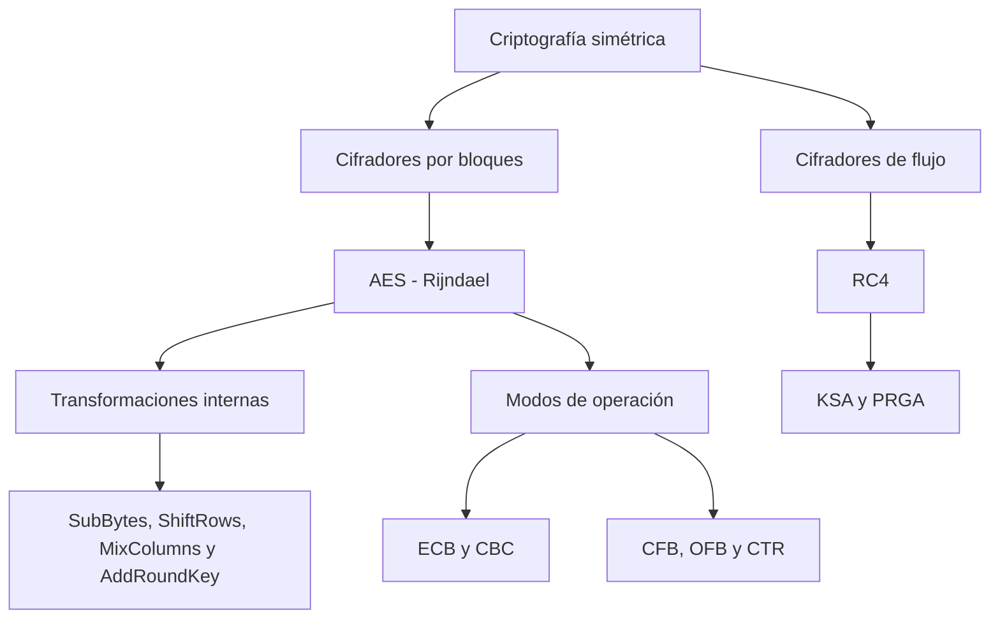
  
La idea fundamental es que **AES define cómo cifrar un bloque**, mientras que los **modos de operación determinan cómo utilizar ese cifrador sobre mensajes completos**. RC4, en cambio, utiliza directamente una secuencia de cifrado generada por un estado interno.  
  
---  
  
## Advanced Encryption Standard (AES)  
  
**Advanced Encryption Standard (AES)** es un algoritmo de cifrado simétrico por bloques basado en Rijndael, desarrollado por Joan Daemen y Vincent Rijmen.  
  
AES fue seleccionado para proporcionar un mecanismo de cifrado eficiente y resistente a los ataques criptográficos conocidos durante su diseño.  
  
Entre sus características principales se encuentran:  
  
- Utiliza una clave secreta compartida.  
- Procesa bloques de información de $128$ bits.  
- Admite claves de $128$, $192$ y $256$ bits.  
- Utiliza una estructura iterativa de sustitución y permutación.  
- Procesa el bloque completo durante cada ronda.  
- Puede implementarse eficientemente mediante operaciones sobre bytes.  
  
A diferencia de los cifradores construidos mediante una **red Feistel**, AES no divide el bloque en dos mitades para transformar una de ellas y después intercambiarlas. En su lugar, aplica transformaciones invertibles sobre el estado completo.  
  
### Tamaños de bloque y de clave:  
  
AES siempre procesa bloques de:  
  
$$  
\boxed{128\text{ bits}}  
$$  
  
Esto equivale a:  
  
$$  
128\div8=16\text{ bytes}  
$$  
  
Sin embargo, admite diferentes longitudes de clave.  
  
| Configuración | Bloque | Clave | Rondas |  
|---|---|---|---|  
| AES-128 | $128$ bits | $128$ bits | $10$ |  
| AES-192 | $128$ bits | $192$ bits | $12$ |  
| AES-256 | $128$ bits | $256$ bits | $14$ |  
  
El número de rondas aumenta con la longitud de la clave.  
  
Es importante distinguir que **el tamaño del bloque no cambia entre las tres configuraciones**. Lo que cambia es la longitud de la clave y el número de rondas necesarias para completar el cifrado.  
  
### Objetivos del diseño:  
  
AES fue diseñado considerando tres aspectos principales:  
  
**Resistencia criptográfica.** Las transformaciones deben dificultar los ataques que intentan relacionar estadísticamente los mensajes originales con sus versiones cifradas.  
  
**Eficiencia.** Las operaciones deben poder implementarse con un costo computacional razonable en diferentes procesadores.  
  
**Simplicidad estructural.** El algoritmo utiliza un conjunto reducido de transformaciones bien definidas, repetidas durante diferentes rondas.  
  
Esto permite implementar AES tanto mediante operaciones sobre bytes como mediante técnicas de optimización específicas de la plataforma.  
  
---  
  
## Estructura de datos de AES  
  
AES organiza cada bloque de información en una matriz denominada **State** o estado.  
  
La matriz contiene cuatro filas y cuatro columnas.  
  
Cada posición almacena un byte.  
  
Por lo tanto:  
  
$$  
4\times4=16\text{ bytes}  
$$  
  
Y:  
  
$$  
16\times8=128\text{ bits}  
$$  
  
### Matriz State:  
  
La representación general es:  
  
$$  
S=  
\begin{bmatrix}  
s_{0,0}&s_{0,1}&s_{0,2}&s_{0,3}\\  
s_{1,0}&s_{1,1}&s_{1,2}&s_{1,3}\\  
s_{2,0}&s_{2,1}&s_{2,2}&s_{2,3}\\  
s_{3,0}&s_{3,1}&s_{3,2}&s_{3,3}  
\end{bmatrix}  
$$  
  
En donde cada elemento $s_{i,j}$ representa un byte.  
  
La característica importante es que **los bytes de entrada se organizan por columnas**, no por filas.  
  
###### Ejemplo práctico:  
  
Supóngase que el bloque contiene:  
  
```text  
00 11 22 33 44 55 66 77 88 99 AA BB CC DD EE FF  
```  
  
Los primeros cuatro bytes forman la primera columna:  
  
$$  
\begin{bmatrix}  
\texttt{00}\\  
\texttt{11}\\  
\texttt{22}\\  
\texttt{33}  
\end{bmatrix}  
$$  
  
Los siguientes cuatro forman la segunda columna, y así sucesivamente.  
  
La matriz resultante es:  
  
$$  
\boxed{  
S=  
\begin{bmatrix}  
\texttt{00}&\texttt{44}&\texttt{88}&\texttt{CC}\\  
\texttt{11}&\texttt{55}&\texttt{99}&\texttt{DD}\\  
\texttt{22}&\texttt{66}&\texttt{AA}&\texttt{EE}\\  
\texttt{33}&\texttt{77}&\texttt{BB}&\texttt{FF}  
\end{bmatrix}  
}  
$$  
  
Esta matriz se modifica progresivamente durante el cifrado.  
  
### Representación de la clave:  
  
La clave también se organiza mediante palabras de $32$ bits.  
  
Cada palabra contiene:  
  
$$  
32\div8=4\text{ bytes}  
$$  
  
AES utiliza un procedimiento denominado **Key Expansion** para generar las palabras necesarias para todas las claves de ronda.  
  
Para AES-128, la clave inicial contiene cuatro palabras.  
  
Después de la expansión se obtienen:  
  
$$  
44\text{ palabras}  
$$  
  
Estas se agrupan en once claves de ronda de $128$ bits cada una.  
  
---  
  
## Estructura general del cifrado AES  
  
AES transforma el estado mediante una operación inicial, varias rondas completas y una ronda final.  
  
Las transformaciones fundamentales son:  
  
1. **SubBytes (BS):** sustituye cada byte mediante una tabla.  
2. **ShiftRows (SR):** desplaza circularmente las filas.  
3. **MixColumns (MC):** combina los bytes de cada columna mediante operaciones en $GF(2^8)$.  
4. **AddRoundKey (ARK):** combina el estado con una clave de ronda mediante XOR.  
  
Cada transformación cumple una función diferente dentro del algoritmo.  
  
### Organización de AES-128:  
  
AES-128 utiliza diez rondas, pero las operaciones no son idénticas en todas ellas.  
  
Primero se aplica una operación inicial:  
  
$$  
\operatorname{AddRoundKey}  
$$  
  
Después se ejecutan nueve rondas completas:  
  
$$  
\boxed{  
\operatorname{SubBytes}  
\rightarrow  
\operatorname{ShiftRows}  
\rightarrow  
\operatorname{MixColumns}  
\rightarrow  
\operatorname{AddRoundKey}  
}  
$$  
  
Finalmente, la décima ronda utiliza:  
  
$$  
\boxed{  
\operatorname{SubBytes}  
\rightarrow  
\operatorname{ShiftRows}  
\rightarrow  
\operatorname{AddRoundKey}  
}  
$$  
  
La última ronda no incluye MixColumns.  
  
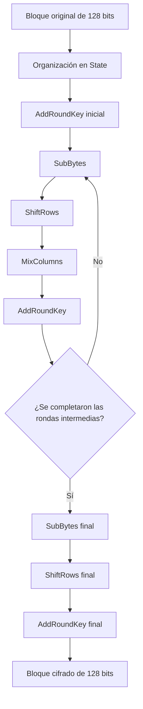
  
La omisión de MixColumns en la ronda final forma parte de la estructura especificada de AES. **No significa que MixColumns sea irreversible**, ya que existe una transformación inversa definida matemáticamente.  
  
### Función de cada transformación:  
  
| Transformación | Operación | Objetivo |  
|---|---|---|  
| SubBytes | Sustitución mediante S-Box | Introducir no linealidad |  
| ShiftRows | Desplazamiento circular | Redistribuir bytes entre columnas |  
| MixColumns | Multiplicación matricial en $GF(2^8)$ | Difundir información dentro de las columnas |  
| AddRoundKey | XOR con clave de ronda | Incorporar material secreto |  
  
La seguridad del algoritmo depende de la combinación repetida de estas operaciones, no de una transformación individual.  
  
---  
  
## Transformación SubBytes  
  
**SubBytes** es una operación de sustitución que reemplaza cada byte del estado mediante un valor obtenido de una tabla denominada **S-Box**.  
  
La tabla contiene:  
  
$$  
16\times16=256  
$$  
  
entradas.  
  
Cada entrada corresponde a uno de los $256$ valores posibles de un byte.  
  
### Funcionamiento de la S-Box:  
  
Para consultar la tabla se utiliza la representación hexadecimal del byte original.  
  
El primer dígito indica la fila.  
  
El segundo dígito indica la columna.  
  
Por ejemplo, el byte:  
  
$$  
\texttt{95}  
$$  
  
se consulta utilizando:  
  
- Fila hexadecimal $\texttt{9}$.  
- Columna hexadecimal $\texttt{5}$.  
  
En esa posición se encuentra:  
  
$$  
\texttt{2A}  
$$  
  
Por lo tanto:  
  
$$  
\boxed{S(\texttt{95})=\texttt{2A}}  
$$  
  
### Aplicación sobre el estado:  
  
SubBytes se aplica individualmente a los dieciséis bytes.  
  
Supóngase que el estado original es:  
  
$$  
S=  
\begin{bmatrix}  
\texttt{EA}&\texttt{04}&\texttt{65}&\texttt{85}\\  
\texttt{83}&\texttt{45}&\texttt{5D}&\texttt{96}\\  
\texttt{5C}&\texttt{33}&\texttt{98}&\texttt{B0}\\  
\texttt{F0}&\texttt{2D}&\texttt{AD}&\texttt{C5}  
\end{bmatrix}  
$$  
  
Cada byte se sustituye mediante la S-Box.  
  
El resultado es:  
  
$$  
\boxed{  
S'=  
\begin{bmatrix}  
\texttt{87}&\texttt{F2}&\texttt{4D}&\texttt{97}\\  
\texttt{EC}&\texttt{6E}&\texttt{4C}&\texttt{90}\\  
\texttt{4A}&\texttt{C3}&\texttt{46}&\texttt{E7}\\  
\texttt{8C}&\texttt{D8}&\texttt{95}&\texttt{A6}  
\end{bmatrix}  
}  
$$  
  
La posición de los bytes no cambia durante SubBytes.  
  
Lo que cambia es su valor.  
  
### Importancia criptográfica:  
  
SubBytes introduce **no linealidad**.  
  
Esto significa que la relación entre el byte original y el byte sustituido no puede describirse mediante una transformación lineal sencilla sobre los bits.  
  
La no linealidad contribuye a dificultar ataques como el criptoanálisis lineal y diferencial.  
  
---  
  
## Construcción matemática de la S-Box  
  
La S-Box de AES no se construye seleccionando sustituciones arbitrarias.  
  
Sus entradas se obtienen mediante operaciones matemáticas definidas sobre:  
  
$$  
GF(2^8)  
$$  
  
El procedimiento utiliza dos transformaciones principales:  
  
1. Cálculo del inverso multiplicativo.  
2. Aplicación de una transformación afín.  
  
### Inverso multiplicativo:  
  
Cada byte distinto de cero se interpreta como un polinomio del campo:  
  
$$  
GF(2^8)  
$$  
  
Se calcula su inverso multiplicativo utilizando el polinomio irreducible:  
  
$$  
\boxed{m(x)=x^8+x^4+x^3+x+1}  
$$  
  
Este polinomio se representa en hexadecimal como:  
  
$$  
\boxed{\texttt{0x11B}}  
$$  
  
Para un byte $a$ distinto de cero, su inverso satisface:  
  
$$  
\boxed{a\otimes a^{-1}=\texttt{01}}  
$$  
  
En donde $\otimes$ representa la multiplicación dentro de $GF(2^8)$.  
  
El byte:  
  
$$  
\texttt{00}  
$$  
  
no tiene inverso multiplicativo.  
  
Por esta razón, se establece que el cero permanezca en cero durante esta primera etapa.  
  
### Transformación afín:  
  
Después de calcular el inverso multiplicativo se aplica una transformación sobre sus ocho bits.  
  
La transformación se define mediante:  
  
$$  
\boxed{  
b_i'=  
b_i  
\oplus b_{(i+4)\bmod8}  
\oplus b_{(i+5)\bmod8}  
\oplus b_{(i+6)\bmod8}  
\oplus b_{(i+7)\bmod8}  
\oplus c_i  
}  
$$  
  
En donde:  
  
- $b_i$ es el bit de la representación obtenida después de calcular el inverso multiplicativo.  
- $b_i'$ es el bit resultante.  
- $c_i$ es el bit correspondiente de una constante fija.  
- $\oplus$ representa XOR.  
  
La constante utilizada es:  
  
$$  
\boxed{\texttt{63}}  
$$  
  
En binario:  
  
$$  
01100011  
$$  
  
La transformación introduce una relación adicional entre los bits y contribuye a las propiedades no lineales de la S-Box.  
  
### Proceso de construcción:  
  
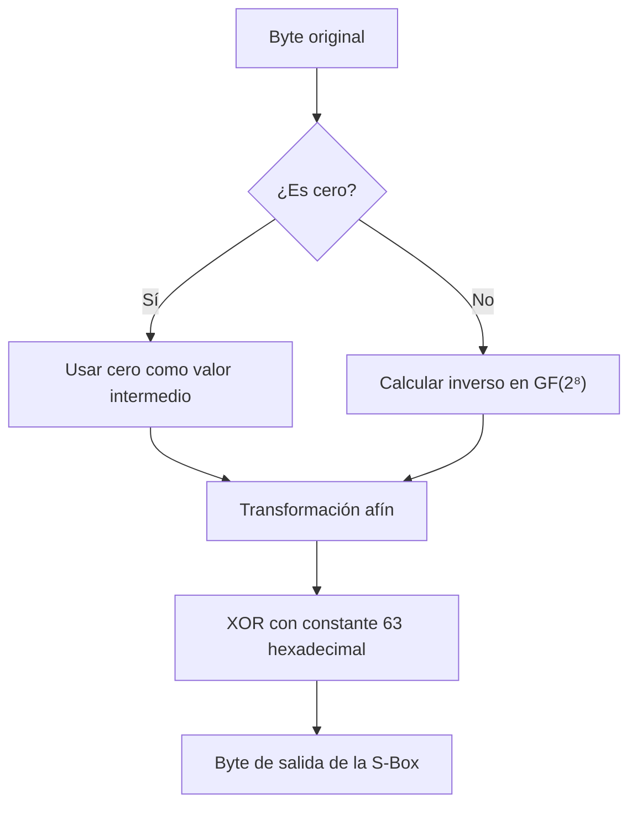
  
### Ejemplo: construcción de la sustitución 95 → 2A:  
  
Considérese el byte:  
  
$$  
\texttt{95}  
$$  
  
Su inverso multiplicativo en $GF(2^8)$ es:  
  
$$  
\boxed{\texttt{95}^{-1}=\texttt{8A}}  
$$  
  
En binario:  
  
$$  
\texttt{8A}=10001010  
$$  
  
A continuación se aplica la transformación afín.  
  
La operación produce:  
  
$$  
00101010  
$$  
  
Esta palabra corresponde al hexadecimal:  
  
$$  
\texttt{2A}  
$$  
  
Por lo tanto:  
  
$$  
\boxed{S(\texttt{95})=\texttt{2A}}  
$$  
  
Este ejemplo demuestra que la sustitución de un byte está determinada por operaciones algebraicas y no por una tabla seleccionada al azar.  
  
---  
  
## Transformación inversa de SubBytes  
  
Para descifrar información es necesario revertir la sustitución realizada por SubBytes.  
  
Esto se consigue mediante una tabla denominada **Inverse S-Box**.  
  
Si la S-Box transforma:  
  
$$  
a\longrightarrow b  
$$  
  
La tabla inversa permite recuperar:  
  
$$  
b\longrightarrow a  
$$  
  
Por ejemplo:  
  
$$  
S(\texttt{95})=\texttt{2A}  
$$  
  
Por lo tanto:  
  
$$  
\boxed{S^{-1}(\texttt{2A})=\texttt{95}}  
$$  
  
### Construcción de la transformación inversa:  
  
La transformación afín inversa puede expresarse mediante:  
  
$$  
\boxed{  
b_i'=  
b_{(i+2)\bmod8}  
\oplus b_{(i+5)\bmod8}  
\oplus b_{(i+7)\bmod8}  
\oplus d_i  
}  
$$  
  
En donde los bits $d_i$ pertenecen a la constante:  
  
$$  
\boxed{\texttt{05}}  
$$  
  
En binario:  
  
$$  
00000101  
$$  
  
Para recuperar el valor original se invierte primero la transformación afín y posteriormente se aplica el inverso multiplicativo correspondiente dentro de $GF(2^8)$.  
  
### Interpretación:  
  
La S-Box es una permutación de los $256$ valores posibles.  
  
Por lo tanto, cada byte tiene exactamente una sustitución y cada valor sustituido corresponde a un único byte original.  
  
Esta propiedad permite que SubBytes sea reversible sin perder la no linealidad necesaria para el cifrado.  
  
---  
  
## Transformación ShiftRows  
  
**ShiftRows** es una transformación que reorganiza los bytes del estado mediante desplazamientos circulares hacia la izquierda.  
  
A diferencia de SubBytes, esta operación no modifica los valores individuales de los bytes.  
  
Únicamente modifica sus posiciones.  
  
### Desplazamientos de las filas:  
  
Cada fila utiliza una cantidad distinta de desplazamientos.  
  
| Fila | Desplazamiento circular |  
|---|---|  
| Primera | $0$ posiciones |  
| Segunda | $1$ posición |  
| Tercera | $2$ posiciones |  
| Cuarta | $3$ posiciones |  
  
El desplazamiento es circular porque los elementos que salen por el extremo izquierdo regresan por el extremo derecho.  
  
### Representación general:  
  
El estado original es:  
  
$$  
S=  
\begin{bmatrix}  
s_{0,0}&s_{0,1}&s_{0,2}&s_{0,3}\\  
s_{1,0}&s_{1,1}&s_{1,2}&s_{1,3}\\  
s_{2,0}&s_{2,1}&s_{2,2}&s_{2,3}\\  
s_{3,0}&s_{3,1}&s_{3,2}&s_{3,3}  
\end{bmatrix}  
$$  
  
Después de ShiftRows:  
  
$$  
\boxed{  
S'=  
\begin{bmatrix}  
s_{0,0}&s_{0,1}&s_{0,2}&s_{0,3}\\  
s_{1,1}&s_{1,2}&s_{1,3}&s_{1,0}\\  
s_{2,2}&s_{2,3}&s_{2,0}&s_{2,1}\\  
s_{3,3}&s_{3,0}&s_{3,1}&s_{3,2}  
\end{bmatrix}  
}  
$$  
  
### Ejemplo práctico:  
  
Se utiliza el estado obtenido después de SubBytes:  
  
$$  
S=  
\begin{bmatrix}  
\texttt{87}&\texttt{F2}&\texttt{4D}&\texttt{97}\\  
\texttt{EC}&\texttt{6E}&\texttt{4C}&\texttt{90}\\  
\texttt{4A}&\texttt{C3}&\texttt{46}&\texttt{E7}\\  
\texttt{8C}&\texttt{D8}&\texttt{95}&\texttt{A6}  
\end{bmatrix}  
$$  
  
La primera fila permanece igual:  
  
$$  
[\texttt{87},\texttt{F2},\texttt{4D},\texttt{97}]  
$$  
  
La segunda se desplaza una posición:  
  
$$  
[\texttt{6E},\texttt{4C},\texttt{90},\texttt{EC}]  
$$  
  
La tercera se desplaza dos posiciones:  
  
$$  
[\texttt{46},\texttt{E7},\texttt{4A},\texttt{C3}]  
$$  
  
La cuarta se desplaza tres posiciones:  
  
$$  
[\texttt{A6},\texttt{8C},\texttt{D8},\texttt{95}]  
$$  
  
El resultado es:  
  
$$  
\boxed{  
S'=  
\begin{bmatrix}  
\texttt{87}&\texttt{F2}&\texttt{4D}&\texttt{97}\\  
\texttt{6E}&\texttt{4C}&\texttt{90}&\texttt{EC}\\  
\texttt{46}&\texttt{E7}&\texttt{4A}&\texttt{C3}\\  
\texttt{A6}&\texttt{8C}&\texttt{D8}&\texttt{95}  
\end{bmatrix}  
}  
$$  
  
### Función criptográfica:  
  
ShiftRows contribuye a la **difusión**.  
  
Esto ocurre porque redistribuye los bytes entre diferentes columnas.  
  
Posteriormente, MixColumns combina los bytes de cada columna. Por lo tanto, la redistribución realizada por ShiftRows permite que la información de una columna influya en otras columnas durante las rondas siguientes.  
  
### InvShiftRows:  
  
La transformación inversa realiza desplazamientos circulares hacia la derecha.  
  
Cada fila se desplaza la misma cantidad de posiciones que durante el cifrado, pero en sentido contrario.  
  
---  
  
## Transformación MixColumns  
  
**MixColumns** combina matemáticamente los cuatro bytes de cada columna mediante una multiplicación matricial.  
  
Las operaciones se realizan en:  
  
$$  
GF(2^8)  
$$  
  
Por lo tanto, no se utiliza la multiplicación ordinaria de enteros.  
  
En su lugar, los bytes se interpretan como polinomios que se multiplican y reducen módulo:  
  
$$  
\boxed{m(x)=x^8+x^4+x^3+x+1}  
$$  
  
### Matriz de transformación:  
  
La matriz utilizada es:  
  
$$  
\boxed{  
M=  
\begin{bmatrix}  
\texttt{02}&\texttt{03}&\texttt{01}&\texttt{01}\\  
\texttt{01}&\texttt{02}&\texttt{03}&\texttt{01}\\  
\texttt{01}&\texttt{01}&\texttt{02}&\texttt{03}\\  
\texttt{03}&\texttt{01}&\texttt{01}&\texttt{02}  
\end{bmatrix}  
}  
$$  
  
Cada columna del estado se multiplica por esta matriz.  
  
Si la columna original es:  
  
$$  
\begin{bmatrix}  
s_0\\  
s_1\\  
s_2\\  
s_3  
\end{bmatrix}  
$$  
  
La transformación produce:  
  
$$  
\begin{bmatrix}  
s_0'\\  
s_1'\\  
s_2'\\  
s_3'  
\end{bmatrix}  
=  
M  
\begin{bmatrix}  
s_0\\  
s_1\\  
s_2\\  
s_3  
\end{bmatrix}  
$$  
  
### Ecuaciones de MixColumns:  
  
El primer byte se calcula mediante:  
  
$$  
\boxed{  
s_0'=  
(\texttt{02}\otimes s_0)  
\oplus  
(\texttt{03}\otimes s_1)  
\oplus s_2  
\oplus s_3  
}  
$$  
  
El segundo:  
  
$$  
s_1'=  
s_0  
\oplus(\texttt{02}\otimes s_1)  
\oplus(\texttt{03}\otimes s_2)  
\oplus s_3  
$$  
  
El tercero:  
  
$$  
s_2'=  
s_0\oplus s_1  
\oplus(\texttt{02}\otimes s_2)  
\oplus(\texttt{03}\otimes s_3)  
$$  
  
Y el cuarto:  
  
$$  
s_3'=  
(\texttt{03}\otimes s_0)  
\oplus s_1\oplus s_2  
\oplus(\texttt{02}\otimes s_3)  
$$  
  
En estas expresiones:  
  
- $\otimes$ representa multiplicación en $GF(2^8)$.  
- $\oplus$ representa XOR.  
  
### Función criptográfica:  
  
MixColumns permite que cada byte de salida dependa de los cuatro bytes originales de la columna.  
  
Así, una modificación en un byte puede afectar diferentes posiciones del estado.  
  
En combinación con ShiftRows, esto contribuye a extender los cambios a través del bloque durante las rondas sucesivas.  
  
---  
  
## Multiplicación en GF(2⁸) utilizada por MixColumns  
  
La matriz MixColumns utiliza principalmente los coeficientes:  
  
$$  
\texttt{01},\quad\texttt{02},\quad\texttt{03}  
$$  
  
Por esta razón, resulta importante comprender cómo se multiplican bytes por estos valores.  
  
### Multiplicación por 01:  
  
Multiplicar por uno no modifica el elemento.  
  
$$  
\boxed{\texttt{01}\otimes a=a}  
$$  
  
### Multiplicación por 02:  
  
El hexadecimal:  
  
$$  
\texttt{02}  
$$  
  
representa el polinomio:  
  
$$  
x  
$$  
  
Por lo tanto, multiplicar por $\texttt{02}$ equivale a multiplicar el polinomio del byte por $x$.  
  
En la representación binaria se realiza un desplazamiento de un bit hacia la izquierda.  
  
Sin embargo, si el bit más significativo original es uno, el resultado debe reducirse mediante XOR con:  
  
$$  
\boxed{\texttt{1B}}  
$$  
  
Esta constante corresponde a los términos restantes del polinomio irreducible después de eliminar $x^8$:  
  
$$  
x^4+x^3+x+1  
$$  
  
### Función xtime:  
  
La multiplicación por $\texttt{02}$ puede expresarse mediante:  
  
$$  
\boxed{  
\operatorname{xtime}(a)=  
\begin{cases}  
(a\ll1),&\text{si el bit más significativo es }0\\  
(a\ll1)\oplus\texttt{1B},&\text{si es }1  
\end{cases}  
}  
$$  
  
En ambos casos se conserva únicamente el resultado de ocho bits.  
  
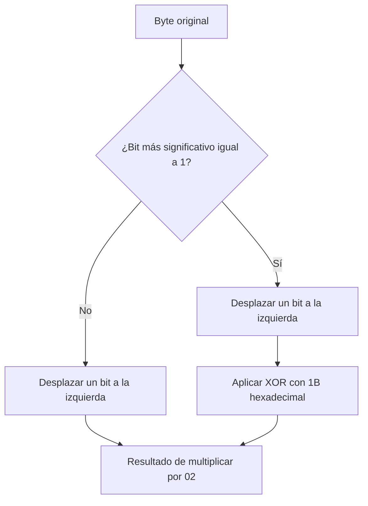
  
### Multiplicación por 03:  
  
El valor:  
  
$$  
\texttt{03}  
$$  
  
representa:  
  
$$  
x+1  
$$  
  
Por lo tanto:  
  
$$  
\texttt{03}\otimes a=(x+1)a  
$$  
  
Distribuyendo:  
  
$$  
xa+a  
$$  
  
En hexadecimal:  
  
$$  
\boxed{  
\texttt{03}\otimes a=  
(\texttt{02}\otimes a)\oplus a  
}  
$$  
  
Esta identidad simplifica considerablemente las operaciones de MixColumns.  
  
### Ejemplo: multiplicar 87 por 02:  
  
El byte hexadecimal:  
  
$$  
\texttt{87}  
$$  
  
corresponde a:  
  
$$  
10000111  
$$  
  
Su bit más significativo es uno.  
  
Al desplazar un bit a la izquierda y conservar ocho bits:  
  
$$  
00001110  
$$  
  
En hexadecimal:  
  
$$  
\texttt{0E}  
$$  
  
Como el bit original era uno, se aplica:  
  
$$  
\texttt{0E}\oplus\texttt{1B}  
$$  
  
El resultado es:  
  
$$  
\boxed{\texttt{02}\otimes\texttt{87}=\texttt{15}}  
$$  
  
### Ejemplo: multiplicar 6E por 02 y 03:  
  
El byte:  
  
$$  
\texttt{6E}  
$$  
  
corresponde a:  
  
$$  
01101110  
$$  
  
El bit más significativo es cero.  
  
Por lo tanto, basta desplazar:  
  
$$  
11011100  
$$  
  
En hexadecimal:  
  
$$  
\boxed{\texttt{02}\otimes\texttt{6E}=\texttt{DC}}  
$$  
  
Para multiplicar por tres:  
  
$$  
\texttt{03}\otimes\texttt{6E}  
=  
\texttt{DC}\oplus\texttt{6E}  
$$  
  
Por lo tanto:  
  
$$  
\boxed{\texttt{03}\otimes\texttt{6E}=\texttt{B2}}  
$$  
  
---  
  
## Ejemplo completo de MixColumns  
  
Se utiliza el estado obtenido después de ShiftRows:  
  
$$  
S=  
\begin{bmatrix}  
\texttt{87}&\texttt{F2}&\texttt{4D}&\texttt{97}\\  
\texttt{6E}&\texttt{4C}&\texttt{90}&\texttt{EC}\\  
\texttt{46}&\texttt{E7}&\texttt{4A}&\texttt{C3}\\  
\texttt{A6}&\texttt{8C}&\texttt{D8}&\texttt{95}  
\end{bmatrix}  
$$  
  
Se desea aplicar MixColumns.  
  
Cada columna se procesa independientemente.  
  
### Primera columna:  
  
La columna original es:  
  
$$  
\begin{bmatrix}  
\texttt{87}\\  
\texttt{6E}\\  
\texttt{46}\\  
\texttt{A6}  
\end{bmatrix}  
$$  
  
El primer byte se calcula como:  
  
$$  
s_0'=  
(\texttt{02}\otimes\texttt{87})  
\oplus  
(\texttt{03}\otimes\texttt{6E})  
\oplus  
\texttt{46}  
\oplus  
\texttt{A6}  
$$  
  
Se conocen:  
  
$$  
\texttt{02}\otimes\texttt{87}=\texttt{15}  
$$  
  
Y:  
  
$$  
\texttt{03}\otimes\texttt{6E}=\texttt{B2}  
$$  
  
Sustituyendo:  
  
$$  
s_0'=  
\texttt{15}\oplus\texttt{B2}  
\oplus\texttt{46}\oplus\texttt{A6}  
$$  
  
Primero:  
  
$$  
\texttt{15}\oplus\texttt{B2}=\texttt{A7}  
$$  
  
Después:  
  
$$  
\texttt{A7}\oplus\texttt{46}=\texttt{E1}  
$$  
  
Finalmente:  
  
$$  
\texttt{E1}\oplus\texttt{A6}=\texttt{47}  
$$  
  
Por lo tanto:  
  
$$  
\boxed{s_0'=\texttt{47}}  
$$  
  
Aplicando el mismo procedimiento a los otros tres bytes se obtiene:  
  
$$  
\begin{bmatrix}  
\texttt{47}\\  
\texttt{37}\\  
\texttt{94}\\  
\texttt{ED}  
\end{bmatrix}  
$$  
  
### Transformación de todas las columnas:  
  
Después de aplicar la matriz MixColumns a las cuatro columnas, el estado resultante es:  
  
$$  
\boxed{  
S'=  
\begin{bmatrix}  
\texttt{47}&\texttt{40}&\texttt{A3}&\texttt{4C}\\  
\texttt{37}&\texttt{D4}&\texttt{70}&\texttt{9F}\\  
\texttt{94}&\texttt{E4}&\texttt{3A}&\texttt{42}\\  
\texttt{ED}&\texttt{A5}&\texttt{A6}&\texttt{BC}  
\end{bmatrix}  
}  
$$  
  
Este ejemplo muestra que MixColumns no modifica la posición de las columnas, sino sus valores internos.  
  
Cada nueva columna depende de los cuatro bytes que contenía previamente.  
  
---  
  
## Transformación inversa de MixColumns  
  
MixColumns es reversible porque la matriz utilizada tiene una inversa multiplicativa sobre:  
  
$$  
GF(2^8)  
$$  
  
La transformación inversa se denomina:  
  
**InvMixColumns**.  
  
### Matriz inversa:  
  
Se utiliza:  
  
$$  
\boxed{  
M^{-1}=  
\begin{bmatrix}  
\texttt{0E}&\texttt{0B}&\texttt{0D}&\texttt{09}\\  
\texttt{09}&\texttt{0E}&\texttt{0B}&\texttt{0D}\\  
\texttt{0D}&\texttt{09}&\texttt{0E}&\texttt{0B}\\  
\texttt{0B}&\texttt{0D}&\texttt{09}&\texttt{0E}  
\end{bmatrix}  
}  
$$  
  
Esta matriz satisface:  
  
$$  
\boxed{M^{-1}M=I}  
$$  
  
En donde $I$ representa la matriz identidad.  
  
Por lo tanto, si:  
  
$$  
S'=MS  
$$  
  
Entonces:  
  
$$  
M^{-1}S'=M^{-1}MS  
$$  
  
Y:  
  
$$  
\boxed{S=M^{-1}S'}  
$$  
  
### Interpretación:  
  
La existencia de una matriz inversa garantiza que ninguna información se pierde durante MixColumns.  
  
La operación puede revertirse completamente si se aplica la transformación inversa correspondiente.  
  
Esto resulta indispensable para el descifrado AES.  
  
---  
  
## Transformación AddRoundKey  
  
**AddRoundKey** combina el estado con una clave de ronda mediante operaciones XOR.  
  
La clave de ronda contiene:  
  
$$  
128\text{ bits}  
$$  
  
Por lo tanto, puede organizarse en una matriz de:  
  
$$  
4\times4  
$$  
  
bytes.  
  
### Operación general:  
  
Si $S$ es el estado y $K$ es la clave de ronda:  
  
$$  
\boxed{S'=S\oplus K}  
$$  
  
La operación se realiza byte por byte en las posiciones correspondientes.  
  
### Ejemplo práctico:  
  
Se utiliza el estado obtenido después de MixColumns:  
  
$$  
S=  
\begin{bmatrix}  
\texttt{47}&\texttt{40}&\texttt{A3}&\texttt{4C}\\  
\texttt{37}&\texttt{D4}&\texttt{70}&\texttt{9F}\\  
\texttt{94}&\texttt{E4}&\texttt{3A}&\texttt{42}\\  
\texttt{ED}&\texttt{A5}&\texttt{A6}&\texttt{BC}  
\end{bmatrix}  
$$  
  
La clave de ronda es:  
  
$$  
K=  
\begin{bmatrix}  
\texttt{AC}&\texttt{19}&\texttt{28}&\texttt{57}\\  
\texttt{77}&\texttt{FA}&\texttt{D1}&\texttt{5C}\\  
\texttt{66}&\texttt{DC}&\texttt{29}&\texttt{00}\\  
\texttt{F3}&\texttt{21}&\texttt{41}&\texttt{6A}  
\end{bmatrix}  
$$  
  
Se aplica XOR entre los bytes correspondientes.  
  
Por ejemplo:  
  
$$  
\texttt{47}\oplus\texttt{AC}=\texttt{EB}  
$$  
  
$$  
\texttt{40}\oplus\texttt{19}=\texttt{59}  
$$  
  
$$  
\texttt{37}\oplus\texttt{77}=\texttt{40}  
$$  
  
$$  
\texttt{D4}\oplus\texttt{FA}=\texttt{2E}  
$$  
  
Después de aplicar la operación a los dieciséis bytes se obtiene:  
  
$$  
\boxed{  
S'=  
\begin{bmatrix}  
\texttt{EB}&\texttt{59}&\texttt{8B}&\texttt{1B}\\  
\texttt{40}&\texttt{2E}&\texttt{A1}&\texttt{C3}\\  
\texttt{F2}&\texttt{38}&\texttt{13}&\texttt{42}\\  
\texttt{1E}&\texttt{84}&\texttt{E7}&\texttt{D2}  
\end{bmatrix}  
}  
$$  
  
### Propiedad de reversibilidad:  
  
XOR posee una propiedad fundamental:  
  
$$  
a\oplus b\oplus b=a  
$$  
  
Por lo tanto:  
  
$$  
(S\oplus K)\oplus K=S  
$$  
  
Esto significa que AddRoundKey es su propia inversa.  
  
No necesita una transformación distinta durante el descifrado.  
  
### Función criptográfica:  
  
AddRoundKey incorpora la información secreta derivada de la clave original.  
  
Sin esta operación, las sustituciones y permutaciones de AES serían transformaciones públicas, completamente determinadas y sin dependencia de una clave secreta.  
  
---  
  
## Expansión de claves AES  
  
La **expansión de claves (Key Expansion)** es el procedimiento mediante el cual AES genera las claves utilizadas durante sus rondas.  
  
La clave original no se aplica directamente de manera idéntica en todas las rondas.  
  
En su lugar, se transforma para producir una secuencia de palabras.  
  
### Estructura de la expansión:  
  
Cada palabra contiene:  
  
$$  
32\text{ bits}=4\text{ bytes}  
$$  
  
La cantidad de palabras generadas depende de la longitud de la clave original.  
  
| Algoritmo | Palabras iniciales | Palabras expandidas | Claves de ronda |  
|---|---|---|---|  
| AES-128 | $4$ | $44$ | $11$ |  
| AES-192 | $6$ | $52$ | $13$ |  
| AES-256 | $8$ | $60$ | $15$ |  
  
Cada clave de ronda contiene cuatro palabras.  
  
Por lo tanto:  
  
$$  
4\times32=128\text{ bits}  
$$  
  
### Expansión de AES-128:  
  
La clave original de $16$ bytes se copia directamente en las primeras cuatro palabras:  
  
$$  
w_0,w_1,w_2,w_3  
$$  
  
Después se calculan las palabras restantes:  
  
$$  
w_4,w_5,\ldots,w_{43}  
$$  
  
La mayoría de las palabras se obtienen mediante XOR.  
  
Cuando el índice no es múltiplo de cuatro:  
  
$$  
\boxed{w_i=w_{i-4}\oplus w_{i-1}}  
$$  
  
Cuando el índice es múltiplo de cuatro se aplica una transformación adicional:  
  
$$  
\boxed{  
w_i=  
w_{i-4}  
\oplus  
\left[  
\operatorname{SubWord}(\operatorname{RotWord}(w_{i-1}))  
\oplus\operatorname{Rcon}(i/4)  
\right]  
}  
$$  
  
### RotWord:  
  
RotWord desplaza circularmente una palabra de cuatro bytes una posición hacia la izquierda.  
  
Por ejemplo:  
  
$$  
[b_0,b_1,b_2,b_3]  
$$  
  
Se transforma en:  
  
$$  
\boxed{[b_1,b_2,b_3,b_0]}  
$$  
  
###### Ejemplo:  
  
$$  
\operatorname{RotWord}(\texttt{7F 8D 29 2F})  
$$  
  
Produce:  
  
$$  
\boxed{\texttt{8D 29 2F 7F}}  
$$  
  
### SubWord:  
  
SubWord aplica la S-Box de AES individualmente a los cuatro bytes de una palabra.  
  
Por ejemplo:  
  
$$  
\operatorname{SubWord}(\texttt{8D 29 2F 7F})  
$$  
  
Produce:  
  
$$  
\boxed{\texttt{5D A5 15 D2}}  
$$  
  
### Rcon:  
  
Rcon es una constante de ronda.  
  
Su estructura es:  
  
$$  
\boxed{\operatorname{Rcon}(j)=[RC(j),0,0,0]}  
$$  
  
En donde los valores $RC(j)$ forman una secuencia generada mediante multiplicaciones por dos dentro de $GF(2^8)$.  
  
Las constantes introducen diferencias entre las transformaciones utilizadas durante las sucesivas rondas.  
  
### Diagrama de expansión:  
  
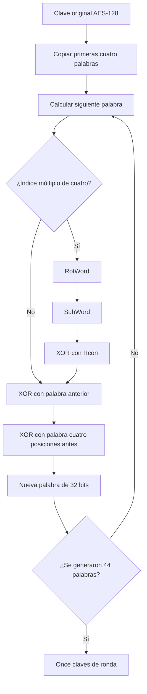
  
---  
  
## Ejemplo completo de expansión de claves AES  
  
Se desea calcular una clave de ronda de AES-128.  
  
Se conocen las cuatro palabras correspondientes a la ronda anterior:  
  
$$  
w_{32}=\texttt{EA D2 73 21}  
$$  
  
$$  
w_{33}=\texttt{B5 8D BA D2}  
$$  
  
$$  
w_{34}=\texttt{31 2B F5 60}  
$$  
  
$$  
w_{35}=\texttt{7F 8D 29 2F}  
$$  
  
Se desea calcular:  
  
$$  
w_{36},w_{37},w_{38},w_{39}  
$$  
  
### Cálculo de la palabra 36:  
  
Como:  
  
$$  
36\bmod4=0  
$$  
  
Se utiliza la transformación especial.  
  
Primero se toma:  
  
$$  
w_{35}=\texttt{7F 8D 29 2F}  
$$  
  
Se aplica RotWord:  
  
$$  
\operatorname{RotWord}(w_{35})=  
\texttt{8D 29 2F 7F}  
$$  
  
Después SubWord:  
  
$$  
\operatorname{SubWord}=  
\texttt{5D A5 15 D2}  
$$  
  
La constante correspondiente es:  
  
$$  
\operatorname{Rcon}(9)=\texttt{1B 00 00 00}  
$$  
  
Se aplica XOR:  
  
$$  
\texttt{5D A5 15 D2}  
\oplus  
\texttt{1B 00 00 00}  
$$  
  
Se obtiene:  
  
$$  
\texttt{46 A5 15 D2}  
$$  
  
Ahora se combina con $w_{32}$:  
  
$$  
w_{36}=  
\texttt{EA D2 73 21}  
\oplus  
\texttt{46 A5 15 D2}  
$$  
  
Por lo tanto:  
  
$$  
\boxed{w_{36}=\texttt{AC 77 66 F3}}  
$$  
  
### Cálculo de la palabra 37:  
  
Como:  
  
$$  
37\bmod4\neq0  
$$  
  
Se utiliza XOR directo:  
  
$$  
w_{37}=w_{33}\oplus w_{36}  
$$  
  
Sustituyendo:  
  
$$  
w_{37}=  
\texttt{B5 8D BA D2}  
\oplus  
\texttt{AC 77 66 F3}  
$$  
  
Por lo tanto:  
  
$$  
\boxed{w_{37}=\texttt{19 FA DC 21}}  
$$  
  
### Cálculo de la palabra 38:  
  
Se utiliza:  
  
$$  
w_{38}=w_{34}\oplus w_{37}  
$$  
  
Sustituyendo:  
  
$$  
w_{38}=  
\texttt{31 2B F5 60}  
\oplus  
\texttt{19 FA DC 21}  
$$  
  
Por lo tanto:  
  
$$  
\boxed{w_{38}=\texttt{28 D1 29 41}}  
$$  
  
### Cálculo de la palabra 39:  
  
Se utiliza:  
  
$$  
w_{39}=w_{35}\oplus w_{38}  
$$  
  
Sustituyendo:  
  
$$  
w_{39}=  
\texttt{7F 8D 29 2F}  
\oplus  
\texttt{28 D1 29 41}  
$$  
  
Por lo tanto:  
  
$$  
\boxed{w_{39}=\texttt{57 5C 00 6A}}  
$$  
  
### Clave de ronda resultante:  
  
Las cuatro palabras son:  
  
$$  
\boxed{  
\begin{aligned}  
w_{36}&=\texttt{AC 77 66 F3}\\  
w_{37}&=\texttt{19 FA DC 21}\\  
w_{38}&=\texttt{28 D1 29 41}\\  
w_{39}&=\texttt{57 5C 00 6A}  
\end{aligned}  
}  
$$  
  
Organizadas por columnas:  
  
$$  
\boxed{  
K=  
\begin{bmatrix}  
\texttt{AC}&\texttt{19}&\texttt{28}&\texttt{57}\\  
\texttt{77}&\texttt{FA}&\texttt{D1}&\texttt{5C}\\  
\texttt{66}&\texttt{DC}&\texttt{29}&\texttt{00}\\  
\texttt{F3}&\texttt{21}&\texttt{41}&\texttt{6A}  
\end{bmatrix}  
}  
$$  
  
Esta es la clave utilizada en el ejemplo de AddRoundKey.  
  
La relación entre ambos procedimientos demuestra que las claves de ronda no son valores independientes, sino resultados derivados matemáticamente de la clave original.  
  
---  
  
## Descifrado AES  
  
El descifrado AES consiste en revertir las transformaciones aplicadas durante el cifrado.  
  
Cada operación fundamental posee una transformación inversa.  
  
| Transformación de cifrado | Transformación inversa |  
|---|---|  
| SubBytes | InvSubBytes |  
| ShiftRows | InvShiftRows |  
| MixColumns | InvMixColumns |  
| AddRoundKey | AddRoundKey |  
  
### InvSubBytes:  
  
Utiliza una tabla inversa para recuperar cada byte anterior a la sustitución.  
  
### InvShiftRows:  
  
Desplaza circularmente las filas hacia la derecha.  
  
La cantidad de posiciones es la misma que se utilizó durante el cifrado.  
  
### InvMixColumns:  
  
Utiliza la matriz inversa:  
  
$$  
\boxed{  
M^{-1}=  
\begin{bmatrix}  
\texttt{0E}&\texttt{0B}&\texttt{0D}&\texttt{09}\\  
\texttt{09}&\texttt{0E}&\texttt{0B}&\texttt{0D}\\  
\texttt{0D}&\texttt{09}&\texttt{0E}&\texttt{0B}\\  
\texttt{0B}&\texttt{0D}&\texttt{09}&\texttt{0E}  
\end{bmatrix}  
}  
$$  
  
### AddRoundKey:  
  
Se utiliza la misma operación XOR.  
  
Esto ocurre porque:  
  
$$  
(S\oplus K)\oplus K=S  
$$  
  
### Orden de las operaciones:  
  
Las transformaciones inversas deben aplicarse en el orden necesario para revertir el cifrado.  
  
Por ejemplo, si una ronda termina con AddRoundKey, el descifrado debe comenzar revirtiendo esa operación antes de continuar con las transformaciones anteriores.  
  
También es necesario utilizar las claves de ronda en el orden inverso correspondiente.  
  
La propiedad fundamental es:  
  
$$  
\boxed{D_K(E_K(P))=P}  
$$  
  
En donde:  
  
- $E_K$ representa el cifrado con la clave $K$.  
- $D_K$ representa el descifrado con la misma clave.  
- $P$ representa el bloque original.  
  
---  
  
## Consideraciones de implementación de AES  
  
AES utiliza operaciones que pueden implementarse eficientemente mediante instrucciones sobre bytes.  
  
Esto facilita su ejecución en diferentes tipos de procesadores, incluidos dispositivos con recursos limitados.  
  
### Implementación de SubBytes:  
  
La sustitución puede realizarse mediante una tabla de:  
  
$$  
256  
$$  
  
entradas.  
  
Cada byte del estado se utiliza como índice para obtener su sustitución.  
  
### Implementación de ShiftRows:  
  
La transformación requiere únicamente reorganizar posiciones de bytes.  
  
No necesita multiplicaciones polinomiales.  
  
### Implementación de MixColumns:  
  
MixColumns utiliza multiplicaciones en $GF(2^8)$.  
  
Sin embargo, estas operaciones pueden simplificarse mediante:  
  
- Desplazamientos de bits.  
- XOR.  
- Tablas precalculadas.  
  
### Implementación de AddRoundKey:  
  
AddRoundKey utiliza únicamente XOR entre bytes correspondientes.  
  
Por lo tanto, es una transformación relativamente sencilla.  
  
### Importancia:  
  
La eficiencia de AES se relaciona con el hecho de que sus operaciones pueden implementarse utilizando instrucciones binarias comunes.  
  
Sin embargo, la implementación debe proteger también el material secreto y evitar filtraciones mediante el comportamiento del sistema.  
  
---  
  
## Cifradores de flujo  
  
Un **cifrador de flujo** procesa información mediante una secuencia de bits o bytes que se combina con el mensaje original.  
  
Esta secuencia se denomina:  
  
**Keystream**.  
  
El keystream se genera a partir de una clave secreta y del estado interno del algoritmo.  
  
### Funcionamiento general:  
  
Si el mensaje original contiene una secuencia de elementos:  
  
$$  
M_1,M_2,\ldots,M_n  
$$  
  
Y el keystream es:  
  
$$  
K_1,K_2,\ldots,K_n  
$$  
  
El cifrado se calcula mediante:  
  
$$  
\boxed{C_i=M_i\oplus K_i}  
$$  
  
El descifrado utiliza:  
  
$$  
\boxed{M_i=C_i\oplus K_i}  
$$  
  
Esto funciona porque XOR es una operación reversible cuando se utiliza nuevamente el mismo valor.  
  
### Esquema de comunicación:  
  
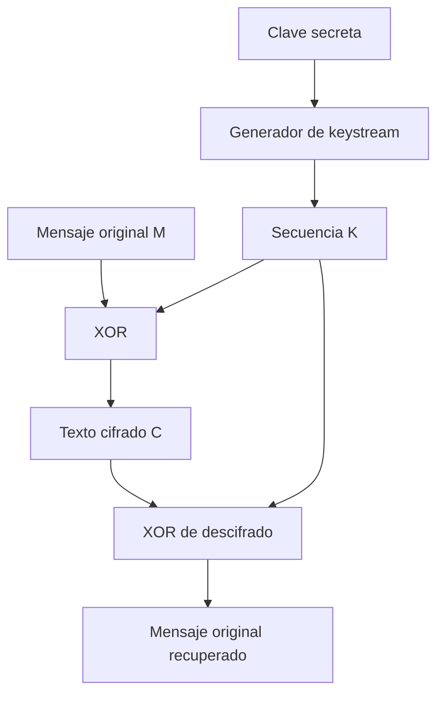
  
### Ejemplo práctico:  
  
Se desea cifrar:  
  
$$  
M=11001100  
$$  
  
Utilizando:  
  
$$  
K=01101100  
$$  
  
Se aplica XOR:  
  
$$  
11001100\oplus01101100  
$$  
  
El resultado es:  
  
$$  
\boxed{C=10100000}  
$$  
  
Para descifrar:  
  
$$  
10100000\oplus01101100  
$$  
  
Se recupera:  
  
$$  
\boxed{M=11001100}  
$$  
  
### Diferencia respecto de un cifrador por bloques:  
  
Un cifrador por bloques transforma un bloque completo de tamaño fijo.  
  
Un cifrador de flujo genera una secuencia de cifrado que se combina progresivamente con la información.  
  
La diferencia principal se encuentra en la forma en que se transforma el mensaje, aunque ambos pertenecen a la criptografía simétrica.  
  
---  
  
## Reutilización del keystream  
  
Una propiedad fundamental de los cifradores de flujo es que **no debe reutilizarse la misma secuencia de cifrado para proteger mensajes diferentes**.  
  
Supóngase que dos mensajes se cifran utilizando el mismo keystream.  
  
Para el primero:  
  
$$  
C_1=M_1\oplus K  
$$  
  
Para el segundo:  
  
$$  
C_2=M_2\oplus K  
$$  
  
Un atacante que conozca ambos textos cifrados puede calcular:  
  
$$  
C_1\oplus C_2  
$$  
  
Sustituyendo:  
  
$$  
C_1\oplus C_2  
=  
(M_1\oplus K)\oplus(M_2\oplus K)  
$$  
  
Reorganizando:  
  
$$  
=M_1\oplus M_2\oplus K\oplus K  
$$  
  
Como:  
  
$$  
K\oplus K=0  
$$  
  
Se obtiene:  
  
$$  
\boxed{C_1\oplus C_2=M_1\oplus M_2}  
$$  
  
El keystream desaparece de la expresión.  
  
### Consecuencia:  
  
El resultado revela una relación matemática entre los mensajes originales.  
  
Si uno de los mensajes es conocido o contiene información predecible, esta relación puede facilitar la recuperación de información del otro.  
  
Por lo tanto, la administración del keystream constituye un requisito fundamental de seguridad.  
  
---  
  
## Rivest Cipher RC4  
  
**RC4**, también conocido como Rivest Cipher 4, es un cifrador simétrico de flujo diseñado por Ron Rivest en 1987.  
  
Fue utilizado históricamente en tecnologías como SSL/TLS y WEP.  
  
Su diseño utiliza un arreglo interno que se reorganiza mediante operaciones modulares e intercambios de posiciones.  
  
Aunque RC4 fue ampliamente utilizado, presenta debilidades criptográficas conocidas y actualmente no se considera adecuado para nuevas aplicaciones.  
  
### Estructura interna:  
  
RC4 mantiene un arreglo:  
  
$$  
\boxed{S=[0,1,2,\ldots,255]}  
$$  
  
Este arreglo contiene una permutación de los $256$ valores posibles de un byte.  
  
El algoritmo tiene dos etapas principales:  
  
1. **Key Scheduling Algorithm (KSA)**.  
2. **Pseudo-Random Generation Algorithm (PRGA)**.  
  
La primera utiliza la clave original para inicializar el estado.  
  
La segunda utiliza ese estado para generar el keystream.  
  
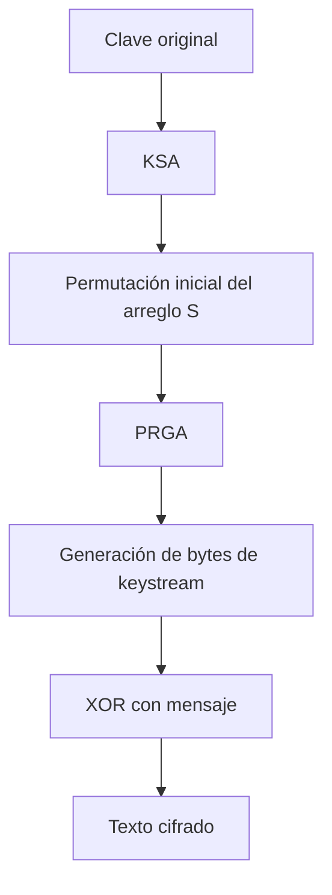
  
### Diferencia entre las etapas:  
  
El KSA prepara el estado interno del cifrador.  
  
El PRGA genera los bytes que se utilizarán para cifrar o descifrar la información.  
  
Después de la inicialización, el PRGA no necesita consultar directamente los bytes de la clave original porque su influencia ya está incorporada en el estado del arreglo.  
  
---  
  
## Key Scheduling Algorithm (KSA)  
  
El **KSA** inicializa y reorganiza el arreglo interno $S$ utilizando la clave secreta.  
  
### Inicialización:  
  
Primero se crea:  
  
$$  
S[i]=i  
$$  
  
Para:  
  
$$  
i=0,1,\ldots,255  
$$  
  
Se construye también un arreglo temporal $T$ de $256$ posiciones.  
  
Si la clave tiene una longitud menor que $256$ bytes, sus elementos se repiten hasta completar el arreglo.  
  
Formalmente:  
  
$$  
\boxed{T[i]=K[i\bmod L]}  
$$  
  
En donde $L$ es la longitud de la clave.  
  
### Permutación inicial:  
  
Después se inicializa:  
  
$$  
j=0  
$$  
  
Para cada índice:  
  
$$  
i=0,1,\ldots,255  
$$  
  
Se calcula:  
  
$$  
\boxed{j=(j+S[i]+T[i])\bmod256}  
$$  
  
Después se intercambian:  
  
$$  
\boxed{S[i]\longleftrightarrow S[j]}  
$$  
  
### Interpretación:  
  
La clave modifica progresivamente la organización de los elementos del arreglo.  
  
Al finalizar, $S$ contiene una permutación que depende de la clave utilizada.  
  
El algoritmo conserva todos los valores del arreglo, pero modifica sus posiciones.  
  
---  
  
## Pseudo-Random Generation Algorithm (PRGA)  
  
El **PRGA** utiliza la permutación generada por KSA para producir los bytes del keystream.  
  
### Inicialización:  
  
Se establecen:  
  
$$  
i=0  
$$  
  
$$  
j=0  
$$  
  
### Actualización de índices:  
  
Para cada byte del mensaje se calcula:  
  
$$  
\boxed{i=(i+1)\bmod256}  
$$  
  
Después:  
  
$$  
\boxed{j=(j+S[i])\bmod256}  
$$  
  
Se intercambian:  
  
$$  
S[i]\longleftrightarrow S[j]  
$$  
  
### Selección del byte:  
  
Se calcula:  
  
$$  
\boxed{t=(S[i]+S[j])\bmod256}  
$$  
  
El byte del keystream es:  
  
$$  
\boxed{k=S[t]}  
$$  
  
Finalmente:  
  
$$  
\boxed{C=M\oplus k}  
$$  
  
### Descifrado:  
  
El receptor debe reproducir el mismo keystream.  
  
Entonces:  
  
$$  
\boxed{M=C\oplus k}  
$$  
  
La misma operación XOR permite recuperar el mensaje original.  
  
---  
  
## Ejemplo práctico completo de RC4 reducido  
  
Para comprender las operaciones de RC4 se utiliza una versión didáctica con cuatro elementos.  
  
En lugar de un arreglo de $256$ posiciones se emplea:  
  
$$  
S=[0,1,2,3]  
$$  
  
Por lo tanto, las operaciones de índices se realizan módulo $4$.  
  
Este ejemplo únicamente sirve para explicar el procedimiento; no representa una configuración criptográficamente segura de RC4.  
  
### Clave y vector temporal:  
  
Se utiliza la clave:  
  
$$  
K=[1,7]  
$$  
  
El vector temporal es:  
  
$$  
T=[1,7,1,7]  
$$  
  
Inicialmente:  
  
$$  
j=0  
$$  
  
### Primera iteración KSA:  
  
Para:  
  
$$  
i=0  
$$  
  
Se calcula:  
  
$$  
j=(0+0+1)\bmod4=1  
$$  
  
Se intercambian $S[0]$ y $S[1]$.  
  
El arreglo queda:  
  
$$  
S=[1,0,2,3]  
$$  
  
### Segunda iteración KSA:  
  
Para:  
  
$$  
i=1  
$$  
  
Se obtiene:  
  
$$  
j=(1+0+7)\bmod4=0  
$$  
  
Se intercambian $S[1]$ y $S[0]$.  
  
El arreglo vuelve a:  
  
$$  
S=[0,1,2,3]  
$$  
  
### Tercera iteración KSA:  
  
Para:  
  
$$  
i=2  
$$  
  
Se calcula:  
  
$$  
j=(0+2+1)\bmod4=3  
$$  
  
Se intercambian $S[2]$ y $S[3]$.  
  
El resultado es:  
  
$$  
S=[0,1,3,2]  
$$  
  
### Cuarta iteración KSA:  
  
Para:  
  
$$  
i=3  
$$  
  
Se calcula:  
  
$$  
j=(3+2+7)\bmod4=0  
$$  
  
Se intercambian $S[3]$ y $S[0]$.  
  
El arreglo final es:  
  
$$  
\boxed{S=[2,1,3,0]}  
$$  
  
### Resumen de KSA:  
  
| Iteración | $i$ | $j$ | Estado $S$ |  
|---|---|---|---|  
| Inicial | — | $0$ | $[0,1,2,3]$ |  
| Primera | $0$ | $1$ | $[1,0,2,3]$ |  
| Segunda | $1$ | $0$ | $[0,1,2,3]$ |  
| Tercera | $2$ | $3$ | $[0,1,3,2]$ |  
| Cuarta | $3$ | $0$ | $[2,1,3,0]$ |  
  
### PRGA para el primer carácter:  
  
Se desea cifrar:  
  
```text  
HI  
```  
  
El primer carácter es:  
  
$$  
H=\texttt{48}  
$$  
  
El arreglo inicial del PRGA es:  
  
$$  
S=[2,1,3,0]  
$$  
  
Se reinician:  
  
$$  
i=0,\qquad j=0  
$$  
  
Primero:  
  
$$  
i=(0+1)\bmod4=1  
$$  
  
Después:  
  
$$  
j=(0+S[1])\bmod4  
$$  
  
Como:  
  
$$  
S[1]=1  
$$  
  
Se obtiene:  
  
$$  
j=1  
$$  
  
El intercambio no modifica el arreglo.  
  
Después:  
  
$$  
t=(S[1]+S[1])\bmod4  
$$  
  
$$  
t=(1+1)\bmod4=2  
$$  
  
El byte generado es:  
  
$$  
k=S[2]=3  
$$  
  
Por lo tanto:  
  
$$  
k=\texttt{03}  
$$  
  
Se cifra:  
  
$$  
\texttt{48}\oplus\texttt{03}=\texttt{4B}  
$$  
  
El valor ASCII:  
  
$$  
\texttt{4B}  
$$  
  
corresponde al carácter:  
  
```text  
K  
```  
  
### PRGA para el segundo carácter:  
  
El segundo carácter es:  
  
$$  
I=\texttt{49}  
$$  
  
El estado continúa siendo:  
  
$$  
S=[2,1,3,0]  
$$  
  
Los índices anteriores son:  
  
$$  
i=1,\qquad j=1  
$$  
  
Se actualiza:  
  
$$  
i=(1+1)\bmod4=2  
$$  
  
Después:  
  
$$  
j=(1+S[2])\bmod4  
$$  
  
Como:  
  
$$  
S[2]=3  
$$  
  
Se obtiene:  
  
$$  
j=(1+3)\bmod4=0  
$$  
  
Se intercambian $S[2]$ y $S[0]$.  
  
El arreglo queda:  
  
$$  
S=[3,1,2,0]  
$$  
  
Se calcula:  
  
$$  
t=(S[2]+S[0])\bmod4  
$$  
  
$$  
t=(2+3)\bmod4=1  
$$  
  
El byte generado es:  
  
$$  
k=S[1]=1  
$$  
  
Por lo tanto:  
  
$$  
k=\texttt{01}  
$$  
  
Se cifra:  
  
$$  
\texttt{49}\oplus\texttt{01}=\texttt{48}  
$$  
  
El valor hexadecimal $\texttt{48}$ corresponde al carácter:  
  
```text  
H  
```  
  
### Resultado del ejemplo:  
  
El mensaje original es:  
  
```text  
HI  
```  
  
El keystream generado es:  
  
$$  
[\texttt{03},\texttt{01}]  
$$  
  
El texto cifrado es:  
  
```text  
KH  
```  
  
Por lo tanto:  
  
$$  
\boxed{\text{"HI"}\longrightarrow\text{"KH"}}  
$$  
  
La operación puede revertirse aplicando XOR con la misma secuencia.  
  
---  
  
## Modos de operación de cifradores por bloques  
  
Los cifradores por bloques procesan una cantidad fija de información.  
  
Por ejemplo:  
  
**DES** procesa bloques de:  
  
$$  
64\text{ bits}  
$$  
  
Y utiliza una clave efectiva de:  
  
$$  
56\text{ bits}  
$$  
  
En cambio, AES procesa bloques de:  
  
$$  
128\text{ bits}  
$$  
  
y admite claves de $128$, $192$ y $256$ bits.  
  
El problema aparece cuando se necesita cifrar información cuya longitud supera el tamaño de un bloque.  
  
Para resolverlo se utilizan **modos de operación**.  
  
### Objetivo:  
  
Un modo de operación determina cómo se aplica repetidamente un cifrador por bloques para proteger un mensaje completo.  
  
Los cinco modos clásicos son:  
  
- Electronic Codebook (ECB).  
- Cipher Block Chaining (CBC).  
- Cipher Feedback (CFB).  
- Output Feedback (OFB).  
- Counter Mode (CTR).  
  
```mermaid  
mindmap  
root((Modos de operación))  
ECB  
Bloques independientes  
CBC  
Encadenamiento de bloques  
CFB  
Retroalimentación del cifrado  
OFB  
Retroalimentación de la salida  
CTR  
Contadores  
```  
  
Estos modos no modifican las transformaciones internas del cifrador.  
  
Lo que modifican es la forma en que los bloques, los valores anteriores o las secuencias auxiliares se combinan durante el procesamiento del mensaje.  
  
---  
  
## Electronic Codebook (ECB)  
  
**Electronic Codebook (ECB)** es el modo más sencillo de utilización de un cifrador por bloques.  
  
Cada bloque original se cifra de manera independiente utilizando la misma clave.  
  
### Cifrado:  
  
La operación es:  
  
$$  
\boxed{C_i=E_K(P_i)}  
$$  
  
En donde:  
  
- $P_i$ es el bloque original.  
- $C_i$ es el bloque cifrado.  
- $E_K$ representa el cifrado con la clave $K$.  
  
### Descifrado:  
  
Se utiliza:  
  
$$  
\boxed{P_i=D_K(C_i)}  
$$  
  
Cada bloque puede procesarse independientemente de los demás.  
  
### Funcionamiento:  
  
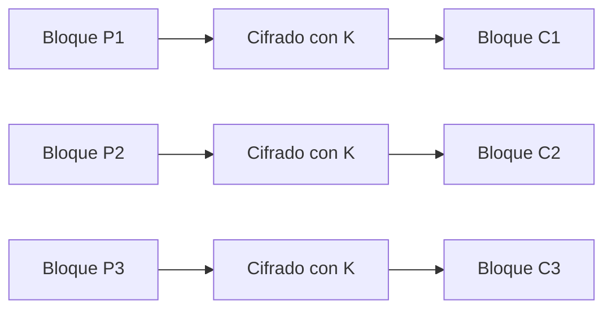
  
### Problema de los patrones:  
  
Supóngase que dos bloques originales son idénticos:  
  
$$  
P_1=P_3  
$$  
  
Como ambos se cifran mediante el mismo algoritmo y la misma clave:  
  
$$  
E_K(P_1)=E_K(P_3)  
$$  
  
Por lo tanto:  
  
$$  
\boxed{C_1=C_3}  
$$  
  
Esto significa que los bloques repetidos del mensaje original producen bloques cifrados repetidos.  
  
### Consecuencia:  
  
Un atacante puede observar relaciones entre los bloques cifrados.  
  
Aunque no conozca el contenido exacto, puede identificar repeticiones.  
  
Por esta razón, ECB no es apropiado para cifrar mensajes generales de múltiples bloques cuando se necesita ocultar patrones de información.  
  
---  
  
## Cipher Block Chaining (CBC)  
  
**Cipher Block Chaining (CBC)** introduce una dependencia entre bloques consecutivos.  
  
Antes de cifrar cada bloque, el mensaje original se combina mediante XOR con el bloque cifrado anterior.  
  
### Cifrado:  
  
Para el primer bloque se utiliza un **vector de inicialización (IV)**.  
  
La primera operación es:  
  
$$  
\boxed{C_1=E_K(P_1\oplus IV)}  
$$  
  
Para los bloques siguientes:  
  
$$  
\boxed{C_i=E_K(P_i\oplus C_{i-1})}  
$$  
  
En donde:  
  
- $P_i$ es el bloque original.  
- $C_{i-1}$ es el bloque cifrado anterior.  
- $IV$ es el vector de inicialización.  
  
### Descifrado:  
  
Se aplica primero la operación inversa del cifrador.  
  
Después se utiliza XOR con el bloque cifrado anterior.  
  
Para el primer bloque:  
  
$$  
\boxed{P_1=D_K(C_1)\oplus IV}  
$$  
  
Para los siguientes:  
  
$$  
\boxed{P_i=D_K(C_i)\oplus C_{i-1}}  
$$  
  
### Funcionamiento:  
  
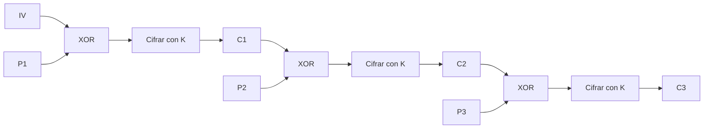
  
### Interpretación:  
  
Cada bloque cifrado depende de dos elementos:  
  
1. El bloque original actual.  
2. El bloque cifrado anterior.  
  
Esto significa que dos bloques originales idénticos no necesariamente producirán el mismo bloque cifrado, porque pueden combinarse con valores anteriores diferentes.  
  
### Función del IV:  
  
El vector de inicialización permite comenzar el encadenamiento sin necesitar un bloque cifrado anterior.  
  
Su selección y administración son importantes para la seguridad del modo CBC.  
  
En el cifrado CBC convencional, el IV debe elegirse de manera apropiada para evitar relaciones predecibles entre mensajes.  
  
CBC proporciona confidencialidad bajo las condiciones adecuadas, pero no garantiza por sí solo la autenticidad ni la integridad de los datos.  
  
---  
  
## Cipher Feedback (CFB)  
  
**Cipher Feedback (CFB)** utiliza un cifrador por bloques para generar una secuencia de valores que se combina mediante XOR con el mensaje original.  
  
Su funcionamiento se asemeja al de un cifrador de flujo.  
  
### Idea principal:  
  
En lugar de cifrar directamente el bloque original, se cifra un valor de retroalimentación.  
  
La salida de esa operación se combina con el mensaje mediante XOR.  
  
Posteriormente, el texto cifrado se utiliza como entrada para continuar generando la secuencia.  
  
### Cifrado:  
  
Para la variante de bloque completo, se utiliza:  
  
$$  
C_0=IV  
$$  
  
Y:  
  
$$  
\boxed{C_i=P_i\oplus E_K(C_{i-1})}  
$$  
  
### Descifrado:  
  
Se utiliza nuevamente la función de cifrado por bloques:  
  
$$  
\boxed{P_i=C_i\oplus E_K(C_{i-1})}  
$$  
  
Esto ocurre porque XOR permite recuperar el mensaje al combinarlo con el mismo valor.  
  
### Interpretación:  
  
CFB utiliza el texto cifrado anterior como elemento de retroalimentación.  
  
Por lo tanto, los valores generados dependen de los bloques cifrados que se hayan producido previamente.  
  
Una característica importante es que el descifrado utiliza la función de cifrado del algoritmo base, no necesariamente su transformación inversa.  
  
### Procesamiento por segmentos:  
  
CFB también puede trabajar con segmentos menores que el tamaño completo del bloque.  
  
En ese caso, un registro de desplazamiento se actualiza utilizando el texto cifrado generado.  
  
Esto permite procesar información por unidades más pequeñas, según la configuración del modo.  
  
---  
  
## Output Feedback (OFB)  
  
**Output Feedback (OFB)** también permite utilizar un cifrador por bloques como generador de una secuencia de cifrado.  
  
Su diferencia fundamental respecto de CFB es que la retroalimentación utiliza la salida del cifrador, no el texto cifrado.  
  
### Generación de keystream:  
  
Primero:  
  
$$  
O_0=IV  
$$  
  
Después:  
  
$$  
\boxed{O_i=E_K(O_{i-1})}  
$$  
  
El valor $O_i$ corresponde a un bloque de la secuencia de cifrado.  
  
### Cifrado:  
  
Se utiliza:  
  
$$  
\boxed{C_i=P_i\oplus O_i}  
$$  
  
### Descifrado:  
  
Se aplica:  
  
$$  
\boxed{P_i=C_i\oplus O_i}  
$$  
  
### Funcionamiento:  
  
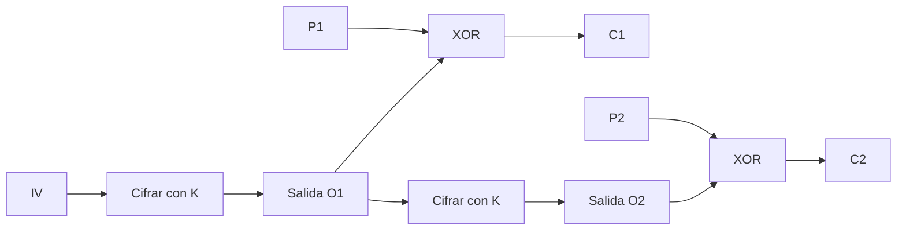
  
### Diferencia respecto de CFB:  
  
En CFB se reutiliza el texto cifrado como retroalimentación.  
  
En OFB se reutiliza la salida interna del cifrador.  
  
Por lo tanto, el keystream de OFB puede generarse sin conocer el mensaje original.  
  
### Consideración de seguridad:  
  
No debe reutilizarse la misma combinación de clave e IV para producir el mismo keystream en mensajes diferentes.  
  
La reutilización permitiría eliminar la secuencia mediante XOR entre textos cifrados y revelar relaciones entre los mensajes originales.  
  
---  
  
## Counter Mode (CTR)  
  
**Counter Mode (CTR)** utiliza valores de contador como entradas de un cifrador por bloques.  
  
Cada valor se cifra utilizando la clave secreta.  
  
El resultado se combina mediante XOR con el bloque del mensaje original.  
  
### Funcionamiento:  
  
Para cada bloque se construye una entrada:  
  
$$  
X_i  
$$  
  
que contiene un contador y, según el formato utilizado, otros valores como un nonce.  
  
Se calcula:  
  
$$  
\boxed{K_i=E_K(X_i)}  
$$  
  
Después:  
  
$$  
\boxed{C_i=P_i\oplus K_i}  
$$  
  
Para descifrar:  
  
$$  
\boxed{P_i=C_i\oplus K_i}  
$$  
  
### Uso del contador:  
  
Cada bloque debe utilizar una entrada distinta bajo la misma clave.  
  
Conceptualmente:  
  
$$  
X_1,X_2,X_3,\ldots  
$$  
  
corresponden a valores de contador diferentes.  
  
### Funcionamiento:  
  
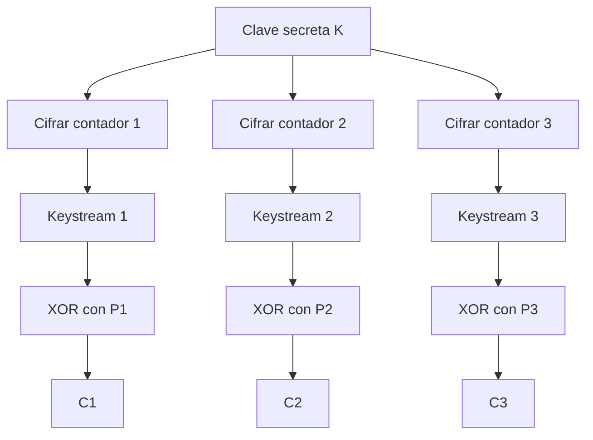
  
### Ventajas principales:  
  
CTR permite calcular los bloques del keystream de manera independiente.  
  
Por lo tanto, puede procesarse información en paralelo.  
  
Además, no es necesario encadenar el resultado de un bloque con el siguiente.  
  
### Consideración de seguridad:  
  
No deben reutilizarse entradas de contador bajo una misma clave.  
  
Si dos bloques utilizan el mismo valor de entrada y la misma clave, producirán el mismo keystream.  
  
Esto ocasionaría el problema de reutilización de secuencia estudiado anteriormente.  
  
---  
  
## Comparación de los modos de operación  
  
Los cinco modos utilizan cifradores por bloques, pero presentan diferencias importantes en sus mecanismos y propiedades.  
  
| Modo | Funcionamiento | Retroalimentación | Característica principal |  
|---|---|---|---|  
| ECB | Cifra bloques independientemente | No utiliza | Puede revelar patrones |  
| CBC | Combina cada bloque con el cifrado anterior | Bloque cifrado anterior | Encadenamiento |  
| CFB | Cifra un estado y aplica XOR | Texto cifrado | Comportamiento de flujo |  
| OFB | Genera una secuencia mediante cifrado repetido | Salida del cifrador | Keystream independiente del mensaje |  
| CTR | Cifra valores de contador | No utiliza encadenamiento | Procesamiento paralelo |  
  
### Modos orientados a bloques:  
  
ECB y CBC trabajan naturalmente con bloques completos.  
  
Cuando un mensaje no ocupa un número entero de bloques, determinadas configuraciones necesitan un mecanismo de relleno.  
  
### Modos semejantes a cifradores de flujo:  
  
CFB, OFB y CTR utilizan la función de cifrado por bloques para generar valores que posteriormente se combinan mediante XOR.  
  
Esto permite comprender por qué un algoritmo como AES puede utilizarse dentro de una construcción con comportamiento de flujo.  
  
### Diferencias de seguridad:  
  
ECB presenta el problema de las repeticiones visibles.  
  
CBC depende de un encadenamiento correcto y de la administración adecuada del IV.  
  
CFB y OFB necesitan valores iniciales apropiados.  
  
CTR exige que las entradas de contador no se repitan bajo una misma clave.  
  
Ninguno de estos cinco modos proporciona automáticamente autenticación de los mensajes. La confidencialidad y la integridad son propiedades distintas, por lo que una aplicación que necesite ambas debe incorporar un mecanismo adecuado de autenticación.  
  
---  
  
## Relación entre AES, RC4 y los modos de operación  
  
AES y RC4 pertenecen a la criptografía simétrica, pero utilizan mecanismos internos diferentes.  
  
### AES:  
  
AES procesa bloques de:  
  
$$  
128\text{ bits}  
$$  
  
Su funcionamiento se basa en rondas que combinan sustituciones, desplazamientos, operaciones algebraicas y claves de ronda.  
  
### RC4:  
  
RC4 genera una secuencia de bytes a partir de una permutación interna.  
  
El mensaje se cifra mediante XOR con dicha secuencia.  
  
### AES con CTR:  
  
AES puede utilizarse dentro de Counter Mode para generar un keystream.  
  
Esto permite que AES, aunque internamente sea un cifrador por bloques, participe en un esquema de procesamiento semejante a un cifrador de flujo.  
  
La relación puede representarse mediante:  
  
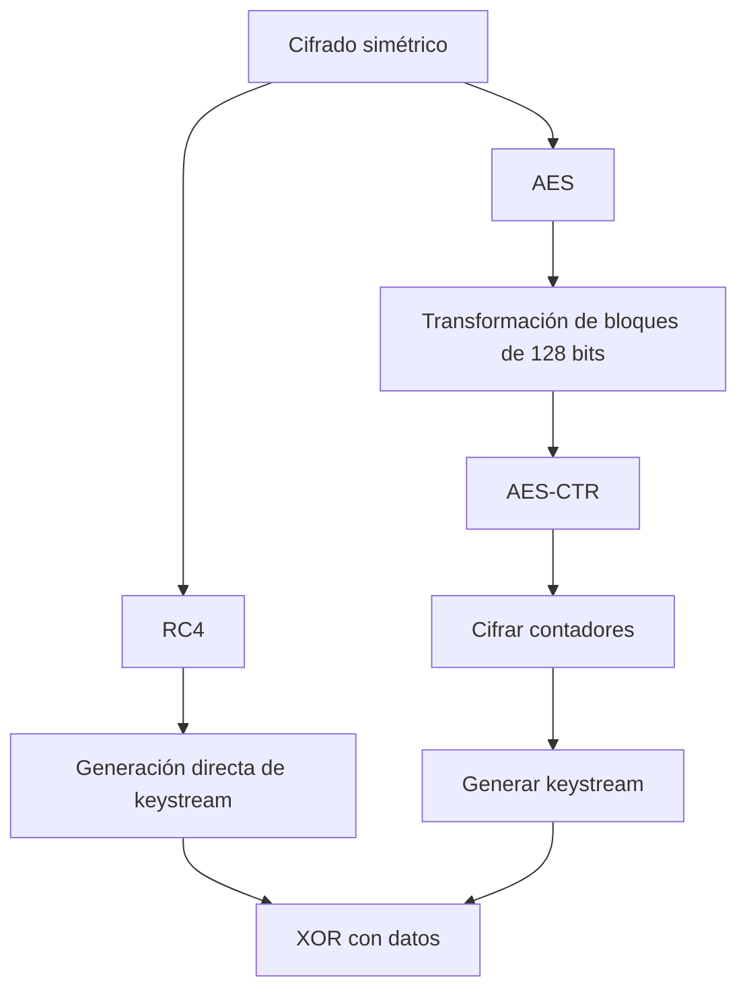
  
La diferencia fundamental es que RC4 fue diseñado directamente como un cifrador de flujo, mientras que AES necesita un modo de operación para producir ese comportamiento.  
  
Además, RC4 presenta debilidades conocidas, por lo que no constituye una alternativa equivalente en seguridad a una configuración moderna y adecuada de AES.  
  
---  
  
## Ideas principales  
  
### AES es un cifrador simétrico por bloques:  
  
AES cifra bloques de:  
  
$$  
\boxed{128\text{ bits}}  
$$  
  
Admite claves de:  
  
$$  
128,\ 192,\ 256\text{ bits}  
$$  
  
Y utiliza:  
  
$$  
10,\ 12,\ 14  
$$  
  
rondas, respectivamente.  
  
### La matriz State contiene dieciséis bytes:  
  
El estado tiene cuatro filas y cuatro columnas.  
  
Los bytes se organizan por columnas y se transforman durante cada ronda.  
  
### SubBytes introduce no linealidad:  
  
Utiliza una S-Box de:  
  
$$  
16\times16=256  
$$  
  
entradas.  
  
Cada byte se sustituye utilizando una transformación construida mediante inversos multiplicativos en $GF(2^8)$ y una transformación afín.  
  
### ShiftRows redistribuye información:  
  
Las filas se desplazan circularmente hacia la izquierda:  
  
$$  
0,\ 1,\ 2,\ 3  
$$  
  
posiciones.  
  
Esto permite que los bytes se distribuyan entre diferentes columnas.  
  
### MixColumns proporciona difusión:  
  
Combina los cuatro bytes de cada columna mediante multiplicación matricial en:  
  
$$  
GF(2^8)  
$$  
  
Utiliza los coeficientes:  
  
$$  
\texttt{01},\quad\texttt{02},\quad\texttt{03}  
$$  
  
Y operaciones como:  
  
$$  
\boxed{\texttt{03}\otimes a=(\texttt{02}\otimes a)\oplus a}  
$$  
  
### AddRoundKey incorpora la clave:  
  
La operación es:  
  
$$  
\boxed{S'=S\oplus K}  
$$  
  
Es reversible porque XOR aplicado dos veces con el mismo valor recupera el dato original.  
  
### Key Expansion genera claves de ronda:  
  
AES-128 transforma la clave inicial de $16$ bytes en:  
  
$$  
44\text{ palabras}  
$$  
  
Estas producen once claves de ronda.  
  
Las operaciones fundamentales son RotWord, SubWord, Rcon y XOR.  
  
### El descifrado utiliza transformaciones inversas:  
  
SubBytes, ShiftRows y MixColumns tienen operaciones inversas.  
  
AddRoundKey es su propia inversa.  
  
Las claves se utilizan en el orden apropiado para revertir el cifrado.  
  
### RC4 es un cifrador de flujo:  
  
Utiliza dos etapas:  
  
- KSA para inicializar una permutación.  
- PRGA para producir el keystream.  
  
El cifrado se realiza mediante:  
  
$$  
\boxed{C_i=M_i\oplus K_i}  
$$  
  
RC4 presenta debilidades conocidas y no debe utilizarse en nuevas aplicaciones.  
  
### Un keystream no debe reutilizarse:  
  
Si dos mensajes utilizan la misma secuencia:  
  
$$  
C_1=M_1\oplus K  
$$  
  
$$  
C_2=M_2\oplus K  
$$  
  
Entonces:  
  
$$  
\boxed{C_1\oplus C_2=M_1\oplus M_2}  
$$  
  
Esto puede revelar información sobre los mensajes.  
  
### Los modos de operación permiten cifrar mensajes completos:  
  
ECB, CBC, CFB, OFB y CTR organizan de diferentes maneras el uso repetido de un cifrador por bloques.  
  
ECB presenta filtración de patrones.  
  
CBC utiliza encadenamiento.  
  
CFB y OFB utilizan retroalimentación.  
  
CTR utiliza contadores y permite procesamiento paralelo.  
  
---  
  
## Conclusión  
  
La criptografía simétrica utiliza una clave secreta compartida para transformar información original en datos cifrados. Dentro de este enfoque, AES representa uno de los algoritmos de cifrado por bloques más importantes, mientras que RC4 permite comprender el funcionamiento histórico de los cifradores de flujo.  
  
AES organiza cada bloque de $128$ bits en una matriz de dieciséis bytes. Su funcionamiento se basa en una estructura iterativa que combina cuatro transformaciones fundamentales. SubBytes introduce no linealidad mediante la S-Box, ShiftRows redistribuye los bytes entre columnas, MixColumns combina algebraicamente los valores mediante operaciones sobre $GF(2^8)$ y AddRoundKey incorpora material secreto derivado de la clave original.  
  
La expansión de claves permite generar las palabras necesarias para todas las rondas, utilizando RotWord, SubWord, Rcon y operaciones XOR. La existencia de transformaciones inversas garantiza que el cifrado pueda revertirse mediante la clave correcta, recuperando exactamente el bloque original.  
  
Por otra parte, RC4 utiliza una estructura diferente. En lugar de transformar bloques completos, inicializa una permutación mediante KSA y genera una secuencia de cifrado mediante PRGA. Esa secuencia se combina con los datos utilizando XOR. Sin embargo, las debilidades conocidas de RC4 demuestran que la existencia de un procedimiento reversible no garantiza por sí sola la seguridad criptográfica.  
  
Los modos de operación permiten extender el uso de los cifradores por bloques hacia mensajes de longitud arbitraria. ECB cifra los bloques independientemente, CBC introduce encadenamiento, CFB y OFB utilizan mecanismos de retroalimentación, mientras que CTR emplea valores de contador para generar una secuencia de cifrado que puede procesarse en paralelo.  
  
La relación entre estos conceptos permite distinguir tres niveles de funcionamiento: **el algoritmo define cómo se cifra una unidad de información, el modo de operación determina cómo se procesan mensajes completos y la administración correcta de claves y valores iniciales condiciona la seguridad del sistema**.  
  
Por lo tanto, comprender AES, RC4 y los modos de operación requiere relacionar las operaciones matemáticas internas con sus propiedades criptográficas y con las condiciones necesarias para proteger correctamente la información.  
````