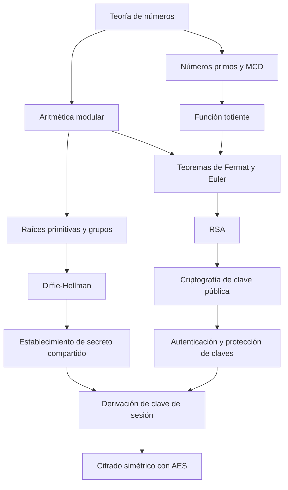
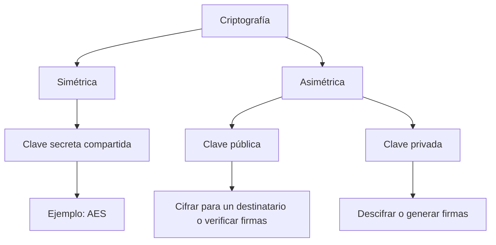
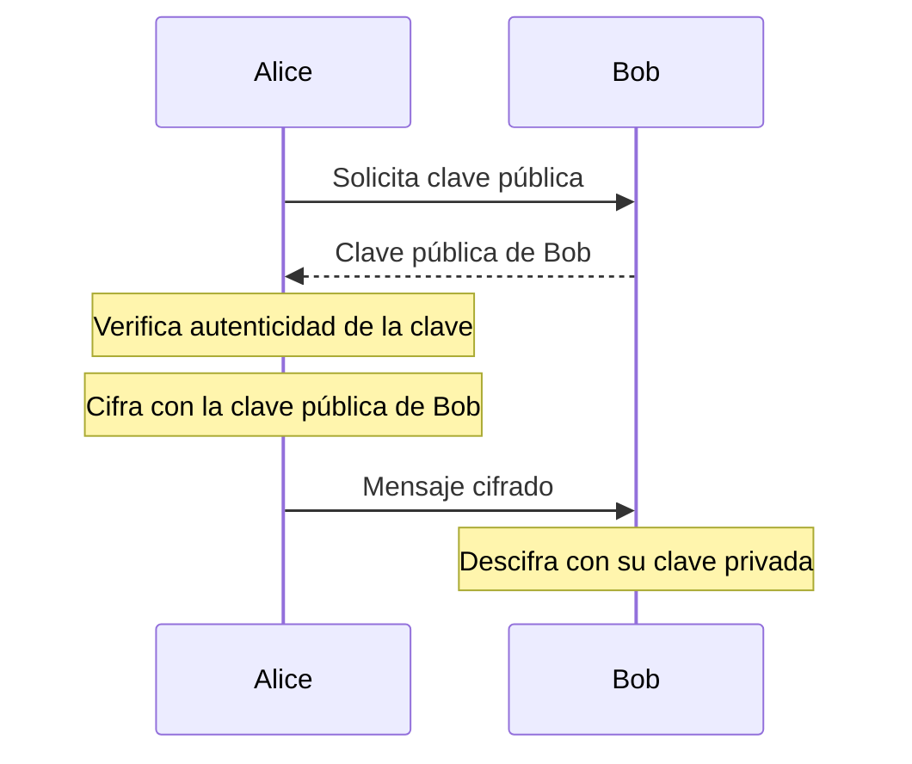
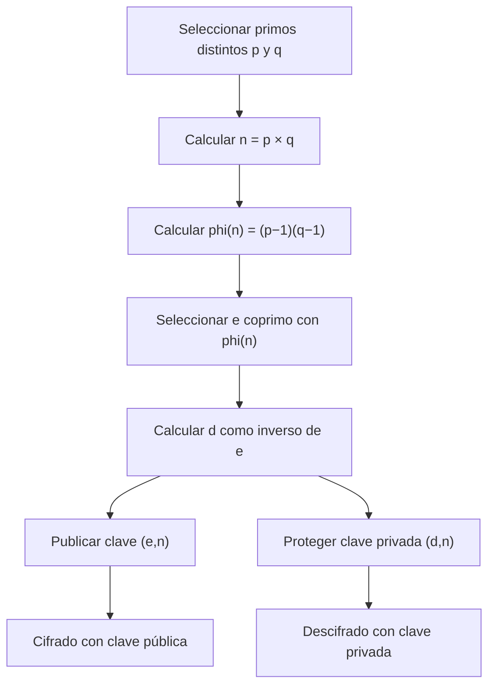
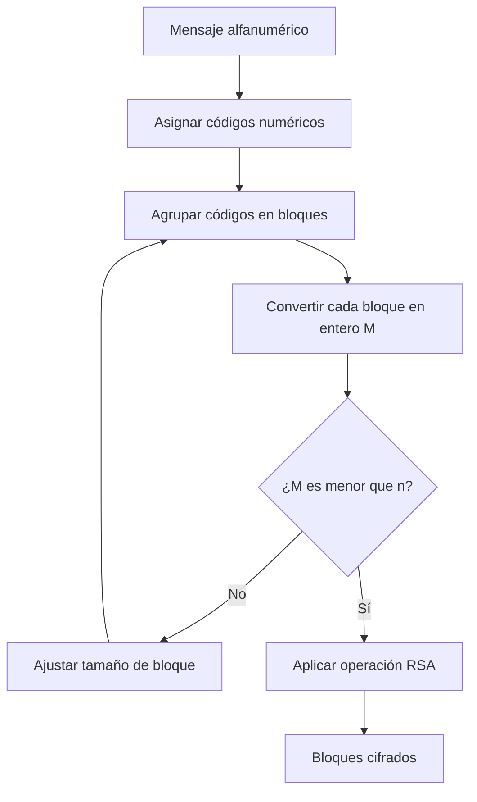
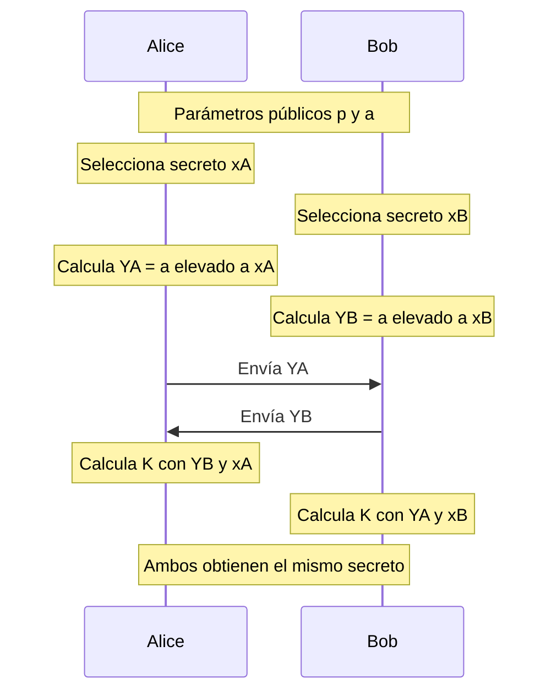
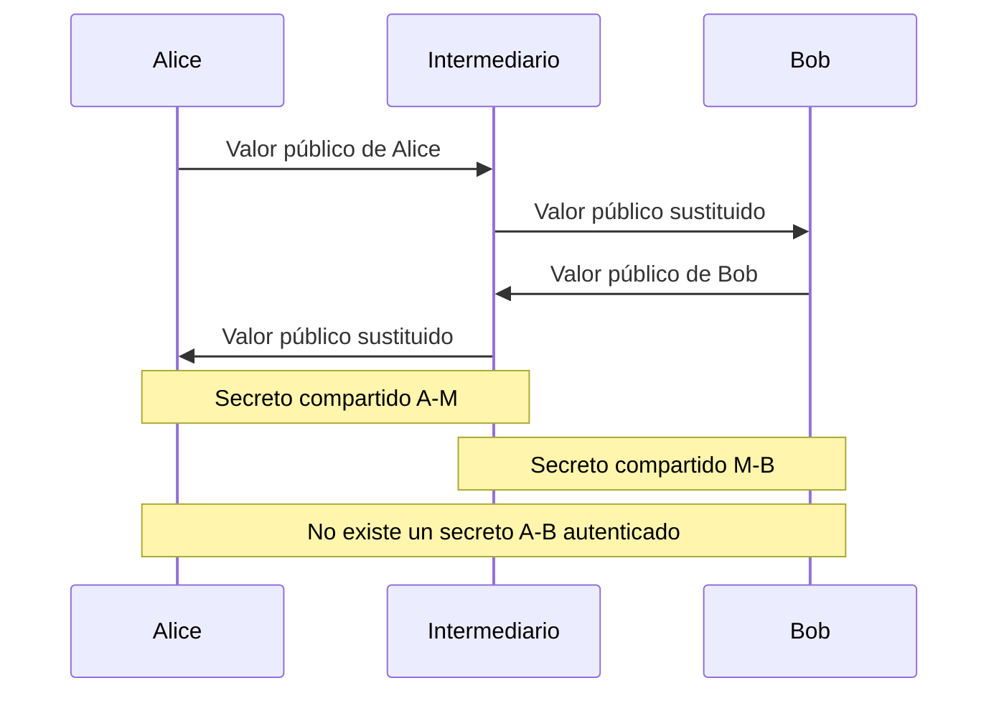
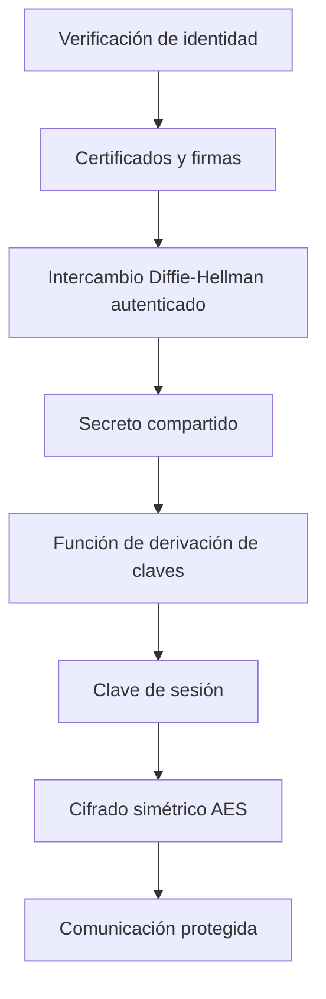

## Introducción  
  
La **criptografía asimétrica** permite proteger información mediante dos claves matemáticamente relacionadas: una **clave pública**, que puede distribuirse, y una **clave privada**, que debe permanecer secreta. Este enfoque permite resolver problemas fundamentales de seguridad, como la distribución de claves, el cifrado de información destinada a un receptor específico y la verificación de firmas digitales.  
  
A diferencia de la criptografía simétrica, donde las entidades necesitan compartir previamente una clave secreta, los sistemas asimétricos permiten realizar determinadas operaciones utilizando información pública sin revelar el secreto necesario para revertirlas.  
  
Su funcionamiento depende de propiedades matemáticas de los **números primos**, la **aritmética modular**, los **inversos multiplicativos** y la **exponenciación modular**. Los teoremas de Fermat y Euler permiten establecer relaciones entre potencias y residuos que resultan fundamentales para comprender algoritmos como RSA.  
  
Por otra parte, el intercambio de claves **Diffie-Hellman** utiliza propiedades de grupos multiplicativos y exponentes secretos para permitir que dos participantes calculen un mismo valor compartido sin transmitirlo directamente.  
  
Estos mecanismos se complementan con la criptografía simétrica. En una comunicación real, la criptografía asimétrica puede utilizarse para autenticar participantes y establecer claves, mientras que algoritmos como AES permiten cifrar eficientemente grandes cantidades de información.  
  
La relación general entre los conceptos puede representarse mediante:  
  

  
La idea fundamental es que **RSA y Diffie-Hellman utilizan operaciones matemáticas relacionadas, pero resuelven problemas diferentes**. RSA permite construir esquemas de cifrado y firmas digitales, mientras que Diffie-Hellman permite establecer un secreto compartido.  
  
---  
  
## Números primos  
  
Los **números primos** son fundamentales en teoría de números y en la construcción de distintos algoritmos criptográficos.  
  
Un número natural $p$ es primo si cumple dos condiciones:  
  
1. Es mayor o igual que $2$.  
2. Sus únicos divisores positivos son $1$ y el propio $p$.  
  
Por lo tanto:  
  
$$  
\boxed{p\text{ es primo}\iff p\geq2\text{ y sus únicos divisores son }1,p}  
$$  
  
Por ejemplo, el número $7$ es primo porque sus únicos divisores positivos son:  
  
$$  
\{1,7\}  
$$  
  
En cambio, el número $9$ no es primo porque:  
  
$$  
9=3\times3  
$$  
  
Los números mayores que uno que no son primos se denominan **compuestos**.  
  
### Importancia criptográfica:  
  
Los números primos permiten construir estructuras matemáticas con propiedades útiles para la criptografía.  
  
Por ejemplo, si se utiliza un número primo $p$ como módulo, todos los residuos distintos de cero tienen inverso multiplicativo.  
  
Además, la multiplicación de dos números primos grandes permite construir el módulo utilizado por RSA:  
  
$$  
\boxed{n=pq}  
$$  
  
Aunque calcular $n$ a partir de $p$ y $q$ es sencillo, recuperar los factores de un número suficientemente grande puede resultar computacionalmente difícil mediante los algoritmos clásicos conocidos.  
  
### Comprobación de primalidad:  
  
Para determinar si un entero $n$ es primo puede comprobarse si tiene divisores primos menores o iguales que:  
  
$$  
\boxed{\sqrt n}  
$$  
  
Esta condición es suficiente porque, si $n$ es compuesto, al menos uno de sus factores no supera su raíz cuadrada.  
  
###### Ejemplo:  
  
Se desea determinar si:  
  
$$  
n=97  
$$  
  
es primo.  
  
Su raíz cuadrada es aproximadamente:  
  
$$  
\sqrt{97}\approx9.85  
$$  
  
Por lo tanto, basta comprobar los primos:  
  
$$  
2,\ 3,\ 5,\ 7  
$$  
  
El número $97$ no es divisible exactamente entre ninguno de ellos.  
  
Por lo tanto:  
  
$$  
\boxed{97\text{ es primo}}  
$$  
  
### Primos grandes:  
  
Los algoritmos criptográficos necesitan trabajar con números primos mucho mayores que los utilizados en ejercicios manuales.  
  
Para esos tamaños, probar todos los divisores pequeños deja de ser una estrategia eficiente.  
  
Por esta razón se utilizan algoritmos especializados de primalidad, como **Miller-Rabin**, que permiten identificar candidatos probablemente primos mediante operaciones modulares.  
  
---  
  
## Factorización prima y máximo común divisor  
  
El **teorema fundamental de la aritmética** establece que todo entero mayor que uno puede escribirse como producto de números primos, y que esa descomposición es única salvo el orden de los factores.  
  
La representación general es:  
  
$$  
\boxed{n=p_1^{a_1}p_2^{a_2}\cdots p_k^{a_k}}  
$$  
  
En donde:  
  
- $p_1,p_2,\ldots,p_k$ son primos distintos.  
- $a_1,a_2,\ldots,a_k$ son exponentes enteros positivos.  
  
### Ejemplos de factorización:  
  
Para $91$:  
  
$$  
\boxed{91=7\times13}  
$$  
  
Para $3600$:  
  
$$  
\boxed{3600=2^4\times3^2\times5^2}  
$$  
  
Para $11011$:  
  
$$  
\boxed{11011=7\times11^2\times13}  
$$  
  
Esta representación permite identificar fácilmente los factores que comparten dos enteros.  
  
### Números relativamente primos:  
  
Dos enteros $a$ y $b$ son **coprimos** o relativamente primos cuando su máximo común divisor es uno.  
  
$$  
\boxed{\gcd(a,b)=1}  
$$  
  
Por ejemplo:  
  
$$  
\gcd(8,15)=1  
$$  
  
Aunque $8$ y $15$ son números compuestos, no comparten divisores positivos diferentes de uno.  
  
Por lo tanto, son coprimos.  
  
### Cálculo del MCD mediante factorización:  
  
Para calcular el máximo común divisor mediante factores primos, se identifican los factores compartidos y se selecciona el menor exponente de cada uno.  
  
Si:  
  
$$  
a=\prod_p p^{\alpha_p}  
$$  
  
Y:  
  
$$  
b=\prod_p p^{\beta_p}  
$$  
  
Entonces:  
  
$$  
\boxed{\gcd(a,b)=\prod_p p^{\min(\alpha_p,\beta_p)}}  
$$  
  
###### Ejemplo práctico:  
  
Se desea calcular:  
  
$$  
\gcd(300,18)  
$$  
  
Primero se factoriza:  
  
$$  
300=2^2\times3\times5^2  
$$  
  
Después:  
  
$$  
18=2\times3^2  
$$  
  
Los factores compartidos son $2$ y $3$.  
  
Se seleccionan sus exponentes mínimos:  
  
$$  
\gcd(300,18)=2^1\times3^1  
$$  
  
Por lo tanto:  
  
$$  
\boxed{\gcd(300,18)=6}  
$$  
  
### Propiedades de los números coprimos:  
  
Existen varias propiedades importantes:  
  
- Dos primos distintos siempre son coprimos.  
- Dos enteros consecutivos siempre son coprimos.  
- El número $1$ es coprimo con cualquier entero positivo.  
- Dos números pares positivos no pueden ser coprimos.  
- Dos números compuestos pueden ser coprimos entre sí.  
  
La propiedad más importante para la criptografía es que **un número tiene inverso multiplicativo módulo $n$ si y solo si es coprimo con $n$**.  
  
Esto permite construir claves relacionadas mediante operaciones modulares.  
  
---  
  
## Pequeño teorema de Fermat  
  
El **pequeño teorema de Fermat** establece una propiedad fundamental de las potencias cuando se trabaja módulo un número primo.  
  
Si $p$ es primo y $a$ es un entero no divisible entre $p$, entonces:  
  
$$  
\boxed{a^{p-1}\equiv1\pmod p}  
$$  
  
La condición también puede expresarse mediante:  
  
$$  
\gcd(a,p)=1  
$$  
  
### Interpretación:  
  
El teorema indica que elevar un número coprimo con un primo $p$ al exponente $p-1$ produce un resultado congruente con uno módulo $p$.  
  
Esto permite simplificar potencias y calcular inversos multiplicativos.  
  
###### Ejemplo:  
  
Considérese:  
  
$$  
a=7  
$$  
  
$$  
p=3  
$$  
  
Se verifica:  
  
$$  
\gcd(7,3)=1  
$$  
  
Entonces:  
  
$$  
7^{3-1}\equiv1\pmod3  
$$  
  
Calculando:  
  
$$  
7^2=49  
$$  
  
Y:  
  
$$  
49\bmod3=1  
$$  
  
Por lo tanto:  
  
$$  
\boxed{7^2\equiv1\pmod3}  
$$  
  
### Forma alternativa:  
  
El teorema también puede expresarse mediante:  
  
$$  
\boxed{a^p\equiv a\pmod p}  
$$  
  
Esta segunda forma es válida para cualquier entero $a$, incluso si es divisible entre $p$.  
  
###### Ejemplo:  
  
Considérese:  
  
$$  
a=3,\qquad p=5  
$$  
  
Se calcula:  
  
$$  
3^5=243  
$$  
  
Como:  
  
$$  
243\bmod5=3  
$$  
  
Se obtiene:  
  
$$  
\boxed{3^5\equiv3\pmod5}  
$$  
  
Ahora supóngase:  
  
$$  
a=10,\qquad p=5  
$$  
  
Se tiene:  
  
$$  
10^5=100000  
$$  
  
Y:  
  
$$  
100000\bmod5=0  
$$  
  
Como:  
  
$$  
10\bmod5=0  
$$  
  
También se cumple:  
  
$$  
\boxed{10^5\equiv10\pmod5}  
$$  
  
### Inverso multiplicativo mediante Fermat:  
  
Si $a$ es coprimo con un primo $p$, entonces:  
  
$$  
a^{p-1}\equiv1\pmod p  
$$  
  
Separando una potencia:  
  
$$  
a\cdot a^{p-2}\equiv1\pmod p  
$$  
  
Por lo tanto:  
  
$$  
\boxed{a^{-1}\equiv a^{p-2}\pmod p}  
$$  
  
Esta fórmula permite calcular inversos multiplicativos mediante exponenciación modular.  
  
###### Ejemplo práctico:  
  
Se desea calcular:  
  
$$  
8^{-1}\bmod17  
$$  
  
Como $17$ es primo:  
  
$$  
8^{-1}\equiv8^{15}\pmod{17}  
$$  
  
Utilizando cuadrados sucesivos:  
  
$$  
8^2\bmod17=13  
$$  
  
$$  
8^4\bmod17=16  
$$  
  
$$  
8^8\bmod17=1  
$$  
  
Como:  
  
$$  
15=8+4+2+1  
$$  
  
Se obtiene:  
  
$$  
8^{15}\bmod17  
=  
(1\times16\times13\times8)\bmod17  
$$  
  
Por lo tanto:  
  
$$  
\boxed{8^{-1}\bmod17=15}  
$$  
  
La comprobación es:  
  
$$  
8\times15=120  
$$  
  
$$  
120\bmod17=1  
$$  
  
---  
  
## Función totiente de Euler  
  
La **función totiente de Euler**, representada mediante $\phi(n)$, cuenta cuántos enteros positivos menores que $n$ son coprimos con $n$.  
  
Formalmente:  
  
$$  
\boxed{\phi(n)=|\{a:1\leq a<n,\ \gcd(a,n)=1\}|}  
$$  
  
Para $n>1$, esta expresión representa la cantidad de elementos del sistema reducido de residuos módulo $n$.  
  
### Sistema completo y sistema reducido:  
  
El sistema completo de residuos módulo $n$ contiene:  
  
$$  
\{0,1,2,\ldots,n-1\}  
$$  
  
El sistema reducido contiene únicamente los residuos coprimos con $n$.  
  
###### Ejemplo:  
  
Para:  
  
$$  
n=10  
$$  
  
El sistema completo es:  
  
$$  
\{0,1,2,3,4,5,6,7,8,9\}  
$$  
  
Los elementos coprimos con $10$ son:  
  
$$  
\{1,3,7,9\}  
$$  
  
Por lo tanto:  
  
$$  
\boxed{\phi(10)=4}  
$$  
  
### Totiente de un número primo:  
  
Si $p$ es primo, todos los enteros desde $1$ hasta $p-1$ son coprimos con $p$.  
  
Por lo tanto:  
  
$$  
\boxed{\phi(p)=p-1}  
$$  
  
###### Ejemplo:  
  
Para:  
  
$$  
p=7  
$$  
  
Se obtiene:  
  
$$  
\boxed{\phi(7)=6}  
$$  
  
### Totiente de una potencia prima:  
  
Para un primo $p$ y un entero positivo $k$:  
  
$$  
\boxed{\phi(p^k)=p^k-p^{k-1}}  
$$  
  
Esto ocurre porque, entre los enteros de $1$ a $p^k$, los que no son coprimos con $p^k$ son precisamente los múltiplos de $p$.  
  
###### Ejemplo:  
  
Para:  
  
$$  
n=9=3^2  
$$  
  
Se calcula:  
  
$$  
\phi(9)=3^2-3  
$$  
  
Por lo tanto:  
  
$$  
\boxed{\phi(9)=6}  
$$  
  
Para:  
  
$$  
n=25=5^2  
$$  
  
$$  
\phi(25)=5^2-5  
$$  
  
$$  
\boxed{\phi(25)=20}  
$$  
  
Para:  
  
$$  
n=49=7^2  
$$  
  
$$  
\phi(49)=7^2-7  
$$  
  
$$  
\boxed{\phi(49)=42}  
$$  
  
### Totiente de un producto de primos:  
  
Si $p$ y $q$ son dos primos distintos:  
  
$$  
\boxed{\phi(pq)=(p-1)(q-1)}  
$$  
  
Esta propiedad es especialmente importante para RSA.  
  
###### Ejemplo práctico:  
  
Considérese:  
  
$$  
n=21  
$$  
  
Como:  
  
$$  
21=3\times7  
$$  
  
Entonces:  
  
$$  
\phi(21)=(3-1)(7-1)  
$$  
  
$$  
=2\times6  
$$  
  
Por lo tanto:  
  
$$  
\boxed{\phi(21)=12}  
$$  
  
Los doce residuos positivos menores que $21$ y coprimos con él son:  
  
$$  
\{1,2,4,5,8,10,11,13,16,17,19,20\}  
$$  
  
### Relación con RSA:  
  
RSA utiliza un módulo:  
  
$$  
n=pq  
$$  
  
En donde $p$ y $q$ son primos distintos.  
  
Por lo tanto, su función totiente puede calcularse como:  
  
$$  
\boxed{\phi(n)=(p-1)(q-1)}  
$$  
  
Este valor permite establecer la relación entre el exponente público y el exponente privado.  
  
---  
  
## Teorema de Euler  
  
El **teorema de Euler** generaliza el pequeño teorema de Fermat.  
  
Establece que, si $a$ y $n$ son coprimos, entonces:  
  
$$  
\boxed{a^{\phi(n)}\equiv1\pmod n}  
$$  
  
La condición necesaria es:  
  
$$  
\boxed{\gcd(a,n)=1}  
$$  
  
### Relación con Fermat:  
  
Cuando $n$ es primo:  
  
$$  
\phi(n)=n-1  
$$  
  
Por lo tanto, el teorema de Euler se convierte en:  
  
$$  
a^{n-1}\equiv1\pmod n  
$$  
  
Que corresponde al pequeño teorema de Fermat.  
  
Así, **Fermat es un caso particular del teorema de Euler**.  
  
### Ejemplo con módulo 10:  
  
Considérese:  
  
$$  
n=10  
$$  
  
Se conoce:  
  
$$  
\phi(10)=4  
$$  
  
Si se selecciona:  
  
$$  
a=3  
$$  
  
Se cumple:  
  
$$  
\gcd(3,10)=1  
$$  
  
Por lo tanto:  
  
$$  
3^4\equiv1\pmod{10}  
$$  
  
Calculando:  
  
$$  
3^4=81  
$$  
  
$$  
81\bmod10=1  
$$  
  
Se verifica:  
  
$$  
\boxed{3^4\equiv1\pmod{10}}  
$$  
  
### Importancia criptográfica:  
  
Los teoremas de Fermat y Euler permiten simplificar potencias modulares y construir relaciones entre exponentes.  
  
Estas propiedades son esenciales para explicar por qué RSA puede recuperar un mensaje después de aplicar una operación de cifrado.  
  
---  
  
## Principios de la criptografía de clave pública  
  
La **criptografía de clave pública** utiliza dos claves matemáticamente relacionadas:  
  
- Una clave pública.  
- Una clave privada.  
  
La clave pública puede distribuirse.  
  
La clave privada debe mantenerse secreta.  
  
### Diferencia respecto de la criptografía simétrica:  
  
En la criptografía simétrica, ambas entidades utilizan una clave secreta compartida.  
  
En la criptografía asimétrica, las operaciones se distribuyen entre dos claves diferentes.  
  

  
### Problemas que busca resolver:  
  
La criptografía de clave pública fue desarrollada para abordar principalmente dos problemas.  
  
**Distribución de claves.** En un sistema simétrico tradicional, las entidades necesitan compartir una clave secreta. Esto puede resultar complicado cuando las comunicaciones se realizan a través de una red pública.  
  
**Firmas digitales.** Se necesita comprobar que un mensaje fue generado por quien afirma ser su emisor y que no fue modificado posteriormente.  
  
Los sistemas de clave pública proporcionan mecanismos para abordar ambos problemas.  
  
### Cifrado de clave pública:  
  
Supóngase que Alice desea enviar un mensaje confidencial a Bob.  
  
Bob dispone de:  
  
$$  
PU_B  
$$  
  
como clave pública, y:  
  
$$  
PR_B  
$$  
  
como clave privada.  
  
Alice utiliza la clave pública de Bob para cifrar el mensaje.  
  
Bob utiliza su clave privada para descifrarlo.  
  

  
La confidencialidad depende de que únicamente Bob posea la clave privada correspondiente y de que el esquema criptográfico utilizado sea seguro.  
  
### Firmas digitales:  
  
Una firma digital utiliza la clave privada del firmante para producir una evidencia criptográfica relacionada con el mensaje.  
  
Posteriormente, la clave pública permite verificar esa firma.  
  
Por lo tanto:  
  
- La clave privada se utiliza para firmar.  
- La clave pública se utiliza para verificar.  
  
Es importante distinguir que **firmar no significa simplemente cifrar un mensaje con la clave privada**. Los esquemas de firma digital incluyen procedimientos específicos para generar y verificar firmas.  
  
### Complementariedad con AES:  
  
Los algoritmos asimétricos suelen ser computacionalmente más costosos que los simétricos.  
  
Por esta razón, es habitual utilizar mecanismos asimétricos para establecer o proteger claves de sesión y después emplear AES para cifrar los datos.  
  
---  
  
## RSA  
  
**RSA**, denominado a partir de los apellidos de Ron Rivest, Adi Shamir y Leonard Adleman, es uno de los algoritmos más conocidos de criptografía de clave pública.  
  
Fue presentado en 1977 y utiliza propiedades de los números primos, la función totiente de Euler y la exponenciación modular.  
  
RSA permite construir esquemas de cifrado de clave pública y firmas digitales.  
  
### Fundamento matemático:  
  
RSA utiliza dos números primos grandes y distintos:  
  
$$  
p,\ q  
$$  
  
A partir de ellos se calcula:  
  
$$  
\boxed{n=pq}  
$$  
  
El número $n$ se denomina **módulo RSA**.  
  
Las operaciones matemáticas básicas se realizan sobre los enteros módulo $n$:  
  
$$  
\mathbb Z_n  
$$  
  
Como $n$ es producto de dos primos distintos, generalmente no es primo. Por lo tanto, la estructura $\mathbb Z_n$ no es un campo: es un anillo.  
  
### Valores del mensaje:  
  
En el RSA matemático básico, los mensajes se representan mediante enteros:  
  
$$  
\boxed{0\leq M<n}  
$$  
  
El texto cifrado también pertenece a ese intervalo.  
  
### Operación de cifrado:  
  
$$  
\boxed{C=M^e\bmod n}  
$$  
  
En donde:  
  
- $M$ es el mensaje representado como entero.  
- $e$ es el exponente público.  
- $n$ es el módulo.  
- $C$ es el texto cifrado.  
  
### Operación de descifrado:  
  
$$  
\boxed{M=C^d\bmod n}  
$$  
  
En donde $d$ es el exponente privado.  
  
La relación matemática entre $e$ y $d$ permite recuperar el mensaje original.  
  
---  
  
## Generación de claves RSA  
  
Cada usuario genera un par de claves pública y privada.  
  
El procedimiento comienza seleccionando dos números primos grandes y distintos.  
  
### Selección de los primos:  
  
Se eligen:  
  
$$  
p,\ q  
$$  
  
Con:  
  
$$  
\boxed{p\neq q}  
$$  
  
Los valores deben generarse mediante un procedimiento apropiado y mantenerse secretos.  
  
### Cálculo del módulo:  
  
Se calcula:  
  
$$  
\boxed{n=pq}  
$$  
  
El módulo forma parte tanto de la clave pública como de la privada.  
  
### Cálculo del totiente:  
  
Como $p$ y $q$ son primos distintos:  
  
$$  
\boxed{\phi(n)=(p-1)(q-1)}  
$$  
  
### Selección del exponente público:  
  
Se selecciona un entero $e$ que satisfaga:  
  
$$  
1<e<\phi(n)  
$$  
  
Y:  
  
$$  
\boxed{\gcd(e,\phi(n))=1}  
$$  
  
La condición de coprimalidad garantiza que exista un inverso multiplicativo.  
  
### Cálculo del exponente privado:  
  
Se obtiene $d$ resolviendo:  
  
$$  
\boxed{ed\equiv1\pmod{\phi(n)}}  
$$  
  
Es decir:  
  
$$  
\boxed{d=e^{-1}\bmod\phi(n)}  
$$  
  
Este cálculo puede realizarse mediante el algoritmo de Euclides extendido.  
  
### Construcción de las claves:  
  
La clave pública es:  
  
$$  
\boxed{PU=(e,n)}  
$$  
  
La representación matemática básica de la clave privada es:  
  
$$  
\boxed{PR=(d,n)}  
$$  
  
En implementaciones reales, la clave privada suele incluir también los factores primos y otros valores que permiten acelerar las operaciones.  
  
### Procedimiento completo:  
  

  
La propiedad fundamental de la generación de claves es:  
  
$$  
\boxed{ed\equiv1\pmod{\phi(n)}}  
$$  
  
---  
  
## Ejemplo completo de generación de claves RSA  
  
Se desea generar un par de claves utilizando:  
  
$$  
p=17  
$$  
  
$$  
q=11  
$$  
  
### Cálculo del módulo:  
  
$$  
n=pq  
$$  
  
$$  
n=17\times11  
$$  
  
Por lo tanto:  
  
$$  
\boxed{n=187}  
$$  
  
### Cálculo del totiente:  
  
$$  
\phi(n)=(p-1)(q-1)  
$$  
  
$$  
=(17-1)(11-1)  
$$  
  
$$  
=16\times10  
$$  
  
Por lo tanto:  
  
$$  
\boxed{\phi(n)=160}  
$$  
  
### Selección del exponente público:  
  
Se necesita un valor $e$ que cumpla:  
  
$$  
\gcd(e,160)=1  
$$  
  
Algunos valores posibles son:  
  
$$  
3,\ 7,\ 9,\ 13,\ 19,\ 21  
$$  
  
Se selecciona:  
  
$$  
\boxed{e=7}  
$$  
  
### Cálculo del exponente privado:  
  
Se busca:  
  
$$  
7d\equiv1\pmod{160}  
$$  
  
El valor:  
  
$$  
d=23  
$$  
  
satisface la ecuación porque:  
  
$$  
7\times23=161  
$$  
  
Y:  
  
$$  
161\bmod160=1  
$$  
  
Por lo tanto:  
  
$$  
\boxed{d=23}  
$$  
  
### Resultado:  
  
La clave pública es:  
  
$$  
\boxed{PU=(7,187)}  
$$  
  
La clave privada es:  
  
$$  
\boxed{PR=(23,187)}  
$$  
  
Los números utilizados son pequeños porque permiten desarrollar manualmente los cálculos. No representan tamaños seguros para aplicaciones reales.  
  
---  
  
## Cifrado y descifrado RSA  
  
Una vez generadas las claves, puede cifrarse un mensaje mediante el exponente público y recuperarse mediante el exponente privado.  
  
Se utiliza:  
  
$$  
PU=(7,187)  
$$  
  
$$  
PR=(23,187)  
$$  
  
Y el mensaje:  
  
$$  
M=88  
$$  
  
### Cifrado:  
  
La expresión es:  
  
$$  
C=M^e\bmod n  
$$  
  
Sustituyendo:  
  
$$  
C=88^7\bmod187  
$$  
  
Para evitar calcular directamente una potencia grande se utilizan cuadrados sucesivos.  
  
Primero:  
  
$$  
88^1\bmod187=88  
$$  
  
Después:  
  
$$  
88^2=7744  
$$  
  
Reduciendo:  
  
$$  
\boxed{88^2\bmod187=77}  
$$  
  
Ahora:  
  
$$  
88^4\bmod187=77^2\bmod187  
$$  
  
$$  
=5929\bmod187  
$$  
  
Por lo tanto:  
  
$$  
\boxed{88^4\bmod187=132}  
$$  
  
Como:  
  
$$  
7=4+2+1  
$$  
  
Entonces:  
  
$$  
88^7=88^4\times88^2\times88  
$$  
  
Sustituyendo los residuos:  
  
$$  
C=(132\times77\times88)\bmod187  
$$  
  
$$  
=894432\bmod187  
$$  
  
Por lo tanto:  
  
$$  
\boxed{C=11}  
$$  
  
El mensaje original $88$ se transforma en el texto cifrado $11$.  
  
### Descifrado:  
  
Se utiliza:  
  
$$  
M=C^d\bmod n  
$$  
  
Sustituyendo:  
  
$$  
M=11^{23}\bmod187  
$$  
  
El exponente se descompone:  
  
$$  
23=16+4+2+1  
$$  
  
Se calculan las potencias necesarias:  
  
| Potencia | Residuo módulo $187$ |  
|---|---|  
| $11^1$ | $11$ |  
| $11^2$ | $121$ |  
| $11^4$ | $55$ |  
| $11^8$ | $33$ |  
| $11^{16}$ | $154$ |  
  
Por lo tanto:  
  
$$  
M=(154\times55\times121\times11)\bmod187  
$$  
  
Reduciendo progresivamente:  
  
$$  
154\times55\bmod187=55  
$$  
  
$$  
55\times121\bmod187=110  
$$  
  
$$  
110\times11\bmod187=88  
$$  
  
Por lo tanto:  
  
$$  
\boxed{M=88}  
$$  
  
El mensaje original se recupera correctamente.  
  
### Relación entre cifrado y descifrado:  
  

  
Este ejemplo demuestra que las claves no son independientes: sus exponentes están relacionados matemáticamente.  
  
---  
  
## Por qué funciona RSA  
  
El funcionamiento de RSA se fundamenta en la relación:  
  
$$  
\boxed{ed\equiv1\pmod{\phi(n)}}  
$$  
  
Esto significa que existe un entero $k$ tal que:  
  
$$  
ed=1+k\phi(n)  
$$  
  
Supóngase primero que el mensaje es coprimo con el módulo:  
  
$$  
\gcd(M,n)=1  
$$  
  
El teorema de Euler establece:  
  
$$  
M^{\phi(n)}\equiv1\pmod n  
$$  
  
Durante el cifrado y descifrado se obtiene:  
  
$$  
C^d\equiv(M^e)^d\pmod n  
$$  
  
Por lo tanto:  
  
$$  
C^d\equiv M^{ed}\pmod n  
$$  
  
Sustituyendo la relación entre exponentes:  
  
$$  
M^{ed}=M^{1+k\phi(n)}  
$$  
  
Separando:  
  
$$  
M^{ed}=M(M^{\phi(n)})^k  
$$  
  
Por el teorema de Euler:  
  
$$  
M^{\phi(n)}\equiv1\pmod n  
$$  
  
Entonces:  
  
$$  
M^{ed}\equiv M(1)^k\pmod n  
$$  
  
Finalmente:  
  
$$  
\boxed{M^{ed}\equiv M\pmod n}  
$$  
  
Por lo tanto, el descifrado recupera el mensaje original.  
  
### Caso de mensajes no coprimos:  
  
La demostración anterior utiliza directamente el teorema de Euler y requiere coprimalidad.  
  
Sin embargo, RSA también puede recuperar correctamente los demás representantes del mensaje cuando los parámetros se generan de manera adecuada.  
  
La demostración general puede establecerse considerando las congruencias por separado módulo $p$ y módulo $q$, y utilizando posteriormente el **teorema chino del residuo**.  
  
---  
  
## Seguridad de RSA  
  
La seguridad de RSA está relacionada con la dificultad de recuperar información privada a partir de la clave pública.  
  
La clave pública contiene:  
  
$$  
(e,n)  
$$  
  
En donde:  
  
$$  
n=pq  
$$  
  
Si se conocen los factores $p$ y $q$, resulta sencillo calcular:  
  
$$  
\phi(n)=(p-1)(q-1)  
$$  
  
Y posteriormente:  
  
$$  
d=e^{-1}\bmod\phi(n)  
$$  
  
Por lo tanto, recuperar los factores de $n$ puede permitir reconstruir la clave privada.  
  
### Factorización de enteros grandes:  
  
Multiplicar dos enteros grandes es computacionalmente sencillo.  
  
En cambio, factorizar un producto suficientemente grande de dos primos puede resultar difícil.  
  
Este contraste es una de las bases de seguridad utilizadas en RSA.  
  
Sin embargo, la seguridad del algoritmo no debe reducirse a afirmar que RSA es equivalente matemáticamente al problema general de factorización. El problema RSA y la factorización están relacionados, pero no se ha demostrado una equivalencia completa en todos los contextos.  
  
### Generación de primos:  
  
Para construir claves RSA se necesitan primos grandes.  
  
Un procedimiento general consiste en:  
  
1. Generar candidatos aleatorios de tamaño apropiado.  
2. Aplicar pruebas de divisibilidad y primalidad.  
3. Rechazar los candidatos compuestos.  
4. Conservar los candidatos que satisfagan las pruebas necesarias.  
  
Una prueba utilizada en este proceso es **Miller-Rabin**.  
  
### Tamaños de clave:  
  
Los ejemplos de RSA pueden utilizar módulos pequeños para facilitar los cálculos.  
  
Sin embargo, los sistemas reales requieren módulos mucho mayores.  
  
Entre los tamaños habituales se encuentran:  
  
$$  
2048\text{ bits}  
$$  
  
Y:  
  
$$  
4096\text{ bits}  
$$  
  
Los módulos de $1024$ bits no se consideran adecuados para nuevas aplicaciones que requieran niveles modernos de seguridad.  
  
### Importancia del esquema de cifrado:  
  
La operación matemática:  
  
$$  
C=M^e\bmod n  
$$  
  
no constituye por sí sola un esquema seguro para cifrar mensajes arbitrarios.  
  
En aplicaciones reales se utilizan construcciones apropiadas, como **RSA-OAEP**, que incorporan mecanismos necesarios para evitar vulnerabilidades del RSA básico.  
  
---  
  
## Teorema chino del residuo y aceleración de RSA  
  
El **teorema chino del residuo (CRT)** permite reconstruir un entero a partir de sus residuos módulo varios números coprimos entre sí.  
  
RSA puede aprovechar esta propiedad porque:  
  
$$  
n=pq  
$$  
  
Y:  
  
$$  
\gcd(p,q)=1  
$$  
  
En lugar de realizar directamente una exponenciación módulo $n$, puede calcularse el resultado por separado módulo $p$ y módulo $q$.  
  
### Procedimiento:  
  
Se conoce:  
  
$$  
M=C^d\bmod n  
$$  
  
Primero se calculan:  
  
$$  
\boxed{M_p=C^d\bmod p}  
$$  
  
Y:  
  
$$  
\boxed{M_q=C^d\bmod q}  
$$  
  
Después se reconstruye el único representante $M$ módulo $pq$ que satisface ambas congruencias.  
  
### Ejemplo práctico:  
  
Se utiliza:  
  
$$  
p=17,\qquad q=11  
$$  
  
Por lo tanto:  
  
$$  
n=187  
$$  
  
También:  
  
$$  
C=11,\qquad d=23  
$$  
  
Primero:  
  
$$  
M_p=11^{23}\bmod17  
$$  
  
Se obtiene:  
  
$$  
\boxed{M_p=3}  
$$  
  
Después:  
  
$$  
M_q=11^{23}\bmod11  
$$  
  
Como:  
  
$$  
11\bmod11=0  
$$  
  
Entonces:  
  
$$  
\boxed{M_q=0}  
$$  
  
Se necesita un número que satisfaga:  
  
$$  
M\equiv3\pmod{17}  
$$  
  
Y:  
  
$$  
M\equiv0\pmod{11}  
$$  
  
El valor:  
  
$$  
M=88  
$$  
  
cumple ambas condiciones:  
  
$$  
88\bmod17=3  
$$  
  
$$  
88\bmod11=0  
$$  
  
Por lo tanto:  
  
$$  
\boxed{M=88}  
$$  
  
### Ventaja:  
  
Las operaciones realizadas módulo $p$ y módulo $q$ utilizan números menores que el módulo completo $n$.  
  
Esto permite acelerar el descifrado RSA y determinadas operaciones de firma digital.  
  
---  
  
## Procesamiento de múltiples bloques con RSA  
  
El RSA matemático básico trabaja con enteros comprendidos entre:  
  
$$  
0\leq M<n  
$$  
  
Sin embargo, los mensajes reales pueden contener texto, números y otros tipos de información.  
  
Para representar texto mediante enteros puede asignarse un código numérico a cada símbolo.  
  
### Codificación de caracteres:  
  
Supóngase que cada símbolo se representa mediante dos dígitos decimales.  
  
Por ejemplo:  
  
$$  
a\longrightarrow00  
$$  
  
$$  
A\longrightarrow26  
$$  
  
Si se utilizan bloques de cuatro dígitos, cada bloque puede contener dos símbolos.  
  
### Procesamiento:  
  
El procedimiento conceptual es:  
  

  
### Limitación:  
  
Dividir un mensaje en bloques y aplicar directamente:  
  
$$  
C_i=M_i^e\bmod n  
$$  
  
sirve para estudiar las operaciones matemáticas.  
  
Sin embargo, no representa un procedimiento de cifrado seguro para aplicaciones reales, porque el RSA básico es determinista y puede revelar relaciones entre mensajes.  
  
En sistemas modernos, RSA se utiliza dentro de esquemas de cifrado adecuados o para proteger claves, mientras que algoritmos simétricos como AES se encargan de cifrar los datos extensos.  
  
---  
  
## Administración y distribución de claves  
  
La **administración de claves** comprende los mecanismos utilizados para generar, distribuir, almacenar, verificar, utilizar y proteger las claves criptográficas.  
  
En la criptografía de clave pública, uno de los problemas fundamentales consiste en garantizar que una clave pública realmente pertenece a la entidad que afirma ser su propietaria.  
  
### Distribución de claves públicas:  
  
Existen cuatro enfoques clásicos:  
  
- Anuncio público.  
- Directorio público.  
- Autoridad de claves públicas.  
- Certificados de clave pública.  
  
### Anuncio público:  
  
Una entidad publica directamente su clave.  
  
El problema es que un atacante podría anunciar una clave propia haciéndose pasar por otra entidad.  
  
Por lo tanto, la publicación por sí sola no garantiza autenticidad.  
  
### Directorio público:  
  
Un servicio mantiene una lista de entidades y sus claves públicas.  
  
Este mecanismo facilita la consulta de claves, pero requiere que el directorio sea confiable y esté protegido contra modificaciones no autorizadas.  
  
### Autoridad de claves públicas:  
  
Una autoridad confiable proporciona información autenticada sobre las claves públicas.  
  
Esto permite verificar que una clave corresponde a una determinada identidad.  
  
### Certificados digitales:  
  
Un certificado vincula una clave pública con una identidad mediante información firmada por una autoridad certificadora.  
  
El receptor puede verificar la firma y la validez del certificado antes de confiar en la clave pública.  
  
### Comparación:  
  
| Mecanismo | Funcionamiento | Consideración principal |  
|---|---|---|  
| Anuncio público | Publicación directa | No garantiza autenticidad |  
| Directorio público | Registro centralizado | Requiere proteger el directorio |  
| Autoridad de claves públicas | Consulta autenticada | Depende de una autoridad confiable |  
| Certificados digitales | Asociación firmada entre identidad y clave | Requiere validar el certificado |  
  
### Claves de sesión:  
  
Debido al costo computacional de los algoritmos asimétricos, es habitual utilizar una **clave de sesión** para cifrar la comunicación.  
  
Una clave de sesión compartida entre A y B puede representarse mediante:  
  
$$  
\boxed{K_{AB}}  
$$  
  
Esta clave puede utilizarse posteriormente con un algoritmo simétrico como AES.  
  
Por lo tanto, la criptografía asimétrica y la simétrica se complementan dentro de los sistemas de comunicación.  
  
---  
  
## Intercambio de claves Diffie-Hellman  
  
El **intercambio de claves Diffie-Hellman (DHKE)** permite que dos entidades establezcan un secreto compartido mediante operaciones de exponenciación modular.  
  
Fue presentado públicamente por Whitfield Diffie y Martin Hellman en 1976.  
  
Su objetivo principal no es cifrar directamente un mensaje, sino permitir que dos participantes obtengan un mismo secreto a partir de valores públicos y exponentes privados.  
  
### Idea fundamental:  
  
Supóngase que Alice y Bob desean comunicarse.  
  
Ambos acuerdan públicamente ciertos parámetros matemáticos.  
  
Después seleccionan exponentes privados diferentes.  
  
Cada uno calcula un valor público utilizando su exponente secreto.  
  
Finalmente, intercambian esos valores y realizan una nueva exponenciación.  
  
Aunque cada participante utiliza datos privados diferentes, ambos obtienen el mismo secreto compartido.  
  
### Fundamento matemático:  
  
Diffie-Hellman utiliza la estructura multiplicativa de un grupo finito.  
  
En su presentación clásica, se trabaja con operaciones módulo un número primo:  
  
$$  
p  
$$  
  
Y con un generador:  
  
$$  
a  
$$  
  
Las potencias de ese elemento permiten recorrer los valores de un grupo multiplicativo.  
  
Para comprender este mecanismo se necesita estudiar las **raíces primitivas** y el **logaritmo discreto**.  
  
---  
  
## Raíces primitivas  
  
Una **raíz primitiva módulo un primo $p$** es un elemento cuyas potencias generan todos los residuos no nulos módulo $p$.  
  
Si $a$ es una raíz primitiva módulo $p$, entonces:  
  
$$  
a^1\bmod p  
$$  
  
$$  
a^2\bmod p  
$$  
  
$$  
\vdots  
$$  
  
$$  
a^{p-1}\bmod p  
$$  
  
producen todos los elementos del conjunto:  
  
$$  
\{1,2,\ldots,p-1\}  
$$  
  
sin repeticiones antes de completar el ciclo.  
  
### Orden multiplicativo:  
  
El **orden multiplicativo** de un elemento $a$ módulo $p$ es el menor entero positivo $r$ que satisface:  
  
$$  
\boxed{a^r\equiv1\pmod p}  
$$  
  
Cuando $a$ es raíz primitiva:  
  
$$  
\boxed{r=p-1}  
$$  
  
### Ejemplo con módulo 7:  
  
Se desea determinar si:  
  
$$  
a=3  
$$  
  
es raíz primitiva módulo:  
  
$$  
p=7  
$$  
  
Se calculan sus potencias:  
  
| Potencia | Resultado módulo $7$ |  
|---|---|  
| $3^1$ | $3$ |  
| $3^2$ | $2$ |  
| $3^3$ | $6$ |  
| $3^4$ | $4$ |  
| $3^5$ | $5$ |  
| $3^6$ | $1$ |  
  
Los residuos son:  
  
$$  
\{3,2,6,4,5,1\}  
$$  
  
Estos corresponden exactamente a todos los residuos no nulos módulo $7$.  
  
Por lo tanto:  
  
$$  
\boxed{3\text{ es raíz primitiva módulo }7}  
$$  
  
El orden multiplicativo es:  
  
$$  
6  
$$  
  
Que coincide con:  
  
$$  
p-1=6  
$$  
  
### Ejemplo con módulo 13:  
  
Considérese:  
  
$$  
a=2,\qquad p=13  
$$  
  
Las potencias de $2$ generan la secuencia:  
  
$$  
2,4,8,3,6,12,11,9,5,10,7,1  
$$  
  
La secuencia contiene todos los residuos no nulos módulo $13$.  
  
Por lo tanto:  
  
$$  
\boxed{2\text{ es raíz primitiva módulo }13}  
$$  
  
### Relación con el logaritmo discreto:  
  
La exponenciación modular calcula:  
  
$$  
y=a^x\bmod p  
$$  
  
Cuando se conocen $a$, $x$ y $p$, obtener $y$ es eficiente.  
  
El problema inverso consiste en recuperar $x$ a partir de:  
  
$$  
a,\ y,\ p  
$$  
  
Es decir, resolver:  
  
$$  
\boxed{a^x\equiv y\pmod p}  
$$  
  
Este problema se denomina **logaritmo discreto**.  
  
En grupos adecuadamente seleccionados y suficientemente grandes, recuperar el exponente secreto puede resultar computacionalmente difícil.  
  
---  
  
## Obtención de otras raíces primitivas  
  
Una propiedad importante permite construir nuevas raíces primitivas a partir de una conocida.  
  
Si $a$ es raíz primitiva módulo un primo $p$, entonces:  
  
$$  
\boxed{a^r\bmod p}  
$$  
  
también es raíz primitiva si y solo si:  
  
$$  
\boxed{\gcd(r,p-1)=1}  
$$  
  
### Interpretación:  
  
No cualquier potencia de una raíz primitiva produce otra raíz primitiva.  
  
El exponente debe ser coprimo con el orden del grupo.  
  
### Ejemplo práctico:  
  
Se sabe que:  
  
$$  
a=2  
$$  
  
es raíz primitiva módulo:  
  
$$  
p=59  
$$  
  
Se desea encontrar siete raíces primitivas adicionales.  
  
Primero:  
  
$$  
p-1=58  
$$  
  
Se seleccionan exponentes coprimos con $58$:  
  
$$  
r\in\{3,5,7,11,13,17,19\}  
$$  
  
Todos cumplen:  
  
$$  
\gcd(r,58)=1  
$$  
  
Se calculan las potencias correspondientes:  
  
| Exponente $r$ | $2^r\bmod59$ |  
|---|---|  
| $3$ | $8$ |  
| $5$ | $32$ |  
| $7$ | $10$ |  
| $11$ | $42$ |  
| $13$ | $50$ |  
| $17$ | $33$ |  
| $19$ | $14$ |  
  
Por lo tanto, otras siete raíces primitivas módulo $59$ son:  
  
$$  
\boxed{8,\ 32,\ 10,\ 42,\ 50,\ 33,\ 14}  
$$  
  
La propiedad permite generar raíces primitivas sin necesidad de comprobar nuevamente todas las potencias de cada candidato.  
  
---  
  
## Configuración de Diffie-Hellman  
  
El intercambio clásico Diffie-Hellman comienza con parámetros públicos compartidos.  
  
### Parámetros públicos:  
  
Se seleccionan:  
  
$$  
p  
$$  
  
Un número primo grande.  
  
Y:  
  
$$  
a  
$$  
  
Un generador apropiado del grupo.  
  
Ambos participantes conocen esos parámetros.  
  
### Exponentes privados:  
  
Alice selecciona un exponente secreto:  
  
$$  
\boxed{x_A}  
$$  
  
Bob selecciona otro:  
  
$$  
\boxed{x_B}  
$$  
  
Estos valores deben mantenerse secretos.  
  
### Valores públicos:  
  
Alice calcula:  
  
$$  
\boxed{Y_A=a^{x_A}\bmod p}  
$$  
  
Bob calcula:  
  
$$  
\boxed{Y_B=a^{x_B}\bmod p}  
$$  
  
Después intercambian sus valores públicos.  
  
### Cálculo del secreto compartido:  
  
Alice utiliza el valor público de Bob:  
  
$$  
\boxed{K_{AB}=Y_B^{x_A}\bmod p}  
$$  
  
Bob utiliza el valor público de Alice:  
  
$$  
\boxed{K_{AB}=Y_A^{x_B}\bmod p}  
$$  
  
Ambos obtienen el mismo resultado.  
  
### Por qué coinciden:  
  
Se conoce:  
  
$$  
Y_A=a^{x_A}\bmod p  
$$  
  
Y:  
  
$$  
Y_B=a^{x_B}\bmod p  
$$  
  
Alice calcula:  
  
$$  
Y_B^{x_A}\bmod p  
$$  
  
Sustituyendo:  
  
$$  
(a^{x_B})^{x_A}\bmod p  
$$  
  
Por lo tanto:  
  
$$  
a^{x_Bx_A}\bmod p  
$$  
  
Bob calcula:  
  
$$  
Y_A^{x_B}\bmod p  
$$  
  
Sustituyendo:  
  
$$  
(a^{x_A})^{x_B}\bmod p  
$$  
  
Por lo tanto:  
  
$$  
a^{x_Ax_B}\bmod p  
$$  
  
Como:  
  
$$  
x_Ax_B=x_Bx_A  
$$  
  
Se obtiene:  
  
$$  
\boxed{  
K_{AB}=a^{x_Ax_B}\bmod p  
}  
$$  
  
Los dos participantes calculan el mismo valor sin transmitir directamente sus exponentes privados.  
  
### Secuencia del intercambio:  
  

  
---  
  
## Ejemplo completo de Diffie-Hellman  
  
Supóngase que Alice y Bob desean establecer un secreto compartido.  
  
Los parámetros públicos son:  
  
$$  
p=353  
$$  
  
$$  
a=3  
$$  
  
Alice selecciona:  
  
$$  
x_A=97  
$$  
  
Bob selecciona:  
  
$$  
x_B=233  
$$  
  
### Cálculo del valor público de Alice:  
  
Se utiliza:  
  
$$  
Y_A=a^{x_A}\bmod p  
$$  
  
Sustituyendo:  
  
$$  
Y_A=3^{97}\bmod353  
$$  
  
Mediante exponenciación modular se obtiene:  
  
$$  
\boxed{Y_A=40}  
$$  
  
### Cálculo del valor público de Bob:  
  
Se utiliza:  
  
$$  
Y_B=a^{x_B}\bmod p  
$$  
  
Sustituyendo:  
  
$$  
Y_B=3^{233}\bmod353  
$$  
  
Se obtiene:  
  
$$  
\boxed{Y_B=248}  
$$  
  
### Intercambio:  
  
Alice envía:  
  
$$  
Y_A=40  
$$  
  
Bob envía:  
  
$$  
Y_B=248  
$$  
  
Los exponentes privados no se transmiten.  
  
### Cálculo del secreto por Alice:  
  
Alice utiliza el valor público de Bob y su exponente privado:  
  
$$  
K_{AB}=Y_B^{x_A}\bmod p  
$$  
  
Sustituyendo:  
  
$$  
K_{AB}=248^{97}\bmod353  
$$  
  
Se obtiene:  
  
$$  
\boxed{K_{AB}=160}  
$$  
  
### Cálculo del secreto por Bob:  
  
Bob utiliza el valor público de Alice y su exponente privado:  
  
$$  
K_{AB}=Y_A^{x_B}\bmod p  
$$  
  
Sustituyendo:  
  
$$  
K_{AB}=40^{233}\bmod353  
$$  
  
Se obtiene:  
  
$$  
\boxed{K_{AB}=160}  
$$  
  
### Resultado:  
  
Ambos participantes obtienen:  
  
$$  
\boxed{K_{AB}=160}  
$$  
  
Los valores del ejercicio pueden organizarse en la siguiente tabla:  
  
| Elemento | Alice | Bob |  
|---|---|---|  
| Primo público | $353$ | $353$ |  
| Generador público | $3$ | $3$ |  
| Exponente privado | $97$ | $233$ |  
| Valor público | $40$ | $248$ |  
| Secreto compartido | $160$ | $160$ |  
  
### Interpretación:  
  
El valor compartido se obtuvo utilizando exponentes secretos que nunca se transmitieron directamente.  
  
Sin embargo, el resultado numérico no debe utilizarse automáticamente como clave AES.  
  
En una implementación real, el secreto Diffie-Hellman se procesa mediante una **función de derivación de claves (KDF)** para obtener material criptográfico apropiado.  
  
---  
  
## Ataque Man-in-the-Middle en Diffie-Hellman  
  
El intercambio Diffie-Hellman básico permite establecer un secreto compartido, pero **no autentica automáticamente la identidad de los participantes**.  
  
Esto significa que Alice puede recibir un valor público sin tener certeza de que realmente fue generado por Bob.  
  
### Funcionamiento del ataque:  
  
Supóngase que un atacante se interpone en la comunicación.  
  
Alice genera su valor público y lo envía.  
  
El atacante intercepta ese valor y lo sustituye por uno propio antes de entregarlo a Bob.  
  
Después intercepta el valor público de Bob y envía otro valor controlado por el atacante a Alice.  
  
Como resultado:  
  
- Alice establece un secreto con el atacante.  
- Bob establece otro secreto con el atacante.  
- Ambos participantes pueden creer que comparten un secreto directamente entre ellos.  
  

  
### Problema fundamental:  
  
Diffie-Hellman puede garantizar que los participantes calculen un secreto mediante las operaciones correspondientes, pero no garantiza por sí solo con quién se estableció ese secreto.  
  
### Protección mediante autenticación:  
  
Para evitar ataques de intermediario pueden utilizarse:  
  
- Firmas digitales.  
- Certificados de clave pública.  
- Protocolos de intercambio de claves autenticados.  
  
Estos mecanismos permiten vincular los valores intercambiados con identidades verificadas.  
  
Por lo tanto, **el establecimiento de un secreto y la autenticación son propiedades diferentes que deben combinarse**.  
  
---  
  
## Relación entre RSA y Diffie-Hellman  
  
RSA y Diffie-Hellman pertenecen al ámbito de la criptografía asimétrica y utilizan exponenciación modular.  
  
Sin embargo, sus objetivos principales son diferentes.  
  
### RSA:  
  
RSA permite construir esquemas de cifrado y firmas digitales.  
  
Su generación de claves utiliza dos primos:  
  
$$  
n=pq  
$$  
  
Y exponentes relacionados mediante:  
  
$$  
ed\equiv1\pmod{\phi(n)}  
$$  
  
### Diffie-Hellman:  
  
Diffie-Hellman permite establecer un secreto compartido.  
  
Utiliza parámetros públicos:  
  
$$  
p,\ a  
$$  
  
Y exponentes secretos:  
  
$$  
x_A,\ x_B  
$$  
  
El secreto se calcula como:  
  
$$  
K_{AB}=a^{x_Ax_B}\bmod p  
$$  
  
### Comparación:  
  
| Característica | RSA | Diffie-Hellman |  
|---|---|---|  
| Objetivo principal | Cifrado o firmas digitales | Establecimiento de secreto |  
| Fundamento matemático | Factorización y problema RSA | Logaritmo discreto y problemas DH |  
| Parámetros públicos | $(e,n)$ | $(p,a)$ y valores públicos |  
| Secreto principal | Exponente privado $d$ | Exponente privado $x$ |  
| Operación característica | $M^e\bmod n$ | $a^x\bmod p$ |  
| Resultado | Texto cifrado o firma, según el esquema | Secreto compartido |  
  
La diferencia más importante es que **Diffie-Hellman no cifra directamente los mensajes**. Produce un secreto que puede utilizarse para derivar claves simétricas.  
  
---  
  
## Integración con la criptografía simétrica  
  
Los sistemas de comunicación modernos suelen combinar mecanismos asimétricos con algoritmos simétricos.  
  
Esta estrategia se denomina **criptografía híbrida**.  
  
Su objetivo consiste en aprovechar las ventajas de ambos enfoques.  
  
### Etapa de autenticación:  
  
Las entidades verifican las claves públicas y las identidades correspondientes.  
  
Para ello pueden utilizar certificados digitales y firmas.  
  
### Etapa de establecimiento de claves:  
  
Se utiliza un mecanismo apropiado, como Diffie-Hellman autenticado, para establecer un secreto compartido.  
  
### Etapa de derivación:  
  
El secreto compartido se utiliza como entrada para una función de derivación de claves.  
  
El resultado proporciona el material necesario para el cifrado simétrico.  
  
### Etapa de cifrado:  
  
Se utiliza AES para proteger eficientemente los datos.  
  
Cuando se requiere confidencialidad e integridad, puede emplearse un modo de cifrado autenticado, como AES-GCM.  
  
### Comunicación completa:  
  

  
El esquema demuestra que RSA, Diffie-Hellman y AES no compiten necesariamente entre sí.  
  
Cada uno puede resolver una parte diferente del problema de seguridad.  
  
---  
  
## Ideas principales  
  
### Los números primos son fundamentales:  
  
Un número primo tiene exactamente dos divisores positivos: uno y él mismo.  
  
La factorización de números grandes permite construir problemas matemáticos utilizados en criptografía.  
  
### Los números coprimos permiten calcular inversos:  
  
Dos números son coprimos cuando:  
  
$$  
\boxed{\gcd(a,b)=1}  
$$  
  
Esta condición es indispensable para construir determinadas relaciones entre exponentes.  
  
### El pequeño teorema de Fermat:  
  
Si $p$ es primo y $a$ es coprimo con $p$:  
  
$$  
\boxed{a^{p-1}\equiv1\pmod p}  
$$  
  
También:  
  
$$  
\boxed{a^p\equiv a\pmod p}  
$$  
  
para cualquier entero $a$.  
  
### La función totiente de Euler:  
  
La función $\phi(n)$ cuenta los residuos positivos menores que $n$ y coprimos con él.  
  
Para primos distintos:  
  
$$  
\boxed{\phi(pq)=(p-1)(q-1)}  
$$  
  
Para potencias primas:  
  
$$  
\boxed{\phi(p^k)=p^k-p^{k-1}}  
$$  
  
### El teorema de Euler:  
  
Si:  
  
$$  
\gcd(a,n)=1  
$$  
  
Entonces:  
  
$$  
\boxed{a^{\phi(n)}\equiv1\pmod n}  
$$  
  
Este teorema generaliza Fermat y permite comprender las relaciones modulares utilizadas por RSA.  
  
### La criptografía de clave pública utiliza dos claves:  
  
La clave pública puede distribuirse.  
  
La clave privada debe permanecer secreta.  
  
Los esquemas de clave pública permiten realizar funciones como cifrado y firmas digitales.  
  
### RSA utiliza exponentes relacionados:  
  
La generación de claves utiliza:  
  
$$  
\boxed{n=pq}  
$$  
  
$$  
\boxed{\phi(n)=(p-1)(q-1)}  
$$  
  
$$  
\boxed{ed\equiv1\pmod{\phi(n)}}  
$$  
  
El cifrado básico es:  
  
$$  
\boxed{C=M^e\bmod n}  
$$  
  
El descifrado es:  
  
$$  
\boxed{M=C^d\bmod n}  
$$  
  
### La seguridad de RSA requiere parámetros adecuados:  
  
Los primos deben ser grandes, distintos y correctamente generados.  
  
El RSA matemático básico necesita construcciones criptográficas adicionales para utilizarse de manera segura.  
  
### El teorema chino del residuo acelera RSA:  
  
Permite calcular potencias por separado módulo $p$ y módulo $q$, y después reconstruir el resultado módulo $pq$.  
  
### Diffie-Hellman establece un secreto compartido:  
  
Cada entidad selecciona un exponente privado:  
  
$$  
x_A,\ x_B  
$$  
  
Publica una potencia modular:  
  
$$  
Y_A=a^{x_A}\bmod p  
$$  
  
$$  
Y_B=a^{x_B}\bmod p  
$$  
  
Y obtiene:  
  
$$  
\boxed{K_{AB}=a^{x_Ax_B}\bmod p}  
$$  
  
### Las raíces primitivas generan residuos:  
  
Si $a$ es raíz primitiva módulo un primo $p$, sus potencias recorren todos los residuos no nulos.  
  
Una potencia $a^r$ también es raíz primitiva si:  
  
$$  
\boxed{\gcd(r,p-1)=1}  
$$  
  
### Diffie-Hellman necesita autenticación:  
  
El intercambio básico no garantiza la identidad del interlocutor.  
  
Las firmas digitales y los certificados permiten construir mecanismos de intercambio autenticado.  
  
### La criptografía moderna combina mecanismos:  
  
Los sistemas híbridos utilizan criptografía asimétrica para autenticar y establecer o proteger claves, mientras que algoritmos como AES permiten cifrar eficientemente grandes cantidades de información.  
  
---  
  
## Conclusión  
  
La criptografía asimétrica se fundamenta en propiedades de la teoría de números que permiten construir relaciones matemáticas entre información pública y valores privados. Los números primos, la factorización, la coprimalidad y los inversos multiplicativos proporcionan las operaciones necesarias para definir sistemas de clave pública.  
  
El pequeño teorema de Fermat y el teorema de Euler permiten comprender el comportamiento de las potencias modulares. La función totiente determina la cantidad de residuos coprimos con un módulo y proporciona una relación fundamental para generar las claves RSA.  
  
RSA utiliza dos números primos grandes para construir un módulo compuesto. A partir de la función totiente se seleccionan exponentes público y privado relacionados mediante una congruencia modular. Esta relación permite que las operaciones correspondientes de cifrado y descifrado recuperen el mensaje original. El algoritmo también puede aprovechar el teorema chino del residuo para acelerar sus cálculos.  
  
Por otra parte, Diffie-Hellman utiliza exponentes secretos y valores públicos para establecer un secreto compartido. Su funcionamiento depende de las propiedades de la exponenciación modular y de problemas matemáticos asociados al logaritmo discreto. Aunque permite calcular el mismo secreto desde dos participantes distintos, requiere mecanismos adicionales de autenticación para evitar ataques de intermediario.  
  
La administración de claves conecta estos algoritmos con su utilización práctica. Los certificados digitales y las firmas permiten autenticar claves públicas, mientras que los mecanismos de intercambio establecen secretos que posteriormente pueden utilizarse para derivar claves de sesión.  
  
Finalmente, la criptografía simétrica y la asimétrica deben comprenderse como técnicas complementarias. Los mecanismos asimétricos permiten resolver problemas de autenticación y establecimiento de claves, mientras que AES proporciona un cifrado eficiente para los datos.  
  
Por lo tanto, **la seguridad de una comunicación depende de combinar correctamente los fundamentos matemáticos, la generación y autenticación de claves, el establecimiento de secretos compartidos y los algoritmos de cifrado adecuados**. Esta relación permite comprender cómo los distintos mecanismos criptográficos colaboran para proteger la información.  