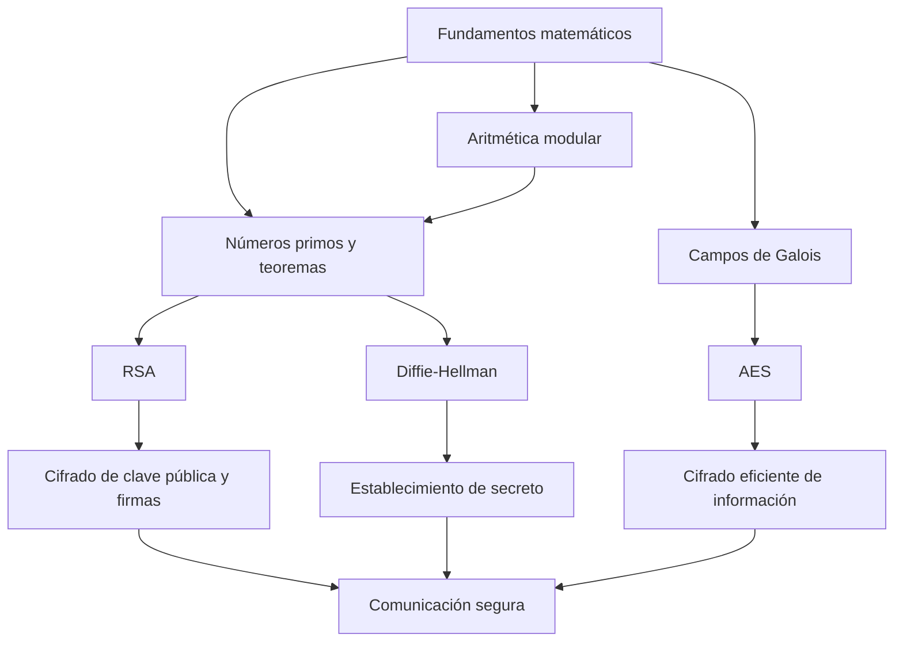
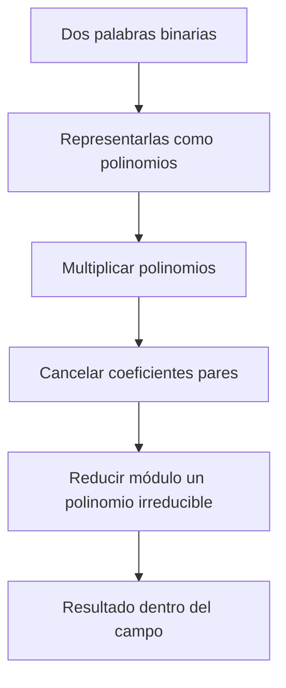
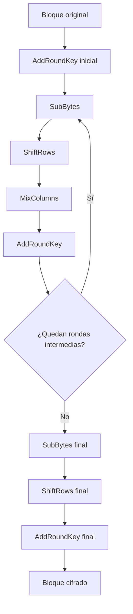
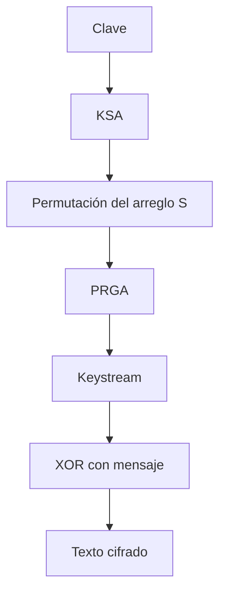
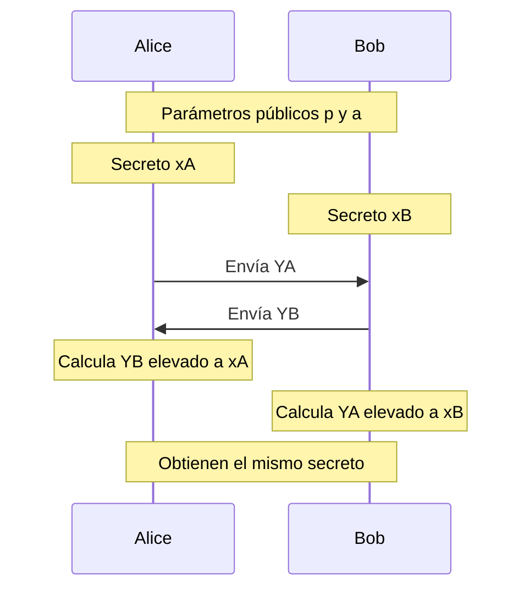
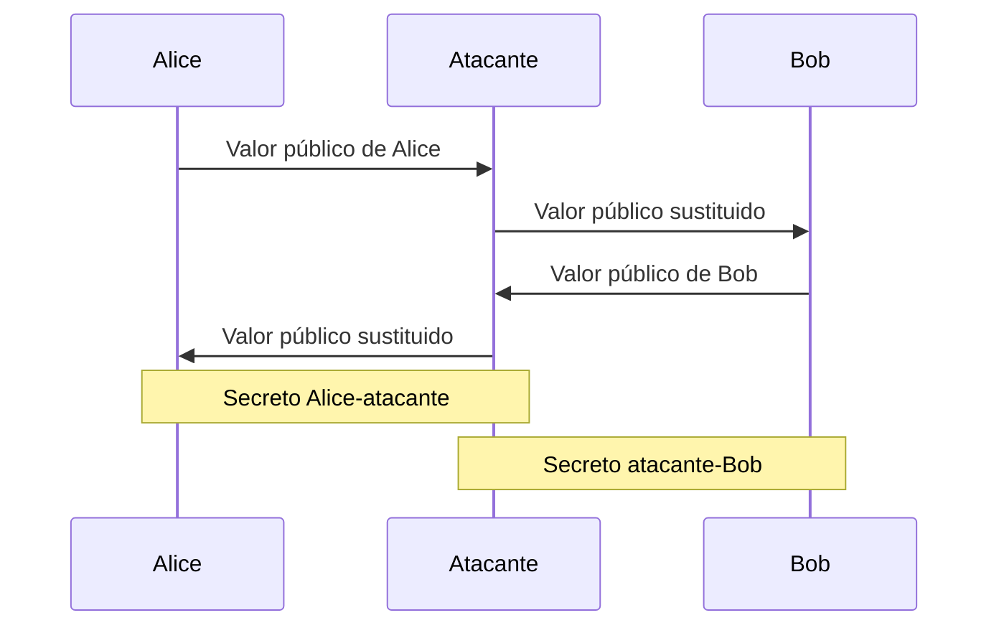
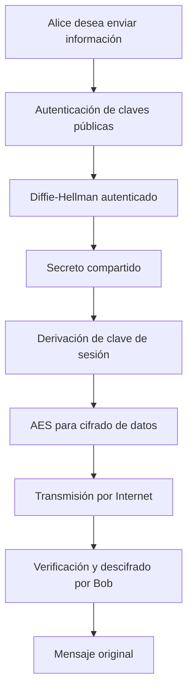
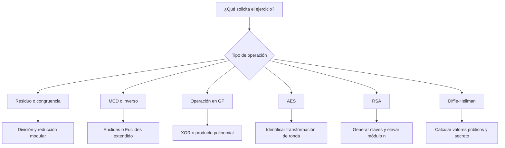

## Introducción  
  
La criptografía permite proteger la información mediante operaciones matemáticas que transforman los datos originales en representaciones difíciles de interpretar sin conocer el secreto correspondiente. Para comprender su funcionamiento, es necesario relacionar tres áreas fundamentales: **aritmética modular y campos de Galois**, **criptografía simétrica** y **criptografía asimétrica**.  
  
Estas áreas no funcionan de manera aislada. La aritmética modular proporciona operaciones sobre conjuntos finitos; los campos de Galois permiten construir transformaciones sobre bytes; AES utiliza estas operaciones para cifrar información; y algoritmos como RSA y Diffie-Hellman permiten proteger o establecer claves que posteriormente pueden utilizarse con algoritmos simétricos.  
  
El objetivo de este repaso es comprender **qué problema resuelve cada mecanismo, cómo funciona, qué operaciones utiliza y cómo se relaciona con los demás**.  
  

  
La relación principal consiste en que **la criptografía asimétrica facilita la gestión y el establecimiento de claves, mientras que la criptografía simétrica protege eficientemente los datos**.  
  
---  
  
## Fundamentos de aritmética modular  
  
La aritmética modular trabaja con los residuos de una división entera.  
  
La operación fundamental es:  
  
$$  
\boxed{a\bmod n=r}  
$$  
  
En donde:  
  
- $a$ es el número original.  
- $n$ es el módulo positivo.  
- $r$ es el residuo.  
  
El residuo siempre cumple:  
  
$$  
0\leq r<n  
$$  
  
### Cálculo del módulo:  
  
###### Ejemplo:  
  
Se desea calcular:  
  
$$  
137\bmod12  
$$  
  
Como:  
  
$$  
137=11(12)+5  
$$  
  
Se obtiene:  
  
$$  
\boxed{137\bmod12=5}  
$$  
  
Para números negativos se busca igualmente un residuo no negativo.  
  
Por ejemplo:  
  
$$  
-23=(-4)(7)+5  
$$  
  
Por lo tanto:  
  
$$  
\boxed{-23\bmod7=5}  
$$  
  
### Congruencia modular:  
  
Dos números son congruentes módulo $n$ cuando producen el mismo residuo.  
  
Se representa mediante:  
  
$$  
\boxed{a\equiv b\pmod n}  
$$  
  
También significa que:  
  
$$  
n\mid(a-b)  
$$  
  
###### Ejemplo:  
  
$$  
35\equiv5\pmod{10}  
$$  
  
Porque:  
  
$$  
35-5=30  
$$  
  
Y $30$ es divisible entre $10$.  
  
### Operaciones modulares:  
  
Las operaciones de suma, resta y multiplicación permiten reducir los operandos antes de calcular el resultado.  
  
$$  
\boxed{(a+b)\bmod n=[(a\bmod n)+(b\bmod n)]\bmod n}  
$$  
  
$$  
\boxed{(ab)\bmod n=[(a\bmod n)(b\bmod n)]\bmod n}  
$$  
  
###### Ejemplo práctico:  
  
Se desea calcular:  
  
$$  
(11\times15)\bmod8  
$$  
  
Primero:  
  
$$  
11\bmod8=3  
$$  
  
$$  
15\bmod8=7  
$$  
  
Después:  
  
$$  
(3\times7)\bmod8=21\bmod8  
$$  
  
Por lo tanto:  
  
$$  
\boxed{(11\times15)\bmod8=5}  
$$  
  
**Para el examen:** es importante dominar las congruencias y las operaciones modulares, porque aparecen directamente en RSA, Diffie-Hellman y los campos finitos.  
  
---  
  
## Máximo común divisor e inversos multiplicativos  
  
El **máximo común divisor (MCD)** es el mayor entero positivo que divide exactamente a dos números.  
  
Se representa mediante:  
  
$$  
\boxed{\gcd(a,b)}  
$$  
  
Dos números son **coprimos** cuando:  
  
$$  
\boxed{\gcd(a,b)=1}  
$$  
  
Por ejemplo:  
  
$$  
\gcd(8,15)=1  
$$  
  
Aunque ambos son compuestos, son coprimos porque no comparten factores positivos diferentes de uno.  
  
### Inverso multiplicativo:  
  
El inverso multiplicativo de $a$ módulo $n$ es un número que satisface:  
  
$$  
\boxed{aa^{-1}\equiv1\pmod n}  
$$  
  
El inverso existe si y solo si:  
  
$$  
\boxed{\gcd(a,n)=1}  
$$  
  
###### Ejemplo:  
  
Se desea calcular el inverso de $3$ módulo $8$.  
  
Como:  
  
$$  
\gcd(3,8)=1  
$$  
  
El inverso existe.  
  
Se observa:  
  
$$  
3\times3=9  
$$  
  
Y:  
  
$$  
9\bmod8=1  
$$  
  
Por lo tanto:  
  
$$  
\boxed{3^{-1}\equiv3\pmod8}  
$$  
  
En cambio, el número $6$ no tiene inverso módulo $8$ porque:  
  
$$  
\gcd(6,8)=2  
$$  
  
### Por qué importa:  
  
La existencia de inversos permite realizar divisiones modulares.  
  
En RSA, por ejemplo, es necesario calcular el inverso del exponente público:  
  
$$  
\boxed{d=e^{-1}\bmod\phi(n)}  
$$  
  
Por lo tanto, **el MCD determina si es posible generar correctamente el exponente privado**.  
  
---  
  
## Algoritmo de Euclides y Euclides extendido  
  
El **algoritmo de Euclides** calcula el máximo común divisor mediante divisiones sucesivas.  
  
Utiliza:  
  
$$  
\boxed{\gcd(a,b)=\gcd(b,a\bmod b)}  
$$  
  
El procedimiento termina cuando el residuo es cero.  
  
### Ejemplo:  
  
Se desea calcular:  
  
$$  
\gcd(252,198)  
$$  
  
Primero:  
  
$$  
252=1(198)+54  
$$  
  
Después:  
  
$$  
198=3(54)+36  
$$  
  
$$  
54=1(36)+18  
$$  
  
Finalmente:  
  
$$  
36=2(18)+0  
$$  
  
El último residuo diferente de cero es:  
  
$$  
18  
$$  
  
Por lo tanto:  
  
$$  
\boxed{\gcd(252,198)=18}  
$$  
  
### Algoritmo de Euclides extendido:  
  
El algoritmo extendido permite encontrar los coeficientes de la **identidad de Bézout**:  
  
$$  
\boxed{sa+tb=\gcd(a,b)}  
$$  
  
Cuando el MCD es uno:  
  
$$  
sa+tb=1  
$$  
  
El coeficiente correspondiente a $a$ permite encontrar su inverso módulo $b$.  
  
###### Ejemplo práctico:  
  
Se desea calcular:  
  
$$  
7^{-1}\bmod40  
$$  
  
Mediante Euclides:  
  
$$  
40=5(7)+5  
$$  
  
$$  
7=1(5)+2  
$$  
  
$$  
5=2(2)+1  
$$  
  
Sustituyendo hacia atrás:  
  
$$  
1=5-2(2)  
$$  
  
$$  
=5-2(7-5)  
$$  
  
$$  
=3(5)-2(7)  
$$  
  
Como:  
  
$$  
5=40-5(7)  
$$  
  
Entonces:  
  
$$  
1=3(40)-17(7)  
$$  
  
Por lo tanto:  
  
$$  
7(-17)+40(3)=1  
$$  
  
El inverso es:  
  
$$  
-17\bmod40=23  
$$  
  
Así:  
  
$$  
\boxed{7^{-1}\bmod40=23}  
$$  
  
Comprobando:  
  
$$  
7\times23=161  
$$  
  
$$  
161\bmod40=1  
$$  
  
---  
  
## Exponenciación modular rápida  
  
La **exponenciación modular** permite calcular:  
  
$$  
\boxed{a^e\bmod n}  
$$  
  
sin desarrollar completamente una potencia grande.  
  
Se utiliza la técnica de **cuadrados sucesivos**, que descompone el exponente como suma de potencias de dos.  
  
### Ejemplo práctico:  
  
Se desea calcular:  
  
$$  
7^{13}\bmod11  
$$  
  
Primero:  
  
$$  
13=8+4+1  
$$  
  
Por lo tanto:  
  
$$  
7^{13}=7^8\times7^4\times7  
$$  
  
Se calculan las potencias:  
  
$$  
7^2\bmod11=5  
$$  
  
$$  
7^4\bmod11=5^2\bmod11=3  
$$  
  
$$  
7^8\bmod11=3^2\bmod11=9  
$$  
  
Se combinan:  
  
$$  
7^{13}\bmod11=(9\times3\times7)\bmod11  
$$  
  
$$  
=189\bmod11  
$$  
  
Por lo tanto:  
  
$$  
\boxed{7^{13}\bmod11=2}  
$$  
  
**Esta técnica debe dominarse**, porque RSA y Diffie-Hellman utilizan exponenciaciones modulares con exponentes grandes.  
  
---  
  
## Campos finitos de Galois  
  
Un **campo finito** es un conjunto con una cantidad limitada de elementos en el que se pueden realizar suma, resta, multiplicación y división entre elementos no nulos.  
  
Se representa mediante:  
  
$$  
\boxed{GF(p^n)}  
$$  
  
En donde:  
  
- $p$ es primo.  
- $n$ es un entero positivo.  
- $p^n$ es la cantidad de elementos.  
  
### Diferencia entre Z₈ y GF(2³):  
  
Ambos contienen ocho elementos, pero sus operaciones son diferentes.  
  
En:  
  
$$  
\mathbb Z_8  
$$  
  
la multiplicación se realiza módulo $8$.  
  
El problema es que existen elementos diferentes de cero cuyo producto es cero.  
  
Por ejemplo:  
  
$$  
2\times4\equiv0\pmod8  
$$  
  
En cambio, en:  
  
$$  
GF(2^3)  
$$  
  
la multiplicación se realiza mediante polinomios y reducción módulo un polinomio irreducible.  
  
Esto garantiza que todos los elementos distintos de cero tengan inverso multiplicativo.  
  
Por lo tanto:  
  
$$  
\boxed{\mathbb Z_8\neq GF(2^3)}  
$$  
  
### Representación de polinomios:  
  
En $GF(2^n)$, los elementos se representan mediante palabras binarias.  
  
Cada bit corresponde al coeficiente de una potencia de $x$.  
  
###### Ejemplo:  
  
La palabra:  
  
$$  
10110101  
$$  
  
Representa:  
  
$$  
\boxed{x^7+x^5+x^4+x^2+1}  
$$  
  
La relación es:  
  
| Posición | $7$ | $6$ | $5$ | $4$ | $3$ | $2$ | $1$ | $0$ |  
|---|---|---|---|---|---|---|---|---|  
| Bit | $1$ | $0$ | $1$ | $1$ | $0$ | $1$ | $0$ | $1$ |  
  
### Suma de polinomios:  
  
En los campos binarios, la suma corresponde a XOR.  
  
Por ejemplo:  
  
$$  
10101100\oplus01101001  
$$  
  
Produce:  
  
$$  
\boxed{11000101}  
$$  
  
Esto ocurre porque:  
  
$$  
1+1=0  
$$  
  
Dentro de $GF(2)$.  
  
### Multiplicación de polinomios:  
  
La multiplicación requiere:  
  
1. Multiplicar los polinomios.  
2. Sumar coeficientes módulo dos.  
3. Reducir el resultado módulo un polinomio irreducible.  
  

  
### Campo utilizado por AES:  
  
AES utiliza:  
  
$$  
\boxed{GF(2^8)}  
$$  
  
Con el polinomio irreducible:  
  
$$  
\boxed{m(x)=x^8+x^4+x^3+x+1}  
$$  
  
En hexadecimal:  
  
$$  
\boxed{\texttt{0x11B}}  
$$  
  
Este campo contiene:  
  
$$  
2^8=256  
$$  
  
elementos.  
  
Cada elemento puede representarse mediante un byte.  
  
### Ejemplo de multiplicación en GF(2³):  
  
Se utiliza:  
  
$$  
m(x)=x^3+x+1  
$$  
  
Y se desea calcular:  
  
$$  
(x^2+1)(x+1)  
$$  
  
Multiplicando:  
  
$$  
x^3+x^2+x+1  
$$  
  
Como:  
  
$$  
x^3\equiv x+1  
$$  
  
Se sustituye:  
  
$$  
(x+1)+x^2+x+1  
$$  
  
Los términos repetidos se cancelan.  
  
Por lo tanto:  
  
$$  
\boxed{x^2}  
$$  
  
En binario:  
  
$$  
\boxed{101\otimes011=100}  
$$  
  
La multiplicación utiliza las reglas de $GF(2)$ y la reducción mediante el polinomio irreducible.  
  
---  
  
## AES: estructura y funcionamiento  
  
**Advanced Encryption Standard (AES)** es un cifrador simétrico por bloques.  
  
Su tamaño de bloque es siempre:  
  
$$  
\boxed{128\text{ bits}}  
$$  
  
Admite diferentes tamaños de clave:  
  
| Configuración | Clave | Rondas |  
|---|---|---|  
| AES-128 | $128$ bits | $10$ |  
| AES-192 | $192$ bits | $12$ |  
| AES-256 | $256$ bits | $14$ |  
  
### Matriz State:  
  
AES organiza cada bloque de $16$ bytes en una matriz de cuatro filas y cuatro columnas.  
  
$$  
S=  
\begin{bmatrix}  
s_{0,0}&s_{0,1}&s_{0,2}&s_{0,3}\\  
s_{1,0}&s_{1,1}&s_{1,2}&s_{1,3}\\  
s_{2,0}&s_{2,1}&s_{2,2}&s_{2,3}\\  
s_{3,0}&s_{3,1}&s_{3,2}&s_{3,3}  
\end{bmatrix}  
$$  
  
Los bytes se introducen por columnas.  
  
### Transformaciones de AES:  
  
AES utiliza cuatro transformaciones:  
  
- **SubBytes:** sustituye los bytes mediante una S-Box.  
- **ShiftRows:** desplaza circularmente las filas.  
- **MixColumns:** mezcla algebraicamente los bytes de cada columna.  
- **AddRoundKey:** aplica XOR con una clave de ronda.  
  

  
La ronda final omite MixColumns.  
  
---  
  
## Las cuatro transformaciones de AES  
  
### SubBytes:  
  
SubBytes sustituye cada byte mediante una tabla S-Box de:  
  
$$  
16\times16=256  
$$  
  
entradas.  
  
###### Ejemplo:  
  
Para consultar el byte:  
  
$$  
\texttt{95}  
$$  
  
Se utiliza:  
  
- Fila hexadecimal $\texttt{9}$.  
- Columna hexadecimal $\texttt{5}$.  
  
La sustitución es:  
  
$$  
\boxed{S(\texttt{95})=\texttt{2A}}  
$$  
  
La S-Box se construye mediante:  
  
1. Inverso multiplicativo dentro de $GF(2^8)$.  
2. Transformación afín con constante hexadecimal $\texttt{63}$.  
  
La función principal de SubBytes es introducir **no linealidad**.  
  
### ShiftRows:  
  
ShiftRows desplaza circularmente las filas hacia la izquierda.  
  
| Fila | Desplazamiento |  
|---|---|  
| Primera | $0$ posiciones |  
| Segunda | $1$ posición |  
| Tercera | $2$ posiciones |  
| Cuarta | $3$ posiciones |  
  
###### Ejemplo:  
  
Considérese:  
  
$$  
S=  
\begin{bmatrix}  
10&20&30&40\\  
50&60&70&80\\  
90&A0&B0&C0\\  
D0&E0&F0&00  
\end{bmatrix}_{16}  
$$  
  
Después de ShiftRows:  
  
$$  
\boxed{  
S'=  
\begin{bmatrix}  
10&20&30&40\\  
60&70&80&50\\  
B0&C0&90&A0\\  
00&D0&E0&F0  
\end{bmatrix}_{16}  
}  
$$  
  
Su función es redistribuir bytes entre columnas.  
  
### MixColumns:  
  
MixColumns multiplica cada columna por una matriz dentro de:  
  
$$  
GF(2^8)  
$$  
  
La matriz utilizada es:  
  
$$  
\boxed{  
M=  
\begin{bmatrix}  
02&03&01&01\\  
01&02&03&01\\  
01&01&02&03\\  
03&01&01&02  
\end{bmatrix}_{16}  
}  
$$  
  
Las operaciones de suma corresponden a XOR.  
  
Las multiplicaciones se realizan dentro del campo finito.  
  
Una regla importante es:  
  
$$  
\boxed{\texttt{03}\otimes a=(\texttt{02}\otimes a)\oplus a}  
$$  
  
###### Ejemplo práctico:  
  
Se desea calcular:  
  
$$  
\texttt{02}\otimes\texttt{87}  
$$  
  
El byte:  
  
$$  
\texttt{87}=10000111  
$$  
  
Tiene el bit más significativo igual a uno.  
  
Al desplazar a la izquierda, conservando ocho bits:  
  
$$  
00001110=\texttt{0E}  
$$  
  
Se aplica XOR con:  
  
$$  
\texttt{1B}  
$$  
  
Por lo tanto:  
  
$$  
\texttt{0E}\oplus\texttt{1B}=\texttt{15}  
$$  
  
Así:  
  
$$  
\boxed{\texttt{02}\otimes\texttt{87}=\texttt{15}}  
$$  
  
La función principal de MixColumns es proporcionar **difusión**, haciendo que cada byte de salida dependa de varios bytes originales.  
  
### AddRoundKey:  
  
AddRoundKey combina el estado con una clave de ronda mediante XOR.  
  
La fórmula es:  
  
$$  
\boxed{S'=S\oplus K}  
$$  
  
###### Ejemplo:  
  
$$  
\texttt{47}\oplus\texttt{AC}=\texttt{EB}  
$$  
  
Esta operación incorpora el material secreto al estado.  
  
También es reversible:  
  
$$  
(S\oplus K)\oplus K=S  
$$  
  
Por lo tanto, AddRoundKey es su propia inversa.  
  
### Comparación:  
  
| Transformación | Qué hace | Función |  
|---|---|---|  
| SubBytes | Sustituye bytes | No linealidad |  
| ShiftRows | Desplaza filas | Redistribución |  
| MixColumns | Combina bytes mediante álgebra | Difusión |  
| AddRoundKey | Aplica XOR con la clave | Incorporar secreto |  
  
La combinación de las transformaciones permite que pequeñas modificaciones del mensaje o de la clave puedan propagarse por el estado durante las rondas.  
  
---  
  
## Expansión de claves y descifrado AES  
  
AES no utiliza exactamente la misma secuencia de bytes como clave en todas sus rondas.  
  
En su lugar, aplica **Key Expansion** para generar las claves de ronda.  
  
### Expansión de AES-128:  
  
La clave original contiene:  
  
$$  
128\text{ bits}  
$$  
  
Equivalentes a:  
  
$$  
16\text{ bytes}  
$$  
  
La expansión produce:  
  
$$  
44  
$$  
  
palabras de $32$ bits.  
  
Cada clave de ronda utiliza cuatro palabras.  
  
Por lo tanto:  
  
$$  
\frac{44}{4}=11  
$$  
  
Se generan once claves de ronda.  
  
### Operaciones principales:  
  
**RotWord** desplaza circularmente una palabra de cuatro bytes.  
  
$$  
[b_0,b_1,b_2,b_3]  
\rightarrow  
[b_1,b_2,b_3,b_0]  
$$  
  
**SubWord** sustituye cada byte utilizando la S-Box.  
  
**Rcon** introduce constantes que dependen de la ronda.  
  
Cuando el índice no es múltiplo de cuatro:  
  
$$  
\boxed{w_i=w_{i-4}\oplus w_{i-1}}  
$$  
  
Cuando es múltiplo de cuatro:  
  
$$  
\boxed{  
w_i=w_{i-4}\oplus  
\left[  
\operatorname{SubWord}(\operatorname{RotWord}(w_{i-1}))  
\oplus\operatorname{Rcon}(i/4)  
\right]  
}  
$$  
  
### Descifrado:  
  
El descifrado utiliza las transformaciones inversas.  
  
| Cifrado | Descifrado |  
|---|---|  
| SubBytes | InvSubBytes |  
| ShiftRows | InvShiftRows |  
| MixColumns | InvMixColumns |  
| AddRoundKey | AddRoundKey |  
  
Las claves de ronda deben utilizarse en el orden correspondiente al procedimiento inverso.  
  
La propiedad fundamental es:  
  
$$  
\boxed{D_K(E_K(P))=P}  
$$  
  
En donde:  
  
- $E_K$ es el cifrado.  
- $D_K$ es el descifrado.  
- $P$ es el bloque original.  
  
---  
  
## Cifradores de flujo y RC4  
  
Los **cifradores de flujo** generan una secuencia de valores denominada *keystream*.  
  
Esta secuencia se combina con el mensaje mediante XOR.  
  
La operación de cifrado es:  
  
$$  
\boxed{C_i=M_i\oplus K_i}  
$$  
  
El descifrado utiliza:  
  
$$  
\boxed{M_i=C_i\oplus K_i}  
$$  
  
### Ejemplo práctico:  
  
Supóngase:  
  
$$  
M=11001100  
$$  
  
Y:  
  
$$  
K=01101100  
$$  
  
Se calcula:  
  
$$  
C=M\oplus K  
$$  
  
$$  
11001100\oplus01101100  
$$  
  
Por lo tanto:  
  
$$  
\boxed{C=10100000}  
$$  
  
El descifrado recupera el mensaje:  
  
$$  
10100000\oplus01101100=11001100  
$$  
  
### RC4:  
  
**RC4** es un cifrador de flujo histórico que utiliza un arreglo interno de $256$ elementos.  
  
Su funcionamiento se divide en dos procedimientos:  
  
- **Key Scheduling Algorithm (KSA)**.  
- **Pseudo-Random Generation Algorithm (PRGA)**.  
  
### KSA:  
  
Inicializa el arreglo:  
  
$$  
S=[0,1,2,\ldots,255]  
$$  
  
Después utiliza la clave para reorganizar sus elementos.  
  
La operación principal es:  
  
$$  
\boxed{j=(j+S[i]+T[i])\bmod256}  
$$  
  
Y se intercambian:  
  
$$  
S[i]\longleftrightarrow S[j]  
$$  
  
### PRGA:  
  
Genera el keystream mediante:  
  
$$  
i=(i+1)\bmod256  
$$  
  
$$  
j=(j+S[i])\bmod256  
$$  
  
Después intercambia los elementos correspondientes.  
  
Se calcula:  
  
$$  
t=(S[i]+S[j])\bmod256  
$$  
  
El byte generado es:  
  
$$  
\boxed{k=S[t]}  
$$  
  
Finalmente:  
  
$$  
C=M\oplus k  
$$  
  

  
### Reutilización del keystream:  
  
Si dos mensajes se cifran utilizando el mismo keystream:  
  
$$  
C_1=M_1\oplus K  
$$  
  
$$  
C_2=M_2\oplus K  
$$  
  
Entonces:  
  
$$  
C_1\oplus C_2  
=  
M_1\oplus K\oplus M_2\oplus K  
$$  
  
Como:  
  
$$  
K\oplus K=0  
$$  
  
Se obtiene:  
  
$$  
\boxed{C_1\oplus C_2=M_1\oplus M_2}  
$$  
  
Esto puede revelar información sobre los mensajes.  
  
RC4 presenta debilidades conocidas y no se considera apropiado para nuevas aplicaciones criptográficas.  
  
---  
  
## Modos de operación de cifradores por bloques  
  
AES cifra bloques de:  
  
$$  
128\text{ bits}  
$$  
  
Para proteger mensajes de mayor longitud se necesitan **modos de operación**.  
  
Los cinco modos clásicos son:  
  
- ECB.  
- CBC.  
- CFB.  
- OFB.  
- CTR.  
  
### Electronic Codebook (ECB):  
  
Cifra cada bloque de manera independiente.  
  
$$  
\boxed{C_i=E_K(P_i)}  
$$  
  
El problema es que dos bloques originales idénticos producen bloques cifrados idénticos bajo la misma clave.  
  
Por lo tanto:  
  
$$  
P_i=P_j\Rightarrow C_i=C_j  
$$  
  
Esto permite detectar patrones repetidos.  
  
### Cipher Block Chaining (CBC):  
  
Combina cada bloque original con el bloque cifrado anterior.  
  
Para el primero:  
  
$$  
\boxed{C_1=E_K(P_1\oplus IV)}  
$$  
  
Para los siguientes:  
  
$$  
\boxed{C_i=E_K(P_i\oplus C_{i-1})}  
$$  
  
El descifrado es:  
  
$$  
\boxed{P_i=D_K(C_i)\oplus C_{i-1}}  
$$  
  
Para el primer bloque se utiliza el IV.  
  
### Cipher Feedback (CFB):  
  
Utiliza el texto cifrado anterior para producir el siguiente valor de la secuencia.  
  
Para la variante de bloque completo:  
  
$$  
\boxed{C_i=P_i\oplus E_K(C_{i-1})}  
$$  
  
Con:  
  
$$  
C_0=IV  
$$  
  
### Output Feedback (OFB):  
  
Genera una secuencia independiente del contenido del mensaje.  
  
$$  
\boxed{O_i=E_K(O_{i-1})}  
$$  
  
Con:  
  
$$  
O_0=IV  
$$  
  
Después:  
  
$$  
\boxed{C_i=P_i\oplus O_i}  
$$  
  
### Counter Mode (CTR):  
  
Genera el keystream cifrando entradas de contador.  
  
$$  
\boxed{K_i=E_K(X_i)}  
$$  
  
Después:  
  
$$  
\boxed{C_i=P_i\oplus K_i}  
$$  
  
CTR permite procesar bloques en paralelo porque no necesita utilizar el texto cifrado anterior para generar el siguiente bloque.  
  
### Comparación:  
  
| Modo | Característica principal | Consideración |  
|---|---|---|  
| ECB | Bloques independientes | Revela patrones |  
| CBC | Encadenamiento | Requiere IV adecuado |  
| CFB | Retroalimentación del cifrado | Depende del texto cifrado anterior |  
| OFB | Retroalimentación de la salida | No reutilizar keystream |  
| CTR | Contadores independientes | No repetir entradas bajo la misma clave |  
  
```mermaid  
mindmap  
root((Modos de operación))  
ECB  
Independiente  
Revela patrones  
CBC  
Encadenamiento  
IV  
CFB  
Retroalimentación cifrada  
OFB  
Keystream por realimentación  
CTR  
Contador  
Paralelismo  
```  
  
**Distinción importante:** los modos clásicos anteriores proporcionan mecanismos de cifrado, pero no garantizan por sí solos la autenticidad de los mensajes.  
  
---  
  
## Números primos, Fermat y Euler  
  
La criptografía asimétrica utiliza propiedades de los números primos y de la exponenciación modular.  
  
### Números primos:  
  
Un número primo es un entero mayor que uno cuyos únicos divisores positivos son uno y él mismo.  
  
Por ejemplo:  
  
$$  
7,\ 11,\ 13,\ 17  
$$  
  
son primos.  
  
En cambio:  
  
$$  
21=3\times7  
$$  
  
es compuesto.  
  
La factorización prima es importante para RSA, que utiliza:  
  
$$  
\boxed{n=pq}  
$$  
  
### Pequeño teorema de Fermat:  
  
Si $p$ es primo y:  
  
$$  
\gcd(a,p)=1  
$$  
  
Entonces:  
  
$$  
\boxed{a^{p-1}\equiv1\pmod p}  
$$  
  
También:  
  
$$  
\boxed{a^p\equiv a\pmod p}  
$$  
  
para cualquier entero $a$.  
  
###### Ejemplo:  
  
Para:  
  
$$  
a=7,\qquad p=3  
$$  
  
Se obtiene:  
  
$$  
7^2=49  
$$  
  
$$  
49\bmod3=1  
$$  
  
Por lo tanto:  
  
$$  
\boxed{7^2\equiv1\pmod3}  
$$  
  
### Función totiente de Euler:  
  
La función:  
  
$$  
\phi(n)  
$$  
  
cuenta los enteros positivos menores que $n$ y coprimos con él.  
  
Por ejemplo, los residuos coprimos con $10$ son:  
  
$$  
\{1,3,7,9\}  
$$  
  
Por lo tanto:  
  
$$  
\boxed{\phi(10)=4}  
$$  
  
Para un primo:  
  
$$  
\boxed{\phi(p)=p-1}  
$$  
  
Para una potencia prima:  
  
$$  
\boxed{\phi(p^k)=p^k-p^{k-1}}  
$$  
  
Para dos primos distintos:  
  
$$  
\boxed{\phi(pq)=(p-1)(q-1)}  
$$  
  
### Teorema de Euler:  
  
Si:  
  
$$  
\gcd(a,n)=1  
$$  
  
Entonces:  
  
$$  
\boxed{a^{\phi(n)}\equiv1\pmod n}  
$$  
  
###### Ejemplo:  
  
Para:  
  
$$  
a=3,\qquad n=10  
$$  
  
Se sabe que:  
  
$$  
\phi(10)=4  
$$  
  
Entonces:  
  
$$  
3^4=81  
$$  
  
$$  
81\bmod10=1  
$$  
  
Por lo tanto:  
  
$$  
\boxed{3^4\equiv1\pmod{10}}  
$$  
  
La relación entre Fermat y Euler es fundamental porque **Fermat es un caso particular del teorema de Euler cuando el módulo es primo**.  
  
---  
  
## Criptografía simétrica y asimétrica  
  
La criptografía simétrica utiliza una clave secreta compartida.  
  
La criptografía asimétrica utiliza un par de claves:  
  
- Pública.  
- Privada.  
  
### Diferencia principal:  
  
En un esquema de cifrado de clave pública, un emisor utiliza la clave pública del destinatario para cifrar información.  
  
El destinatario utiliza su clave privada para descifrarla.  
  
En un esquema de firma digital, la clave privada permite firmar y la pública verificar.  
  
| Característica | Simétrica | Asimétrica |  
|---|---|---|  
| Claves | Una compartida | Pública y privada |  
| Algoritmo | AES | RSA |  
| Rendimiento | Generalmente más eficiente | Generalmente más costoso |  
| Uso | Cifrado de datos | Firmas, cifrado de claves |  
| Problema principal | Distribución de secreto | Autenticidad de claves públicas |  
  
Los enfoques se complementan en sistemas híbridos.  
  
---  
  
## RSA: generación, cifrado y descifrado  
  
**RSA** es un algoritmo asimétrico que utiliza números primos, función totiente e inversos multiplicativos.  
  
### Generación de claves:  
  
Primero se seleccionan dos primos distintos:  
  
$$  
p,\ q  
$$  
  
Después:  
  
$$  
\boxed{n=pq}  
$$  
  
Se calcula:  
  
$$  
\boxed{\phi(n)=(p-1)(q-1)}  
$$  
  
Se selecciona un exponente público $e$ que satisfaga:  
  
$$  
\gcd(e,\phi(n))=1  
$$  
  
Después se obtiene:  
  
$$  
\boxed{d=e^{-1}\bmod\phi(n)}  
$$  
  
Las claves son:  
  
$$  
\boxed{PU=(e,n)}  
$$  
  
$$  
\boxed{PR=(d,n)}  
$$  
  
### Ejemplo de generación:  
  
Se seleccionan:  
  
$$  
p=17,\qquad q=11  
$$  
  
Entonces:  
  
$$  
n=17\times11=187  
$$  
  
La función totiente es:  
  
$$  
\phi(n)=16\times10=160  
$$  
  
Se selecciona:  
  
$$  
e=7  
$$  
  
El exponente privado es:  
  
$$  
d=23  
$$  
  
Porque:  
  
$$  
7\times23=161  
$$  
  
Y:  
  
$$  
161\bmod160=1  
$$  
  
Por lo tanto:  
  
$$  
\boxed{PU=(7,187)}  
$$  
  
$$  
\boxed{PR=(23,187)}  
$$  
  
### Cifrado:  
  
La operación básica de cifrado es:  
  
$$  
\boxed{C=M^e\bmod n}  
$$  
  
Supóngase:  
  
$$  
M=88  
$$  
  
Entonces:  
  
$$  
C=88^7\bmod187  
$$  
  
El resultado es:  
  
$$  
\boxed{C=11}  
$$  
  
### Descifrado:  
  
Se utiliza:  
  
$$  
\boxed{M=C^d\bmod n}  
$$  
  
Sustituyendo:  
  
$$  
M=11^{23}\bmod187  
$$  
  
Se obtiene:  
  
$$  
\boxed{M=88}  
$$  
  
El mensaje original se recupera.  
  

  
### Por qué funciona:  
  
RSA selecciona exponentes que satisfacen:  
  
$$  
\boxed{ed\equiv1\pmod{\phi(n)}}  
$$  
  
Por lo tanto, existe un entero $k$ tal que:  
  
$$  
ed=1+k\phi(n)  
$$  
  
Para mensajes coprimos con $n$, el teorema de Euler permite demostrar:  
  
$$  
M^{ed}\equiv M\pmod n  
$$  
  
La demostración se obtiene mediante:  
  
$$  
M^{ed}=M(M^{\phi(n)})^k  
$$  
  
Y:  
  
$$  
M^{\phi(n)}\equiv1\pmod n  
$$  
  
De esta manera:  
  
$$  
\boxed{M^{ed}\equiv M\pmod n}  
$$  
  
Para el caso general, también puede utilizarse el teorema chino del residuo.  
  
### Seguridad de RSA:  
  
RSA utiliza dos primos grandes para construir:  
  
$$  
n=pq  
$$  
  
Conocer los factores permite calcular el totiente y obtener el exponente privado.  
  
Por esta razón, la dificultad de factorizar módulos grandes es relevante para su seguridad.  
  
En aplicaciones reales deben utilizarse tamaños adecuados y esquemas seguros como RSA-OAEP para cifrado.  
  
---  
  
## Teorema chino del residuo en RSA  
  
El **teorema chino del residuo (CRT)** permite reconstruir un número a partir de sus residuos módulo varios enteros coprimos.  
  
En RSA, como:  
  
$$  
n=pq  
$$  
  
pueden calcularse las potencias por separado módulo $p$ y módulo $q$.  
  
### Ejemplo práctico:  
  
Considérese:  
  
$$  
p=17,\qquad q=11  
$$  
  
$$  
C=11,\qquad d=23  
$$  
  
Primero se calcula:  
  
$$  
M_p=11^{23}\bmod17  
$$  
  
El resultado es:  
  
$$  
\boxed{M_p=3}  
$$  
  
Después:  
  
$$  
M_q=11^{23}\bmod11  
$$  
  
Como $11\bmod11=0$:  
  
$$  
\boxed{M_q=0}  
$$  
  
Ahora se busca un número que satisfaga:  
  
$$  
M\equiv3\pmod{17}  
$$  
  
Y:  
  
$$  
M\equiv0\pmod{11}  
$$  
  
El valor:  
  
$$  
M=88  
$$  
  
cumple ambas congruencias.  
  
Por lo tanto:  
  
$$  
\boxed{M=88}  
$$  
  
El CRT permite acelerar el descifrado al trabajar con módulos menores.  
  
---  
  
## Diffie-Hellman y raíces primitivas  
  
**Diffie-Hellman** es un mecanismo de establecimiento de secretos compartidos.  
  
Utiliza exponenciación modular y propiedades de grupos finitos.  
  
Antes de estudiar el intercambio es importante comprender las raíces primitivas.  
  
### Raíz primitiva:  
  
Una raíz primitiva módulo un primo $p$ es un elemento cuyas potencias generan todos los residuos no nulos módulo $p$.  
  
###### Ejemplo:  
  
Se desea determinar si $3$ es raíz primitiva módulo $7$.  
  
Se calculan:  
  
| Potencia | Residuo |  
|---|---|  
| $3^1\bmod7$ | $3$ |  
| $3^2\bmod7$ | $2$ |  
| $3^3\bmod7$ | $6$ |  
| $3^4\bmod7$ | $4$ |  
| $3^5\bmod7$ | $5$ |  
| $3^6\bmod7$ | $1$ |  
  
Se obtienen todos los residuos no nulos:  
  
$$  
\{1,2,3,4,5,6\}  
$$  
  
Por lo tanto:  
  
$$  
\boxed{3\text{ es raíz primitiva módulo }7}  
$$  
  
### Otras raíces primitivas:  
  
Si $a$ es raíz primitiva módulo un primo $p$, entonces:  
  
$$  
a^r\bmod p  
$$  
  
también es raíz primitiva si:  
  
$$  
\boxed{\gcd(r,p-1)=1}  
$$  
  
Esta propiedad permite obtener nuevos generadores a partir de uno conocido.  
  
### Relación con el logaritmo discreto:  
  
Calcular:  
  
$$  
y=a^x\bmod p  
$$  
  
es eficiente cuando se conocen $a$, $x$ y $p$.  
  
En cambio, recuperar $x$ a partir de $a$, $y$ y $p$ puede resultar difícil cuando se utilizan grupos y parámetros suficientemente grandes.  
  
Este problema se denomina **logaritmo discreto**.  
  
---  
  
## Intercambio Diffie-Hellman  
  
Diffie-Hellman permite que dos entidades calculen un mismo secreto sin transmitirlo directamente.  
  
### Parámetros públicos:  
  
Ambas entidades conocen:  
  
$$  
p  
$$  
  
Un primo grande.  
  
Y:  
  
$$  
a  
$$  
  
Un generador apropiado del grupo.  
  
### Valores privados:  
  
Alice selecciona:  
  
$$  
x_A  
$$  
  
Bob selecciona:  
  
$$  
x_B  
$$  
  
Los exponentes son secretos.  
  
### Valores públicos:  
  
Alice calcula:  
  
$$  
\boxed{Y_A=a^{x_A}\bmod p}  
$$  
  
Bob calcula:  
  
$$  
\boxed{Y_B=a^{x_B}\bmod p}  
$$  
  
Después intercambian los valores públicos.  
  
### Secreto compartido:  
  
Alice calcula:  
  
$$  
\boxed{K_{AB}=Y_B^{x_A}\bmod p}  
$$  
  
Bob calcula:  
  
$$  
\boxed{K_{AB}=Y_A^{x_B}\bmod p}  
$$  
  
Ambos obtienen:  
  
$$  
\boxed{K_{AB}=a^{x_Ax_B}\bmod p}  
$$  
  
Esto ocurre porque:  
  
$$  
x_Ax_B=x_Bx_A  
$$  
  

  
### Ejemplo práctico:  
  
Se utilizan:  
  
$$  
p=353,\qquad a=3  
$$  
  
Alice selecciona:  
  
$$  
x_A=97  
$$  
  
Bob selecciona:  
  
$$  
x_B=233  
$$  
  
Los valores públicos son:  
  
$$  
Y_A=3^{97}\bmod353=40  
$$  
  
$$  
Y_B=3^{233}\bmod353=248  
$$  
  
Alice calcula:  
  
$$  
248^{97}\bmod353  
$$  
  
Bob calcula:  
  
$$  
40^{233}\bmod353  
$$  
  
Ambos obtienen:  
  
$$  
\boxed{K_{AB}=160}  
$$  
  
El secreto compartido se obtiene sin transmitir directamente los exponentes privados.  
  
En una implementación real, el secreto debe procesarse mediante una función de derivación de claves antes de utilizarse como material criptográfico.  
  
---  
  
## Distribución de claves y autenticación  
  
La criptografía asimétrica también necesita mecanismos que permitan determinar si una clave pública realmente pertenece a la entidad correspondiente.  
  
Existen cuatro enfoques clásicos:  
  
| Mecanismo | Funcionamiento | Limitación principal |  
|---|---|---|  
| Anuncio público | Publicación directa de la clave | Puede ser suplantada |  
| Directorio público | Registro de entidades y claves | Necesita protección |  
| Autoridad de claves | Consulta autenticada | Requiere autoridad confiable |  
| Certificados digitales | Asociación firmada entre identidad y clave | Deben verificarse |  
  
### Ataque Man-in-the-Middle:  
  
Diffie-Hellman básico no autentica automáticamente a los participantes.  
  
Un atacante puede interceptar y sustituir los valores públicos intercambiados.  
  
Como resultado, puede establecer un secreto con cada entidad por separado.  
  

  
La solución consiste en autenticar el intercambio mediante mecanismos apropiados, como certificados y firmas digitales.  
  
**La distinción esencial es que establecer un secreto no equivale a verificar la identidad del interlocutor.**  
  
---  
  
## Cómo se integra todo en una comunicación segura  
  
Los mecanismos anteriores pueden combinarse para proteger una comunicación real.  
  
Supóngase que Alice necesita enviar información confidencial a Bob a través de Internet.  
  
El sistema debe proporcionar:  
  
- Confidencialidad.  
- Integridad.  
- Autenticación.  
- Establecimiento de claves.  
- Cifrado eficiente.  
  
### Primera etapa: autenticación:  
  
Los participantes verifican la identidad y las claves públicas correspondientes mediante certificados y firmas.  
  
### Segunda etapa: establecimiento de secreto:  
  
Se realiza un intercambio Diffie-Hellman autenticado.  
  
Ambos participantes calculan un secreto compartido.  
  
### Tercera etapa: derivación de clave:  
  
El secreto se procesa mediante una función de derivación de claves para obtener material criptográfico adecuado.  
  
### Cuarta etapa: cifrado:  
  
Se utiliza AES para cifrar eficientemente los mensajes.  
  
Si se requiere también autenticidad e integridad, puede utilizarse un modo autenticado como AES-GCM.  
  
### Quinta etapa: recepción:  
  
El receptor verifica la autenticidad del mensaje y lo descifra mediante la clave correspondiente.  
  

  
La relación entre los mecanismos es:  
  
| Mecanismo | Qué aporta |  
|---|---|  
| Aritmética modular | Operaciones sobre residuos |  
| Campos de Galois | Operaciones algebraicas sobre bytes |  
| Euclides extendido | Cálculo de inversos |  
| AES | Cifrado eficiente |  
| Modos de operación | Procesamiento de mensajes completos |  
| RSA | Cifrado de clave pública y firmas, según el esquema |  
| Diffie-Hellman | Establecimiento de secreto |  
| Certificados digitales | Autenticación de claves públicas |  
  
---  
  
## Procedimientos esenciales para el examen  
  
Los procedimientos siguientes reúnen las operaciones que conviene poder resolver sin consultar apuntes.  
  
### Identificar el tipo de problema:  
  

  
### Fórmulas fundamentales:  
  
| Concepto | Fórmula |  
|---|---|  
| Residuo modular | $a\bmod n$ |  
| Congruencia | $a\equiv b\pmod n$ |  
| Euclides | $\gcd(a,b)=\gcd(b,a\bmod b)$ |  
| Inverso multiplicativo | $aa^{-1}\equiv1\pmod n$ |  
| Fermat | $a^{p-1}\equiv1\pmod p$ |  
| Euler | $a^{\phi(n)}\equiv1\pmod n$ |  
| Totiente de RSA | $\phi(pq)=(p-1)(q-1)$ |  
| Relación de exponentes RSA | $ed\equiv1\pmod{\phi(n)}$ |  
| Cifrado RSA | $C=M^e\bmod n$ |  
| Descifrado RSA | $M=C^d\bmod n$ |  
| Clave pública DH | $Y=a^x\bmod p$ |  
| Secreto DH | $K_{AB}=a^{x_Ax_B}\bmod p$ |  
| Cifrado de flujo | $C=M\oplus K$ |  
| AddRoundKey | $S'=S\oplus K$ |  
  
### Diferencias que no deben confundirse:  
  
| Conceptos | Diferencia |  
|---|---|  
| Módulo y congruencia | El módulo obtiene un residuo; la congruencia expresa una relación |  
| MCD e inverso | El MCD determina si existe inverso |  
| $\mathbb Z_8$ y $GF(2^3)$ | Tienen ocho elementos, pero operaciones diferentes |  
| SubBytes y ShiftRows | Uno sustituye valores; el otro cambia posiciones |  
| ShiftRows y MixColumns | Uno redistribuye bytes; el otro los combina algebraicamente |  
| AES y RC4 | AES es por bloques; RC4 es de flujo |  
| ECB y CBC | ECB cifra independientemente; CBC encadena |  
| CFB y OFB | CFB retroalimenta texto cifrado; OFB retroalimenta la salida |  
| RSA y Diffie-Hellman | RSA permite cifrado o firmas; DH establece secretos |  
| Secreto compartido y autenticación | Un secreto no demuestra por sí mismo la identidad |  
  
---  
  
## Ideas principales  
  
La **aritmética modular** permite realizar operaciones sobre residuos. Es fundamental para comprender la exponenciación modular de RSA y Diffie-Hellman.  
  
El **máximo común divisor** determina cuándo dos números son coprimos. El algoritmo de Euclides calcula el MCD y Euclides extendido permite obtener inversos multiplicativos.  
  
Los **campos de Galois** permiten construir operaciones algebraicas sobre conjuntos finitos. En particular, $GF(2^8)$ proporciona la estructura utilizada por AES para realizar operaciones sobre bytes.  
  
**AES** es un cifrador simétrico por bloques de $128$ bits. Sus transformaciones principales son SubBytes, ShiftRows, MixColumns y AddRoundKey. La expansión de claves genera el material necesario para cada ronda.  
  
**RC4** es un cifrador de flujo que utiliza KSA y PRGA. Su funcionamiento permite comprender la generación de keystream, aunque sus debilidades lo hacen inadecuado para nuevas aplicaciones.  
  
Los **modos de operación** determinan cómo aplicar un cifrador por bloques a mensajes completos. ECB revela patrones, CBC encadena bloques, CFB y OFB utilizan retroalimentación y CTR utiliza contadores.  
  
Los **teoremas de Fermat y Euler** permiten comprender propiedades de las potencias modulares. La función totiente resulta indispensable para generar los exponentes RSA.  
  
**RSA** utiliza dos primos para construir un módulo y exponentes público y privado relacionados matemáticamente. Su funcionamiento se basa en la exponenciación modular.  
  
**Diffie-Hellman** permite establecer un secreto compartido sin transmitirlo directamente. Sin embargo, necesita autenticación para evitar ataques de intermediario.  
  
La **criptografía híbrida** combina mecanismos asimétricos para autenticar o establecer claves y algoritmos simétricos para cifrar eficientemente la información.  
  
---  
  
## Conclusión  
  
Los tres temas forman una secuencia conceptual que comienza con las propiedades matemáticas de la aritmética modular y termina con la construcción de comunicaciones seguras.  
  
La aritmética modular permite trabajar con residuos, mientras que el algoritmo de Euclides y los inversos multiplicativos proporcionan herramientas para realizar operaciones reversibles. Los campos de Galois extienden estos conceptos hacia los polinomios binarios y permiten construir las operaciones utilizadas por AES.  
  
AES utiliza sustituciones, desplazamientos, mezclas algebraicas y claves de ronda para transformar bloques de información. Los modos de operación permiten aplicar el cifrador a mensajes completos, mientras que los cifradores de flujo ilustran otra forma de combinar los datos con una secuencia criptográfica.  
  
La criptografía asimétrica utiliza propiedades de los números primos, la función totiente y la exponenciación modular para establecer relaciones entre valores públicos y secretos. RSA aprovecha estas propiedades para construir sistemas de clave pública, mientras que Diffie-Hellman permite establecer un secreto compartido entre participantes.  
  
Finalmente, los sistemas criptográficos completos combinan estas técnicas de acuerdo con sus funciones. La autenticación permite identificar correctamente a los participantes, los mecanismos asimétricos facilitan el establecimiento o protección de claves y los algoritmos simétricos proporcionan cifrado eficiente.  
  
Por lo tanto, **la comprensión integral de la criptografía consiste en relacionar cada herramienta matemática con el mecanismo que la utiliza y con la propiedad de seguridad que proporciona**. Este enfoque permite resolver ejercicios prácticos, distinguir algoritmos similares y comprender cómo se construyen sistemas seguros a partir de componentes complementarios.  