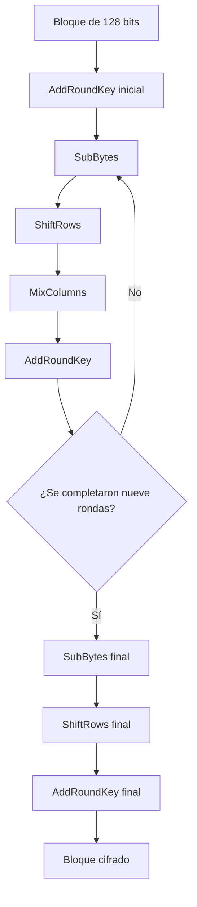
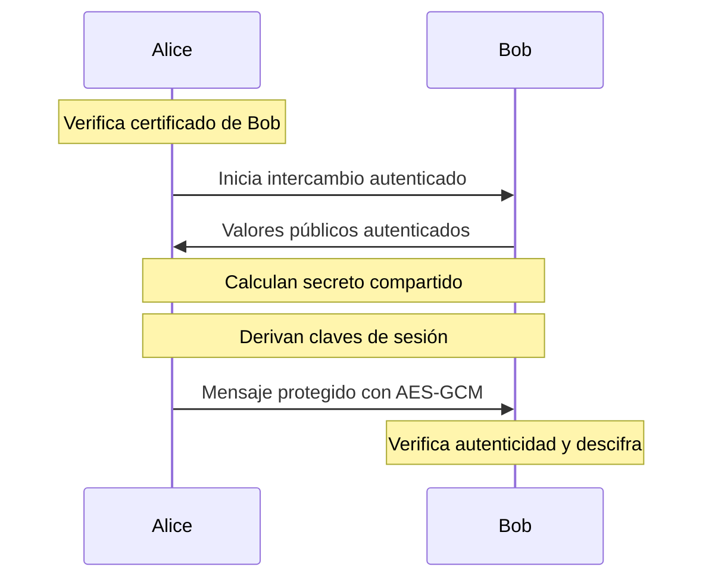

## Introducción

La criptografía combina fundamentos matemáticos, operaciones algebraicas y algoritmos especializados para proteger información. Su comprensión exige mucho más que memorizar fórmulas: es necesario **resolver operaciones, interpretar resultados, identificar errores y desarrollar procesos completos de cifrado y descifrado**.

Este cuestionario reúne **50 preguntas de nivel avanzado**, diseñadas para preparar un examen parcial exigente que comprende las diapositivas 109–176. Integra aritmética modular, algoritmo de Euclides, campos de Galois, AES, RC4, modos de operación, teoría de números, RSA y Diffie-Hellman.

Se da especial importancia a los ejercicios prácticos. Cada pregunta incluye su **respuesta inmediatamente después del enunciado**, con los procedimientos matemáticos necesarios para comprender el resultado.

Los ejercicios de cifrado y descifrado utilizan ejemplos diferentes, desde operaciones manuales pequeñas hasta vectores completos de AES. Los casos de RSA y Diffie-Hellman se desarrollan con números manejables para permitir su resolución sin depender de herramientas criptográficas.

| Área | Preguntas | Cantidad |
|---|---|---|
| Aritmética modular y campos de Galois | 1–16 | 16 |
| AES | 17–28 | 12 |
| RC4 y modos de operación | 29–36 | 8 |
| Teoría de números y RSA | 37–46 | 10 |
| Diffie-Hellman e integración | 47–50 | 4 |
| **Total** | | **50** |

La dificultad aumenta progresivamente. Los últimos ejercicios requieren combinar conceptos de distintas áreas, como ocurre en los problemas que evalúan la comprensión integral de un sistema criptográfico.

---

## Aritmética modular y campos de Galois

### Pregunta 1: Operaciones modulares combinadas

**Tipo:** Práctica.

Calcular:

$$
a)\quad257\bmod13
$$

$$
b)\quad-45\bmod11
$$

$$
c)\quad(27\times19+8)\bmod17
$$

**Respuesta:**

**Inciso a:**

$$
257=19(13)+10
$$

Por lo tanto:

$$
\boxed{257\bmod13=10}
$$

**Inciso b:**

Para números negativos se busca un residuo no negativo.

$$
-45=(-5)(11)+10
$$

Por lo tanto:

$$
\boxed{-45\bmod11=10}
$$

**Inciso c:**

Primero:

$$
27\times19+8=521
$$

Reduciendo:

$$
521=30(17)+11
$$

Por lo tanto:

$$
\boxed{(27\times19+8)\bmod17=11}
$$

También puede reducirse cada operando antes de multiplicar:

$$
27\bmod17=10
$$

$$
19\bmod17=2
$$

$$
(10\times2+8)\bmod17=28\bmod17=11
$$

Ambos procedimientos producen el mismo resultado.

### Pregunta 2: Congruencias y cancelación modular

**Tipo:** Teórica y práctica.

Determinar si es válida la siguiente implicación:

$$
6a\equiv6b\pmod8
$$

$$
\Downarrow
$$

$$
a\equiv b\pmod8
$$

Proporcionar un contraejemplo si es falsa.

**Respuesta:**

La implicación es **falsa**.

En aritmética modular, un factor puede cancelarse directamente únicamente cuando es coprimo con el módulo.

Se necesita:

$$
\gcd(6,8)=1
$$

Sin embargo:

$$
\gcd(6,8)=2
$$

Por lo tanto, el factor $6$ no posee inverso multiplicativo módulo $8$.

Considérese:

$$
a=3,\qquad b=7
$$

Se calcula:

$$
6\times3=18
$$

$$
6\times7=42
$$

Ambos productos son congruentes módulo $8$:

$$
18\bmod8=2
$$

$$
42\bmod8=2
$$

Por lo tanto:

$$
6(3)\equiv6(7)\pmod8
$$

Pero:

$$
3\not\equiv7\pmod8
$$

Así, la cancelación no es válida.

**La cancelación multiplicativa módulo $n$ requiere que el factor cancelado tenga inverso multiplicativo.**

### Pregunta 3: Exponenciación modular mediante cuadrados sucesivos

**Tipo:** Práctica.

Calcular:

$$
7^{29}\bmod19
$$

Sin desarrollar directamente la potencia completa.

**Respuesta:**

Primero se descompone el exponente:

$$
29=16+8+4+1
$$

Por lo tanto:

$$
7^{29}=7^{16}\times7^8\times7^4\times7
$$

Se calculan las potencias modulares:

$$
7^1\bmod19=7
$$

$$
7^2\bmod19=49\bmod19=11
$$

$$
7^4\bmod19=11^2\bmod19=121\bmod19=7
$$

$$
7^8\bmod19=7^2\bmod19=11
$$

$$
7^{16}\bmod19=11^2\bmod19=7
$$

Ahora se combinan:

$$
7^{29}\bmod19=(7\times11\times7\times7)\bmod19
$$

Agrupando:

$$
7\times11=77\equiv1\pmod{19}
$$

Por lo tanto:

$$
7^{29}\bmod19=(1\times7\times7)\bmod19
$$

$$
=49\bmod19
$$

Se obtiene:

$$
\boxed{7^{29}\bmod19=11}
$$

La reducción modular intermedia permite evitar el cálculo de números extremadamente grandes.

### Pregunta 4: Máximo común divisor mediante Euclides

**Tipo:** Práctica.

Calcular:

$$
\gcd(662,414)
$$

Determinar si los números son coprimos.

**Respuesta:**

Se realizan divisiones sucesivas:

$$
662=1(414)+248
$$

$$
414=1(248)+166
$$

$$
248=1(166)+82
$$

$$
166=2(82)+2
$$

$$
82=41(2)+0
$$

El último residuo distinto de cero es $2$.

Por lo tanto:

$$
\boxed{\gcd(662,414)=2}
$$

Los números no son coprimos porque:

$$
\gcd(662,414)\neq1
$$

Como consecuencia, $414$ no posee inverso multiplicativo módulo $662$.

### Pregunta 5: Inverso modular mediante Euclides extendido

**Tipo:** Práctica.

Calcular:

$$
37^{-1}\bmod101
$$

Utilizando el algoritmo de Euclides extendido.

**Respuesta:**

Primero se calcula el MCD:

$$
101=2(37)+27
$$

$$
37=1(27)+10
$$

$$
27=2(10)+7
$$

$$
10=1(7)+3
$$

$$
7=2(3)+1
$$

El MCD es uno, por lo que existe inverso.

Ahora se realiza la sustitución hacia atrás:

$$
1=7-2(3)
$$

Como:

$$
3=10-7
$$

Entonces:

$$
1=7-2(10-7)
$$

$$
1=3(7)-2(10)
$$

Sustituyendo:

$$
7=27-2(10)
$$

Se obtiene:

$$
1=3(27)-8(10)
$$

Como:

$$
10=37-27
$$

Entonces:

$$
1=3(27)-8(37-27)
$$

$$
1=11(27)-8(37)
$$

Finalmente:

$$
27=101-2(37)
$$

Por lo tanto:

$$
1=11(101-2(37))-8(37)
$$

$$
1=11(101)-30(37)
$$

Así:

$$
37(-30)+101(11)=1
$$

El inverso es:

$$
-30\bmod101=71
$$

Por lo tanto:

$$
\boxed{37^{-1}\bmod101=71}
$$

Comprobación:

$$
37\times71=2627
$$

$$
2627\bmod101=1
$$

### Pregunta 6: Existencia de inversos multiplicativos

**Tipo:** Práctica y teórica.

Determinar cuáles elementos tienen inverso módulo $15$:

$$
2,\quad3,\quad4,\quad5,\quad7,\quad10
$$

Calcular los inversos existentes.

**Respuesta:**

Un elemento $a$ tiene inverso módulo $n$ cuando:

$$
\gcd(a,n)=1
$$

Se examina cada elemento.

| Elemento | MCD con $15$ | ¿Tiene inverso? |
|---|---|---|
| $2$ | $1$ | Sí |
| $3$ | $3$ | No |
| $4$ | $1$ | Sí |
| $5$ | $5$ | No |
| $7$ | $1$ | Sí |
| $10$ | $5$ | No |

Los inversos son:

$$
2\times8=16\equiv1\pmod{15}
$$

Por lo tanto:

$$
\boxed{2^{-1}=8}
$$

Después:

$$
4\times4=16\equiv1\pmod{15}
$$

Por lo tanto:

$$
\boxed{4^{-1}=4}
$$

Finalmente:

$$
7\times13=91\equiv1\pmod{15}
$$

Por lo tanto:

$$
\boxed{7^{-1}=13}
$$

Los elementos $3$, $5$ y $10$ no tienen inverso multiplicativo módulo $15$.

### Pregunta 7: Función totiente mediante factorización

**Tipo:** Práctica.

Calcular:

$$
\phi(45)
$$

$$
\phi(27)
$$

$$
\phi(77)
$$

**Respuesta:**

Para calcular la función totiente se utiliza la factorización prima.

En general:

$$
\phi(n)=n\prod_{p\mid n}\left(1-\frac1p\right)
$$

En donde el producto considera los primos distintos que dividen a $n$.

**Para $45$:**

$$
45=3^2\times5
$$

Entonces:

$$
\phi(45)=45\left(1-\frac13\right)\left(1-\frac15\right)
$$

$$
=45\times\frac23\times\frac45
$$

Por lo tanto:

$$
\boxed{\phi(45)=24}
$$

**Para $27$:**

$$
27=3^3
$$

Por lo tanto:

$$
\phi(27)=3^3-3^2
$$

$$
\boxed{\phi(27)=18}
$$

**Para $77$:**

$$
77=7\times11
$$

Por lo tanto:

$$
\phi(77)=(7-1)(11-1)
$$

$$
\boxed{\phi(77)=60}
$$

### Pregunta 8: Aplicación de Fermat y Euler

**Tipo:** Práctica.

Resolver:

$$
a)\quad3^{100}\bmod7
$$

$$
b)\quad7^{40}\bmod15
$$

Explicar qué teorema resulta adecuado en cada caso.

**Respuesta:**

**Inciso a:**

Como $7$ es primo y:

$$
\gcd(3,7)=1
$$

Puede aplicarse Fermat:

$$
3^6\equiv1\pmod7
$$

Se descompone:

$$
100=16(6)+4
$$

Entonces:

$$
3^{100}\equiv3^4\pmod7
$$

$$
3^4=81
$$

$$
81\bmod7=4
$$

Por lo tanto:

$$
\boxed{3^{100}\bmod7=4}
$$

**Inciso b:**

El módulo $15$ no es primo, pero:

$$
\gcd(7,15)=1
$$

Por lo tanto, puede aplicarse Euler.

$$
\phi(15)=(3-1)(5-1)=8
$$

Entonces:

$$
7^8\equiv1\pmod{15}
$$

Como:

$$
40=5(8)
$$

Se obtiene:

$$
7^{40}\equiv(7^8)^5\equiv1\pmod{15}
$$

Por lo tanto:

$$
\boxed{7^{40}\bmod15=1}
$$

La diferencia principal es que Fermat requiere un módulo primo, mientras que Euler permite trabajar también con módulos compuestos, siempre que exista coprimalidad.

### Pregunta 9: Representación binaria y suma polinomial

**Tipo:** Práctica.

Convertir los siguientes bytes a polinomios:

$$
A=\texttt{A5}
$$

$$
B=\texttt{3C}
$$

Después calcular:

$$
A\oplus B
$$

**Respuesta:**

Primero se convierten a binario.

$$
\texttt{A5}=10100101
$$

Por lo tanto:

$$
A(x)=x^7+x^5+x^2+1
$$

Después:

$$
\texttt{3C}=00111100
$$

Entonces:

$$
B(x)=x^5+x^4+x^3+x^2
$$

Se aplica XOR:

$$
10100101\oplus00111100
$$

El resultado es:

$$
10011001
$$

En hexadecimal:

$$
\boxed{\texttt{99}}
$$

En forma polinomial:

$$
\boxed{x^7+x^4+x^3+1}
$$

Los términos $x^5$ y $x^2$ se cancelan porque aparecen en ambos polinomios.

### Pregunta 10: Multiplicación completa en GF(2⁸)

**Tipo:** Práctica avanzada.

Calcular:

$$
\texttt{57}\otimes\texttt{83}
$$

Dentro del campo utilizado por AES.

**Respuesta:**

AES utiliza:

$$
m(x)=x^8+x^4+x^3+x+1
$$

Se necesita multiplicar:

$$
\texttt{57}=01010111
$$

Por:

$$
\texttt{83}=10000011
$$

El segundo operando tiene activos los bits correspondientes a:

$$
x^7+x+1
$$

Por lo tanto, se necesitan los productos de $\texttt{57}$ por potencias de $x$.

Se calculan mediante `xtime`:

| Potencia | Resultado hexadecimal |
|---|---|
| $x^0$ | $\texttt{57}$ |
| $x^1$ | $\texttt{AE}$ |
| $x^2$ | $\texttt{47}$ |
| $x^3$ | $\texttt{8E}$ |
| $x^4$ | $\texttt{07}$ |
| $x^5$ | $\texttt{0E}$ |
| $x^6$ | $\texttt{1C}$ |
| $x^7$ | $\texttt{38}$ |

Se combinan únicamente los términos correspondientes a $x^7$, $x$ y $1$:

$$
\texttt{38}\oplus\texttt{AE}\oplus\texttt{57}
$$

Primero:

$$
\texttt{38}\oplus\texttt{AE}=\texttt{96}
$$

Después:

$$
\texttt{96}\oplus\texttt{57}=\texttt{C1}
$$

Por lo tanto:

$$
\boxed{\texttt{57}\otimes\texttt{83}=\texttt{C1}}
$$

Esta multiplicación es un ejemplo fundamental de reducción polinomial en $GF(2^8)$.

### Pregunta 11: Inversos en GF(2²)

**Tipo:** Práctica.

Se construye:

$$
GF(2^2)
$$

Utilizando:

$$
m(x)=x^2+x+1
$$

Calcular el inverso multiplicativo de:

$$
x
$$

Y de:

$$
x+1
$$

**Respuesta:**

Como:

$$
x^2+x+1\equiv0
$$

Se obtiene:

$$
x^2\equiv x+1
$$

Ahora se multiplica:

$$
x(x+1)=x^2+x
$$

Sustituyendo:

$$
(x+1)+x=1
$$

Por lo tanto:

$$
x(x+1)=1
$$

Así:

$$
\boxed{x^{-1}=x+1}
$$

Y:

$$
\boxed{(x+1)^{-1}=x}
$$

En binario:

$$
\boxed{10^{-1}=11}
$$

$$
\boxed{11^{-1}=10}
$$

Esto demuestra que ambos elementos poseen inverso multiplicativo dentro del campo.

### Pregunta 12: Comparación de dos campos GF(2³)

**Tipo:** Práctica y teórica.

Calcular:

$$
(x^2+1)(x+1)
$$

Primero utilizando:

$$
m_1(x)=x^3+x+1
$$

Y después:

$$
m_2(x)=x^3+x^2+1
$$

Explicar por qué los resultados son diferentes.

**Respuesta:**

La multiplicación inicial es:

$$
(x^2+1)(x+1)=x^3+x^2+x+1
$$

**Primer polinomio:**

$$
m_1(x)=x^3+x+1
$$

Entonces:

$$
x^3\equiv x+1
$$

Sustituyendo:

$$
(x+1)+x^2+x+1
$$

Se cancelan los términos repetidos.

Por lo tanto:

$$
\boxed{x^2}
$$

En binario:

$$
\boxed{100}
$$

**Segundo polinomio:**

$$
m_2(x)=x^3+x^2+1
$$

Entonces:

$$
x^3\equiv x^2+1
$$

Sustituyendo:

$$
(x^2+1)+x^2+x+1
$$

Se obtiene:

$$
\boxed{x}
$$

En binario:

$$
\boxed{010}
$$

Los resultados son diferentes porque se utilizaron polinomios de reducción distintos.

Ambos construyen campos con ocho elementos, pero las palabras binarias representan elementos bajo operaciones de multiplicación diferentes.

### Pregunta 13: Multiplicaciones por 02 y 03 en AES

**Tipo:** Práctica.

Calcular:

$$
a)\quad\texttt{02}\otimes\texttt{D7}
$$

$$
b)\quad\texttt{03}\otimes\texttt{D7}
$$

**Respuesta:**

El byte:

$$
\texttt{D7}=11010111
$$

Tiene el bit más significativo igual a uno.

Se desplaza hacia la izquierda, conservando ocho bits:

$$
10101110
$$

Esto corresponde a:

$$
\texttt{AE}
$$

Como el bit original era uno, se aplica XOR con $\texttt{1B}$:

$$
\texttt{AE}\oplus\texttt{1B}=\texttt{B5}
$$

Por lo tanto:

$$
\boxed{\texttt{02}\otimes\texttt{D7}=\texttt{B5}}
$$

Para multiplicar por tres:

$$
\texttt{03}\otimes a=(\texttt{02}\otimes a)\oplus a
$$

Entonces:

$$
\texttt{03}\otimes\texttt{D7}
=
\texttt{B5}\oplus\texttt{D7}
$$

Se obtiene:

$$
\boxed{\texttt{03}\otimes\texttt{D7}=\texttt{62}}
$$

### Pregunta 14: MixColumns completo sobre una columna

**Tipo:** Práctica avanzada.

Aplicar MixColumns a:

$$
S=
\begin{bmatrix}
\texttt{DB}\\
\texttt{13}\\
\texttt{53}\\
\texttt{45}
\end{bmatrix}
$$

**Respuesta:**

La matriz utilizada es:

$$
M=
\begin{bmatrix}
02&03&01&01\\
01&02&03&01\\
01&01&02&03\\
03&01&01&02
\end{bmatrix}_{16}
$$

El primer byte es:

$$
s_0'=
(02\otimes DB)\oplus
(03\otimes13)\oplus53\oplus45
$$

Las multiplicaciones producen:

$$
02\otimes DB=AD
$$

$$
03\otimes13=35
$$

Entonces:

$$
AD\oplus35\oplus53\oplus45=8E
$$

Por lo tanto:

$$
\boxed{s_0'=\texttt{8E}}
$$

El segundo byte es:

$$
s_1'=DB\oplus(02\otimes13)\oplus(03\otimes53)\oplus45
$$

Se utilizan:

$$
02\otimes13=26
$$

$$
03\otimes53=F5
$$

Entonces:

$$
DB\oplus26\oplus F5\oplus45=4D
$$

Por lo tanto:

$$
\boxed{s_1'=\texttt{4D}}
$$

El tercero:

$$
s_2'=DB\oplus13\oplus(02\otimes53)\oplus(03\otimes45)
$$

Se conoce:

$$
02\otimes53=A6
$$

$$
03\otimes45=CF
$$

Entonces:

$$
DB\oplus13\oplus A6\oplus CF=A1
$$

Por lo tanto:

$$
\boxed{s_2'=\texttt{A1}}
$$

Finalmente:

$$
s_3'=(03\otimes DB)\oplus13\oplus53\oplus(02\otimes45)
$$

Se obtiene:

$$
03\otimes DB=76
$$

$$
02\otimes45=8A
$$

Entonces:

$$
76\oplus13\oplus53\oplus8A=BC
$$

Por lo tanto:

$$
\boxed{s_3'=\texttt{BC}}
$$

La columna resultante es:

$$
\boxed{
S'=
\begin{bmatrix}
\texttt{8E}\\
\texttt{4D}\\
\texttt{A1}\\
\texttt{BC}
\end{bmatrix}
}
$$

### Pregunta 15: Diferencia entre un anillo y un campo

**Tipo:** Teórica avanzada.

Explicar por qué:

$$
\mathbb Z_{16}
$$

no es un campo, pero:

$$
GF(2^4)
$$

sí puede construirse como campo.

**Respuesta:**

Ambos conjuntos contienen dieciséis elementos.

Sin embargo, sus operaciones son diferentes.

En $\mathbb Z_{16}$ la multiplicación se realiza módulo $16$.

Por ejemplo:

$$
4\times4=16\equiv0\pmod{16}
$$

Esto significa que existen divisores de cero.

Además:

$$
\gcd(4,16)=4
$$

Por lo tanto, $4$ no tiene inverso multiplicativo.

En cambio, $GF(2^4)$ se construye utilizando polinomios con coeficientes en $GF(2)$ y un polinomio irreducible de grado cuatro.

Esto garantiza que todos los elementos distintos de cero tengan inverso multiplicativo.

La diferencia principal es que **la cantidad de elementos no determina por sí sola si una estructura algebraica es un campo**.

### Pregunta 16: Interpretación de los campos de Galois en AES

**Tipo:** Teórica de integración.

¿Por qué AES necesita trabajar con $GF(2^8)$ en lugar de utilizar únicamente operaciones enteras módulo $256$?

**Respuesta:**

AES necesita realizar operaciones sobre bytes que sean matemáticamente definidas y reversibles cuando corresponda.

El conjunto:

$$
\mathbb Z_{256}
$$

contiene $256$ elementos, pero no es un campo.

Algunos elementos distintos de cero no tienen inverso multiplicativo.

En cambio:

$$
GF(2^8)
$$

también contiene $256$ elementos, pero utiliza multiplicación polinomial reducida mediante:

$$
m(x)=x^8+x^4+x^3+x+1
$$

Esta estructura permite calcular el inverso multiplicativo de todos los elementos no nulos.

AES utiliza estas propiedades para construir la S-Box y realizar operaciones en MixColumns.

Por lo tanto, **AES no utiliza simplemente aritmética de enteros módulo $256$; utiliza operaciones específicas de un campo finito**.

---

## AES: cifrado, descifrado y expansión de claves

### Pregunta 17: Construcción correcta de la matriz State

**Tipo:** Práctica.

Organizar el siguiente bloque de $128$ bits en la matriz State:

```text
2B 7E 15 16 28 AE D2 A6 AB F7 15 88 09 CF 4F 3C
```

**Respuesta:**

AES introduce los bytes por columnas.

Los primeros cuatro bytes forman la primera columna:

$$
\begin{bmatrix}
\texttt{2B}\\
\texttt{7E}\\
\texttt{15}\\
\texttt{16}
\end{bmatrix}
$$

Los siguientes forman la segunda:

$$
\begin{bmatrix}
\texttt{28}\\
\texttt{AE}\\
\texttt{D2}\\
\texttt{A6}
\end{bmatrix}
$$

Por lo tanto, la matriz es:

$$
\boxed{
S=
\begin{bmatrix}
\texttt{2B}&\texttt{28}&\texttt{AB}&\texttt{09}\\
\texttt{7E}&\texttt{AE}&\texttt{F7}&\texttt{CF}\\
\texttt{15}&\texttt{D2}&\texttt{15}&\texttt{4F}\\
\texttt{16}&\texttt{A6}&\texttt{88}&\texttt{3C}
\end{bmatrix}
}
$$

La matriz contiene:

$$
4\times4=16\text{ bytes}=128\text{ bits}
$$

### Pregunta 18: SubBytes y construcción de la S-Box

**Tipo:** Práctica y teórica.

Determinar:

$$
S(\texttt{00})
$$

$$
S(\texttt{53})
$$

Explicar cómo se construyen las sustituciones.

**Respuesta:**

La S-Box de AES utiliza:

1. Inverso multiplicativo en $GF(2^8)$.
2. Transformación afín.

El polinomio irreducible es:

$$
m(x)=x^8+x^4+x^3+x+1
$$

La constante afín es:

$$
\texttt{63}
$$

Para el byte cero, se define que su valor intermedio permanezca en cero porque no tiene inverso multiplicativo.

Después de la transformación afín:

$$
\boxed{S(\texttt{00})=\texttt{63}}
$$

Para el byte:

$$
\texttt{53}
$$

Su inverso multiplicativo es:

$$
\texttt{CA}
$$

Después de la transformación afín se obtiene:

$$
\boxed{S(\texttt{53})=\texttt{ED}}
$$

La S-Box proporciona no linealidad y es invertible.

Por lo tanto:

$$
\boxed{S^{-1}(\texttt{ED})=\texttt{53}}
$$

### Pregunta 19: ShiftRows e InvShiftRows

**Tipo:** Práctica.

Aplicar ShiftRows al estado:

$$
S=
\begin{bmatrix}
01&02&03&04\\
05&06&07&08\\
09&0A&0B&0C\\
0D&0E&0F&10
\end{bmatrix}_{16}
$$

Después explicar cómo se revierte.

**Respuesta:**

La primera fila no cambia.

La segunda se desplaza una posición hacia la izquierda.

La tercera se desplaza dos posiciones.

La cuarta se desplaza tres posiciones.

Por lo tanto:

$$
\boxed{
S'=
\begin{bmatrix}
01&02&03&04\\
06&07&08&05\\
0B&0C&09&0A\\
10&0D&0E&0F
\end{bmatrix}_{16}
}
$$

Para revertir la transformación se aplica InvShiftRows.

Cada fila se desplaza circularmente hacia la derecha la cantidad correspondiente.

Se recupera:

$$
S=
\begin{bmatrix}
01&02&03&04\\
05&06&07&08\\
09&0A&0B&0C\\
0D&0E&0F&10
\end{bmatrix}_{16}
$$

La transformación cambia posiciones, pero no valores.

### Pregunta 20: AddRoundKey completo

**Tipo:** Práctica.

Aplicar AddRoundKey entre:

$$
S=
\begin{bmatrix}
47&40&A3&4C\\
37&D4&70&9F\\
94&E4&3A&42\\
ED&A5&A6&BC
\end{bmatrix}_{16}
$$

Y:

$$
K=
\begin{bmatrix}
AC&19&28&57\\
77&FA&D1&5C\\
66&DC&29&00\\
F3&21&41&6A
\end{bmatrix}_{16}
$$

**Respuesta:**

La operación es:

$$
S'=S\oplus K
$$

Se calcula XOR en cada posición.

Primera fila:

$$
47\oplus AC=EB
$$

$$
40\oplus19=59
$$

$$
A3\oplus28=8B
$$

$$
4C\oplus57=1B
$$

Segunda fila:

$$
37\oplus77=40
$$

$$
D4\oplus FA=2E
$$

$$
70\oplus D1=A1
$$

$$
9F\oplus5C=C3
$$

Tercera fila:

$$
94\oplus66=F2
$$

$$
E4\oplus DC=38
$$

$$
3A\oplus29=13
$$

$$
42\oplus00=42
$$

Cuarta fila:

$$
ED\oplus F3=1E
$$

$$
A5\oplus21=84
$$

$$
A6\oplus41=E7
$$

$$
BC\oplus6A=D6
$$

Por lo tanto:

$$
\boxed{
S'=
\begin{bmatrix}
EB&59&8B&1B\\
40&2E&A1&C3\\
F2&38&13&42\\
1E&84&E7&D6
\end{bmatrix}_{16}
}
$$

La operación se revierte aplicando XOR nuevamente con la misma clave.

### Pregunta 21: Estructura de las rondas AES-128

**Tipo:** Teórica.

Describir todas las etapas de AES-128 y explicar por qué se necesitan once claves de ronda.

**Respuesta:**

AES-128 utiliza diez rondas de cifrado y una operación inicial.

La secuencia es:



La operación inicial utiliza una clave.

Las diez rondas utilizan otra clave cada una.

Por lo tanto:

$$
1+10=11
$$

Se necesitan:

$$
\boxed{11\text{ claves de ronda}}
$$

Cada clave contiene cuatro palabras de $32$ bits:

$$
4\times32=128\text{ bits}
$$

La última ronda no incluye MixColumns.

### Pregunta 22: Expansión de claves AES-128

**Tipo:** Práctica avanzada.

Calcular:

$$
w_{36},w_{37},w_{38},w_{39}
$$

A partir de:

$$
w_{32}=\texttt{EA D2 73 21}
$$

$$
w_{33}=\texttt{B5 8D BA D2}
$$

$$
w_{34}=\texttt{31 2B F5 60}
$$

$$
w_{35}=\texttt{7F 8D 29 2F}
$$

Se conocen:

$$
\operatorname{SubWord}(\operatorname{RotWord}(w_{35}))
=
\texttt{5D A5 15 D2}
$$

Y:

$$
\operatorname{Rcon}(9)=\texttt{1B 00 00 00}
$$

**Respuesta:**

Para calcular $w_{36}$ se aplica la transformación especial porque:

$$
36\bmod4=0
$$

Primero:

$$
\texttt{5D A5 15 D2}
\oplus
\texttt{1B 00 00 00}
=
\texttt{46 A5 15 D2}
$$

Después:

$$
w_{36}=
\texttt{EA D2 73 21}
\oplus
\texttt{46 A5 15 D2}
$$

Por lo tanto:

$$
\boxed{w_{36}=\texttt{AC 77 66 F3}}
$$

La palabra siguiente es:

$$
w_{37}=w_{33}\oplus w_{36}
$$

$$
=\texttt{B5 8D BA D2}\oplus\texttt{AC 77 66 F3}
$$

Por lo tanto:

$$
\boxed{w_{37}=\texttt{19 FA DC 21}}
$$

Después:

$$
w_{38}=w_{34}\oplus w_{37}
$$

$$
=\texttt{31 2B F5 60}\oplus\texttt{19 FA DC 21}
$$

Entonces:

$$
\boxed{w_{38}=\texttt{28 D1 29 41}}
$$

Finalmente:

$$
w_{39}=w_{35}\oplus w_{38}
$$

$$
=\texttt{7F 8D 29 2F}\oplus\texttt{28 D1 29 41}
$$

Por lo tanto:

$$
\boxed{w_{39}=\texttt{57 5C 00 6E}}
$$

Las cuatro palabras forman la clave de ronda:

$$
\boxed{
\begin{bmatrix}
AC&19&28&57\\
77&FA&D1&5C\\
66&DC&29&00\\
F3&21&41&6E
\end{bmatrix}_{16}
}
$$

### Pregunta 23: Cifrado AES-128 completo de un bloque

**Tipo:** Práctica avanzada: cifrado completo.

Se utiliza la clave AES-128:

```text
000102030405060708090A0B0C0D0E0F
```

Y el mensaje de $128$ bits:

```text
00112233445566778899AABBCCDDEEFF
```

Determinar el texto cifrado después de las diez rondas.

**Respuesta:**

La clave contiene:

$$
128\text{ bits}
$$

El mensaje también contiene:

$$
128\text{ bits}
$$

Por lo tanto, se cifra exactamente un bloque.

Primero se aplica AddRoundKey inicial.

El mensaje es:

```text
00112233445566778899AABBCCDDEEFF
```

La clave es:

```text
000102030405060708090A0B0C0D0E0F
```

El XOR produce:

```text
00102030405060708090A0B0C0D0E0F0
```

Después comienza la primera ronda.

SubBytes produce:

```text
63CAB7040953D051CD60E0E7BA70E18C
```

ShiftRows produce:

```text
6353E08C0960E104CD70B751BACAD0E7
```

MixColumns produce:

```text
5F72641557F5BC92F7BE3B291DB9F91A
```

Después de AddRoundKey de la primera ronda:

```text
89D810E8855ACE682D1843D8CB128FE4
```

El cifrado continúa hasta completar las diez rondas.

Los estados después de AddRoundKey de cada ronda son:

| Ronda | Estado hexadecimal |
|---|---|
| Inicial | `00102030405060708090A0B0C0D0E0F0` |
| 1 | `89D810E8855ACE682D1843D8CB128FE4` |
| 2 | `4915598F55E5D7A0DACA94FA1F0A63F7` |
| 3 | `FA636A2825B339C940668A3157244D17` |
| 4 | `247240236966B3FA6ED2753288425B6C` |
| 5 | `C81677BC9B7AC93B25027992B0261996` |
| 6 | `C62FE109F75EEDC3CC79395D84F9CF5D` |
| 7 | `D1876C0F79C4300AB45594ADD66FF41F` |
| 8 | `FDE3BAD205E5D0D73547964EF1FE37F1` |
| 9 | `BD6E7C3DF2B5779E0B61216E8B10B689` |
| 10 | `69C4E0D86A7B0430D8CDB78070B4C55A` |

Por lo tanto, el bloque cifrado completo es:

```text
69C4E0D86A7B0430D8CDB78070B4C55A
```

**Resultado:**

$$
\boxed{C=\texttt{69C4E0D86A7B0430D8CDB78070B4C55A}}
$$

### Pregunta 24: Descifrado AES-128 completo de un bloque

**Tipo:** Práctica avanzada: descifrado completo.

Se recibe el texto cifrado:

```text
69C4E0D86A7B0430D8CDB78070B4C55A
```

Con la clave:

```text
000102030405060708090A0B0C0D0E0F
```

Determinar el mensaje original.

**Respuesta:**

El descifrado utiliza las transformaciones inversas de AES y las claves de ronda en el orden correspondiente.

Primero se aplica AddRoundKey con la última clave de ronda.

Después se invierten las transformaciones de la última ronda.

Las rondas intermedias utilizan:

- InvShiftRows.
- InvSubBytes.
- AddRoundKey.
- InvMixColumns.

La operación final revierte el AddRoundKey inicial.

Los estados recuperados después de revertir cada ronda de cifrado son:

| Ronda revertida | Estado anterior recuperado |
|---|---|
| 10 | `BD6E7C3DF2B5779E0B61216E8B10B689` |
| 9 | `FDE3BAD205E5D0D73547964EF1FE37F1` |
| 8 | `D1876C0F79C4300AB45594ADD66FF41F` |
| 7 | `C62FE109F75EEDC3CC79395D84F9CF5D` |
| 6 | `C81677BC9B7AC93B25027992B0261996` |
| 5 | `247240236966B3FA6ED2753288425B6C` |
| 4 | `FA636A2825B339C940668A3157244D17` |
| 3 | `4915598F55E5D7A0DACA94FA1F0A63F7` |
| 2 | `89D810E8855ACE682D1843D8CB128FE4` |
| 1 | `00102030405060708090A0B0C0D0E0F0` |

Después se revierte el AddRoundKey inicial.

Se utiliza:

```text
00102030405060708090A0B0C0D0E0F0
```

Y la clave:

```text
000102030405060708090A0B0C0D0E0F
```

Al aplicar XOR:

```text
00112233445566778899AABBCCDDEEFF
```

Por lo tanto:

$$
\boxed{P=\texttt{00112233445566778899AABBCCDDEEFF}}
$$

Se recupera exactamente el bloque original.

### Pregunta 25: Segundo cifrado y descifrado AES-128 completo

**Tipo:** Práctica avanzada.

Se utiliza otra clave AES-128:

```text
2B7E151628AED2A6ABF7158809CF4F3C
```

Y otro mensaje:

```text
6BC1BEE22E409F96E93D7E117393172A
```

Cifrar y después descifrar el bloque mediante AES-128 en modo ECB.

**Respuesta:**

El mensaje contiene exactamente un bloque de $128$ bits.

Por lo tanto, en ECB se aplica directamente la operación de cifrado AES al bloque.

La clave es:

$$
K=\texttt{2B7E151628AED2A6ABF7158809CF4F3C}
$$

El mensaje original es:

$$
P=\texttt{6BC1BEE22E409F96E93D7E117393172A}
$$

Se ejecuta el cifrado AES-128 completo:

$$
C=E_K(P)
$$

El resultado es:

```text
3AD77BB40D7A3660A89ECAF32466EF97
```

Por lo tanto:

$$
\boxed{C=\texttt{3AD77BB40D7A3660A89ECAF32466EF97}}
$$

**Descifrado:**

Se aplica la transformación inversa completa:

$$
P=D_K(C)
$$

Con la misma clave.

El resultado es:

```text
6BC1BEE22E409F96E93D7E117393172A
```

Por lo tanto:

$$
\boxed{P=\texttt{6BC1BEE22E409F96E93D7E117393172A}}
$$

Este segundo ejemplo utiliza una clave y un mensaje diferentes del ejercicio anterior.

### Pregunta 26: Cifrado y descifrado AES-CBC de dos bloques

**Tipo:** Práctica avanzada: cifrado completo de varios bloques.

Se utiliza AES-128 con:

```text
Clave:
2B7E151628AED2A6ABF7158809CF4F3C

IV:
000102030405060708090A0B0C0D0E0F
```

Los dos bloques originales son:

```text
P1:
6BC1BEE22E409F96E93D7E117393172A

P2:
AE2D8A571E03AC9C9EB76FAC45AF8E51
```

Cifrar ambos bloques mediante CBC y comprobar su descifrado.

**Respuesta:**

CBC utiliza:

$$
C_1=E_K(P_1\oplus IV)
$$

Y:

$$
C_2=E_K(P_2\oplus C_1)
$$

**Primer bloque:**

Se realiza:

$$
P_1\oplus IV
$$

El resultado es:

```text
6BC0BCE12A459991E134741A7F9E1925
```

Ahora AES cifra ese bloque:

$$
C_1=E_K(P_1\oplus IV)
$$

Se obtiene:

```text
7649ABAC8119B246CEE98E9B12E9197D
```

Por lo tanto:

$$
\boxed{C_1=\texttt{7649ABAC8119B246CEE98E9B12E9197D}}
$$

**Segundo bloque:**

Se calcula:

$$
P_2\oplus C_1
$$

El resultado es:

```text
D86421FB9F1A1EDA505EE1375746972C
```

Después se aplica AES:

$$
C_2=E_K(P_2\oplus C_1)
$$

Se obtiene:

```text
5086CB9B507219EE95DB113A917678B2
```

Por lo tanto:

$$
\boxed{C_2=\texttt{5086CB9B507219EE95DB113A917678B2}}
$$

**Mensaje cifrado completo:**

```text
7649ABAC8119B246CEE98E9B12E9197D
5086CB9B507219EE95DB113A917678B2
```

**Descifrado:**

Para el primer bloque:

$$
P_1=D_K(C_1)\oplus IV
$$

Se recupera:

```text
6BC1BEE22E409F96E93D7E117393172A
```

Para el segundo:

$$
P_2=D_K(C_2)\oplus C_1
$$

Se recupera:

```text
AE2D8A571E03AC9C9EB76FAC45AF8E51
```

Por lo tanto, ambos bloques originales se recuperan exactamente.

Este ejercicio demuestra que **CBC introduce una dependencia entre bloques consecutivos**.

### Pregunta 27: Cifrado y descifrado AES-CTR completo

**Tipo:** Práctica avanzada.

Se utiliza la clave:

```text
2B7E151628AED2A6ABF7158809CF4F3C
```

El bloque original es:

```text
6BC1BEE22E409F96E93D7E117393172A
```

Y la entrada inicial de contador:

```text
F0F1F2F3F4F5F6F7F8F9FAFBFCFDFEFF
```

Determinar el cifrado y descifrado mediante CTR.

**Respuesta:**

CTR no cifra directamente el bloque original.

Primero cifra la entrada de contador:

$$
K_1=E_K(X_1)
$$

El keystream resultante es:

```text
EC8CDF7398607CB0F2D21675EA9EA1E4
```

Después se calcula:

$$
C_1=P_1\oplus K_1
$$

Sustituyendo:

```text
P1:
6BC1BEE22E409F96E93D7E117393172A

K1:
EC8CDF7398607CB0F2D21675EA9EA1E4
```

Se aplica XOR byte por byte.

El resultado es:

```text
874D6191B620E3261BEF6864990DB6CE
```

Por lo tanto:

$$
\boxed{C_1=\texttt{874D6191B620E3261BEF6864990DB6CE}}
$$

**Descifrado:**

El receptor cifra nuevamente la misma entrada de contador para generar el mismo keystream.

Después:

$$
P_1=C_1\oplus K_1
$$

Se calcula:

```text
874D6191B620E3261BEF6864990DB6CE
XOR
EC8CDF7398607CB0F2D21675EA9EA1E4
```

El resultado es:

```text
6BC1BEE22E409F96E93D7E117393172A
```

Por lo tanto:

$$
\boxed{P_1=\texttt{6BC1BEE22E409F96E93D7E117393172A}}
$$

CTR utiliza la operación de cifrado AES tanto para generar el keystream del cifrado como para generar el del descifrado.

### Pregunta 28: Reversibilidad y seguridad de las transformaciones AES

**Tipo:** Teórica avanzada.

Explicar por qué AES puede descifrarse completamente si algunas de sus transformaciones introducen no linealidad.

**Respuesta:**

La no linealidad no significa irreversibilidad.

AES utiliza transformaciones que pueden revertirse matemáticamente.

**SubBytes** es una permutación de los $256$ valores posibles de un byte.

Por lo tanto, cada sustitución tiene una entrada inversa única.

**ShiftRows** únicamente reorganiza posiciones, por lo que puede revertirse desplazando las filas en sentido contrario.

**MixColumns** utiliza una matriz invertible sobre $GF(2^8)$.

**AddRoundKey** utiliza XOR, que es su propia inversa.

Por lo tanto, la composición completa de estas transformaciones también es reversible.

La clave secreta determina qué transformaciones dependientes de clave se aplican en cada ronda.

La seguridad de AES no depende de que sus operaciones sean imposibles de revertir, sino de que **recuperar la información sin conocer la clave sea computacionalmente inviable bajo las condiciones de seguridad esperadas**.

---

## RC4 y modos de operación

### Pregunta 29: Cifrado y descifrado completo mediante XOR

**Tipo:** Práctica.

Se desea cifrar el texto ASCII:

```text
SOL
```

Utilizando el keystream hexadecimal:

```text
12 A7 3C
```

Determinar el texto cifrado y comprobar su descifrado.

**Respuesta:**

Los códigos ASCII son:

| Carácter | Hexadecimal |
|---|---|
| S | `53` |
| O | `4F` |
| L | `4C` |

El mensaje original es:

```text
53 4F 4C
```

Se aplica XOR con:

```text
12 A7 3C
```

Primer byte:

$$
\texttt{53}\oplus\texttt{12}=\texttt{41}
$$

Segundo:

$$
\texttt{4F}\oplus\texttt{A7}=\texttt{E8}
$$

Tercero:

$$
\texttt{4C}\oplus\texttt{3C}=\texttt{70}
$$

Por lo tanto, el texto cifrado hexadecimal es:

```text
41 E8 70
```

**Descifrado:**

Se aplica nuevamente XOR con el mismo keystream.

$$
\texttt{41}\oplus\texttt{12}=\texttt{53}
$$

$$
\texttt{E8}\oplus\texttt{A7}=\texttt{4F}
$$

$$
\texttt{70}\oplus\texttt{3C}=\texttt{4C}
$$

Se recupera:

```text
53 4F 4C
```

Que corresponde a:

$$
\boxed{\text{"SOL"}}
$$

### Pregunta 30: Ataque por reutilización de keystream

**Tipo:** Práctica y análisis de seguridad.

Se interceptan dos bytes cifrados mediante el mismo keystream:

$$
C_1=\texttt{A9}
$$

$$
C_2=\texttt{F3}
$$

Se sabe que el primer mensaje original era:

$$
M_1=\texttt{41}
$$

Determinar el keystream y recuperar el segundo mensaje original.

**Respuesta:**

Se conoce:

$$
C_1=M_1\oplus K
$$

Por lo tanto:

$$
K=C_1\oplus M_1
$$

Sustituyendo:

$$
K=\texttt{A9}\oplus\texttt{41}
$$

Se obtiene:

$$
\boxed{K=\texttt{E8}}
$$

Ahora se recupera el segundo mensaje:

$$
M_2=C_2\oplus K
$$

$$
M_2=\texttt{F3}\oplus\texttt{E8}
$$

Por lo tanto:

$$
\boxed{M_2=\texttt{1B}}
$$

La recuperación fue posible porque ambos mensajes utilizaron la misma secuencia de cifrado.

El problema no depende de que el algoritmo sea RC4 específicamente: cualquier construcción XOR con keystream puede presentar esta vulnerabilidad si reutiliza la misma secuencia de forma insegura.

### Pregunta 31: KSA reducido de RC4

**Tipo:** Práctica avanzada.

Se utiliza una versión didáctica de RC4 con cuatro elementos.

Inicialmente:

$$
S=[0,1,2,3]
$$

El vector temporal es:

$$
T=[2,1,2,1]
$$

Y:

$$
j=0
$$

Ejecutar las cuatro iteraciones del KSA.

**Respuesta:**

La fórmula es:

$$
j=(j+S[i]+T[i])\bmod4
$$

Después se intercambian:

$$
S[i]\longleftrightarrow S[j]
$$

**Iteración 1:**

$$
i=0
$$

$$
j=(0+0+2)\bmod4=2
$$

Se intercambian las posiciones $0$ y $2$.

$$
S=[2,1,0,3]
$$

**Iteración 2:**

$$
i=1
$$

$$
j=(2+1+1)\bmod4=0
$$

Se intercambian las posiciones $1$ y $0$.

$$
S=[1,2,0,3]
$$

**Iteración 3:**

$$
i=2
$$

$$
j=(0+0+2)\bmod4=2
$$

El intercambio no modifica el arreglo.

$$
S=[1,2,0,3]
$$

**Iteración 4:**

$$
i=3
$$

$$
j=(2+3+1)\bmod4=2
$$

Se intercambian las posiciones $3$ y $2$.

$$
S=[1,2,3,0]
$$

Por lo tanto:

$$
\boxed{S=[1,2,3,0]}
$$

### Pregunta 32: PRGA reducido y cifrado-descifrado de dos caracteres

**Tipo:** Práctica avanzada.

Se utiliza el estado producido en el ejercicio anterior:

$$
S=[1,2,3,0]
$$

Se inicializan:

$$
i=0,\qquad j=0
$$

Generar dos valores del keystream y cifrar:

```text
NO
```

**Respuesta:**

El PRGA utiliza:

$$
i=(i+1)\bmod4
$$

$$
j=(j+S[i])\bmod4
$$

Después realiza el intercambio y calcula:

$$
t=(S[i]+S[j])\bmod4
$$

$$
k=S[t]
$$

**Primer byte:**

$$
i=1
$$

$$
j=(0+S[1])\bmod4=2
$$

Se intercambian $S[1]$ y $S[2]$.

El arreglo queda:

$$
S=[1,3,2,0]
$$

Se calcula:

$$
t=(3+2)\bmod4=1
$$

Por lo tanto:

$$
k_1=S[1]=3
$$

**Segundo byte:**

$$
i=2
$$

$$
j=(2+S[2])\bmod4=(2+2)\bmod4=0
$$

Se intercambian las posiciones $2$ y $0$.

El arreglo queda:

$$
S=[2,3,1,0]
$$

Ahora:

$$
t=(S[2]+S[0])\bmod4
$$

$$
t=(1+2)\bmod4=3
$$

Por lo tanto:

$$
k_2=S[3]=0
$$

El keystream es:

$$
\boxed{K=[\texttt{03},\texttt{00}]}
$$

Los caracteres originales son:

$$
N=\texttt{4E}
$$

$$
O=\texttt{4F}
$$

Se cifra el primer carácter:

$$
\texttt{4E}\oplus\texttt{03}=\texttt{4D}
$$

El segundo:

$$
\texttt{4F}\oplus\texttt{00}=\texttt{4F}
$$

Los valores resultantes corresponden a:

```text
MO
```

**Descifrado:**

$$
\texttt{4D}\oplus\texttt{03}=\texttt{4E}
$$

$$
\texttt{4F}\oplus\texttt{00}=\texttt{4F}
$$

Se recupera:

$$
\boxed{\text{"NO"}}
$$

El ejemplo demuestra el uso completo de KSA, PRGA, cifrado y descifrado en una versión didáctica reducida.

### Pregunta 33: ECB y filtración de patrones

**Tipo:** Teórica de análisis.

Supóngase que un archivo contiene tres bloques:

$$
P_1=A
$$

$$
P_2=B
$$

$$
P_3=A
$$

Y se cifra mediante AES-ECB con una misma clave.

¿Qué relación existe entre $C_1$ y $C_3$?

**Respuesta:**

ECB cifra cada bloque independientemente:

$$
C_i=E_K(P_i)
$$

Como:

$$
P_1=P_3
$$

Y ambos utilizan la misma clave:

$$
E_K(P_1)=E_K(P_3)
$$

Por lo tanto:

$$
\boxed{C_1=C_3}
$$

Esto permite identificar patrones repetidos.

Aunque el atacante no pueda recuperar directamente el mensaje, sí puede observar que determinadas partes son idénticas.

Por esta razón, ECB no es adecuado para cifrar mensajes generales de múltiples bloques.

### Pregunta 34: Cifrado y descifrado CBC completo con un cifrador didáctico

**Tipo:** Práctica avanzada.

Se utiliza un cifrador didáctico de bloques de ocho bits:

$$
E_K(x)=x\oplus\texttt{A5}
$$

Su descifrado es:

$$
D_K(x)=x\oplus\texttt{A5}
$$

El IV es:

$$
IV=\texttt{3C}
$$

Y los bloques originales son:

$$
P_1=\texttt{31}
$$

$$
P_2=\texttt{31}
$$

$$
P_3=\texttt{42}
$$

Calcular CBC y comprobar el descifrado.

**Respuesta:**

Este cifrador es únicamente didáctico y no proporciona seguridad criptográfica real.

CBC utiliza:

$$
C_1=E_K(P_1\oplus IV)
$$

**Primer bloque:**

$$
P_1\oplus IV=\texttt{31}\oplus\texttt{3C}=\texttt{0D}
$$

Se cifra:

$$
C_1=\texttt{0D}\oplus\texttt{A5}
$$

Por lo tanto:

$$
\boxed{C_1=\texttt{A8}}
$$

**Segundo bloque:**

$$
P_2\oplus C_1=\texttt{31}\oplus\texttt{A8}=\texttt{99}
$$

Se cifra:

$$
C_2=\texttt{99}\oplus\texttt{A5}
$$

Por lo tanto:

$$
\boxed{C_2=\texttt{3C}}
$$

**Tercer bloque:**

$$
P_3\oplus C_2=\texttt{42}\oplus\texttt{3C}=\texttt{7E}
$$

Se cifra:

$$
C_3=\texttt{7E}\oplus\texttt{A5}
$$

Por lo tanto:

$$
\boxed{C_3=\texttt{DB}}
$$

El mensaje cifrado es:

```text
A8 3C DB
```

**Descifrado del primer bloque:**

$$
D_K(\texttt{A8})=\texttt{A8}\oplus\texttt{A5}=\texttt{0D}
$$

Después:

$$
P_1=\texttt{0D}\oplus\texttt{3C}=\texttt{31}
$$

**Segundo bloque:**

$$
D_K(\texttt{3C})=\texttt{99}
$$

$$
P_2=\texttt{99}\oplus\texttt{A8}=\texttt{31}
$$

**Tercer bloque:**

$$
D_K(\texttt{DB})=\texttt{7E}
$$

$$
P_3=\texttt{7E}\oplus\texttt{3C}=\texttt{42}
$$

Por lo tanto:

$$
\boxed{P=[\texttt{31},\texttt{31},\texttt{42}]}
$$

El ejercicio demuestra el encadenamiento y su reversibilidad.

### Pregunta 35: Comparación de CFB, OFB y CTR

**Tipo:** Teórica avanzada.

Explicar qué utiliza cada modo como entrada para generar los valores que se combinan con el mensaje mediante XOR.

**Respuesta:**

**CFB** utiliza el texto cifrado anterior como retroalimentación.

Para una variante de bloque completo:

$$
C_i=P_i\oplus E_K(C_{i-1})
$$

Con:

$$
C_0=IV
$$

**OFB** utiliza la salida anterior del cifrador.

$$
O_i=E_K(O_{i-1})
$$

Después:

$$
C_i=P_i\oplus O_i
$$

**CTR** utiliza entradas de contador diferentes.

$$
K_i=E_K(X_i)
$$

Después:

$$
C_i=P_i\oplus K_i
$$

La diferencia principal es:

| Modo | Entrada o retroalimentación |
|---|---|
| CFB | Texto cifrado anterior |
| OFB | Salida anterior del cifrador |
| CTR | Entrada de contador |

CTR permite generar bloques de keystream independientemente.

CFB y OFB utilizan retroalimentación, pero de valores diferentes.

### Pregunta 36: Seguridad de IV, nonce y padding

**Tipo:** Teórica avanzada.

Explicar por qué una implementación que utiliza AES puede ser insegura aunque el algoritmo AES no haya sido vulnerado.

**Respuesta:**

AES es un cifrador por bloques, pero la seguridad de una aplicación depende también del modo de operación y de la administración de sus parámetros.

Por ejemplo, utilizar AES-ECB puede revelar patrones.

Reutilizar una entrada de contador bajo una misma clave en CTR puede repetir el keystream.

En CBC, una administración incorrecta del IV puede comprometer la seguridad.

Además, CBC requiere un mecanismo de relleno cuando el mensaje no contiene un número entero de bloques.

Si los errores de padding se revelan de manera insegura, pueden existir ataques contra implementaciones concretas.

Por lo tanto, la seguridad depende de:

- Algoritmo.
- Modo de operación.
- Clave.
- IV o nonce.
- Administración del padding, cuando corresponda.
- Protección de integridad y autenticidad.

Un modo autenticado como AES-GCM puede proporcionar confidencialidad e integridad, siempre que se utilice correctamente.

---

## Teoría de números y RSA

### Pregunta 37: Primalidad y factorización

**Tipo:** Práctica.

Determinar cuáles son primos:

$$
31,\quad49,\quad83,\quad91
$$

Factorizar:

$$
924
$$

**Respuesta:**

El número $31$ es primo.

El número $49$ es compuesto:

$$
49=7^2
$$

El número $83$ es primo.

El número $91$ es compuesto:

$$
91=7\times13
$$

Por lo tanto:

$$
\boxed{\text{Primos: }31,\ 83}
$$

Para factorizar $924$:

$$
924=2\times462
$$

$$
=2^2\times231
$$

$$
=2^2\times3\times77
$$

$$
=2^2\times3\times7\times11
$$

Por lo tanto:

$$
\boxed{924=2^2\times3\times7\times11}
$$

La factorización prima permite calcular funciones como el MCD y el totiente de Euler.

### Pregunta 38: Inverso modular mediante Fermat

**Tipo:** Práctica.

Calcular:

$$
9^{-1}\bmod23
$$

Utilizando el pequeño teorema de Fermat.

**Respuesta:**

Como $23$ es primo:

$$
9^{-1}\equiv9^{21}\pmod{23}
$$

Se calculan cuadrados sucesivos:

$$
9^2\bmod23=12
$$

$$
9^4\bmod23=12^2\bmod23=6
$$

$$
9^8\bmod23=6^2\bmod23=13
$$

$$
9^{16}\bmod23=13^2\bmod23=8
$$

Como:

$$
21=16+4+1
$$

Se obtiene:

$$
9^{21}\bmod23=(8\times6\times9)\bmod23
$$

$$
=432\bmod23
$$

Por lo tanto:

$$
\boxed{9^{-1}\bmod23=18}
$$

Comprobación:

$$
9\times18=162
$$

$$
162\bmod23=1
$$

### Pregunta 39: Aplicación de Euler a exponentes grandes

**Tipo:** Práctica.

Calcular:

$$
7^{100}\bmod15
$$

**Respuesta:**

Primero se verifica:

$$
\gcd(7,15)=1
$$

Por lo tanto, puede aplicarse Euler.

Se calcula:

$$
\phi(15)=(3-1)(5-1)=8
$$

Entonces:

$$
7^8\equiv1\pmod{15}
$$

Se descompone:

$$
100=12(8)+4
$$

Por lo tanto:

$$
7^{100}\equiv7^4\pmod{15}
$$

Se calcula:

$$
7^2=49
$$

$$
49\bmod15=4
$$

Entonces:

$$
7^4\bmod15=4^2\bmod15
$$

$$
16\bmod15=1
$$

Por lo tanto:

$$
\boxed{7^{100}\bmod15=1}
$$

### Pregunta 40: Diferencias entre criptografía simétrica y asimétrica

**Tipo:** Teórica.

¿Por qué RSA no suele utilizarse para cifrar directamente archivos grandes, mientras que AES sí resulta apropiado para ello?

**Respuesta:**

AES es un algoritmo simétrico diseñado para procesar bloques de información eficientemente.

RSA utiliza operaciones de exponenciación modular sobre enteros grandes, que son considerablemente más costosas.

Además, los esquemas seguros de cifrado RSA limitan la cantidad de información que puede cifrarse en una operación.

Por esta razón, es habitual utilizar mecanismos asimétricos para establecer o proteger claves de sesión y después utilizar AES para cifrar los datos.

Esta combinación se denomina **criptografía híbrida**.

La criptografía simétrica proporciona eficiencia.

La asimétrica proporciona mecanismos para resolver problemas relacionados con distribución de claves, firmas y autenticación.

### Pregunta 41: Generación completa de claves RSA

**Tipo:** Práctica avanzada.

Generar un par de claves RSA utilizando:

$$
p=13
$$

$$
q=17
$$

$$
e=5
$$

Calcular:

$$
n,\quad\phi(n),\quad d
$$

**Respuesta:**

Primero:

$$
n=pq
$$

$$
n=13\times17
$$

Por lo tanto:

$$
\boxed{n=221}
$$

Después:

$$
\phi(n)=(p-1)(q-1)
$$

$$
=(13-1)(17-1)
$$

$$
=12\times16
$$

Por lo tanto:

$$
\boxed{\phi(n)=192}
$$

Se verifica que:

$$
\gcd(5,192)=1
$$

Por lo tanto, $e=5$ es válido.

Ahora se busca:

$$
5d\equiv1\pmod{192}
$$

El inverso es:

$$
d=77
$$

Porque:

$$
5\times77=385
$$

$$
385=2(192)+1
$$

Por lo tanto:

$$
\boxed{d=77}
$$

La clave pública es:

$$
\boxed{PU=(5,221)}
$$

La clave privada es:

$$
\boxed{PR=(77,221)}
$$

### Pregunta 42: Cifrado y descifrado RSA completos — primer ejemplo

**Tipo:** Práctica avanzada.

Se utilizan:

$$
PU=(5,221)
$$

$$
PR=(77,221)
$$

El mensaje original es:

$$
M=42
$$

Cifrar y descifrar completamente.

**Respuesta:**

**Cifrado:**

La operación es:

$$
C=M^e\bmod n
$$

Sustituyendo:

$$
C=42^5\bmod221
$$

Se descompone:

$$
5=4+1
$$

Se calculan cuadrados:

$$
42^1\bmod221=42
$$

$$
42^2\bmod221=217
$$

$$
42^4\bmod221=16
$$

Entonces:

$$
42^5\bmod221=(16\times42)\bmod221
$$

$$
=672\bmod221
$$

Por lo tanto:

$$
\boxed{C=9}
$$

**Descifrado:**

Se utiliza:

$$
M=C^d\bmod n
$$

$$
M=9^{77}\bmod221
$$

Se descompone:

$$
77=64+8+4+1
$$

Se calculan cuadrados:

| Potencia | Residuo módulo $221$ |
|---|---|
| $9^1$ | $9$ |
| $9^2$ | $81$ |
| $9^4$ | $152$ |
| $9^8$ | $120$ |
| $9^{16}$ | $35$ |
| $9^{32}$ | $120$ |
| $9^{64}$ | $35$ |

Por lo tanto:

$$
M=(35\times120\times152\times9)\bmod221
$$

Reduciendo progresivamente:

$$
35\times120\bmod221=1
$$

$$
1\times152\bmod221=152
$$

$$
152\times9\bmod221=42
$$

Por lo tanto:

$$
\boxed{M=42}
$$

Se recupera exactamente el mensaje original.

### Pregunta 43: Segundo cifrado y descifrado RSA completos

**Tipo:** Práctica avanzada.

Se seleccionan:

$$
p=17,\qquad q=23,\qquad e=3
$$

El mensaje es:

$$
M=123
$$

Generar las claves, cifrar y descifrar.

**Respuesta:**

**Generación de claves:**

$$
n=17\times23=391
$$

$$
\phi(n)=16\times22=352
$$

Se necesita:

$$
3d\equiv1\pmod{352}
$$

El inverso es:

$$
d=235
$$

Porque:

$$
3\times235=705
$$

$$
705=2(352)+1
$$

Por lo tanto:

$$
\boxed{PU=(3,391)}
$$

$$
\boxed{PR=(235,391)}
$$

**Cifrado:**

$$
C=123^3\bmod391
$$

Se calcula:

$$
123^2\bmod391=271
$$

Después:

$$
123^3\bmod391=(271\times123)\bmod391
$$

Se obtiene:

$$
\boxed{C=98}
$$

**Descifrado:**

Se utiliza:

$$
M=98^{235}\bmod391
$$

Se descompone:

$$
235=128+64+32+8+2+1
$$

Los cuadrados sucesivos son:

| Potencia | Residuo módulo $391$ |
|---|---|
| $98^1$ | $98$ |
| $98^2$ | $220$ |
| $98^4$ | $307$ |
| $98^8$ | $18$ |
| $98^{16}$ | $324$ |
| $98^{32}$ | $188$ |
| $98^{64}$ | $154$ |
| $98^{128}$ | $256$ |

Se combinan las potencias correspondientes:

$$
M=(256\times154\times188\times18\times220\times98)\bmod391
$$

El resultado es:

$$
\boxed{M=123}
$$

Por lo tanto:

$$
\boxed{123\longrightarrow98\longrightarrow123}
$$

El cifrado y el descifrado son correctos.

### Pregunta 44: Demostración matemática del funcionamiento de RSA

**Tipo:** Teórica avanzada.

Demostrar por qué RSA recupera el mensaje original cuando este es coprimo con el módulo.

**Respuesta:**

Durante la generación de claves se seleccionan exponentes que satisfacen:

$$
ed\equiv1\pmod{\phi(n)}
$$

Por lo tanto, existe un entero $k$ tal que:

$$
ed=1+k\phi(n)
$$

El cifrado produce:

$$
C=M^e\bmod n
$$

Durante el descifrado:

$$
C^d\equiv M^{ed}\pmod n
$$

Sustituyendo:

$$
M^{ed}=M^{1+k\phi(n)}
$$

Separando:

$$
M^{ed}=M(M^{\phi(n)})^k
$$

Como el mensaje es coprimo con el módulo, se aplica Euler:

$$
M^{\phi(n)}\equiv1\pmod n
$$

Por lo tanto:

$$
M^{ed}\equiv M(1)^k\pmod n
$$

Finalmente:

$$
\boxed{M^{ed}\equiv M\pmod n}
$$

Esto demuestra que el descifrado recupera el mensaje original.

La demostración general para mensajes no coprimos puede realizarse mediante congruencias módulo $p$ y $q$ y el teorema chino del residuo.

### Pregunta 45: Descifrado RSA utilizando el teorema chino del residuo

**Tipo:** Práctica avanzada.

Se dispone de:

$$
p=13,\qquad q=17
$$

$$
C=9,\qquad d=77
$$

Descifrar mediante CRT.

**Respuesta:**

Primero se calcula:

$$
M_p=C^d\bmod p
$$

$$
M_p=9^{77}\bmod13
$$

El resultado es:

$$
\boxed{M_p=3}
$$

Después:

$$
M_q=C^d\bmod q
$$

$$
M_q=9^{77}\bmod17
$$

El resultado es:

$$
\boxed{M_q=8}
$$

Se busca un entero que satisfaga:

$$
M\equiv3\pmod{13}
$$

Y:

$$
M\equiv8\pmod{17}
$$

El número:

$$
M=42
$$

cumple:

$$
42\bmod13=3
$$

Y:

$$
42\bmod17=8
$$

Por lo tanto:

$$
\boxed{M=42}
$$

El teorema chino del residuo permite reconstruir el resultado a partir de operaciones realizadas con módulos menores.

### Pregunta 46: Seguridad de RSA y factorización

**Tipo:** Teórica avanzada.

Explicar por qué conocer la clave pública RSA no debería permitir recuperar fácilmente la clave privada en una configuración segura.

**Respuesta:**

La clave pública contiene:

$$
(e,n)
$$

En donde:

$$
n=pq
$$

Los factores $p$ y $q$ no se publican.

Si se conocen los factores, puede calcularse:

$$
\phi(n)=(p-1)(q-1)
$$

Y posteriormente:

$$
d=e^{-1}\bmod\phi(n)
$$

Por lo tanto, factorizar $n$ permite recuperar información necesaria para construir la clave privada.

Cuando $p$ y $q$ son primos grandes, factorizar su producto puede resultar computacionalmente difícil mediante algoritmos clásicos conocidos.

Sin embargo, la seguridad práctica también exige:

- Generación adecuada de primos.
- Tamaños de módulo suficientemente grandes.
- Protección de claves privadas.
- Esquemas de cifrado o firma seguros.
- Implementaciones resistentes a filtraciones.

El RSA matemático básico, sin construcciones criptográficas apropiadas, no proporciona por sí solo todas las garantías necesarias.

---

## Diffie-Hellman e integración

### Pregunta 47: Raíces primitivas y orden multiplicativo

**Tipo:** Práctica.

Determinar si:

$$
5
$$

es raíz primitiva módulo:

$$
23
$$

**Respuesta:**

Para que $5$ sea raíz primitiva módulo $23$, su orden multiplicativo debe ser:

$$
23-1=22
$$

Los divisores primos de $22$ son:

$$
2,\ 11
$$

Basta verificar que:

$$
5^{22/2}\not\equiv1\pmod{23}
$$

Y:

$$
5^{22/11}\not\equiv1\pmod{23}
$$

Se calcula:

$$
5^{11}\bmod23=22
$$

Y:

$$
5^2\bmod23=2
$$

Ninguno de los resultados es uno.

Por lo tanto, el orden de $5$ es exactamente $22$.

Así:

$$
\boxed{5\text{ es raíz primitiva módulo }23}
$$

### Pregunta 48: Intercambio Diffie-Hellman completo — primer ejemplo

**Tipo:** Práctica avanzada.

Dos participantes utilizan:

$$
p=23
$$

$$
a=5
$$

Alice selecciona:

$$
x_A=6
$$

Bob selecciona:

$$
x_B=15
$$

Calcular los valores públicos y el secreto compartido.

**Respuesta:**

**Valor público de Alice:**

$$
Y_A=5^6\bmod23
$$

Se obtiene:

$$
\boxed{Y_A=8}
$$

**Valor público de Bob:**

$$
Y_B=5^{15}\bmod23
$$

Se obtiene:

$$
\boxed{Y_B=19}
$$

Después intercambian los valores públicos.

Alice calcula:

$$
K_{AB}=19^6\bmod23
$$

Se obtiene:

$$
\boxed{K_{AB}=2}
$$

Bob calcula:

$$
K_{AB}=8^{15}\bmod23
$$

Se obtiene:

$$
\boxed{K_{AB}=2}
$$

Por lo tanto:

$$
\boxed{K_{AB}=2}
$$

El secreto compartido coincide.

### Pregunta 49: Segundo intercambio Diffie-Hellman completo

**Tipo:** Práctica avanzada.

Se utilizan parámetros diferentes:

$$
p=47
$$

$$
a=5
$$

Alice selecciona:

$$
x_A=9
$$

Bob selecciona:

$$
x_B=13
$$

Calcular ambos valores públicos y el secreto compartido.

**Respuesta:**

Alice calcula:

$$
Y_A=5^9\bmod47
$$

El resultado es:

$$
\boxed{Y_A=40}
$$

Bob calcula:

$$
Y_B=5^{13}\bmod47
$$

El resultado es:

$$
\boxed{Y_B=43}
$$

Después intercambian los valores públicos.

Alice calcula:

$$
K_{AB}=43^9\bmod47
$$

Se obtiene:

$$
\boxed{K_{AB}=22}
$$

Bob calcula:

$$
K_{AB}=40^{13}\bmod47
$$

También obtiene:

$$
\boxed{K_{AB}=22}
$$

Por lo tanto:

$$
\boxed{K_{AB}=22}
$$

La igualdad se explica mediante:

$$
(a^{x_A})^{x_B}\equiv(a^{x_B})^{x_A}\pmod p
$$

Así:

$$
\boxed{K_{AB}=a^{x_Ax_B}\bmod p}
$$

### Pregunta 50: Diseño y análisis de una comunicación segura completa

**Tipo:** Integración avanzada.

Alice desea enviar información confidencial a Bob a través de una red pública.

Se requiere:

- Confidencialidad.
- Integridad.
- Autenticación de Bob.
- Establecimiento de una clave de sesión.
- Cifrado eficiente de información extensa.

Se dispone de AES, RSA, Diffie-Hellman, firmas y certificados.

Explicar qué mecanismos deben combinarse, en qué orden y por qué Diffie-Hellman básico no es suficiente.

**Respuesta:**

La solución debe combinar mecanismos asimétricos y simétricos.

**Primera etapa: autenticación.**

Alice necesita verificar que la clave pública utilizada realmente pertenece a Bob.

Para ello puede utilizar certificados digitales y firmas.

Esta etapa contribuye a evitar ataques de intermediario.

**Segunda etapa: establecimiento de secreto.**

Alice y Bob ejecutan un intercambio Diffie-Hellman autenticado.

Ambos calculan el mismo secreto compartido sin transmitirlo directamente.

**Tercera etapa: derivación de clave.**

El secreto compartido se utiliza como entrada para una función de derivación de claves.

El resultado es una clave de sesión apropiada para cifrado simétrico.

**Cuarta etapa: cifrado de información.**

Alice utiliza AES en un modo autenticado, como AES-GCM, para cifrar los mensajes.

**Quinta etapa: recepción y verificación.**

Bob utiliza la clave correspondiente para verificar la autenticidad criptográfica del mensaje y descifrarlo.

El proceso puede representarse como:



**¿Por qué Diffie-Hellman básico no es suficiente?**

Porque no autentica automáticamente a los participantes.

Un atacante podría interceptar y sustituir valores públicos para establecer secretos independientes con Alice y Bob.

Por lo tanto, se necesita un mecanismo de autenticación adicional.

**¿Qué función cumple cada mecanismo?**

| Mecanismo | Función |
|---|---|
| Certificados | Asociar identidades con claves públicas |
| Firmas digitales | Autenticar información firmada |
| Diffie-Hellman | Establecer secreto compartido |
| Función de derivación | Producir claves de sesión |
| AES | Cifrado eficiente |
| AES-GCM | Confidencialidad e integridad autenticada |

RSA puede utilizarse en ciertos esquemas para firmas o protección de claves, pero no necesita intervenir obligatoriamente en todos los intercambios.

La conclusión es que **ningún algoritmo aislado proporciona automáticamente todas las propiedades necesarias de una comunicación segura**.

---

## Ideas principales

### Aritmética modular:

La operación módulo permite trabajar con residuos.

La congruencia expresa que dos enteros pertenecen a la misma clase de residuos.

Las operaciones modulares pueden simplificarse mediante reducciones intermedias.

### Inversos y algoritmo de Euclides:

Un inverso multiplicativo existe cuando:

$$
\boxed{\gcd(a,n)=1}
$$

El algoritmo de Euclides calcula el MCD.

Euclides extendido permite encontrar inversos mediante la identidad de Bézout.

### Exponenciación modular:

Los cuadrados sucesivos permiten calcular potencias modulares grandes eficientemente.

Esta técnica es esencial para RSA y Diffie-Hellman.

### Campos de Galois:

Los elementos de $GF(2^n)$ pueden representarse mediante polinomios binarios.

La suma corresponde a XOR.

La multiplicación requiere reducción mediante un polinomio irreducible.

AES utiliza:

$$
\boxed{GF(2^8)}
$$

Con:

$$
\boxed{m(x)=x^8+x^4+x^3+x+1}
$$

### AES:

AES procesa bloques de $128$ bits y admite claves de $128$, $192$ y $256$ bits.

Las cuatro transformaciones principales son SubBytes, ShiftRows, MixColumns y AddRoundKey.

La expansión de claves genera el material utilizado por cada ronda.

El descifrado utiliza operaciones inversas y las claves de ronda correspondientes.

### Cifrado y descifrado AES:

La relación fundamental es:

$$
\boxed{D_K(E_K(P))=P}
$$

El descifrado correcto debe recuperar exactamente el mensaje original.

### RC4:

RC4 utiliza KSA para inicializar una permutación y PRGA para generar un keystream.

Su cifrado utiliza:

$$
\boxed{C=M\oplus K}
$$

Sin embargo, RC4 presenta vulnerabilidades conocidas y no debe utilizarse en nuevas aplicaciones.

### Modos de operación:

ECB cifra bloques independientemente y puede revelar patrones.

CBC introduce encadenamiento.

CFB utiliza retroalimentación del texto cifrado.

OFB utiliza retroalimentación de la salida interna del cifrador.

CTR utiliza contadores y permite procesamiento paralelo.

### Fermat y Euler:

El pequeño teorema de Fermat establece:

$$
\boxed{a^{p-1}\equiv1\pmod p}
$$

Cuando $p$ es primo y $a$ es coprimo con $p$.

Euler establece:

$$
\boxed{a^{\phi(n)}\equiv1\pmod n}
$$

Cuando:

$$
\gcd(a,n)=1
$$

### RSA:

La generación de claves utiliza:

$$
\boxed{n=pq}
$$

$$
\boxed{\phi(n)=(p-1)(q-1)}
$$

$$
\boxed{ed\equiv1\pmod{\phi(n)}}
$$

El cifrado utiliza:

$$
\boxed{C=M^e\bmod n}
$$

El descifrado utiliza:

$$
\boxed{M=C^d\bmod n}
$$

### Diffie-Hellman:

Cada participante selecciona un exponente privado y genera un valor público.

Ambos obtienen:

$$
\boxed{K_{AB}=a^{x_Ax_B}\bmod p}
$$

El secreto no se transmite directamente.

Sin embargo, el intercambio necesita autenticación para evitar ataques de intermediario.

---

## Conclusión

Este cuestionario integra los fundamentos matemáticos y los procedimientos criptográficos necesarios para comprender los mecanismos de cifrado simétrico y asimétrico.

La aritmética modular proporciona las operaciones sobre residuos que aparecen en RSA y Diffie-Hellman. El algoritmo de Euclides permite calcular máximos comunes divisores, mientras que Euclides extendido proporciona inversos multiplicativos. Los campos de Galois extienden estas operaciones hacia estructuras polinomiales que permiten realizar transformaciones sobre bytes.

AES utiliza esas estructuras matemáticas para transformar bloques mediante sustituciones, desplazamientos, mezclas algebraicas y claves de ronda. Sus operaciones son reversibles, lo que permite recuperar exactamente la información original durante el descifrado. Los modos de operación determinan cómo se utiliza AES para proteger mensajes de longitud arbitraria.

Los cifradores de flujo generan secuencias que se combinan mediante XOR con el mensaje. RC4 permite comprender este mecanismo, mientras que los ejercicios de reutilización de keystream muestran cómo una administración incorrecta puede comprometer la confidencialidad.

La criptografía asimétrica utiliza propiedades de los números primos y la exponenciación modular. RSA construye claves relacionadas mediante la función totiente de Euler y permite realizar operaciones de cifrado y descifrado. Diffie-Hellman, por su parte, permite establecer un secreto compartido sin transmitirlo directamente.

Finalmente, la seguridad de una comunicación exige combinar correctamente los mecanismos de autenticación, establecimiento de claves, cifrado e integridad.

Para dominar el parcial resulta fundamental poder **resolver manualmente operaciones modulares, inversos multiplicativos, multiplicaciones en campos finitos, transformaciones AES, expansiones de claves, cifrados y descifrados RSA, e intercambios Diffie-Hellman completos**.

La comprensión de estos procedimientos permite no solamente obtener resultados correctos, sino también justificar cada operación, identificar errores y explicar cómo los fundamentos matemáticos se convierten en mecanismos prácticos de seguridad criptográfica.