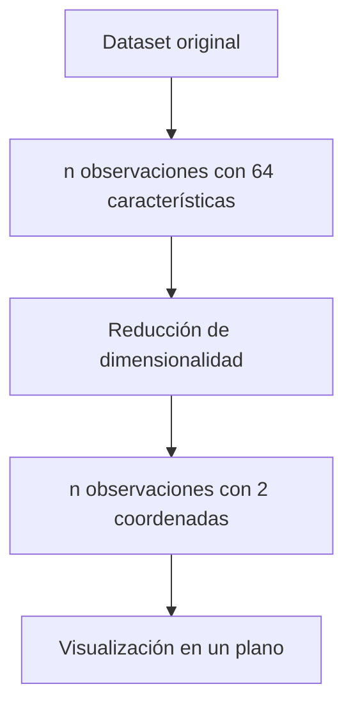
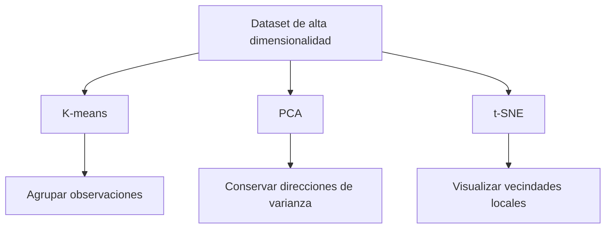
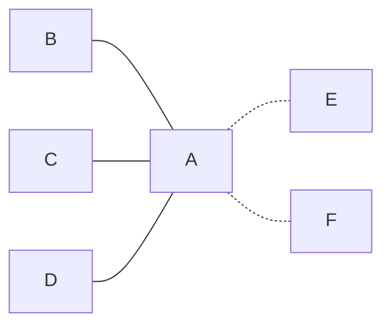
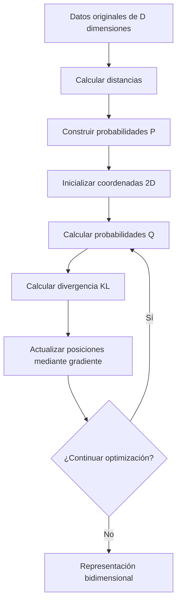
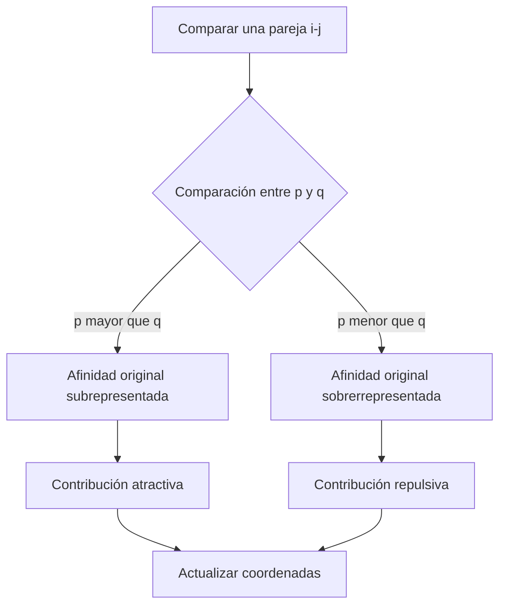
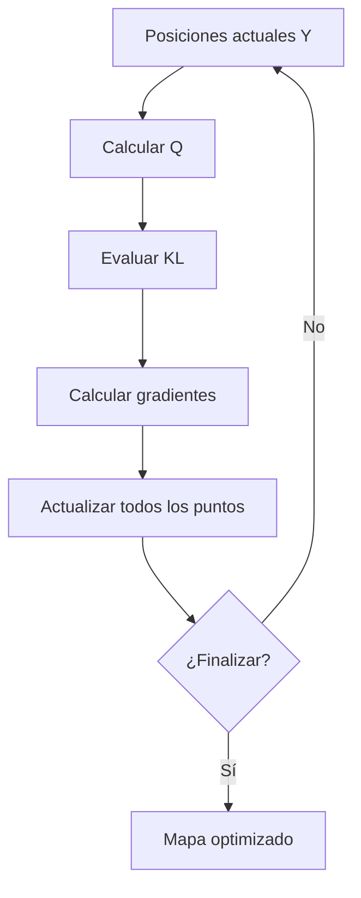

## Introducción  
  
Cuando un conjunto de datos contiene muchas características, resulta difícil comprender cómo se relacionan sus observaciones. Aunque un algoritmo puede procesar información con decenas o cientos de dimensiones, las personas solamente pueden visualizar directamente espacios de dos o tres dimensiones.  
  
Por ejemplo, una imagen de un dígito manuscrito de $8\times8$ píxeles contiene:  
  
$$  
8\times8=64  
$$  
  
características. Cada píxel representa una intensidad numérica, por lo que una imagen puede interpretarse como un punto en un espacio de **64 dimensiones**.  
  
El problema consiste en representar esas observaciones en un plano bidimensional sin perder completamente las relaciones de similitud existentes entre ellas.  
  
Para resolverlo se utiliza **t-Distributed Stochastic Neighbor Embedding (t-SNE)**, una técnica de reducción de dimensionalidad no lineal diseñada principalmente para la visualización de datos.  
  
Su objetivo es construir un mapa de dos dimensiones en el que las observaciones similares en el espacio original tiendan a aparecer cerca unas de otras.  
  
A diferencia de otros algoritmos, t-SNE no intenta preservar exactamente todas las distancias originales. Su prioridad es conservar las **relaciones locales de vecindad**, es decir, identificar qué observaciones son relativamente cercanas entre sí.  
  
Para conseguirlo, transforma las distancias originales en probabilidades de similitud, construye probabilidades equivalentes en el mapa bidimensional y modifica las posiciones de los puntos para reducir las diferencias entre ambas distribuciones.  
  
Este procedimiento permite explorar estructuras difíciles de observar directamente, pero también introduce limitaciones importantes: las distancias globales, el tamaño de los grupos y la separación visual entre regiones no necesariamente representan fielmente la geometría del espacio original.  
  
Por lo tanto, comprender t-SNE requiere estudiar cómo calcula las similitudes, cómo construye su representación bidimensional y qué conclusiones pueden extraerse correctamente de sus resultados.  
  
---  
  
## Reducción de dimensionalidad y visualización de datos  
  
La **reducción de dimensionalidad (Dimensionality Reduction)** consiste en representar observaciones utilizando menos variables que las disponibles originalmente.  
  
Supóngase que un conjunto contiene $n$ observaciones, cada una con $D$ características.  
  
Su matriz de datos es:  
  
$$  
X\in\mathbb{R}^{n\times D}  
$$  
  
En donde:  
  
- $n$ representa el número de observaciones.  
- $D$ representa el número de características originales.  
- $X$ contiene los valores de todas las observaciones.  
  
Si se desea obtener una representación bidimensional, el resultado tendrá la forma:  
  
$$  
Y\in\mathbb{R}^{n\times2}  
$$  
  
Cada observación original:  
  
$$  
x_i\in\mathbb{R}^{D}  
$$  
  
se representa mediante un nuevo punto:  
  
$$  
y_i\in\mathbb{R}^{2}  
$$  
  
Por ejemplo, una imagen de 64 características se transforma en un punto con solamente dos coordenadas.  
  

  
Es importante comprender que esta transformación no puede conservar necesariamente toda la información original.  
  
Al reducir 64 dimensiones a dos, algunas relaciones geométricas se distorsionan.  
  
Por lo tanto, cada técnica debe decidir **qué propiedades de los datos intenta conservar**.  
  
### Diferencia entre K-means, PCA y t-SNE:  
  
Aunque los tres algoritmos permiten explorar la estructura de un conjunto de datos, sus objetivos son diferentes.  
  
| Algoritmo | Objetivo principal | Resultado |  
|---|---|---|  
| K-means | Agrupar observaciones similares | Asignaciones a clusters y centroides |  
| PCA | Encontrar direcciones de máxima varianza | Componentes principales |  
| t-SNE | Preservar relaciones locales de similitud | Coordenadas para visualización |  
  
**K-means** responde principalmente a la pregunta: ¿qué observaciones pertenecen al mismo grupo?  
  
**Principal Component Analysis (PCA)** busca direcciones que expliquen la mayor cantidad posible de varianza mediante una proyección lineal.  
  
**t-SNE** busca representar observaciones similares cerca unas de otras utilizando una transformación no lineal.  
  

  
Estas técnicas son complementarias, no equivalentes.  
  
Por ejemplo, PCA puede utilizarse para reducir inicialmente un conjunto de muchas características, mientras que t-SNE puede utilizarse posteriormente para construir una representación de dos dimensiones.  
  
### ¿t-SNE realiza clustering?:  
  
No.  
  
**t-SNE no es un algoritmo de clustering** porque no asigna automáticamente una etiqueta de grupo a cada observación.  
  
Su resultado consiste en coordenadas que pueden representarse gráficamente.  
  
Si aparecen regiones visualmente separadas, esto no demuestra por sí solo que existan clusters claramente definidos en los datos originales.  
  
Para determinar si existen grupos reales, es necesario analizar las observaciones y sus relaciones en el espacio original.  
  
---  
  
## El concepto de vecindad  
  
El concepto más importante de t-SNE es la **vecindad (neighborhood)**.  
  
Dos observaciones son vecinas cuando se encuentran relativamente cerca según la medida de distancia utilizada.  
  
Por ejemplo, supóngase que existen seis observaciones:  
  
$$  
A,\ B,\ C,\ D,\ E,\ F  
$$  
  
Las observaciones B, C y D están relativamente cerca de A, mientras que E y F se encuentran más alejadas.  
  

  
Las conexiones continuas representan relaciones de vecindad más cercana; las conexiones discontinuas representan observaciones más alejadas.  
  
El objetivo de t-SNE sería construir una representación bidimensional donde B, C y D conservaran, aproximadamente, su relación de cercanía con A.  
  
No es necesario que todas las distancias permanezcan idénticas.  
  
Lo importante es que las observaciones consideradas vecinas en el espacio original sigan siendo vecinas en el mapa.  
  
### Relaciones locales y globales:  
  
Las relaciones **locales** describen qué observaciones están cerca unas de otras.  
  
Las relaciones **globales** describen la geometría del conjunto completo, incluyendo distancias entre grupos muy separados.  
  
t-SNE prioriza principalmente las relaciones locales.  
  
Por lo tanto, un mapa puede representar correctamente los vecinos cercanos y, al mismo tiempo, distorsionar las distancias entre regiones lejanas.  
  
Esta diferencia será fundamental al interpretar sus visualizaciones.  
  
---  
  
## Funcionamiento general de t-SNE  
  
t-SNE construye una representación bidimensional mediante un procedimiento iterativo.  
  
Primero calcula similitudes entre las observaciones originales. Después inicializa sus posiciones en un plano y ajusta esas posiciones para que las similitudes bidimensionales se parezcan a las originales.  
  

  
El procedimiento puede comprenderse mediante cuatro ideas:  
  
1. **Medir:** identificar las relaciones de vecindad en el espacio original.  
2. **Inicializar:** asignar coordenadas bidimensionales a las observaciones.  
3. **Comparar:** medir cuánto difieren las relaciones de similitud originales y las del mapa.  
4. **Ajustar:** modificar las coordenadas para reducir esa diferencia.  
  
Las últimas dos operaciones se repiten durante numerosas iteraciones.  
  
La función que se intenta minimizar es la **divergencia de Kullback-Leibler (KL Divergence)**.  
  
---  
  
## Representación de imágenes como vectores  
  
Para comprender el funcionamiento matemático de t-SNE se considera un conjunto de imágenes de dígitos manuscritos.  
  
Cada imagen tiene una resolución de:  
  
$$  
8\times8  
$$  
  
píxeles.  
  
Por lo tanto, contiene:  
  
$$  
D=64  
$$  
  
características.  
  
Cada píxel almacena una intensidad entre $0$ y $16$.  
  
Una imagen puede representarse mediante:  
  
$$  
x_i=(x_{i1},x_{i2},\ldots,x_{i64})  
$$  
  
En donde $x_{ik}$ representa la intensidad del píxel $k$ de la imagen $i$.  
  
### Ejemplo práctico:  
  
Considérense cuatro imágenes:  
  
| Imagen | Dígito representado |  
|---|---|  
| A | 0 |  
| B | 0 |  
| C | 1 |  
| D | 1 |  
  
Las imágenes A y B representan diferentes escrituras del dígito cero.  
  
Las imágenes C y D representan diferentes escrituras del dígito uno.  
  
Sus primeras características pueden expresarse como:  
  
$$  
x_A=(0,0,5,13,9,1,0,0,\ldots)  
$$  
  
$$  
x_B=(0,0,1,9,15,11,0,0,\ldots)  
$$  
  
Cada vector contiene 64 intensidades.  
  
Aunque dos imágenes representen el mismo dígito, sus valores no tienen que ser idénticos, ya que la forma, posición y grosor de los trazos pueden variar.  
  
### Características y etiquetas:  
  
Una distinción fundamental es que **t-SNE utiliza las intensidades de los píxeles, no las etiquetas de los dígitos, para construir la representación**.  
  
Por ejemplo:  
  
$$  
X=\text{Intensidades de los píxeles}  
$$  
  
Mientras que:  
  
$$  
y=\text{Dígito representado}  
$$  
  
Las etiquetas pueden utilizarse posteriormente para colorear los puntos y comprobar visualmente si aparecen patrones relacionados con las categorías.  
  
Sin embargo, no participan en la función objetivo de t-SNE.  
  
Esto explica por qué t-SNE se considera una técnica de aprendizaje no supervisado.  
  
---  
  
## Distancia euclidiana en alta dimensionalidad  
  
El primer paso consiste en calcular qué tan diferentes son las observaciones originales.  
  
Para ello puede utilizarse la distancia euclidiana.  
  
La distancia entre dos observaciones de $D$ dimensiones es:  
  
$$  
d(x_i,x_j)=  
\sqrt{\sum_{k=1}^{D}(x_{ik}-x_{jk})^2}  
$$  
  
En donde:  
  
- $x_i$ y $x_j$ son las observaciones comparadas.  
- $D$ es el número de características.  
- $x_{ik}$ y $x_{jk}$ son los valores de la característica $k$.  
- $d(x_i,x_j)$ es la distancia euclidiana.  
  
En el ejemplo de los dígitos:  
  
$$  
D=64  
$$  
  
Por lo tanto:  
  
$$  
d(A,B)^2=  
\sum_{k=1}^{64}(x_{Ak}-x_{Bk})^2  
$$  
  
### Ejemplo: distancia entre dos imágenes del dígito cero:  
  
Las primeras diferencias son:  
  
$$  
(0-0)^2+(0-0)^2+(5-1)^2  
$$  
  
$$  
+(13-9)^2+(9-15)^2+(1-11)^2+\cdots  
$$  
  
El cálculo considera los 64 píxeles.  
  
La suma completa produce:  
  
$$  
d(A,B)^2=562  
$$  
  
Por lo tanto:  
  
$$  
d(A,B)=\sqrt{562}  
$$  
  
$$  
\boxed{d(A,B)\approx23.71}  
$$  
  
Esto significa que las imágenes A y B presentan diferencias en sus intensidades, aunque ambas representan el mismo dígito.  
  
### Matriz de distancias:  
  
Al calcular las distancias entre las cuatro imágenes se obtiene:  
  
$$  
D=  
\begin{pmatrix}  
0&23.71&59.56&60.42\\  
23.71&0&54.65&54.85\\  
59.56&54.65&0&35.13\\  
60.42&54.85&35.13&0  
\end{pmatrix}  
$$  
  
Cada entrada representa la distancia entre dos imágenes.  
  
Por ejemplo:  
  
$$  
d(A,B)=23.71  
$$  
  
Mientras que:  
  
$$  
d(A,C)=59.56  
$$  
  
Como:  
  
$$  
23.71<59.56  
$$  
  
se concluye que la imagen B está mucho más cerca de A que la imagen C.  
  
De manera semejante:  
  
$$  
d(C,D)=35.13  
$$  
  
indica que las dos imágenes del dígito uno también presentan una cercanía relativa.  
  
La matriz es simétrica:  
  
$$  
d(i,j)=d(j,i)  
$$  
  
Y su diagonal es cero:  
  
$$  
d(i,i)=0  
$$  
  
Sin embargo, **t-SNE no utiliza directamente estas distancias como las coordenadas finales del mapa**. Primero las transforma en medidas de similitud.  
  
---  
  
## De distancias a similitudes gaussianas  
  
La distancia permite determinar qué observaciones están cerca, pero t-SNE necesita expresar estas relaciones mediante probabilidades.  
  
Para ello utiliza una función exponencial de tipo gaussiano.  
  
La afinidad entre una observación $i$ y otra $j$ puede expresarse mediante:  
  
$$  
w_{ij}=  
\exp\left(  
-\frac{\|x_i-x_j\|^2}{2\sigma_i^2}  
\right)  
$$  
  
En donde:  
  
- $w_{ij}$ es el peso de similitud.  
- $\|x_i-x_j\|^2$ es la distancia euclidiana al cuadrado.  
- $\sigma_i$ controla la escala de vecindad alrededor de la observación $i$.  
- $\exp$ representa la función exponencial.  
  
Para una observación comparada consigo misma se establece:  
  
$$  
w_{ii}=0  
$$  
  
Con esto se evita considerar cada punto como su propio vecino.  
  
### Interpretación:  
  
Cuando dos observaciones están muy cerca:  
  
$$  
\|x_i-x_j\|^2\approx0  
$$  
  
el exponente se aproxima a cero y:  
  
$$  
w_{ij}\approx1  
$$  
  
Cuando están alejadas, el exponente se vuelve más negativo y el peso se aproxima a cero.  
  
Por lo tanto:  
  
$$  
\boxed{\text{Menor distancia}\Rightarrow\text{Mayor similitud}}  
$$  
  
### Ejemplo práctico: similitud entre imágenes:  
  
Para facilitar los cálculos, se considera una desviación estándar fija:  
  
$$  
\sigma=25  
$$  
  
Entonces:  
  
$$  
w_{ij}=  
\exp\left(  
-\frac{d(i,j)^2}{2(25)^2}  
\right)  
$$  
  
Como:  
  
$$  
2(25)^2=1250  
$$  
  
se obtiene:  
  
$$  
w_{ij}=e^{-d(i,j)^2/1250}  
$$  
  
Para las imágenes A y B:  
  
$$  
d(A,B)^2=562  
$$  
  
Por lo tanto:  
  
$$  
w_{AB}=e^{-562/1250}  
$$  
  
$$  
\boxed{w_{AB}\approx0.6379}  
$$  
  
Para A y C:  
  
$$  
d(A,C)^2\approx3547  
$$  
  
Entonces:  
  
$$  
w_{AC}=e^{-3547/1250}  
$$  
  
$$  
\boxed{w_{AC}\approx0.0586}  
$$  
  
La comparación es:  
  
| Pareja | Peso de similitud |  
|---|---:|  
| A–B | $0.6379$ |  
| A–C | $0.0586$ |  
  
El par A–B recibe un peso considerablemente mayor porque sus imágenes son más parecidas.  
  
Estos valores todavía son **pesos de similitud**, no probabilidades normalizadas.  
  
---  
  
## Probabilidades condicionales de vecindad  
  
Una vez calculados los pesos gaussianos, se normalizan para obtener probabilidades condicionales.  
  
La fórmula es:  
  
$$  
\boxed{  
p_{j|i}=  
\frac{w_{ij}}  
{\sum_{k\neq i}w_{ik}}  
}  
$$  
  
En donde:  
  
- $p_{j|i}$ representa la probabilidad de seleccionar $j$ como vecino de $i$ según el modelo de similitud.  
- $w_{ij}$ es el peso de similitud.  
- El denominador suma los pesos de todos los posibles vecinos de $i$.  
  
La suma de las probabilidades de cada observación respecto a sus vecinos es:  
  
$$  
\sum_{j\neq i}p_{j|i}=1  
$$  
  
### Ejemplo práctico: vecinos de A:  
  
Supóngase que se tienen:  
  
$$  
w_{AB}=0.6379  
$$  
  
$$  
w_{AC}=0.0586  
$$  
  
$$  
w_{AD}=0.0539  
$$  
  
La suma de pesos es:  
  
$$  
Z_A=0.6379+0.0586+0.0539  
$$  
  
$$  
Z_A=0.7504  
$$  
  
La probabilidad de B como vecino de A es:  
  
$$  
p_{B|A}=\frac{0.6379}{0.7504}  
$$  
  
$$  
\boxed{p_{B|A}\approx0.8501}  
$$  
  
Para C:  
  
$$  
p_{C|A}=\frac{0.0586}{0.7504}  
$$  
  
$$  
\boxed{p_{C|A}\approx0.0781}  
$$  
  
Para D:  
  
$$  
p_{D|A}=\frac{0.0539}{0.7504}  
$$  
  
$$  
\boxed{p_{D|A}\approx0.0718}  
$$  
  
La interpretación es que B domina la distribución de vecinos de A.  
  
Esto es consistente con el hecho de que ambas imágenes representan el mismo dígito.  
  
### ¿Las probabilidades condicionales son simétricas?:  
  
No necesariamente.  
  
En general:  
  
$$  
p_{j|i}\neq p_{i|j}  
$$  
  
Esto ocurre porque la normalización depende de los otros vecinos de cada observación.  
  
Además, en el procedimiento general de t-SNE cada punto puede tener un valor distinto de $\sigma_i$.  
  
Por lo tanto, aunque las distancias sean simétricas, las probabilidades condicionales pueden no serlo.  
  
---  
  
## Perplexity y el tamaño de las vecindades  
  
El hiperparámetro **perplexity** controla la escala de las vecindades consideradas por t-SNE.  
  
Su interpretación está relacionada con el número efectivo de vecinos que influyen sobre la distribución local de probabilidades.  
  
No debe confundirse con un número exacto de vecinos, como ocurre con el hiperparámetro $k$ de kNN.  
  
### Relación con la entropía:  
  
Para la distribución condicional de vecinos de una observación $i$, se define:  
  
$$  
H(P_i)=  
-\sum_{j\neq i}p_{j|i}\log_2(p_{j|i})  
$$  
  
La perplexity se calcula como:  
  
$$  
\boxed{  
\operatorname{Perp}(P_i)=2^{H(P_i)}  
}  
$$  
  
En donde:  
  
- $H(P_i)$ es la entropía de las probabilidades condicionales.  
- $\operatorname{Perp}(P_i)$ representa el tamaño efectivo de la vecindad.  
  
En t-SNE, el algoritmo ajusta $\sigma_i$ para aproximar la perplexity solicitada.  
  
### Perplexity pequeña:  
  
Una perplexity pequeña enfatiza relaciones muy locales.  
  
El algoritmo presta mayor atención a vecindades reducidas.  
  
Esto puede producir representaciones con grupos visualmente más fragmentados.  
  
### Perplexity grande:  
  
Una perplexity mayor considera vecindades más amplias.  
  
Esto puede favorecer una representación menos localizada de las relaciones entre observaciones.  
  
Por ejemplo, se pueden comparar:  
  
$$  
\text{perplexity}\in\{5,30,70\}  
$$  
  
| Perplexity | Interpretación general |  
|---|---|  
| $5$ | Vecindades más locales |  
| $30$ | Escala intermedia |  
| $70$ | Vecindades más amplias |  
  
Estos valores pueden producir mapas visualmente diferentes utilizando exactamente las mismas observaciones.  
  
Sin embargo, **no existe una perplexity universalmente correcta**.  
  
La selección depende del tamaño del conjunto de datos y de las relaciones que se desea explorar.  
  
### Diferencia entre perplexity y k de kNN:  
  
Aunque ambos conceptos se relacionan con vecindades, no cumplen la misma función.  
  
En kNN, $k$ indica explícitamente cuántas observaciones participan en una predicción.  
  
En t-SNE, perplexity controla la distribución de probabilidades y el ajuste de las escalas gaussianas locales.  
  
Por lo tanto, establecer:  
  
$$  
\text{perplexity}=30  
$$  
  
no significa que cada observación tenga exactamente treinta vecinos seleccionados.  
  
---  
  
## Construcción de la matriz de probabilidades P  
  
Las probabilidades condicionales describen relaciones de vecindad desde la perspectiva de cada observación.  
  
Sin embargo, t-SNE necesita una matriz conjunta y simétrica para comparar las relaciones originales con las del mapa.  
  
La probabilidad conjunta se define mediante:  
  
$$  
\boxed{  
p_{ij}=  
\frac{p_{j|i}+p_{i|j}}{2n}  
}  
$$  
  
En donde:  
  
- $p_{j|i}$ representa la probabilidad de $j$ como vecino de $i$.  
- $p_{i|j}$ representa la probabilidad de $i$ como vecino de $j$.  
- $n$ es el número total de observaciones.  
  
### Ejemplo práctico:  
  
Para cuatro observaciones:  
  
$$  
n=4  
$$  
  
Se tienen:  
  
$$  
p_{B|A}=0.8501  
$$  
  
$$  
p_{A|B}=0.7783  
$$  
  
Entonces:  
  
$$  
p_{AB}=  
\frac{0.8501+0.7783}{2(4)}  
$$  
  
$$  
p_{AB}=\frac{1.6284}{8}  
$$  
  
$$  
\boxed{p_{AB}\approx0.2035}  
$$  
  
Esta operación combina ambas perspectivas de vecindad.  
  
### Matriz P:  
  
Para las cuatro imágenes se obtiene aproximadamente:  
  
$$  
P=  
\begin{pmatrix}  
0&0.204&0.024&0.022\\  
0.204&0&0.036&0.036\\  
0.024&0.036&0&0.179\\  
0.022&0.036&0.179&0  
\end{pmatrix}  
$$  
  
La matriz cumple tres propiedades fundamentales.  
  
**Diagonal nula:**  
  
$$  
p_{ii}=0  
$$  
  
**Simetría:**  
  
$$  
P=P^T  
$$  
  
**Normalización:**  
  
$$  
\sum_{i\neq j}p_{ij}=1  
$$  
  
Esta última propiedad considera todos los pares ordenados de observaciones.  
  
### Interpretación de P:  
  
Los valores más grandes corresponden a relaciones de similitud importantes.  
  
Por ejemplo:  
  
$$  
p_{AB}\approx0.204  
$$  
  
y:  
  
$$  
p_{CD}\approx0.179  
$$  
  
son relativamente elevados.  
  
Esto significa que los pares A–B y C–D presentan relaciones de vecindad importantes dentro del conjunto.  
  
En cambio:  
  
$$  
p_{AC}\approx0.024  
$$  
  
indica una relación de similitud menor.  
  
Por lo tanto, el objetivo de t-SNE será construir un mapa donde estas relaciones queden representadas aproximadamente.  
  
---  
  
## Inicialización de coordenadas bidimensionales  
  
Una vez construida la matriz $P$, t-SNE necesita asignar posiciones iniciales a las observaciones en un plano.  
  
Cada observación original:  
  
$$  
x_i\in\mathbb{R}^{64}  
$$  
  
se representa mediante:  
  
$$  
y_i=(y_{i1},y_{i2})  
$$  
  
Estas coordenadas pueden inicializarse aleatoriamente o mediante PCA.  
  
### Ejemplo práctico:  
  
Considérense las siguientes posiciones iniciales:  
  
$$  
y_A=(-1.0,0.0)  
$$  
  
$$  
y_B=(-0.2,0.3)  
$$  
  
$$  
y_C=(0.4,-0.5)  
$$  
  
$$  
y_D=(1.0,0.2)  
$$  
  
Estos valores son coordenadas iniciales para ilustrar la optimización.  
  
No representan todavía una solución final.  
  
El algoritmo debe modificar estas posiciones para que las relaciones de similitud del mapa se parezcan a las del espacio original.  
  
### ¿Qué se optimiza?:  
  
Durante esta etapa, las posiciones bidimensionales:  
  
$$  
y_A,\ y_B,\ y_C,\ y_D  
$$  
  
son las variables que se ajustan.  
  
En cambio, las probabilidades originales de la matriz $P$ permanecen fijas durante la optimización ordinaria.  
  
Por lo tanto:  
  
- $P$ representa las relaciones originales que se desean conservar.  
- Las coordenadas $Y$ son las variables ajustables.  
- $Q$ representa las relaciones que resultan de las posiciones actuales de $Y$.  
  
---  
  
## Distribución Student-t en el mapa bidimensional  
  
En el espacio original se utilizan similitudes gaussianas.  
  
Sin embargo, en el mapa de dos dimensiones t-SNE utiliza una distribución **Student-t con un grado de libertad**, equivalente a una distribución de Cauchy.  
  
Esta elección es importante porque permite representar similitudes con colas más pesadas que las de una distribución gaussiana.  
  
### Pesos Student-t:  
  
El peso de similitud entre dos puntos del mapa se calcula mediante:  
  
$$  
\boxed{  
t_{ij}=  
\frac{1}{1+\|y_i-y_j\|^2}  
}  
$$  
  
En donde:  
  
- $y_i$ y $y_j$ son coordenadas bidimensionales.  
- $\|y_i-y_j\|^2$ es la distancia euclidiana al cuadrado.  
- $t_{ij}$ es un peso de similitud.  
  
Para un punto comparado consigo mismo:  
  
$$  
t_{ii}=0  
$$  
  
### Ejemplo: distancia entre A y B:  
  
Se tienen:  
  
$$  
y_A=(-1.0,0.0)  
$$  
  
$$  
y_B=(-0.2,0.3)  
$$  
  
La distancia al cuadrado es:  
  
$$  
\|y_A-y_B\|^2=  
(-1.0+0.2)^2+(0.0-0.3)^2  
$$  
  
$$  
=(-0.8)^2+(-0.3)^2  
$$  
  
$$  
=0.64+0.09  
$$  
  
$$  
\boxed{\|y_A-y_B\|^2=0.73}  
$$  
  
El peso Student-t es:  
  
$$  
t_{AB}=\frac{1}{1+0.73}  
$$  
  
$$  
t_{AB}=\frac{1}{1.73}  
$$  
  
$$  
\boxed{t_{AB}\approx0.5780}  
$$  
  
Cuanto menor es la distancia bidimensional, mayor es el peso de similitud.  
  
---  
  
## Cálculo de todas las distancias bidimensionales  
  
Para construir la distribución completa del mapa es necesario comparar todas las parejas de observaciones.  
  
Se mantienen las coordenadas iniciales:  
  
$$  
y_A=(-1.0,0.0)  
$$  
  
$$  
y_B=(-0.2,0.3)  
$$  
  
$$  
y_C=(0.4,-0.5)  
$$  
  
$$  
y_D=(1.0,0.2)  
$$  
  
Las distancias al cuadrado son:  
  
| Pareja | Distancia al cuadrado |  
|---|---:|  
| A–B | $0.73$ |  
| A–C | $2.21$ |  
| A–D | $4.04$ |  
| B–C | $1.00$ |  
| B–D | $1.45$ |  
| C–D | $0.85$ |  
  
Por ejemplo, para C y D:  
  
$$  
\|y_C-y_D\|^2=  
(0.4-1.0)^2+(-0.5-0.2)^2  
$$  
  
$$  
=(-0.6)^2+(-0.7)^2  
$$  
  
$$  
=0.36+0.49  
$$  
  
$$  
\boxed{\|y_C-y_D\|^2=0.85}  
$$  
  
No es necesario calcular doce distancias diferentes porque:  
  
$$  
\|y_i-y_j\|^2=\|y_j-y_i\|^2  
$$  
  
Con cuatro observaciones existen seis parejas distintas.  
  
### Matriz de distancias cuadradas:  
  
$$  
D^2=  
\begin{pmatrix}  
0&0.73&2.21&4.04\\  
0.73&0&1.00&1.45\\  
2.21&1.00&0&0.85\\  
4.04&1.45&0.85&0  
\end{pmatrix}  
$$  
  
La matriz muestra que A–B es una pareja relativamente cercana en el mapa inicial.  
  
También muestra que C–D tiene una distancia pequeña, mientras que A–D se encuentra considerablemente más separada.  
  
---  
  
## Construcción de los pesos Student-t  
  
Con las distancias anteriores se calcula:  
  
$$  
t_{ij}=\frac{1}{1+D_{ij}^2}  
$$  
  
Los resultados son:  
  
| Pareja | Peso Student-t |  
|---|---:|  
| A–B | $0.5780$ |  
| A–C | $0.3115$ |  
| A–D | $0.1984$ |  
| B–C | $0.5000$ |  
| B–D | $0.4082$ |  
| C–D | $0.5405$ |  
  
Por ejemplo:  
  
$$  
t_{AC}=\frac{1}{1+2.21}  
$$  
  
$$  
\boxed{t_{AC}\approx0.3115}  
$$  
  
Mientras que:  
  
$$  
t_{CD}=\frac{1}{1+0.85}  
$$  
  
$$  
\boxed{t_{CD}\approx0.5405}  
$$  
  
La matriz de pesos es:  
  
$$  
T=  
\begin{pmatrix}  
0&0.5780&0.3115&0.1984\\  
0.5780&0&0.5000&0.4082\\  
0.3115&0.5000&0&0.5405\\  
0.1984&0.4082&0.5405&0  
\end{pmatrix}  
$$  
  
Estos valores todavía no son probabilidades normalizadas.  
  
Para obtenerlas es necesario dividir cada peso entre la suma total de pesos de todos los pares ordenados.  
  
---  
  
## Construcción de la matriz Q  
  
La matriz $Q$ representa las probabilidades de similitud correspondientes al mapa bidimensional.  
  
Cada probabilidad se calcula mediante:  
  
$$  
\boxed{  
q_{ij}=  
\frac{t_{ij}}{\sum_{k\neq l}t_{kl}}  
}  
$$  
  
El denominador constituye una constante de normalización:  
  
$$  
Z=\sum_{k\neq l}t_{kl}  
$$  
  
### Cálculo de Z:  
  
Como la matriz $T$ es simétrica, cada pareja distinta aparece dos veces.  
  
Por lo tanto:  
  
$$  
Z=2(t_{AB}+t_{AC}+t_{AD}+t_{BC}+t_{BD}+t_{CD})  
$$  
  
Utilizando valores con mayor precisión:  
  
$$  
Z=2(0.5780347+0.3115265+0.1984127  
$$  
  
$$  
+0.5000000+0.4081633+0.5405405)  
$$  
  
Se obtiene:  
  
$$  
\boxed{Z\approx5.0734}  
$$  
  
El factor $2$ aparece porque cada relación está representada en ambas direcciones.  
  
Por ejemplo:  
  
$$  
t_{AB}=t_{BA}  
$$  
  
### Cálculo de una probabilidad:  
  
Para A y B:  
  
$$  
q_{AB}=\frac{0.5780}{5.0734}  
$$  
  
$$  
\boxed{q_{AB}\approx0.1139}  
$$  
  
Para C y D:  
  
$$  
q_{CD}=\frac{0.5405}{5.0734}  
$$  
  
$$  
\boxed{q_{CD}\approx0.1065}  
$$  
  
### Matriz Q:  
  
La distribución resultante es:  
  
$$  
Q\approx  
\begin{pmatrix}  
0&0.1139&0.0614&0.0391\\  
0.1139&0&0.0986&0.0805\\  
0.0614&0.0986&0&0.1065\\  
0.0391&0.0805&0.1065&0  
\end{pmatrix}  
$$  
  
La matriz cumple:  
  
$$  
Q=Q^T  
$$  
  
$$  
q_{ii}=0  
$$  
  
$$  
\sum_{i\neq j}q_{ij}=1  
$$  
  
Ahora existen dos distribuciones comparables:  
  
- $P$: similitudes construidas a partir de los datos originales.  
- $Q$: similitudes construidas a partir de las posiciones bidimensionales actuales.  
  
El siguiente objetivo consiste en reducir las diferencias entre ambas.  
  
---  
  
## Comparación entre las matrices P y Q  
  
Las matrices $P$ y $Q$ contienen probabilidades correspondientes a las mismas parejas de observaciones.  
  
Sin embargo, representan espacios diferentes.  
  
$$  
P=\text{Similitudes originales}  
$$  
  
$$  
Q=\text{Similitudes bidimensionales}  
$$  
  
Por ejemplo:  
  
| Pareja | $p_{ij}$ | $q_{ij}$ |  
|---|---:|---:|  
| A–B | $0.2035$ | $0.1139$ |  
| A–C | $0.024$ | $0.0614$ |  
| C–D | $0.179$ | $0.1065$ |  
  
### Interpretación:  
  
Para A–B:  
  
$$  
p_{AB}>q_{AB}  
$$  
  
La relación es más importante en el espacio original que en el mapa.  
  
Esto indica que el mapa inicial representa insuficientemente su similitud.  
  
Por lo tanto, la optimización tenderá a favorecer una mayor cercanía relativa entre A y B.  
  
En cambio, para A–C:  
  
$$  
p_{AC}<q_{AC}  
$$  
  
El mapa asigna a esa pareja una similitud mayor que la representada en el espacio original.  
  
Esto puede generar una contribución repulsiva durante la optimización.  
  

  
Estas fuerzas no se aplican de manera aislada.  
  
Cada punto recibe contribuciones de todas las demás observaciones, por lo que su desplazamiento final depende del gradiente completo.  
  
---  
  
## Divergencia de Kullback-Leibler  
  
La **divergencia de Kullback-Leibler (KL Divergence)** mide la discrepancia entre dos distribuciones de probabilidad.  
  
En t-SNE se utiliza para comparar:  
  
$$  
P  
$$  
  
y:  
  
$$  
Q  
$$  
  
Su fórmula es:  
  
$$  
\boxed{  
KL(P\|Q)=  
\sum_{i\neq j}  
p_{ij}\ln\left(\frac{p_{ij}}{q_{ij}}\right)  
}  
$$  
  
En donde:  
  
- $p_{ij}$ representa la similitud original.  
- $q_{ij}$ representa la similitud en el mapa.  
- $\ln$ es el logaritmo natural.  
- $KL(P\|Q)$ mide la discrepancia entre ambas distribuciones.  
  
El objetivo de t-SNE es minimizar:  
  
$$  
\boxed{\min_Y KL(P\|Q(Y))}  
$$  
  
Esto significa que las coordenadas $Y$ se modifican para que la distribución $Q$ se parezca lo más posible a $P$.  
  
### Interpretación:  
  
Cuando:  
  
$$  
P=Q  
$$  
  
la divergencia es:  
  
$$  
KL(P\|Q)=0  
$$  
  
Este es su valor mínimo teórico.  
  
Cuanto mayor sea la discrepancia entre ambas distribuciones, mayor puede ser la divergencia.  
  
### Ejemplo numérico:  
  
Para las cuatro imágenes puede escribirse:  
  
$$  
KL(P\|Q)=  
2\left[  
p_{AB}\ln\left(\frac{p_{AB}}{q_{AB}}\right)  
+  
p_{AC}\ln\left(\frac{p_{AC}}{q_{AC}}\right)  
+\cdots  
\right]  
$$  
  
El factor $2$ aparece por la simetría de las matrices.  
  
Al considerar las seis parejas distintas y sus valores completos, se obtiene aproximadamente:  
  
$$  
\boxed{KL(P\|Q)\approx0.2217}  
$$  
  
Esto indica que el mapa inicial todavía presenta diferencias entre sus relaciones de similitud y las del espacio original.  
  
El algoritmo intentará reducir esta discrepancia durante las siguientes iteraciones.  
  
### ¿Por qué se utiliza KL(P||Q) y no KL(Q||P)?:  
  
La divergencia KL es asimétrica:  
  
$$  
KL(P\|Q)\neq KL(Q\|P)  
$$  
  
En t-SNE, la dirección utilizada penaliza especialmente las situaciones en las que una pareja posee una similitud original importante, pero aparece representada con una probabilidad demasiado pequeña en el mapa.  
  
Esto favorece la conservación de vecinos cercanos.  
  
Por lo tanto, la función objetivo está alineada con la prioridad de t-SNE: preservar relaciones locales de similitud.  
  
---  
  
## Optimización mediante descenso de gradiente  
  
Después de calcular la divergencia KL, t-SNE modifica las posiciones bidimensionales para intentar reducir su valor.  
  
Este procedimiento se basa en **descenso de gradiente (Gradient Descent)**.  
  
El gradiente indica cómo cambia la función objetivo cuando se modifican las coordenadas.  
  
### Fórmula del gradiente:  
  
Para una observación $i$:  
  
$$  
\boxed{  
\frac{\partial KL}{\partial y_i}  
=  
4\sum_{j\neq i}  
(p_{ij}-q_{ij})  
\frac{y_i-y_j}{1+\|y_i-y_j\|^2}  
}  
$$  
  
En donde:  
  
- $p_{ij}-q_{ij}$ representa la diferencia entre similitudes.  
- $y_i-y_j$ es el vector entre las posiciones bidimensionales.  
- El denominador depende de la distancia entre los puntos.  
- El factor $4$ forma parte de la expresión del gradiente.  
  
Esta fórmula combina contribuciones atractivas y repulsivas.  
  
### Contribución atractiva:  
  
Cuando:  
  
$$  
p_{ij}>q_{ij}  
$$  
  
la similitud original es mayor que la representada en el mapa.  
  
El término correspondiente favorece acercar los puntos durante el descenso de gradiente.  
  
### Contribución repulsiva:  
  
Cuando:  
  
$$  
p_{ij}<q_{ij}  
$$  
  
la similitud bidimensional es excesiva respecto a la original.  
  
El término correspondiente favorece separarlos.  
  
### Actualización de coordenadas:  
  
La regla básica de descenso de gradiente es:  
  
$$  
\boxed{  
y_i^{(t+1)}  
=  
y_i^{(t)}-\eta\nabla_{y_i}KL  
}  
$$  
  
En donde:  
  
- $y_i^{(t)}$ representa la posición actual.  
- $y_i^{(t+1)}$ representa la nueva posición.  
- $\eta$ es la tasa de aprendizaje.  
- $\nabla_{y_i}KL$ representa el gradiente.  
  
La tasa de aprendizaje controla la magnitud del desplazamiento en cada iteración.  
  
---  
  
## Ejemplo de una actualización por gradiente  
  
Considérese la observación A, cuya posición inicial es:  
  
$$  
y_A^{(0)}=(-1.0,0.0)  
$$  
  
Supóngase que su gradiente calculado es:  
  
$$  
\nabla_{y_A}KL=(-0.0730,-0.0829)  
$$  
  
Y se utiliza una tasa de aprendizaje:  
  
$$  
\eta=1  
$$  
  
La actualización es:  
  
$$  
y_A^{(1)}  
=  
y_A^{(0)}-\eta\nabla_{y_A}KL  
$$  
  
Sustituyendo:  
  
$$  
y_A^{(1)}  
=  
(-1.0,0.0)-1(-0.0730,-0.0829)  
$$  
  
Por coordenadas:  
  
$$  
y_{A1}^{(1)}=-1.0+0.0730  
$$  
  
$$  
y_{A2}^{(1)}=0.0+0.0829  
$$  
  
Finalmente:  
  
$$  
\boxed{  
y_A^{(1)}=(-0.9270,0.0829)  
}  
$$  
  
La observación A se desplazó ligeramente hacia la derecha y hacia arriba.  
  
Este movimiento refleja el efecto combinado de sus relaciones con B, C y D.  
  
### ¿Se actualiza solamente A?:  
  
No.  
  
En una iteración completa se calculan las contribuciones correspondientes a las demás observaciones y se actualizan sus posiciones.  
  
Posteriormente se vuelven a calcular las similitudes del mapa y la divergencia KL.  
  

  
En implementaciones prácticas pueden utilizarse técnicas adicionales de optimización, pero el principio central continúa siendo reducir la divergencia entre las similitudes originales y las bidimensionales.  
  
---  
  
## ¿Por qué se utiliza Student-t en lugar de una gaussiana?  
  
Uno de los problemas de representar datos de alta dimensionalidad en dos dimensiones es el **crowding problem**.  
  
Este problema aparece porque un espacio bidimensional tiene una capacidad geométrica mucho menor para acomodar simultáneamente numerosas relaciones de vecindad.  
  
Si se utilizan distribuciones demasiado concentradas, muchos puntos pueden terminar amontonándose en una región reducida.  
  
La distribución Student-t utilizada por t-SNE posee **colas pesadas (heavy tails)**.  
  
Esto significa que sus pesos disminuyen más lentamente con la distancia que los de una función gaussiana.  
  
### Comparación:  
  
En el espacio original se utilizan afinidades gaussianas:  
  
$$  
w_{ij}=  
\exp\left(  
-\frac{\|x_i-x_j\|^2}{2\sigma_i^2}  
\right)  
$$  
  
En el mapa se utilizan pesos Student-t:  
  
$$  
t_{ij}=  
\frac{1}{1+\|y_i-y_j\|^2}  
$$  
  
La segunda función permite asignar pesos no despreciables a distancias relativamente grandes.  
  
Esto contribuye a que el algoritmo pueda representar mejor separaciones entre observaciones que no deberían encontrarse demasiado cerca.  
  
### Consecuencia:  
  
La distribución Student-t ayuda a disminuir el crowding problem.  
  
Sin embargo, también contribuye a que las distancias globales del mapa no deban interpretarse como distancias exactas del espacio original.  
  
**t-SNE utiliza una geometría diseñada para preservar vecindades, no para reproducir todas las distancias originales.**  
  
---  
  
## Aplicación a un conjunto completo de dígitos  
  
El ejemplo de cuatro imágenes permite comprender los cálculos, pero t-SNE también puede aplicarse a conjuntos mucho mayores.  
  
Considérese un dataset de:  
  
$$  
n=1797  
$$  
  
imágenes de dígitos manuscritos.  
  
Cada imagen tiene:  
  
$$  
D=64  
$$  
  
características.  
  
La matriz original posee dimensiones:  
  
$$  
X\in\mathbb{R}^{1797\times64}  
$$  
  
Después de aplicar t-SNE con dos componentes:  
  
$$  
Y\in\mathbb{R}^{1797\times2}  
$$  
  
Cada imagen queda representada mediante dos coordenadas.  
  
### ¿Qué cambia respecto al ejemplo pequeño?:  
  
Las fórmulas fundamentales permanecen.  
  
La diferencia es que ahora existen muchas más observaciones y relaciones de vecindad.  
  
Además, la perplexity se utiliza para ajustar las escalas gaussianas locales:  
  
$$  
\sigma_i  
$$  
  
El algoritmo realiza numerosas actualizaciones hasta encontrar una representación útil.  
  
Las etiquetas de los dígitos pueden utilizarse para colorear los puntos, pero no forman parte de la función objetivo.  
  
### Comparación con PCA:  
  
En una representación PCA bidimensional, los datos se proyectan sobre las dos direcciones lineales que explican la mayor varianza posible.  
  
Las observaciones de diferentes dígitos pueden aparecer parcialmente mezcladas.  
  
En t-SNE, las relaciones locales pueden producir regiones visualmente más compactas y separadas.  
  
Esto no significa automáticamente que t-SNE clasifique mejor.  
  
PCA y t-SNE optimizan propiedades diferentes, por lo que sus mapas responden a preguntas distintas.  
  
---  
  
## Interpretación de los mapas t-SNE  
  
Una visualización t-SNE debe interpretarse con precaución.  
  
Su principal utilidad consiste en explorar **qué observaciones tienden a conservar relaciones de vecindad**.  
  
Por ejemplo, si varias imágenes manuscritas del mismo dígito aparecen próximas, puede existir una relación de similitud entre sus intensidades originales.  
  
Sin embargo, esto no significa que todas las propiedades geométricas del mapa sean confiables.  
  
### Qué puede interpretarse:  
  
| Propiedad | Interpretación |  
|---|---|  
| Vecinos cercanos | Aproximadamente informativa |  
| Regiones locales | Útiles para explorar similitud |  
| Mezcla de etiquetas | Puede indicar observaciones con características semejantes |  
| Separación visual de algunos grupos | Sugiere patrones que requieren validación |  
  
### Qué no debe asumirse:  
  
| Propiedad | Limitación |  
|---|---|  
| Tamaño de los grupos | No representa necesariamente su tamaño en alta dimensión |  
| Distancias entre grupos | No son distancias globales calibradas |  
| Espacios vacíos | No demuestran separación real |  
| Densidad visual | No representa necesariamente densidad original |  
| Islas separadas | No prueban automáticamente la existencia de clusters |  
  
### Ejemplo de interpretación incorrecta:  
  
Supóngase que un mapa muestra tres regiones separadas.  
  
Una interpretación incorrecta sería afirmar:  
  
"Los datos contienen exactamente tres clusters naturales".  
  
t-SNE no proporciona esa conclusión.  
  
Una interpretación más apropiada sería:  
  
"Las observaciones presentan tres regiones visualmente diferenciadas bajo esta configuración, lo que sugiere relaciones de similitud que deben estudiarse en el espacio original".  
  
La segunda interpretación reconoce que la visualización es exploratoria.  
  
---  
  
## Efecto de los hiperparámetros  
  
La forma de una representación t-SNE depende de diferentes decisiones de configuración.  
  
Entre las más importantes se encuentran:  
  
- Perplexity.  
- Tasa de aprendizaje.  
- Inicialización.  
- Número de iteraciones.  
- Semilla aleatoria.  
  
### Perplexity:  
  
Controla la escala efectiva de las vecindades.  
  
Un valor pequeño enfatiza relaciones más locales.  
  
Un valor grande considera relaciones de vecindad más amplias.  
  
### Learning rate:  
  
Controla la magnitud de las actualizaciones de posiciones durante la optimización.  
  
Una tasa inadecuada puede producir una representación deficiente o dificultar la optimización.  
  
### Inicialización:  
  
Las posiciones iniciales pueden establecerse mediante métodos como PCA o inicialización aleatoria.  
  
Debido a que la optimización es no convexa, diferentes inicializaciones pueden conducir a representaciones diferentes.  
  
### Random state:  
  
Permite controlar componentes aleatorios para favorecer la reproducibilidad.  
  
### Número de iteraciones:  
  
Determina cuánto se prolonga el proceso de optimización.  
  
Un número insuficiente puede impedir que las posiciones se ajusten adecuadamente.  
  
### ¿Cuál es el mapa correcto?:  
  
No existe una única representación universalmente correcta.  
  
Dos configuraciones de t-SNE pueden producir mapas distintos utilizando exactamente los mismos datos.  
  
Por lo tanto, las conclusiones importantes deben contrastarse con las características originales y, cuando sea necesario, comprobarse mediante diferentes configuraciones.  
  
---  
  
## Implementación de t-SNE con scikit-learn  
  
Scikit-learn permite aplicar t-SNE mediante la clase `TSNE`.  
  
Una aplicación básica utiliza las características originales y produce coordenadas bidimensionales.  
  
### Ejemplo práctico:  
  
```python  
from sklearn.datasets import load_digits  
from sklearn.manifold import TSNE  
  
digits = load_digits()  
  
X = digits.data  
y = digits.target  
  
tsne = TSNE(  
n_components=2,  
perplexity=30,  
random_state=42  
)  
  
X_2d = tsne.fit_transform(X)  
```  
  
En este ejemplo:  
  
- `load_digits()` carga las imágenes.  
- `X` contiene las intensidades de los píxeles.  
- `y` contiene las etiquetas de los dígitos.  
- `n_components=2` solicita una representación bidimensional.  
- `perplexity=30` establece la escala efectiva de vecindad.  
- `random_state=42` favorece resultados reproducibles.  
  
El método:  
  
```python  
fit_transform(X)  
```  
  
calcula las coordenadas de la representación.  
  
Obsérvese que las etiquetas:  
  
```python  
y  
```  
  
no se proporcionan al procedimiento de ajuste.  
  
### Visualización del resultado:  
  
```python  
import matplotlib.pyplot as plt  
  
plt.scatter(  
X_2d[:, 0],  
X_2d[:, 1],  
c=y,  
cmap="tab10",  
s=10  
)  
  
plt.xlabel("Componente t-SNE 1")  
plt.ylabel("Componente t-SNE 2")  
  
plt.colorbar(label="Dígito")  
plt.show()  
```  
  
El color permite observar cómo se distribuyen las distintas etiquetas dentro del mapa.  
  
Sin embargo, las dos coordenadas no tienen una interpretación directa equivalente a características originales como intensidad, grosor o posición de los trazos.  
  
### Comparación con PCA:  
  
Una comparación útil consiste en generar ambas representaciones.  
  
```python  
from sklearn.decomposition import PCA  
  
pca = PCA(n_components=2)  
  
X_pca = pca.fit_transform(X)  
```  
  
Después pueden examinarse sus diferencias.  
  
PCA busca conservar direcciones de máxima varianza.  
  
t-SNE busca preservar relaciones locales de vecindad.  
  
Por lo tanto, la separación visual de clases no debe interpretarse automáticamente como una comparación de desempeño predictivo.  
  
---  
  
## Ejercicio integrador de t-SNE  
  
Supóngase que se desea construir un mapa bidimensional para cuatro observaciones de alta dimensionalidad.  
  
El procedimiento puede resumirse mediante las siguientes etapas.  
  
### Distancias originales:  
  
Se calcula:  
  
$$  
d(i,j)^2=\sum_{k=1}^{D}(x_{ik}-x_{jk})^2  
$$  
  
Para las imágenes A y B:  
  
$$  
d(A,B)^2=562  
$$  
  
$$  
\boxed{d(A,B)\approx23.71}  
$$  
  
### Pesos gaussianos:  
  
Con:  
  
$$  
\sigma=25  
$$  
  
se utiliza:  
  
$$  
w_{ij}=e^{-d(i,j)^2/1250}  
$$  
  
Por lo tanto:  
  
$$  
\boxed{w_{AB}\approx0.6379}  
$$  
  
### Probabilidades condicionales:  
  
Se normalizan los pesos:  
  
$$  
p_{B|A}=  
\frac{0.6379}{0.6379+0.0586+0.0539}  
$$  
  
$$  
\boxed{p_{B|A}\approx0.8501}  
$$  
  
### Probabilidades simétricas:  
  
Con:  
  
$$  
n=4  
$$  
  
y:  
  
$$  
p_{A|B}=0.7783  
$$  
  
se obtiene:  
  
$$  
p_{AB}=\frac{0.8501+0.7783}{8}  
$$  
  
$$  
\boxed{p_{AB}\approx0.2035}  
$$  
  
### Inicialización bidimensional:  
  
Se asignan:  
  
$$  
y_A=(-1.0,0.0)  
$$  
  
$$  
y_B=(-0.2,0.3)  
$$  
  
### Peso Student-t:  
  
La distancia bidimensional al cuadrado es:  
  
$$  
\|y_A-y_B\|^2=0.73  
$$  
  
Entonces:  
  
$$  
t_{AB}=\frac{1}{1+0.73}  
$$  
  
$$  
\boxed{t_{AB}\approx0.5780}  
$$  
  
### Probabilidad bidimensional:  
  
Con:  
  
$$  
Z\approx5.0734  
$$  
  
se obtiene:  
  
$$  
q_{AB}=\frac{0.5780}{5.0734}  
$$  
  
$$  
\boxed{q_{AB}\approx0.1139}  
$$  
  
### Comparación:  
  
Como:  
  
$$  
p_{AB}>q_{AB}  
$$  
  
el mapa representa una similitud menor que la original para esa pareja.  
  
Por lo tanto, su contribución durante la optimización favorece que A y B se acerquen relativamente.  
  
### Optimización:  
  
Se calcula la divergencia:  
  
$$  
KL(P\|Q)=  
\sum_{i\neq j}p_{ij}\ln\left(\frac{p_{ij}}{q_{ij}}\right)  
$$  
  
Posteriormente se actualizan las coordenadas mediante:  
  
$$  
y_i^{(t+1)}=  
y_i^{(t)}-\eta\nabla_{y_i}KL  
$$  
  
Este procedimiento se repite hasta obtener una representación bidimensional adecuada según el criterio de optimización.  
  
---  
  
## Ideas principales  
  
### Reducción de dimensionalidad:  
  
Permite representar datos de muchas características utilizando menos dimensiones.  
  
t-SNE se utiliza principalmente para visualización y busca conservar relaciones locales de vecindad.  
  
### Diferencia entre algoritmos:  
  
K-means agrupa observaciones.  
  
PCA identifica direcciones lineales de máxima varianza.  
  
t-SNE construye una representación no lineal enfocada en vecindades.  
  
### Distancia euclidiana:  
  
La similitud original comienza calculando distancias entre observaciones.  
  
$$  
d(x_i,x_j)=  
\sqrt{\sum_{k=1}^{D}(x_{ik}-x_{jk})^2}  
$$  
  
### Pesos gaussianos:  
  
Transforman las distancias originales en medidas de similitud.  
  
$$  
w_{ij}=  
\exp\left(-\frac{\|x_i-x_j\|^2}{2\sigma_i^2}\right)  
$$  
  
Una distancia pequeña produce un peso grande.  
  
### Probabilidades condicionales:  
  
Normalizan los pesos desde la perspectiva de cada observación.  
  
$$  
p_{j|i}=  
\frac{w_{ij}}{\sum_{k\neq i}w_{ik}}  
$$  
  
Estas probabilidades no son necesariamente simétricas.  
  
### Matriz P:  
  
Representa las similitudes del espacio original.  
  
$$  
p_{ij}=  
\frac{p_{j|i}+p_{i|j}}{2n}  
$$  
  
La matriz es simétrica y sus probabilidades suman uno.  
  
### Perplexity:  
  
Controla la escala efectiva de las vecindades mediante el ajuste de las distribuciones gaussianas.  
  
Una perplexity pequeña enfatiza relaciones locales; una mayor considera vecindades más amplias.  
  
### Matriz Q:  
  
Representa las similitudes del mapa bidimensional.  
  
Utiliza pesos Student-t:  
  
$$  
t_{ij}=\frac{1}{1+\|y_i-y_j\|^2}  
$$  
  
Posteriormente:  
  
$$  
q_{ij}=\frac{t_{ij}}{\sum_{k\neq l}t_{kl}}  
$$  
  
### Distribución Student-t:  
  
Sus colas pesadas ayudan a reducir el crowding problem y permiten representar mejor separaciones relativas en dos dimensiones.  
  
### Divergencia KL:  
  
Mide la discrepancia entre las distribuciones originales y bidimensionales.  
  
$$  
KL(P\|Q)=  
\sum_{i\neq j}p_{ij}\ln\left(\frac{p_{ij}}{q_{ij}}\right)  
$$  
  
t-SNE busca minimizar esta función.  
  
### Descenso de gradiente:  
  
Actualiza las posiciones de los puntos utilizando el gradiente de KL.  
  
$$  
y_i^{(t+1)}=  
y_i^{(t)}-\eta\nabla_{y_i}KL  
$$  
  
El procedimiento se repite durante múltiples iteraciones.  
  
### Interpretación:  
  
t-SNE es útil para explorar vecinos cercanos, pero no garantiza preservar tamaños de grupos, densidades, distancias globales ni separaciones exactas.  
  
Las islas visibles no prueban automáticamente la existencia de clusters reales.  
  
---  
  
## Conclusión  
  
t-SNE es una técnica de reducción de dimensionalidad no lineal cuyo objetivo principal consiste en representar datos de alta dimensionalidad dentro de un espacio visual de dos o tres dimensiones, preservando aproximadamente sus relaciones locales de similitud.  
  
Su funcionamiento comienza con el cálculo de distancias entre observaciones originales. Estas distancias se transforman mediante afinidades gaussianas y se normalizan para construir una distribución de probabilidades que representa las relaciones de vecindad del espacio original.  
  
Posteriormente, el algoritmo asigna coordenadas iniciales a las observaciones y calcula una segunda distribución de probabilidades utilizando pesos Student-t. La elección de esta distribución permite disminuir el problema de amontonamiento que aparece al representar relaciones de alta dimensionalidad en un espacio reducido.  
  
La divergencia de Kullback-Leibler permite comparar ambas distribuciones. Mediante descenso de gradiente, las coordenadas bidimensionales se ajustan iterativamente para reducir la discrepancia entre las similitudes originales y las del mapa.  
  
El hiperparámetro perplexity influye sobre la escala de las vecindades y puede modificar considerablemente la representación. Por esta razón, diferentes configuraciones pueden producir mapas visualmente distintos, sin que exista necesariamente una única imagen correcta.  
  
Finalmente, t-SNE debe comprenderse como una herramienta de **exploración visual**, no como un algoritmo de clasificación ni de clustering. Su principal fortaleza consiste en facilitar la identificación de relaciones locales difíciles de observar directamente. Sin embargo, sus mapas no garantizan preservar todas las distancias ni la geometría global de los datos.  
  
Por lo tanto, utilizar t-SNE correctamente requiere comprender cómo se construyen las matrices $P$ y $Q$, cómo se minimiza su divergencia y, especialmente, **qué propiedades de una visualización pueden interpretarse y cuáles deben verificarse en el espacio original**.  
````