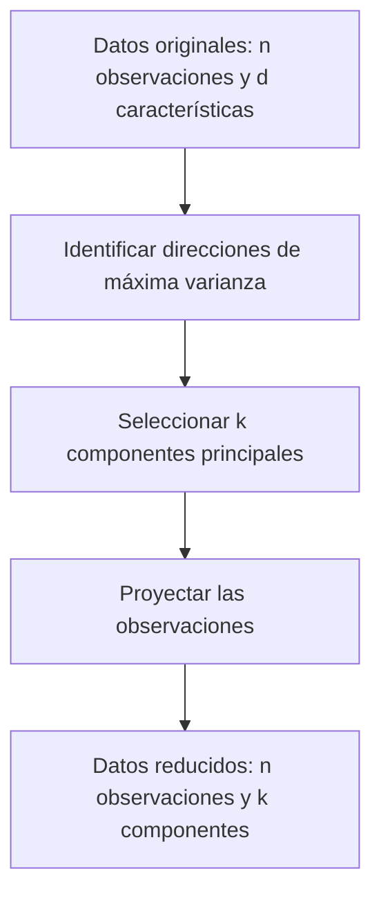
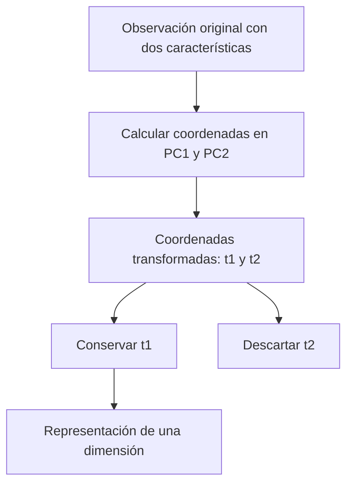
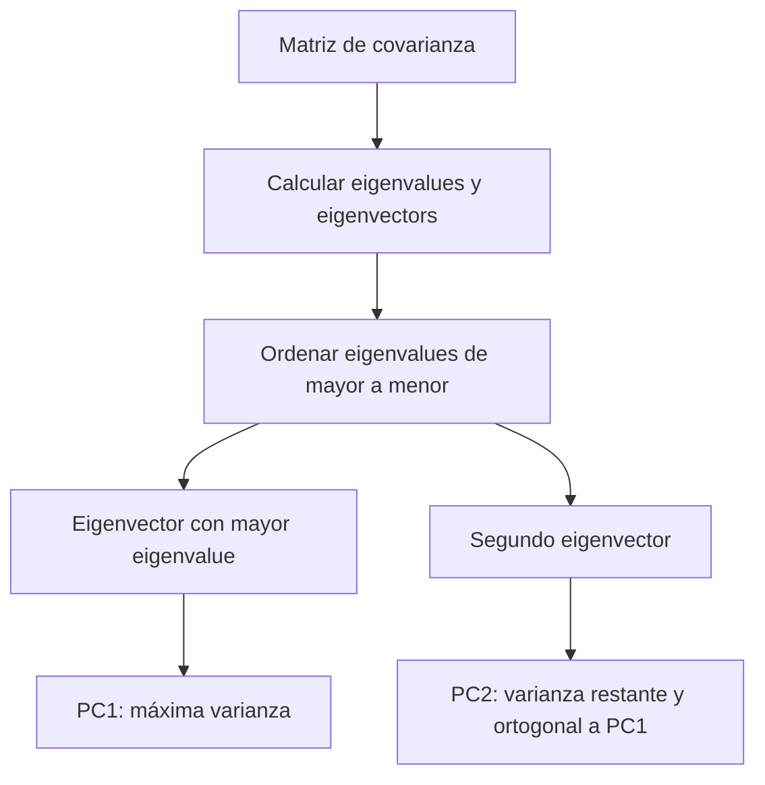
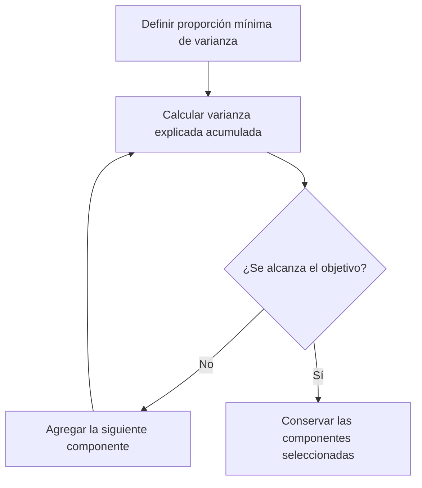
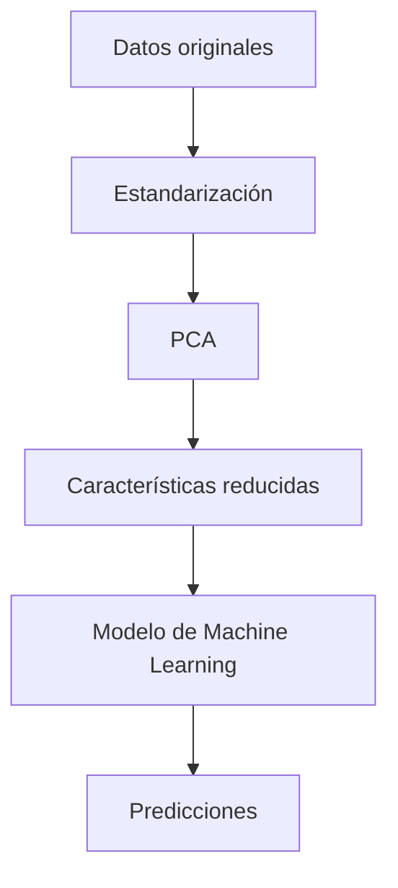

## Introducción  
  
En Machine Learning, los conjuntos de datos pueden contener decenas, cientos o incluso miles de características. Aunque disponer de numerosas variables permite describir las observaciones con mayor detalle, también puede introducir información redundante, aumentar el costo computacional y dificultar la identificación de patrones.  
  
Por ejemplo, supóngase que se desea estudiar la relación entre los ingresos de una persona y el número promedio de horas que trabaja. Estas variables pueden estar correlacionadas, ya que determinadas variaciones en una pueden estar relacionadas con variaciones en la otra.  
  
Cuando dos características contienen información parcialmente redundante, es posible construir una nueva representación que resuma gran parte de su variabilidad utilizando menos dimensiones.  
  
**Principal Component Analysis (PCA)** es una técnica de aprendizaje no supervisado que permite realizar esta transformación mediante la identificación de las direcciones en las que los datos presentan mayor varianza.  
  
En lugar de seleccionar simplemente algunas características originales, PCA construye nuevas variables denominadas **componentes principales (Principal Components)**, que son combinaciones lineales de las características iniciales.  
  
Estas componentes se ordenan según la cantidad de varianza que explican:  
  
- **PC1:** dirección que captura la mayor varianza posible.  
- **PC2:** dirección ortogonal a PC1 que captura la mayor varianza restante.  
- **PC3 y posteriores:** direcciones ortogonales a las anteriores que capturan progresivamente la varianza restante.  
  
Al conservar solamente las primeras componentes, puede reducirse la dimensionalidad mientras se preserva una proporción importante de la variabilidad original.  
  
El procedimiento se fundamenta en conceptos de estadística y álgebra lineal, principalmente **varianza, covarianza, correlación, eigenvectors y eigenvalues**.  
  
La idea central puede resumirse como:  
  
**PCA = Rotación + Proyección.**  
  
Primero se identifican nuevos ejes que describen mejor la distribución de los datos. Posteriormente, las observaciones se proyectan sobre los ejes más importantes, descartando las direcciones que aportan menor varianza.  
  
Sin embargo, conservar una gran proporción de varianza no garantiza preservar toda la información necesaria para una tarea predictiva. PCA no utiliza las etiquetas de clasificación ni los valores objetivo para determinar las componentes, por lo que su utilidad debe evaluarse según el problema.  
  
---  
  
## Reducción de dimensionalidad  
  
La **reducción de dimensionalidad (Dimensionality Reduction)** consiste en transformar un conjunto de datos con muchas características en otro con una cantidad menor de variables.  
  
Supóngase que se dispone de una matriz:  
  
$$  
X\in\mathbb{R}^{n\times d}  
$$  
  
En donde:  
  
- $n$ representa el número de observaciones.  
- $d$ representa el número de características originales.  
- $X$ contiene los valores de todas las observaciones.  
  
Si se conservan solamente $k$ componentes principales, con:  
  
$$  
k<d  
$$  
  
la representación reducida tendrá dimensiones:  
  
$$  
T\in\mathbb{R}^{n\times k}  
$$  
  
Por ejemplo, un conjunto con $1000$ observaciones y $50$ características puede transformarse en otro con las mismas $1000$ observaciones, pero solamente $5$ componentes.  
  
$$  
X\in\mathbb{R}^{1000\times50}  
$$  
  
$$  
\downarrow\ PCA  
$$  
  
$$  
T\in\mathbb{R}^{1000\times5}  
$$  
  
El número de observaciones no cambia. Lo que se reduce es la cantidad de variables utilizadas para representar cada una.  
  

  
### ¿Por qué reducir la dimensionalidad?:  
  
La reducción de dimensionalidad puede ser útil por diferentes razones.  
  
**Visualización:** permite representar observaciones de muchas dimensiones mediante gráficas de dos o tres ejes.  
  
**Reducción de redundancia:** cuando algunas características están correlacionadas, sus relaciones pueden resumirse mediante menos componentes.  
  
**Eficiencia computacional:** determinados modelos pueden entrenarse más rápidamente al recibir menos variables.  
  
**Reducción de ruido:** si algunas direcciones contienen principalmente variaciones poco relevantes, descartarlas puede simplificar la representación.  
  
**Compresión:** permite almacenar una representación aproximada de los datos utilizando menos coordenadas.  
  
Ahora bien, reducir dimensiones implica descartar información. Por ello, la cantidad de componentes debe seleccionarse considerando cuánto se conserva y cuánto se pierde.  
  
---  
  
## Intuición geométrica de PCA  
  
La idea fundamental de PCA consiste en encontrar la dirección sobre la cual las observaciones presentan la mayor dispersión.  
  
Supóngase que un conjunto contiene dos características:  
  
$$  
x_1=\text{Ingresos}  
$$  
  
$$  
x_2=\text{Horas trabajadas}  
$$  
  
Cada persona se representa mediante un punto:  
  
$$  
x_i=(x_{i1},x_{i2})  
$$  
  
Si ambas características están positivamente correlacionadas, los puntos pueden distribuirse aproximadamente a lo largo de una dirección diagonal.  
  
En esta situación, la mayor variabilidad no necesariamente coincide con el eje horizontal ni con el vertical.  
  
Una dirección diagonal puede representar mejor la estructura del conjunto.  
  
### Primera componente principal:  
  
PCA identifica una dirección denominada **PC1**, que captura la máxima varianza posible de los datos proyectados.  
  
Geométricamente, PC1 coincide con la dirección de mayor extensión de la nube de puntos.  
  
Por ejemplo, si las observaciones forman una nube alargada diagonalmente, PC1 seguirá aproximadamente esa dirección.  
  
### Segunda componente principal:  
  
Después de identificar PC1, PCA busca una segunda dirección:  
  
$$  
PC2  
$$  
  
Esta componente debe ser ortogonal a PC1 y capturar la mayor varianza restante.  
  
En dos dimensiones:  
  
$$  
PC1\perp PC2  
$$  
  
Por lo tanto, las dos componentes forman un nuevo sistema de ejes perpendiculares.  
  
### ¿Qué significa proyectar?:  
  
La proyección consiste en representar una observación mediante su posición sobre una dirección determinada.  
  
Una analogía útil es la sombra que produce un objeto sobre una superficie.  
  
Al proyectar un punto sobre PC1, se conserva su posición a lo largo de esa dirección y se descarta su desplazamiento perpendicular.  
  

  
Si se conserva una sola componente, cada observación se representa mediante un único número.  
  
Por lo tanto, un conjunto bidimensional puede reducirse a una dimensión sin limitarse a eliminar directamente una de sus características originales.  
  
---  
  
## Varianza y su importancia en PCA  
  
La **varianza (Variance)** mide qué tan dispersos se encuentran los valores de una variable respecto a su media.  
  
Para una muestra de $n$ observaciones, la varianza se calcula mediante:  
  
$$  
s^2=\frac{1}{n-1}\sum_{i=1}^{n}(x_i-\bar{x})^2  
$$  
  
En donde:  
  
- $x_i$ representa cada observación.  
- $\bar{x}$ representa la media.  
- $n$ es el número de observaciones.  
- $s^2$ es la varianza muestral.  
  
Una varianza elevada indica que los valores están relativamente dispersos.  
  
Una varianza pequeña indica que se encuentran más concentrados alrededor de la media.  
  
### Relación con PCA:  
  
PCA busca direcciones sobre las cuales las proyecciones de los datos tengan la mayor varianza posible.  
  
Supóngase que una nube de puntos tiene una distribución muy alargada.  
  
A lo largo de su dirección principal, las observaciones presentan una dispersión considerable.  
  
En cambio, perpendicularmente a esa dirección, los puntos pueden encontrarse muy próximos.  
  
Por lo tanto, conservar la dirección de mayor varianza permite preservar gran parte de la estructura geométrica del conjunto.  
  
### ¿Mayor varianza significa mayor información predictiva?:  
  
No necesariamente.  
  
PCA interpreta la varianza como una propiedad importante de la representación, pero no conoce cuál característica resulta más útil para predecir una variable objetivo.  
  
Por ejemplo, una característica con poca varianza podría ser decisiva para distinguir dos clases.  
  
Si PCA la descarta por explicar poca variabilidad, podría reducir el desempeño de un clasificador posterior.  
  
**La varianza explicada mide variabilidad conservada, no accuracy ni capacidad predictiva.**  
  
---  
  
## Correlación y redundancia entre características  
  
Una de las principales motivaciones de PCA aparece cuando existen características correlacionadas.  
  
Dos variables están correlacionadas cuando sus valores presentan una relación estadística.  
  
Por ejemplo, la estatura y la longitud de los brazos pueden mostrar una correlación positiva.  
  
De manera semejante, ciertos indicadores de ingresos y consumo pueden presentar relaciones positivas.  
  
Cuando dos características están fuertemente correlacionadas, parte de su variabilidad puede estar representando una estructura común.  
  
PCA permite encontrar nuevas direcciones que capturen esa estructura sin conservar necesariamente ambas variables originales.  
  
### Correlación positiva:  
  
Ocurre cuando dos variables tienden a aumentar juntas.  
  
$$  
\operatorname{corr}(x,y)>0  
$$  
  
### Correlación negativa:  
  
Ocurre cuando una variable tiende a aumentar mientras la otra disminuye.  
  
$$  
\operatorname{corr}(x,y)<0  
$$  
  
### Correlación cercana a cero:  
  
Indica que no existe una relación lineal fuerte entre las variables.  
  
$$  
\operatorname{corr}(x,y)\approx0  
$$  
  
Esto no significa necesariamente que las variables sean independientes, ya que pueden existir relaciones no lineales.  
  
---  
  
## Covarianza y correlación  
  
Aunque ambos conceptos describen relaciones entre variables, no son equivalentes.  
  
### Covarianza:  
  
La **covarianza (Covariance)** mide cómo varían conjuntamente dos características.  
  
La covarianza muestral se calcula mediante:  
  
$$  
\operatorname{cov}(x,y)=  
\frac{1}{n-1}  
\sum_{i=1}^{n}(x_i-\bar{x})(y_i-\bar{y})  
$$  
  
Si ambas variables tienden a aumentar juntas, la covarianza suele ser positiva.  
  
Si una aumenta mientras la otra disminuye, suele ser negativa.  
  
Su magnitud depende de las unidades y de las escalas de las variables.  
  
### Correlación:  
  
La **correlación de Pearson** normaliza la covarianza utilizando las desviaciones estándar:  
  
$$  
\boxed{  
\operatorname{corr}(x,y)=  
\frac{\operatorname{cov}(x,y)}{s_xs_y}  
}  
$$  
  
En donde:  
  
- $s_x$ representa la desviación estándar de $x$.  
- $s_y$ representa la desviación estándar de $y$.  
  
La correlación se encuentra entre:  
  
$$  
-1\leq r\leq1  
$$  
  
| Valor | Interpretación |  
|---|---|  
| $r=1$ | Relación lineal positiva perfecta |  
| $r\approx0$ | Relación lineal débil o inexistente |  
| $r=-1$ | Relación lineal negativa perfecta |  
  
### Diferencia fundamental:  
  
| Propiedad | Covarianza | Correlación |  
|---|---|---|  
| Mide variación conjunta | Sí | Sí |  
| Depende de las unidades | Sí | No |  
| Está acotada entre $-1$ y $1$ | No | Sí |  
| Permite interpretar dirección de relación | Sí | Sí |  
  
La matriz de covarianza será fundamental para identificar las componentes principales.  
  
---  
  
## Centrado y estandarización de los datos  
  
Antes de calcular PCA es necesario considerar el preprocesamiento de las características.  
  
### Centrado:  
  
Centrar una característica significa restarle su media.  
  
$$  
x'_{ij}=x_{ij}-\mu_j  
$$  
  
En donde $\mu_j$ representa la media de la característica $j$.  
  
Después del centrado, cada característica tiene media cero.  
  
En forma matricial:  
  
$$  
\boxed{  
X_c=X-\mathbf{1}\mu^T  
}  
$$  
  
En donde:  
  
- $X_c$ es la matriz centrada.  
- $\mathbf{1}$ es un vector de unos.  
- $\mu$ es el vector de medias de las características.  
  
El centrado permite estudiar la variabilidad respecto al centro del conjunto.  
  
### Estandarización:  
  
Cuando las características poseen escalas diferentes, puede ser conveniente estandarizarlas.  
  
La fórmula es:  
  
$$  
\boxed{  
z_{ij}=\frac{x_{ij}-\mu_j}{\sigma_j}  
}  
$$  
  
En donde $\sigma_j$ representa la desviación estándar utilizada para escalar la característica.  
  
La transformación produce características con media cero y desviación estándar unitaria según la convención de escalamiento empleada.  
  
### Ejemplo práctico:  
  
Supóngase que se estudian:  
  
- Ingresos, con valores alrededor de $10\,000$.  
- Horas trabajadas, con valores alrededor de $40$.  
  
Si se utiliza directamente la matriz de covarianza, la escala numérica de los ingresos podría dominar la varianza.  
  
La estandarización coloca ambas características en una escala comparable.  
  
Esto permite estudiar sus relaciones sin que la magnitud original de las unidades determine automáticamente la componente principal.  
  
### ¿Es obligatorio estandarizar?:  
  
PCA requiere centrar los datos, pero no siempre es necesario escalar cada característica a varianza unitaria.  
  
La estandarización es especialmente útil cuando las unidades o escalas son diferentes y se desea otorgar una importancia comparable a las características.  
  
Sin embargo, si las magnitudes originales tienen significado y sus diferencias de varianza son relevantes, estandarizar podría modificar indebidamente la interpretación.  
  
Por lo tanto, la decisión depende del problema.  
  
---  
  
## Objetivo matemático de PCA  
  
PCA busca una dirección unitaria sobre la cual la varianza de los datos proyectados sea máxima.  
  
Sea:  
  
$$  
X_c\in\mathbb{R}^{n\times d}  
$$  
  
la matriz de datos centrados.  
  
Se desea encontrar un vector:  
  
$$  
w_1\in\mathbb{R}^{d}  
$$  
  
que maximice:  
  
$$  
\boxed{  
w_1=  
\arg\max_{\|w\|_2=1}  
\operatorname{Var}(X_cw)  
}  
$$  
  
En donde:  
  
- $w$ representa una dirección candidata.  
- $X_cw$ contiene las proyecciones de las observaciones sobre esa dirección.  
- $\operatorname{Var}(X_cw)$ es la varianza de dichas proyecciones.  
- $\|w\|_2=1$ obliga a que la dirección tenga longitud unitaria.  
  
La restricción de norma evita aumentar artificialmente la varianza multiplicando el vector por números cada vez mayores.  
  
### Primera componente:  
  
La solución:  
  
$$  
w_1  
$$  
  
define la dirección de máxima varianza.  
  
### Componentes posteriores:  
  
Las siguientes direcciones deben ser ortogonales a las anteriores.  
  
Por ejemplo:  
  
$$  
w_1^Tw_2=0  
$$  
  
Esto permite construir componentes principales que capturan diferentes direcciones de variabilidad.  
  
---  
  
## Matriz de covarianza  
  
El siguiente paso consiste en calcular la **matriz de covarianza** del conjunto centrado.  
  
Su expresión es:  
  
$$  
\boxed{  
\Sigma=\frac{1}{n-1}X_c^TX_c  
}  
$$  
  
En donde:  
  
- $\Sigma$ es la matriz de covarianza.  
- $X_c$ es la matriz centrada.  
- $n$ representa el número de observaciones.  
  
Si existen dos características, la matriz tiene la forma:  
  
$$  
\Sigma=  
\begin{pmatrix}  
\operatorname{Var}(x_1)&\operatorname{Cov}(x_1,x_2)\\  
\operatorname{Cov}(x_2,x_1)&\operatorname{Var}(x_2)  
\end{pmatrix}  
$$  
  
Los elementos de la diagonal representan las varianzas individuales.  
  
Los elementos fuera de la diagonal representan las covarianzas entre características.  
  
### Ejemplo práctico:  
  
Considérese la matriz:  
  
$$  
\Sigma=  
\begin{pmatrix}  
1.0526&0.6823\\  
0.6823&1.0526  
\end{pmatrix}  
$$  
  
La diagonal indica que ambas características tienen una varianza muestral aproximada de:  
  
$$  
1.0526  
$$  
  
La covarianza es:  
  
$$  
0.6823  
$$  
  
Como es positiva, existe una tendencia lineal positiva entre las características.  
  
La matriz también es simétrica:  
  
$$  
\Sigma=\Sigma^T  
$$  
  
Esto es importante porque las matrices de covarianza reales y simétricas poseen eigenvalues reales y permiten elegir eigenvectors ortogonales.  
  
### ¿Por qué la varianza puede ser mayor que uno después de estandarizar?:  
  
`StandardScaler` utiliza una convención de varianza poblacional para realizar el escalamiento.  
  
Sin embargo, la matriz de covarianza muestral utiliza el divisor:  
  
$$  
n-1  
$$  
  
Por esta diferencia de convenciones, la varianza muestral de una característica estandarizada puede ser ligeramente mayor que uno.  
  
Por ejemplo:  
  
$$  
1.0526  
$$  
  
No representa necesariamente un error de estandarización.  
  
---  
  
## Eigenvectors y eigenvalues  
  
Para encontrar las componentes principales se resuelve un problema de valores y vectores propios.  
  
La expresión es:  
  
$$  
\boxed{  
\Sigma w_j=\lambda_jw_j  
}  
$$  
  
En donde:  
  
- $\Sigma$ es la matriz de covarianza.  
- $w_j$ es un **eigenvector**.  
- $\lambda_j$ es su **eigenvalue** correspondiente.  
  
### Eigenvectors:  
  
Los eigenvectors identifican direcciones especiales de la matriz de covarianza.  
  
En PCA, estas direcciones forman los ejes principales del conjunto.  
  
Por lo tanto:  
  
**Eigenvector = dirección de una componente principal.**  
  
### Eigenvalues:  
  
Los eigenvalues representan la varianza capturada a lo largo de sus respectivas direcciones, cuando se utiliza la matriz de covarianza.  
  
Por lo tanto:  
  
**Eigenvalue = varianza explicada por una componente.**  
  
### Ordenamiento:  
  
Los eigenvalues se ordenan de mayor a menor:  
  
$$  
\lambda_1\geq\lambda_2\geq\cdots\geq\lambda_d  
$$  
  
El eigenvector asociado con el mayor eigenvalue define PC1.  
  
El segundo define PC2, y así sucesivamente.  
  

  
---  
  
## Cálculo de las componentes principales  
  
Se considera nuevamente:  
  
$$  
\Sigma=  
\begin{pmatrix}  
1.0526&0.6823\\  
0.6823&1.0526  
\end{pmatrix}  
$$  
  
Al resolver el problema de eigenvalues y eigenvectors se obtienen aproximadamente:  
  
### Primera componente principal:  
  
$$  
w_1=  
\begin{pmatrix}  
-0.7071\\  
-0.7071  
\end{pmatrix}  
$$  
  
Con eigenvalue:  
  
$$  
\boxed{\lambda_1=1.7349}  
$$  
  
### Segunda componente principal:  
  
$$  
w_2=  
\begin{pmatrix}  
-0.7071\\  
0.7071  
\end{pmatrix}  
$$  
  
Con eigenvalue:  
  
$$  
\boxed{\lambda_2=0.3702}  
$$  
  
La primera componente captura más varianza porque:  
  
$$  
\lambda_1>\lambda_2  
$$  
  
Además, las componentes son ortogonales.  
  
Para comprobarlo:  
  
$$  
w_1^Tw_2=  
(-0.7071)(-0.7071)+(-0.7071)(0.7071)  
$$  
  
$$  
w_1^Tw_2\approx0.5-0.5  
$$  
  
$$  
\boxed{w_1^Tw_2\approx0}  
$$  
  
Por lo tanto, ambas direcciones son perpendiculares.  
  
### ¿Por qué los eigenvectors tienen signos negativos?:  
  
El signo de un eigenvector no modifica su dirección geométrica como eje.  
  
Por ejemplo:  
  
$$  
w_1=  
\begin{pmatrix}  
-0.7071\\  
-0.7071  
\end{pmatrix}  
$$  
  
y:  
  
$$  
-w_1=  
\begin{pmatrix}  
0.7071\\  
0.7071  
\end{pmatrix}  
$$  
  
representan el mismo eje, pero con orientaciones opuestas.  
  
Por lo tanto, PCA puede producir componentes con signos invertidos sin alterar la varianza explicada ni la información geométrica conservada.  
  
---  
  
## Proyección de los datos  
  
Una vez identificadas las componentes principales, las observaciones se proyectan sobre ellas.  
  
Para una observación centrada o estandarizada:  
  
$$  
z  
$$  
  
su coordenada en la primera componente es:  
  
$$  
\boxed{t_1=z^Tw_1}  
$$  
  
En donde:  
  
- $z$ es el vector de características transformadas.  
- $w_1$ es la dirección de PC1.  
- $t_1$ es la coordenada de la observación en PC1.  
  
Para conservar varias componentes se construye una matriz:  
  
$$  
W_k=  
\begin{pmatrix}  
w_1&w_2&\cdots&w_k  
\end{pmatrix}  
$$  
  
La proyección completa es:  
  
$$  
\boxed{T=X_cW_k}  
$$  
  
Cuando se trabaja con datos previamente estandarizados, se utiliza la matriz estandarizada en lugar de $X_c$.  
  
### Interpretación de la proyección:  
  
PCA no elimina observaciones.  
  
Cada punto original se transforma en nuevas coordenadas.  
  
Si se tienen veinte observaciones con dos características y se conserva solamente PC1, el resultado contiene veinte coordenadas unidimensionales.  
  
$$  
20\times2  
\longrightarrow  
20\times1  
$$  
  
La información correspondiente a PC2 se descarta.  
  
---  
  
## Ejemplo de proyección sobre PC1  
  
Supóngase que una observación estandarizada es:  
  
$$  
z=  
\begin{pmatrix}  
1\\  
0  
\end{pmatrix}  
$$  
  
La primera componente principal es:  
  
$$  
w_1=  
\begin{pmatrix}  
-\frac{1}{\sqrt{2}}\\  
-\frac{1}{\sqrt{2}}  
\end{pmatrix}  
$$  
  
La coordenada proyectada se obtiene mediante:  
  
$$  
t_1=z^Tw_1  
$$  
  
Sustituyendo:  
  
$$  
t_1=  
(1,0)  
\begin{pmatrix}  
-\frac{1}{\sqrt{2}}\\  
-\frac{1}{\sqrt{2}}  
\end{pmatrix}  
$$  
  
$$  
t_1=-\frac{1}{\sqrt{2}}  
$$  
  
$$  
\boxed{t_1\approx-0.7071}  
$$  
  
La observación original necesitaba dos características:  
  
$$  
(1,0)  
$$  
  
Después de PCA se representa mediante una sola coordenada:  
  
$$  
\boxed{-0.7071}  
$$  
  
Esta coordenada indica su posición sobre PC1.  
  
El valor no equivale directamente a ingresos ni a horas trabajadas, sino a una combinación lineal de ambas características.  
  
---  
  
## Reconstrucción y pérdida de información  
  
Cuando se conserva solamente una componente, la representación original puede reconstruirse de manera aproximada.  
  
La reconstrucción en el espacio centrado o estandarizado se calcula mediante:  
  
$$  
\boxed{\hat{z}=t_1w_1}  
$$  
  
Para el ejemplo anterior:  
  
$$  
t_1=-\frac{1}{\sqrt{2}}  
$$  
  
$$  
w_1=  
\begin{pmatrix}  
-\frac{1}{\sqrt{2}}\\  
-\frac{1}{\sqrt{2}}  
\end{pmatrix}  
$$  
  
Entonces:  
  
$$  
\hat{z}=  
-\frac{1}{\sqrt{2}}  
\begin{pmatrix}  
-\frac{1}{\sqrt{2}}\\  
-\frac{1}{\sqrt{2}}  
\end{pmatrix}  
$$  
  
$$  
\boxed{  
\hat{z}=  
\begin{pmatrix}  
0.5\\  
0.5  
\end{pmatrix}  
}  
$$  
  
La observación original era:  
  
$$  
z=  
\begin{pmatrix}  
1\\  
0  
\end{pmatrix}  
$$  
  
La reconstrucción es:  
  
$$  
\hat{z}=  
\begin{pmatrix}  
0.5\\  
0.5  
\end{pmatrix}  
$$  
  
Por lo tanto, existe una pérdida de información.  
  
### Error de reconstrucción:  
  
La diferencia entre el punto original y el reconstruido es:  
  
$$  
z-\hat{z}=  
\begin{pmatrix}  
1\\  
0  
\end{pmatrix}  
-  
\begin{pmatrix}  
0.5\\  
0.5  
\end{pmatrix}  
$$  
  
$$  
\boxed{  
z-\hat{z}=  
\begin{pmatrix}  
0.5\\  
-0.5  
\end{pmatrix}  
}  
$$  
  
Este vector representa la información descartada al eliminar la segunda componente.  
  
Geométricamente, corresponde al desplazamiento perpendicular a PC1.  
  
### Interpretación:  
  
La reconstrucción:  
  
$$  
(0.5,0.5)  
$$  
  
se encuentra sobre el eje principal, mientras que el punto original:  
  
$$  
(1,0)  
$$  
  
no necesariamente pertenece a ese eje.  
  
Por lo tanto, la reducción de dos dimensiones a una conserva la información proyectada sobre PC1, pero elimina la variación perpendicular.  
  
Si se conservaran ambas componentes en este ejemplo bidimensional, la reconstrucción sería exacta salvo errores de redondeo.  
  
---  
  
## Varianza explicada  
  
Una vez calculados los eigenvalues, es posible determinar qué proporción de la varianza total explica cada componente.  
  
La **explained variance ratio** se define mediante:  
  
$$  
\boxed{  
r_j=\frac{\lambda_j}{\sum_{\ell=1}^{d}\lambda_\ell}  
}  
$$  
  
En donde:  
  
- $r_j$ representa la proporción de varianza explicada por la componente $j$.  
- $\lambda_j$ representa su eigenvalue.  
- $d$ es el número de características originales.  
  
### Ejemplo práctico:  
  
Se tienen:  
  
$$  
\lambda_1=1.7349  
$$  
  
$$  
\lambda_2=0.3702  
$$  
  
La varianza total es:  
  
$$  
\lambda_1+\lambda_2=2.1051  
$$  
  
Para PC1:  
  
$$  
r_1=\frac{1.7349}{2.1051}  
$$  
  
$$  
\boxed{r_1\approx0.824=82.4\%}  
$$  
  
Para PC2:  
  
$$  
r_2=\frac{0.3702}{2.1051}  
$$  
  
$$  
\boxed{r_2\approx0.176=17.6\%}  
$$  
  
Por lo tanto:  
  
| Componente | Varianza explicada |  
|---|---:|  
| PC1 | $82.4\%$ |  
| PC2 | $17.6\%$ |  
| Total | $100\%$ |  
  
### Interpretación:  
  
Si se conserva solamente PC1, se preserva aproximadamente el:  
  
$$  
\boxed{82.4\%}  
$$  
  
de la varianza total.  
  
Al mismo tiempo, se descarta aproximadamente:  
  
$$  
\boxed{17.6\%}  
$$  
  
Esta pérdida corresponde a la variabilidad asociada con PC2.  
  
Es importante recordar que **82.4 % de varianza explicada no significa 82.4 % de accuracy**.  
  
La varianza explicada describe cuánto de la variabilidad original permanece en la representación reducida.  
  
---  
  
## Selección del número de componentes  
  
Uno de los hiperparámetros principales de PCA es:  
  
```python  
n_components  
```  
  
Este valor determina cuántas componentes principales deben conservarse.  
  
La elección puede basarse en un número fijo de componentes o en una proporción objetivo de varianza explicada.  
  
### Varianza acumulada:  
  
La varianza explicada acumulada por las primeras $k$ componentes es:  
  
$$  
\boxed{  
R_k=\sum_{j=1}^{k}r_j  
}  
$$  
  
Esto permite determinar cuántas componentes se necesitan para alcanzar un porcentaje determinado.  
  
### Ejemplo práctico:  
  
Se tienen:  
  
| Componentes conservadas | Varianza acumulada |  
|---|---:|  
| PC1 | $82.4\%$ |  
| PC1 y PC2 | $100\%$ |  
  
Si el objetivo es conservar al menos el:  
  
$$  
80\%  
$$  
  
de la varianza, basta con conservar PC1.  
  
Si el objetivo es conservar al menos:  
  
$$  
90\%  
$$  
  
se necesitan ambas componentes.  
  
Lo mismo ocurre con un objetivo de:  
  
$$  
95\%  
$$  
  
### Regla de selección:  
  

  
El procedimiento permite seleccionar automáticamente una representación que cumpla un objetivo de conservación de varianza.  
  
Sin embargo, la decisión final también debe considerar el uso posterior de los datos.  
  
---  
  
## Hiperparámetros de PCA  
  
Aunque PCA aprende automáticamente las direcciones principales, existen configuraciones que controlan su comportamiento.  
  
### n_components:  
  
Permite establecer el número de componentes conservadas.  
  
Puede configurarse de diferentes maneras.  
  
**Número entero:**  
  
```python  
PCA(n_components=2)  
```  
  
Conserva las primeras dos componentes principales.  
  
**Proporción de varianza:**  
  
```python  
PCA(n_components=0.80, svd_solver="full")  
```  
  
Selecciona suficientes componentes para explicar al menos el $80\%$ de la varianza.  
  
**Todas las componentes disponibles:**  
  
```python  
PCA(n_components=None)  
```  
  
Conserva todas las componentes que correspondan según las dimensiones de los datos y el procedimiento de cálculo.  
  
### Diferencia entre cantidad y porcentaje:  
  
No es lo mismo:  
  
```python  
n_components=2  
```  
  
que:  
  
```python  
n_components=0.80  
```  
  
El primero conserva exactamente dos componentes.  
  
El segundo selecciona automáticamente una cantidad suficiente para alcanzar un porcentaje de varianza explicada.  
  
### ¿Siempre conviene conservar la mayor cantidad posible?:  
  
No necesariamente.  
  
Conservar más componentes preserva más varianza, pero también aumenta la dimensionalidad de la representación.  
  
Conservar menos reduce el costo y simplifica los datos, pero descarta más información.  
  
Por lo tanto, debe encontrarse un equilibrio entre compresión y conservación de variabilidad.  
  
---  
  
## Implementación de PCA con scikit-learn  
  
Scikit-learn permite implementar PCA mediante:  
  
```python  
from sklearn.decomposition import PCA  
```  
  
Cuando las características requieren estandarización, puede utilizarse:  
  
```python  
from sklearn.preprocessing import StandardScaler  
```  
  
### Ejemplo básico:  
  
```python  
from sklearn.preprocessing import StandardScaler  
from sklearn.decomposition import PCA  
  
scaler = StandardScaler()  
X_scaled = scaler.fit_transform(X)  
  
pca = PCA(n_components=2)  
X_pca = pca.fit_transform(X_scaled)  
  
print(pca.explained_variance_ratio_)  
```  
  
El procedimiento realiza las siguientes operaciones:  
  
1. Estandariza las características originales.  
2. Calcula las direcciones principales.  
3. Selecciona las primeras dos componentes.  
4. Proyecta las observaciones sobre ellas.  
5. Muestra la proporción de varianza explicada.  
  
### Atributos importantes:  
  
`explained_variance_ratio_` contiene las proporciones de varianza explicada.  
  
`explained_variance_` contiene los eigenvalues correspondientes a las componentes retenidas.  
  
`components_` contiene las direcciones principales.  
  
`n_components_` indica cuántas componentes fueron seleccionadas finalmente.  
  
### Selección automática del 80 %:  
  
```python  
from sklearn.decomposition import PCA  
  
pca = PCA(  
n_components=0.80,  
svd_solver="full"  
)  
  
T = pca.fit_transform(X_scaled)  
  
print(pca.n_components_)  
print(pca.explained_variance_ratio_)  
```  
  
En el ejemplo de dos características, donde PC1 explica aproximadamente el $82.4\%$, esta configuración conservaría una sola componente.  
  
---  
  
## PCA como preprocesamiento de Machine Learning  
  
PCA puede utilizarse antes de entrenar modelos supervisados, especialmente cuando existen numerosas características correlacionadas.  
  
Por ejemplo, un dataset puede contener muchas medidas numéricas parcialmente redundantes.  
  
PCA permite construir una representación compacta que posteriormente se utiliza como entrada de un clasificador o regresor.  
  

  
### ¿PCA garantiza mejorar el modelo?:  
  
No.  
  
Reducir dimensionalidad puede disminuir el costo computacional y eliminar parte de la redundancia.  
  
Sin embargo, también puede descartar información relevante para predecir la variable objetivo.  
  
Por lo tanto, el desempeño debe compararse mediante validación.  
  
### Prevención de data leakage:  
  
Cuando PCA se utiliza dentro de un proceso de aprendizaje supervisado, tanto la estandarización como PCA deben ajustarse exclusivamente con los datos de entrenamiento.  
  
No debe calcularse PCA sobre todo el dataset antes de realizar la separación entre entrenamiento y prueba.  
  
Una implementación apropiada puede utilizar un `Pipeline`:  
  
```python  
from sklearn.pipeline import Pipeline  
from sklearn.preprocessing import StandardScaler  
from sklearn.decomposition import PCA  
from sklearn.svm import SVC  
  
modelo = Pipeline([  
("scaler", StandardScaler()),  
("pca", PCA(n_components=0.95, svd_solver="full")),  
("svc", SVC())  
])  
  
modelo.fit(X_train, y_train)  
```  
  
Posteriormente:  
  
```python  
y_pred = modelo.predict(X_test)  
```  
  
De esta manera, las transformaciones se aprenden durante el ajuste y pueden aplicarse correctamente a observaciones nuevas.  
  
---  
  
## Aplicaciones y limitaciones de PCA  
  
PCA puede utilizarse en diferentes situaciones.  
  
### Visualización:  
  
Permite representar datos de alta dimensionalidad mediante dos o tres componentes principales.  
  
Esto facilita observar patrones generales de dispersión.  
  
### Compresión:  
  
Las observaciones pueden almacenarse mediante menos coordenadas.  
  
Por ejemplo, una imagen representada mediante numerosos píxeles puede aproximarse utilizando una cantidad menor de componentes.  
  
### Reducción de ruido:  
  
Cuando ciertas direcciones contienen principalmente pequeñas fluctuaciones, descartarlas puede producir una representación más sencilla.  
  
Sin embargo, no toda variación pequeña es ruido.  
  
### Características correlacionadas:  
  
PCA construye componentes ortogonales que, al utilizar los datos con los que se ajustó, presentan covarianza cero entre sí.  
  
Esto permite reducir parte de la redundancia lineal.  
  
### Aceleración de modelos:  
  
Una representación con menos componentes puede disminuir los recursos necesarios para determinados algoritmos.  
  
No obstante, el propio cálculo de PCA también tiene un costo, por lo que la mejora computacional debe evaluarse.  
  
### Limitaciones principales:  
  
**Transformación lineal:** PCA busca combinaciones lineales de las características.  
  
**Pérdida de información:** descartar componentes implica eliminar parte de la variabilidad original.  
  
**Sensibilidad a la escala:** características con unidades muy diferentes pueden dominar el resultado si no se utiliza un preprocesamiento apropiado.  
  
**Sensibilidad a valores atípicos:** observaciones extremas pueden modificar considerablemente las direcciones de mayor varianza.  
  
**Ausencia de información supervisada:** PCA no considera directamente las etiquetas ni los valores objetivo.  
  
Estas limitaciones explican por qué debe utilizarse como una herramienta de representación y preprocesamiento, no como una garantía de mejores predicciones.  
  
---  
  
## Ideas principales  
  
### PCA:  
  
Principal Component Analysis es una técnica de aprendizaje no supervisado que construye nuevas características mediante combinaciones lineales de las variables originales.  
  
Su objetivo consiste en conservar la mayor varianza posible utilizando menos dimensiones.  
  
### Componentes principales:  
  
PC1 captura la mayor varianza.  
  
PC2 captura la mayor varianza restante y es ortogonal a PC1.  
  
Las componentes posteriores siguen el mismo principio.  
  
### Varianza:  
  
Mide la dispersión de los datos respecto a su media.  
  
PCA busca direcciones que maximicen la varianza proyectada.  
  
### Covarianza:  
  
Mide cómo cambian conjuntamente dos variables.  
  
La matriz de covarianza contiene las varianzas individuales en la diagonal y las covarianzas fuera de ella.  
  
$$  
\Sigma=\frac{1}{n-1}X_c^TX_c  
$$  
  
### Correlación:  
  
Es una covarianza normalizada que se encuentra entre $-1$ y $1$.  
  
Permite interpretar la relación lineal entre variables independientemente de sus unidades.  
  
### Centrado y estandarización:  
  
El centrado resta la media.  
  
La estandarización resta la media y divide entre la desviación estándar.  
  
$$  
z_j=\frac{x_j-\mu_j}{\sigma_j}  
$$  
  
### Eigenvectors:  
  
Representan las direcciones principales.  
  
### Eigenvalues:  
  
Representan la varianza capturada por cada dirección.  
  
$$  
\Sigma w_j=\lambda_jw_j  
$$  
  
### Proyección:  
  
Transforma las observaciones originales en coordenadas sobre los nuevos ejes.  
  
$$  
T=X_cW_k  
$$  
  
### Reconstrucción:  
  
Permite aproximar los datos originales utilizando las componentes conservadas.  
  
Cuando se descartan componentes, existe una pérdida de información.  
  
### Explained Variance Ratio:  
  
Mide la proporción de varianza conservada por cada componente.  
  
$$  
r_j=\frac{\lambda_j}{\sum_{\ell=1}^{d}\lambda_\ell}  
$$  
  
Conservar una varianza elevada no equivale a obtener una accuracy elevada.  
  
### n_components:  
  
Controla cuántas componentes se conservan.  
  
Puede establecerse mediante un número entero o un porcentaje objetivo de varianza explicada.  
  
### Evaluación:  
  
PCA puede utilizarse antes de modelos supervisados, pero debe ajustarse únicamente con los datos de entrenamiento.  
  
Su utilidad debe comprobarse mediante validación y comparación con alternativas.  
  
---  
  
## Conclusión  
  
Principal Component Analysis permite reducir la dimensionalidad de un conjunto de datos mediante la identificación de las direcciones que capturan la mayor varianza posible. Su principal ventaja consiste en construir una representación más compacta sin limitarse a eliminar directamente características originales.  
  
El procedimiento comienza con el centrado o estandarización de los datos, seguido del cálculo de la matriz de covarianza. A partir de esta matriz se obtienen eigenvectors y eigenvalues, que representan respectivamente las direcciones principales y la varianza capturada por cada una.  
  
Las componentes se ordenan según sus eigenvalues y las observaciones se proyectan sobre las direcciones seleccionadas. Al conservar solamente las primeras componentes, se obtiene una representación de menor dimensionalidad, aunque necesariamente se descarta parte de la variabilidad original.  
  
La varianza explicada permite cuantificar esta pérdida. Por ejemplo, cuando una componente captura el $82.4\%$ de la varianza total, conservarla permite reducir dos características a una mientras se preserva la mayor parte de la dispersión observada.  
  
Sin embargo, PCA no identifica automáticamente las variables más importantes para predecir una etiqueta. Su criterio es la varianza, por lo que debe distinguirse entre conservar información estadística y mejorar el desempeño de un modelo supervisado.  
  
Finalmente, PCA puede comprenderse geométricamente como una **rotación del sistema de coordenadas seguida de una proyección sobre los ejes de mayor varianza**. Esta interpretación conecta la estadística, el álgebra lineal y la reducción de dimensionalidad, y permite comprender tanto sus aplicaciones como sus limitaciones dentro de Machine Learning.  