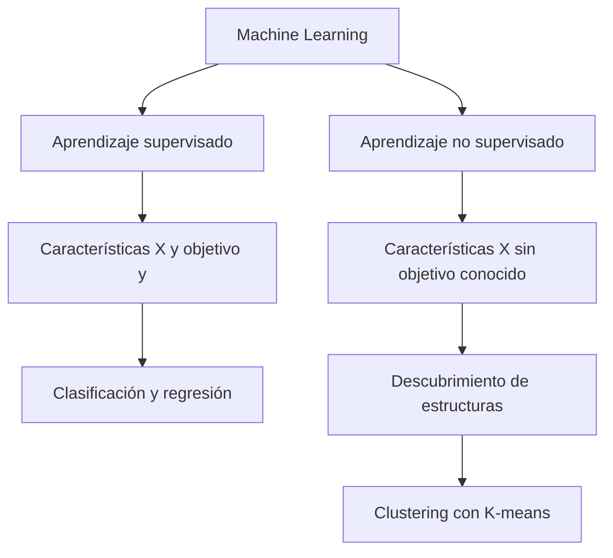
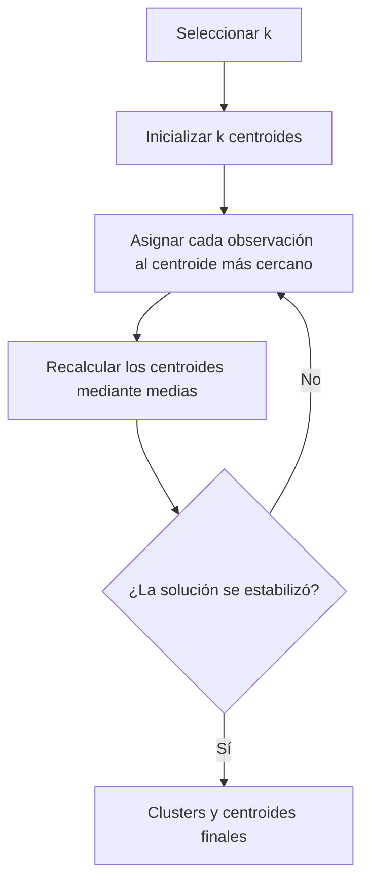
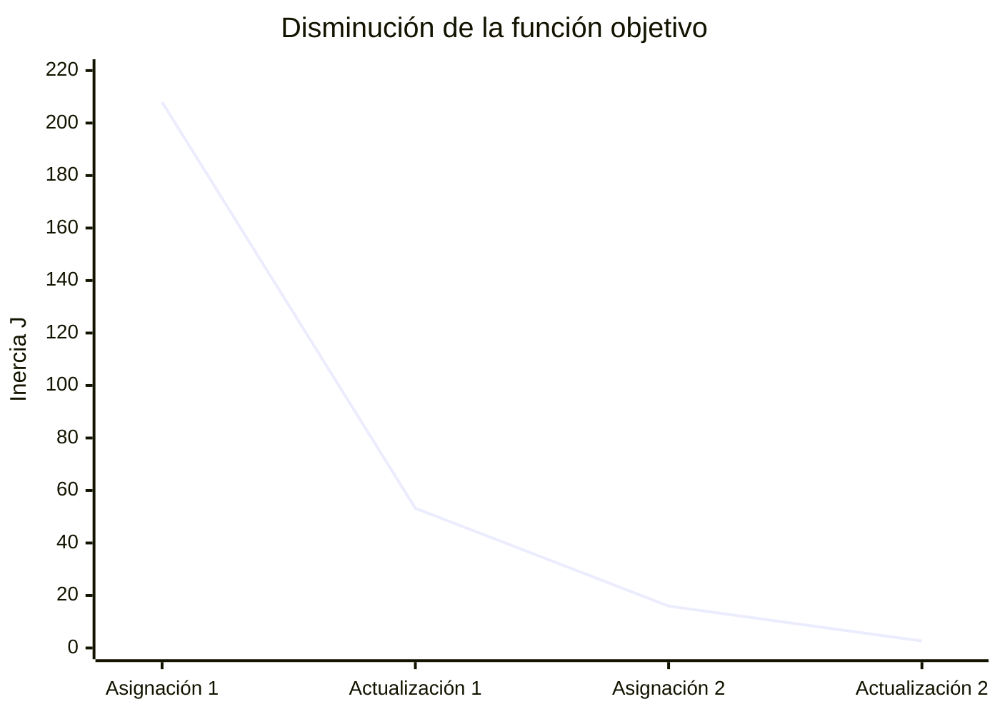

## Introducción  
  
En Machine Learning, no todos los problemas consisten en predecir una categoría o un valor numérico conocido. En ocasiones se dispone de un conjunto de observaciones y se desea descubrir cómo están organizadas, qué similitudes existen entre ellas o si pueden dividirse en grupos con características semejantes.  
  
Este tipo de problemas pertenece al **aprendizaje no supervisado (Unsupervised Learning)**, en el cual los algoritmos trabajan con las características de las observaciones sin disponer de una variable objetivo que indique cuál debería ser el resultado.  
  
Una de las técnicas más importantes es **K-means**, un algoritmo de agrupamiento (*clustering*) que divide las observaciones en $k$ grupos a partir de sus distancias a determinados puntos centrales llamados **centroides (centroids)**.  
  
Su funcionamiento se basa en un procedimiento iterativo:  
  
1. Seleccionar la cantidad de grupos $k$ e inicializar sus centroides.  
2. Asignar cada observación al centroide más cercano.  
3. Recalcular cada centroide utilizando la media de las observaciones asignadas.  
4. Repetir ambos pasos hasta que la solución se estabilice.  
  
El objetivo es construir grupos internamente compactos, minimizando la suma de las distancias euclidianas al cuadrado entre cada observación y el centroide de su grupo.  
  
Para comprender el procedimiento, se considera un ejemplo de seis clientes descritos mediante dos características: tiempo de uso de una página web y número de aperturas de una aplicación por semana.  
  
Este ejemplo permite desarrollar las asignaciones iniciales, los cambios de centroides, la convergencia y el cálculo de la función objetivo.  
  
También permite comprender algunas limitaciones importantes: la sensibilidad a la escala de las características, la dependencia de la inicialización, la influencia de valores atípicos y la dificultad de elegir el número apropiado de grupos.  
  
---  
  
## Aprendizaje supervisado y no supervisado  
  
La diferencia fundamental entre ambos enfoques se encuentra en la información disponible durante el entrenamiento.  
  
### Aprendizaje supervisado:  
  
En el aprendizaje supervisado se dispone de características de entrada y resultados conocidos.  
  
$$  
X=\text{Características}  
$$  
  
$$  
y=\text{Variable objetivo}  
$$  
  
Por ejemplo, una empresa puede utilizar datos de actividad de sus clientes para predecir si cancelarán un servicio.  
  
El modelo aprende utilizando ejemplos donde se conoce si la cancelación realmente ocurrió.  
  
Posteriormente, sus predicciones pueden compararse con los resultados observados mediante métricas de clasificación.  
  
### Aprendizaje no supervisado:  
  
En el aprendizaje no supervisado no se dispone de una variable objetivo para la tarea que se desea resolver.  
  
El algoritmo recibe:  
  
$$  
X  
$$  
  
y busca relaciones o estructuras dentro de las observaciones.  
  
Por ejemplo, una empresa puede analizar cuánto tiempo pasan sus clientes en una página web y cuántas veces abren una aplicación para identificar perfiles de actividad semejantes.  
  
El algoritmo puede descubrir grupos de clientes con comportamientos parecidos, pero no conoce automáticamente si esos clientes son rentables, si cancelarán el servicio o si están satisfechos.  
  

  
Por lo tanto, **identificar grupos de comportamiento no equivale a predecir resultados de negocio**. Para establecer esas relaciones se necesitaría información adicional.  
  
---  
  
## Clustering y el significado de un grupo  
  
El **clustering** consiste en organizar observaciones en grupos de acuerdo con sus características y una medida de similitud.  
  
En K-means, la similitud se determina mediante la distancia euclidiana: las observaciones cercanas tienden a asignarse al mismo centroide.  
  
Cada grupo recibe un identificador denominado **cluster ID**.  
  
Por ejemplo:  
  
$$  
c_i=1  
$$  
  
indica que la observación $i$ pertenece al grupo 1.  
  
Sin embargo, el número asignado no posee un significado intrínseco.  
  
Los mismos grupos podrían identificarse utilizando:  
  
$$  
0,\ 1  
$$  
  
o:  
  
$$  
1,\ 2  
$$  
  
sin modificar el resultado del agrupamiento.  
  
### Diferencia entre cluster ID y etiqueta conocida:  
  
Una etiqueta supervisada representa un resultado conocido, como:  
  
- Cliente que canceló.  
- Cliente que no canceló.  
  
Un cluster ID solamente identifica un conjunto de observaciones agrupadas por el algoritmo.  
  
Si K-means divide a los clientes en dos grupos, no significa que haya descubierto automáticamente cuáles cancelarán el servicio.  
  
Las etiquetas deben interpretarse a partir de las características que describen cada grupo.  
  
### ¿Los grupos encontrados son necesariamente naturales?:  
  
No.  
  
K-means siempre intenta construir los $k$ grupos solicitados, incluso cuando los datos no presentan una separación clara.  
  
Por lo tanto, obtener una partición no demuestra que exista una estructura natural de exactamente $k$ grupos.  
  
La calidad del agrupamiento debe evaluarse considerando la compactación interna, la separación, la estabilidad y la utilidad de los resultados.  
  
---  
  
## Representación de las observaciones  
  
Cada observación puede representarse mediante un vector de características.  
  
Para un conjunto con dos características:  
  
$$  
x_i=(x_{i1},x_{i2})  
$$  
  
En donde:  
  
- $x_i$ es la observación $i$.  
- $x_{i1}$ es su primera característica.  
- $x_{i2}$ es su segunda característica.  
  
En el ejemplo de clientes se utilizan:  
  
$$  
x_1=\text{Tiempo en la página web}  
$$  
  
$$  
x_2=\text{Aperturas de la aplicación}  
$$  
  
Ambas características se miden semanalmente.  
  
Se dispone de seis clientes:  
  
| Cliente | Tiempo web (min/semana) | Aperturas de app/semana |  
|---|---:|---:|  
| A | 1 | 1 |  
| B | 1 | 2 |  
| C | 2 | 1 |  
| D | 7 | 7 |  
| E | 7 | 8 |  
| F | 8 | 7 |  
  
Las observaciones son:  
  
$$  
A=(1,1),\quad B=(1,2),\quad C=(2,1)  
$$  
  
$$  
D=(7,7),\quad E=(7,8),\quad F=(8,7)  
$$  
  
Puede observarse que A, B y C se encuentran cerca unas de otras.  
  
De manera semejante, D, E y F presentan coordenadas próximas.  
  
Esto sugiere dos regiones de actividad:  
  
- Clientes con menor actividad medida.  
- Clientes con mayor actividad medida.  
  
Sin embargo, esta interpretación inicial todavía no constituye el resultado formal de K-means.  
  
---  
  
## Componentes fundamentales de K-means  
  
K-means utiliza varios elementos que deben distinguirse.  
  
| Símbolo | Significado |  
|---|---|  
| $n$ | Número de observaciones |  
| $k$ | Número de clusters |  
| $x_i$ | Vector de características de la observación $i$ |  
| $\mu_j$ | Centroide del cluster $j$ |  
| $c_i$ | Cluster asignado a la observación $i$ |  
| $C_j$ | Conjunto de observaciones del cluster $j$ |  
| $J$ | Función objetivo del agrupamiento |  
  
En el ejemplo:  
  
$$  
n=6  
$$  
  
y se decide utilizar:  
  
$$  
k=2  
$$  
  
Por lo tanto, el algoritmo construirá dos clusters.  
  
### Parámetros e hiperparámetros:  
  
El número de grupos:  
  
$$  
k  
$$  
  
es un **hiperparámetro**, porque se establece antes del entrenamiento.  
  
En cambio, las coordenadas de los centroides:  
  
$$  
\mu_1,\mu_2  
$$  
  
y las asignaciones:  
  
$$  
c_1,\ldots,c_6  
$$  
  
son resultados aprendidos por el procedimiento.  
  
**K-means aprende centroides y asignaciones; no aprende automáticamente el valor de $k$ en su formulación habitual.**  
  
---  
  
## Centroides  
  
Un **centroide (centroid)** representa el centro de un cluster calculado mediante la media de sus observaciones.  
  
Para un grupo $C_j$, su centroide es:  
  
$$  
\boxed{  
\mu_j=\frac{1}{|C_j|}\sum_{i\in C_j}x_i  
}  
$$  
  
En donde:  
  
- $C_j$ contiene las observaciones asignadas al grupo $j$.  
- $|C_j|$ representa la cantidad de observaciones del grupo.  
- $\mu_j$ es su centroide.  
  
La media se calcula por separado para cada característica.  
  
### Ejemplo:  
  
Supóngase que un cluster contiene:  
  
$$  
A=(1,1)  
$$  
  
$$  
B=(1,2)  
$$  
  
Su centroide es:  
  
$$  
\mu=  
\left(  
\frac{1+1}{2},  
\frac{1+2}{2}  
\right)  
$$  
  
Por lo tanto:  
  
$$  
\boxed{\mu=(1,1.5)}  
$$  
  
El centroide representa el promedio del tiempo web y de las aperturas de aplicación.  
  
### ¿El centroide debe coincidir con una observación real?:  
  
No.  
  
En este caso:  
  
$$  
\mu=(1,1.5)  
$$  
  
no coincide con A ni con B.  
  
Esto ocurre porque K-means utiliza medias y no exige que los centros pertenezcan al conjunto de observaciones originales.  
  
---  
  
## Distancia euclidiana  
  
K-means asigna cada observación al centroide más cercano.  
  
Para determinar la cercanía se utiliza la distancia euclidiana.  
  
En dos dimensiones:  
  
$$  
\boxed{  
d(x,\mu_j)=  
\sqrt{(x_1-\mu_{j1})^2+(x_2-\mu_{j2})^2}  
}  
$$  
  
En donde:  
  
- $x_1,x_2$ son las coordenadas de una observación.  
- $\mu_{j1},\mu_{j2}$ son las coordenadas del centroide.  
- $d(x,\mu_j)$ representa la distancia.  
  
### Distancia euclidiana al cuadrado:  
  
Durante la comparación de centroides también puede utilizarse:  
  
$$  
\boxed{  
d^2(x,\mu_j)=  
(x_1-\mu_{j1})^2+(x_2-\mu_{j2})^2  
}  
$$  
  
La raíz cuadrada no modifica el orden de las distancias.  
  
Por ejemplo:  
  
$$  
1<2  
$$  
  
implica:  
  
$$  
\sqrt{1}<\sqrt{2}  
$$  
  
Por lo tanto, para seleccionar el centroide más cercano basta con comparar las distancias al cuadrado.  
  
Esto simplifica los cálculos manuales.  
  
---  
  
## Funcionamiento del algoritmo K-means  
  
El procedimiento alterna dos operaciones fundamentales: **asignación** y **actualización**.  
  
### Asignación:  
  
Cada observación se asigna al centroide más cercano.  
  
La regla puede escribirse como:  
  
$$  
\boxed{  
c_i=\arg\min_j\|x_i-\mu_j\|^2  
}  
$$  
  
En esta etapa los centroides permanecen fijos.  
  
### Actualización:  
  
Después de asignar todas las observaciones, se recalcula la media de cada grupo.  
  
$$  
\boxed{  
\mu_j=\frac{1}{|C_j|}\sum_{i\in C_j}x_i  
}  
$$  
  
En esta etapa las asignaciones permanecen fijas.  
  
### Repetición:  
  
Ambas operaciones se alternan hasta que las asignaciones y los centroides dejan de cambiar de manera relevante o se alcanza otro criterio de parada.  
  

  
La distinción entre ambas etapas es fundamental:  
  
**Durante la asignación se mantienen fijos los centroides. Durante la actualización se mantienen fijas las asignaciones.**  
  
---  
  
## Inicialización de K-means  
  
Antes de comenzar las iteraciones deben establecerse los centroides iniciales.  
  
En este ejemplo se utilizan:  
  
$$  
k=2  
$$  
  
y se seleccionan las observaciones A y C como centros iniciales:  
  
$$  
\boxed{\mu_1^{(0)}=(1,1)}  
$$  
  
$$  
\boxed{\mu_2^{(0)}=(2,1)}  
$$  
  
El superíndice:  
  
$$  
(0)  
$$  
  
indica que se trata de las posiciones iniciales, antes de realizar actualizaciones.  
  
Ambos centroides se encuentran cerca del grupo de menor actividad.  
  
Esta elección permite observar cómo el algoritmo modifica los centros para reorganizar las observaciones.  
  
### ¿Por qué importa la inicialización?:  
  
K-means optimiza mediante decisiones locales.  
  
Diferentes centroides iniciales pueden provocar distintas secuencias de asignación y actualización.  
  
En algunos conjuntos, distintas inicializaciones pueden conducir a soluciones finales diferentes.  
  
Por lo tanto, la inicialización puede influir tanto en el recorrido del algoritmo como en la función objetivo final.  
  
---  
  
## Primera asignación de observaciones  
  
Se utilizan los centroides iniciales:  
  
$$  
\mu_1^{(0)}=(1,1)  
$$  
  
$$  
\mu_2^{(0)}=(2,1)  
$$  
  
Cada cliente debe asignarse al centroide más cercano.  
  
### Ejemplo con el cliente B:  
  
El cliente B tiene coordenadas:  
  
$$  
B=(1,2)  
$$  
  
Su distancia al cuadrado respecto al primer centroide es:  
  
$$  
d^2(B,\mu_1^{(0)})=  
(1-1)^2+(2-1)^2  
$$  
  
$$  
\boxed{d^2(B,\mu_1^{(0)})=1}  
$$  
  
Respecto al segundo:  
  
$$  
d^2(B,\mu_2^{(0)})=  
(1-2)^2+(2-1)^2  
$$  
  
$$  
\boxed{d^2(B,\mu_2^{(0)})=2}  
$$  
  
Como:  
  
$$  
1<2  
$$  
  
B se asigna al cluster 1.  
  
$$  
\boxed{c_B=1}  
$$  
  
### Ejemplo con el cliente D:  
  
El cliente D tiene coordenadas:  
  
$$  
D=(7,7)  
$$  
  
Respecto al primer centroide:  
  
$$  
d^2(D,\mu_1^{(0)})=  
(7-1)^2+(7-1)^2  
$$  
  
$$  
=36+36  
$$  
  
$$  
\boxed{d^2(D,\mu_1^{(0)})=72}  
$$  
  
Respecto al segundo:  
  
$$  
d^2(D,\mu_2^{(0)})=  
(7-2)^2+(7-1)^2  
$$  
  
$$  
=25+36  
$$  
  
$$  
\boxed{d^2(D,\mu_2^{(0)})=61}  
$$  
  
Como:  
  
$$  
61<72  
$$  
  
D se asigna al cluster 2.  
  
$$  
\boxed{c_D=2}  
$$  
  
Aunque ambos centros están lejos de D, el algoritmo selecciona el más cercano.  
  
K-means no exige que una observación se encuentre a una distancia máxima para poder asignarse a un cluster.  
  
---  
  
## Resultado completo de la primera asignación  
  
Al repetir el cálculo para las seis observaciones se obtiene:  
  
| Cliente | $d_1^2$ | $d_2^2$ | Cluster |  
|---|---:|---:|---:|  
| A | 0 | 1 | 1 |  
| B | 1 | 2 | 1 |  
| C | 1 | 0 | 2 |  
| D | 72 | 61 | 2 |  
| E | 85 | 74 | 2 |  
| F | 85 | 72 | 2 |  
  
Por lo tanto, los grupos iniciales son:  
  
$$  
\boxed{C_1=\{A,B\}}  
$$  
  
$$  
\boxed{C_2=\{C,D,E,F\}}  
$$  
  
### ¿Por qué C pertenece inicialmente al cluster 2?:  
  
La observación C tiene coordenadas:  
  
$$  
C=(2,1)  
$$  
  
Estas coinciden exactamente con el segundo centroide inicial:  
  
$$  
\mu_2^{(0)}=(2,1)  
$$  
  
Por lo tanto:  
  
$$  
d^2(C,\mu_2^{(0)})=0  
$$  
  
La observación C queda asignada al cluster 2, aunque visualmente se encuentra cerca de A y B.  
  
Esto demuestra que **las primeras asignaciones dependen de los centroides iniciales y no tienen que coincidir con la estructura final del conjunto**.  
  
---  
  
## Primera actualización de centroides  
  
Después de completar la asignación, los centroides se recalculan como las medias de sus respectivos grupos.  
  
En esta etapa se mantienen las asignaciones anteriores:  
  
$$  
C_1=\{A,B\}  
$$  
  
$$  
C_2=\{C,D,E,F\}  
$$  
  
### Actualización del centroide 1:  
  
El primer grupo contiene:  
  
$$  
A=(1,1)  
$$  
  
$$  
B=(1,2)  
$$  
  
Por lo tanto:  
  
$$  
\mu_1^{(1)}=  
\left(  
\frac{1+1}{2},  
\frac{1+2}{2}  
\right)  
$$  
  
$$  
\boxed{\mu_1^{(1)}=(1,1.5)}  
$$  
  
El centroide se desplaza verticalmente hacia el punto medio entre A y B.  
  
### Actualización del centroide 2:  
  
El segundo grupo contiene:  
  
$$  
C=(2,1)  
$$  
  
$$  
D=(7,7)  
$$  
  
$$  
E=(7,8)  
$$  
  
$$  
F=(8,7)  
$$  
  
Su primera coordenada es:  
  
$$  
\mu_{21}^{(1)}=  
\frac{2+7+7+8}{4}  
$$  
  
$$  
\boxed{\mu_{21}^{(1)}=6}  
$$  
  
La segunda coordenada es:  
  
$$  
\mu_{22}^{(1)}=  
\frac{1+7+8+7}{4}  
$$  
  
$$  
\boxed{\mu_{22}^{(1)}=5.75}  
$$  
  
Por lo tanto:  
  
$$  
\boxed{\mu_2^{(1)}=(6,5.75)}  
$$  
  
### Resultado:  
  
Los nuevos centroides son:  
  
$$  
\boxed{\mu_1^{(1)}=(1,1.5)}  
$$  
  
$$  
\boxed{\mu_2^{(1)}=(6,5.75)}  
$$  
  
El segundo centroide se desplazó considerablemente hacia las observaciones D, E y F.  
  
Sin embargo, C sigue perteneciendo temporalmente al cluster 2 porque las asignaciones todavía no se han recalculado.  
  
---  
  
## Segunda asignación de observaciones  
  
Con los centroides actualizados se vuelven a calcular las distancias.  
  
Ahora:  
  
$$  
\mu_1^{(1)}=(1,1.5)  
$$  
  
$$  
\mu_2^{(1)}=(6,5.75)  
$$  
  
### Ejemplo con el cliente C:  
  
La observación C es:  
  
$$  
C=(2,1)  
$$  
  
Respecto al centroide 1:  
  
$$  
d^2(C,\mu_1^{(1)})=  
(2-1)^2+(1-1.5)^2  
$$  
  
$$  
=1+0.25  
$$  
  
$$  
\boxed{d^2(C,\mu_1^{(1)})=1.25}  
$$  
  
Respecto al centroide 2:  
  
$$  
d^2(C,\mu_2^{(1)})=  
(2-6)^2+(1-5.75)^2  
$$  
  
$$  
=16+22.5625  
$$  
  
$$  
\boxed{d^2(C,\mu_2^{(1)})=38.5625}  
$$  
  
Como:  
  
$$  
1.25<38.5625  
$$  
  
C cambia al cluster 1.  
  
$$  
\boxed{c_C=1}  
$$  
  
### Interpretación:  
  
Inicialmente, C pertenecía al cluster 2 porque coincidía con su centroide.  
  
Sin embargo, después de actualizar las posiciones, el primer centroide quedó mucho más cerca.  
  
El cambio de C es una consecuencia directa de recalcular las distancias utilizando los centros actualizados.  
  
---  
  
## Resultado completo de la segunda asignación  
  
Las distancias al cuadrado son:  
  
| Cliente | $d_1^2$ | $d_2^2$ | Cluster |  
|---|---:|---:|---:|  
| A | 0.25 | 47.5625 | 1 |  
| B | 0.25 | 39.0625 | 1 |  
| C | 1.25 | 38.5625 | 1 |  
| D | 66.25 | 2.5625 | 2 |  
| E | 78.25 | 6.0625 | 2 |  
| F | 79.25 | 5.5625 | 2 |  
  
Las nuevas asignaciones son:  
  
$$  
\boxed{C_1=\{A,B,C\}}  
$$  
  
$$  
\boxed{C_2=\{D,E,F\}}  
$$  
  
Solamente la observación C cambió de grupo.  
  
Ahora los clusters coinciden con las dos regiones de actividad que se identificaban visualmente.  
  
---  
  
## Segunda actualización de centroides  
  
Con las nuevas asignaciones se vuelven a calcular las medias.  
  
### Centroide del cluster 1:  
  
El primer grupo contiene:  
  
$$  
A=(1,1)  
$$  
  
$$  
B=(1,2)  
$$  
  
$$  
C=(2,1)  
$$  
  
Por lo tanto:  
  
$$  
\mu_1^{(2)}=  
\left(  
\frac{1+1+2}{3},  
\frac{1+2+1}{3}  
\right)  
$$  
  
$$  
\boxed{  
\mu_1^{(2)}=  
\left(\frac43,\frac43\right)  
}  
$$  
  
Aproximadamente:  
  
$$  
\boxed{\mu_1^{(2)}=(1.33,1.33)}  
$$  
  
### Centroide del cluster 2:  
  
El segundo grupo contiene:  
  
$$  
D=(7,7)  
$$  
  
$$  
E=(7,8)  
$$  
  
$$  
F=(8,7)  
$$  
  
Por lo tanto:  
  
$$  
\mu_2^{(2)}=  
\left(  
\frac{7+7+8}{3},  
\frac{7+8+7}{3}  
\right)  
$$  
  
$$  
\boxed{  
\mu_2^{(2)}=  
\left(\frac{22}{3},\frac{22}{3}\right)  
}  
$$  
  
Aproximadamente:  
  
$$  
\boxed{\mu_2^{(2)}=(7.33,7.33)}  
$$  
  
Los centroides ahora representan correctamente el promedio de cada región de actividad.  
  
---  
  
## Convergencia de K-means  
  
Después de actualizar nuevamente los centroides, se realiza otra asignación.  
  
En este caso, las observaciones permanecen en los mismos grupos:  
  
$$  
C_1=\{A,B,C\}  
$$  
  
$$  
C_2=\{D,E,F\}  
$$  
  
Si se vuelven a calcular los centroides, se obtienen las mismas medias:  
  
$$  
\mu_1=\left(\frac43,\frac43\right)  
$$  
  
$$  
\mu_2=\left(\frac{22}{3},\frac{22}{3}\right)  
$$  
  
Por lo tanto, la solución se ha estabilizado.  
  
### ¿Qué significa convergencia?:  
  
La convergencia ocurre cuando el procedimiento deja de producir cambios relevantes en las asignaciones o en las posiciones de los centroides.  
  
En una implementación práctica también pueden utilizarse criterios de tolerancia o un número máximo de iteraciones.  
  
### ¿Convergencia significa solución global óptima?:  
  
No necesariamente.  
  
K-means puede converger a una solución local dependiente de la inicialización.  
  
Por esta razón, alcanzar la convergencia no demuestra que se haya encontrado el mejor agrupamiento posible entre todas las particiones existentes.  
  
---  
  
## Función objetivo de K-means  
  
K-means busca minimizar la **suma de distancias euclidianas al cuadrado dentro de los clusters**.  
  
Su función objetivo es:  
  
$$  
\boxed{  
J=\sum_{i=1}^{n}\|x_i-\mu_{c_i}\|^2  
}  
$$  
  
En donde:  
  
- $x_i$ representa la observación $i$.  
- $c_i$ identifica el cluster asignado.  
- $\mu_{c_i}$ representa el centroide correspondiente.  
- $\|x_i-\mu_{c_i}\|^2$ es la distancia euclidiana al cuadrado.  
- $n$ es la cantidad total de observaciones.  
  
Esta cantidad también se conoce como **Within-Cluster Sum of Squares (WCSS)**.  
  
En scikit-learn se obtiene mediante:  
  
```python  
model.inertia_  
```  
  
### Interpretación:  
  
Un valor pequeño de $J$ indica que las observaciones se encuentran, en conjunto, relativamente cerca de sus centroides.  
  
Un valor grande indica mayor dispersión dentro de los grupos.  
  
Sin embargo, el valor debe interpretarse considerando la escala de las características, el conjunto de datos y la cantidad de clusters.  
  
---  
  
## Evolución de la función objetivo  
  
Durante el procedimiento, las operaciones de asignación y actualización no aumentan la función objetivo cuando se realizan conforme al algoritmo.  
  
Esto ocurre porque:  
  
- La asignación selecciona el centroide más cercano para cada observación.  
- La actualización selecciona la media, que minimiza la suma de errores cuadrados dentro del grupo.  
  
### Primera asignación:  
  
Con los centros iniciales, las distancias al cuadrado asignadas son:  
  
| Cliente | Distancia asignada |  
|---|---:|  
| A | 0 |  
| B | 1 |  
| C | 0 |  
| D | 61 |  
| E | 74 |  
| F | 72 |  
  
Por lo tanto:  
  
$$  
J=0+1+0+61+74+72  
$$  
  
$$  
\boxed{J=208}  
$$  
  
### Primera actualización:  
  
Después de recalcular los centroides sin modificar las asignaciones:  
  
$$  
\boxed{J=53.25}  
$$  
  
### Segunda asignación:  
  
Después de reasignar las observaciones a los centroides actualizados:  
  
$$  
\boxed{J=15.9375}  
$$  
  
### Segunda actualización:  
  
Después de recalcular los centroides con los nuevos grupos:  
  
$$  
\boxed{J\approx2.6667}  
$$  
  
La evolución es:  
  
| Etapa | Función objetivo |  
|---|---:|  
| Primera asignación | 208 |  
| Primera actualización | 53.25 |  
| Segunda asignación | 15.9375 |  
| Segunda actualización | 2.6667 |  
  

  
El descenso muestra cómo K-means mejora progresivamente la compactación de los grupos en este ejemplo.  
  
---  
  
## Cálculo de la función objetivo final  
  
Los grupos finales son:  
  
$$  
C_1=\{A,B,C\}  
$$  
  
$$  
C_2=\{D,E,F\}  
$$  
  
Sus centroides son:  
  
$$  
\mu_1=\left(\frac43,\frac43\right)  
$$  
  
$$  
\mu_2=\left(\frac{22}{3},\frac{22}{3}\right)  
$$  
  
### Contribución del cliente A:  
  
La observación A es:  
  
$$  
A=(1,1)  
$$  
  
Su distancia al cuadrado al centroide 1 es:  
  
$$  
d^2(A,\mu_1)=  
\left(1-\frac43\right)^2+  
\left(1-\frac43\right)^2  
$$  
  
$$  
=\left(-\frac13\right)^2+  
\left(-\frac13\right)^2  
$$  
  
$$  
\boxed{d^2(A,\mu_1)=\frac29}  
$$  
  
Las contribuciones de todas las observaciones son:  
  
| Cliente | Distancia al cuadrado |  
|---|---:|  
| A | $\frac29$ |  
| B | $\frac59$ |  
| C | $\frac59$ |  
| D | $\frac29$ |  
| E | $\frac59$ |  
| F | $\frac59$ |  
  
Por lo tanto:  
  
$$  
J=\frac{2+5+5+2+5+5}{9}  
$$  
  
$$  
J=\frac{24}{9}  
$$  
  
$$  
\boxed{J=\frac83\approx2.6667}  
$$  
  
### ¿Por qué J no es cero?:  
  
Porque los clientes de cada grupo no tienen exactamente las mismas coordenadas.  
  
Aunque son relativamente similares, permanecen a cierta distancia de su centroide.  
  
Por lo tanto, existe dispersión dentro de ambos clusters.  
  
---  
  
## Interpretación de los clusters encontrados  
  
Los grupos finales permiten identificar dos perfiles distintos de actividad.  
  
### Cluster 1:  
  
Contiene:  
  
$$  
A,\ B,\ C  
$$  
  
Su centroide es:  
  
$$  
\mu_1\approx(1.33,1.33)  
$$  
  
Por lo tanto, representa clientes con:  
  
- Tiempo web promedio de aproximadamente $1.33$ minutos por semana.  
- Aproximadamente $1.33$ aperturas de aplicación por semana.  
  
### Cluster 2:  
  
Contiene:  
  
$$  
D,\ E,\ F  
$$  
  
Su centroide es:  
  
$$  
\mu_2\approx(7.33,7.33)  
$$  
  
Por lo tanto, representa clientes con:  
  
- Tiempo web promedio de aproximadamente $7.33$ minutos por semana.  
- Aproximadamente $7.33$ aperturas de aplicación por semana.  
  
La diferencia principal entre los grupos es su nivel de actividad medida.  
  
### ¿Puede concluirse que el segundo cluster es más rentable?:  
  
No.  
  
El algoritmo solamente utiliza tiempo web y aperturas de aplicación.  
  
La rentabilidad no forma parte de las características utilizadas.  
  
Para estudiar si existe una relación entre actividad y rentabilidad sería necesario incorporar evidencia adicional.  
  
La interpretación correcta es que los grupos difieren en sus características observadas, no necesariamente en todos los aspectos del comportamiento de los clientes.  
  
---  
  
## Asignación de nuevas observaciones  
  
Una vez entrenado K-means, puede asignarse una nueva observación al centroide más cercano.  
  
No es necesario volver a entrenar el modelo para realizar esta asignación.  
  
Supóngase que aparece un nuevo cliente:  
  
$$  
Q=(5,2)  
$$  
  
Se utilizan los centroides finales:  
  
$$  
\mu_1=\left(\frac43,\frac43\right)  
$$  
  
$$  
\mu_2=\left(\frac{22}{3},\frac{22}{3}\right)  
$$  
  
### Distancia al cluster 1:  
  
$$  
d_1^2=  
\left(5-\frac43\right)^2+  
\left(2-\frac43\right)^2  
$$  
  
$$  
=\left(\frac{11}{3}\right)^2+  
\left(\frac23\right)^2  
$$  
  
$$  
=\frac{121+4}{9}  
$$  
  
$$  
\boxed{d_1^2=\frac{125}{9}\approx13.89}  
$$  
  
### Distancia al cluster 2:  
  
$$  
d_2^2=  
\left(5-\frac{22}{3}\right)^2+  
\left(2-\frac{22}{3}\right)^2  
$$  
  
$$  
=\left(-\frac73\right)^2+  
\left(-\frac{16}{3}\right)^2  
$$  
  
$$  
=\frac{49+256}{9}  
$$  
  
$$  
\boxed{d_2^2=\frac{305}{9}\approx33.89}  
$$  
  
Como:  
  
$$  
13.89<33.89  
$$  
  
el cliente Q se asigna al cluster 1.  
  
$$  
\boxed{c_Q=1}  
$$  
  
Esto significa que, según la distancia euclidiana y los centroides aprendidos, Q es más cercano al grupo de menor actividad.  
  
No significa que el algoritmo haya predicho una categoría supervisada.  
  
---  
  
## Sensibilidad a la escala de las características  
  
K-means utiliza distancias euclidianas, por lo que es sensible a las escalas numéricas de las características.  
  
Supóngase que el tiempo web se expresa inicialmente en minutos.  
  
Posteriormente se convierte a segundos:  
  
$$  
1\text{ min}=60\text{ s}  
$$  
  
La información física no cambia, pero sus valores numéricos se multiplican por 60.  
  
### Efecto sobre la distancia:  
  
La distancia euclidiana al cuadrado considera:  
  
$$  
d^2=  
(x_1-\mu_1)^2+  
(x_2-\mu_2)^2  
$$  
  
Si la primera característica se multiplica por 60:  
  
$$  
d^2=  
60^2(x_1-\mu_1)^2+  
(x_2-\mu_2)^2  
$$  
  
Por lo tanto, la contribución de esa característica queda multiplicada por:  
  
$$  
60^2=3600  
$$  
  
Esto puede cambiar cuál centroide resulta más cercano.  
  
### Ejemplo con el cliente Q:  
  
En minutos:  
  
| Centroide | Distancia al cuadrado |  
|---|---:|  
| Centroide 1 | 13.89 |  
| Centroide 2 | 33.89 |  
  
Q se asigna al cluster 1.  
  
Si el tiempo web se convierte a segundos y se transforman de la misma manera las coordenadas de los centroides:  
  
| Centroide | Distancia al cuadrado |  
|---|---:|  
| Centroide 1 | 48,400.44 |  
| Centroide 2 | 19,628.44 |  
  
Ahora el centroide más cercano es el segundo.  
  
Por lo tanto:  
  
$$  
\boxed{c_Q=2}  
$$  
  
La observación no cambió su comportamiento real.  
  
Lo que cambió fue la contribución relativa de las características al cálculo de distancia.  
  
**Una transformación de unidades puede modificar el agrupamiento si no se controla adecuadamente la escala de los datos.**  
  
---  
  
## Estandarización de características  
  
Una estrategia habitual para evitar que determinadas escalas dominen las distancias consiste en estandarizar las características.  
  
La fórmula es:  
  
$$  
\boxed{  
z_{ij}=\frac{x_{ij}-m_j}{s_j}  
}  
$$  
  
En donde:  
  
- $x_{ij}$ es el valor original.  
- $m_j$ es la media de la característica.  
- $s_j$ es su desviación estándar.  
- $z_{ij}$ es el valor estandarizado.  
  
La estandarización transforma las características para expresarlas respecto a su distribución.  
  
### Ejemplo:  
  
Para las seis observaciones, ambas características tienen media:  
  
$$  
m_j=\frac{13}{3}\approx4.3333  
$$  
  
Y desviación estándar poblacional:  
  
$$  
s_j=\frac{\sqrt{83}}{3}\approx3.0368  
$$  
  
Para la primera característica del cliente A:  
  
$$  
x=1  
$$  
  
Entonces:  
  
$$  
z=\frac{1-4.3333}{3.0368}  
$$  
  
$$  
\boxed{z\approx-1.098}  
$$  
  
### Efecto sobre las unidades:  
  
Si una característica se expresa en minutos o segundos, la estandarización produce las mismas coordenadas estandarizadas, siempre que la transformación y el ajuste del escalador se realicen correctamente.  
  
Por lo tanto, el cambio de unidades deja de modificar su contribución relativa a la distancia.  
  
### Nueva asignación de Q:  
  
Después de estandarizar utilizando los datos de entrenamiento, las distancias al cuadrado de Q son aproximadamente:  
  
$$  
d_1^2\approx1.506  
$$  
  
$$  
d_2^2\approx3.675  
$$  
  
Como:  
  
$$  
1.506<3.675  
$$  
  
Q vuelve a asignarse al cluster 1.  
  
### Precaución:  
  
La estandarización evita que una característica domine únicamente por sus unidades, pero no determina cuáles variables son relevantes para el problema.  
  
Una característica irrelevante puede continuar afectando las distancias aun después de estandarizarse.  
  
Además, el escalador debe ajustarse con los datos permitidos para entrenamiento, sin incorporar observaciones nuevas ni información reservada para evaluación.  
  
---  
  
## Influencia de la inicialización  
  
K-means puede producir recorridos diferentes dependiendo de los centroides iniciales.  
  
En el ejemplo se utilizaron inicialmente A y C:  
  
$$  
\mu_1^{(0)}=A  
$$  
  
$$  
\mu_2^{(0)}=C  
$$  
  
Esta elección produjo una primera función objetivo:  
  
$$  
J=208  
$$  
  
Sin embargo, otra inicialización puede comenzar con A y D:  
  
$$  
\mu_1^{(0)}=A  
$$  
  
$$  
\mu_2^{(0)}=D  
$$  
  
En este caso, la primera asignación produce:  
  
$$  
J=4  
$$  
  
Aunque los recorridos son diferentes, ambos terminan encontrando los mismos grupos para estas seis observaciones:  
  
$$  
C_1=\{A,B,C\}  
$$  
  
$$  
C_2=\{D,E,F\}  
$$  
  
Con función objetivo final:  
  
$$  
\boxed{J=\frac83}  
$$  
  
### ¿Siempre ocurre lo mismo?:  
  
No.  
  
En otros conjuntos, distintas inicializaciones pueden producir soluciones locales diferentes.  
  
Por lo tanto, una buena inicialización puede contribuir a obtener soluciones más estables y reducir la cantidad de iteraciones necesarias.  
  
---  
  
## K-means++ y múltiples inicializaciones  
  
Una estrategia habitual para inicializar centroides es:  
  
```python  
init="k-means++"  
```  
  
K-means++ utiliza un procedimiento de muestreo que favorece la selección de centroides iniciales relativamente separados.  
  
Esto suele mejorar la inicialización respecto a seleccionar puntos completamente al azar.  
  
### n_init:  
  
El hiperparámetro:  
  
```python  
n_init=20  
```  
  
indica que se realizan veinte inicializaciones diferentes.  
  
El algoritmo ejecuta K-means desde cada una y conserva el resultado con menor inercia.  
  
### ¿Por qué utilizar varias inicializaciones?:  
  
Porque la función objetivo no garantiza una única solución global a partir de cualquier conjunto de centroides iniciales.  
  
Las múltiples inicializaciones permiten comparar diferentes soluciones locales.  
  
Sin embargo, tampoco garantizan encontrar siempre el óptimo global.  
  
---  
  
## Selección del número de clusters  
  
El valor de:  
  
$$  
k  
$$  
  
determina cuántos grupos debe construir K-means.  
  
Este valor no se aprende automáticamente mediante el procedimiento de asignación y actualización.  
  
Por lo tanto, debe seleccionarse considerando el propósito del análisis y la calidad de los agrupamientos.  
  
### Relación entre k e inercia:  
  
Al aumentar el número de clusters, generalmente disminuye la suma de distancias al cuadrado.  
  
Esto ocurre porque se utilizan más centroides para representar las observaciones.  
  
Para las seis observaciones:  
  
| Número de clusters | Inercia |  
|---|---:|  
| $k=1$ | 110.67 |  
| $k=2$ | 2.67 |  
| $k=3$ | 1.83 |  
| $k=6$ | 0 |  
  
Cuando:  
  
$$  
k=6  
$$  
  
cada observación puede convertirse en su propio cluster.  
  
Por lo tanto:  
  
$$  
\boxed{J=0}  
$$  
  
### ¿J=0 significa una segmentación perfecta?:  
  
No.  
  
Si cada cliente forma su propio grupo, la inercia es cero porque todas las observaciones coinciden con sus respectivos centroides.  
  
Sin embargo, este resultado puede ser inútil para segmentar clientes, ya que no resume ninguna estructura colectiva.  
  
Por lo tanto, **una menor inercia no implica automáticamente un mejor número de clusters**.  
  
### Criterios complementarios:  
  
Para seleccionar $k$ conviene considerar:  
  
- **Compactación:** qué tan cercanas están las observaciones dentro de cada grupo.  
- **Separación:** qué tan diferenciados están los grupos.  
- **Estabilidad:** si los resultados cambian considerablemente al modificar condiciones razonables.  
- **Utilidad:** si la segmentación aporta información relevante para el problema.  
  
La selección debe equilibrar estos aspectos, no depender exclusivamente de minimizar la función objetivo.  
  
---  
  
## Sensibilidad a valores atípicos  
  
K-means utiliza medias para calcular centroides.  
  
Por esta razón, puede ser sensible a observaciones muy alejadas del resto.  
  
Supóngase que el segundo grupo contiene:  
  
$$  
D=(7,7)  
$$  
  
$$  
E=(7,8)  
$$  
  
$$  
F=(8,7)  
$$  
  
Su centroide es:  
  
$$  
\mu=\left(\frac{22}{3},\frac{22}{3}\right)  
$$  
  
$$  
\mu\approx(7.33,7.33)  
$$  
  
Ahora supóngase que se incorpora una nueva observación:  
  
$$  
G=(14,2)  
$$  
  
y se mantiene dentro del mismo grupo.  
  
El nuevo centroide sería:  
  
$$  
\mu_{\text{new}}=  
\left(  
\frac{7+7+8+14}{4},  
\frac{7+8+7+2}{4}  
\right)  
$$  
  
$$  
=\left(\frac{36}{4},\frac{24}{4}\right)  
$$  
  
$$  
\boxed{\mu_{\text{new}}=(9,6)}  
$$  
  
El centroide se desplaza considerablemente.  
  
### Interpretación:  
  
La observación G modifica la media del grupo porque tiene coordenadas alejadas de las otras observaciones.  
  
Esto demuestra que los centroides son sensibles a valores extremos.  
  
Sin embargo, el cálculo anterior mantiene artificialmente fija la pertenencia de G al grupo.  
  
Si se ejecutara nuevamente K-means sobre todo el conjunto, las asignaciones también podrían cambiar.  
  
Por lo tanto, el efecto completo de una observación atípica depende de la reorganización producida durante el entrenamiento.  
  
---  
  
## Implementación de K-means con scikit-learn  
  
Scikit-learn proporciona la clase:  
  
```python  
from sklearn.cluster import KMeans  
```  
  
Para reproducir el ejemplo puede construirse la matriz:  
  
```python  
import numpy as np  
  
X = np.array([  
[1, 1],  
[1, 2],  
[2, 1],  
[7, 7],  
[7, 8],  
[8, 7]  
])  
```  
  
### Inicialización con A y C:  
  
Se seleccionan las observaciones A y C como centros iniciales.  
  
```python  
initial = X[[0, 2]]  
```  
  
Posteriormente se configura el modelo:  
  
```python  
from sklearn.cluster import KMeans  
  
model = KMeans(  
n_clusters=2,  
init=initial,  
n_init=1,  
algorithm="lloyd",  
tol=0,  
random_state=42  
)  
  
model.fit(X)  
```  
  
### Resultados:  
  
Los centroides finales son aproximadamente:  
  
$$  
\mu_1=(1.3333,1.3333)  
$$  
  
$$  
\mu_2=(7.3333,7.3333)  
$$  
  
La inercia es:  
  
$$  
\boxed{J\approx2.6667}  
$$  
  
Y las etiquetas asignadas pueden representarse mediante:  
  
```python  
[0, 0, 0, 1, 1, 1]  
```  
  
Scikit-learn utiliza identificadores numéricos para los clusters.  
  
En este caso, los clientes A, B y C pertenecen a un grupo, mientras que D, E y F pertenecen al otro.  
  
### Atributos importantes:  
  
| Atributo | Significado |  
|---|---|  
| `cluster_centers_` | Coordenadas de los centroides finales |  
| `labels_` | Cluster asignado a cada observación |  
| `inertia_` | Suma de distancias al cuadrado |  
| `n_iter_` | Número de iteraciones realizadas |  
  
Para asignar un nuevo cliente puede utilizarse:  
  
```python  
Q = np.array([[5, 2]])  
  
cluster = model.predict(Q)  
```  
  
La predicción devuelve el identificador del cluster más cercano.  
  
No representa una etiqueta supervisada ni una probabilidad de pertenencia.  
  
---  
  
## Aplicación correcta de K-means  
  
Aunque el procedimiento matemático es sencillo, su utilización práctica requiere tomar decisiones adecuadas.  
  
### Selección de características:  
  
Los clusters se construyen únicamente a partir de las variables proporcionadas.  
  
Si se utilizan tiempo web y aperturas de aplicación, los grupos reflejarán esas dimensiones de actividad.  
  
No pueden interpretarse directamente como grupos de rentabilidad, satisfacción o cancelación sin información adicional.  
  
### Escalamiento:  
  
Cuando las características presentan unidades o magnitudes diferentes, debe evaluarse la necesidad de estandarización.  
  
Esto evita que una variable domine exclusivamente por su escala numérica.  
  
### Inicialización:  
  
Conviene utilizar estrategias de inicialización apropiadas y, cuando sea necesario, ejecutar el algoritmo desde varios puntos de partida.  
  
### Número de grupos:  
  
La cantidad de clusters debe seleccionarse considerando compactación, separación, estabilidad y utilidad.  
  
Una reducción de inercia no constituye por sí sola evidencia suficiente.  
  
### Interpretación:  
  
Los centroides permiten describir el comportamiento promedio de cada grupo.  
  
Sin embargo, los identificadores numéricos no contienen un significado semántico automático.  
  
Una interpretación válida debe basarse en las características observadas y en evidencia adicional cuando se formulen conclusiones externas a esas variables.  
  
---  
  
## Ideas principales  
  
### Aprendizaje no supervisado:  
  
Trabaja con características sin disponer de una variable objetivo conocida para la tarea.  
  
Busca identificar relaciones y estructuras entre las observaciones.  
  
### Clustering:  
  
Consiste en organizar observaciones en grupos utilizando medidas de similitud.  
  
Los identificadores de cluster no equivalen a etiquetas supervisadas.  
  
### K-means:  
  
Divide las observaciones en $k$ grupos y busca minimizar las distancias al cuadrado respecto a sus centroides.  
  
### Centroides:  
  
Son las medias de las observaciones asignadas a cada grupo.  
  
$$  
\mu_j=\frac{1}{|C_j|}\sum_{i\in C_j}x_i  
$$  
  
No necesitan coincidir con observaciones reales.  
  
### Distancia euclidiana:  
  
Permite determinar qué centroide se encuentra más cerca de una observación.  
  
$$  
d^2(x,\mu_j)=\sum_r(x_r-\mu_{jr})^2  
$$  
  
Para comparar centroides puede utilizarse directamente la distancia al cuadrado.  
  
### Asignación:  
  
Cada observación se asigna al centroide más cercano manteniendo fijos los centros.  
  
### Actualización:  
  
Cada centroide se recalcula mediante la media de su grupo manteniendo fijas las asignaciones.  
  
### Convergencia:  
  
El procedimiento termina cuando las asignaciones y centroides dejan de cambiar de manera relevante o se cumple otro criterio de parada.  
  
La convergencia no garantiza una solución global óptima.  
  
### Función objetivo:  
  
K-means minimiza la suma de distancias al cuadrado dentro de los clusters.  
  
$$  
J=\sum_{i=1}^{n}\|x_i-\mu_{c_i}\|^2  
$$  
  
En scikit-learn esta cantidad se denomina `inertia_`.  
  
### Inicialización:  
  
Los centroides iniciales pueden afectar el recorrido del algoritmo y la solución final.  
  
K-means++ y múltiples inicializaciones permiten explorar mejores puntos de partida.  
  
### Escalamiento:  
  
K-means es sensible a las unidades y magnitudes de las características.  
  
La estandarización permite colocarlas en escalas comparables.  
  
### Valores atípicos:  
  
Las observaciones extremas pueden desplazar los centroides porque estos se calculan mediante medias.  
  
### Número de clusters:  
  
Una inercia menor no garantiza una mejor segmentación.  
  
Seleccionar $k$ requiere considerar también la interpretación y utilidad de los grupos.  
  
---  
  
## Conclusión  
  
K-means es un algoritmo de aprendizaje no supervisado que permite organizar observaciones en grupos a partir de sus distancias a centroides.  
  
Su funcionamiento consiste en alternar dos operaciones: asignar las observaciones al centroide más cercano y recalcular cada centroide mediante la media de las observaciones asignadas. Este procedimiento se repite hasta alcanzar una solución estable.  
  
La función objetivo representa la suma de las distancias euclidianas al cuadrado dentro de los grupos. Durante las operaciones habituales de asignación y actualización, esta cantidad no aumenta, lo que permite comprender por qué el algoritmo converge hacia una solución local.  
  
El ejemplo de seis clientes demuestra que las primeras asignaciones pueden ser poco intuitivas cuando los centroides iniciales no representan adecuadamente la distribución de las observaciones. Sin embargo, las actualizaciones permiten desplazar los centros y corregir asignaciones hasta producir grupos más compactos.  
  
También se observa que K-means depende de decisiones importantes. La escala de las características puede modificar las distancias y cambiar las asignaciones; las inicializaciones pueden conducir a recorridos diferentes; y los valores atípicos pueden desplazar considerablemente los centroides.  
  
Finalmente, el número de clusters no debe seleccionarse únicamente por la inercia. Aunque aumentar $k$ reduce el error interno, esto no garantiza obtener grupos útiles o interpretables.  
  
Por lo tanto, la aplicación correcta de K-means requiere **comprender el procedimiento de asignación y actualización, calcular e interpretar la función objetivo, controlar las escalas de las características y justificar la cantidad de grupos utilizando evidencia relevante para el problema**.  
