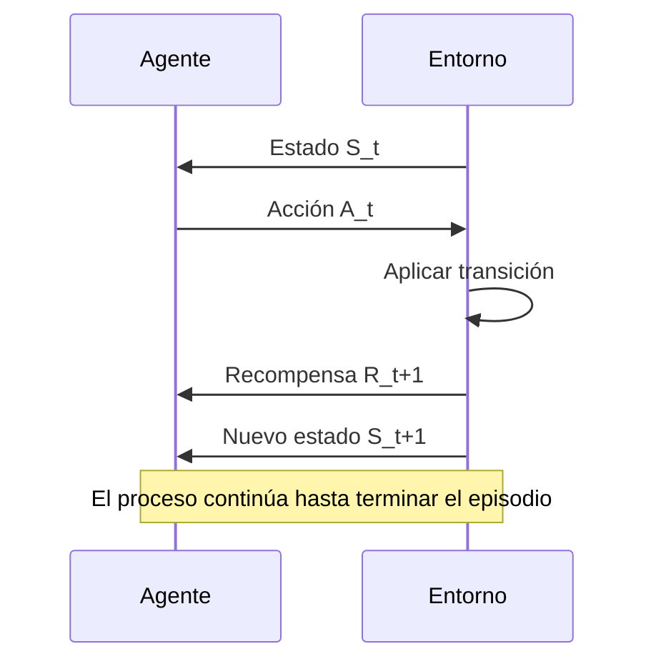
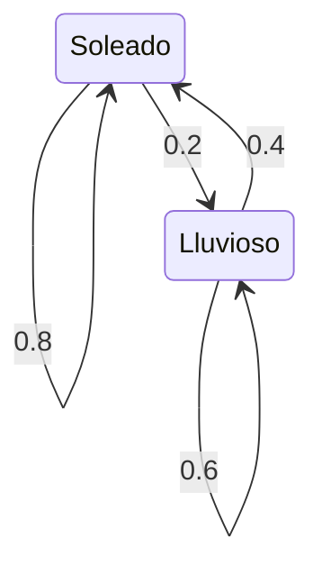
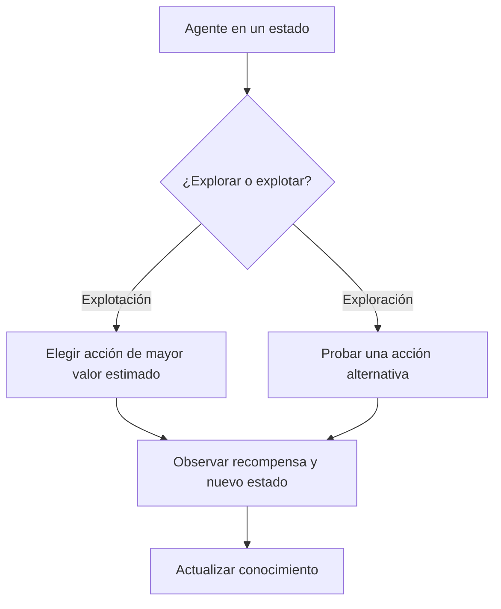
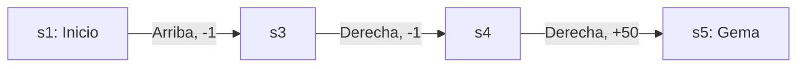
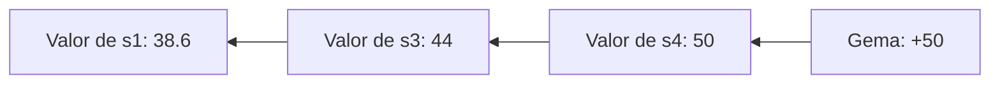
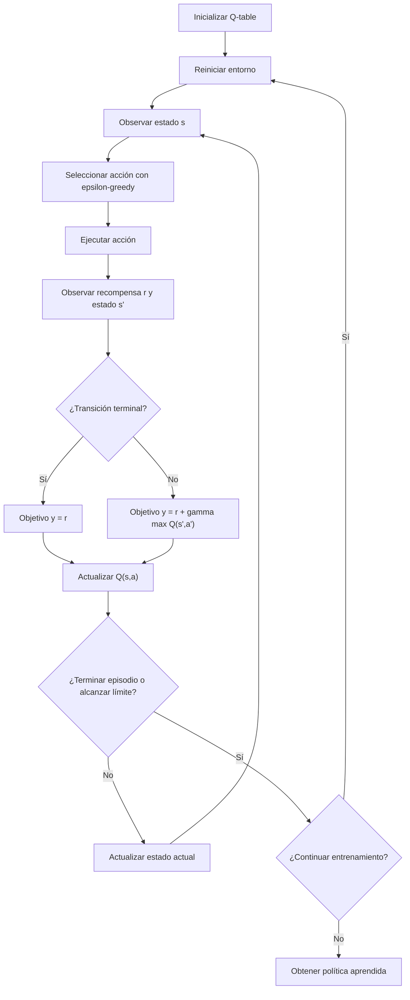
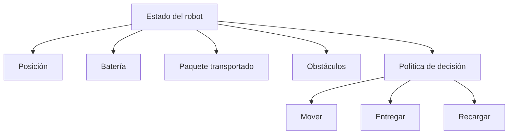
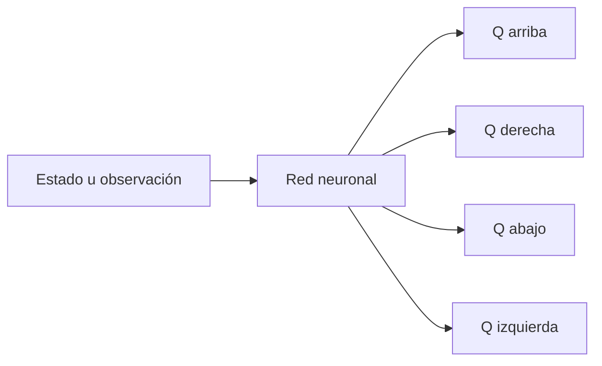
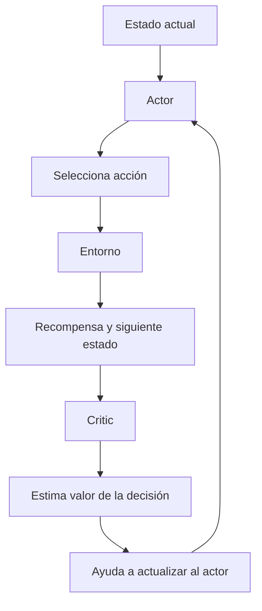

## Introducción  
  
El **Reinforcement Learning (RL)**, también conocido como **aprendizaje por refuerzo**, es una rama de Machine Learning en la que un agente aprende a tomar decisiones mediante la interacción con un entorno.  
  
A diferencia del aprendizaje supervisado, donde se conocen los resultados correctos de los ejemplos de entrenamiento, en Reinforcement Learning el agente no recibe necesariamente una indicación de cuál es la mejor acción en cada situación. En cambio, ejecuta acciones y obtiene **recompensas (rewards)** que permiten evaluar sus consecuencias.  
  
Por ejemplo, considérese un robot que debe transportar paquetes dentro de un almacén. En cada momento necesita decidir si debe avanzar, recoger un paquete, realizar una entrega o recargar su batería.  
  
Cada decisión modifica su situación y puede afectar las acciones que tendrá disponibles posteriormente. Una acción que parece conveniente de manera inmediata podría provocar un problema futuro, mientras que una acción con un costo inicial podría permitir obtener una recompensa mayor después.  
  
Por esta razón, el objetivo del aprendizaje por refuerzo no consiste simplemente en seleccionar la acción con mayor recompensa inmediata, sino en **aprender una estrategia que maximice la recompensa acumulada esperada a lo largo del tiempo**.  
  
Para comprender este procedimiento se estudian progresivamente:  
  
- **Markov Chains:** describen cómo un sistema cambia entre estados.  
- **Markov Decision Processes (MDP):** incorporan acciones y recompensas a las transiciones entre estados.  
- **Policies:** determinan qué acciones selecciona un agente.  
- **Return y Discount Factor:** permiten evaluar secuencias de recompensas.  
- **Value Functions y Bellman Equations:** relacionan las decisiones actuales con sus consecuencias futuras.  
- **Q-Learning:** aprende el valor de realizar acciones en diferentes estados.  
- **Deep Reinforcement Learning:** extiende estos principios utilizando redes neuronales.  
  
Estos conceptos permiten comprender cómo un agente puede aprender una política de decisión sin conocer inicialmente cuál es la mejor ruta para alcanzar su objetivo.  
  
---  
  
## Paradigmas de Machine Learning  
  
Los principales paradigmas de Machine Learning se distinguen por el tipo de información disponible, el feedback recibido y el objetivo del aprendizaje.  
  
### Aprendizaje supervisado:  
  
El **Supervised Learning** utiliza ejemplos que contienen características y resultados conocidos.  
  
Cada observación puede representarse mediante:  
  
$$  
(x_i,y_i)  
$$  
  
En donde:  
  
- $x_i$ representa las características.  
- $y_i$ representa el resultado observado.  
  
Por ejemplo, si se dispone del peso y tamaño de un paquete, puede entrenarse un modelo para predecir su tiempo de manipulación.  
  
El algoritmo ajusta una función que busca reducir las diferencias entre las predicciones y los resultados reales.  
  
### Aprendizaje no supervisado:  
  
El **Unsupervised Learning** utiliza observaciones sin etiquetas objetivo para la tarea.  
  
Su propósito consiste en identificar estructuras o construir representaciones de los datos.  
  
Por ejemplo:  
  
- **K-means:** identifica grupos de observaciones similares.  
- **PCA:** construye componentes que conservan varianza.  
- **t-SNE:** permite visualizar relaciones locales de similitud.  
  
Estos algoritmos no aprenden directamente qué acción debe realizarse para obtener una recompensa.  
  
### Aprendizaje por refuerzo:  
  
El **Reinforcement Learning** aprende a partir de experiencias que relacionan una situación, una acción y sus consecuencias.  
  
Una transición puede expresarse mediante:  
  
$$  
(s,a,r,s')  
$$  
  
En donde:  
  
- $s$ es el estado actual.  
- $a$ es la acción ejecutada.  
- $r$ es la recompensa recibida.  
- $s'$ es el siguiente estado.  
  
El objetivo consiste en aprender una **política (policy)** que permita seleccionar acciones para maximizar el retorno esperado.  
  
| Aspecto | Supervisado | No supervisado | Por refuerzo |  
|---|---|---|---|  
| Información | Características y objetivos | Características | Estados, acciones y recompensas |  
| Feedback | Resultado conocido | Estructura de los datos | Consecuencias de acciones |  
| Objetivo | Predecir | Descubrir patrones | Tomar decisiones |  
| Resultado | Predictor | Grupos o representaciones | Política |  
  
La diferencia fundamental no es si los datos son estáticos o dinámicos. El aprendizaje por refuerzo también puede utilizar experiencias registradas previamente.  
  
Lo que lo caracteriza es **aprender decisiones considerando sus consecuencias y las recompensas futuras**.  
  
---  
  
## Agente, entorno y ciclo de interacción  
  
En Reinforcement Learning intervienen dos elementos principales: el **agente (agent)** y el **entorno (environment)**.  
  
El agente es el sistema que toma decisiones.  
  
El entorno es aquello con lo que interactúa y que determina las consecuencias de sus acciones.  
  
Por ejemplo, en un videojuego:  
  
| Elemento | Ejemplo |  
|---|---|  
| Agente | Controlador que decide cómo jugar |  
| Entorno | Juego, enemigos y reglas |  
| Observación | Imagen de la pantalla |  
| Acción | Moverse, disparar o esperar |  
| Recompensa | Puntos obtenidos o penalización |  
  
### Ciclo de interacción:  
  
En cada instante $t$ ocurre la siguiente secuencia:  
  
1. El agente observa el estado $S_t$.  
2. Selecciona una acción $A_t$.  
3. El entorno procesa la acción.  
4. El agente recibe una recompensa $R_{t+1}$.  
5. El entorno proporciona el siguiente estado $S_{t+1}$.  
  

  
Este ciclo se repite y produce experiencias que el agente puede utilizar para aprender.  
  
### Recompensa y acción correcta:  
  
La recompensa permite evaluar una consecuencia, pero generalmente no indica directamente cuál era la mejor acción.  
  
Por ejemplo, un movimiento puede producir:  
  
$$  
r=-1  
$$  
  
porque consume tiempo.  
  
Sin embargo, ese movimiento podría acercar al agente a una recompensa futura de:  
  
$$  
r=+50  
$$  
  
Por lo tanto, **una recompensa inmediata negativa no significa necesariamente que la acción haya sido incorrecta**.  
  
---  
  
## Estados y observaciones  
  
Un **estado (state)** describe la información necesaria para representar la situación actual del entorno.  
  
Por ejemplo, para un robot en un almacén, el estado podría incluir:  
  
$$  
s=(\text{posición, batería, paquete})  
$$  
  
Las acciones apropiadas dependen de esta información.  
  
Un robot con batería suficiente puede realizar una entrega, mientras que otro situado en la misma posición, pero con batería casi agotada, podría necesitar recargar primero.  
  
### Diferencia entre estado y observación:  
  
El estado describe la situación relevante del entorno.  
  
La observación es la información que recibe el agente.  
  
Ambos conceptos pueden coincidir cuando el agente tiene acceso completo al estado, pero no siempre ocurre.  
  
Por ejemplo, una sola captura de pantalla de un videojuego puede mostrar la posición de un enemigo, pero no su velocidad.  
  
Para conocer cómo se está moviendo, podrían necesitarse varias imágenes consecutivas.  
  
Por lo tanto, una observación individual puede contener menos información que el estado necesario para tomar decisiones adecuadas.  
  
---  
  
## Entorno Gridworld  
  
Para estudiar los conceptos fundamentales se utiliza un entorno sencillo denominado **Gridworld**.  
  
Consiste en una cuadrícula de dos filas y cuatro columnas.  
  
Cada celda representa un estado.  
  
| | Columna 1 | Columna 2 | Columna 3 | Columna 4 |  
|---|---|---|---|---|  
| Fila superior | $s_2$ | $s_3$ | $s_4$ | $s_5$ — Gema |  
| Fila inferior | $s_0$ | $s_1$ — Inicio | $s_6$ — Fuego | $s_7$ |  
  
El agente comienza en:  
  
$$  
\boxed{s_1}  
$$  
  
Su objetivo consiste en alcanzar la gema:  
  
$$  
s_5  
$$  
  
sin entrar en la celda de fuego:  
  
$$  
s_6  
$$  
  
### Acciones disponibles:  
  
El agente puede seleccionar:  
  
$$  
A=\{\uparrow,\rightarrow,\downarrow,\leftarrow\}  
$$  
  
Es decir:  
  
- Arriba.  
- Derecha.  
- Abajo.  
- Izquierda.  
  
### Recompensas:  
  
| Resultado | Recompensa |  
|---|---:|  
| Movimiento ordinario | $-1$ |  
| Llegar a la gema | $+50$ |  
| Entrar al fuego | $-100$ |  
| Intentar salir de la cuadrícula | $-1$ |  
  
Cuando el agente intenta salir de los límites, permanece en la misma celda y recibe una penalización de $-1$.  
  
La posición inicial no proporciona una recompensa por sí misma.  
  
Cada acción recibe una única recompensa asociada con su resultado.  
  
### Estados terminales:  
  
La gema y el fuego son estados terminales.  
  
Si el agente entra en:  
  
$$  
s_5  
$$  
  
el episodio termina con recompensa:  
  
$$  
+50  
$$  
  
Si entra en:  
  
$$  
s_6  
$$  
  
termina con:  
  
$$  
-100  
$$  
  
Después de una transición terminal, el agente no ejecuta más acciones dentro de ese episodio.  
  
---  
  
## Transiciones entre estados  
  
Una **transición (transition)** representa el cambio producido al ejecutar una acción.  
  
Puede almacenarse como:  
  
$$  
(S_t,A_t,R_{t+1},S_{t+1})  
$$  
  
En implementaciones prácticas suele incluirse un indicador adicional:  
  
$$  
(S_t,A_t,R_{t+1},S_{t+1},\text{terminated})  
$$  
  
Este indicador permite distinguir si la acción terminó el episodio.  
  
### Ejemplo:  
  
Desde el estado inicial:  
  
$$  
s_1  
$$  
  
el agente puede moverse hacia arriba:  
  
$$  
s_1\xrightarrow{\uparrow,-1}s_3  
$$  
  
Esto significa:  
  
- Estado inicial: $s_1$.  
- Acción: arriba.  
- Recompensa: $-1$.  
- Estado siguiente: $s_3$.  
  
En cambio, si se mueve hacia la derecha:  
  
$$  
s_1\xrightarrow{\rightarrow,-100}s_6  
$$  
  
el agente entra directamente al fuego y el episodio termina.  
  
Las dos acciones parten del mismo estado, pero producen consecuencias muy diferentes.  
  
Esto introduce la necesidad de comparar decisiones considerando sus resultados futuros.  
  
---  
  
## Markov Chains  
  
Antes de estudiar decisiones, es necesario comprender cómo un sistema puede evolucionar entre estados.  
  
Una **Markov Chain**, o cadena de Markov, es un modelo probabilístico que describe transiciones entre estados a lo largo de pasos discretos.  
  
Su propiedad fundamental es que la distribución del siguiente estado depende únicamente del estado actual, cuando este contiene toda la información relevante.  
  
Esta condición se conoce como **Markov Property**.  
  
### Propiedad de Markov:  
  
$$  
\boxed{  
P(S_{t+1}\mid S_t,S_{t-1},\ldots)  
=  
P(S_{t+1}\mid S_t)  
}  
$$  
  
La expresión significa que, una vez conocido el estado presente, la historia anterior no aporta información adicional para determinar la distribución del siguiente estado.  
  
Esto no significa que los estados consecutivos sean independientes.  
  
Al contrario, el siguiente estado puede depender fuertemente del actual.  
  
### Ejemplo del clima:  
  
Considérese un modelo con dos estados:  
  
$$  
S=\{\text{Soleado, Lluvioso}\}  
$$  
  
Se establecen las siguientes probabilidades:  
  
- Si hoy está soleado, mañana estará soleado con probabilidad $0.8$.  
- Si hoy está soleado, mañana lloverá con probabilidad $0.2$.  
- Si hoy llueve, mañana estará soleado con probabilidad $0.4$.  
- Si hoy llueve, mañana también lloverá con probabilidad $0.6$.  
  

  
Este modelo permite calcular probabilidades futuras a partir del estado presente.  
  
---  
  
## Matriz de transición  
  
Las probabilidades de una cadena de Markov pueden organizarse en una **matriz de transición (Transition Matrix)**.  
  
Para el ejemplo del clima:  
  
$$  
\boxed{  
P=  
\begin{pmatrix}  
0.8&0.2\\  
0.4&0.6  
\end{pmatrix}  
}  
$$  
  
Se utiliza el orden:  
  
$$  
(\text{Soleado, Lluvioso})  
$$  
  
Las filas representan el estado actual y las columnas representan el estado siguiente.  
  
Por lo tanto:  
  
$$  
P_{ij}=P(S_{t+1}=j\mid S_t=i)  
$$  
  
### Propiedades:  
  
Cada entrada representa una probabilidad:  
  
$$  
0\leq P_{ij}\leq1  
$$  
  
Cada fila debe sumar uno:  
  
$$  
\sum_j P_{ij}=1  
$$  
  
Por ejemplo:  
  
$$  
0.8+0.2=1  
$$  
  
$$  
0.4+0.6=1  
$$  
  
Los valores de la diagonal representan la probabilidad de permanecer en el mismo estado durante otro paso.  
  
---  
  
## Predicción de estados mediante cadenas de Markov  
  
Una distribución de probabilidad sobre los estados puede representarse mediante un vector fila:  
  
$$  
\mu_t  
$$  
  
La distribución del siguiente instante se calcula mediante:  
  
$$  
\boxed{  
\mu_{t+1}=\mu_tP  
}  
$$  
  
### Ejemplo: día inicialmente soleado:  
  
Supóngase que hoy se sabe con certeza que está soleado.  
  
Entonces:  
  
$$  
\mu_0=(1,0)  
$$  
  
La distribución del día siguiente es:  
  
$$  
\mu_1=  
(1,0)  
\begin{pmatrix}  
0.8&0.2\\  
0.4&0.6  
\end{pmatrix}  
$$  
  
Por lo tanto:  
  
$$  
\boxed{\mu_1=(0.8,0.2)}  
$$  
  
Esto significa:  
  
- Probabilidad de sol mañana: $80\%$.  
- Probabilidad de lluvia mañana: $20\%$.  
  
Una distribución representa incertidumbre sobre posibles resultados; el clima que realmente ocurra tendrá un solo estado.  
  
---  
  
## Transiciones de múltiples pasos  
  
Para calcular la distribución después de dos pasos se utiliza:  
  
$$  
\mu_2=\mu_1P  
$$  
  
De manera equivalente:  
  
$$  
\boxed{\mu_2=\mu_0P^2}  
$$  
  
### Ejemplo: lluvia dentro de dos días:  
  
Si hoy está soleado, existen dos caminos posibles para que dentro de dos días llueva.  
  
Primer camino:  
  
$$  
S\rightarrow S\rightarrow R  
$$  
  
Su probabilidad es:  
  
$$  
0.8(0.2)=0.16  
$$  
  
Segundo camino:  
  
$$  
S\rightarrow R\rightarrow R  
$$  
  
Su probabilidad es:  
  
$$  
0.2(0.6)=0.12  
$$  
  
Como los caminos son mutuamente excluyentes, sus probabilidades se suman:  
  
$$  
P(S_2=R\mid S_0=S)=0.16+0.12  
$$  
  
$$  
\boxed{P(S_2=R\mid S_0=S)=0.28}  
$$  
  
La distribución completa es:  
  
$$  
\boxed{\mu_2=(0.72,0.28)}  
$$  
  
Por lo tanto, después de dos días existe una probabilidad del $72\%$ de sol y del $28\%$ de lluvia.  
  
La regla importante es:  
  
**Se multiplican las probabilidades a lo largo de un camino y se suman las probabilidades de los caminos alternativos que conducen al mismo resultado.**  
  
### Ejemplo con un día lluvioso:  
  
Si el estado inicial es:  
  
$$  
\mu_0=(0,1)  
$$  
  
la distribución de mañana es:  
  
$$  
\mu_1=(0.4,0.6)  
$$  
  
La probabilidad de sol dentro de dos días es:  
  
$$  
P(R\rightarrow S\rightarrow S)+P(R\rightarrow R\rightarrow S)  
$$  
  
$$  
=0.4(0.8)+0.6(0.4)  
$$  
  
$$  
=0.32+0.24  
$$  
  
$$  
\boxed{P(S_2=S)=0.56}  
$$  
  
La distribución final es:  
  
$$  
\boxed{\mu_2=(0.56,0.44)}  
$$  
  
---  
  
## Markov Decision Processes  
  
Una cadena de Markov describe cómo evoluciona un sistema, pero no incorpora necesariamente decisiones controladas por un agente.  
  
Un **Markov Decision Process (MDP)** extiende esta idea al incluir acciones y recompensas.  
  
Su representación es:  
  
$$  
\boxed{  
M=(S,A,P,r,\gamma)  
}  
$$  
  
En donde:  
  
- $S$ es el conjunto de estados.  
- $A$ es el conjunto de acciones.  
- $P$ representa las probabilidades de transición.  
- $r$ representa la función de recompensa.  
- $\gamma$ es el factor de descuento.  
  
### Estados:  
  
Representan las situaciones posibles del entorno.  
  
En Gridworld:  
  
$$  
S=\{s_0,s_1,\ldots,s_7\}  
$$  
  
### Acciones:  
  
Representan las decisiones disponibles para el agente.  
  
$$  
A=\{\uparrow,\rightarrow,\downarrow,\leftarrow\}  
$$  
  
### Probabilidades de transición:  
  
Describen cómo una acción puede modificar el estado:  
  
$$  
P(s'\mid s,a)  
$$  
  
### Recompensa:  
  
Describe el feedback asociado con una transición:  
  
$$  
r(s,a,s')  
$$  
  
### Factor de descuento:  
  
Controla la importancia de recompensas futuras:  
  
$$  
\gamma  
$$  
  
La diferencia central es que **una cadena de Markov describe la evolución de estados, mientras que un MDP permite estudiar decisiones que influyen en esa evolución**.  
  
| Propiedad | Markov Chain | MDP |  
|---|---|---|  
| Transiciones | $P(s'\mid s)$ | $P(s'\mid s,a)$ |  
| Acciones controladas | No | Sí |  
| Recompensas | No son necesarias | Sí |  
| Objetivo | Describir evolución | Maximizar retorno esperado |  
  
---  
  
## Propiedad de Markov en un MDP  
  
En un MDP, la propiedad de Markov debe considerar tanto el estado como la acción.  
  
Su expresión es:  
  
$$  
\boxed{  
P(S_{t+1},R_{t+1}\mid S_t,A_t,\text{historia})  
=  
P(S_{t+1},R_{t+1}\mid S_t,A_t)  
}  
$$  
  
Esto significa que el estado actual y la acción seleccionada contienen la información necesaria para determinar las probabilidades de los resultados siguientes.  
  
### Ejemplo de una puerta cerrada:  
  
Supóngase que un agente intenta atravesar una puerta que solamente se abre después de recoger una llave.  
  
Si el estado contiene únicamente:  
  
$$  
s=\text{posición}  
$$  
  
dos situaciones diferentes podrían parecer idénticas:  
  
- El agente está frente a la puerta y tiene la llave.  
- El agente está frente a la puerta y no tiene la llave.  
  
Sin embargo, la misma acción produciría resultados diferentes.  
  
Por lo tanto, la posición no es información suficiente.  
  
Una representación más apropiada sería:  
  
$$  
\boxed{  
s=(\text{posición},\text{tiene llave})  
}  
$$  
  
Ahora el estado distingue las situaciones relevantes.  
  
### Importancia del diseño del estado:  
  
En un almacén, representar solamente la posición de un robot puede ser insuficiente si la batería determina qué rutas puede completar.  
  
El estado debería incluir también la energía disponible.  
  
Una representación inadecuada puede impedir que el agente aprenda decisiones correctas, aunque el algoritmo de aprendizaje funcione apropiadamente.  
  
---  
  
## Transiciones deterministas y estocásticas  
  
Las transiciones de un MDP pueden ser deterministas o estocásticas.  
  
### Transición determinista:  
  
Una acción produce un resultado conocido con probabilidad uno.  
  
Por ejemplo:  
  
$$  
P(s_3\mid s_1,\uparrow)=1  
$$  
  
Esto significa que moverse hacia arriba desde $s_1$ conduce siempre a $s_3$.  
  
### Transición estocástica:  
  
Una acción puede producir diferentes estados siguientes.  
  
Por ejemplo, un robot puede intentar avanzar, pero el movimiento podría fallar.  
  
Supóngase que:  
  
$$  
P(\text{avanzar}\mid s,\rightarrow)=0.8  
$$  
  
y:  
  
$$  
P(\text{permanecer}\mid s,\rightarrow)=0.2  
$$  
  
El agente selecciona la acción derecha, pero el entorno determina aleatoriamente si el movimiento se completa.  
  
Esta incertidumbre pertenece a la dinámica del entorno.  
  
No debe confundirse con la aleatoriedad utilizada por el agente para seleccionar sus acciones.  
  
---  
  
## Políticas  
  
Una **política (policy)** establece cómo selecciona acciones un agente dependiendo del estado actual.  
  
Se representa mediante:  
  
$$  
\pi  
$$  
  
El objetivo del aprendizaje por refuerzo es encontrar una política que produzca un retorno esperado elevado.  
  
### Política determinista:  
  
Selecciona una única acción para cada estado.  
  
$$  
\boxed{a=\pi(s)}  
$$  
  
Por ejemplo:  
  
$$  
\pi(s_1)=\uparrow  
$$  
  
Esto significa que el agente siempre elige subir cuando se encuentra en $s_1$.  
  
### Política estocástica:  
  
Asigna probabilidades a las acciones posibles.  
  
$$  
\boxed{\pi(a\mid s)}  
$$  
  
Por ejemplo, en $s_1$:  
  
| Acción | Probabilidad |  
|---|---:|  
| Arriba | 0.70 |  
| Derecha | 0.05 |  
| Abajo | 0.10 |  
| Izquierda | 0.15 |  
  
La suma de probabilidades es:  
  
$$  
0.70+0.05+0.10+0.15=1  
$$  
  
Por lo tanto, la distribución es válida.  
  
### Diferencia entre política y modelo:  
  
El modelo del entorno describe qué puede ocurrir:  
  
$$  
P(s'\mid s,a)  
$$  
  
La política describe qué decide hacer el agente:  
  
$$  
\pi(a\mid s)  
$$  
  
**El modelo representa cómo funciona el entorno; la política representa cómo actúa el agente.**  
  
### Trayectoria:  
  
Una **trayectoria (trajectory)** es una secuencia concreta de estados, acciones y recompensas experimentada al seguir una política.  
  
Por ejemplo:  
  
$$  
s_1\xrightarrow{\uparrow}s_3  
\xrightarrow{\rightarrow}s_4  
\xrightarrow{\rightarrow}s_5  
$$  
  
Esta trayectoria conduce a la gema.  
  
Una política puede producir trayectorias diferentes cuando utiliza acciones estocásticas o cuando el entorno presenta transiciones inciertas.  
  
---  
  
## Episodios y recompensas acumuladas  
  
Un **episodio (episode)** es una secuencia de interacciones que comienza en un estado inicial y termina al alcanzar una condición terminal.  
  
En Gridworld, entrar a la gema o al fuego termina el episodio.  
  
Considérense tres trayectorias posibles desde $s_1$.  
  
### Episodio A: ruta corta hacia la gema:  
  
Acciones:  
  
$$  
\uparrow,\rightarrow,\rightarrow  
$$  
  
Recompensas:  
  
$$  
-1,-1,+50  
$$  
  
La suma es:  
  
$$  
G=-1-1+50  
$$  
  
$$  
\boxed{G=48}  
$$  
  
### Episodio B: ruta más larga hacia la gema:  
  
Acciones:  
  
$$  
\leftarrow,\uparrow,\rightarrow,\rightarrow,\rightarrow  
$$  
  
Recompensas:  
  
$$  
-1,-1,-1,-1,+50  
$$  
  
La suma es:  
  
$$  
G=-1-1-1-1+50  
$$  
  
$$  
\boxed{G=46}  
$$  
  
### Episodio C: entrada directa al fuego:  
  
Acción:  
  
$$  
\rightarrow  
$$  
  
Recompensa:  
  
$$  
-100  
$$  
  
Por lo tanto:  
  
$$  
\boxed{G=-100}  
$$  
  
### Comparación:  
  
| Episodio | Acciones | Recompensa total |  
|---|---:|---:|  
| A | 3 | 48 |  
| B | 5 | 46 |  
| C | 1 | -100 |  
  
Ambas rutas exitosas alcanzan la gema, pero la ruta A obtiene un retorno mayor porque requiere menos movimientos penalizados.  
  
Esto muestra por qué una penalización pequeña por movimiento puede incentivar rutas más cortas.  
  
---  
  
## Return y factor de descuento  
  
El **return**, o retorno, representa la recompensa acumulada a partir de un instante determinado.  
  
Sin embargo, no siempre se consideran igualmente importantes todas las recompensas futuras.  
  
Para controlar esta diferencia se introduce el **discount factor**:  
  
$$  
\gamma  
$$  
  
En un episodio finito, el retorno descontado puede expresarse mediante:  
  
$$  
\boxed{  
G_t=\sum_{k=0}^{T-t-1}\gamma^kR_{t+k+1}  
}  
$$  
  
En donde:  
  
- $G_t$ representa el retorno desde el instante $t$.  
- $R_{t+k+1}$ representa una recompensa futura.  
- $\gamma$ es el factor de descuento.  
- $T$ representa el instante terminal.  
  
En este contexto:  
  
$$  
0\leq\gamma\leq1  
$$  
  
### Interpretación de gamma:  
  
**Si $\gamma=0$**, solamente importa la recompensa inmediata.  
  
**Si $\gamma=1$**, las recompensas del episodio se suman sin descuento.  
  
**Si $0<\gamma<1$**, las recompensas futuras reciben progresivamente menor peso.  
  
Por lo tanto, $\gamma$ controla cuánto valor se asigna a consecuencias que ocurren más adelante.  
  
---  
  
## Ejemplo de retorno descontado  
  
Considérese la ruta corta hacia la gema:  
  
$$  
-1,-1,+50  
$$  
  
Se utiliza:  
  
$$  
\gamma=0.9  
$$  
  
El retorno es:  
  
$$  
G_0=-1+0.9(-1)+0.9^2(50)  
$$  
  
Como:  
  
$$  
0.9^2=0.81  
$$  
  
se obtiene:  
  
$$  
G_0=-1-0.9+40.5  
$$  
  
$$  
\boxed{G_0=38.6}  
$$  
  
La recompensa final sigue siendo:  
  
$$  
+50  
$$  
  
pero su contribución al retorno inicial es:  
  
$$  
0.9^2(50)=40.5  
$$  
  
porque ocurre dos pasos después de la primera recompensa.  
  
### Ruta más larga:  
  
Para:  
  
$$  
-1,-1,-1,-1,+50  
$$  
  
el retorno es:  
  
$$  
G_0=-1-0.9-0.81-0.729+0.9^4(50)  
$$  
  
Como:  
  
$$  
0.9^4=0.6561  
$$  
  
se obtiene:  
  
$$  
G_0=-1-0.9-0.81-0.729+32.805  
$$  
  
$$  
\boxed{G_0=29.366}  
$$  
  
### Comparación:  
  
| Ruta | Sin descuento | Con $\gamma=0.9$ |  
|---|---:|---:|  
| Corta | 48 | 38.6 |  
| Larga | 46 | 29.366 |  
  
La ruta corta obtiene mayor retorno en ambos casos.  
  
Con descuento, la diferencia se acentúa porque la gema se alcanza antes.  
  
**Una misma recompensa futura tiene menor contribución al retorno cuanto más tarde se recibe, cuando $\gamma<1$.**  
  
---  
  
## Exploración y explotación  
  
El agente necesita aprender cuáles acciones son útiles, pero al principio no conoce sus consecuencias.  
  
Esto produce un problema fundamental denominado **Exploration–Exploitation Trade-off**.  
  
### Explotación:  
  
La **explotación (exploitation)** consiste en seleccionar la acción que actualmente parece tener mayor valor.  
  
Por ejemplo, si el agente considera que subir desde $s_1$ es la mejor opción, puede continuar seleccionando esa acción.  
  
### Exploración:  
  
La **exploración (exploration)** consiste en probar otras acciones para obtener información y mejorar las estimaciones.  
  
Por ejemplo, aunque subir parezca adecuado, el agente podría explorar otra dirección para comprobar si existe una ruta mejor.  
  

  
### ¿Por qué no conviene explotar desde el principio?:  
  
Si el agente utiliza siempre la primera ruta exitosa que descubre, podría ignorar otras rutas más cortas o seguras.  
  
En cambio, explorar indefinidamente tampoco es conveniente porque puede provocar acciones innecesarias o peligrosas.  
  
Por ello, es necesario equilibrar ambas estrategias.  
  
Durante el entrenamiento puede mantenerse cierto nivel de exploración, incluso cuando la política greedy aprendida ya es adecuada.  
  
---  
  
## Funciones de valor  
  
Para tomar decisiones no basta con conocer las recompensas inmediatas.  
  
Es necesario estimar qué tan conveniente es encontrarse en un estado o ejecutar una acción.  
  
Para ello se utilizan las **Value Functions**.  
  
Existen dos funciones fundamentales:  
  
- **State-Value Function:** $V^\pi(s)$.  
- **Action-Value Function:** $Q^\pi(s,a)$.  
  
### State-Value Function:  
  
La función de valor de estado es:  
  
$$  
\boxed{  
V^\pi(s)=\mathbb{E}_\pi[G_t\mid S_t=s]  
}  
$$  
  
Representa el retorno esperado al comenzar en el estado $s$ y seguir la política $\pi$.  
  
Responde a la pregunta:  
  
**¿Qué tan conveniente es estar en este estado bajo determinada política?**  
  
### Action-Value Function:  
  
La función de valor de acción es:  
  
$$  
\boxed{  
Q^\pi(s,a)=  
\mathbb{E}_\pi[G_t\mid S_t=s,A_t=a]  
}  
$$  
  
Representa el retorno esperado al ejecutar la acción $a$ en el estado $s$ y después continuar siguiendo la política $\pi$.  
  
Responde a la pregunta:  
  
**¿Qué tan conveniente es ejecutar esta acción desde este estado?**  
  
### Diferencia:  
  
| Función | Evalúa |  
|---|---|  
| $V^\pi(s)$ | Un estado |  
| $Q^\pi(s,a)$ | Una acción específica en un estado |  
  
### ¿Q representa una probabilidad?:  
  
No.  
  
El valor:  
  
$$  
Q(s,a)  
$$  
  
representa una estimación de retorno.  
  
Por ejemplo:  
  
$$  
Q(s_1,\uparrow)=38.6  
$$  
  
no significa que exista una probabilidad del $38.6\%$ de obtener la gema.  
  
Significa que el retorno esperado asociado con esa decisión tiene valor $38.6$ bajo las condiciones correspondientes.  
  
---  
  
## Bellman Equations  
  
Las **Bellman Equations** permiten relacionar el valor de una decisión actual con la recompensa inmediata y el valor de la situación siguiente.  
  
La idea fundamental es que el retorno puede descomponerse como:  
  
$$  
\boxed{  
G_t=R_{t+1}+\gamma G_{t+1}  
}  
$$  
  
Es decir:  
  
**Retorno actual = Recompensa inmediata + Retorno futuro descontado.**  
  
Esta relación permite estudiar decisiones largas mediante problemas más pequeños.  
  
### Bellman Optimality Equation:  
  
Para los valores óptimos de acción:  
  
$$  
\boxed{  
Q^*(s,a)=  
\mathbb{E}  
\left[  
R_{t+1}  
+  
\gamma\max_{a'}Q^*(S_{t+1},a')  
\mid s,a  
\right]  
}  
$$  
  
En donde:  
  
- $Q^*(s,a)$ representa el valor óptimo de ejecutar $a$ desde $s$.  
- $R_{t+1}$ representa la recompensa inmediata.  
- $S_{t+1}$ es el siguiente estado.  
- $\gamma$ descuenta el valor futuro.  
- $\max_{a'}$ selecciona la mejor acción futura disponible.  
  
La ecuación expresa que una decisión puede ser valiosa incluso cuando su recompensa inmediata es negativa.  
  
Esto ocurre cuando conduce a estados desde los cuales se pueden obtener recompensas importantes.  
  
---  
  
## Bellman y estados terminales  
  
Cuando una transición conduce a un estado terminal, no existen acciones futuras dentro del episodio.  
  
Por lo tanto, desaparece el término de valor futuro.  
  
En una transición terminal:  
  
$$  
\boxed{  
Q^*(s,a)=\mathbb{E}[R_{t+1}\mid s,a]  
}  
$$  
  
En Gridworld las transiciones son deterministas.  
  
Por lo tanto, entrar directamente a la gema tiene valor:  
  
$$  
Q^*(s_4,\rightarrow)=50  
$$  
  
Mientras que entrar directamente al fuego produce:  
  
$$  
Q^*(s_1,\rightarrow)=-100  
$$  
  
No debe agregarse una recompensa futura después de terminar el episodio.  
  
---  
  
## Cálculo de valores mediante Bellman  
  
Considérese la ruta segura:  
  
$$  
s_1\rightarrow s_3\rightarrow s_4\rightarrow s_5  
$$  
  
Con:  
  
$$  
\gamma=0.9  
$$  
  
Se pueden calcular sus valores trabajando desde el final hacia el inicio.  
  
### Último movimiento:  
  
Desde $s_4$, moverse a la derecha conduce directamente a la gema.  
  
$$  
\boxed{Q^*(s_4,\rightarrow)=50}  
$$  
  
### Movimiento anterior:  
  
Desde $s_3$, moverse a la derecha conduce a $s_4$ y proporciona una recompensa inmediata de $-1$.  
  
Después puede obtenerse el valor de alcanzar la gema:  
  
$$  
Q^*(s_3,\rightarrow)=-1+0.9(50)  
$$  
  
$$  
=-1+45  
$$  
  
$$  
\boxed{Q^*(s_3,\rightarrow)=44}  
$$  
  
### Primer movimiento:  
  
Desde $s_1$, subir conduce a $s_3$ con recompensa $-1$.  
  
$$  
Q^*(s_1,\uparrow)=-1+0.9(44)  
$$  
  
$$  
=-1+39.6  
$$  
  
$$  
\boxed{Q^*(s_1,\uparrow)=38.6}  
$$  
  

  
Los valores calculados son:  
  
| Estado y acción | Valor |  
|---|---:|  
| $Q^*(s_4,\rightarrow)$ | 50 |  
| $Q^*(s_3,\rightarrow)$ | 44 |  
| $Q^*(s_1,\uparrow)$ | 38.6 |  
  
El primer movimiento tiene una recompensa inmediata de:  
  
$$  
-1  
$$  
  
pero un valor de acción positivo:  
  
$$  
38.6  
$$  
  
porque permite alcanzar una recompensa importante posteriormente.  
  
**La recompensa inmediata y el valor a largo plazo de una acción no representan lo mismo.**  
  
---  
  
## Q-Learning  
  
**Q-Learning** es un algoritmo de aprendizaje por refuerzo que aprende estimaciones de los valores:  
  
$$  
Q(s,a)  
$$  
  
a partir de transiciones observadas durante la interacción con el entorno.  
  
Su objetivo consiste en aproximar:  
  
$$  
Q^*(s,a)  
$$  
  
sin necesitar conocer previamente todas las probabilidades de transición ni todas las recompensas del entorno.  
  
### Q-table:  
  
Cuando el número de estados y acciones es pequeño, los valores pueden almacenarse en una tabla denominada **Q-table**.  
  
En Gridworld existen:  
  
$$  
8  
$$  
  
estados y:  
  
$$  
4  
$$  
  
acciones.  
  
Por lo tanto, la tabla tiene:  
  
$$  
8\times4=32  
$$  
  
entradas.  
  
| Estado | ↑ | → | ↓ | ← |  
|---|---:|---:|---:|---:|  
| $s_0$ | $Q(s_0,\uparrow)$ | $Q(s_0,\rightarrow)$ | $Q(s_0,\downarrow)$ | $Q(s_0,\leftarrow)$ |  
| $s_1$ | $Q(s_1,\uparrow)$ | $Q(s_1,\rightarrow)$ | $Q(s_1,\downarrow)$ | $Q(s_1,\leftarrow)$ |  
| $\vdots$ | $\vdots$ | $\vdots$ | $\vdots$ | $\vdots$ |  
| $s_7$ | $Q(s_7,\uparrow)$ | $Q(s_7,\rightarrow)$ | $Q(s_7,\downarrow)$ | $Q(s_7,\leftarrow)$ |  
  
Cada entrada almacena una estimación del valor de una acción en un estado.  
  
### Inicialización:  
  
Una estrategia sencilla consiste en inicializar las entradas con cero.  
  
$$  
Q(s,a)=0  
$$  
  
Sin embargo, un cero inicial no significa que la acción sea segura ni que tenga un retorno verdadero de cero.  
  
Puede significar simplemente que todavía no se ha aprendido información sobre esa decisión.  
  
Los estados terminales no poseen decisiones posteriores. Sus filas pueden mostrarse con ceros por convenio.  
  
---  
  
## Regla de actualización de Q-Learning  
  
Q-Learning actualiza una entrada utilizando la diferencia entre una estimación anterior y un nuevo objetivo.  
  
Su fórmula es:  
  
$$  
\boxed{  
Q(s,a)\leftarrow  
Q(s,a)+\alpha[y-Q(s,a)]  
}  
$$  
  
En donde:  
  
- $Q(s,a)$ es el valor anterior.  
- $y$ es el objetivo de actualización.  
- $\alpha$ es la tasa de aprendizaje.  
- $y-Q(s,a)$ es el error de diferencia temporal.  
  
El objetivo depende de si la transición termina el episodio.  
  
### Transición no terminal:  
  
$$  
\boxed{  
y=r+\gamma\max_{a'}Q(s',a')  
}  
$$  
  
### Transición terminal:  
  
$$  
\boxed{y=r}  
$$  
  
Por lo tanto, la regla completa es:  
  
$$  
\boxed{  
y=  
\begin{cases}  
r & \text{si la transición es terminal}\\  
r+\gamma\max_{a'}Q(s',a') & \text{en otro caso}  
\end{cases}  
}  
$$  
  
Esta distinción es fundamental.  
  
En una transición terminal no debe agregarse el valor futuro porque el episodio ha terminado.  
  
---  
  
## Hiperparámetros de Q-Learning  
  
Q-Learning utiliza varios hiperparámetros con funciones diferentes.  
  
### Learning rate:  
  
La tasa de aprendizaje se representa mediante:  
  
$$  
\alpha  
$$  
  
Controla cuánto se modifica una estimación después de observar una transición.  
  
Un valor pequeño produce cambios graduales.  
  
Un valor grande permite acercarse más rápidamente al nuevo objetivo.  
  
### Discount factor:  
  
El factor de descuento se representa mediante:  
  
$$  
\gamma  
$$  
  
Controla la importancia de las recompensas futuras.  
  
### Exploration rate:  
  
La tasa de exploración suele representarse mediante:  
  
$$  
\epsilon  
$$  
  
Controla la probabilidad de explorar en una política epsilon-greedy.  
  
| Hiperparámetro | Función |  
|---|---|  
| $\alpha$ | Cuánto aprende de una actualización |  
| $\gamma$ | Cuánto valora recompensas futuras |  
| $\epsilon$ | Con qué frecuencia explora |  
  
**Alpha controla el aprendizaje, gamma controla el descuento y epsilon controla la exploración.**  
  
No deben confundirse.  
  
---  
  
## Ejemplo numérico de Q-Learning  
  
Supóngase que el agente observa la transición:  
  
$$  
s_1\xrightarrow{\uparrow,-1}s_3  
$$  
  
Se conocen los siguientes valores:  
  
$$  
Q(s_1,\uparrow)=2  
$$  
  
$$  
\max_{a'}Q(s_3,a')=10  
$$  
  
$$  
\alpha=0.5  
$$  
  
$$  
\gamma=0.9  
$$  
  
### Cálculo del objetivo:  
  
Como la transición no es terminal:  
  
$$  
y=r+\gamma\max_{a'}Q(s',a')  
$$  
  
Sustituyendo:  
  
$$  
y=-1+0.9(10)  
$$  
  
$$  
\boxed{y=8}  
$$  
  
### Error de diferencia temporal:  
  
El **Temporal-Difference Error** es:  
  
$$  
\delta=y-Q(s,a)  
$$  
  
Por lo tanto:  
  
$$  
\delta=8-2  
$$  
  
$$  
\boxed{\delta=6}  
$$  
  
### Actualización:  
  
$$  
Q_{\text{nuevo}}(s_1,\uparrow)=2+0.5(6)  
$$  
  
$$  
\boxed{Q_{\text{nuevo}}(s_1,\uparrow)=5}  
$$  
  
### Interpretación:  
  
El valor anterior era:  
  
$$  
2  
$$  
  
El nuevo objetivo es:  
  
$$  
8  
$$  
  
Como:  
  
$$  
\alpha=0.5  
$$  
  
la estimación se mueve a la mitad de la distancia entre ambos valores.  
  
El resultado es:  
  
$$  
5  
$$  
  
Por lo tanto, una actualización no necesariamente reemplaza por completo el valor anterior.  
  
---  
  
## Q-Learning en transiciones terminales  
  
Supóngase que el agente se encuentra en $s_1$ y se mueve a la derecha.  
  
Esto produce:  
  
$$  
s_1\xrightarrow{\rightarrow,-100}s_6  
$$  
  
El estado $s_6$ corresponde al fuego y termina el episodio.  
  
Se tiene:  
  
$$  
Q(s_1,\rightarrow)=0  
$$  
  
$$  
\alpha=0.5  
$$  
  
### Objetivo terminal:  
  
Como no existen recompensas futuras dentro del episodio:  
  
$$  
\boxed{y=-100}  
$$  
  
### Actualización:  
  
$$  
Q_{\text{nuevo}}(s_1,\rightarrow)  
=  
0+0.5(-100-0)  
$$  
  
$$  
\boxed{Q_{\text{nuevo}}(s_1,\rightarrow)=-50}  
$$  
  
El valor se desplaza hacia la recompensa terminal negativa.  
  
### Segunda actualización:  
  
Si posteriormente se observa nuevamente la misma transición y se mantiene:  
  
$$  
\alpha=0.5  
$$  
  
entonces:  
  
$$  
Q_{\text{nuevo}}=-50+0.5(-100+50)  
$$  
  
$$  
=-50-25  
$$  
  
$$  
\boxed{Q_{\text{nuevo}}=-75}  
$$  
  
La estimación continúa acercándose a:  
  
$$  
-100  
$$  
  
Este ejemplo demuestra que la tasa de aprendizaje controla la velocidad con la que se incorporan las experiencias.  
  
---  
  
## Propagación de recompensas futuras  
  
Una característica fundamental de Q-Learning es que el valor de una recompensa futura puede propagarse hacia estados anteriores mediante nuevas experiencias.  
  
Supóngase que todas las entradas de la Q-table comienzan en cero.  
  
Se utilizan:  
  
$$  
\alpha=1  
$$  
  
$$  
\gamma=0.9  
$$  
  
El agente realiza una ruta exitosa:  
  
$$  
s_1\rightarrow s_3\rightarrow s_4\rightarrow s_5  
$$  
  
### Primera visita:  
  
Desde $s_1$ se mueve a $s_3$.  
  
Como todavía no se conoce un valor futuro positivo:  
  
$$  
Q(s_1,\uparrow)=-1+0.9(0)  
$$  
  
$$  
\boxed{Q(s_1,\uparrow)=-1}  
$$  
  
### Segunda visita:  
  
Desde $s_3$ se mueve a $s_4$.  
  
$$  
Q(s_3,\rightarrow)=-1+0.9(0)  
$$  
  
$$  
\boxed{Q(s_3,\rightarrow)=-1}  
$$  
  
### Llegada a la gema:  
  
Desde $s_4$ se mueve a $s_5$.  
  
Como la transición es terminal:  
  
$$  
\boxed{Q(s_4,\rightarrow)=50}  
$$  
  
La primera experiencia exitosa termina aquí.  
  
Sin embargo, los valores positivos todavía no se han propagado completamente hacia los estados anteriores.  
  
### Nuevas visitas:  
  
En una experiencia posterior, el agente vuelve a ejecutar la acción derecha desde $s_3$.  
  
Ahora conoce que:  
  
$$  
Q(s_4,\rightarrow)=50  
$$  
  
Por lo tanto:  
  
$$  
Q(s_3,\rightarrow)=-1+0.9(50)  
$$  
  
$$  
\boxed{Q(s_3,\rightarrow)=44}  
$$  
  
Posteriormente vuelve a ejecutar la acción arriba desde $s_1$.  
  
$$  
Q(s_1,\uparrow)=-1+0.9(44)  
$$  
  
$$  
\boxed{Q(s_1,\uparrow)=38.6}  
$$  
  
### Resumen:  
  
| Visita | Acción actualizada | Nuevo valor |  
|---|---|---:|  
| 1 | $Q(s_1,\uparrow)$ | -1 |  
| 2 | $Q(s_3,\rightarrow)$ | -1 |  
| 3 | $Q(s_4,\rightarrow)$ | 50 |  
| 4 | $Q(s_3,\rightarrow)$ | 44 |  
| 5 | $Q(s_1,\uparrow)$ | 38.6 |  
  
Las últimas dos actualizaciones corresponden a nuevas visitas, no a movimientos posteriores al final del episodio.  
  

  
Este mecanismo permite que una recompensa final influya progresivamente en decisiones tomadas muchos pasos antes.  
  
---  
  
## Epsilon-greedy  
  
Una estrategia común para combinar exploración y explotación es **epsilon-greedy**.  
  
El agente selecciona acciones mediante dos posibilidades:  
  
- Con probabilidad $1-\epsilon$, selecciona una acción de mayor valor estimado.  
- Con probabilidad $\epsilon$, selecciona aleatoriamente una acción entre las disponibles.  
  
### Ejemplo:  
  
Supóngase:  
  
$$  
\epsilon=0.2  
$$  
  
y existen cuatro acciones.  
  
Entonces:  
  
$$  
1-\epsilon=0.8  
$$  
  
El agente explota con probabilidad $0.8$ y explora con probabilidad $0.2$.  
  
### Probabilidad de seleccionar la acción greedy:  
  
Durante la exploración aleatoria también puede seleccionarse la mejor acción.  
  
Si existe una única acción de valor máximo:  
  
$$  
P(\text{greedy})=  
(1-\epsilon)+\frac{\epsilon}{4}  
$$  
  
Sustituyendo:  
  
$$  
P(\text{greedy})=0.8+\frac{0.2}{4}  
$$  
  
$$  
=0.8+0.05  
$$  
  
$$  
\boxed{P(\text{greedy})=0.85}  
$$  
  
Por lo tanto, la probabilidad total de seleccionar la acción greedy es del $85\%$.  
  
### Probabilidad de otras acciones:  
  
Cada una de las otras tres acciones tiene probabilidad:  
  
$$  
\frac{0.2}{4}=0.05  
$$  
  
La distribución completa sería:  
  
| Tipo de acción | Probabilidad |  
|---|---:|  
| Acción greedy única | 0.85 |  
| Primera alternativa | 0.05 |  
| Segunda alternativa | 0.05 |  
| Tercera alternativa | 0.05 |  
  
### Empates:  
  
Si varias acciones tienen el mismo valor máximo, puede seleccionarse aleatoriamente entre ellas.  
  
Esto evita que una regla arbitraria favorezca permanentemente una dirección.  
  
### Evolución de epsilon:  
  
Durante el entrenamiento, puede utilizarse una exploración inicial elevada y reducirla progresivamente.  
  
Sin embargo, debe mantenerse suficiente exploración para que el agente continúe obteniendo experiencias informativas.  
  
---  
  
## Ciclo completo de entrenamiento de Q-Learning  
  
El entrenamiento combina las ideas estudiadas.  
  
Primero se inicializa la Q-table y después se ejecutan episodios de interacción con el entorno.  
  

  
La actualización central es:  
  
$$  
Q(s,a)\leftarrow Q(s,a)+\alpha[y-Q(s,a)]  
$$  
  
El algoritmo utiliza experiencias reales para modificar gradualmente sus estimaciones.  
  
### ¿Q-Learning necesita conocer el modelo del entorno?:  
  
No.  
  
Q-Learning es un algoritmo **model-free**, porque puede aprender valores a partir de transiciones observadas sin conocer previamente toda la función:  
  
$$  
P(s'\mid s,a)  
$$  
  
ni disponer de una descripción completa de las recompensas posibles.  
  
Sin embargo, necesita interactuar con el entorno o disponer de experiencias apropiadas para actualizar sus estimaciones.  
  
---  
  
## Terminación y truncamiento  
  
Es importante distinguir entre una transición terminal y un episodio interrumpido por un límite de entrenamiento.  
  
### Terminación:  
  
Ocurre cuando el entorno alcanza un estado que realmente termina la tarea.  
  
En Gridworld:  
  
- Alcanzar la gema.  
- Entrar al fuego.  
  
En ambos casos desaparece el valor futuro de la actualización.  
  
$$  
y=r  
$$  
  
### Truncamiento:  
  
Ocurre cuando se interrumpe la recopilación de experiencias por un límite externo, como un máximo de pasos.  
  
Por ejemplo, puede establecerse un máximo de treinta transiciones por episodio de entrenamiento.  
  
Sin embargo, alcanzar ese límite no significa necesariamente que el estado sea terminal dentro del problema original.  
  
### Consecuencia para Q-Learning:  
  
Si el episodio terminó realmente:  
  
$$  
y=r  
$$  
  
Si solamente se truncó la experiencia y el proceso continúa conceptualmente:  
  
$$  
y=r+\gamma\max_{a'}Q(s',a')  
$$  
  
puede seguir siendo necesario considerar el valor futuro.  
  
**Un límite de entrenamiento no debe confundirse automáticamente con el final real de la tarea.**  
  
Esta distinción evita eliminar incorrectamente recompensas futuras durante las actualizaciones.  
  
---  
  
## Interpretación de una Q-table aprendida  
  
Después de suficiente aprendizaje, las entradas de la Q-table pueden aproximar los valores óptimos de acción.  
  
Para el entorno determinista con:  
  
$$  
\gamma=0.9  
$$  
  
se considera la siguiente tabla de referencia:  
  
| Estado | ↑ | → | ↓ | ← |  
|---|---:|---:|---:|---:|  
| $s_0$ | 33.74 | 33.74 | 29.37 | 29.37 |  
| $s_1$ | 38.60 | -100.00 | 33.74 | 29.37 |  
| $s_2$ | 33.74 | 38.60 | 29.37 | 33.74 |  
| $s_3$ | 38.60 | 44.00 | 33.74 | 33.74 |  
| $s_4$ | 44.00 | 50.00 | -100.00 | 38.60 |  
| $s_5$ | 0.00 | 0.00 | 0.00 | 0.00 |  
| $s_6$ | 0.00 | 0.00 | 0.00 | 0.00 |  
| $s_7$ | 50.00 | 44.00 | 44.00 | -100.00 |  
  
Los estados:  
  
$$  
s_5,\ s_6  
$$  
  
son terminales, por lo que sus filas se muestran con ceros por convenio.  
  
### Interpretación del estado inicial:  
  
En:  
  
$$  
s_1  
$$  
  
los valores son:  
  
| Acción | Valor |  
|---|---:|  
| Arriba | 38.60 |  
| Derecha | -100.00 |  
| Abajo | 33.74 |  
| Izquierda | 29.37 |  
  
La mejor acción es:  
  
$$  
\boxed{\uparrow}  
$$  
  
porque presenta el mayor valor esperado.  
  
### Interpretación de s4:  
  
En:  
  
$$  
s_4  
$$  
  
la mejor acción es:  
  
$$  
\boxed{\rightarrow}  
$$  
  
con valor:  
  
$$  
50  
$$  
  
porque conduce directamente a la gema.  
  
### Interpretación de s0:  
  
En:  
  
$$  
s_0  
$$  
  
las acciones arriba y derecha tienen el mismo valor:  
  
$$  
33.74  
$$  
  
Por lo tanto, ambas pueden formar parte de una política óptima.  
  
Un empate no significa que el aprendizaje haya fallado.  
  
Puede existir más de una política óptima.  
  
---  
  
## Obtención de una política greedy  
  
Una vez estimada la Q-table, puede construirse una política seleccionando la acción con mayor valor para cada estado.  
  
La regla es:  
  
$$  
\boxed{  
\pi_{\text{greedy}}(s)\in\arg\max_a Q(s,a)  
}  
$$  
  
Esto significa que el agente selecciona una acción que maximiza el valor estimado.  
  
### Ejemplo:  
  
Desde el estado inicial:  
  
$$  
s_1  
$$  
  
la mejor acción es subir:  
  
$$  
\pi(s_1)=\uparrow  
$$  
  
Desde:  
  
$$  
s_3  
$$  
  
la mejor acción es derecha:  
  
$$  
\pi(s_3)=\rightarrow  
$$  
  
Desde:  
  
$$  
s_4  
$$  
  
también se selecciona derecha:  
  
$$  
\pi(s_4)=\rightarrow  
$$  
  
La trayectoria resultante es:  
  
$$  
\boxed{s_1\rightarrow s_3\rightarrow s_4\rightarrow s_5}  
$$  
  
Se alcanza la gema en tres acciones.  
  
Su retorno sin descuento es:  
  
$$  
\boxed{48}  
$$  
  
Mientras que con:  
  
$$  
\gamma=0.9  
$$  
  
se obtiene:  
  
$$  
\boxed{38.6}  
$$  
  
La política greedy permite utilizar el conocimiento aprendido sin necesidad de mantener la exploración aleatoria durante la evaluación.  
  
---  
  
## Evaluación de una política  
  
Una política no debe evaluarse únicamente observando la recompensa obtenida en un episodio.  
  
Una trayectoria exitosa puede ser producto de una decisión afortunada, especialmente cuando existen transiciones estocásticas.  
  
El objetivo consiste en medir el **retorno esperado** de la política y estudiar su comportamiento.  
  
### Métricas útiles:  
  
**Retorno promedio:** recompensa acumulada media obtenida en múltiples episodios.  
  
**Success rate:** proporción de episodios que alcanzan el objetivo.  
  
**Fire rate:** proporción de episodios que terminan en el fuego.  
  
**Episode length:** cantidad de pasos necesarios para finalizar.  
  
También resulta conveniente comparar diferentes semillas aleatorias y estrategias de referencia.  
  
### Separación entre entrenamiento y evaluación:  
  
Durante el entrenamiento, una política epsilon-greedy puede realizar acciones exploratorias.  
  
Sin embargo, para evaluar la política aprendida puede utilizarse una política greedy fija sin actualizaciones de la Q-table.  
  
Esto permite distinguir:  
  
- Desempeño de la estrategia aprendida.  
- Consecuencias de la exploración utilizada durante el entrenamiento.  
  
### Comparaciones:  
  
La política aprendida puede compararse con:  
  
- Una política completamente aleatoria.  
- Una estrategia sencilla de ruta segura.  
- Una política greedy obtenida mediante los valores estimados.  
  
Una comparación adecuada debe considerar tanto el retorno como la seguridad y eficiencia del comportamiento.  
  
---  
  
## Diseño de recompensas  
  
La función de recompensa determina qué comportamiento intenta optimizar el agente.  
  
Por lo tanto, diseñar recompensas apropiadas es una parte fundamental del problema.  
  
### Penalización por movimiento:  
  
Una recompensa de:  
  
$$  
-1  
$$  
  
por movimiento incentiva rutas más cortas cuando el objetivo final proporciona una recompensa positiva.  
  
### Recompensa por alcanzar el objetivo:  
  
La gema proporciona:  
  
$$  
+50  
$$  
  
Esto hace conveniente alcanzar el objetivo.  
  
### Penalización por riesgo:  
  
El fuego proporciona:  
  
$$  
-100  
$$  
  
Por lo tanto, las acciones que conducen al fuego tienen un valor muy negativo.  
  
### Recompensas mal diseñadas:  
  
Supóngase que permanecer inmóvil proporciona:  
  
$$  
+1  
$$  
  
en cada paso.  
  
Si el agente puede seguir esperando indefinidamente, podría aprender a permanecer inmóvil para acumular recompensas, en lugar de completar la tarea.  
  
Este comportamiento puede ser racional respecto a la función objetivo definida, aunque contradiga la intención original.  
  
Por lo tanto, **el agente optimiza las recompensas especificadas, no necesariamente los objetivos que se pretendían conseguir**.  
  
El diseño debe considerar tanto las recompensas como las condiciones de terminación.  
  
---  
  
## Aplicación a un robot de almacén  
  
Los mismos principios pueden utilizarse para estudiar decisiones más complejas.  
  
Considérese un robot que debe transportar paquetes utilizando una batería limitada.  
  
### Estado:  
  
Una representación apropiada podría incluir:  
  
$$  
s=(\text{posición, batería, paquete, obstáculos})  
$$  
  
### Acciones:  
  
El robot podría:  
  
- Avanzar.  
- Recoger paquetes.  
- Realizar entregas.  
- Recargar batería.  
  
### Transiciones:  
  
Una acción puede modificar:  
  
- La posición.  
- El nivel de batería.  
- El estado del paquete.  
- La exposición a obstáculos.  
  
Algunas transiciones podrían ser inciertas.  
  
### Recompensa:  
  
La recompensa podría combinar:  
  
- Beneficio de completar entregas.  
- Penalización por tiempo.  
- Penalización por consumo energético.  
- Penalización por colisiones.  
  

  
### Importancia del estado:  
  
Si el modelo solamente considera la posición del robot, podría recomendar una ruta demasiado larga para la batería disponible.  
  
Por lo tanto, la batería debe formar parte del estado cuando afecta las transiciones y las decisiones futuras.  
  
---  
  
## Limitaciones de Q-Learning tabular  
  
Q-Learning tabular funciona bien cuando el número de estados y acciones es relativamente pequeño.  
  
En Gridworld existen:  
  
$$  
8\times4=32  
$$  
  
combinaciones posibles de estado y acción.  
  
Una tabla puede almacenar fácilmente estos valores.  
  
Sin embargo, los problemas reales pueden incluir muchas más variables.  
  
Por ejemplo, si un agente utiliza imágenes de una cámara, cada observación puede contener miles de píxeles.  
  
Además, el robot podría tener numerosos valores posibles de posición, velocidad y batería.  
  
En estas situaciones, construir una tabla para todas las combinaciones puede resultar impracticable.  
  
Para resolver este problema pueden utilizarse métodos de aproximación de funciones.  
  
---  
  
## Deep Q-Networks  
  
Una **Deep Q-Network (DQN)** utiliza una red neuronal para aproximar los valores de acción.  
  
En lugar de almacenar cada combinación en una Q-table, la red recibe una representación del estado y produce una estimación por acción.  
  
Por ejemplo:  
  
$$  
\boxed{  
Q_\theta(s)=  
\begin{bmatrix}  
Q_\theta(s,\uparrow)\\  
Q_\theta(s,\rightarrow)\\  
Q_\theta(s,\downarrow)\\  
Q_\theta(s,\leftarrow)  
\end{bmatrix}  
}  
$$  
  
En donde:  
  
- $\theta$ representa los parámetros de la red neuronal.  
- $s$ es el estado de entrada.  
- Cada salida representa el valor estimado de una acción.  
  

  
### Diferencia con Q-Learning tabular:  
  
| Aspecto | Q-Learning tabular | DQN |  
|---|---|---|  
| Representación | Tabla | Red neuronal |  
| Estados | Conjunto pequeño y discreto | Representaciones grandes o complejas |  
| Valores | Una entrada por par | Predicciones de una función |  
| Aprendizaje | Actualización directa de Q | Ajuste de parámetros neuronales |  
  
### Estabilización del aprendizaje:  
  
DQN utiliza mecanismos adicionales, entre ellos:  
  
**Experience Replay:** permite reutilizar transiciones almacenadas durante el entrenamiento.  
  
**Target Network:** proporciona objetivos de aprendizaje más estables mediante una red de referencia.  
  
### ¿Las salidas de DQN son probabilidades?:  
  
No.  
  
Las salidas representan valores estimados de acciones.  
  
Por lo tanto, no necesitan estar entre cero y uno ni sumar uno.  
  
---  
  
## Policy Gradients  
  
Los métodos de **Policy Gradients** utilizan una estrategia diferente.  
  
En lugar de aprender principalmente una función de valor para seleccionar acciones, aprenden directamente una política parametrizada.  
  
Se representa mediante:  
  
$$  
\boxed{\pi_\theta(a\mid s)}  
$$  
  
En donde:  
  
- $\theta$ representa los parámetros del modelo.  
- $s$ es el estado.  
- $a$ es una acción.  
- $\pi_\theta(a\mid s)$ representa la probabilidad de seleccionarla.  
  
Por ejemplo, una red neuronal puede recibir un estado y producir probabilidades mediante una función softmax.  
  
Estas probabilidades deben ser no negativas y sumar uno.  
  
### Objetivo:  
  
El objetivo consiste en maximizar el retorno esperado:  
  
$$  
\boxed{  
J(\theta)=\mathbb{E}_{\pi_\theta}[G_0]  
}  
$$  
  
Los parámetros se modifican para favorecer políticas que producen mayores recompensas acumuladas.  
  
### REINFORCE:  
  
Un método clásico de Policy Gradients es **REINFORCE**.  
  
Una forma simplificada de su actualización es:  
  
$$  
\boxed{  
\theta\leftarrow  
\theta+\alpha G_t\nabla_\theta  
\log\pi_\theta(A_t\mid S_t)  
}  
$$  
  
En donde:  
  
- $\theta$ representa los parámetros de la política.  
- $\alpha$ es la tasa de aprendizaje.  
- $G_t$ es el retorno utilizado para evaluar la acción.  
- $\nabla_\theta\log\pi_\theta(A_t\mid S_t)$ indica cómo cambia la log-probabilidad de la acción respecto a los parámetros.  
  
La actualización favorece acciones que contribuyen a obtener retornos elevados.  
  
Existen variantes que utilizan baselines y estimaciones de ventaja para mejorar el aprendizaje.  
  
---  
  
## Actor–Critic  
  
Los métodos **Actor–Critic** combinan dos componentes.  
  
### Actor:  
  
El actor representa la política.  
  
Su función consiste en seleccionar acciones.  
  
$$  
\pi_\theta(a\mid s)  
$$  
  
### Critic:  
  
El critic estima valores que permiten evaluar las decisiones del actor.  
  
Puede utilizar una función de valor de estado o de acción.  
  
### Funcionamiento:  
  

  
El actor decide qué hacer, mientras que el critic proporciona información para mejorar la política.  
  
### Comparación entre enfoques:  
  
| Método | Qué aprende principalmente | Cómo selecciona acciones |  
|---|---|---|  
| Q-Learning | Valores $Q(s,a)$ | Mayor valor estimado o exploración |  
| DQN | Aproximación neuronal de $Q(s,a)$ | Mayor valor estimado o exploración |  
| Policy Gradients | Política $\pi_\theta(a\mid s)$ | Probabilidades aprendidas |  
| Actor–Critic | Política y función de valor | Actor decide y critic evalúa |  
  
Estas técnicas pertenecen a familias diferentes de aprendizaje por refuerzo.  
  
Su conveniencia depende del tipo de entorno, del espacio de acciones y de la complejidad del problema.  
  
---  
  
## Ejemplo integrador  
  
Considérese nuevamente el estado inicial del Gridworld:  
  
$$  
s_1  
$$  
  
El agente puede subir o moverse hacia el fuego.  
  
### Primera opción: derecha:  
  
La acción derecha conduce directamente a:  
  
$$  
s_6  
$$  
  
Con recompensa:  
  
$$  
-100  
$$  
  
Como la transición es terminal:  
  
$$  
\boxed{Q^*(s_1,\rightarrow)=-100}  
$$  
  
### Segunda opción: arriba:  
  
La acción arriba produce una recompensa inmediata:  
  
$$  
-1  
$$  
  
pero conduce a:  
  
$$  
s_3  
$$  
  
Desde allí puede alcanzarse la gema.  
  
El valor óptimo es:  
  
$$  
Q^*(s_1,\uparrow)=-1+0.9(44)  
$$  
  
$$  
\boxed{Q^*(s_1,\uparrow)=38.6}  
$$  
  
### Comparación:  
  
| Acción | Recompensa inmediata | Valor óptimo |  
|---|---:|---:|  
| Arriba | -1 | 38.6 |  
| Derecha | -100 | -100 |  
  
La acción arriba tiene una recompensa inmediata negativa, pero permite obtener un retorno positivo.  
  
Esta diferencia resume el principio más importante del aprendizaje por refuerzo:  
  
**El valor de una decisión depende tanto de su consecuencia inmediata como de las oportunidades futuras que produce.**  
  
---  
  
## Ideas principales  
  
### Aprendizaje por refuerzo:  
  
Permite aprender políticas de decisión mediante experiencias de interacción y recompensas.  
  
Su objetivo es maximizar el retorno acumulado esperado.  
  
### Agente y entorno:  
  
El agente selecciona acciones.  
  
El entorno determina los siguientes estados y recompensas.  
  
### Markov Chains:  
  
Describen transiciones probabilísticas entre estados.  
  
$$  
P(S_{t+1}\mid S_t)  
$$  
  
La distribución futura puede calcularse mediante:  
  
$$  
\mu_{t+1}=\mu_tP  
$$  
  
### Markov Decision Processes:  
  
Incorporan acciones y recompensas.  
  
$$  
M=(S,A,P,r,\gamma)  
$$  
  
### Propiedad de Markov:  
  
El estado actual y la acción deben contener la información necesaria para determinar la distribución del siguiente resultado.  
  
### Política:  
  
Determina cómo selecciona acciones el agente.  
  
Puede ser determinista:  
  
$$  
a=\pi(s)  
$$  
  
o estocástica:  
  
$$  
\pi(a\mid s)  
$$  
  
### Return:  
  
Representa la recompensa acumulada descontada.  
  
$$  
G_t=\sum_{k=0}^{T-t-1}\gamma^kR_{t+k+1}  
$$  
  
### Discount Factor:  
  
$\gamma$ controla la importancia de recompensas futuras.  
  
### Exploration y Exploitation:  
  
La exploración permite descubrir información.  
  
La explotación utiliza la mejor acción estimada.  
  
### Value Functions:  
  
$V^\pi(s)$ estima el valor de un estado.  
  
$Q^\pi(s,a)$ estima el valor de una acción en un estado.  
  
### Bellman:  
  
Relaciona una recompensa inmediata con el valor futuro.  
  
$$  
G_t=R_{t+1}+\gamma G_{t+1}  
$$  
  
### Q-Learning:  
  
Actualiza estimaciones mediante:  
  
$$  
Q(s,a)\leftarrow Q(s,a)+\alpha[y-Q(s,a)]  
$$  
  
Con:  
  
$$  
y=  
\begin{cases}  
r & \text{terminal}\\  
r+\gamma\max_{a'}Q(s',a') & \text{no terminal}  
\end{cases}  
$$  
  
### Hiperparámetros:  
  
$\alpha$ controla cuánto se aprende.  
  
$\gamma$ controla el descuento futuro.  
  
$\epsilon$ controla la exploración.  
  
### Epsilon-greedy:  
  
Con probabilidad $1-\epsilon$ se explota.  
  
Con probabilidad $\epsilon$ se explora.  
  
### Evaluación:  
  
Debe utilizarse una política fija, sin actualizaciones, para distinguir el rendimiento aprendido del comportamiento exploratorio.  
  
### DQN:  
  
Utiliza redes neuronales para aproximar valores de acción cuando las Q-tables resultan demasiado grandes.  
  
### Policy Gradients:  
  
Aprenden directamente una política parametrizada.  
  
### Actor–Critic:  
  
Combinan un actor que selecciona acciones con un critic que estima valores para mejorar el aprendizaje.  
  
---  
  
## Conclusión  
  
El aprendizaje por refuerzo permite estudiar problemas donde las decisiones afectan no solamente el resultado inmediato, sino también las situaciones que aparecerán posteriormente. En lugar de aprender una predicción a partir de ejemplos etiquetados, un agente interactúa con su entorno y modifica su comportamiento utilizando recompensas.  
  
Las cadenas de Markov proporcionan la base probabilística para describir cómo evolucionan los estados. Los procesos de decisión de Markov amplían esta representación incorporando acciones, recompensas y un factor de descuento. De esta manera, es posible estudiar formalmente cómo una decisión actual modifica las oportunidades futuras.  
  
Una política determina qué acciones selecciona el agente, mientras que las funciones de valor permiten evaluar la utilidad esperada de estados y decisiones. Las ecuaciones de Bellman conectan las recompensas inmediatas con los valores futuros y constituyen la base matemática de numerosos algoritmos de Reinforcement Learning.  
  
Q-Learning utiliza estas relaciones para aprender valores de acción mediante experiencias observadas. Su regla de actualización combina la estimación anterior, una recompensa inmediata y el valor estimado del siguiente estado. Las recompensas futuras pueden propagarse gradualmente hacia decisiones anteriores, permitiendo descubrir rutas convenientes incluso cuando sus primeros movimientos tienen recompensas negativas.  
  
El equilibrio entre exploración y explotación resulta fundamental. Un agente necesita probar diferentes acciones para aprender sus consecuencias, pero también debe aprovechar el conocimiento adquirido. La estrategia epsilon-greedy permite controlar este comportamiento mediante una probabilidad de exploración.  
  
Cuando los estados son numerosos o complejos, una Q-table puede resultar insuficiente. Métodos como DQN utilizan redes neuronales para aproximar valores de acción, mientras que Policy Gradients aprenden directamente políticas parametrizadas. Actor–Critic combina ambos enfoques utilizando una política y una estimación de valor.  
  
Finalmente, el desempeño de un agente debe evaluarse mediante su comportamiento y su retorno esperado, no solamente mediante una recompensa aislada. También es indispensable diseñar cuidadosamente la función de recompensa, ya que el agente aprenderá a optimizar el objetivo especificado.  
  
Por lo tanto, el principio central de Reinforcement Learning consiste en **aprender decisiones que equilibren sus consecuencias inmediatas con las recompensas futuras, utilizando experiencias para construir una política capaz de actuar adecuadamente dentro de un entorno**.  
