## Introducción  
  
El Machine Learning permite construir modelos capaces de aprender relaciones a partir de datos, identificar patrones y tomar decisiones. Sin embargo, cada algoritmo utiliza mecanismos diferentes y busca resolver un problema específico. Algunos aprenden fronteras para clasificar observaciones, otros utilizan distancias para identificar vecinos, otros construyen grupos y otros aprenden acciones mediante recompensas.  
  
Para comprender estos algoritmos no basta con memorizar sus fórmulas. Es necesario identificar **qué información reciben, qué operaciones realizan, qué aprenden durante el entrenamiento y cómo deben interpretarse sus resultados**.  
  
El parcial comprende tres paradigmas fundamentales:  
  
- **Aprendizaje supervisado:** regresión logística, k-Nearest Neighbors, Support Vector Machines, selección de modelos, Decision Trees y Random Forest.  
- **Aprendizaje no supervisado:** K-means, Principal Component Analysis y t-SNE.  
- **Aprendizaje por refuerzo:** Markov Chains, Markov Decision Processes, políticas, Bellman, Q-Learning y métodos basados en redes neuronales.  
  
A lo largo del capítulo se utilizan ilustraciones Mermaid para representar distribuciones de puntos, fronteras de decisión, árboles completos, centroides, redes neuronales y transiciones entre estados. Estas representaciones complementan los ejemplos matemáticos y permiten relacionar el funcionamiento visual de cada algoritmo con sus fórmulas.  
  
El objetivo consiste en desarrollar una comprensión suficientemente clara para explicar cada técnica, distinguirla de las demás y resolver los procedimientos numéricos fundamentales del examen.  
  
---  
  
## Fundamentos de Machine Learning  
  
### Paradigmas de aprendizaje:  
  
El primer paso para seleccionar un algoritmo consiste en identificar el tipo de aprendizaje necesario.  
  
En el **aprendizaje supervisado**, las observaciones contienen características y resultados conocidos. El modelo aprende una relación que posteriormente utiliza para predecir nuevas observaciones.  
  
En el **aprendizaje no supervisado**, no se dispone de una variable objetivo conocida para la tarea. El algoritmo intenta descubrir estructuras internas o construir representaciones de los datos.  
  
En el **aprendizaje por refuerzo**, un agente interactúa con un entorno y aprende una estrategia de decisiones a partir de las recompensas que obtiene.  
  
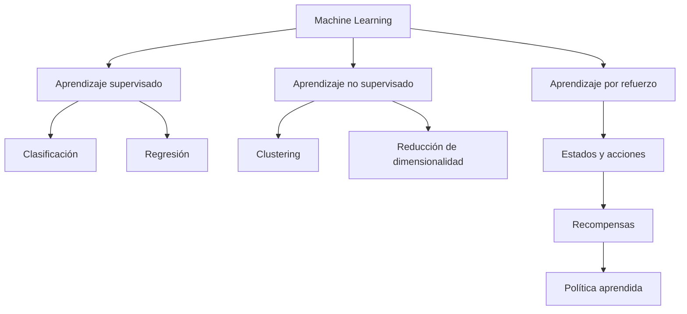
  
La diferencia fundamental es el objetivo del aprendizaje. Predecir una categoría, descubrir grupos y aprender decisiones son problemas distintos, aunque todos utilicen datos.  
  
### Clasificación y regresión:  
  
En clasificación, el objetivo es predecir una categoría.  
  
Por ejemplo, una entrega puede pertenecer a:  
  
$$  
y\in\{0,1\}  
$$  
  
En donde:  
  
- $0$: entrega a tiempo.  
- $1$: entrega tardía.  
  
En regresión, el objetivo consiste en predecir un valor numérico.  
  
Por ejemplo:  
  
$$  
\hat{y}=24.5\text{ minutos}  
$$  
  
Las mismas características pueden utilizarse para ambos problemas.  
  
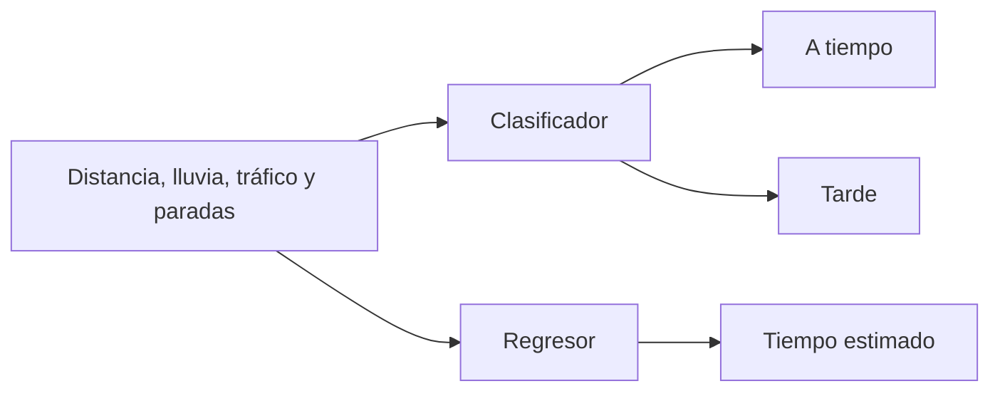
  
Por lo tanto, la diferencia entre clasificación y regresión se encuentra principalmente en el tipo de salida que se desea aprender.  
  
### Parámetros e hiperparámetros:  
  
Los **parámetros** son valores que el algoritmo aprende a partir del entrenamiento.  
  
Por ejemplo, en una regresión logística:  
  
$$  
z=w^Tx+b  
$$  
  
Los pesos $w$ y el sesgo $b$ se aprenden a partir de los datos.  
  
Los **hiperparámetros** son configuraciones que controlan el comportamiento del algoritmo.  
  
| Modelo | Hiperparámetro | Función |  
|---|---|---|  
| kNN | $k$ | Número de vecinos |  
| SVM | $C$ | Penalización de violaciones |  
| SVM con RBF | $\gamma$ | Alcance de la influencia |  
| SVR | $\epsilon$ | Tolerancia de error |  
| Decision Tree | `max_depth` | Profundidad máxima |  
| Random Forest | `n_estimators` | Número de árboles |  
| K-means | $k$ | Número de clusters |  
| PCA | `n_components` | Componentes conservadas |  
| t-SNE | `perplexity` | Escala efectiva de vecindad |  
| Q-Learning | $\alpha,\gamma,\epsilon$ | Aprendizaje, descuento y exploración |  
  
**Los parámetros se aprenden; los hiperparámetros se seleccionan.**  
  
### Generalización, overfitting y underfitting:  
  
El objetivo de un modelo supervisado consiste en aprender patrones que también funcionen sobre observaciones nuevas.  
  
El **underfitting** ocurre cuando el modelo es demasiado simple para representar los patrones relevantes.  
  
El **overfitting** ocurre cuando se adapta excesivamente a detalles del entrenamiento, incluido el ruido.  
  
La **generalización** consiste en mantener un desempeño adecuado sobre datos que no participaron en el ajuste.  
  
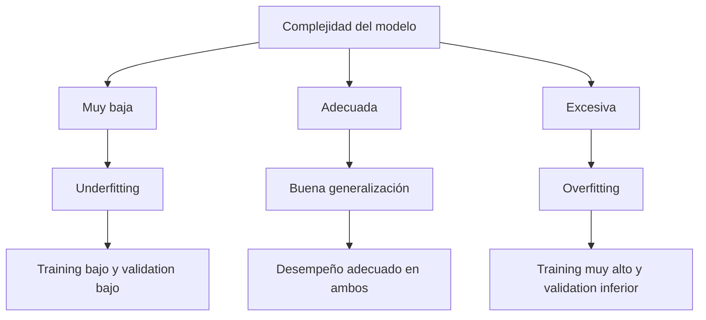
  
###### Ejemplo:  
  
Se comparan tres modelos:  
  
| Modelo | F1 training | F1 validation |  
|---|---:|---:|  
| A | 0.72 | 0.70 |  
| B | 0.94 | 0.92 |  
| C | 1.00 | 0.80 |  
  
El modelo C obtiene un F1 perfecto en entrenamiento, pero el modelo B presenta un mejor resultado de validación.  
  
Por lo tanto, **el mejor desempeño de entrenamiento no garantiza la mejor generalización**.  
  
---  
  
## Regresión logística  
  
La **regresión logística (Logistic Regression)** es un algoritmo supervisado de clasificación que aprende una combinación lineal de las características y transforma ese resultado en una probabilidad estimada.  
  
Primero calcula:  
  
$$  
z=w^Tx+b  
$$  
  
En donde:  
  
- $w$ contiene los pesos aprendidos.  
- $x$ representa las características.  
- $b$ es el sesgo.  
- $z$ es un puntaje lineal.  
  
Posteriormente utiliza la función sigmoide:  
  
$$  
\boxed{  
\sigma(z)=\frac{1}{1+e^{-z}}  
}  
$$  
  
Por lo tanto:  
  
$$  
P(y=1\mid x)=\sigma(w^Tx+b)  
$$  
  
### Función sigmoide:  
  
La sigmoide transforma cualquier número real en un valor entre cero y uno.  
  
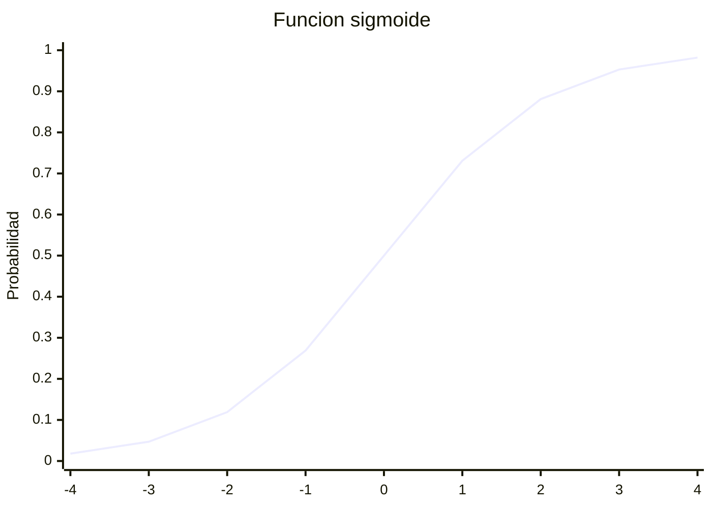
  
Cuando el puntaje es negativo, la probabilidad es menor que $0.5$.  
  
Cuando el puntaje es positivo, la probabilidad es mayor que $0.5$.  
  
###### Ejemplo:  
  
Si:  
  
$$  
z=0  
$$  
  
entonces:  
  
$$  
\sigma(0)=\frac{1}{1+e^0}  
$$  
  
$$  
\boxed{\sigma(0)=0.5}  
$$  
  
### Frontera de decisión:  
  
Con el umbral habitual de $0.5$, la frontera de clasificación satisface:  
  
$$  
\boxed{w^Tx+b=0}  
$$  
  
Esta expresión representa una línea en dos dimensiones, un plano en tres dimensiones y un hiperplano en dimensiones superiores.  
  
### Ilustración de clases separables linealmente:  
  
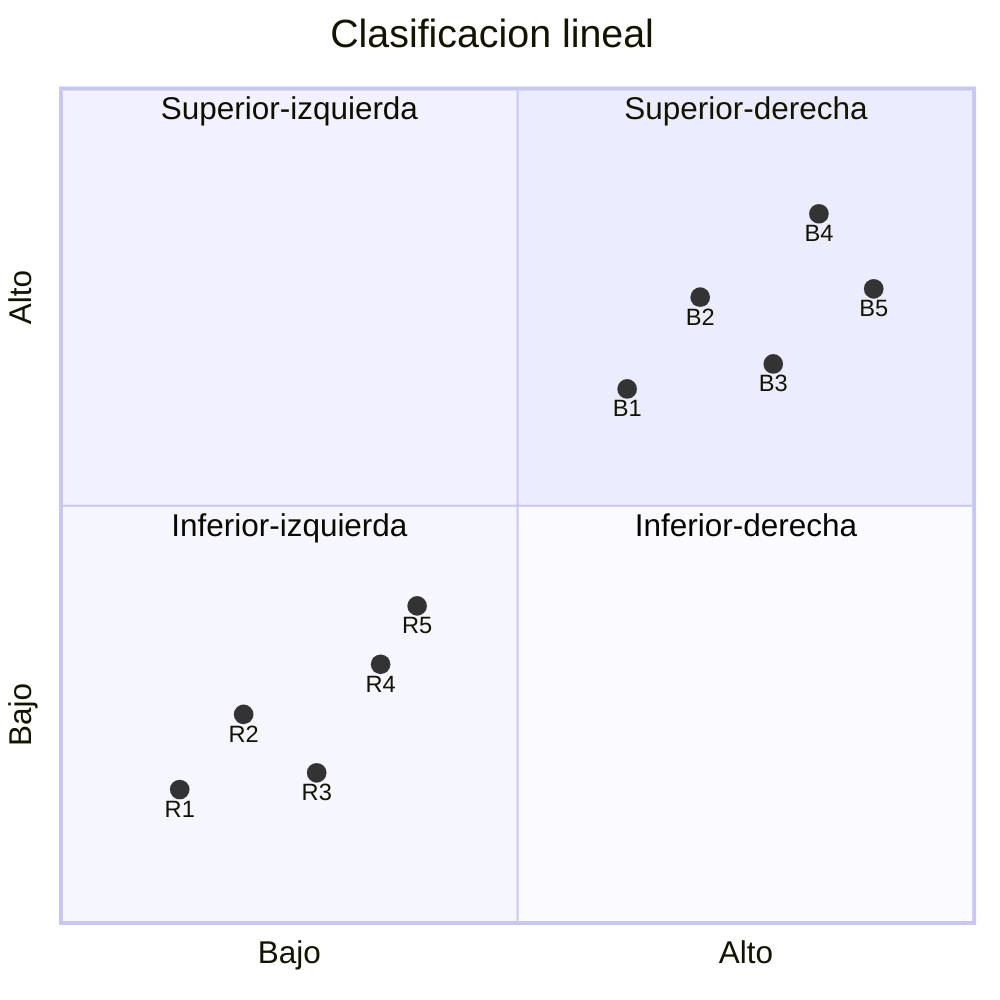
  
Los puntos R representan una clase y los puntos B representan otra. Su disposición permite imaginar una frontera diagonal que separa ambas regiones.  
  
Esta es la situación donde un clasificador lineal puede funcionar adecuadamente.  
  
### Limitación de la regresión logística:  
  
Cuando las clases poseen una estructura curva, una sola frontera lineal puede resultar insuficiente.  
  
Por ejemplo, si una clase ocupa una región central y otra la rodea formando un anillo, no existe una recta capaz de separarlas perfectamente.  
  
Esta limitación permite comprender por qué modelos como kNN y SVM con kernel RBF pueden funcionar mejor en determinados problemas no lineales.  
  
---  
  
## k-Nearest Neighbors  
  
El algoritmo **k-Nearest Neighbors (kNN)** realiza predicciones utilizando las $k$ observaciones conocidas más cercanas a una nueva entrada.  
  
A diferencia de la regresión logística, no necesita aprender explícitamente una ecuación global de separación.  
  
En cambio, conserva los ejemplos de entrenamiento y calcula distancias para encontrar observaciones similares.  
  
### Ilustración de vecinos cercanos:  
  
Supóngase que existen dos clases de observaciones en un plano.  
  
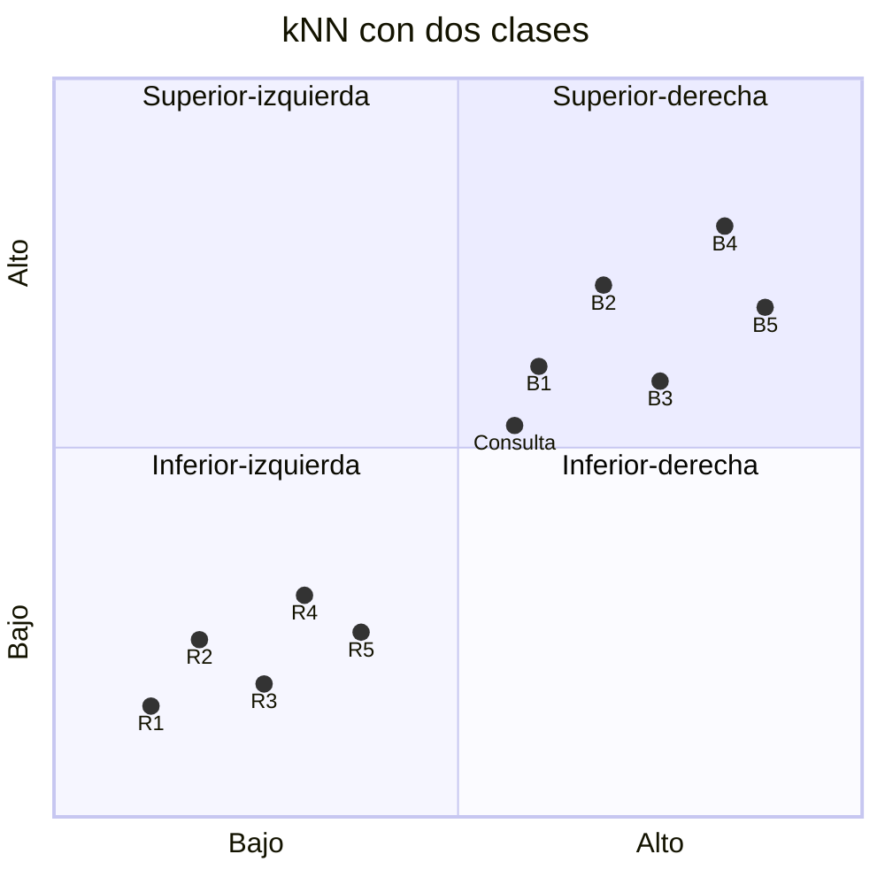
  
Las observaciones R pertenecen a la clase roja y las B a la clase azul.  
  
El punto `Consulta` es una observación cuya clase se desconoce.  
  
Para clasificarla, kNN calcula las distancias respecto a las observaciones de entrenamiento y selecciona las más cercanas.  
  
En esta ilustración, el punto de consulta se encuentra cerca de la región azul.  
  
### Distancia euclidiana:  
  
Para dos observaciones con $d$ características:  
  
$$  
\boxed{  
d(x,x_i)=\sqrt{\sum_{j=1}^{d}(x_j-x_{ij})^2}  
}  
$$  
  
En donde:  
  
- $x$ es la observación nueva.  
- $x_i$ es una observación conocida.  
- $d$ es la cantidad de características.  
  
En dos dimensiones:  
  
$$  
d(A,B)=\sqrt{(x_A-x_B)^2+(y_A-y_B)^2}  
$$  
  
###### Ejemplo:  
  
Sean:  
  
$$  
A=(2,3)  
$$  
  
$$  
B=(5,7)  
$$  
  
Entonces:  
  
$$  
d(A,B)=\sqrt{(5-2)^2+(7-3)^2}  
$$  
  
$$  
=\sqrt{9+16}  
$$  
  
$$  
\boxed{d(A,B)=5}  
$$  
  
La distancia permite ordenar las observaciones desde la más cercana hasta la más alejada.  
  
### Funcionamiento de kNN:  
  
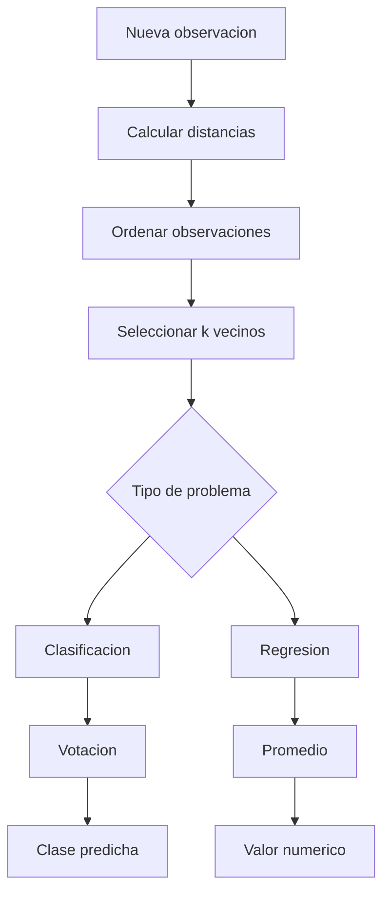
  
### kNN para clasificación:  
  
Cuando se utilizan pesos uniformes, cada vecino tiene la misma importancia.  
  
###### Ejemplo:  
  
Supóngase:  
  
$$  
k=5  
$$  
  
Los vecinos más cercanos pertenecen a:  
  
$$  
\{0,1,1,0,1\}  
$$  
  
Se obtienen:  
  
$$  
\text{Clase 0}=2\text{ votos}  
$$  
  
$$  
\text{Clase 1}=3\text{ votos}  
$$  
  
Por lo tanto:  
  
$$  
\boxed{\hat{y}=1}  
$$  
  
La proporción de vecinos de clase $1$ es:  
  
$$  
\frac35=0.6  
$$  
  
Esta proporción puede utilizarse como estimación de probabilidad, aunque no necesariamente se encuentra calibrada.  
  
### kNN para regresión:  
  
En regresión, los valores de los vecinos se promedian.  
  
###### Ejemplo:  
  
Los tres vecinos más cercanos tienen valores:  
  
$$  
10,\ 12,\ 8  
$$  
  
Entonces:  
  
$$  
\hat{y}=\frac{10+12+8}{3}  
$$  
  
$$  
\boxed{\hat{y}=10}  
$$  
  
La diferencia entre clasificación y regresión no está en la búsqueda de vecinos, sino en la forma de combinar sus resultados.  
  
### Efecto del hiperparámetro k:  
  
El valor de $k$ controla el tamaño de la vecindad.  
  
Si:  
  
$$  
k=1  
$$  
  
la predicción depende de una sola observación.  
  
Con valores mayores participan más vecinos, lo que produce predicciones más suavizadas.  
  
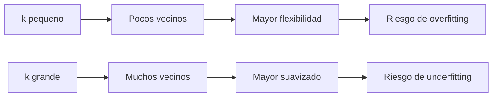
  
Por lo tanto, $k$ debe seleccionarse mediante validación.  
  
### Pesos uniformes y por distancia:  
  
Con `weights="uniform"`, todos los vecinos tienen el mismo peso.  
  
Con `weights="distance"`, los vecinos más cercanos tienen mayor influencia.  
  
Esta segunda estrategia puede resultar útil cuando existe una diferencia considerable entre las distancias de los vecinos.  
  
### Importancia del escalamiento:  
  
kNN depende directamente de las distancias numéricas.  
  
Si una característica tiene valores alrededor de $20$ y otra alrededor de $2000$, la segunda puede dominar el cálculo únicamente por su escala.  
  
La estandarización utiliza:  
  
$$  
\boxed{  
z_j=\frac{x_j-\mu_j}{s_j}  
}  
$$  
  
En donde:  
  
- $x_j$ es el valor original.  
- $\mu_j$ es la media.  
- $s_j$ es la desviación estándar.  
- $z_j$ es el valor estandarizado.  
  
El escalamiento puede modificar cuáles observaciones son las más cercanas y, por lo tanto, cambiar la predicción.  
  
**kNN es sensible al valor de $k$, a la medida de distancia y a la escala de las características.**  
  
---  
  
## Support Vector Machines  
  
Los **Support Vector Machines (SVM)** utilizan una estrategia diferente a kNN.  
  
En clasificación, buscan una frontera que separe las clases considerando el **margen**.  
  
El margen representa la distancia geométrica entre la frontera y determinadas observaciones que restringen su posición.  
  
Estas observaciones importantes se denominan **support vectors**.  
  
### Frontera lineal:  
  
La función de decisión es:  
  
$$  
\boxed{  
f(x)=w^Tx+b  
}  
$$  
  
En donde:  
  
- $w$ contiene los pesos.  
- $x$ contiene las características.  
- $b$ es el sesgo.  
  
La frontera se encuentra cuando:  
  
$$  
f(x)=0  
$$  
  
En clasificación binaria, el signo del puntaje indica de qué lado de la frontera se encuentra una observación.  
  
### Ilustración de support vectors:  
  
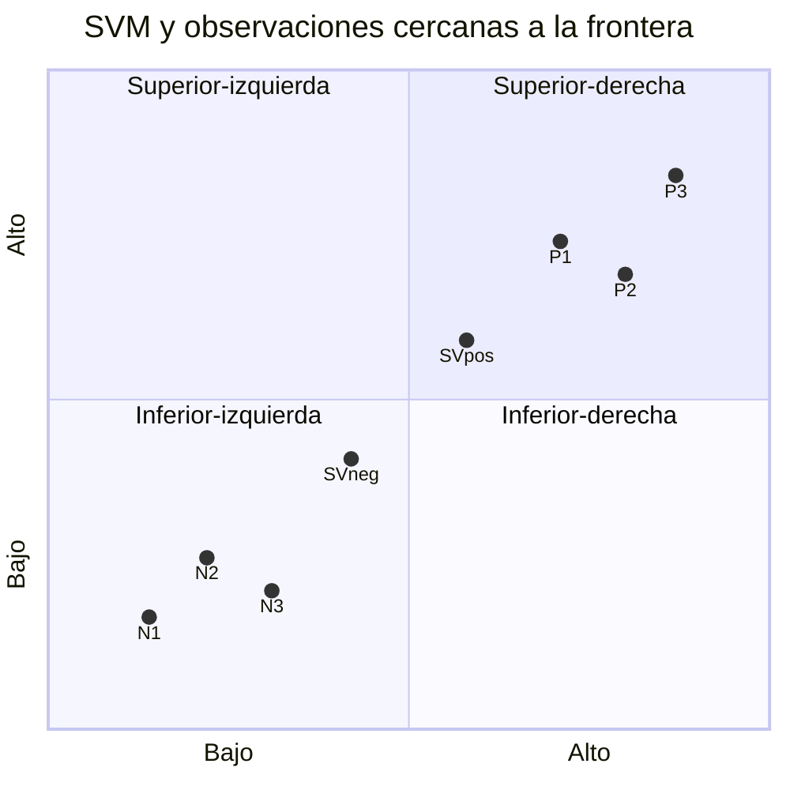
  
Los puntos `SVneg` y `SVpos` ilustran observaciones cercanas a la región de separación.  
  
En el modelo real, los vectores de soporte se determinan durante el entrenamiento y participan en la definición de la frontera.  
  
### Margen suave:  
  
En problemas reales, las clases no siempre pueden separarse perfectamente.  
  
Para permitir determinadas violaciones del margen se utiliza una formulación como:  
  
$$  
\min_{w,b,\xi}  
\frac12\|w\|^2+C\sum_i\xi_i  
$$  
  
En donde:  
  
- $\|w\|^2$ participa en el control de la complejidad.  
- $\xi_i$ representa violaciones del margen.  
- $C$ controla cuánto se penalizan dichas violaciones.  
  
### Hiperparámetro C:  
  
Un valor pequeño de $C$ permite mayor tolerancia y aplica regularización más fuerte.  
  
Un valor grande penaliza más estrictamente las violaciones del margen.  
  
| Valor de $C$ | Comportamiento general |  
|---|---|  
| Pequeño | Mayor regularización |  
| Grande | Penalización más estricta |  
| Excesivamente grande | Mayor riesgo de adaptación al entrenamiento |  
  
Un valor mayor de $C$ no garantiza mejores resultados en validación.  
  
### Hinge Loss:  
  
La pérdida hinge se expresa mediante:  
  
$$  
\boxed{  
\ell(z)=\max(0,1-z)  
}  
$$  
  
En donde:  
  
$$  
z=yf(x)  
$$  
  
con etiquetas binarias codificadas como $-1$ y $+1$.  
  
###### Ejemplo:  
  
Si:  
  
$$  
z=0.4  
$$  
  
entonces:  
  
$$  
\ell(0.4)=\max(0,1-0.4)  
$$  
  
$$  
\boxed{\ell=0.6}  
$$  
  
Si:  
  
$$  
z=1.5  
$$  
  
entonces:  
  
$$  
\ell(1.5)=0  
$$  
  
Una observación con margen firmado suficiente no produce pérdida hinge.  
  
---  
  
## Kernel RBF y clasificación no lineal  
  
Un SVC lineal construye una frontera lineal en el espacio de características que recibe.  
  
Sin embargo, existen problemas donde la separación entre clases tiene una forma curva.  
  
Para estos casos puede utilizarse el **kernel Radial Basis Function (RBF)**.  
  
Su expresión es:  
  
$$  
\boxed{  
K(x,x')=\exp(-\gamma\|x-x'\|^2)  
}  
$$  
  
En donde:  
  
- $x$ y $x'$ son dos observaciones.  
- $\|x-x'\|^2$ es su distancia euclidiana al cuadrado.  
- $\gamma$ controla el alcance espacial de la similitud.  
  
### Ilustración de una distribución no lineal:  
  
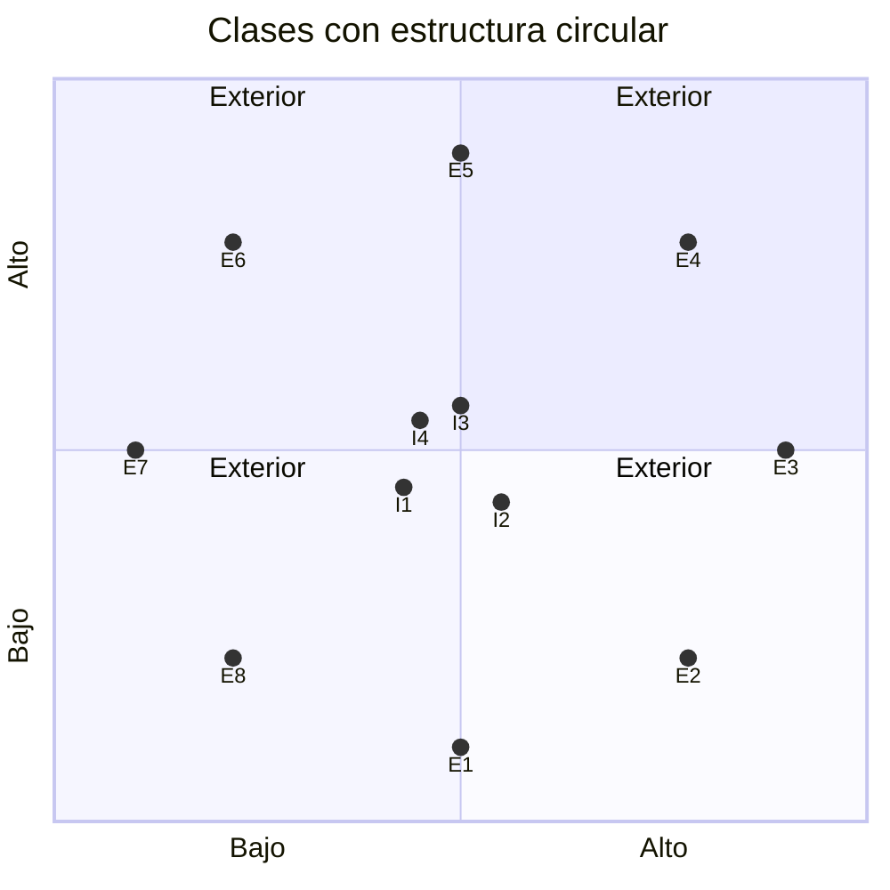
  
Las observaciones E forman aproximadamente un anillo, mientras que las observaciones I se encuentran en el centro.  
  
Una única recta no puede separar perfectamente ambas clases.  
  
En cambio, un kernel no lineal puede permitir construir una frontera adecuada para esta geometría.  
  
### Hiperparámetro gamma:  
  
Gamma controla la influencia espacial de las observaciones.  
  
**Gamma pequeño:** influencia amplia, con fronteras generalmente suaves.  
  
**Gamma grande:** influencia localizada, con fronteras potencialmente más complejas.  
  
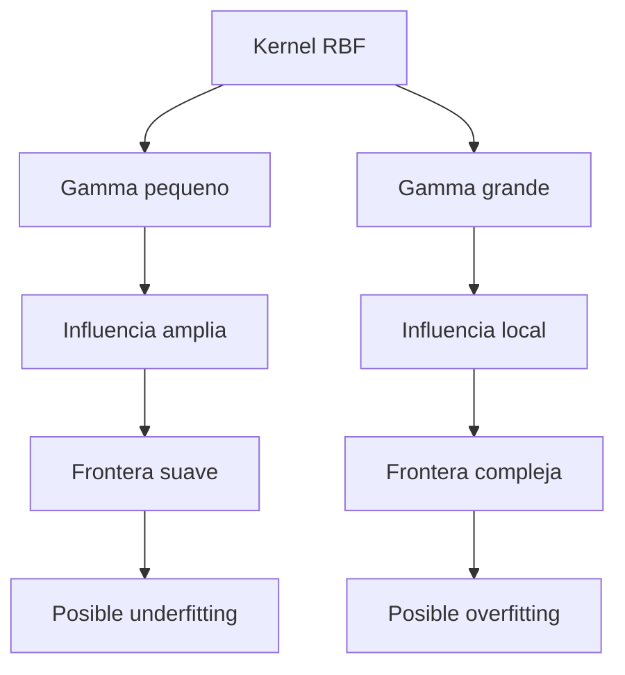
  
### Diferencia entre C y gamma:  
  
| Hiperparámetro | Función |  
|---|---|  
| $C$ | Penaliza violaciones del margen |  
| $\gamma$ | Controla la influencia del kernel |  
  
Ambos afectan la flexibilidad, pero mediante mecanismos diferentes.  
  
### Ejemplo de validación:  
  
| $\gamma$ | F1 training | F1 validation |  
|---|---:|---:|  
| 0.01 | 0.86 | 0.88 |  
| 1 | 0.93 | 0.95 |  
| 100 | 1.00 | 0.87 |  
  
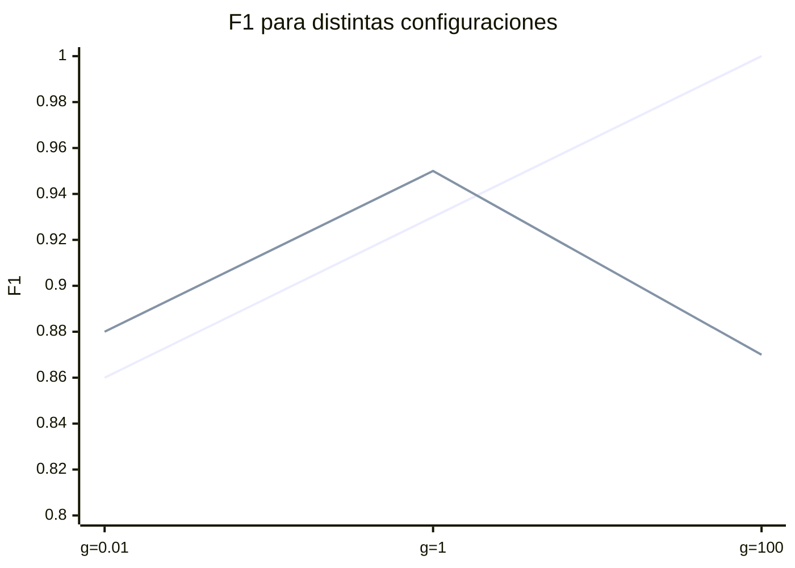
  
La primera línea corresponde a entrenamiento y la segunda a validación.  
  
El valor:  
  
$$  
\boxed{\gamma=1}  
$$  
  
presenta el mejor desempeño de validación entre las configuraciones evaluadas.  
  
El valor $\gamma=100$ obtiene un resultado perfecto de entrenamiento, pero presenta evidencia de sobreajuste.  
  
---  
  
## Support Vector Regression  
  
**Support Vector Regression (SVR)** utiliza los principios de SVM para problemas de regresión.  
  
En lugar de separar categorías, busca una función que prediga valores numéricos.  
  
Su concepto fundamental es el **epsilon tube**, una zona de tolerancia alrededor de la predicción.  
  
### Pérdida epsilon-insensitive:  
  
$$  
\boxed{  
\ell_\epsilon=  
\max(0,|y-f(x)|-\epsilon)  
}  
$$  
  
En donde:  
  
- $y$ es el valor real.  
- $f(x)$ es la predicción.  
- $\epsilon$ es la tolerancia.  
- $\ell_\epsilon$ es la pérdida.  
  
### Ilustración del tubo epsilon:  
  
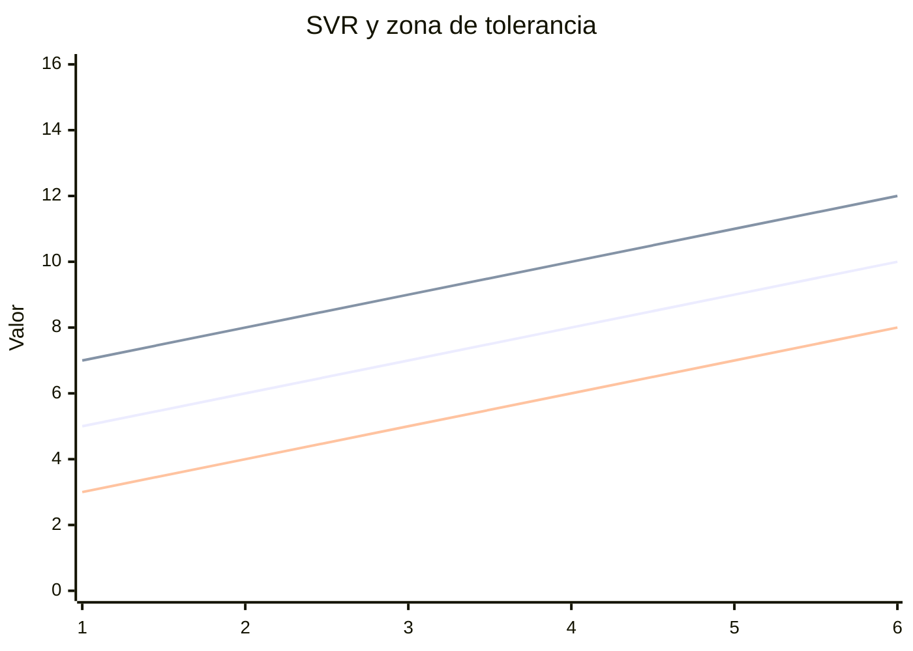
  
La primera línea representa una función predictiva ilustrativa.  
  
La segunda y tercera representan los límites superior e inferior de una tolerancia de dos unidades.  
  
###### Ejemplo:  
  
Supóngase:  
  
$$  
y=24  
$$  
  
$$  
f(x)=20  
$$  
  
$$  
\epsilon=2  
$$  
  
El error absoluto es:  
  
$$  
|24-20|=4  
$$  
  
La pérdida es:  
  
$$  
\ell_\epsilon=\max(0,4-2)  
$$  
  
$$  
\boxed{\ell_\epsilon=2}  
$$  
  
Solamente se penaliza la parte del error que excede la tolerancia.  
  
El tubo epsilon no representa un intervalo de confianza estadístico.  
  
---  
  
## Selección de modelos  
  
La selección de modelos consiste en comparar algoritmos e hiperparámetros utilizando evidencia de datos que no participaron en el ajuste correspondiente.  
  
El objetivo es elegir una configuración que generalice, evitando que las decisiones se adapten indebidamente al conjunto de prueba.  
  
### Training, validation y test:  
  
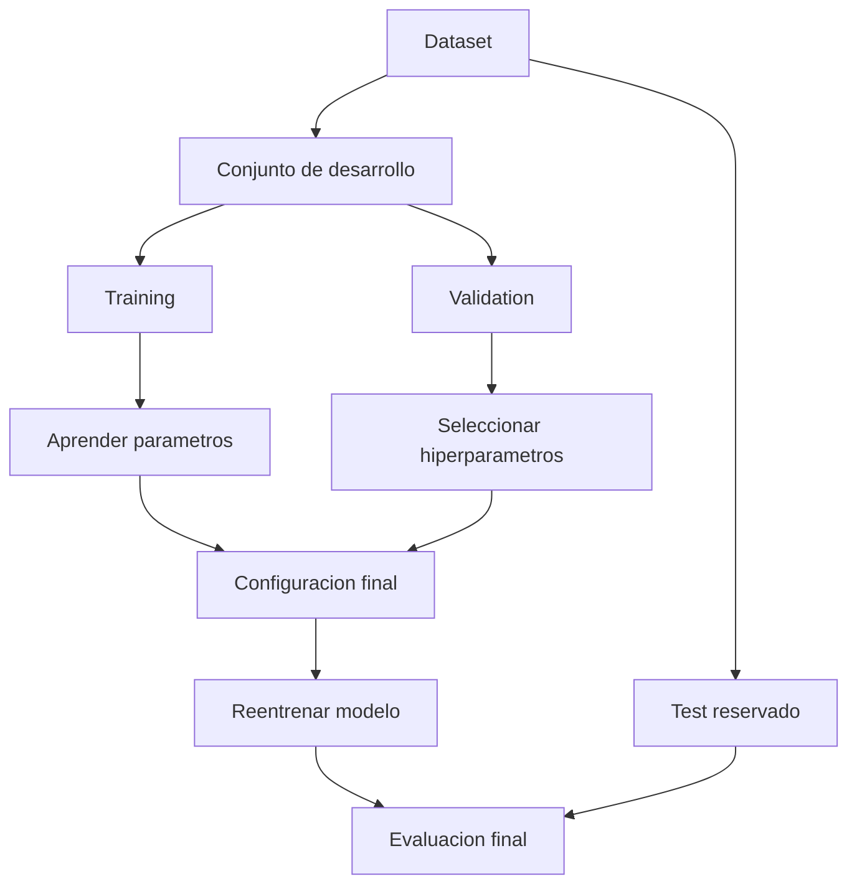
  
**Training:** permite aprender parámetros.  
  
**Validation:** permite comparar configuraciones.  
  
**Test:** permite evaluar finalmente el modelo seleccionado.  
  
El conjunto de prueba no debe utilizarse repetidamente para ajustar hiperparámetros.  
  
### Cross-validation:  
  
En validación cruzada, los datos de entrenamiento se dividen en $K$ folds.  
  
En cada iteración se utiliza uno para validación y los restantes para entrenamiento.  
  
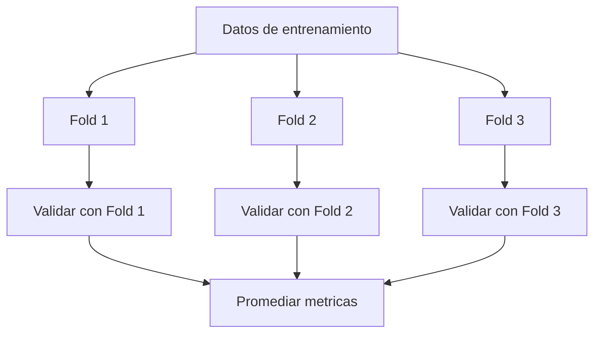
  
En cada evaluación, los demás folds se utilizan para ajustar el modelo.  
  
El promedio de la métrica es:  
  
$$  
\boxed{  
\bar{s}=\frac1K\sum_{i=1}^{K}s_i  
}  
$$  
  
Para clasificación desbalanceada puede utilizarse `StratifiedKFold`, que busca conservar aproximadamente las proporciones de clases.  
  
### GridSearchCV:  
  
Grid Search prueba diferentes combinaciones de hiperparámetros.  
  
###### Ejemplo:  
  
Se consideran:  
  
$$  
C\in\{0.1,1,10\}  
$$  
  
$$  
\gamma\in\{0.01,0.1,1\}  
$$  
  
Existen:  
  
$$  
3\times3=9  
$$  
  
configuraciones.  
  
Con cinco folds:  
  
$$  
9\times5=45  
$$  
  
Por lo tanto:  
  
$$  
\boxed{45\text{ ajustes de validación cruzada}}  
$$  
  
sin contar el reentrenamiento final cuando está habilitado.  
  
### Pipeline y data leakage:  
  
El **data leakage** ocurre cuando información que debería permanecer fuera de una etapa influye indebidamente en el modelo.  
  
Por ejemplo, calcular un escalador utilizando tanto training como test antes de entrenar introduce información del conjunto de prueba.  
  
El procedimiento apropiado consiste en ajustar las transformaciones únicamente con los datos permitidos para entrenamiento.  
  
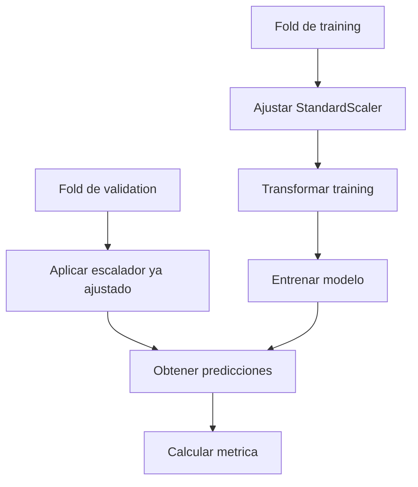
  
Un `Pipeline` permite aplicar correctamente estas operaciones durante la validación cruzada.  
  
**Todo procedimiento que aprende información de los datos debe ajustarse dentro del entrenamiento correspondiente.**  
  
---  
  
## Métricas de clasificación y regresión  
  
Las métricas permiten evaluar el comportamiento de un modelo, pero deben seleccionarse según el tipo de problema.  
  
### Matriz de confusión:  
  
En clasificación binaria existen cuatro resultados.  
  
| | Predicción negativa | Predicción positiva |  
|---|---|---|  
| Real negativa | TN | FP |  
| Real positiva | FN | TP |  
  
En donde:  
  
- $TP$: verdaderos positivos.  
- $TN$: verdaderos negativos.  
- $FP$: falsos positivos.  
- $FN$: falsos negativos.  
  
### Accuracy:  
  
$$  
\boxed{  
Accuracy=\frac{TP+TN}{TP+TN+FP+FN}  
}  
$$  
  
Mide la proporción total de aciertos.  
  
### Precision:  
  
$$  
\boxed{  
Precision=\frac{TP}{TP+FP}  
}  
$$  
  
Mide qué proporción de las predicciones positivas fue correcta.  
  
### Recall:  
  
$$  
\boxed{  
Recall=\frac{TP}{TP+FN}  
}  
$$  
  
Mide qué proporción de los positivos reales fue identificada.  
  
### F1-score:  
  
$$  
\boxed{  
F1=2\frac{Precision\cdot Recall}{Precision+Recall}  
}  
$$  
  
Combina precision y recall mediante una media armónica.  
  
### F1 macro:  
  
$$  
\boxed{  
F1_{\text{macro}}=\frac1K\sum_{k=1}^{K}F1_k  
}  
$$  
  
Promedia el F1 de todas las clases, otorgando el mismo peso a cada una.  
  
###### Ejemplo:  
  
Supóngase:  
  
$$  
TP=40,\quad TN=30,\quad FP=10,\quad FN=20  
$$  
  
Entonces:  
  
$$  
Accuracy=\frac{40+30}{100}=0.70  
$$  
  
$$  
Precision=\frac{40}{50}=0.80  
$$  
  
$$  
Recall=\frac{40}{60}\approx0.667  
$$  
  
$$  
F1=\frac{2(40)}{2(40)+10+20}  
$$  
  
$$  
\boxed{F1\approx0.727}  
$$  
  
### Métricas de regresión:  
  
**Mean Absolute Error:**  
  
$$  
\boxed{  
MAE=\frac1n\sum_i|y_i-\hat{y}_i|  
}  
$$  
  
**Mean Squared Error:**  
  
$$  
\boxed{  
MSE=\frac1n\sum_i(y_i-\hat{y}_i)^2  
}  
$$  
  
**Root Mean Squared Error:**  
  
$$  
\boxed{  
RMSE=\sqrt{MSE}  
}  
$$  
  
**Coeficiente de determinación:**  
  
$$  
\boxed{  
R^2=  
1-\frac{\sum_i(y_i-\hat{y}_i)^2}  
{\sum_i(y_i-\bar{y})^2}  
}  
$$  
  
MAE y RMSE utilizan las unidades originales del objetivo.  
  
MSE utiliza las unidades al cuadrado.  
  
$R^2$ puede ser negativo cuando el modelo presenta un error cuadrático mayor que el predictor constante basado en la media de los valores reales evaluados.  
  
---  
  
## Decision Trees  
  
Los **árboles de decisión (Decision Trees)** aprenden reglas mediante preguntas sucesivas sobre las características.  
  
Cada pregunta divide las observaciones en subconjuntos. Las divisiones continúan hasta alcanzar hojas que contienen predicciones.  
  
### Componentes:  
  
- **Root:** nodo inicial.  
- **Internal nodes:** preguntas intermedias.  
- **Branches:** caminos correspondientes a condiciones.  
- **Leaves:** nodos terminales.  
- **Depth:** profundidad del árbol.  
  
### Ilustración de un árbol:  
  
Supóngase que se desea predecir si una entrega llegará tarde.  
  
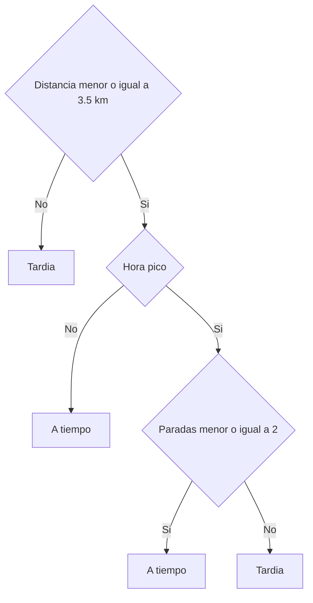
  
Una entrega de 3 km, durante hora pico y con tres paradas sigue la rama que conduce a la predicción tardía.  
  
### CART:  
  
**Classification and Regression Trees (CART)** construye divisiones binarias recursivas.  
  
En cada nodo busca una división que reduzca la impureza o el error.  
  
Es un procedimiento *greedy*: selecciona la mejor división disponible en cada etapa, sin buscar exhaustivamente todas las estructuras posibles.  
  
---  
  
## Gini y entropía  
  
Los árboles de clasificación necesitan medir qué tan mezcladas están las clases dentro de cada nodo.  
  
Dos criterios fundamentales son **Gini** y **entropía**.  
  
### Impureza de Gini:  
  
$$  
\boxed{  
G=1-\sum_{k=1}^{K}p_k^2  
}  
$$  
  
En donde $p_k$ representa la proporción de la clase $k$.  
  
Para clasificación binaria:  
  
$$  
\boxed{G=2p(1-p)}  
$$  
  
### Ilustración de Gini:  
  
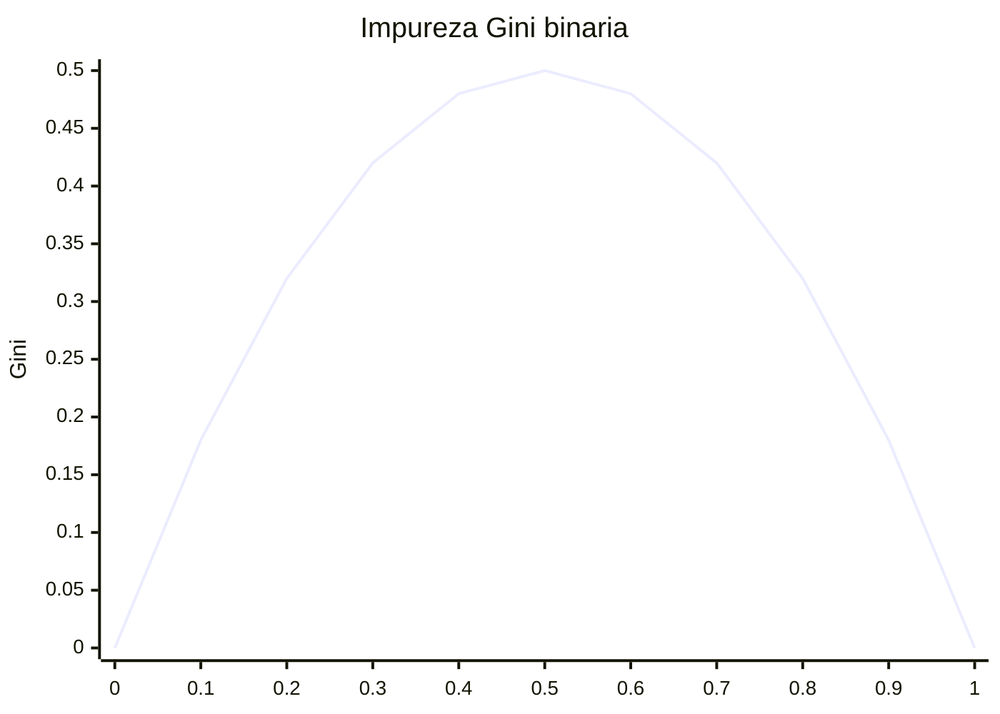
  
La impureza es cero cuando el nodo contiene una sola clase.  
  
Para dos clases equilibradas alcanza:  
  
$$  
G=0.5  
$$  
  
###### Ejemplo:  
  
Un nodo contiene ocho observaciones rojas y dos verdes.  
  
$$  
p_R=0.8  
$$  
  
$$  
p_V=0.2  
$$  
  
Entonces:  
  
$$  
G=1-(0.8)^2-(0.2)^2  
$$  
  
$$  
=1-0.64-0.04  
$$  
  
$$  
\boxed{G=0.32}  
$$  
  
### Entropía:  
  
$$  
\boxed{  
H=-\sum_{k=1}^{K}p_k\log_2(p_k)  
}  
$$  
  
Para dos clases equilibradas:  
  
$$  
H=-0.5\log_2(0.5)-0.5\log_2(0.5)  
$$  
  
$$  
\boxed{H=1\text{ bit}}  
$$  
  
Un nodo puro tiene entropía cero.  
  
### Impureza ponderada:  
  
Para evaluar una división deben considerarse ambos hijos y sus tamaños.  
  
$$  
\boxed{  
I_{\text{split}}=  
\frac{n_L}{n}I_L+  
\frac{n_R}{n}I_R  
}  
$$  
  
En donde:  
  
- $n_L$ y $n_R$ son los tamaños de los hijos.  
- $I_L$ e $I_R$ son sus impurezas.  
- $n=n_L+n_R$.  
  
###### Ejemplo:  
  
El hijo izquierdo contiene cuatro observaciones con:  
  
$$  
G_L=0.5  
$$  
  
El hijo derecho contiene seis observaciones con:  
  
$$  
G_R=0.2  
$$  
  
Entonces:  
  
$$  
G_{\text{split}}=  
\frac4{10}(0.5)+\frac6{10}(0.2)  
$$  
  
$$  
=0.20+0.12  
$$  
  
$$  
\boxed{G_{\text{split}}=0.32}  
$$  
  
La mejor división válida es aquella que produce la mayor reducción de impureza.  
  
---  
  
## Árboles de regresión y regularización  
  
Los árboles de decisión también pueden predecir valores numéricos.  
  
Cuando se utiliza el criterio `squared_error`, cada hoja predice la media de los valores objetivo que contiene.  
  
###### Ejemplo:  
  
Una hoja contiene:  
  
$$  
10,\ 12,\ 20  
$$  
  
La predicción es:  
  
$$  
\hat{y}=\frac{10+12+20}{3}  
$$  
  
$$  
\boxed{\hat{y}=14}  
$$  
  
Con `absolute_error`, la hoja predice una mediana, que en este caso es $12$.  
  
### Predicciones escalonadas:  
  
Los árboles de regresión producen predicciones constantes por regiones.  
  
Por ejemplo:  
  
$$  
\hat{y}(d)=  
\begin{cases}  
12 & d\leq3\\  
25 & 3<d\leq6\\  
35 & d>6  
\end{cases}  
$$  
  
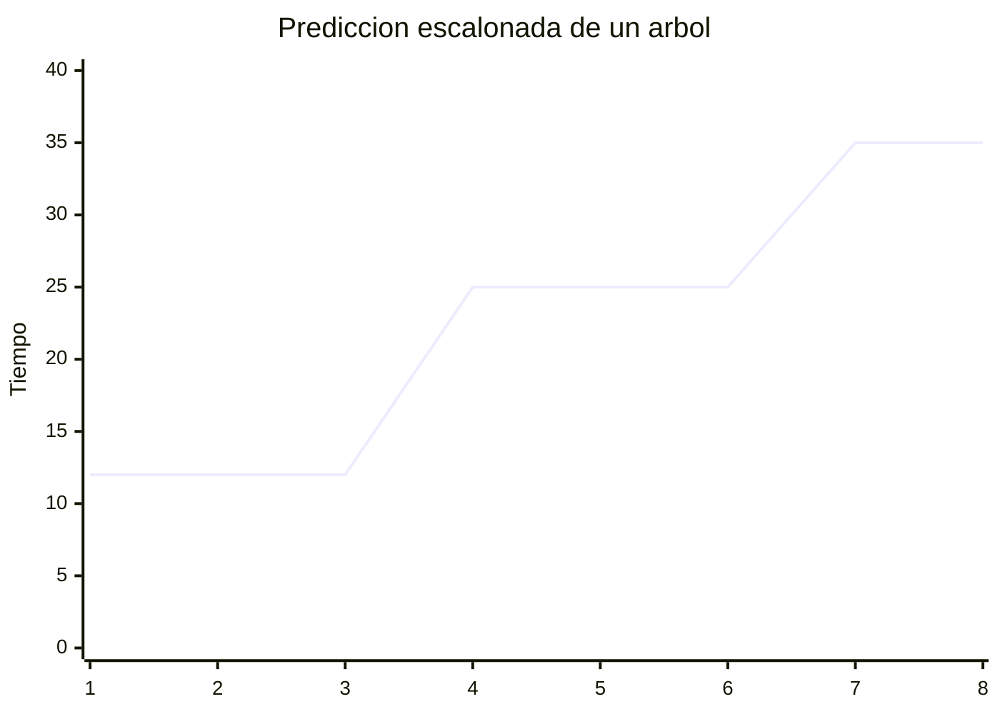
  
A diferencia de un modelo lineal, un árbol estándar no extrapola automáticamente tendencias fuera del rango observado.  
  
### Hiperparámetros de regularización:  
  
| Hiperparámetro | Función |  
|---|---|  
| `max_depth` | Limita profundidad |  
| `min_samples_split` | Mínimo de observaciones para intentar dividir |  
| `min_samples_leaf` | Mínimo de observaciones por hoja |  
| `max_leaf_nodes` | Limita número de hojas |  
| `ccp_alpha` | Controla poda |  
  
### Poda:  
  
La poda busca reducir la complejidad eliminando divisiones.  
  
Una función de costo es:  
  
$$  
\boxed{  
R_\alpha(T)=R(T)+\alpha L(T)  
}  
$$  
  
En donde:  
  
- $R(T)$ representa la impureza ponderada.  
- $L(T)$ representa el número de hojas.  
- $\alpha$ controla la penalización por complejidad.  
  
**Una hoja pura durante entrenamiento no garantiza una buena generalización.**  
  
---  
  
## Random Forest  
  
**Random Forest** combina múltiples árboles de decisión para reducir principalmente la varianza de un árbol individual.  
  
Pertenece a los métodos de **Ensemble Learning**.  
  
### Ilustración de un bosque:  
  
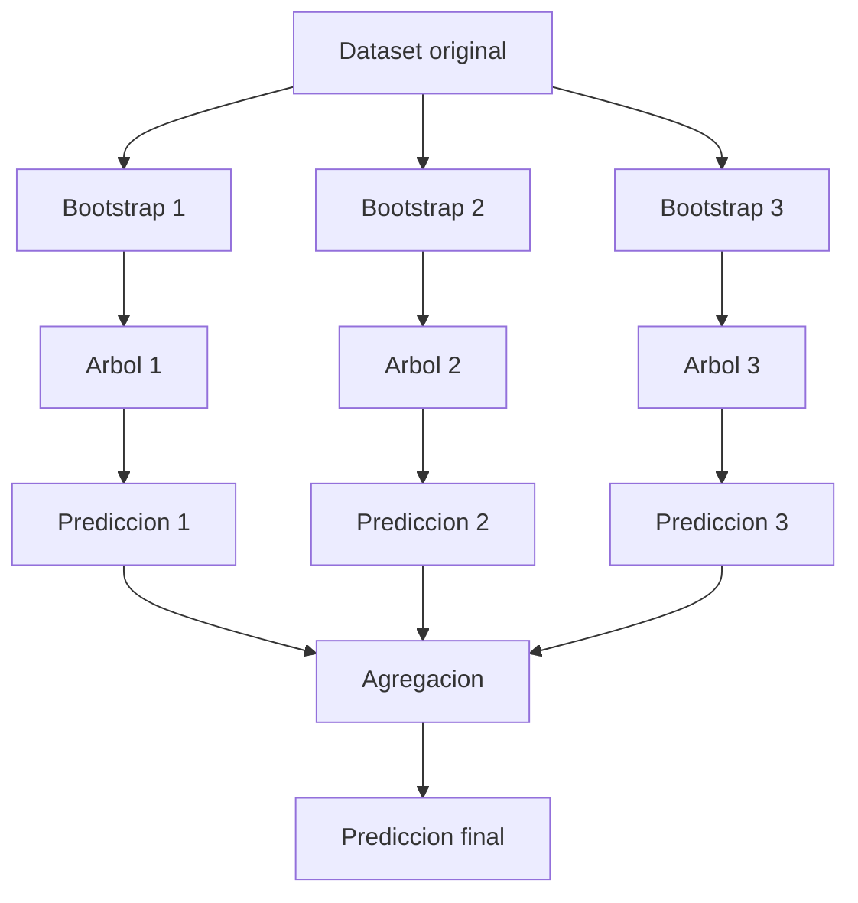
  
Cada árbol aprende divisiones sobre una muestra aleatorizada de las observaciones.  
  
### Bootstrap:  
  
Bootstrap selecciona observaciones con reemplazo.  
  
Supóngase:  
  
$$  
\{A,B,C,D,E,F\}  
$$  
  
Una muestra bootstrap podría ser:  
  
$$  
\{A,A,C,D,F,F\}  
$$  
  
Se realizaron seis extracciones, pero solamente cuatro observaciones distintas fueron seleccionadas.  
  
Las observaciones que no aparecen son:  
  
$$  
\{B,E\}  
$$  
  
### Out-of-Bag:  
  
Las observaciones no seleccionadas para un árbol se denominan **Out-of-Bag (OOB)** para ese árbol.  
  
En el ejemplo:  
  
$$  
\boxed{OOB=\{B,E\}}  
$$  
  
La probabilidad de que una observación quede fuera de un bootstrap estándar es:  
  
$$  
P(OOB)=\left(1-\frac1n\right)^n  
$$  
  
Cuando $n$ es grande:  
  
$$  
\boxed{P(OOB)\approx e^{-1}\approx0.368}  
$$  
  
Por lo tanto, aproximadamente el $36.8\%$ de las observaciones queda fuera de cada muestra bootstrap, en promedio.  
  
### Selección aleatoria de características:  
  
Random Forest introduce aleatoriedad adicional seleccionando características candidatas en cada división.  
  
Si se utiliza:  
  
`max_features="sqrt"`  
  
y existen trece características:  
  
$$  
\sqrt{13}\approx3.606  
$$  
  
Se consideran inicialmente:  
  
$$  
\boxed{3\text{ características}}  
$$  
  
Esta selección se repite en cada nodo.  
  
### Bagging frente a Random Forest:  
  
**Bagging** utiliza diferentes muestras bootstrap y combina predicciones.  
  
**Random Forest** añade selección aleatoria de características para reducir la correlación entre árboles.  
  
### Clasificación:  
  
En scikit-learn, Random Forest promedia las probabilidades estimadas por los árboles.  
  
$$  
\boxed{  
\hat{P}(y=k\mid x)=  
\frac1B\sum_{b=1}^{B}\hat{P}_b(y=k\mid x)  
}  
$$  
  
###### Ejemplo:  
  
Tres árboles predicen probabilidades de retraso:  
  
$$  
0.2,\ 0.7,\ 0.8  
$$  
  
Entonces:  
  
$$  
\hat{P}(\text{Tarde})=  
\frac{0.2+0.7+0.8}{3}  
$$  
  
$$  
\boxed{\hat{P}(\text{Tarde})\approx0.567}  
$$  
  
La clase seleccionada es tardía.  
  
### Regresión:  
  
En regresión se promedian las predicciones numéricas.  
  
$$  
\boxed{  
\hat{y}_{RF}=  
\frac1B\sum_{b=1}^{B}\hat{y}_b  
}  
$$  
  
###### Ejemplo:  
  
Tres árboles predicen:  
  
$$  
21,\ 25,\ 23  
$$  
  
minutos.  
  
$$  
\hat{y}_{RF}=\frac{21+25+23}{3}  
$$  
  
$$  
\boxed{\hat{y}_{RF}=23\text{ minutos}}  
$$  
  
### Sesgo y varianza:  
  
El **bias** representa errores sistemáticos.  
  
La **variance** representa cuánto cambian las predicciones cuando se modifican los datos de entrenamiento.  
  
Random Forest busca reducir principalmente la varianza mediante la agregación.  
  
Bajo el supuesto de árboles con varianza común $\sigma^2$ y correlación común $\rho$:  
  
$$  
\boxed{  
\operatorname{Var}(\bar{y})=  
\sigma^2  
\left[  
\rho+\frac{1-\rho}{B}  
\right]  
}  
$$  
  
En donde $B$ representa el número de árboles.  
  
Si los árboles cometen errores muy similares, la agregación ofrece menos beneficio.  
  
Por lo tanto, **la diversidad entre árboles es fundamental para que el bosque reduzca la varianza**.  
  
---  
  
## K-means  
  
**K-means** es un algoritmo de aprendizaje no supervisado que divide observaciones en $k$ grupos utilizando distancias a centroides.  
  
Cada centroide representa la media de las observaciones asignadas a su grupo.  
  
### Ilustración de dos clusters:  
  
Considérense seis clientes descritos mediante dos características:  
  
- Tiempo semanal en una página web.  
- Número de aperturas de una aplicación.  
  
Las observaciones son:  
  
| Cliente | Coordenadas |  
|---|---|  
| A | $(1,1)$ |  
| B | $(1,2)$ |  
| C | $(2,1)$ |  
| D | $(7,7)$ |  
| E | $(7,8)$ |  
| F | $(8,7)$ |  
  
```mermaid  
quadrantChart  
title K-means con dos grupos  
x-axis Bajo --> Alto  
y-axis Bajo --> Alto  
quadrant-1 Alta-actividad  
quadrant-2 Superior-izquierda  
quadrant-3 Baja-actividad  
quadrant-4 Inferior-derecha  
A: [0.12, 0.12]  
B: [0.12, 0.24]  
C: [0.24, 0.12]  
D: [0.84, 0.84]  
E: [0.84, 0.96]  
F: [0.96, 0.84]  
M1: [0.16, 0.16]  
M2: [0.88, 0.88]  
```  
  
Las coordenadas del diagrama están normalizadas, pero conservan la disposición relativa de las observaciones.  
  
Los puntos `M1` y `M2` representan intuitivamente los centroides finales.  
  
### Funcionamiento:  
  
K-means alterna dos operaciones.  
  
**Asignación:** cada observación se asigna al centroide más cercano.  
  
$$  
\boxed{  
c_i=\arg\min_j\|x_i-\mu_j\|^2  
}  
$$  
  
**Actualización:** cada centroide se recalcula utilizando la media de su grupo.  
  
$$  
\boxed{  
\mu_j=\frac1{|C_j|}\sum_{i\in C_j}x_i  
}  
$$  
  
```mermaid  
flowchart TB  
A["Seleccionar k"]  
A --> B["Inicializar centroides"]  
B --> C["Asignar puntos"]  
C --> D["Recalcular medias"]  
D --> E{"Convergencia"}  
E -->|No| C  
E -->|Si| F["Clusters finales"]  
```  
  
###### Ejemplo de cálculo del centroide:  
  
El primer grupo contiene:  
  
$$  
A=(1,1)  
$$  
  
$$  
B=(1,2)  
$$  
  
$$  
C=(2,1)  
$$  
  
Por lo tanto:  
  
$$  
\mu_1=  
\left(  
\frac{1+1+2}{3},  
\frac{1+2+1}{3}  
\right)  
$$  
  
$$  
\boxed{  
\mu_1=\left(\frac43,\frac43\right)  
}  
$$  
  
Para el segundo grupo:  
  
$$  
D=(7,7)  
$$  
  
$$  
E=(7,8)  
$$  
  
$$  
F=(8,7)  
$$  
  
se obtiene:  
  
$$  
\boxed{  
\mu_2=\left(\frac{22}{3},\frac{22}{3}\right)  
}  
$$  
  
### Función objetivo e inercia:  
  
K-means busca minimizar la suma de distancias cuadradas entre las observaciones y sus centroides.  
  
$$  
\boxed{  
J=\sum_{i=1}^{n}\|x_i-\mu_{c_i}\|^2  
}  
$$  
  
Esta cantidad se denomina **inercia (inertia)**.  
  
### Ilustración de la convergencia:  
  
```mermaid  
xychart-beta  
title "Disminucion de la inercia"  
x-axis ["A1", "U1", "A2", "U2"]  
y-axis "Inercia" 0 --> 220  
line [208, 53.25, 15.9375, 2.6667]  
```  
  
Las letras A representan asignaciones y U representan actualizaciones.  
  
El descenso muestra cómo las observaciones quedan progresivamente más cerca de sus centroides.  
  
### Selección del número de clusters:  
  
El valor:  
  
$$  
k  
$$  
  
es un hiperparámetro.  
  
Aumentarlo generalmente reduce la inercia.  
  
Sin embargo, una inercia menor no garantiza una mejor segmentación.  
  
Si cada observación forma su propio cluster:  
  
$$  
k=n  
$$  
  
puede obtenerse:  
  
$$  
J=0  
$$  
  
pero esa partición podría resultar poco útil.  
  
### Limitaciones:  
  
K-means es sensible a:  
  
- Escala de las características.  
- Inicialización de centroides.  
- Valores atípicos.  
- Cantidad de clusters solicitada.  
  
Además, **un identificador de cluster no equivale automáticamente a una clase supervisada**.  
  
---  
  
## Principal Component Analysis  
  
**Principal Component Analysis (PCA)** es una técnica de reducción de dimensionalidad lineal.  
  
Su objetivo consiste en construir nuevas variables llamadas componentes principales que conservan la mayor varianza posible.  
  
### Intuición geométrica:  
  
Supóngase que dos características están correlacionadas.  
  
Las observaciones pueden formar una nube alargada diagonalmente.  
  
La primera componente principal, PC1, sigue la dirección donde los datos presentan mayor dispersión.  
  
La segunda componente, PC2, es perpendicular a la primera y captura la mayor varianza restante.  
  
### Ilustración de una nube correlacionada:  
  
```mermaid  
quadrantChart  
title PCA y datos correlacionados  
x-axis Bajo --> Alto  
y-axis Bajo --> Alto  
quadrant-1 Superior-derecha  
quadrant-2 Superior-izquierda  
quadrant-3 Inferior-izquierda  
quadrant-4 Inferior-derecha  
P1: [0.14, 0.19]  
P2: [0.24, 0.29]  
P3: [0.33, 0.31]  
P4: [0.39, 0.46]  
P5: [0.48, 0.49]  
P6: [0.57, 0.60]  
P7: [0.68, 0.66]  
P8: [0.78, 0.81]  
P9: [0.87, 0.83]  
```  
  
Los puntos presentan una orientación diagonal.  
  
Esa dirección representa intuitivamente el eje principal de máxima varianza.  
  
### Varianza:  
  
La varianza muestral es:  
  
$$  
\boxed{  
s^2=\frac1{n-1}\sum_i(x_i-\bar{x})^2  
}  
$$  
  
Mide la dispersión de los valores respecto a su media.  
  
### Covarianza:  
  
$$  
\boxed{  
\operatorname{Cov}(x,y)=  
\frac1{n-1}\sum_i(x_i-\bar{x})(y_i-\bar{y})  
}  
$$  
  
Mide cómo varían conjuntamente dos características.  
  
### Correlación:  
  
$$  
\boxed{  
r=\frac{\operatorname{Cov}(x,y)}{s_xs_y}  
}  
$$  
  
La correlación se encuentra entre $-1$ y $1$.  
  
La covarianza depende de las unidades; la correlación no.  
  
### Matriz de covarianza:  
  
Para los datos centrados:  
  
$$  
\boxed{  
\Sigma=\frac1{n-1}X_c^TX_c  
}  
$$  
  
La diagonal contiene varianzas.  
  
Las posiciones fuera de la diagonal contienen covarianzas.  
  
### Eigenvectors y eigenvalues:  
  
PCA resuelve:  
  
$$  
\boxed{  
\Sigma w_j=\lambda_jw_j  
}  
$$  
  
En donde:  
  
- $w_j$ es un eigenvector.  
- $\lambda_j$ es un eigenvalue.  
  
Los **eigenvectors** representan las direcciones principales.  
  
Los **eigenvalues** representan la varianza capturada por cada dirección.  
  
###### Ejemplo:  
  
Supóngase:  
  
$$  
\lambda_1=1.7349  
$$  
  
$$  
\lambda_2=0.3702  
$$  
  
La varianza total es:  
  
$$  
1.7349+0.3702=2.1051  
$$  
  
La proporción explicada por PC1 es:  
  
$$  
r_1=\frac{1.7349}{2.1051}  
$$  
  
$$  
\boxed{r_1\approx82.4\%}  
$$  
  
Para PC2:  
  
$$  
\boxed{r_2\approx17.6\%}  
$$  
  
### Ilustración de varianza explicada:  
  
```mermaid  
xychart-beta  
title "Varianza explicada"  
x-axis ["PC1", "PC2"]  
y-axis "Porcentaje" 0 --> 100  
bar [82.4, 17.6]  
```  
  
Por lo tanto, conservar PC1 permite representar los datos utilizando una dimensión mientras se preserva aproximadamente el $82.4\%$ de la varianza total.  
  
### Proyección:  
  
Si $W_k$ contiene las primeras $k$ componentes:  
  
$$  
\boxed{  
T=X_cW_k  
}  
$$  
  
En donde:  
  
- $X_c$ contiene los datos centrados.  
- $W_k$ contiene las direcciones seleccionadas.  
- $T$ es la representación reducida.  
  
### Limitación:  
  
PCA no utiliza directamente las etiquetas objetivo.  
  
Por lo tanto, **conservar mucha varianza no garantiza conservar la información más útil para una tarea de clasificación**.  
  
---  
  
## t-Distributed Stochastic Neighbor Embedding  
  
**t-SNE** es una técnica de reducción de dimensionalidad no lineal utilizada principalmente para visualización.  
  
Busca representar observaciones similares cerca unas de otras, priorizando las relaciones locales de vecindad.  
  
###### Ejemplo de imágenes:  
  
Una imagen de un dígito manuscrito de:  
  
$$  
8\times8  
$$  
  
píxeles contiene:  
  
$$  
64  
$$  
  
características.  
  
Cada imagen es un punto en un espacio de 64 dimensiones.  
  
t-SNE construye una representación:  
  
$$  
\mathbb{R}^{64}\rightarrow\mathbb{R}^{2}  
$$  
  
para visualizar relaciones entre las imágenes.  
  
### Ilustración de vecindades:  
  
```mermaid  
quadrantChart  
title t-SNE y vecindades locales  
x-axis Bajo --> Alto  
y-axis Bajo --> Alto  
quadrant-1 Region-C  
quadrant-2 Region-B  
quadrant-3 Region-A  
quadrant-4 Region-intermedia  
A1: [0.15, 0.17]  
A2: [0.22, 0.20]  
A3: [0.18, 0.28]  
A4: [0.29, 0.16]  
B1: [0.19, 0.76]  
B2: [0.28, 0.82]  
B3: [0.23, 0.89]  
B4: [0.13, 0.84]  
C1: [0.72, 0.71]  
C2: [0.81, 0.76]  
C3: [0.75, 0.85]  
C4: [0.86, 0.82]  
```  
  
Los puntos A, B y C forman regiones visuales donde las observaciones conservan relaciones de vecindad.  
  
Sin embargo, las separaciones visuales no demuestran automáticamente que existan clusters naturales en el espacio original.  
  
### Funcionamiento:  
  
```mermaid  
flowchart TB  
A["Datos originales"]  
A --> B["Calcular distancias"]  
B --> C["Construir matriz P"]  
C --> D["Inicializar coordenadas 2D"]  
D --> E["Construir matriz Q"]  
E --> F["Calcular divergencia KL"]  
F --> G["Actualizar coordenadas"]  
G --> H{"Continuar optimizacion"}  
H -->|Si| E  
H -->|No| I["Mapa final"]  
```  
  
### Similitudes gaussianas:  
  
En el espacio original se calculan pesos como:  
  
$$  
\boxed{  
w_{ij}=  
\exp\left(  
-\frac{\|x_i-x_j\|^2}{2\sigma_i^2}  
\right)  
}  
$$  
  
Las observaciones cercanas reciben pesos mayores.  
  
Posteriormente:  
  
$$  
\boxed{  
p_{j|i}=  
\frac{w_{ij}}{\sum_{k\neq i}w_{ik}}  
}  
$$  
  
### Matriz P:  
  
Las probabilidades conjuntas se calculan mediante:  
  
$$  
\boxed{  
p_{ij}=  
\frac{p_{j|i}+p_{i|j}}{2n}  
}  
$$  
  
En donde $n$ es el número de observaciones.  
  
La matriz $P$ representa las similitudes originales.  
  
### Perplexity:  
  
La perplexity controla la escala efectiva de las vecindades.  
  
Se relaciona con la entropía mediante:  
  
$$  
\boxed{  
\operatorname{Perp}(P_i)=2^{H(P_i)}  
}  
$$  
  
Una perplexity pequeña enfatiza relaciones locales.  
  
Una perplexity mayor considera vecindades más amplias.  
  
### Matriz Q:  
  
En el mapa bidimensional se utilizan pesos Student-t:  
  
$$  
\boxed{  
t_{ij}=\frac1{1+\|y_i-y_j\|^2}  
}  
$$  
  
Las probabilidades se normalizan:  
  
$$  
\boxed{  
q_{ij}=  
\frac{t_{ij}}{\sum_{k\neq l}t_{kl}}  
}  
$$  
  
La distribución Student-t ayuda a reducir el problema de amontonamiento o *crowding problem*.  
  
### Divergencia KL:  
  
t-SNE compara ambas distribuciones mediante:  
  
$$  
\boxed{  
KL(P\|Q)=  
\sum_{i\neq j}p_{ij}\ln\left(\frac{p_{ij}}{q_{ij}}\right)  
}  
$$  
  
El objetivo consiste en modificar las coordenadas para reducir esta discrepancia.  
  
### Descenso de gradiente:  
  
Las posiciones se actualizan mediante:  
  
$$  
\boxed{  
y_i^{(t+1)}=  
y_i^{(t)}-\eta\nabla_{y_i}KL  
}  
$$  
  
En donde $\eta$ es la tasa de aprendizaje.  
  
### Interpretación correcta:  
  
t-SNE permite explorar vecinos cercanos, pero no garantiza preservar:  
  
- Distancias globales.  
- Tamaños relativos de grupos.  
- Densidades originales.  
- Separaciones geométricas exactas.  
  
Además, **t-SNE no es un algoritmo de clustering**.  
  
---  
  
## Reinforcement Learning  
  
El **aprendizaje por refuerzo (Reinforcement Learning)** estudia cómo un agente aprende a seleccionar acciones a partir de recompensas recibidas al interactuar con un entorno.  
  
La diferencia fundamental respecto al aprendizaje supervisado es que el agente no conoce necesariamente cuál es la mejor acción en cada situación.  
  
En cambio, aprende de las consecuencias de sus decisiones.  
  
### Agente y entorno:  
  
Una transición puede representarse mediante:  
  
$$  
(s,a,r,s')  
$$  
  
En donde:  
  
- $s$ es el estado actual.  
- $a$ es la acción.  
- $r$ es la recompensa.  
- $s'$ es el siguiente estado.  
  
### Ciclo de interacción:  
  
```mermaid  
sequenceDiagram  
participant A as Agente  
participant E as Entorno  
  
E->>A: Estado actual  
A->>E: Accion  
E->>E: Aplicar transicion  
E->>A: Recompensa  
E->>A: Nuevo estado  
```  
  
El agente observa un estado, selecciona una acción y recibe información que puede utilizar para mejorar su estrategia.  
  
### Markov Chains:  
  
Una cadena de Markov describe transiciones probabilísticas entre estados.  
  
Su propiedad fundamental es:  
  
$$  
\boxed{  
P(S_{t+1}\mid S_t,S_{t-1},\ldots)  
=  
P(S_{t+1}\mid S_t)  
}  
$$  
  
Esto significa que, si el estado actual contiene toda la información relevante, no es necesario conocer toda la historia para determinar la distribución del siguiente estado.  
  
###### Ejemplo del clima:  
  
```mermaid  
stateDiagram-v2  
state "Soleado" as S  
state "Lluvioso" as R  
  
S --> S: 0.8  
S --> R: 0.2  
R --> S: 0.4  
R --> R: 0.6  
```  
  
La matriz de transición es:  
  
$$  
\boxed{  
P=  
\begin{pmatrix}  
0.8&0.2\\  
0.4&0.6  
\end{pmatrix}  
}  
$$  
  
Cada fila suma uno.  
  
### Predicción de dos pasos:  
  
Si hoy está soleado, la probabilidad de lluvia dentro de dos días es:  
  
$$  
P(S\rightarrow S\rightarrow R)  
+  
P(S\rightarrow R\rightarrow R)  
$$  
  
$$  
=0.8(0.2)+0.2(0.6)  
$$  
  
$$  
=0.16+0.12  
$$  
  
$$  
\boxed{P=0.28}  
$$  
  
Las probabilidades se multiplican dentro de cada camino y se suman entre caminos alternativos.  
  
---  
  
## Markov Decision Processes  
  
Un **Markov Decision Process (MDP)** incorpora acciones y recompensas a las transiciones entre estados.  
  
Se representa mediante:  
  
$$  
\boxed{  
M=(S,A,P,r,\gamma)  
}  
$$  
  
En donde:  
  
- $S$ es el conjunto de estados.  
- $A$ es el conjunto de acciones.  
- $P$ describe las probabilidades de transición.  
- $r$ es la función de recompensa.  
- $\gamma$ es el factor de descuento.  
  
En una cadena de Markov:  
  
$$  
P(s'\mid s)  
$$  
  
En un MDP:  
  
$$  
P(s'\mid s,a)  
$$  
  
La diferencia consiste en que las acciones seleccionadas pueden modificar las probabilidades de transición.  
  
### Gridworld:  
  
Considérese un entorno donde un agente debe alcanzar una gema evitando una celda de fuego.  
  
```mermaid  
stateDiagram-v2  
state "Inicio" as S1  
state "Pasillo 1" as S3  
state "Pasillo 2" as S4  
state "Gema" as S5  
state "Fuego" as S6  
  
[*] --> S1  
S1 --> S3: Arriba -1  
S3 --> S4: Derecha -1  
S4 --> S5: Derecha +50  
S1 --> S6: Derecha -100  
S5 --> [*]  
S6 --> [*]  
```  
  
Las recompensas son:  
  
| Resultado | Recompensa |  
|---|---:|  
| Movimiento ordinario | $-1$ |  
| Gema | $+50$ |  
| Fuego | $-100$ |  
  
La gema y el fuego son estados terminales.  
  
---  
  
## Políticas y retorno  
  
Una **política (policy)** determina qué acción selecciona el agente en cada estado.  
  
### Política determinista:  
  
$$  
\boxed{a=\pi(s)}  
$$  
  
Selecciona una acción para cada estado.  
  
### Política estocástica:  
  
$$  
\boxed{\pi(a\mid s)}  
$$  
  
Asigna probabilidades a las acciones disponibles.  
  
### Return:  
  
El retorno es la recompensa acumulada descontada.  
  
$$  
\boxed{  
G_t=  
\sum_{k=0}^{T-t-1}\gamma^kR_{t+k+1}  
}  
$$  
  
En donde:  
  
- $G_t$ representa el retorno.  
- $R_{t+k+1}$ son las recompensas futuras.  
- $\gamma$ es el factor de descuento.  
- $T$ es el instante terminal.  
  
###### Ejemplo:  
  
La ruta segura produce:  
  
$$  
-1,-1,+50  
$$  
  
Con:  
  
$$  
\gamma=0.9  
$$  
  
el retorno es:  
  
$$  
G_0=-1+0.9(-1)+0.9^2(50)  
$$  
  
$$  
=-1-0.9+40.5  
$$  
  
$$  
\boxed{G_0=38.6}  
$$  
  
Aunque los primeros movimientos producen recompensas negativas, la ruta completa tiene un retorno positivo.  
  
Esto demuestra que **una recompensa inmediata negativa no significa necesariamente que la acción sea incorrecta**.  
  
---  
  
## Bellman y funciones de valor  
  
Para seleccionar acciones adecuadas, el agente necesita estimar las consecuencias futuras de sus decisiones.  
  
### State-Value Function:  
  
$$  
\boxed{  
V^\pi(s)=  
\mathbb{E}_\pi[G_t\mid S_t=s]  
}  
$$  
  
Representa el retorno esperado al comenzar en un estado y seguir la política $\pi$.  
  
### Action-Value Function:  
  
$$  
\boxed{  
Q^\pi(s,a)=  
\mathbb{E}_\pi[G_t\mid S_t=s,A_t=a]  
}  
$$  
  
Representa el retorno esperado al ejecutar una acción y después continuar siguiendo la política.  
  
**V evalúa estados; Q evalúa pares estado-acción.**  
  
### Bellman:  
  
La relación fundamental es:  
  
$$  
\boxed{  
G_t=R_{t+1}+\gamma G_{t+1}  
}  
$$  
  
El retorno actual se descompone en recompensa inmediata y retorno futuro descontado.  
  
Para valores óptimos de acción:  
  
$$  
\boxed{  
Q^*(s,a)=  
\mathbb{E}  
\left[  
R_{t+1}+  
\gamma\max_{a'}Q^*(S_{t+1},a')  
\mid s,a  
\right]  
}  
$$  
  
###### Ejemplo de propagación:  
  
Desde el estado anterior a la gema:  
  
$$  
Q^*(s_4,\rightarrow)=50  
$$  
  
Desde el estado anterior:  
  
$$  
Q^*(s_3,\rightarrow)=-1+0.9(50)  
$$  
  
$$  
\boxed{Q^*(s_3,\rightarrow)=44}  
$$  
  
Desde el estado inicial:  
  
$$  
Q^*(s_1,\uparrow)=-1+0.9(44)  
$$  
  
$$  
\boxed{Q^*(s_1,\uparrow)=38.6}  
$$  
  
```mermaid  
flowchart RL  
A["Gema: +50"]  
B["Valor desde s4: 50"]  
C["Valor desde s3: 44"]  
D["Valor desde s1: 38.6"]  
  
A --> B  
B --> C  
C --> D  
```  
  
El valor de una recompensa futura puede propagarse hacia decisiones anteriores.  
  
---  
  
## Q-Learning  
  
**Q-Learning** aprende estimaciones de los valores de acción mediante experiencias observadas.  
  
Cuando existen pocos estados y acciones puede utilizarse una **Q-table**.  
  
### Regla de actualización:  
  
$$  
\boxed{  
Q(s,a)\leftarrow  
Q(s,a)+\alpha[y-Q(s,a)]  
}  
$$  
  
En donde:  
  
- $Q(s,a)$ es el valor anterior.  
- $\alpha$ es la tasa de aprendizaje.  
- $y$ es el objetivo.  
- $y-Q(s,a)$ es el error de diferencia temporal.  
  
### Transición no terminal:  
  
$$  
\boxed{  
y=r+\gamma\max_{a'}Q(s',a')  
}  
$$  
  
### Transición terminal:  
  
$$  
\boxed{y=r}  
$$  
  
En una transición terminal no se agrega valor futuro porque el episodio termina.  
  
###### Ejemplo:  
  
Se tienen:  
  
$$  
Q(s_1,\uparrow)=2  
$$  
  
$$  
\max_{a'}Q(s_3,a')=10  
$$  
  
$$  
r=-1  
$$  
  
$$  
\alpha=0.5  
$$  
  
$$  
\gamma=0.9  
$$  
  
El objetivo es:  
  
$$  
y=-1+0.9(10)  
$$  
  
$$  
\boxed{y=8}  
$$  
  
El error de diferencia temporal es:  
  
$$  
\delta=8-2=6  
$$  
  
La actualización es:  
  
$$  
Q_{\text{nuevo}}=2+0.5(6)  
$$  
  
$$  
\boxed{Q_{\text{nuevo}}=5}  
$$  
  
### Exploración y explotación:  
  
El agente debe equilibrar dos comportamientos.  
  
**Exploración:** probar acciones para obtener información.  
  
**Explotación:** seleccionar acciones que actualmente parecen tener mayor valor.  
  
La estrategia epsilon-greedy utiliza:  
  
- Probabilidad $1-\epsilon$ para explotar.  
- Probabilidad $\epsilon$ para explorar.  
  
```mermaid  
flowchart TB  
A["Estado actual"]  
A --> B{"Seleccionar comportamiento"}  
B -->|Explotar| C["Mayor valor Q"]  
B -->|Explorar| D["Accion aleatoria"]  
C --> E["Ejecutar accion"]  
D --> E  
E --> F["Observar recompensa"]  
F --> G["Actualizar Q"]  
```  
  
### Hiperparámetros:  
  
| Símbolo | Función |  
|---|---|  
| $\alpha$ | Controla cuánto cambia Q |  
| $\gamma$ | Controla la importancia de recompensas futuras |  
| $\epsilon$ | Controla la frecuencia de exploración |  
  
**Alpha aprende, gamma descuenta y epsilon explora.**  
  
---  
  
## Deep Reinforcement Learning  
  
Cuando el espacio de estados es muy grande, almacenar todos los valores de acción en una Q-table puede resultar impracticable.  
  
Por ejemplo, un robot que recibe imágenes de una cámara puede manejar miles de características.  
  
En estas situaciones pueden utilizarse redes neuronales para aproximar valores o políticas.  
  
### Deep Q-Network:  
  
Una **Deep Q-Network (DQN)** recibe una representación del estado y produce una estimación del valor de cada acción.  
  
$$  
\boxed{  
Q_\theta(s)=  
\begin{bmatrix}  
Q_\theta(s,\uparrow)\\  
Q_\theta(s,\rightarrow)\\  
Q_\theta(s,\downarrow)\\  
Q_\theta(s,\leftarrow)  
\end{bmatrix}  
}  
$$  
  
En donde $\theta$ representa los parámetros de la red neuronal.  
  
### Ilustración de una red neuronal:  
  
```mermaid  
flowchart LR  
subgraph Entrada  
X1((x1))  
X2((x2))  
X3((x3))  
end  
  
subgraph Oculta1  
H1((h1))  
H2((h2))  
H3((h3))  
end  
  
subgraph Oculta2  
J1((h4))  
J2((h5))  
J3((h6))  
end  
  
subgraph Salida  
O1((Q1))  
O2((Q2))  
O3((Q3))  
O4((Q4))  
end  
  
X1 --> H1  
X1 --> H2  
X1 --> H3  
X2 --> H1  
X2 --> H2  
X2 --> H3  
X3 --> H1  
X3 --> H2  
X3 --> H3  
  
H1 --> J1  
H1 --> J2  
H1 --> J3  
H2 --> J1  
H2 --> J2  
H2 --> J3  
H3 --> J1  
H3 --> J2  
H3 --> J3  
  
J1 --> O1  
J1 --> O2  
J1 --> O3  
J1 --> O4  
J2 --> O1  
J2 --> O2  
J2 --> O3  
J2 --> O4  
J3 --> O1  
J3 --> O2  
J3 --> O3  
J3 --> O4  
```  
  
La ilustración representa una red neuronal completamente conectada.  
  
Las neuronas de entrada reciben las características del estado.  
  
Las capas ocultas transforman esa información mediante pesos y funciones de activación.  
  
La capa de salida produce cuatro valores Q, uno para cada acción disponible.  
  
Estos valores **no son probabilidades** y no necesitan sumar uno.  
  
### Experience Replay y Target Network:  
  
DQN utiliza mecanismos adicionales para estabilizar el aprendizaje.  
  
**Experience Replay:** almacena transiciones y permite reutilizarlas.  
  
**Target Network:** utiliza una red de referencia para calcular objetivos de aprendizaje más estables.  
  
### Policy Gradients:  
  
Los métodos de **Policy Gradients** aprenden directamente una política parametrizada:  
  
$$  
\boxed{  
\pi_\theta(a\mid s)  
}  
$$  
  
Su objetivo consiste en maximizar:  
  
$$  
\boxed{  
J(\theta)=\mathbb{E}_{\pi_\theta}[G_0]  
}  
$$  
  
Una actualización simplificada de REINFORCE es:  
  
$$  
\boxed{  
\theta\leftarrow  
\theta+\alpha G_t\nabla_\theta  
\log\pi_\theta(A_t\mid S_t)  
}  
$$  
  
### Actor–Critic:  
  
Los métodos Actor–Critic combinan dos componentes.  
  
El **actor** selecciona acciones mediante una política.  
  
El **critic** estima valores que permiten evaluar y mejorar esa política.  
  
```mermaid  
flowchart TB  
S["Estado"]  
A["Actor"]  
AC["Accion"]  
E["Entorno"]  
R["Recompensa"]  
NS["Nuevo estado"]  
C["Critic"]  
U["Actualizacion"]  
  
S --> A  
A --> AC  
AC --> E  
E --> R  
E --> NS  
R --> C  
NS --> C  
C --> U  
U --> A  
```  
  
### Comparación:  
  
| Método | Qué aprende principalmente |  
|---|---|  
| Q-Learning | Valores Q en una tabla |  
| DQN | Aproximación neuronal de valores Q |  
| Policy Gradients | Política parametrizada |  
| Actor–Critic | Política y función de valor |  
  
---  
  
## Comparación general de los algoritmos  
  
Los modelos estudiados pueden diferenciarse por la pregunta que buscan responder.  
  
| Algoritmo | Pregunta principal | Mecanismo |  
|---|---|---|  
| Regresión logística | ¿A qué clase pertenece? | Frontera lineal y sigmoide |  
| kNN | ¿Qué ejemplos son cercanos? | Distancias y vecinos |  
| SVC | ¿Qué frontera separa las clases? | Margen y support vectors |  
| SVR | ¿Qué valor debe predecirse? | Tolerancia epsilon |  
| Decision Tree | ¿Qué preguntas dividen los datos? | Reglas y umbrales |  
| Random Forest | ¿Cómo estabilizar árboles? | Agregación |  
| K-means | ¿Qué observaciones forman grupos? | Distancias a centroides |  
| PCA | ¿Qué direcciones explican varianza? | Componentes principales |  
| t-SNE | ¿Qué observaciones son vecinas? | Similitudes y divergencia KL |  
| Q-Learning | ¿Qué acción conviene ejecutar? | Recompensas y valores Q |  
  
### Relaciones fundamentales:  
  
**kNN y K-means** utilizan distancias, pero kNN predice utilizando observaciones etiquetadas y K-means construye grupos sin etiquetas.  
  
**Decision Trees y Random Forest** utilizan árboles, pero Random Forest combina numerosos estimadores aleatorizados para reducir la inestabilidad.  
  
**PCA y t-SNE** reducen dimensionalidad, pero PCA conserva varianza mediante una transformación lineal y t-SNE busca conservar relaciones locales.  
  
**SVC y Q-Learning** pueden producir puntajes, pero un puntaje SVC se utiliza para clasificar, mientras que un Q-value representa una estimación del retorno futuro.  
  
**K-means y clasificación** no son equivalentes: un cluster ID no representa automáticamente una categoría conocida.  
  
---  
  
## Ideas principales  
  
**Aprendizaje supervisado:** utiliza características y resultados conocidos para aprender predicciones.  
  
**Regresión logística:** aplica una sigmoide sobre una combinación lineal de características.  
  
**kNN:** utiliza distancias y vecinos; depende de $k$ y del escalamiento.  
  
**SVM:** aprende fronteras basadas en márgenes. $C$ controla penalizaciones y $\gamma$ controla la influencia del kernel RBF.  
  
**SVR:** utiliza una tolerancia epsilon para errores de regresión.  
  
**Selección de modelos:** training aprende, validation selecciona y test evalúa finalmente. Cross-validation y Pipeline ayudan a obtener comparaciones confiables.  
  
**Decision Trees:** aprenden preguntas y umbrales. Gini y entropía permiten evaluar divisiones de clasificación.  
  
**Random Forest:** combina árboles aleatorizados y reduce principalmente la varianza.  
  
**K-means:** asigna observaciones a centroides y actualiza esos centroides mediante medias.  
  
**PCA:** construye direcciones que conservan varianza. Los eigenvectors representan direcciones y los eigenvalues representan varianza explicada.  
  
**t-SNE:** construye representaciones enfocadas en vecindades locales mediante similitudes y divergencia KL.  
  
**Reinforcement Learning:** aprende decisiones utilizando estados, acciones y recompensas.  
  
**Markov Chains:** describen transiciones probabilísticas entre estados.  
  
**MDP:** incorpora acciones y recompensas.  
  
**Bellman:** relaciona recompensa inmediata con valor futuro.  
  
**Q-Learning:** aprende valores de acción mediante actualizaciones de diferencia temporal.  
  
**DQN:** utiliza redes neuronales para aproximar valores Q.  
  
**Actor–Critic:** combina una política que selecciona acciones con una función de valor que las evalúa.  
  
---  
  
## Conclusión  
  
Los algoritmos del parcial representan diferentes maneras de aprender información útil a partir de los datos. En aprendizaje supervisado, esa información permite predecir categorías o valores numéricos. En aprendizaje no supervisado, permite descubrir agrupamientos, direcciones de variabilidad o vecindades. En aprendizaje por refuerzo, permite seleccionar acciones considerando recompensas futuras.  
  
En kNN, las distancias determinan qué observaciones influyen sobre una predicción. En SVM, el margen y los support vectors restringen la frontera de decisión. En Decision Trees, las preguntas dividen progresivamente el espacio de características, mientras que Random Forest combina numerosos árboles para obtener predicciones más estables.  
  
De manera semejante, K-means puede comprenderse mediante el desplazamiento de centroides, PCA mediante la dirección de máxima dispersión y t-SNE mediante la conservación aproximada de vecindades. En Reinforcement Learning, los estados y transiciones muestran cómo las acciones modifican las oportunidades futuras, mientras que las redes neuronales permiten representar funciones de valor cuando el espacio de estados es demasiado grande.  
  
Para resolver correctamente el examen, es indispensable relacionar **la intuición visual de cada algoritmo, su formulación matemática y la interpretación de sus resultados**.  
  
El objetivo final no consiste únicamente en memorizar ecuaciones, sino en comprender qué problema resuelve cada modelo, cómo aprende y cuáles son sus principales limitaciones.  
