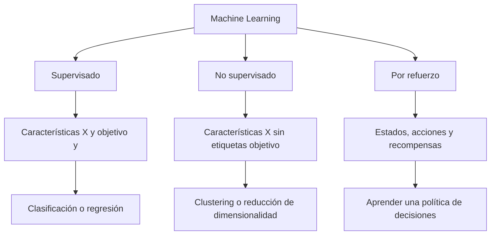
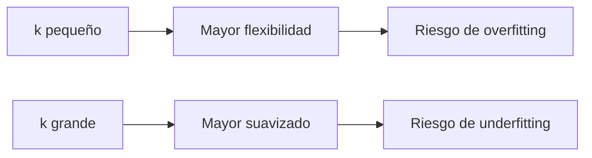
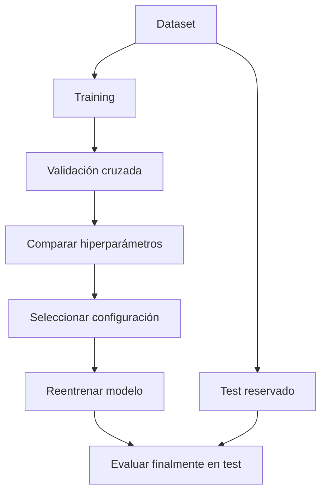
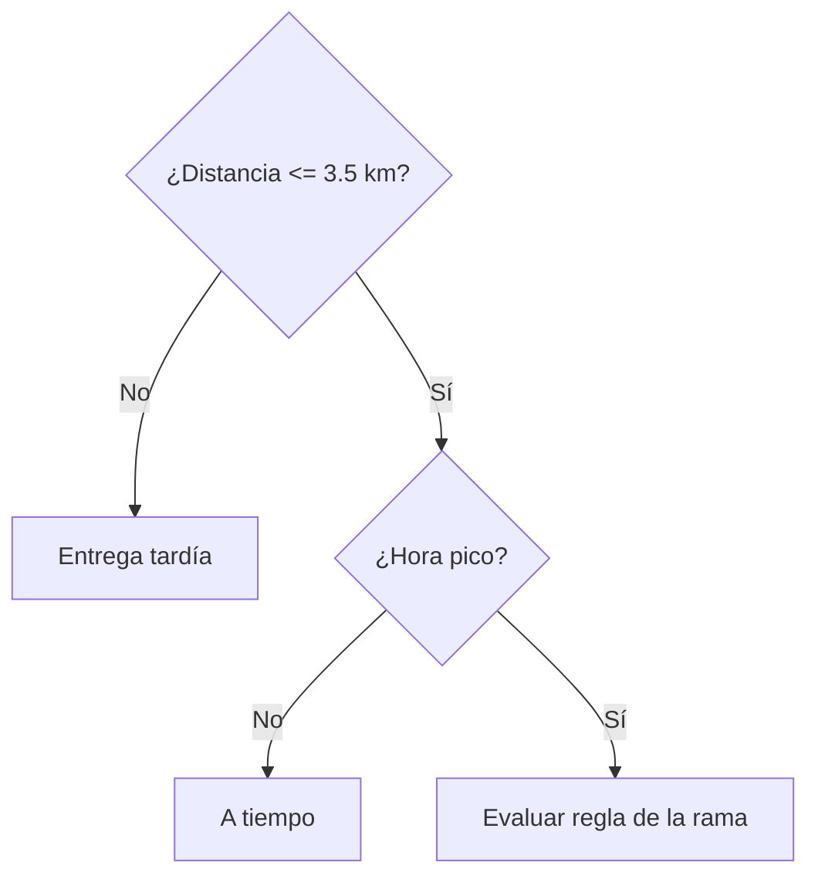
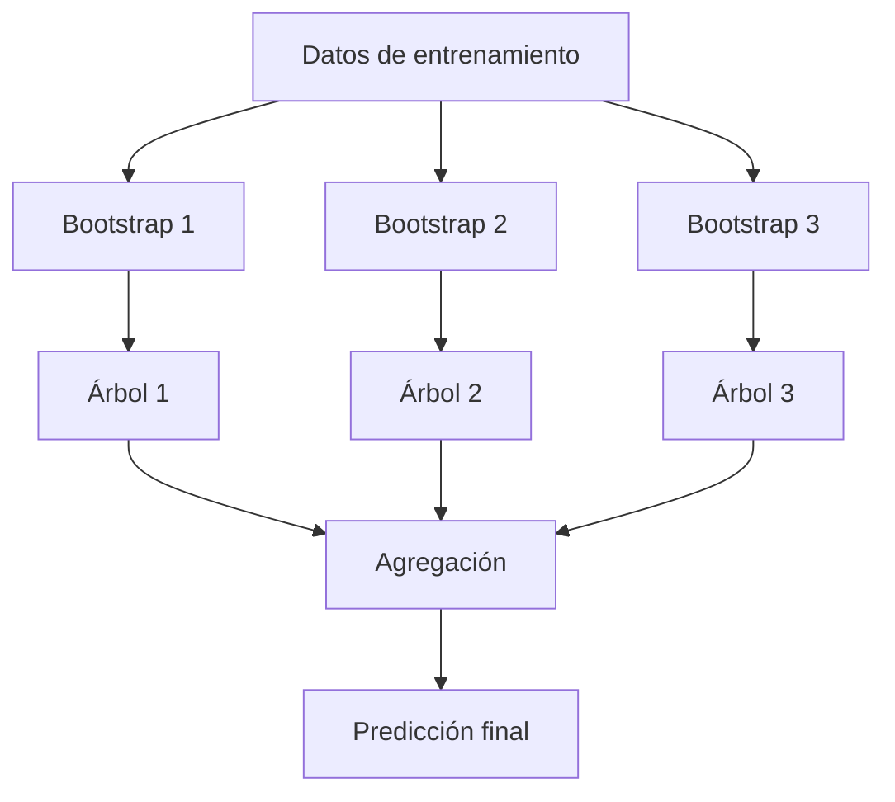
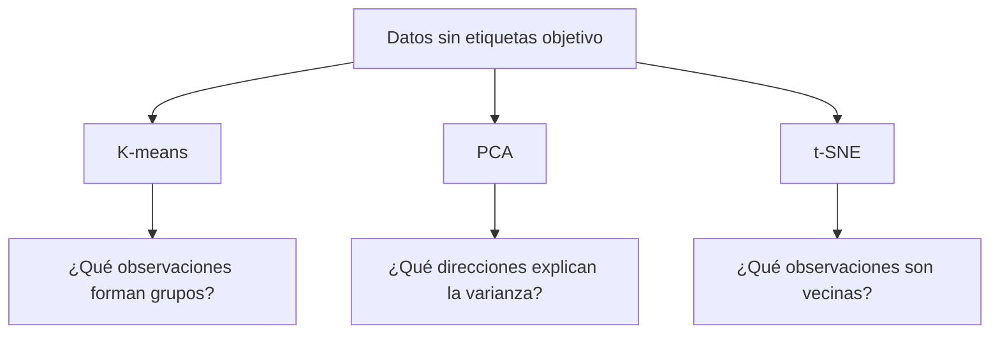
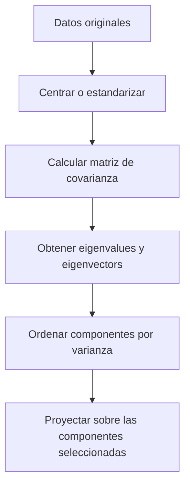
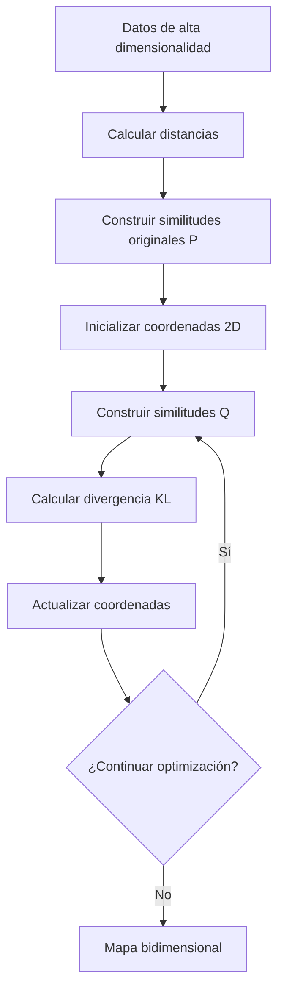
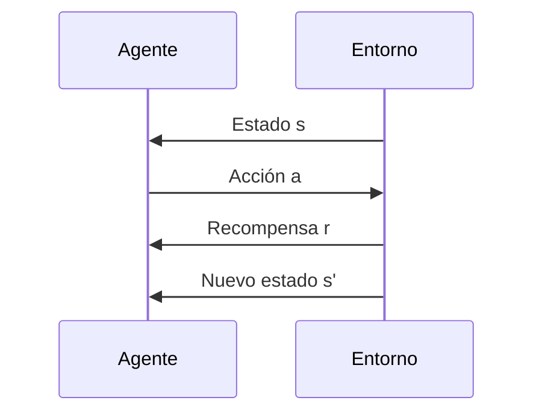

## Introducción  
  
El Machine Learning permite construir modelos capaces de aprender relaciones a partir de datos. Sin embargo, no todos los algoritmos aprenden de la misma manera ni intentan resolver el mismo tipo de problema.  
  
Algunos utilizan observaciones conocidas para predecir resultados nuevos. Otros identifican estructuras sin disponer de etiquetas. También existen algoritmos que aprenden a tomar decisiones mediante recompensas obtenidas al interactuar con un entorno.  
  
Durante este parcial se estudian tres grandes paradigmas:  
  
- **Aprendizaje supervisado:** regresión logística, k-Nearest Neighbors, Support Vector Machines, Decision Trees y Random Forest.  
- **Aprendizaje no supervisado:** K-means, Principal Component Analysis y t-SNE.  
- **Aprendizaje por refuerzo:** Markov Chains, Markov Decision Processes, Bellman y Q-Learning, además de sus extensiones mediante redes neuronales.  
  
El objetivo de este repaso es comprender los mecanismos fundamentales de cada técnica, sus fórmulas, sus hiperparámetros y las diferencias que permiten reconocer cuándo conviene utilizarla.  
  
Se dará especial importancia a los procedimientos que pueden resolverse a mano: distancias, votaciones, márgenes, impurezas, centroides, proyecciones, probabilidades de transición, retornos y actualizaciones de valores.  
  
Además, se relacionarán los algoritmos entre sí, porque uno de los aspectos más importantes de un examen de Machine Learning consiste en **identificar correctamente el problema antes de seleccionar el modelo**.  
  
---  
  
## Fundamentos de Machine Learning  
  
### Paradigmas de aprendizaje:  
  
La primera distinción consiste en determinar qué información recibe el algoritmo y qué resultado debe aprender.  
  

  
| Paradigma | Información disponible | Objetivo |  
|---|---|---|  
| Supervisado | Entradas y resultados conocidos | Predecir resultados |  
| No supervisado | Observaciones sin etiquetas objetivo | Descubrir estructura |  
| Por refuerzo | Experiencias y recompensas | Aprender decisiones |  
  
Por ejemplo, en un almacén pueden formularse tres preguntas diferentes.  
  
**¿Cuánto tardará en procesarse un paquete?** Es un problema supervisado de regresión.  
  
**¿Qué paquetes tienen características similares?** Es un problema no supervisado de clustering.  
  
**¿Debe un robot entregar un paquete o recargar primero?** Es un problema de aprendizaje por refuerzo, porque una acción afecta las posibilidades futuras.  
  
### Clasificación y regresión:  
  
Dentro del aprendizaje supervisado, la clasificación predice categorías.  
  
$$  
\hat{y}\in\{0,1\}  
$$  
  
Por ejemplo, determinar si una entrega llegará tarde.  
  
La regresión predice valores numéricos.  
  
$$  
\hat{y}\in\mathbb{R}  
$$  
  
Por ejemplo, estimar el tiempo de una entrega.  
  
Varios algoritmos poseen versiones para ambos problemas.  
  
| Familia | Clasificación | Regresión |  
|---|---|---|  
| kNN | `KNeighborsClassifier` | `KNeighborsRegressor` |  
| SVM | `SVC` | `SVR` |  
| Decision Trees | `DecisionTreeClassifier` | `DecisionTreeRegressor` |  
| Random Forest | `RandomForestClassifier` | `RandomForestRegressor` |  
  
### Parámetros e hiperparámetros:  
  
Los **parámetros** se aprenden automáticamente durante el entrenamiento.  
  
Por ejemplo, los pesos de una regresión logística:  
  
$$  
w,b  
$$  
  
Los **hiperparámetros** controlan cómo se realiza ese aprendizaje.  
  
Por ejemplo:  
  
- $k$ en kNN.  
- $C$ y $\gamma$ en SVM.  
- `max_depth` en árboles.  
- `n_estimators` en Random Forest.  
- $k$ en K-means.  
- `n_components` en PCA.  
  
La regla es:  
  
**El hiperparámetro se selecciona; el parámetro se aprende.**  
  
### Generalización:  
  
Un modelo debe funcionar sobre observaciones que no participaron en su entrenamiento.  
  
Cuando aprende excesivamente los detalles del conjunto de entrenamiento aparece **overfitting**.  
  
Cuando es demasiado simple para capturar los patrones aparece **underfitting**.  
  
| Situación | Training | Validation | Interpretación |  
|---|---|---|---|  
| Underfitting | Bajo | Bajo | Capacidad insuficiente |  
| Overfitting | Muy alto | Mucho menor | Exceso de adaptación |  
| Buena generalización | Alto | Similarmente alto | Comportamiento más estable |  
  
Estos patrones son indicios, no pruebas absolutas. La cantidad de datos y la variabilidad de las métricas también deben considerarse.  
  
---  
  
## Regresión logística  
  
La **regresión logística (Logistic Regression)** es un modelo de clasificación que aprende una combinación lineal de las características.  
  
Primero calcula:  
  
$$  
z=w^Tx+b  
$$  
  
En donde:  
  
- $w$ contiene los pesos aprendidos.  
- $x$ contiene las características.  
- $b$ es el sesgo.  
- $z$ es un puntaje lineal.  
  
Posteriormente transforma ese puntaje mediante la función sigmoide:  
  
$$  
\boxed{  
\sigma(z)=\frac{1}{1+e^{-z}}  
}  
$$  
  
El resultado está entre cero y uno.  
  
Para clasificación binaria:  
  
$$  
P(y=1\mid x)=\sigma(w^Tx+b)  
$$  
  
### Ejemplo:  
  
Supóngase que:  
  
$$  
z=0  
$$  
  
Entonces:  
  
$$  
\sigma(0)=\frac{1}{1+e^0}  
$$  
  
$$  
\boxed{\sigma(0)=0.5}  
$$  
  
Con un umbral de clasificación de $0.5$, los valores superiores o iguales a ese umbral pueden asignarse a la clase positiva, según la convención utilizada.  
  
### Frontera de decisión:  
  
La frontera correspondiente a probabilidad $0.5$ satisface:  
  
$$  
w^Tx+b=0  
$$  
  
Por lo tanto, utilizando directamente las características originales, la frontera es lineal.  
  
Esto significa que una regresión logística estándar puede tener dificultades cuando las clases están separadas mediante una curva.  
  
Su importancia en el parcial consiste principalmente en servir como **modelo lineal de referencia** para compararlo con kNN y SVM.  
  
---  
  
## k-Nearest Neighbors  
  
El algoritmo **k-Nearest Neighbors (kNN)** predice utilizando las observaciones de entrenamiento más cercanas a una nueva entrada.  
  
A diferencia de la regresión logística, no aprende una única ecuación global para separar las clases.  
  
En cambio, conserva los ejemplos y utiliza sus distancias cuando necesita predecir.  
  
### Distancia euclidiana:  
  
Para dos observaciones con $p$ características:  
  
$$  
\boxed{  
d(x,x_i)=\sqrt{\sum_{j=1}^{p}(x_j-x_{ij})^2}  
}  
$$  
  
En dos dimensiones:  
  
$$  
d(A,B)=\sqrt{(x_A-x_B)^2+(y_A-y_B)^2}  
$$  
  
###### Ejemplo:  
  
Supóngase:  
  
$$  
A=(2,3),\qquad B=(5,7)  
$$  
  
La distancia es:  
  
$$  
d(A,B)=\sqrt{(5-2)^2+(7-3)^2}  
$$  
  
$$  
=\sqrt{9+16}  
$$  
  
$$  
\boxed{d(A,B)=5}  
$$  
  
Cuanto menor es la distancia, más cercanas se consideran las observaciones.  
  
### kNN para clasificación:  
  
El algoritmo selecciona los $k$ vecinos más cercanos y combina sus clases.  
  
Con pesos uniformes se utiliza una votación.  
  
###### Ejemplo:  
  
Supóngase:  
  
$$  
k=5  
$$  
  
Y los vecinos pertenecen a:  
  
$$  
\{0,1,1,0,1\}  
$$  
  
La clase $1$ obtiene tres votos.  
  
La clase $0$ obtiene dos.  
  
Por lo tanto:  
  
$$  
\boxed{\hat{y}=1}  
$$  
  
La proporción de vecinos de clase $1$ es:  
  
$$  
\hat{P}(1)=\frac35=0.6  
$$  
  
Esta proporción puede utilizarse como estimación de probabilidad, aunque no necesariamente está calibrada.  
  
### kNN para regresión:  
  
En regresión, los valores numéricos de los vecinos se promedian.  
  
###### Ejemplo:  
  
Los tres vecinos más cercanos tienen valores:  
  
$$  
10,\ 12,\ 8  
$$  
  
Entonces:  
  
$$  
\hat{y}=\frac{10+12+8}{3}  
$$  
  
$$  
\boxed{\hat{y}=10}  
$$  
  
La búsqueda de vecinos es similar a clasificación, pero cambia la forma de producir la respuesta.  
  
### Hiperparámetro k:  
  
El valor de $k$ controla la cantidad de vecinos utilizados.  
  
**$k$ pequeño:** el modelo depende de pocas observaciones, produce decisiones locales y puede ser sensible al ruido.  
  
**$k$ grande:** las decisiones se suavizan, pero pueden perderse patrones locales relevantes.  
  

  
No existe un valor óptimo universal.  
  
Debe seleccionarse mediante validación.  
  
### Pesos uniformes y por distancia:  
  
Con:  
  
`weights="uniform"`  
  
todos los vecinos seleccionados tienen la misma importancia.  
  
Con:  
  
`weights="distance"`  
  
los vecinos más cercanos tienen mayor influencia.  
  
Esto puede resultar útil cuando existe una diferencia considerable entre las distancias de los vecinos.  
  
### El problema de la escala:  
  
kNN depende directamente de distancias.  
  
Supóngase que dos características representan:  
  
- Temperatura, con valores alrededor de $20$.  
- Consumo energético, con valores alrededor de $1500$.  
  
La segunda podría dominar numéricamente la distancia aunque no sea más importante para el problema.  
  
La estandarización utiliza:  
  
$$  
\boxed{  
z_j=\frac{x_j-\mu_j}{s_j}  
}  
$$  
  
En donde $\mu_j$ es la media y $s_j$ la desviación estándar de la característica.  
  
**kNN debe evaluarse con especial atención al escalamiento de las variables.**  
  
El escalador debe ajustarse solamente con los datos de entrenamiento correspondientes.  
  
---  
  
## Support Vector Machines  
  
Los **Support Vector Machines (SVM)** utilizan una estrategia distinta de kNN.  
  
En clasificación, buscan una frontera que separe las clases considerando el **margen**.  
  
### Margen y support vectors:  
  
El margen es la separación geométrica entre la frontera de decisión y las observaciones que restringen su posición.  
  
Estas observaciones importantes se denominan **support vectors**.  
  
Para una frontera lineal:  
  
$$  
\boxed{f(x)=w^Tx+b}  
$$  
  
En clasificación binaria, el signo de esta función determina de qué lado de la frontera se encuentra la observación.  
  
La formulación lineal separable busca maximizar el margen, que está relacionado con:  
  
$$  
\frac{2}{\|w\|}  
$$  
  
En problemas reales pueden permitirse violaciones del margen mediante regularización.  
  
### Hiperparámetro C:  
  
Una formulación de margen suave es:  
  
$$  
\min_{w,b,\xi}  
\frac12\|w\|^2+C\sum_i\xi_i  
$$  
  
Sujeta a condiciones que permiten determinadas violaciones del margen.  
  
En donde:  
  
- $\|w\|^2$ controla parte de la complejidad.  
- $\xi_i$ representa violaciones del margen.  
- $C$ establece la penalización de esas violaciones.  
  
| Valor de C | Comportamiento general |  
|---|---|  
| Pequeño | Mayor tolerancia y regularización más fuerte |  
| Grande | Penalización más estricta y mayor adaptación potencial |  
  
Un valor mayor de $C$ no garantiza mejor validación.  
  
### Hinge Loss:  
  
La pérdida hinge puede expresarse como:  
  
$$  
\boxed{  
\ell(z)=\max(0,1-z)  
}  
$$  
  
En donde:  
  
$$  
z=yf(x)  
$$  
  
con etiquetas binarias codificadas como $-1$ y $+1$.  
  
###### Ejemplo:  
  
Si:  
  
$$  
z=0.4  
$$  
  
entonces:  
  
$$  
\ell(0.4)=\max(0,1-0.4)  
$$  
  
$$  
\boxed{\ell=0.6}  
$$  
  
Si:  
  
$$  
z=1.5  
$$  
  
entonces:  
  
$$  
\ell(1.5)=\max(0,-0.5)  
$$  
  
$$  
\boxed{\ell=0}  
$$  
  
Una observación con margen firmado suficiente no genera pérdida hinge.  
  
---  
  
## Kernels y SVM no lineal  
  
Un SVC lineal solamente puede producir una frontera lineal en las características que recibe.  
  
Sin embargo, existen problemas donde las clases presentan relaciones curvas.  
  
Para estos casos pueden utilizarse **kernels**.  
  
### Kernel RBF:  
  
El kernel Radial Basis Function se define como:  
  
$$  
\boxed{  
K(x,x')=\exp(-\gamma\|x-x'\|^2)  
}  
$$  
  
En donde:  
  
- $x$ y $x'$ son dos observaciones.  
- $\|x-x'\|^2$ representa su distancia euclidiana al cuadrado.  
- $\gamma$ controla cómo cambia la similitud con la distancia.  
  
### Efecto de gamma:  
  
**Gamma pequeño:** la influencia de las observaciones es relativamente amplia y las fronteras suelen ser suaves.  
  
**Gamma grande:** la influencia es muy local, lo que permite fronteras más complejas.  
  
Un gamma excesivamente grande puede producir overfitting.  
  
### Diferencia entre C y gamma:  
  
| Hiperparámetro | Pregunta que responde |  
|---|---|  
| $C$ | ¿Cuánto se penalizan las violaciones del margen? |  
| $\gamma$ | ¿Qué tan local es la influencia del kernel? |  
  
Ambos modifican el comportamiento del modelo, pero por mecanismos distintos.  
  
### Ejemplo de selección:  
  
| $\gamma$ | F1 training | F1 validation |  
|---|---:|---:|  
| 0.01 | 0.86 | 0.88 |  
| 1 | 0.93 | 0.95 |  
| 100 | 1.00 | 0.87 |  
  
La configuración preferible entre las evaluadas es:  
  
$$  
\boxed{\gamma=1}  
$$  
  
porque obtiene el mejor F1 de validación.  
  
El resultado perfecto de entrenamiento con gamma $100$ no demuestra una mejor generalización.  
  
### SVR:  
  
**Support Vector Regression (SVR)** utiliza la familia SVM para predecir valores numéricos.  
  
Su concepto central es el **epsilon tube**, que define una zona de tolerancia alrededor de la predicción.  
  
La pérdida epsilon-insensitive es:  
  
$$  
\boxed{  
\ell_\epsilon=  
\max(0,|y-f(x)|-\epsilon)  
}  
$$  
  
###### Ejemplo:  
  
Supóngase:  
  
$$  
y=24,\qquad f(x)=20,\qquad\epsilon=2  
$$  
  
El error absoluto es:  
  
$$  
|24-20|=4  
$$  
  
La pérdida es:  
  
$$  
\ell_\epsilon=\max(0,4-2)  
$$  
  
$$  
\boxed{\ell_\epsilon=2}  
$$  
  
El tubo epsilon no constituye un intervalo de confianza; representa una tolerancia dentro de la función de pérdida.  
  
---  
  
## Selección de modelos  
  
Uno de los problemas más importantes consiste en elegir hiperparámetros sin utilizar indebidamente información reservada para la evaluación.  
  
### Training, validation y test:  
  
Las tres particiones cumplen funciones diferentes.  
  

  
**Training:** permite aprender los parámetros.  
  
**Validation:** permite comparar configuraciones.  
  
**Test:** permite evaluar finalmente el modelo seleccionado.  
  
La idea fundamental es que **test no debe utilizarse repetidamente para ajustar hiperparámetros**.  
  
Hacerlo provoca que las decisiones terminen adaptándose indirectamente a ese conjunto.  
  
### Cross-validation:  
  
La validación cruzada divide los datos de entrenamiento en varios subconjuntos llamados *folds*.  
  
Por ejemplo, con tres folds:  
  
| Iteración | Fold 1 | Fold 2 | Fold 3 |  
|---|---|---|---|  
| 1 | Validation | Training | Training |  
| 2 | Training | Validation | Training |  
| 3 | Training | Training | Validation |  
  
Cada fold se utiliza una vez para validación.  
  
El promedio de las métricas es:  
  
$$  
\boxed{  
\bar{s}=\frac1K\sum_{i=1}^{K}s_i  
}  
$$  
  
En problemas de clasificación desbalanceada, `StratifiedKFold` busca conservar aproximadamente las proporciones de clases en los folds.  
  
### GridSearchCV:  
  
Grid Search evalúa combinaciones de hiperparámetros.  
  
###### Ejemplo:  
  
Supóngase que se prueban:  
  
$$  
C\in\{0.1,1,10\}  
$$  
  
$$  
\gamma\in\{0.01,0.1,1\}  
$$  
  
Existen:  
  
$$  
3\times3=9  
$$  
  
configuraciones.  
  
Con cinco folds:  
  
$$  
9\times5=45  
$$  
  
Se realizan:  
  
$$  
\boxed{45\text{ ajustes de validación cruzada}}  
$$  
  
sin contar el reentrenamiento final cuando está habilitado.  
  
La mejor configuración se selecciona mediante la métrica promedio de validación, no mediante el resultado de entrenamiento.  
  
### Pipeline y data leakage:  
  
El **data leakage** ocurre cuando información que debería permanecer fuera de determinada etapa influye en el modelo.  
  
Por ejemplo, estandarizar utilizando todo el dataset antes de dividir training y test introduce información indebida.  
  
Un `Pipeline` permite ajustar el escalamiento dentro del procedimiento de entrenamiento y validación.  
  
```python  
from sklearn.pipeline import make_pipeline  
from sklearn.preprocessing import StandardScaler  
from sklearn.svm import SVC  
from sklearn.model_selection import GridSearchCV  
  
pipe = make_pipeline(  
StandardScaler(),  
SVC()  
)  
  
grid = GridSearchCV(  
pipe,  
{  
"svc__C": [0.1, 1, 10],  
"svc__gamma": ["scale", 0.1, 1]  
},  
cv=5,  
scoring="f1_macro"  
)  
  
grid.fit(X_train, y_train)  
```  
  
Posteriormente, la configuración seleccionada se evalúa sobre test.  
  
---  
  
## Métricas de evaluación  
  
Las métricas dependen del tipo de problema.  
  
### Matriz de confusión:  
  
En clasificación binaria se distinguen:  
  
| | Predicción negativa | Predicción positiva |  
|---|---|---|  
| Real negativa | TN | FP |  
| Real positiva | FN | TP |  
  
En donde:  
  
- $TP$: verdadero positivo.  
- $TN$: verdadero negativo.  
- $FP$: falso positivo.  
- $FN$: falso negativo.  
  
### Accuracy:  
  
Mide la proporción de aciertos.  
  
$$  
\boxed{  
Accuracy=\frac{TP+TN}{TP+TN+FP+FN}  
}  
$$  
  
### Precision:  
  
Mide cuántas predicciones positivas fueron correctas.  
  
$$  
\boxed{  
Precision=\frac{TP}{TP+FP}  
}  
$$  
  
### Recall:  
  
Mide cuántos positivos reales fueron identificados.  
  
$$  
\boxed{  
Recall=\frac{TP}{TP+FN}  
}  
$$  
  
### F1-score:  
  
Combina precision y recall mediante la media armónica.  
  
$$  
\boxed{  
F1=2\frac{Precision\cdot Recall}{Precision+Recall}  
}  
$$  
  
### F1 macro:  
  
Calcula el F1 para cada clase y posteriormente los promedia.  
  
$$  
\boxed{  
F1_{\text{macro}}=\frac1K\sum_{k=1}^{K}F1_k  
}  
$$  
  
Cada clase tiene el mismo peso en el promedio.  
  
###### Ejemplo:  
  
Supóngase:  
  
$$  
TP=40,\quad TN=30,\quad FP=10,\quad FN=20  
$$  
  
Entonces:  
  
$$  
Accuracy=\frac{40+30}{100}=0.70  
$$  
  
$$  
Precision=\frac{40}{50}=0.80  
$$  
  
$$  
Recall=\frac{40}{60}\approx0.667  
$$  
  
$$  
F1=\frac{2(40)}{2(40)+10+20}  
$$  
  
$$  
\boxed{F1\approx0.727}  
$$  
  
### Métricas de regresión:  
  
Las principales son:  
  
**Mean Absolute Error:**  
  
$$  
\boxed{  
MAE=\frac1n\sum_i|y_i-\hat{y}_i|  
}  
$$  
  
**Mean Squared Error:**  
  
$$  
\boxed{  
MSE=\frac1n\sum_i(y_i-\hat{y}_i)^2  
}  
$$  
  
**Root Mean Squared Error:**  
  
$$  
\boxed{RMSE=\sqrt{MSE}}  
$$  
  
**Coeficiente de determinación:**  
  
$$  
\boxed{  
R^2=1-  
\frac{\sum_i(y_i-\hat{y}_i)^2}  
{\sum_i(y_i-\bar{y})^2}  
}  
$$  
  
MAE y RMSE se expresan en las unidades originales del objetivo.  
  
MSE utiliza las unidades al cuadrado.  
  
$R^2$ puede ser negativo cuando el modelo presenta un error cuadrático mayor que el predictor constante basado en la media de los objetivos evaluados.  
  
---  
  
## Decision Trees  
  
Los **árboles de decisión (Decision Trees)** realizan predicciones mediante preguntas sucesivas sobre las características.  
  
Cada pregunta divide las observaciones en grupos.  
  
### Componentes:  
  
- **Root:** nodo inicial.  
- **Internal node:** nodo que contiene una pregunta.  
- **Branch:** camino asociado con una condición.  
- **Leaf:** nodo terminal que produce una predicción.  
- **Depth:** número de divisiones desde la raíz.  
  
### Ejemplo:  
  

  
Una observación recorre el árbol desde la raíz hasta llegar a una hoja.  
  
### CART:  
  
**Classification and Regression Trees (CART)** construye divisiones binarias de forma recursiva.  
  
Es un procedimiento *greedy*: selecciona la mejor división disponible en cada nodo sin evaluar exhaustivamente todas las estructuras completas posibles.  
  
### Árboles de clasificación:  
  
En clasificación se buscan divisiones que reduzcan la mezcla de clases.  
  
Uno de los criterios principales es **Gini**.  
  
$$  
\boxed{  
G=1-\sum_{k=1}^{K}p_k^2  
}  
$$  
  
En donde $p_k$ representa la proporción de la clase $k$.  
  
Para dos clases:  
  
$$  
\boxed{G=2p(1-p)}  
$$  
  
Un nodo puro tiene:  
  
$$  
G=0  
$$  
  
Una mezcla perfectamente equilibrada entre dos clases tiene:  
  
$$  
G=0.5  
$$  
  
###### Ejemplo:  
  
Un nodo contiene ocho observaciones rojas y dos verdes.  
  
Entonces:  
  
$$  
p_R=0.8,\qquad p_V=0.2  
$$  
  
La impureza es:  
  
$$  
G=1-(0.8)^2-(0.2)^2  
$$  
  
$$  
=1-0.64-0.04  
$$  
  
$$  
\boxed{G=0.32}  
$$  
  
### Entropía:  
  
Otro criterio es:  
  
$$  
\boxed{  
H=-\sum_{k=1}^{K}p_k\log_2(p_k)  
}  
$$  
  
Para dos clases equilibradas:  
  
$$  
H=-0.5\log_2(0.5)-0.5\log_2(0.5)  
$$  
  
$$  
\boxed{H=1\text{ bit}}  
$$  
  
Un nodo puro tiene entropía cero.  
  
### Impureza ponderada:  
  
Cuando un nodo se divide, deben considerarse ambos hijos.  
  
$$  
\boxed{  
I_{\text{split}}=  
\frac{n_L}{n}I_L+  
\frac{n_R}{n}I_R  
}  
$$  
  
En donde:  
  
- $n_L$ es la cantidad de observaciones del hijo izquierdo.  
- $n_R$ es la cantidad del derecho.  
- $I_L$ e $I_R$ son sus impurezas.  
- $n=n_L+n_R$.  
  
###### Ejemplo:  
  
Un nodo se divide en:  
  
- Cuatro observaciones con Gini $0.5$.  
- Seis observaciones con Gini $0.2$.  
  
Entonces:  
  
$$  
G_{\text{split}}=  
\frac4{10}(0.5)+\frac6{10}(0.2)  
$$  
  
$$  
=0.20+0.12  
$$  
  
$$  
\boxed{G_{\text{split}}=0.32}  
$$  
  
La mejor división es aquella que consigue la mayor reducción de impureza entre las candidatas válidas.  
  
### Árboles de regresión:  
  
En regresión, cuando se utiliza `squared_error`, cada hoja predice la media de los valores objetivo que contiene.  
  
###### Ejemplo:  
  
Una hoja contiene:  
  
$$  
10,\ 12,\ 20  
$$  
  
Su predicción es:  
  
$$  
\hat{y}=\frac{10+12+20}{3}  
$$  
  
$$  
\boxed{\hat{y}=14}  
$$  
  
Con `absolute_error`, una hoja predice una mediana; en este ejemplo sería $12$.  
  
Los árboles de regresión producen predicciones constantes por regiones y no extrapolan automáticamente tendencias lineales.  
  
### Regularización de árboles:  
  
Un árbol demasiado profundo puede aprender reglas basadas en muy pocas observaciones.  
  
Los principales hiperparámetros son:  
  
| Hiperparámetro | Función |  
|---|---|  
| `max_depth` | Limita profundidad |  
| `min_samples_split` | Mínimo de observaciones para intentar dividir |  
| `min_samples_leaf` | Mínimo de observaciones en cada hoja |  
| `max_leaf_nodes` | Limita cantidad de hojas |  
| `ccp_alpha` | Controla poda |  
  
La poda puede describirse mediante:  
  
$$  
\boxed{  
R_\alpha(T)=R(T)+\alpha L(T)  
}  
$$  
  
En donde:  
  
- $R(T)$ representa la impureza del árbol.  
- $L(T)$ representa su número de hojas.  
- $\alpha$ controla la penalización por complejidad.  
  
**Una hoja pura no garantiza generalización**, especialmente si contiene solamente una observación.  
  
---  
  
## Random Forest  
  
Los árboles individuales pueden ser inestables: pequeños cambios en los datos de entrenamiento pueden modificar sus divisiones.  
  
**Random Forest** busca reducir esa variabilidad combinando múltiples árboles aleatorizados.  
  
Pertenece a los métodos de **Ensemble Learning**.  
  
### Funcionamiento:  
  

  
En un bosque real pueden utilizarse decenas o cientos de árboles.  
  
### Bootstrap:  
  
El **bootstrap sampling** selecciona observaciones con reemplazo.  
  
Supóngase:  
  
$$  
\{A,B,C,D,E,F\}  
$$  
  
Una muestra bootstrap podría ser:  
  
$$  
\{A,A,C,D,F,F\}  
$$  
  
Se realizaron seis extracciones, pero solamente existen cuatro observaciones diferentes.  
  
B y E no aparecen.  
  
### Out-of-Bag:  
  
Las observaciones no seleccionadas por un árbol se denominan **Out-of-Bag (OOB)** para ese árbol.  
  
En el ejemplo:  
  
$$  
\boxed{OOB=\{B,E\}}  
$$  
  
La probabilidad de que una observación quede fuera de una muestra bootstrap estándar es:  
  
$$  
P(OOB)=\left(1-\frac1n\right)^n  
$$  
  
Cuando $n$ es grande:  
  
$$  
\boxed{P(OOB)\approx0.368}  
$$  
  
Por lo tanto, aproximadamente el $36.8\%$ de las observaciones originales queda fuera de cada bootstrap, en promedio.  
  
Las predicciones OOB permiten construir una evaluación interna utilizando solamente los árboles que omitieron cada observación.  
  
### Selección aleatoria de características:  
  
Random Forest también introduce aleatoriedad al seleccionar características candidatas durante las divisiones.  
  
Por ejemplo:  
  
`max_features="sqrt"`  
  
utiliza aproximadamente la raíz cuadrada de la cantidad de características.  
  
Si existen trece:  
  
$$  
\sqrt{13}\approx3.606  
$$  
  
Se consideran inicialmente:  
  
$$  
\boxed{3\text{ características}}  
$$  
  
Esta selección se repite en cada nodo.  
  
### Bagging frente a Random Forest:  
  
**Bagging** utiliza muestras bootstrap y agrega modelos.  
  
Random Forest combina esta estrategia con selección aleatoria de características para reducir la similitud entre árboles.  
  
### Clasificación:  
  
En scikit-learn, Random Forest promedia las probabilidades estimadas por los árboles.  
  
$$  
\boxed{  
\hat{P}(y=k\mid x)=  
\frac1B\sum_{b=1}^{B}\hat{P}_b(y=k\mid x)  
}  
$$  
  
La clase seleccionada es la de mayor probabilidad promedio.  
  
###### Ejemplo:  
  
Tres árboles estiman probabilidades de retraso:  
  
$$  
0.2,\ 0.7,\ 0.8  
$$  
  
Entonces:  
  
$$  
\hat{P}(\text{Tarde})=\frac{0.2+0.7+0.8}{3}  
$$  
  
$$  
\boxed{\hat{P}(\text{Tarde})\approx0.567}  
$$  
  
El modelo selecciona tarde en este problema binario.  
  
El promedio de probabilidades no siempre equivale al voto mayoritario directo de las clases.  
  
### Regresión:  
  
En regresión se utiliza el promedio numérico:  
  
$$  
\boxed{  
\hat{y}_{RF}=\frac1B\sum_{b=1}^{B}\hat{y}_b  
}  
$$  
  
###### Ejemplo:  
  
Tres árboles predicen:  
  
$$  
21,\ 25,\ 23  
$$  
  
minutos.  
  
$$  
\hat{y}_{RF}=\frac{21+25+23}{3}  
$$  
  
$$  
\boxed{\hat{y}_{RF}=23\text{ min}}  
$$  
  
### Sesgo y varianza:  
  
El **bias** representa errores sistemáticos.  
  
La **variance** representa cuánto cambian las predicciones cuando se modifica el entrenamiento.  
  
Random Forest busca reducir principalmente la varianza.  
  
Bajo el supuesto de árboles con varianza común $\sigma^2$ y correlación común $\rho$:  
  
$$  
\boxed{  
\operatorname{Var}(\bar{y})=  
\sigma^2\left[\rho+\frac{1-\rho}{B}\right]  
}  
$$  
  
En donde $B$ es el número de árboles.  
  
Si los árboles cometen errores muy similares, agregarlos aporta menos beneficio.  
  
Por lo tanto, **la diversidad es tan importante como la cantidad de estimadores**.  
  
---  
  
## Aprendizaje no supervisado  
  
A diferencia de los modelos anteriores, el aprendizaje no supervisado no dispone de una variable objetivo conocida para la tarea.  
  
Los algoritmos deben identificar relaciones directamente a partir de las características.  
  
Los tres procedimientos principales son:  
  
| Algoritmo | Objetivo | Resultado |  
|---|---|---|  
| K-means | Agrupar observaciones | Clusters y centroides |  
| PCA | Conservar varianza con menos dimensiones | Componentes principales |  
| t-SNE | Representar vecindades locales | Coordenadas de visualización |  
  

  
Estas técnicas son complementarias.  
  
Por ejemplo, PCA puede utilizarse para reducir dimensiones antes de aplicar otro procedimiento, mientras que t-SNE permite explorar visualmente las relaciones locales.  
  
---  
  
## K-means  
  
**K-means** es un algoritmo de clustering que organiza observaciones en $k$ grupos.  
  
Busca que cada observación se encuentre cerca del centroide de su grupo.  
  
### Elementos principales:  
  
- $n$: cantidad de observaciones.  
- $k$: cantidad de clusters.  
- $x_i$: observación.  
- $\mu_j$: centroide del cluster $j$.  
- $c_i$: cluster asignado a la observación.  
  
El valor de $k$ es un hiperparámetro.  
  
Los centroides y asignaciones son aprendidos.  
  
### Funcionamiento:  
  
K-means alterna dos operaciones.  
  
**Asignación:**  
  
$$  
\boxed{  
c_i=\arg\min_j\|x_i-\mu_j\|^2  
}  
$$  
  
Cada observación se asigna al centroide más cercano.  
  
**Actualización:**  
  
$$  
\boxed{  
\mu_j=\frac1{|C_j|}\sum_{i\in C_j}x_i  
}  
$$  
  
Cada centroide se recalcula mediante la media de su grupo.  
  
Durante la asignación se mantienen fijos los centros.  
  
Durante la actualización se mantienen fijas las asignaciones.  
  
### Ejemplo de seis clientes:  
  
Se tienen:  
  
| Cliente | Coordenadas |  
|---|---|  
| A | $(1,1)$ |  
| B | $(1,2)$ |  
| C | $(2,1)$ |  
| D | $(7,7)$ |  
| E | $(7,8)$ |  
| F | $(8,7)$ |  
  
Se selecciona:  
  
$$  
k=2  
$$  
  
Los centroides iniciales son:  
  
$$  
\mu_1^{(0)}=(1,1)  
$$  
  
$$  
\mu_2^{(0)}=(2,1)  
$$  
  
### Primera asignación:  
  
Las distancias al cuadrado son:  
  
| Cliente | $d_1^2$ | $d_2^2$ | Grupo |  
|---|---:|---:|---:|  
| A | 0 | 1 | 1 |  
| B | 1 | 2 | 1 |  
| C | 1 | 0 | 2 |  
| D | 72 | 61 | 2 |  
| E | 85 | 74 | 2 |  
| F | 85 | 72 | 2 |  
  
Por lo tanto:  
  
$$  
C_1=\{A,B\}  
$$  
  
$$  
C_2=\{C,D,E,F\}  
$$  
  
La primera asignación todavía no coincide con los grupos visualmente esperados.  
  
### Primera actualización:  
  
El primer centroide es:  
  
$$  
\mu_1^{(1)}=  
\left(\frac{1+1}{2},\frac{1+2}{2}\right)  
$$  
  
$$  
\boxed{\mu_1^{(1)}=(1,1.5)}  
$$  
  
El segundo es:  
  
$$  
\mu_2^{(1)}=  
\left(  
\frac{2+7+7+8}{4},  
\frac{1+7+8+7}{4}  
\right)  
$$  
  
$$  
\boxed{\mu_2^{(1)}=(6,5.75)}  
$$  
  
### Segunda asignación:  
  
La observación C cambia de grupo.  
  
Su distancia al primer centroide es:  
  
$$  
d_1^2(C)=(2-1)^2+(1-1.5)^2  
$$  
  
$$  
\boxed{d_1^2(C)=1.25}  
$$  
  
Al segundo:  
  
$$  
d_2^2(C)=(2-6)^2+(1-5.75)^2  
$$  
  
$$  
\boxed{d_2^2(C)=38.5625}  
$$  
  
Por lo tanto:  
  
$$  
\boxed{C\rightarrow\text{Cluster 1}}  
$$  
  
Los grupos quedan:  
  
$$  
C_1=\{A,B,C\}  
$$  
  
$$  
C_2=\{D,E,F\}  
$$  
  
### Centroides finales:  
  
Para el primer grupo:  
  
$$  
\mu_1=\left(\frac{1+1+2}{3},\frac{1+2+1}{3}\right)  
$$  
  
$$  
\boxed{\mu_1=\left(\frac43,\frac43\right)}  
$$  
  
Para el segundo:  
  
$$  
\mu_2=\left(\frac{7+7+8}{3},\frac{7+8+7}{3}\right)  
$$  
  
$$  
\boxed{\mu_2=\left(\frac{22}{3},\frac{22}{3}\right)}  
$$  
  
Al repetir la asignación, los grupos ya no cambian.  
  
El algoritmo converge.  
  
### Función objetivo e inercia:  
  
K-means busca minimizar:  
  
$$  
\boxed{  
J=\sum_{i=1}^{n}\|x_i-\mu_{c_i}\|^2  
}  
$$  
  
Esta cantidad se conoce como **inercia** o *Within-Cluster Sum of Squares*.  
  
La evolución del ejemplo es:  
  
| Etapa | Inercia |  
|---|---:|  
| Asignación inicial | 208 |  
| Primera actualización | 53.25 |  
| Segunda asignación | 15.9375 |  
| Segunda actualización | 2.6667 |  
  
El valor final es:  
  
$$  
\boxed{J=\frac83\approx2.6667}  
$$  
  
### Selección de k:  
  
Aumentar $k$ puede reducir la inercia.  
  
Si existen seis observaciones y:  
  
$$  
k=6  
$$  
  
cada una podría formar su propio grupo.  
  
Entonces:  
  
$$  
J=0  
$$  
  
Sin embargo, esto no significa que la segmentación sea útil.  
  
El número de clusters debe seleccionarse considerando compactación, separación, estabilidad y significado práctico.  
  
### Limitaciones de K-means:  
  
**Escala:** las unidades pueden modificar las distancias.  
  
**Inicialización:** distintos centroides iniciales pueden conducir a soluciones diferentes.  
  
**Valores atípicos:** pueden desplazar los centroides porque estos se calculan mediante medias.  
  
**Interpretación:** el cluster ID no equivale a una clase supervisada.  
  
`k-means++` y múltiples inicializaciones mediante `n_init` permiten mejorar la búsqueda de soluciones.  
  
---  
  
## Principal Component Analysis  
  
**Principal Component Analysis (PCA)** es una técnica de reducción de dimensionalidad lineal.  
  
Su objetivo consiste en representar los datos mediante menos características, conservando la mayor varianza posible.  
  
PCA construye nuevas variables llamadas **componentes principales (Principal Components)**.  
  
### Intuición geométrica:  
  
Supóngase que se tienen dos características correlacionadas.  
  
Los puntos forman una nube alargada.  
  
La primera componente principal sigue la dirección de mayor dispersión.  
  
La segunda es perpendicular a la primera y captura la mayor varianza restante.  
  

  
### Varianza:  
  
Mide la dispersión de una variable respecto a su media.  
  
$$  
\boxed{  
s^2=\frac1{n-1}\sum_i(x_i-\bar{x})^2  
}  
$$  
  
### Covarianza:  
  
Mide cómo varían conjuntamente dos características.  
  
$$  
\boxed{  
\operatorname{Cov}(x,y)=  
\frac1{n-1}\sum_i(x_i-\bar{x})(y_i-\bar{y})  
}  
$$  
  
Una covarianza positiva indica una tendencia de variación conjunta en la misma dirección.  
  
Una negativa indica una tendencia en direcciones opuestas.  
  
### Correlación:  
  
Normaliza la covarianza.  
  
$$  
\boxed{  
r=\frac{\operatorname{Cov}(x,y)}{s_xs_y}  
}  
$$  
  
Se encuentra entre:  
  
$$  
-1\leq r\leq1  
$$  
  
La covarianza depende de las unidades; la correlación no.  
  
### Matriz de covarianza:  
  
Para los datos centrados:  
  
$$  
\boxed{  
\Sigma=\frac1{n-1}X_c^TX_c  
}  
$$  
  
Esta matriz resume las varianzas y covarianzas de las características.  
  
### Eigenvectors y eigenvalues:  
  
PCA resuelve:  
  
$$  
\boxed{  
\Sigma w_j=\lambda_jw_j  
}  
$$  
  
En donde:  
  
- $w_j$ es un eigenvector, que determina una dirección principal.  
- $\lambda_j$ es su eigenvalue, que representa la varianza capturada por esa dirección.  
  
**Eigenvector = dirección.**  
  
**Eigenvalue = varianza explicada.**  
  
### Ejemplo:  
  
Supóngase:  
  
$$  
\Sigma=  
\begin{pmatrix}  
1.0526&0.6823\\  
0.6823&1.0526  
\end{pmatrix}  
$$  
  
Se obtienen aproximadamente:  
  
$$  
\lambda_1=1.7349  
$$  
  
$$  
\lambda_2=0.3702  
$$  
  
El mayor eigenvalue corresponde a PC1.  
  
### Varianza explicada:  
  
La proporción explicada por cada componente es:  
  
$$  
\boxed{  
r_j=\frac{\lambda_j}{\sum_\ell\lambda_\ell}  
}  
$$  
  
Para PC1:  
  
$$  
r_1=\frac{1.7349}{1.7349+0.3702}  
$$  
  
$$  
\boxed{r_1\approx0.824=82.4\%}  
$$  
  
Para PC2:  
  
$$  
\boxed{r_2\approx17.6\%}  
$$  
  
Si se conserva solamente PC1, se preserva aproximadamente el $82.4\%$ de la varianza.  
  
### Proyección:  
  
Si $W_k$ contiene las primeras $k$ direcciones principales:  
  
$$  
\boxed{T=X_cW_k}  
$$  
  
En donde $T$ es la nueva representación.  
  
La reducción puede verse geométricamente como una rotación de ejes seguida de una proyección sobre las direcciones seleccionadas.  
  
### n_components:  
  
El hiperparámetro `n_components` determina cuántas componentes se conservan.  
  
Por ejemplo:  
  
`n_components=2`  
  
conserva dos componentes.  
  
Mientras que:  
  
`n_components=0.80`  
  
con un solucionador compatible selecciona suficientes componentes para conservar al menos el $80\%$ de la varianza.  
  
### Limitación principal:  
  
PCA no utiliza las etiquetas objetivo.  
  
Por lo tanto, **conservar mucha varianza no garantiza conservar la información más útil para clasificar o predecir**.  
  
La varianza explicada no es accuracy.  
  
---  
  
## t-Distributed Stochastic Neighbor Embedding  
  
**t-SNE** es una técnica de reducción de dimensionalidad no lineal utilizada principalmente para visualización.  
  
Su objetivo consiste en construir un mapa de dos dimensiones donde observaciones cercanas en el espacio original tiendan a conservar sus relaciones de vecindad.  
  
A diferencia de PCA, t-SNE no prioriza las direcciones de máxima varianza.  
  
Prioriza las **similitudes locales**.  
  
### Ejemplo:  
  
Una imagen de un dígito manuscrito de:  
  
$$  
8\times8  
$$  
  
píxeles contiene:  
  
$$  
64  
$$  
  
características.  
  
Cada imagen es un punto en un espacio de 64 dimensiones.  
  
t-SNE busca construir una representación bidimensional:  
  
$$  
\mathbb{R}^{64}\rightarrow\mathbb{R}^{2}  
$$  
  
donde imágenes similares aparezcan relativamente cerca.  
  
### Funcionamiento:  
  

  
### Similitudes gaussianas:  
  
En el espacio original se utilizan pesos como:  
  
$$  
\boxed{  
w_{ij}=  
\exp\left(  
-\frac{\|x_i-x_j\|^2}{2\sigma_i^2}  
\right)  
}  
$$  
  
Las observaciones cercanas reciben pesos mayores.  
  
Después se normalizan:  
  
$$  
\boxed{  
p_{j|i}=\frac{w_{ij}}{\sum_{k\neq i}w_{ik}}  
}  
$$  
  
Estas probabilidades indican las relaciones de vecindad desde la perspectiva de cada observación.  
  
### Matriz P:  
  
t-SNE construye una distribución simétrica mediante:  
  
$$  
\boxed{  
p_{ij}=\frac{p_{j|i}+p_{i|j}}{2n}  
}  
$$  
  
En donde $n$ es el número de observaciones.  
  
$P$ representa las relaciones originales de similitud.  
  
### Perplexity:  
  
La **perplexity** controla la escala efectiva de las vecindades.  
  
Se relaciona con la entropía mediante:  
  
$$  
\boxed{  
\operatorname{Perp}(P_i)=2^{H(P_i)}  
}  
$$  
  
En términos generales:  
  
- Perplexity pequeña: enfatiza vecindades locales.  
- Perplexity grande: considera vecindades más amplias.  
  
No representa exactamente un número fijo de vecinos como $k$ en kNN.  
  
### Matriz Q:  
  
En el mapa bidimensional se utilizan pesos Student-t:  
  
$$  
\boxed{  
t_{ij}=\frac1{1+\|y_i-y_j\|^2}  
}  
$$  
  
Posteriormente:  
  
$$  
\boxed{  
q_{ij}=\frac{t_{ij}}{\sum_{k\neq l}t_{kl}}  
}  
$$  
  
La distribución Student-t tiene colas pesadas y ayuda a reducir el problema de amontonamiento (*crowding problem*) al representar relaciones de alta dimensionalidad en dos dimensiones.  
  
### Divergencia KL:  
  
t-SNE compara ambas distribuciones mediante:  
  
$$  
\boxed{  
KL(P\|Q)=  
\sum_{i\neq j}  
p_{ij}\ln\left(\frac{p_{ij}}{q_{ij}}\right)  
}  
$$  
  
El algoritmo ajusta las coordenadas bidimensionales para minimizar esta divergencia.  
  
### Descenso de gradiente:  
  
Las posiciones se modifican iterativamente:  
  
$$  
\boxed{  
y_i^{(t+1)}=  
y_i^{(t)}-\eta\nabla_{y_i}KL  
}  
$$  
  
En donde $\eta$ es la tasa de aprendizaje.  
  
### Interpretación correcta:  
  
t-SNE resulta útil para explorar qué observaciones son vecinas.  
  
Sin embargo, no garantiza conservar:  
  
- Distancias globales entre grupos.  
- Tamaños relativos de clusters.  
- Densidades originales.  
- Separaciones exactas entre regiones.  
  
Además, **t-SNE no realiza clustering**. Produce coordenadas para visualización, no etiquetas de pertenencia a grupos.  
  
---  
  
## Reinforcement Learning  
  
El **aprendizaje por refuerzo (Reinforcement Learning)** estudia cómo un agente puede aprender a tomar decisiones mediante recompensas recibidas al interactuar con un entorno.  
  
### Agente y entorno:  
  
El agente observa una situación y selecciona una acción.  
  
El entorno procesa la acción y proporciona una recompensa y un nuevo estado.  
  
Una transición se representa mediante:  
  
$$  
(s,a,r,s')  
$$  
  
En donde:  
  
- $s$ es el estado actual.  
- $a$ es la acción.  
- $r$ es la recompensa.  
- $s'$ es el estado siguiente.  
  

  
La diferencia respecto al aprendizaje supervisado es que la recompensa generalmente no indica directamente la acción correcta para cada estado.  
  
Una acción con recompensa inmediata negativa puede conducir a una recompensa futura elevada.  
  
---  
  
## Markov Chains  
  
Una **cadena de Markov (Markov Chain)** describe cómo un sistema evoluciona probabilísticamente entre estados.  
  
Su propiedad fundamental es que la distribución del siguiente estado depende del estado actual, suponiendo que este contiene toda la información relevante.  
  
$$  
\boxed{  
P(S_{t+1}\mid S_t,S_{t-1},\ldots)  
=  
P(S_{t+1}\mid S_t)  
}  
$$  
  
### Ejemplo del clima:  
  
Se tienen dos estados:  
  
$$  
S=\{\text{Soleado, Lluvioso}\}  
$$  
  
Y una matriz de transición:  
  
$$  
\boxed{  
P=  
\begin{pmatrix}  
0.8&0.2\\  
0.4&0.6  
\end{pmatrix}  
}  
$$  
  
Las filas representan el estado actual.  
  
Las columnas representan el siguiente estado.  
  
Cada fila suma uno.  
  
### Predicción de un paso:  
  
Si hoy está soleado:  
  
$$  
\mu_0=(1,0)  
$$  
  
Entonces:  
  
$$  
\mu_1=\mu_0P  
$$  
  
$$  
\boxed{\mu_1=(0.8,0.2)}  
$$  
  
Mañana existe probabilidad $0.8$ de sol y $0.2$ de lluvia.  
  
### Predicción de dos pasos:  
  
$$  
\mu_2=\mu_1P  
$$  
  
La probabilidad de lluvia dentro de dos días puede calcularse mediante dos caminos:  
  
$$  
S\rightarrow S\rightarrow R  
$$  
  
$$  
S\rightarrow R\rightarrow R  
$$  
  
Entonces:  
  
$$  
P(R\text{ en dos días})=  
0.8(0.2)+0.2(0.6)  
$$  
  
$$  
=0.16+0.12  
$$  
  
$$  
\boxed{P=0.28}  
$$  
  
Se multiplican probabilidades dentro de cada camino y se suman caminos alternativos mutuamente excluyentes.  
  
---  
  
## Markov Decision Processes  
  
Un **Markov Decision Process (MDP)** incorpora acciones y recompensas a las transiciones entre estados.  
  
Se representa mediante:  
  
$$  
\boxed{  
M=(S,A,P,r,\gamma)  
}  
$$  
  
En donde:  
  
- $S$ es el conjunto de estados.  
- $A$ es el conjunto de acciones.  
- $P$ representa probabilidades de transición.  
- $r$ es la función de recompensa.  
- $\gamma$ es el factor de descuento.  
  
La diferencia fundamental es:  
  
| Markov Chain | MDP |  
|---|---|  
| Describe transiciones | Describe decisiones y transiciones |  
| $P(s'\mid s)$ | $P(s'\mid s,a)$ |  
| No requiere acciones controladas | El agente selecciona acciones |  
| Describe evolución | Busca maximizar retorno esperado |  
  
### Propiedad de Markov:  
  
El estado y la acción deben contener información suficiente para determinar las probabilidades de los resultados siguientes.  
  
Por ejemplo, un robot no debería representarse únicamente mediante su posición si su batería afecta las acciones que puede completar.  
  
Un estado más apropiado sería:  
  
$$  
s=(\text{posición, batería, paquete})  
$$  
  
---  
  
## Políticas y recompensas  
  
Una **política (policy)** determina cómo selecciona acciones el agente.  
  
### Política determinista:  
  
$$  
\boxed{a=\pi(s)}  
$$  
  
Selecciona una acción para cada estado.  
  
### Política estocástica:  
  
$$  
\boxed{\pi(a\mid s)}  
$$  
  
Asigna probabilidades a las acciones posibles.  
  
Estas probabilidades deben sumar uno.  
  
### Return:  
  
El **retorno** representa la recompensa acumulada descontada.  
  
$$  
\boxed{  
G_t=\sum_{k=0}^{T-t-1}\gamma^kR_{t+k+1}  
}  
$$  
  
En donde:  
  
- $G_t$ es el retorno desde el instante $t$.  
- $\gamma$ es el factor de descuento.  
- $R_{t+k+1}$ representa las recompensas futuras.  
  
### Factor de descuento:  
  
Si:  
  
$$  
\gamma=0  
$$  
  
solamente se considera la siguiente recompensa.  
  
Si:  
  
$$  
\gamma=1  
$$  
  
las recompensas de un episodio finito se suman sin descuento.  
  
Con valores intermedios, las recompensas futuras tienen menor peso.  
  
### Ejemplo de una ruta:  
  
Supóngase que las recompensas son:  
  
$$  
-1,-1,+50  
$$  
  
Con:  
  
$$  
\gamma=0.9  
$$  
  
el retorno es:  
  
$$  
G_0=-1+0.9(-1)+0.9^2(50)  
$$  
  
$$  
=-1-0.9+40.5  
$$  
  
$$  
\boxed{G_0=38.6}  
$$  
  
Aunque los primeros movimientos producen recompensas negativas, la ruta completa tiene un retorno positivo.  
  
---  
  
## Bellman y funciones de valor  
  
Para seleccionar acciones adecuadas, el agente necesita estimar sus consecuencias futuras.  
  
### State-Value Function:  
  
$$  
\boxed{  
V^\pi(s)=\mathbb{E}_\pi[G_t\mid S_t=s]  
}  
$$  
  
Representa el retorno esperado al comenzar en un estado y seguir la política $\pi$.  
  
### Action-Value Function:  
  
$$  
\boxed{  
Q^\pi(s,a)=  
\mathbb{E}_\pi[G_t\mid S_t=s,A_t=a]  
}  
$$  
  
Representa el retorno esperado al ejecutar una acción en un estado y después seguir la política.  
  
**V evalúa estados; Q evalúa pares estado-acción.**  
  
### Bellman:  
  
La relación fundamental es:  
  
$$  
\boxed{  
G_t=R_{t+1}+\gamma G_{t+1}  
}  
$$  
  
El retorno actual es la recompensa inmediata más el retorno futuro descontado.  
  
Para valores óptimos de acción:  
  
$$  
\boxed{  
Q^*(s,a)=  
\mathbb{E}  
\left[  
R_{t+1}+  
\gamma\max_{a'}Q^*(S_{t+1},a')  
\mid s,a  
\right]  
}  
$$  
  
### Ejemplo de Gridworld:  
  
El agente debe alcanzar una gema con recompensa:  
  
$$  
+50  
$$  
  
Desde tres estados consecutivos:  
  
$$  
s_1\rightarrow s_3\rightarrow s_4\rightarrow s_5  
$$  
  
El último movimiento entra a la gema:  
  
$$  
Q^*(s_4,\rightarrow)=50  
$$  
  
El anterior produce $-1$ y después permite alcanzar la gema:  
  
$$  
Q^*(s_3,\rightarrow)=-1+0.9(50)  
$$  
  
$$  
\boxed{Q^*(s_3,\rightarrow)=44}  
$$  
  
El primer movimiento produce $-1$ y permite acceder al siguiente estado:  
  
$$  
Q^*(s_1,\uparrow)=-1+0.9(44)  
$$  
  
$$  
\boxed{Q^*(s_1,\uparrow)=38.6}  
$$  
  
Esto explica por qué **una acción puede tener recompensa inmediata negativa y un Q-value positivo**.  
  
---  
  
## Q-Learning  
  
**Q-Learning** aprende estimaciones del valor de las acciones a partir de transiciones observadas.  
  
Cuando existen pocos estados y acciones puede utilizarse una **Q-table**.  
  
En el Gridworld estudiado existen:  
  
$$  
8  
$$  
  
estados y:  
  
$$  
4  
$$  
  
acciones.  
  
Por lo tanto:  
  
$$  
8\times4=32  
$$  
  
entradas posibles.  
  
### Regla de actualización:  
  
$$  
\boxed{  
Q(s,a)\leftarrow  
Q(s,a)+\alpha[y-Q(s,a)]  
}  
$$  
  
En donde:  
  
- $Q(s,a)$ es la estimación anterior.  
- $\alpha$ es la tasa de aprendizaje.  
- $y$ es el objetivo.  
- $y-Q(s,a)$ es el error de diferencia temporal.  
  
Para una transición no terminal:  
  
$$  
\boxed{  
y=r+\gamma\max_{a'}Q(s',a')  
}  
$$  
  
Para una transición terminal:  
  
$$  
\boxed{y=r}  
$$  
  
### Ejemplo de actualización no terminal:  
  
Se conoce:  
  
$$  
Q(s_1,\uparrow)=2  
$$  
  
$$  
\max_{a'}Q(s_3,a')=10  
$$  
  
$$  
r=-1,\qquad\alpha=0.5,\qquad\gamma=0.9  
$$  
  
El objetivo es:  
  
$$  
y=-1+0.9(10)  
$$  
  
$$  
\boxed{y=8}  
$$  
  
El error es:  
  
$$  
\delta=8-2=6  
$$  
  
La actualización es:  
  
$$  
Q_{\text{nuevo}}=2+0.5(6)  
$$  
  
$$  
\boxed{Q_{\text{nuevo}}=5}  
$$  
  
### Ejemplo terminal:  
  
El agente entra al fuego:  
  
$$  
r=-100  
$$  
  
Si:  
  
$$  
Q(s_1,\rightarrow)=0  
$$  
  
y:  
  
$$  
\alpha=0.5  
$$  
  
entonces:  
  
$$  
Q_{\text{nuevo}}=0+0.5(-100)  
$$  
  
$$  
\boxed{Q_{\text{nuevo}}=-50}  
$$  
  
No se agrega valor futuro porque el episodio termina.  
  
### Hiperparámetros:  
  
| Símbolo | Nombre | Función |  
|---|---|---|  
| $\alpha$ | Learning rate | Cuánto cambia Q en cada actualización |  
| $\gamma$ | Discount factor | Cuánto importan recompensas futuras |  
| $\epsilon$ | Exploration rate | Con qué frecuencia se explora |  
  
### Epsilon-greedy:  
  
Con probabilidad:  
  
$$  
1-\epsilon  
$$  
  
se selecciona una acción de mayor Q-value.  
  
Con probabilidad:  
  
$$  
\epsilon  
$$  
  
se selecciona aleatoriamente una acción.  
  
###### Ejemplo:  
  
Con:  
  
$$  
\epsilon=0.2  
$$  
  
y cuatro acciones, si existe una única acción greedy:  
  
$$  
P(\text{greedy})=0.8+\frac{0.2}{4}  
$$  
  
$$  
\boxed{P(\text{greedy})=0.85}  
$$  
  
La acción greedy puede seleccionarse tanto durante la explotación como durante la exploración aleatoria.  
  
### Política greedy:  
  
Después del aprendizaje puede seleccionarse:  
  
$$  
\boxed{  
\pi_{\text{greedy}}(s)\in\arg\max_aQ(s,a)  
}  
$$  
  
En el estado inicial del Gridworld, la mejor acción es subir porque permite alcanzar la gema evitando el fuego.  
  
### Terminación y truncamiento:  
  
Una transición terminal representa el final real de la tarea.  
  
Por ejemplo, entrar a la gema o al fuego.  
  
En cambio, alcanzar un límite de entrenamiento de treinta pasos puede ser solamente un truncamiento.  
  
**Un truncamiento no implica automáticamente que el valor futuro sea cero.**  
  
---  
  
## Deep Reinforcement Learning  
  
Cuando el número de estados es muy grande, una Q-table puede resultar impracticable.  
  
Por ejemplo, una observación formada por miles de píxeles puede producir un espacio de estados enorme.  
  
### Deep Q-Network:  
  
Una **DQN** utiliza una red neuronal para aproximar valores de acción:  
  
$$  
\boxed{  
Q_\theta(s)=  
[Q_\theta(s,\uparrow),  
Q_\theta(s,\rightarrow),  
Q_\theta(s,\downarrow),  
Q_\theta(s,\leftarrow)]  
}  
$$  
  
La red recibe el estado y produce un valor por acción.  
  
Estos valores **no son probabilidades** y no necesitan sumar uno.  
  
DQN utiliza mecanismos como **Experience Replay** y una **Target Network** para estabilizar el aprendizaje.  
  
### Policy Gradients:  
  
Los métodos de **Policy Gradients** aprenden directamente una política parametrizada.  
  
$$  
\boxed{\pi_\theta(a\mid s)}  
$$  
  
El objetivo consiste en maximizar:  
  
$$  
\boxed{  
J(\theta)=\mathbb{E}_{\pi_\theta}[G_0]  
}  
$$  
  
Una actualización simplificada de REINFORCE es:  
  
$$  
\boxed{  
\theta\leftarrow  
\theta+\alpha G_t\nabla_\theta  
\log\pi_\theta(A_t\mid S_t)  
}  
$$  
  
### Actor–Critic:  
  
Combina dos componentes:  
  
- **Actor:** selecciona acciones mediante una política.  
- **Critic:** estima valores que permiten evaluar y mejorar la política.  
  
| Método | Qué aprende |  
|---|---|  
| Q-Learning | Tabla de valores $Q(s,a)$ |  
| DQN | Aproximación neuronal de valores Q |  
| Policy Gradients | Política parametrizada |  
| Actor–Critic | Política y función de valor |  
  
La elección depende de la complejidad del estado, del espacio de acciones y de la tarea.  
  
---  
  
## Comparación general de algoritmos  
  
Los principales modelos pueden diferenciarse por la pregunta que responden y la información que utilizan.  
  
| Algoritmo | Pregunta principal | Mecanismo |  
|---|---|---|  
| Regresión logística | ¿A qué clase pertenece? | Frontera lineal y sigmoide |  
| kNN | ¿Qué observaciones son cercanas? | Distancias y vecinos |  
| SVC | ¿Qué frontera separa las clases? | Margen y support vectors |  
| SVR | ¿Qué valor debe predecirse? | Margen de tolerancia epsilon |  
| Decision Tree | ¿Qué preguntas dividen los datos? | Reglas y umbrales |  
| Random Forest | ¿Cómo estabilizar árboles? | Agregación de árboles |  
| K-means | ¿Qué observaciones forman grupos? | Distancias a centroides |  
| PCA | ¿Qué direcciones explican varianza? | Eigenvectors y proyección |  
| t-SNE | ¿Qué observaciones son vecinas? | Similitudes y KL |  
| Q-Learning | ¿Qué acción conviene ejecutar? | Recompensas y valores Q |  
  
### Relaciones importantes:  
  
**kNN y K-means** utilizan distancias, pero kNN predice utilizando ejemplos etiquetados y K-means construye grupos sin etiquetas.  
  
**Decision Trees y Random Forest** utilizan árboles, pero Random Forest combina numerosos árboles aleatorizados para reducir inestabilidad.  
  
**PCA y t-SNE** reducen dimensionalidad, pero PCA conserva varianza mediante una transformación lineal y t-SNE busca conservar relaciones locales de similitud.  
  
**SVC y Q-Learning** pueden evaluar alternativas mediante puntajes, pero un puntaje de decisión SVC clasifica observaciones, mientras que un Q-value estima retorno futuro de una acción.  
  
**K-means y clasificación** no son equivalentes: un cluster ID no representa automáticamente una categoría conocida.  
  
---  
  
## Ejercicios integradores para el examen  
  
### Ejercicio de selección de modelos:  
  
Supóngase que se comparan tres configuraciones:  
  
| Modelo | F1 training | F1 validation |  
|---|---:|---:|  
| A | 1.00 | 0.81 |  
| B | 0.94 | 0.92 |  
| C | 0.88 | 0.87 |  
  
La configuración preferible entre las evaluadas es:  
  
$$  
\boxed{B}  
$$  
  
porque presenta el mejor desempeño de validación.  
  
No debe seleccionarse A solamente por obtener F1 perfecto en entrenamiento.  
  
### Ejercicio de Gini:  
  
Un nodo contiene seis observaciones de una clase y dos de otra.  
  
$$  
p_1=\frac68=0.75  
$$  
  
$$  
p_2=\frac28=0.25  
$$  
  
Entonces:  
  
$$  
G=1-(0.75)^2-(0.25)^2  
$$  
  
$$  
\boxed{G=0.375}  
$$  
  
### Ejercicio de Random Forest:  
  
Tres árboles predicen:  
  
$$  
18,\ 24,\ 27  
$$  
  
minutos.  
  
$$  
\hat{y}=\frac{18+24+27}{3}  
$$  
  
$$  
\boxed{\hat{y}=23}  
$$  
  
### Ejercicio de PCA:  
  
Dos componentes tienen:  
  
$$  
\lambda_1=8,\qquad\lambda_2=2  
$$  
  
La varianza explicada por PC1 es:  
  
$$  
r_1=\frac8{8+2}  
$$  
  
$$  
\boxed{r_1=80\%}  
$$  
  
La segunda explica:  
  
$$  
\boxed{20\%}  
$$  
  
### Ejercicio de K-means:  
  
Un cluster contiene:  
  
$$  
A=(1,1)  
$$  
  
$$  
B=(1,2)  
$$  
  
$$  
C=(2,1)  
$$  
  
El centroide es:  
  
$$  
\mu=  
\left(  
\frac{1+1+2}{3},  
\frac{1+2+1}{3}  
\right)  
$$  
  
$$  
\boxed{\mu=\left(\frac43,\frac43\right)}  
$$  
  
### Ejercicio de Markov:  
  
Desde un día lluvioso, la probabilidad de sol mañana es $0.4$.  
  
La probabilidad de sol dentro de dos días es:  
  
$$  
0.4(0.8)+0.6(0.4)  
$$  
  
$$  
\boxed{0.56}  
$$  
  
### Ejercicio de Q-Learning:  
  
Se tienen:  
  
$$  
Q(s,a)=4  
$$  
  
$$  
r=-1  
$$  
  
$$  
\max_{a'}Q(s',a')=12  
$$  
  
$$  
\alpha=0.5,\qquad\gamma=0.9  
$$  
  
El objetivo es:  
  
$$  
y=-1+0.9(12)  
$$  
  
$$  
y=9.8  
$$  
  
La actualización es:  
  
$$  
Q_{\text{nuevo}}=4+0.5(9.8-4)  
$$  
  
$$  
\boxed{Q_{\text{nuevo}}=6.9}  
$$  
  
El resultado debe interpretarse como una nueva estimación de retorno, no como una probabilidad.  
  
---  
  
## Ideas principales  
  
### Aprendizaje supervisado:  
  
La clasificación predice categorías y la regresión predice valores numéricos.  
  
Los parámetros se aprenden, mientras que los hiperparámetros se seleccionan.  
  
### kNN:  
  
Utiliza distancias y vecinos cercanos.  
  
El valor de $k$ controla la flexibilidad y la escala de las características puede modificar las predicciones.  
  
### SVM:  
  
SVC aprende fronteras considerando márgenes.  
  
$C$ controla penalizaciones y $\gamma$ controla la influencia espacial del kernel RBF.  
  
SVR utiliza una tolerancia epsilon para errores de regresión.  
  
### Selección de modelos:  
  
Training aprende, validation selecciona y test evalúa finalmente.  
  
Cross-validation y GridSearchCV permiten comparar configuraciones de manera controlada.  
  
El preprocesamiento debe evitar data leakage.  
  
### Decision Trees:  
  
Aprenden preguntas y umbrales.  
  
Gini y entropía permiten evaluar divisiones de clasificación.  
  
En regresión, las hojas pueden almacenar medias o medianas, dependiendo del criterio.  
  
La regularización evita árboles excesivamente complejos.  
  
### Random Forest:  
  
Combina árboles mediante bootstrap y aleatoriedad en las características.  
  
En clasificación promedia probabilidades; en regresión promedia predicciones.  
  
Busca reducir principalmente la varianza.  
  
### K-means:  
  
Agrupa observaciones mediante asignación al centroide más cercano y actualización de medias.  
  
Minimiza la suma de distancias cuadradas.  
  
La inicialización, la escala y los valores atípicos afectan los resultados.  
  
### PCA:  
  
Construye componentes principales que capturan varianza.  
  
Los eigenvectors representan direcciones y los eigenvalues representan varianza explicada.  
  
La proyección reduce dimensiones, pero puede perder información.  
  
### t-SNE:  
  
Construye mapas que intentan conservar vecindades locales.  
  
Utiliza probabilidades de similitud, Student-t y divergencia KL.  
  
No debe confundirse con clustering.  
  
### Reinforcement Learning:  
  
Un agente aprende decisiones mediante estados, acciones y recompensas.  
  
Markov Chains describen transiciones; MDP incorpora decisiones.  
  
Bellman conecta recompensas inmediatas con valores futuros.  
  
Q-Learning actualiza estimaciones utilizando diferencias temporales.  
  
DQN, Policy Gradients y Actor–Critic permiten abordar problemas más complejos.  
  
---  
  
## Conclusión  
  
Los algoritmos estudiados pueden comprenderse como diferentes respuestas a tres preguntas fundamentales: cómo predecir resultados conocidos, cómo descubrir estructuras sin etiquetas y cómo aprender decisiones mediante consecuencias.  
  
En aprendizaje supervisado, los modelos construyen predicciones a partir de ejemplos etiquetados. kNN utiliza vecinos cercanos, SVM aprende fronteras basadas en márgenes, los árboles de decisión construyen reglas mediante divisiones y Random Forest combina árboles para obtener predicciones más estables. La selección de hiperparámetros y la evaluación mediante validación resultan esenciales para distinguir el aprendizaje real del sobreajuste.  
  
En aprendizaje no supervisado, los algoritmos buscan estructura sin conocer una variable objetivo. K-means identifica grupos utilizando centroides y distancias. PCA construye direcciones de máxima varianza para reducir dimensionalidad. t-SNE transforma relaciones de similitud en una representación visual que prioriza las vecindades locales. Aunque estas técnicas pueden parecer relacionadas, cada una optimiza una propiedad diferente.  
  
En aprendizaje por refuerzo, las decisiones deben evaluarse considerando sus consecuencias futuras. Las cadenas de Markov describen transiciones probabilísticas, los MDP incorporan acciones y recompensas, y las ecuaciones de Bellman permiten relacionar el valor presente con el valor futuro. Q-Learning utiliza estas relaciones para aprender estimaciones que orientan la selección de acciones.  
  
Para resolver correctamente un examen, no basta con recordar las fórmulas. Es necesario **identificar qué representa cada variable, reconocer cuándo corresponde utilizar cada algoritmo, desarrollar los cálculos fundamentales e interpretar los resultados sin atribuirles propiedades que no garantizan**.  
  
El principio que conecta todo el parcial es que un modelo útil no se define únicamente por su complejidad o por obtener un resultado numérico elevado, sino por **qué problema resuelve, qué información utiliza, qué propiedad optimiza y qué evidencia permite confiar en sus resultados**.  