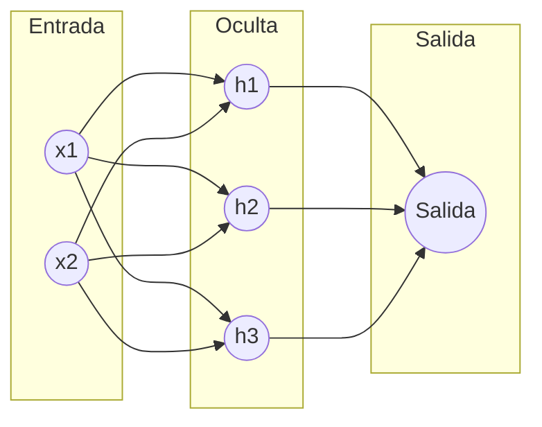
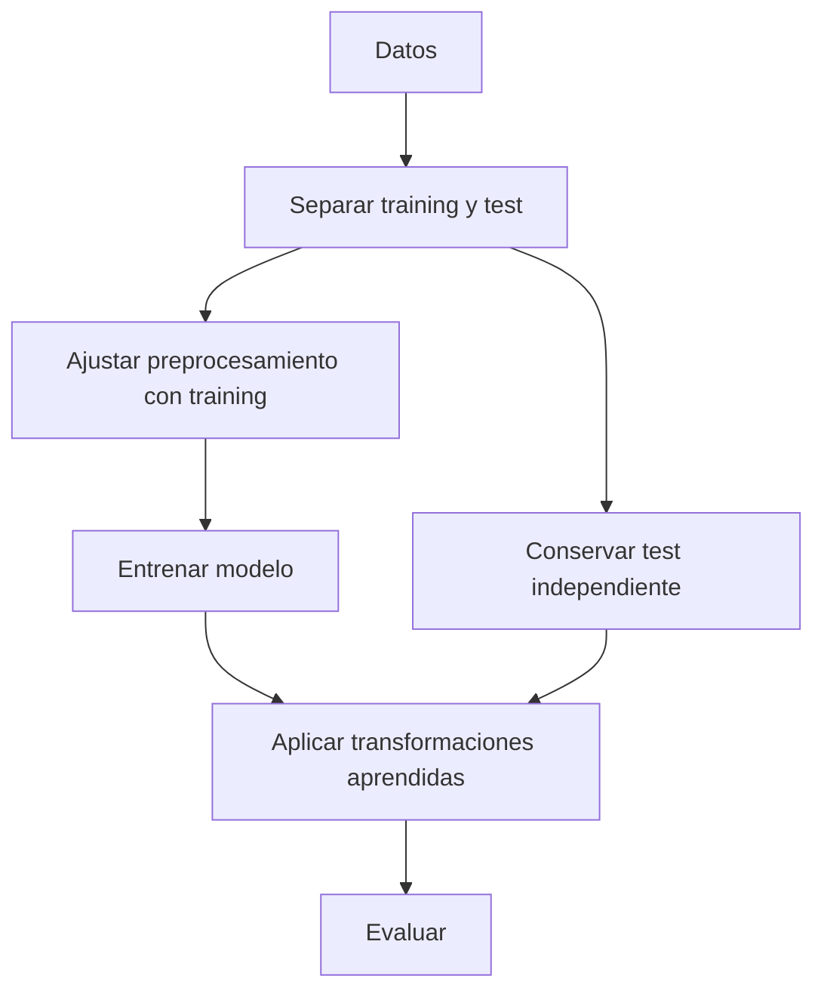
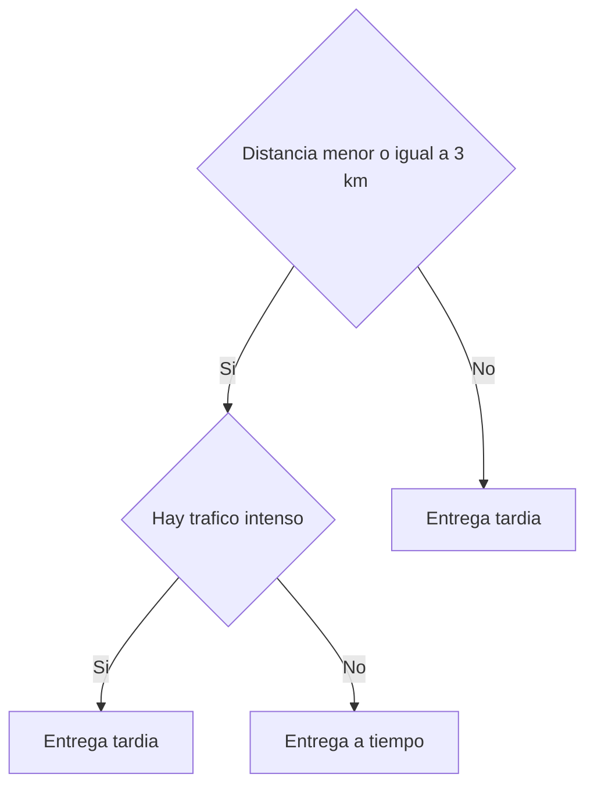

## Introducción  
  
El siguiente cuestionario reúne **50 preguntas con sus respuestas explicadas** para preparar el examen parcial de Machine Learning. Su objetivo es comprobar tanto la comprensión conceptual como la capacidad de resolver ejercicios matemáticos e interpretar resultados.  
  
Las preguntas se distribuyen entre los fundamentos de Machine Learning, regresión logística, kNN, SVM, selección de modelos, métricas de evaluación, Decision Trees, Random Forest, K-means, PCA, t-SNE y Reinforcement Learning.  
  
Cada respuesta explica el razonamiento necesario para llegar a la solución, incluyendo fórmulas, interpretación de variables y procedimientos numéricos cuando corresponde. Para estudiar, conviene intentar responder cada pregunta antes de consultar su solución.  
  
---  
  
## Fundamentos de Machine Learning  
  
### Preguntas conceptuales:  
  
**Pregunta 1. ¿Cuáles son los tres principales paradigmas de Machine Learning y en qué se diferencian?**  
  
**Respuesta:**  
  
Los tres paradigmas principales son **aprendizaje supervisado, aprendizaje no supervisado y aprendizaje por refuerzo**.  
  
El aprendizaje supervisado utiliza características $X$ y resultados conocidos $y$ para aprender una función predictiva:  
  
$$  
f(X)\rightarrow\hat{y}  
$$  
  
El aprendizaje no supervisado utiliza datos sin una variable objetivo etiquetada para descubrir agrupamientos o representaciones.  
  
El aprendizaje por refuerzo utiliza estados, acciones y recompensas para aprender una política de decisiones.  
  
| Paradigma | Información disponible | Objetivo |  
|---|---|---|  
| Supervisado | Características y etiquetas | Predecir |  
| No supervisado | Características sin etiquetas objetivo | Descubrir estructura |  
| Refuerzo | Estados, acciones y recompensas | Aprender decisiones |  
  
Por ejemplo, predecir si un cliente cancelará un servicio es supervisado; agrupar clientes por comportamiento es no supervisado; aprender qué acción debe ejecutar un robot es aprendizaje por refuerzo.  
  
**Pregunta 2. ¿Cuál es la diferencia entre clasificación y regresión?**  
  
**Respuesta:**  
  
La **clasificación** predice una categoría, mientras que la **regresión** predice un valor numérico.  
  
Por ejemplo, si se utilizan las características de una entrega para determinar si llegará tarde, el resultado puede ser:  
  
$$  
y\in\{0,1\}  
$$  
  
En donde $0$ significa a tiempo y $1$ significa tarde.  
  
Si las mismas características se utilizan para estimar cuánto tardará la entrega, el resultado podría ser:  
  
$$  
\hat{y}=24.5\text{ minutos}  
$$  
  
Por lo tanto, el tipo de problema depende principalmente de **la variable que se desea predecir**, no de las características utilizadas.  
  
**Pregunta 3. ¿Cuál es la diferencia entre parámetros e hiperparámetros?**  
  
**Respuesta:**  
  
Los **parámetros** son valores que el modelo aprende durante el entrenamiento. Los **hiperparámetros** son configuraciones que controlan el comportamiento del algoritmo.  
  
Por ejemplo, una regresión logística calcula:  
  
$$  
z=w^Tx+b  
$$  
  
Los pesos $w$ y el sesgo $b$ son parámetros aprendidos.  
  
En cambio, el número de vecinos $k$ de kNN, el hiperparámetro $C$ de SVM y la profundidad máxima de un árbol son hiperparámetros.  
  
La diferencia importante para el examen es que **los parámetros se ajustan mediante entrenamiento y los hiperparámetros se seleccionan utilizando validación**.  
  
**Pregunta 4. ¿Qué son underfitting y overfitting, y cómo pueden reconocerse?**  
  
**Respuesta:**  
  
El **underfitting** ocurre cuando un modelo es demasiado simple y no consigue representar los patrones relevantes.  
  
El **overfitting** ocurre cuando un modelo se adapta excesivamente al entrenamiento y pierde capacidad de generalización.  
  
Supónganse los siguientes resultados:  
  
| Modelo | Accuracy training | Accuracy validation |  
|---|---:|---:|  
| A | 0.65 | 0.63 |  
| B | 0.92 | 0.90 |  
| C | 1.00 | 0.75 |  
  
El modelo A presenta indicios de underfitting porque obtiene resultados relativamente bajos en ambos conjuntos.  
  
El modelo C presenta indicios de overfitting porque consigue un resultado perfecto en training, pero disminuye considerablemente en validation.  
  
El modelo B presenta el mejor resultado de validación y una diferencia pequeña entre ambos conjuntos.  
  
Por lo tanto, el mejor modelo no necesariamente es el que obtiene el mayor desempeño durante entrenamiento.  
  
---  
  
## Regresión y redes neuronales  
  
### Fundamentos matemáticos:  
  
**Pregunta 5. ¿Cómo funciona una neurona artificial y qué representan sus componentes?**  
  
**Respuesta:**  
  
Una neurona artificial recibe características numéricas, las multiplica por pesos, suma un sesgo y aplica una función de activación.  
  
Primero calcula:  
  
$$  
z=b+\sum_{j=1}^{d}w_jx_j  
$$  
  
Después:  
  
$$  
a=g(z)  
$$  
  
En donde:  
  
- $x_j$ representa la entrada.  
- $w_j$ representa el peso aprendido.  
- $b$ representa el sesgo.  
- $g$ representa la función de activación.  
- $a$ es la salida de la neurona.  
  
Una red neuronal combina numerosas neuronas organizadas en capas. Las conexiones entre capas permiten construir representaciones progresivamente más complejas.  
  

  
**Pregunta 6. ¿Cómo funciona Gradient Descent y cómo se realiza una actualización?**  
  
**Respuesta:**  
  
**Gradient Descent** es un procedimiento de optimización que modifica los parámetros en dirección contraria al gradiente de una función de pérdida.  
  
Su regla es:  
  
$$  
\boxed{  
\theta_{t+1}=\theta_t-\eta\nabla L(\theta_t)  
}  
$$  
  
En donde:  
  
- $\theta_t$ es el parámetro actual.  
- $\eta$ es el learning rate.  
- $\nabla L$ es el gradiente de la pérdida.  
  
###### Ejemplo:  
  
Supóngase:  
  
$$  
L(\theta)=(\theta-3)^2  
$$  
  
Su derivada es:  
  
$$  
L'(\theta)=2(\theta-3)  
$$  
  
Si:  
  
$$  
\theta=1,\qquad\eta=0.1  
$$  
  
entonces:  
  
$$  
L'(1)=2(1-3)=-4  
$$  
  
La actualización es:  
  
$$  
\theta_{\text{nuevo}}=1-0.1(-4)  
$$  
  
$$  
\boxed{\theta_{\text{nuevo}}=1.4}  
$$  
  
El parámetro se acerca al mínimo de la función, ubicado en $\theta=3$.  
  
**Pregunta 7. ¿Cómo se calcula una predicción de regresión lineal y qué significa su pendiente?**  
  
**Respuesta:**  
  
La regresión lineal simple utiliza:  
  
$$  
\boxed{\hat{y}=b+wx}  
$$  
  
En donde:  
  
- $w$ es la pendiente.  
- $b$ es el intercepto.  
- $x$ es la entrada.  
- $\hat{y}$ es la predicción.  
  
Supóngase:  
  
$$  
\hat{y}=5+2x  
$$  
  
Para:  
  
$$  
x=4  
$$  
  
se obtiene:  
  
$$  
\hat{y}=5+2(4)  
$$  
  
$$  
\boxed{\hat{y}=13}  
$$  
  
La pendiente $w=2$ indica que, según el modelo, aumentar una unidad de $x$ incrementa la predicción en dos unidades.  
  
Esta relación matemática no demuestra por sí sola una relación causal.  
  
---  
  
## Regresión logística  
  
### Clasificación probabilística:  
  
**Pregunta 8. ¿Cómo funciona la regresión logística y para qué sirve la sigmoide?**  
  
**Respuesta:**  
  
La regresión logística realiza clasificación utilizando un puntaje lineal:  
  
$$  
z=w^Tx+b  
$$  
  
Posteriormente transforma ese puntaje mediante la función sigmoide:  
  
$$  
\boxed{  
\sigma(z)=\frac{1}{1+e^{-z}}  
}  
$$  
  
La sigmoide convierte cualquier número real en un valor entre cero y uno.  
  
Por lo tanto:  
  
$$  
P(y=1\mid x)=\sigma(z)  
$$  
  
Esta salida puede interpretarse como una probabilidad estimada de pertenecer a la clase positiva.  
  
Cuando:  
  
$$  
z=0  
$$  
  
se obtiene:  
  
$$  
\boxed{\sigma(0)=0.5}  
$$  
  
**Pregunta 9. Un clasificador obtiene una probabilidad de 0.72. ¿Qué clase predice con umbrales de 0.5 y 0.8?**  
  
**Respuesta:**  
  
La decisión se obtiene mediante:  
  
$$  
\hat{y}=  
\begin{cases}  
1 & \hat{p}\geq\tau\\  
0 & \hat{p}<\tau  
\end{cases}  
$$  
  
Con:  
  
$$  
\hat{p}=0.72  
$$  
  
y:  
  
$$  
\tau=0.5  
$$  
  
se cumple:  
  
$$  
0.72\geq0.5  
$$  
  
Por lo tanto:  
  
$$  
\boxed{\hat{y}=1}  
$$  
  
Si el umbral cambia a:  
  
$$  
\tau=0.8  
$$  
  
entonces:  
  
$$  
0.72<0.8  
$$  
  
y:  
  
$$  
\boxed{\hat{y}=0}  
$$  
  
**Modificar el threshold cambia la decisión final, pero no modifica los parámetros aprendidos por el modelo.**  
  
---  
  
## k-Nearest Neighbors  
  
### Clasificación basada en distancias:  
  
**Pregunta 10. ¿Cómo funciona kNN y qué operaciones realiza para clasificar una observación?**  
  
**Respuesta:**  
  
El algoritmo **k-Nearest Neighbors** clasifica una observación utilizando las etiquetas de sus $k$ vecinos más cercanos.  
  
El procedimiento consiste en calcular las distancias desde el punto nuevo hasta las observaciones de entrenamiento, seleccionar los $k$ ejemplos más cercanos y obtener la clase mediante votación.  
  
La distancia euclidiana es:  
  
$$  
\boxed{  
d(x,x_i)=  
\sqrt{\sum_{j=1}^{d}(x_j-x_{ij})^2}  
}  
$$  
  
Por ejemplo, si se utiliza $k=3$ y los vecinos pertenecen a:  
  
$$  
\{1,0,1\}  
$$  
  
la clase más frecuente es $1$.  
  
Por lo tanto:  
  
$$  
\boxed{\hat{y}=1}  
$$  
  
kNN se distingue de la regresión logística porque utiliza relaciones locales entre observaciones en lugar de aprender necesariamente una frontera lineal global.  
  
**Pregunta 11. Dados los puntos A = (1,2), B = (4,6) y C = (2,3), ¿cuál está más cerca de X = (2,2)?**  
  
**Respuesta:**  
  
Se calcula la distancia euclidiana entre el punto de consulta y cada observación.  
  
Para A:  
  
$$  
d(X,A)=\sqrt{(2-1)^2+(2-2)^2}  
$$  
  
$$  
\boxed{d(X,A)=1}  
$$  
  
Para B:  
  
$$  
d(X,B)=\sqrt{(2-4)^2+(2-6)^2}  
$$  
  
$$  
=\sqrt{4+16}  
$$  
  
$$  
\boxed{d(X,B)=\sqrt{20}\approx4.472}  
$$  
  
Para C:  
  
$$  
d(X,C)=\sqrt{(2-2)^2+(2-3)^2}  
$$  
  
$$  
\boxed{d(X,C)=1}  
$$  
  
Por lo tanto, **A y C están empatados como vecinos más cercanos**, ambos con distancia uno.  
  
Este ejemplo muestra que pueden existir empates y que, cuando ocurren, debe conocerse la regla de desempate utilizada por el algoritmo.  
  
**Pregunta 12. ¿Cómo afecta el valor de k al comportamiento de kNN?**  
  
**Respuesta:**  
  
El hiperparámetro $k$ determina cuántos vecinos participan en la predicción.  
  
Con un valor pequeño, el modelo toma decisiones muy locales. Esto permite capturar patrones detallados, pero aumenta su sensibilidad al ruido.  
  
Con un valor grande, la predicción utiliza una vecindad más amplia y suele producir fronteras más suavizadas.  
  
| Valor de k | Comportamiento | Riesgo |  
|---|---|---|  
| Pequeño | Muy local | Overfitting |  
| Grande | Más suavizado | Underfitting |  
  
El valor apropiado debe seleccionarse mediante validación.  
  
**Pregunta 13. ¿Por qué es importante estandarizar las características antes de utilizar kNN?**  
  
**Respuesta:**  
  
kNN utiliza distancias numéricas. Si una característica tiene valores mucho mayores que otra, puede dominar el cálculo incluso cuando no es más importante.  
  
Supóngase que una observación contiene:  
  
$$  
x=(20,2000)  
$$  
  
y otra:  
  
$$  
z=(25,2100)  
$$  
  
La diferencia de la segunda característica es mucho mayor que la primera.  
  
Para evitar que la escala determine injustificadamente la cercanía, puede utilizarse:  
  
$$  
\boxed{  
z_j=\frac{x_j-\mu_j}{s_j}  
}  
$$  
  
En donde $\mu_j$ y $s_j$ son la media y desviación estándar obtenidas exclusivamente con training.  
  
Por lo tanto, estandarizar puede modificar cuáles observaciones son consideradas vecinas y cambiar las predicciones.  
  
---  
  
## Support Vector Machines  
  
### Fronteras y márgenes:  
  
**Pregunta 14. ¿Cuál es el objetivo principal de SVM y qué son los support vectors?**  
  
**Respuesta:**  
  
Un **Support Vector Machine** de clasificación busca una frontera que separe las clases considerando el margen.  
  
La función lineal es:  
  
$$  
f(x)=w^Tx+b  
$$  
  
La frontera de decisión satisface:  
  
$$  
f(x)=0  
$$  
  
Los **support vectors** son observaciones que restringen la solución y determinan la posición de la frontera.  
  
En la formulación lineal canónica, el ancho del margen es:  
  
$$  
\boxed{  
\frac{2}{\|w\|}  
}  
$$  
  
Por lo tanto, el objetivo está relacionado con encontrar una separación amplia, equilibrando el margen y las posibles violaciones.  
  
**Pregunta 15. ¿Cuál es la diferencia entre los hiperparámetros C y gamma de un SVM con kernel RBF?**  
  
**Respuesta:**  
  
El hiperparámetro $C$ determina cuánto se penalizan las violaciones del margen.  
  
Un $C$ pequeño aplica mayor regularización y permite más tolerancia.  
  
Un $C$ grande penaliza las violaciones más estrictamente.  
  
Por otra parte, $\gamma$ controla el alcance espacial de la similitud del kernel RBF:  
  
$$  
\boxed{  
K(x,x')=\exp(-\gamma\|x-x'\|^2)  
}  
$$  
  
Un $\gamma$ pequeño produce influencia amplia y fronteras generalmente suaves.  
  
Un $\gamma$ grande produce influencia localizada y fronteras potencialmente más complejas.  
  
Por lo tanto:  
  
**C controla la penalización y gamma controla la influencia espacial.**  
  
**Pregunta 16. Si una observación tiene un margen firmado z = 0.3, ¿cuál es su Hinge Loss?**  
  
**Respuesta:**  
  
La pérdida hinge es:  
  
$$  
\boxed{  
\ell(z)=\max(0,1-z)  
}  
$$  
  
Sustituyendo:  
  
$$  
z=0.3  
$$  
  
se obtiene:  
  
$$  
\ell(0.3)=\max(0,1-0.3)  
$$  
  
$$  
=\max(0,0.7)  
$$  
  
$$  
\boxed{\ell=0.7}  
$$  
  
La observación todavía presenta pérdida porque su margen firmado es inferior a uno.  
  
Si:  
  
$$  
z\geq1  
$$  
  
la pérdida hinge es cero.  
  
**Pregunta 17. ¿Por qué un SVM lineal puede fallar en datos circulares y cómo ayuda el kernel RBF?**  
  
**Respuesta:**  
  
Un SVM lineal construye una frontera basada en:  
  
$$  
w^Tx+b=0  
$$  
  
Esta frontera es lineal en el espacio original de características.  
  
Si una clase ocupa una región central y otra forma un anillo alrededor, una sola recta no puede separarlas perfectamente.  
  
El kernel RBF permite representar relaciones no lineales mediante:  
  
$$  
K(x,x')=\exp(-\gamma\|x-x'\|^2)  
$$  
  
Esto permite construir fronteras curvas sin calcular explícitamente una transformación de características de dimensión potencialmente elevada.  
  
La elección de $\gamma$ y $C$ determina la complejidad y regularización del clasificador.  
  
**Pregunta 18. ¿Cómo calcula SVR la pérdida cuando un error supera el tubo epsilon?**  
  
**Respuesta:**  
  
Support Vector Regression utiliza la pérdida:  
  
$$  
\boxed{  
\ell_\epsilon=  
\max(0,|y-f(x)|-\epsilon)  
}  
$$  
  
Supóngase:  
  
$$  
y=18,\qquad f(x)=14,\qquad\epsilon=1.5  
$$  
  
Primero se calcula el error absoluto:  
  
$$  
|18-14|=4  
$$  
  
Después se resta la tolerancia:  
  
$$  
4-1.5=2.5  
$$  
  
Por lo tanto:  
  
$$  
\boxed{\ell_\epsilon=2.5}  
$$  
  
El modelo penaliza únicamente la parte del error que excede la tolerancia.  
  
---  
  
## Selección y evaluación de modelos  
  
### Validación y métricas:  
  
**Pregunta 19. ¿Cuál es la función de training, validation y test?**  
  
**Respuesta:**  
  
Los tres conjuntos cumplen funciones diferentes.  
  
**Training** permite ajustar los parámetros del modelo y aprender las transformaciones necesarias.  
  
**Validation** permite comparar modelos, hiperparámetros y umbrales de decisión.  
  
**Test** permite estimar finalmente el desempeño sobre observaciones no utilizadas para seleccionar el modelo.  
  
La regla fundamental es:  
  
| Conjunto | Función |  
|---|---|  
| Training | Aprender |  
| Validation | Elegir |  
| Test | Evaluar al final |  
  
Utilizar el conjunto de prueba repetidamente para seleccionar hiperparámetros puede introducir un sesgo optimista en la evaluación.  
  
**Pregunta 20. Si Grid Search prueba 4 valores de C, 3 valores de gamma y utiliza 5 folds, ¿cuántos ajustes de validación cruzada realiza?**  
  
**Respuesta:**  
  
Primero se calcula el número de combinaciones de hiperparámetros:  
  
$$  
N_{\text{configuraciones}}=4\times3  
$$  
  
$$  
=12  
$$  
  
Cada combinación se evalúa mediante cinco folds:  
  
$$  
N_{\text{fits}}=12\times5  
$$  
  
$$  
\boxed{N_{\text{fits}}=60}  
$$  
  
Por lo tanto, se realizan sesenta ajustes de validación cruzada.  
  
Si la herramienta vuelve a entrenar automáticamente la mejor configuración, puede existir un ajuste final adicional.  
  
**Pregunta 21. ¿Qué es data leakage y por qué un Pipeline ayuda a evitarlo?**  
  
**Respuesta:**  
  
El **data leakage** ocurre cuando información que no debería estar disponible durante el entrenamiento influye en el modelo.  
  
Puede presentarse cuando una característica revela información futura o cuando una transformación se ajusta utilizando datos de validation o test.  
  
Por ejemplo, calcular la media de una característica utilizando todo el dataset antes de dividirlo introduce información externa al entrenamiento.  
  
El procedimiento correcto es:  
  

  
Un `Pipeline` permite integrar las transformaciones y el modelo para que, durante la validación cruzada, cada transformación se ajuste solamente con el fold de entrenamiento correspondiente.  
  
**Pregunta 22. Con TP = 30, TN = 50, FP = 10 y FN = 10, calcula Accuracy, Precision, Recall y F1.**  
  
**Respuesta:**  
  
Primero se calcula el total de observaciones:  
  
$$  
N=30+50+10+10=100  
$$  
  
Accuracy:  
  
$$  
Accuracy=\frac{TP+TN}{N}  
$$  
  
$$  
=\frac{30+50}{100}  
$$  
  
$$  
\boxed{Accuracy=0.80}  
$$  
  
Precision:  
  
$$  
Precision=\frac{TP}{TP+FP}  
$$  
  
$$  
=\frac{30}{30+10}  
$$  
  
$$  
\boxed{Precision=0.75}  
$$  
  
Recall:  
  
$$  
Recall=\frac{TP}{TP+FN}  
$$  
  
$$  
=\frac{30}{30+10}  
$$  
  
$$  
\boxed{Recall=0.75}  
$$  
  
F1:  
  
$$  
F1=2\frac{Precision\cdot Recall}{Precision+Recall}  
$$  
  
$$  
=2\frac{0.75(0.75)}{0.75+0.75}  
$$  
  
$$  
\boxed{F1=0.75}  
$$  
  
**Pregunta 23. Si detectar un falso negativo es mucho más costoso que producir un falso positivo, ¿qué métrica debe priorizarse?**  
  
**Respuesta:**  
  
Debe prestarse especial atención a **Recall**, porque mide la proporción de positivos reales identificados correctamente.  
  
Su fórmula es:  
  
$$  
\boxed{  
Recall=\frac{TP}{TP+FN}  
}  
$$  
  
Por ejemplo, en una aplicación donde es importante detectar eventos peligrosos, un falso negativo representa un caso real que el sistema no identificó.  
  
Reducir los falsos negativos incrementa recall cuando el total de positivos reales permanece fijo.  
  
Sin embargo, también debe evaluarse precision, ya que aumentar recall mediante un umbral más bajo puede producir más falsas alarmas.  
  
**Pregunta 24. ¿Cómo se calculan MAE, MSE y RMSE cuando los valores reales son (2,4,6) y las predicciones son (3,2,7)?**  
  
**Respuesta:**  
  
Los valores reales son:  
  
$$  
y=(2,4,6)  
$$  
  
Las predicciones son:  
  
$$  
\hat{y}=(3,2,7)  
$$  
  
Los residuos son:  
  
$$  
e=y-\hat{y}  
$$  
  
$$  
e=(-1,2,-1)  
$$  
  
Para MAE:  
  
$$  
MAE=\frac{|{-1}|+|2|+|{-1}|}{3}  
$$  
  
$$  
\boxed{MAE=\frac43\approx1.333}  
$$  
  
Para MSE:  
  
$$  
MSE=\frac{(-1)^2+2^2+(-1)^2}{3}  
$$  
  
$$  
=\frac{1+4+1}{3}  
$$  
  
$$  
\boxed{MSE=2}  
$$  
  
Para RMSE:  
  
$$  
RMSE=\sqrt{2}  
$$  
  
$$  
\boxed{RMSE\approx1.414}  
$$  
  
MAE y RMSE se expresan en las unidades originales de la variable objetivo, mientras que MSE utiliza unidades al cuadrado.  
  
---  
  
## Decision Trees  
  
### Estructura y criterios de división:  
  
**Pregunta 25. ¿Cómo funciona un Decision Tree y qué representan la raíz, los nodos internos y las hojas?**  
  
**Respuesta:**  
  
Un árbol de decisión predice mediante una sucesión de preguntas sobre las características.  
  
La **raíz** es el nodo inicial donde comienza la clasificación.  
  
Los **nodos internos** contienen condiciones que dividen las observaciones.  
  
Las **ramas** representan los resultados de esas condiciones.  
  
Las **hojas** contienen la predicción final.  
  
Por ejemplo:  
  

  
Para clasificar una entrega de dos kilómetros sin tráfico intenso, se recorre la rama izquierda de la primera pregunta y después la rama negativa de la segunda.  
  
La predicción es **entrega a tiempo**.  
  
**Pregunta 26. Calcula la impureza Gini de un nodo con 6 observaciones de clase A y 4 de clase B.**  
  
**Respuesta:**  
  
La impureza Gini se calcula mediante:  
  
$$  
\boxed{  
G=1-\sum_{c=1}^{K}p_c^2  
}  
$$  
  
Primero se calculan las proporciones:  
  
$$  
p_A=\frac6{10}=0.6  
$$  
  
$$  
p_B=\frac4{10}=0.4  
$$  
  
Después:  
  
$$  
G=1-(0.6)^2-(0.4)^2  
$$  
  
$$  
=1-0.36-0.16  
$$  
  
$$  
\boxed{G=0.48}  
$$  
  
El nodo no es puro porque contiene observaciones de ambas clases.  
  
Para dos clases, el máximo de Gini es $0.5$, cuando ambas están perfectamente equilibradas.  
  
**Pregunta 27. ¿Cómo se calcula la entropía de un nodo con dos clases distribuidas al 50 %?**  
  
**Respuesta:**  
  
La entropía se calcula mediante:  
  
$$  
\boxed{  
H=-\sum_{c=1}^{K}p_c\log_2p_c  
}  
$$  
  
Si ambas clases tienen la misma proporción:  
  
$$  
p_1=0.5,\qquad p_2=0.5  
$$  
  
entonces:  
  
$$  
H=-0.5\log_2(0.5)-0.5\log_2(0.5)  
$$  
  
Como:  
  
$$  
\log_2(0.5)=-1  
$$  
  
se obtiene:  
  
$$  
H=0.5+0.5  
$$  
  
$$  
\boxed{H=1\text{ bit}}  
$$  
  
Esta es la máxima entropía para un problema binario.  
  
**Pregunta 28. Un split produce un hijo de 4 observaciones con Gini 0.5 y otro de 6 con Gini 0.2. ¿Cuál es la impureza ponderada?**  
  
**Respuesta:**  
  
La impureza posterior a una división debe ponderarse utilizando el tamaño de cada hijo.  
  
$$  
\boxed{  
I_{\text{split}}=  
\frac{n_L}{n}I_L+  
\frac{n_R}{n}I_R  
}  
$$  
  
Con:  
  
$$  
n_L=4,\quad I_L=0.5  
$$  
  
$$  
n_R=6,\quad I_R=0.2  
$$  
  
se tiene:  
  
$$  
n=4+6=10  
$$  
  
Entonces:  
  
$$  
I_{\text{split}}=  
\frac4{10}(0.5)+\frac6{10}(0.2)  
$$  
  
$$  
=0.2+0.12  
$$  
  
$$  
\boxed{I_{\text{split}}=0.32}  
$$  
  
Si la impureza del nodo padre era $0.48$, la reducción sería:  
  
$$  
\Delta I=0.48-0.32  
$$  
  
$$  
\boxed{\Delta I=0.16}  
$$  
  
**Pregunta 29. ¿Por qué un árbol demasiado profundo puede producir overfitting y qué hiperparámetros ayudan a evitarlo?**  
  
**Respuesta:**  
  
Un árbol muy profundo puede construir reglas excesivamente específicas, incluso hasta generar hojas con pocas observaciones.  
  
Esto puede permitirle memorizar el entrenamiento, pero dificulta que sus reglas generalicen.  
  
Entre los hiperparámetros de regularización se encuentran:  
  
| Hiperparámetro | Función |  
|---|---|  
| `max_depth` | Limita profundidad |  
| `min_samples_split` | Exige un mínimo para intentar dividir |  
| `min_samples_leaf` | Exige un mínimo en cada hoja |  
| `max_leaf_nodes` | Limita el número de hojas |  
| `ccp_alpha` | Controla la poda |  
  
Por ejemplo, si:  
  
`min_samples_leaf = 3`  
  
una división que produce un hijo con una sola observación no está permitida.  
  
La idea fundamental es que **una hoja perfectamente pura durante entrenamiento no garantiza una buena generalización**.  
  
---  
  
## Random Forest  
  
### Aprendizaje mediante conjuntos de árboles:  
  
**Pregunta 30. ¿Por qué Random Forest suele ser más estable que un único Decision Tree?**  
  
**Respuesta:**  
  
Random Forest combina las predicciones de numerosos árboles entrenados con muestras y características aleatorizadas.  
  
Un árbol individual puede cambiar considerablemente cuando se modifican los datos de entrenamiento.  
  
Al promediar múltiples predicciones, Random Forest busca reducir principalmente esa variabilidad.  
  
Para regresión:  
  
$$  
\boxed{  
\hat{y}_{RF}=\frac1B\sum_{b=1}^{B}\hat{y}_b  
}  
$$  
  
En donde $B$ es el número de árboles.  
  
El beneficio de la agregación depende de que los errores de los árboles no estén completamente correlacionados.  
  
**Pregunta 31. ¿Qué es bootstrap y cuáles son las observaciones Out-of-Bag en una muestra concreta?**  
  
**Respuesta:**  
  
Bootstrap es un procedimiento de muestreo con reemplazo.  
  
Esto significa que una misma observación puede seleccionarse varias veces.  
  
Supóngase que el dataset original contiene:  
  
$$  
\{A,B,C,D,E,F\}  
$$  
  
Una muestra bootstrap es:  
  
$$  
\{A,A,C,D,F,F\}  
$$  
  
Las observaciones seleccionadas son A, C, D y F, aunque algunas aparecen repetidas.  
  
Las que no aparecen son:  
  
$$  
\boxed{OOB=\{B,E\}}  
$$  
  
Estas observaciones Out-of-Bag pueden utilizarse para evaluar ese árbol sin haber participado en su entrenamiento.  
  
Para un bootstrap estándar grande, aproximadamente el $36.8\%$ de las observaciones originales queda fuera de cada muestra.  
  
**Pregunta 32. Tres árboles predicen probabilidades de clase positiva de 0.2, 0.7 y 0.8. ¿Qué probabilidad obtiene Random Forest?**  
  
**Respuesta:**  
  
En la implementación de clasificación de scikit-learn, Random Forest promedia las probabilidades estimadas por sus árboles.  
  
$$  
\boxed{  
\hat{P}(y=c\mid x)=  
\frac1B\sum_{b=1}^{B}\hat{P}_b(y=c\mid x)  
}  
$$  
  
Con tres árboles:  
  
$$  
\hat{P}(y=1\mid x)=\frac{0.2+0.7+0.8}{3}  
$$  
  
$$  
=\frac{1.7}{3}  
$$  
  
$$  
\boxed{\hat{P}(y=1\mid x)\approx0.567}  
$$  
  
Con un umbral de $0.5$, la observación se clasifica como positiva.  
  
Esto es diferente de contar directamente el voto mayoritario de las clases producidas por cada árbol.  
  
---  
  
## K-means  
  
### Agrupamiento por centroides:  
  
**Pregunta 33. ¿Cómo funciona K-means y cuáles son sus dos operaciones fundamentales?**  
  
**Respuesta:**  
  
K-means es un algoritmo no supervisado que divide observaciones en $k$ grupos.  
  
Cada grupo se representa mediante un **centroide**, que corresponde a la media de sus observaciones.  
  
El algoritmo alterna dos operaciones.  
  
**Asignación:** cada observación se asigna al centroide más cercano.  
  
$$  
\boxed{  
c_i=\arg\min_j\|x_i-\mu_j\|^2  
}  
$$  
  
**Actualización:** cada centroide se recalcula mediante la media de los puntos de su grupo.  
  
$$  
\boxed{  
\mu_j=\frac1{|C_j|}\sum_{i\in C_j}x_i  
}  
$$  
  
Estas operaciones se repiten hasta que las asignaciones o los centroides se estabilizan según el criterio de convergencia.  
  
**Pregunta 34. Calcula el centroide de los puntos A = (1,1), B = (1,2) y C = (2,1).**  
  
**Respuesta:**  
  
Un centroide se calcula promediando cada coordenada de las observaciones.  
  
Para la primera coordenada:  
  
$$  
\mu_x=\frac{1+1+2}{3}  
$$  
  
$$  
\boxed{\mu_x=\frac43}  
$$  
  
Para la segunda:  
  
$$  
\mu_y=\frac{1+2+1}{3}  
$$  
  
$$  
\boxed{\mu_y=\frac43}  
$$  
  
Por lo tanto:  
  
$$  
\boxed{  
\mu=\left(\frac43,\frac43\right)  
}  
$$  
  
El centroide no necesariamente coincide con una de las observaciones originales.  
  
**Pregunta 35. ¿Qué es la inercia de K-means y cómo se calcula?**  
  
**Respuesta:**  
  
La **inercia** mide la suma de distancias cuadradas entre cada observación y el centroide de su grupo.  
  
$$  
\boxed{  
J=\sum_{i=1}^{n}\|x_i-\mu_{c_i}\|^2  
}  
$$  
  
En donde:  
  
- $x_i$ es una observación.  
- $\mu_{c_i}$ es el centroide asignado.  
- $J$ es la inercia.  
  
Supóngase que existen tres puntos:  
  
$$  
(1,1),\quad(1,2),\quad(2,1)  
$$  
  
Su centroide es:  
  
$$  
\mu=\left(\frac43,\frac43\right)  
$$  
  
Las distancias cuadradas son:  
  
$$  
d_A^2=\frac29  
$$  
  
$$  
d_B^2=\frac59  
$$  
  
$$  
d_C^2=\frac59  
$$  
  
Por lo tanto:  
  
$$  
J=\frac29+\frac59+\frac59  
$$  
  
$$  
\boxed{J=\frac43}  
$$  
  
En general, K-means busca disminuir esta cantidad mediante asignaciones y actualizaciones sucesivas.  
  
**Pregunta 36. ¿Por qué aumentar k siempre puede disminuir la inercia óptima, pero no garantiza mejores clusters?**  
  
**Respuesta:**  
  
Al aumentar el número de centroides, los puntos disponen de más centros a los cuales asignarse.  
  
Por ello, la inercia mínima global no aumenta cuando se incrementa $k$.  
  
Sin embargo, utilizar muchos clusters puede producir grupos demasiado pequeños y difíciles de interpretar.  
  
En el caso extremo:  
  
$$  
k=n  
$$  
  
cada observación puede formar su propio cluster.  
  
Entonces:  
  
$$  
\boxed{J=0}  
$$  
  
Aunque la inercia sea cero, la partición puede resultar poco útil porque ya no resume adecuadamente la estructura de los datos.  
  
Por lo tanto, la selección de $k$ debe considerar tanto la inercia como la utilidad e interpretación de los grupos.  
  
---  
  
## Principal Component Analysis  
  
### Varianza, covarianza y componentes:  
  
**Pregunta 37. ¿Cuál es el objetivo principal de PCA y en qué se diferencia de K-means?**  
  
**Respuesta:**  
  
**Principal Component Analysis (PCA)** reduce dimensionalidad mediante nuevas direcciones que conservan la mayor varianza posible.  
  
Estas direcciones se denominan componentes principales.  
  
La primera componente principal conserva la máxima varianza.  
  
La segunda conserva la máxima varianza restante bajo la condición de ser ortogonal a la primera.  
  
K-means, en cambio, no construye componentes principales. Su objetivo consiste en agrupar observaciones mediante centroides.  
  
Por lo tanto:  
  
- PCA produce nuevas coordenadas.  
- K-means produce asignaciones a grupos.  
  
PCA es una transformación lineal, mientras que K-means utiliza agrupamientos basados en distancias.  
  
**Pregunta 38. ¿Cuál es la diferencia entre varianza, covarianza y correlación?**  
  
**Respuesta:**  
  
La **varianza** mide la dispersión de una variable respecto a su media.  
  
$$  
\boxed{  
s^2=\frac1{n-1}\sum_i(x_i-\bar{x})^2  
}  
$$  
  
La **covarianza** mide cómo varían conjuntamente dos variables.  
  
$$  
\boxed{  
\operatorname{Cov}(x,y)=  
\frac1{n-1}  
\sum_i(x_i-\bar{x})(y_i-\bar{y})  
}  
$$  
  
La **correlación de Pearson** estandariza esa relación:  
  
$$  
\boxed{  
r=\frac{\operatorname{Cov}(x,y)}{s_xs_y}  
}  
$$  
  
La correlación está entre $-1$ y $1$, cuando ambas desviaciones estándar son distintas de cero.  
  
Una covarianza positiva indica que las variables tienden a aumentar conjuntamente.  
  
Una covarianza negativa indica que, cuando una aumenta, la otra tiende a disminuir.  
  
La diferencia importante es que **la covarianza depende de las unidades, mientras que la correlación no**.  
  
**Pregunta 39. ¿Qué representan los eigenvectors y los eigenvalues en PCA?**  
  
**Respuesta:**  
  
PCA estudia la matriz de covarianza:  
  
$$  
\Sigma=\frac1{n-1}X_c^TX_c  
$$  
  
Posteriormente resuelve:  
  
$$  
\boxed{  
\Sigma w_j=\lambda_jw_j  
}  
$$  
  
En donde:  
  
- $w_j$ es un eigenvector.  
- $\lambda_j$ es un eigenvalue.  
  
El eigenvector representa una dirección principal.  
  
El eigenvalue representa la varianza capturada en esa dirección.  
  
Los eigenvalues se ordenan de mayor a menor.  
  
La primera componente principal corresponde al eigenvalue más grande.  
  
**Pregunta 40. Una matriz tiene eigenvalues 4, 2 y 1. ¿Qué porcentaje de varianza explican las dos primeras componentes?**  
  
**Respuesta:**  
  
La varianza total se calcula sumando los eigenvalues:  
  
$$  
\lambda_{\text{total}}=4+2+1  
$$  
  
$$  
=7  
$$  
  
La primera componente explica:  
  
$$  
r_1=\frac47\approx0.5714  
$$  
  
La segunda componente explica:  
  
$$  
r_2=\frac27\approx0.2857  
$$  
  
La varianza acumulada de las dos primeras componentes es:  
  
$$  
R_2=r_1+r_2  
$$  
  
$$  
=\frac47+\frac27  
$$  
  
$$  
=\frac67  
$$  
  
$$  
\boxed{R_2\approx85.71\%}  
$$  
  
Por lo tanto, conservar dos componentes permite retener aproximadamente el $85.71\%$ de la varianza total.  
  
---  
  
## t-SNE  
  
### Reducción de dimensionalidad no lineal:  
  
**Pregunta 41. ¿Cuál es el objetivo de t-SNE y por qué no debe confundirse con clustering?**  
  
**Respuesta:**  
  
**t-Distributed Stochastic Neighbor Embedding (t-SNE)** busca producir una representación de baja dimensionalidad que conserve aproximadamente las relaciones locales de vecindad.  
  
Por ejemplo, un conjunto de imágenes de:  
  
$$  
8\times8=64  
$$  
  
píxeles puede representarse originalmente mediante 64 características.  
  
t-SNE puede transformar esas observaciones en coordenadas bidimensionales:  
  
$$  
\mathbb{R}^{64}\rightarrow\mathbb{R}^{2}  
$$  
  
El algoritmo puede producir regiones visualmente separadas, pero no asigna necesariamente etiquetas de cluster.  
  
Por lo tanto, **t-SNE es una técnica de visualización y reducción de dimensionalidad, no un algoritmo de clustering**.  
  
Además, no garantiza preservar distancias globales ni tamaños relativos de los grupos originales.  
  
**Pregunta 42. ¿Cómo se calculan las probabilidades condicionales y la matriz P de t-SNE?**  
  
**Respuesta:**  
  
Primero se calculan distancias cuadradas entre observaciones originales.  
  
$$  
d_{ij}^2=\|x_i-x_j\|^2  
$$  
  
Después se utilizan pesos gaussianos:  
  
$$  
\boxed{  
w_{j|i}=  
\exp\left(  
-\frac{d_{ij}^2}{2\sigma_i^2}  
\right)  
}  
$$  
  
Las probabilidades condicionales se calculan normalizando:  
  
$$  
\boxed{  
p_{j|i}=  
\frac{w_{j|i}}{\sum_{k\neq i}w_{k|i}}  
}  
$$  
  
Finalmente, la matriz simétrica se obtiene mediante:  
  
$$  
\boxed{  
p_{ij}=  
\frac{p_{j|i}+p_{i|j}}{2n}  
}  
$$  
  
En donde $n$ es el número de observaciones.  
  
Las probabilidades $P$ representan similitudes en el espacio original.  
  
**Pregunta 43. ¿Cómo se construye la matriz Q y qué función cumple la divergencia KL?**  
  
**Respuesta:**  
  
En el espacio reducido, t-SNE utiliza pesos Student-t:  
  
$$  
\boxed{  
t_{ij}=  
\frac1{1+\|y_i-y_j\|^2}  
}  
$$  
  
Posteriormente se normalizan:  
  
$$  
\boxed{  
q_{ij}=  
\frac{t_{ij}}{\sum_{k\neq l}t_{kl}}  
}  
$$  
  
La matriz $Q$ representa similitudes entre puntos del mapa reducido.  
  
El algoritmo compara las distribuciones $P$ y $Q$ mediante:  
  
$$  
\boxed{  
KL(P\|Q)=  
\sum_{i\neq j}  
p_{ij}\ln\left(\frac{p_{ij}}{q_{ij}}\right)  
}  
$$  
  
El objetivo consiste en modificar las coordenadas reducidas para disminuir la divergencia KL.  
  
Esto favorece que las observaciones que eran vecinas en el espacio original permanezcan próximas en la representación.  
  
---  
  
## Reinforcement Learning  
  
### Estados, transiciones y recompensas:  
  
**Pregunta 44. ¿Cuál es la propiedad de Markov y qué significa que el siguiente estado dependa solamente del estado actual?**  
  
**Respuesta:**  
  
La propiedad de Markov establece que, si el estado actual contiene toda la información relevante, la distribución del siguiente estado no depende de la historia anterior.  
  
Matemáticamente:  
  
$$  
\boxed{  
P(S_{t+1}\mid S_t,S_{t-1},\ldots)  
=  
P(S_{t+1}\mid S_t)  
}  
$$  
  
Por ejemplo, puede utilizarse una cadena de Markov para representar transiciones meteorológicas entre los estados soleado y lluvioso.  
  
La matriz de transición describe las probabilidades de pasar desde un estado actual hasta cada posible estado siguiente.  
  
La propiedad no significa que el pasado nunca haya influido en el sistema, sino que **el estado presente resume la información necesaria para modelar la siguiente transición**.  
  
**Pregunta 45. Si la matriz de transición del clima es P = [[0.8,0.2],[0.4,0.6]], ¿cuál es la probabilidad de lluvia dentro de dos días si hoy está soleado?**  
  
**Respuesta:**  
  
Se identifican los caminos que comienzan en soleado y terminan en lluvioso después de dos transiciones.  
  
La matriz es:  
  
$$  
P=  
\begin{pmatrix}  
0.8&0.2\\  
0.4&0.6  
\end{pmatrix}  
$$  
  
El primer camino es:  
  
$$  
S\rightarrow S\rightarrow R  
$$  
  
Su probabilidad es:  
  
$$  
0.8(0.2)=0.16  
$$  
  
El segundo camino es:  
  
$$  
S\rightarrow R\rightarrow R  
$$  
  
Su probabilidad es:  
  
$$  
0.2(0.6)=0.12  
$$  
  
Se suman ambas probabilidades:  
  
$$  
P(R\text{ en dos días})=0.16+0.12  
$$  
  
$$  
\boxed{P=0.28}  
$$  
  
Por lo tanto, existe una probabilidad del $28\%$ de que esté lluvioso dentro de dos días.  
  
**Pregunta 46. ¿Qué es un Markov Decision Process y en qué se diferencia de una Markov Chain?**  
  
**Respuesta:**  
  
Un **Markov Decision Process (MDP)** modela situaciones donde un agente selecciona acciones y recibe recompensas.  
  
Se representa mediante:  
  
$$  
\boxed{  
M=(S,A,P,r,\gamma)  
}  
$$  
  
En donde:  
  
- $S$ es el conjunto de estados.  
- $A$ es el conjunto de acciones.  
- $P$ describe las probabilidades de transición.  
- $r$ es la función de recompensa.  
- $\gamma$ es el factor de descuento.  
  
En una Markov Chain, la transición se expresa como:  
  
$$  
P(s'\mid s)  
$$  
  
En un MDP, la transición depende también de la acción:  
  
$$  
P(s'\mid s,a)  
$$  
  
La diferencia fundamental consiste en que **en un MDP el agente toma decisiones que pueden modificar la evolución del entorno**.  
  
**Pregunta 47. Una trayectoria proporciona recompensas de -1, -1 y +50. Si gamma = 0.9, ¿cuál es su retorno descontado?**  
  
**Respuesta:**  
  
El retorno descontado se calcula mediante:  
  
$$  
\boxed{  
G_t=\sum_{k=0}^{T-t-1}\gamma^kR_{t+k+1}  
}  
$$  
  
Las recompensas son:  
  
$$  
-1,-1,+50  
$$  
  
Con:  
  
$$  
\gamma=0.9  
$$  
  
se obtiene:  
  
$$  
G_0=-1+0.9(-1)+0.9^2(50)  
$$  
  
$$  
=-1-0.9+0.81(50)  
$$  
  
$$  
=-1-0.9+40.5  
$$  
  
$$  
\boxed{G_0=38.6}  
$$  
  
El retorno es positivo porque la recompensa futura de la gema supera el costo de los movimientos anteriores.  
  
Esto muestra que una acción con recompensa inmediata negativa puede formar parte de una estrategia conveniente.  
  
**Pregunta 48. ¿Cuál es la diferencia entre V(s), Q(s,a) y la ecuación de Bellman?**  
  
**Respuesta:**  
  
La función de valor de estado evalúa el retorno esperado al comenzar en un estado y seguir una política.  
  
$$  
\boxed{  
V^\pi(s)=  
\mathbb{E}_\pi[G_t\mid S_t=s]  
}  
$$  
  
La función de valor de acción evalúa el retorno esperado al seleccionar una acción específica desde un estado.  
  
$$  
\boxed{  
Q^\pi(s,a)=  
\mathbb{E}_\pi[G_t\mid S_t=s,A_t=a]  
}  
$$  
  
La ecuación de Bellman relaciona el valor actual con la recompensa inmediata y el valor futuro.  
  
Para valores óptimos de acción:  
  
$$  
\boxed{  
Q^*(s,a)=  
\mathbb{E}\left[  
R_{t+1}+  
\gamma\max_{a'}Q^*(S_{t+1},a')  
\mid s,a  
\right]  
}  
$$  
  
Por lo tanto:  
  
- $V$ evalúa estados.  
- $Q$ evalúa pares estado-acción.  
- Bellman relaciona sus valores presentes y futuros.  
  
**Pregunta 49. En Q-Learning, si Q(s,a) = 2, la recompensa es -1, gamma = 0.9, alpha = 0.5 y el máximo Q del siguiente estado es 10, ¿cuál es el nuevo valor?**  
  
**Respuesta:**  
  
Q-Learning utiliza la actualización:  
  
$$  
\boxed{  
Q(s,a)\leftarrow  
Q(s,a)+\alpha[y-Q(s,a)]  
}  
$$  
  
Para una transición no terminal:  
  
$$  
y=r+\gamma\max_{a'}Q(s',a')  
$$  
  
Sustituyendo:  
  
$$  
y=-1+0.9(10)  
$$  
  
$$  
\boxed{y=8}  
$$  
  
El error de diferencia temporal es:  
  
$$  
\delta=y-Q(s,a)  
$$  
  
$$  
\delta=8-2=6  
$$  
  
Finalmente:  
  
$$  
Q_{\text{nuevo}}=2+0.5(6)  
$$  
  
$$  
\boxed{Q_{\text{nuevo}}=5}  
$$  
  
Por lo tanto, el valor de acción pasa de dos a cinco.  
  
Si la transición fuera terminal, el objetivo sería únicamente la recompensa inmediata, sin agregar un valor futuro.  
  
**Pregunta 50. ¿Cuál es la diferencia entre Q-Learning, DQN, Policy Gradients y Actor–Critic?**  
  
**Respuesta:**  
  
Los cuatro métodos pertenecen al aprendizaje por refuerzo, pero representan el conocimiento aprendido de maneras diferentes.  
  
**Q-Learning** aprende valores de acción mediante una tabla:  
  
$$  
Q(s,a)  
$$  
  
Es adecuado cuando el espacio de estados y acciones es suficientemente pequeño para almacenar los valores.  
  
**Deep Q-Network (DQN)** utiliza una red neuronal para aproximar los valores Q:  
  
$$  
Q_\theta(s,a)  
$$  
  
En lugar de almacenar una entrada de tabla para cada combinación, la red aprende una función que produce valores estimados.  
  
**Policy Gradients** aprende directamente una política parametrizada:  
  
$$  
\pi_\theta(a\mid s)  
$$  
  
Esta política determina cómo se seleccionan las acciones en cada estado.  
  
**Actor–Critic** combina dos componentes:  
  
- El actor aprende una política para seleccionar acciones.  
- El critic estima valores que ayudan a evaluar y mejorar dicha política.  
  
| Método | Qué aprende |  
|---|---|  
| Q-Learning | Valores Q en una tabla |  
| DQN | Aproximación neuronal de valores Q |  
| Policy Gradients | Política parametrizada |  
| Actor–Critic | Política y función de valor |  
  
La diferencia fundamental es que **DQN aproxima valores Q, Policy Gradients aprende directamente una política y Actor–Critic combina ambas ideas**.  
  
---  
  
## Ideas principales  
  
Las cincuenta preguntas permiten repasar los conocimientos esenciales desde el reconocimiento de conceptos hasta la resolución de ejercicios matemáticos.  
  
**Aprendizaje supervisado:** las características y etiquetas conocidas permiten construir modelos predictivos. La clasificación produce categorías y la regresión produce valores numéricos.  
  
**Parámetros e hiperparámetros:** los primeros se aprenden durante el entrenamiento; los segundos controlan el comportamiento del algoritmo y se seleccionan mediante validación.  
  
**Regresión logística:** utiliza un puntaje lineal, una sigmoide y un threshold para realizar clasificación.  
  
**kNN:** calcula distancias, selecciona vecinos cercanos y combina sus resultados. El valor de $k$ y el escalamiento influyen en el comportamiento del modelo.  
  
**SVM:** utiliza márgenes y support vectors para definir fronteras. El hiperparámetro $C$ controla las penalizaciones, mientras que $\gamma$ regula el alcance del kernel RBF.  
  
**Selección de modelos:** training aprende, validation selecciona y test evalúa finalmente. Cross-validation permite comparar configuraciones y Pipeline ayuda a prevenir data leakage.  
  
**Métricas:** accuracy, precision, recall y F1 permiten analizar errores de clasificación. MAE, MSE y RMSE permiten medir errores de regresión.  
  
**Decision Trees:** construyen reglas mediante divisiones sucesivas. Gini, entropía e impureza ponderada permiten evaluar la calidad de los splits.  
  
**Random Forest:** combina árboles aleatorizados mediante bootstrap y selección de características para reducir principalmente la varianza.  
  
**K-means:** alterna asignaciones a centroides y actualización de medias, buscando disminuir la inercia.  
  
**PCA:** construye nuevas direcciones de máxima varianza mediante eigenvectors y eigenvalues.  
  
**t-SNE:** convierte distancias en similitudes probabilísticas y optimiza una representación de baja dimensionalidad mediante la divergencia KL.  
  
**Reinforcement Learning:** utiliza estados, acciones, políticas y recompensas. Markov describe transiciones, Bellman relaciona valores presentes y futuros y Q-Learning aprende valores de acción.  
  
**Deep Reinforcement Learning:** utiliza redes neuronales para representar valores o políticas cuando los espacios de estados son demasiado grandes para métodos tabulares.  
  
---  
  
## Conclusión  
  
La preparación del examen requiere algo más que reconocer las fórmulas de cada algoritmo. Es necesario comprender qué representan las variables, por qué se utiliza cada procedimiento y cómo debe interpretarse el resultado obtenido.  
  
Las preguntas conceptuales permiten distinguir algoritmos que pueden parecer similares. Por ejemplo, kNN y K-means utilizan distancias, pero resuelven problemas distintos. PCA y t-SNE reducen dimensionalidad, pero persiguen objetivos diferentes. Decision Trees y Random Forest utilizan árboles, aunque el segundo combina numerosos modelos para mejorar la estabilidad.  
  
Por otra parte, los ejercicios numéricos requieren identificar correctamente la fórmula, sustituir los datos, respetar el orden de las operaciones y comprobar el significado del resultado. Esto resulta especialmente importante en los cálculos de Gini, inercia, varianza explicada, probabilidades de Markov, retorno descontado y actualizaciones de Q-Learning.  
  
La forma más efectiva de utilizar este cuestionario consiste en realizar una primera lectura para comprender las soluciones y después intentar **resolver las cincuenta preguntas sin consultar las respuestas**. Aquellas que no puedan resolverse correctamente deben estudiarse nuevamente mediante el procedimiento correspondiente.  
  
Cuando los conceptos, los cálculos y las interpretaciones pueden explicarse sin depender de las soluciones, existe una base sólida para afrontar las preguntas teóricas y prácticas del examen parcial.  