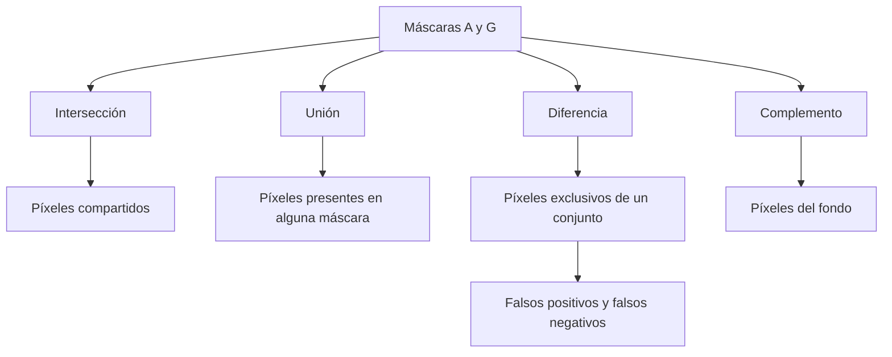
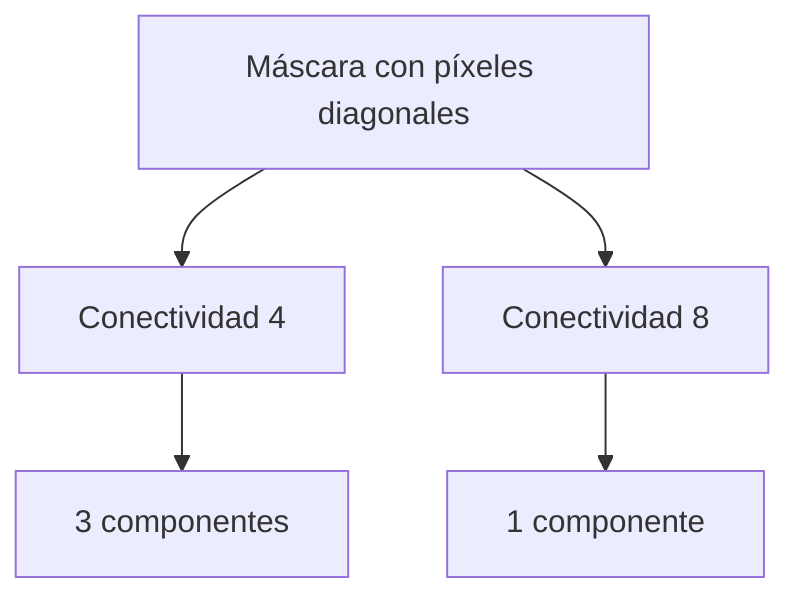
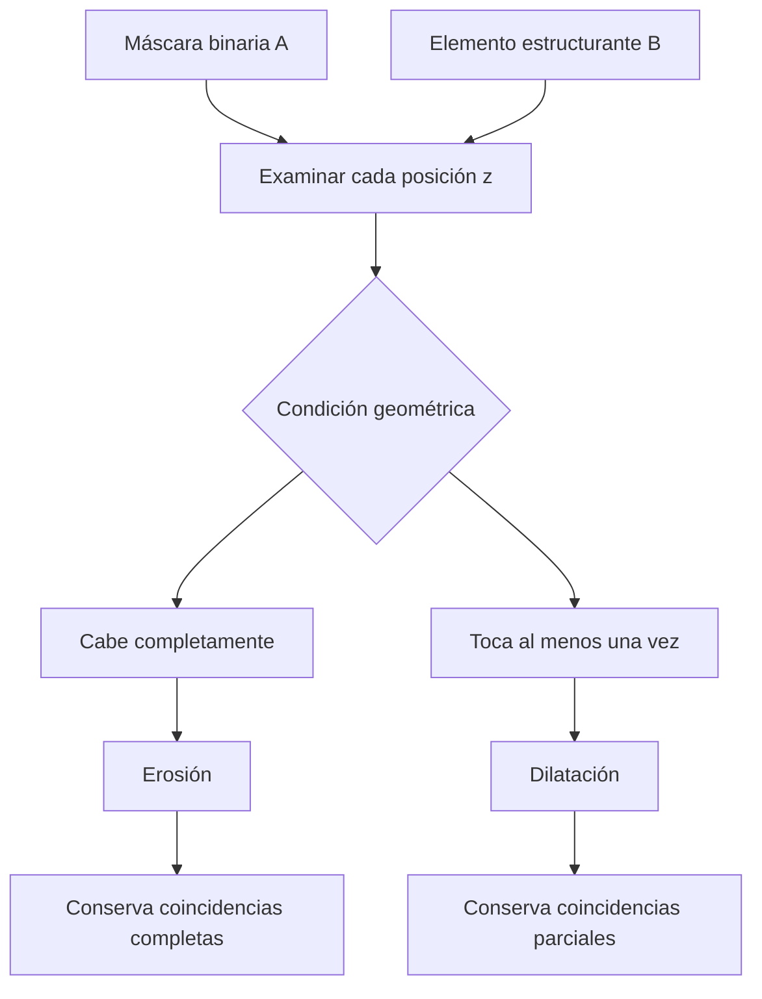
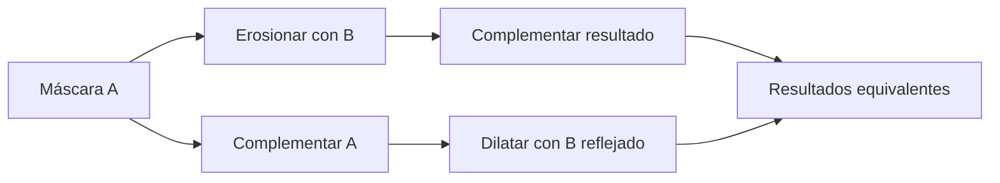
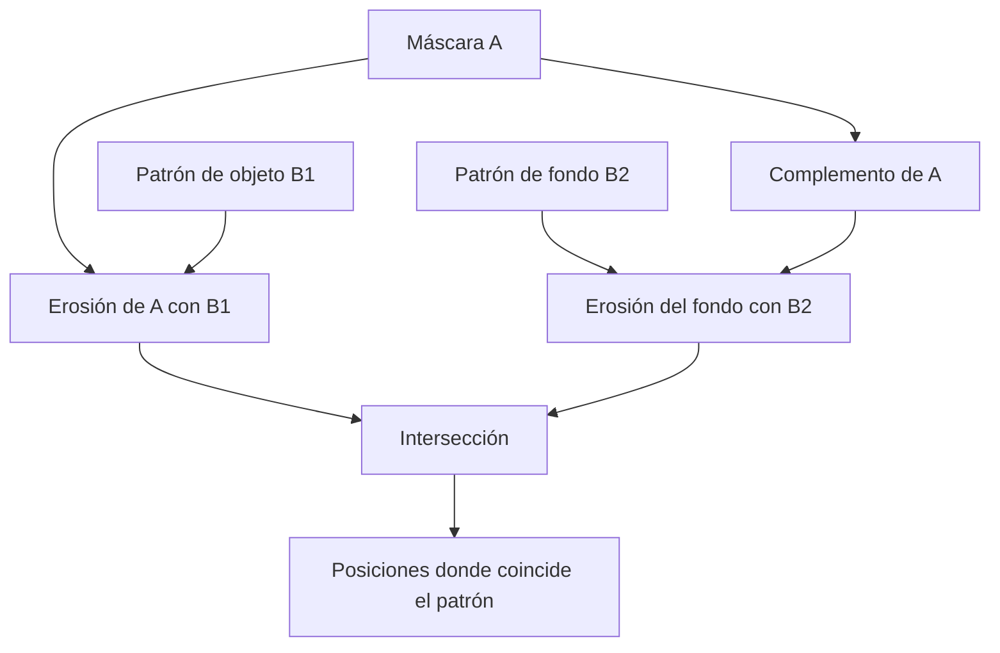
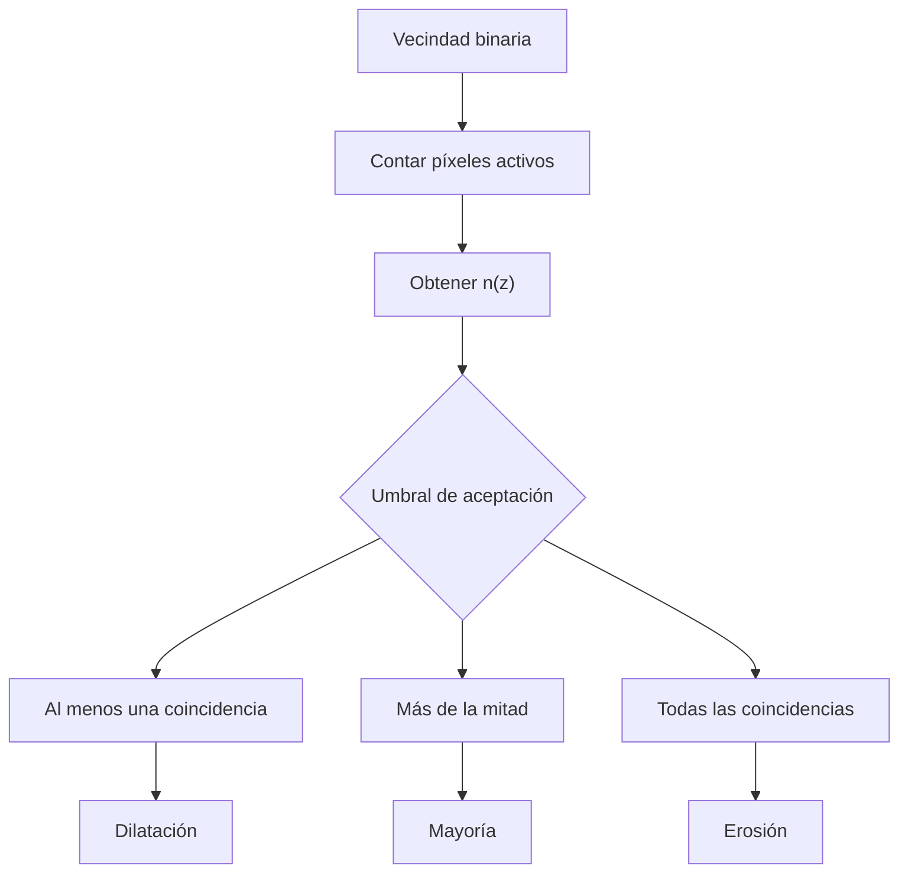
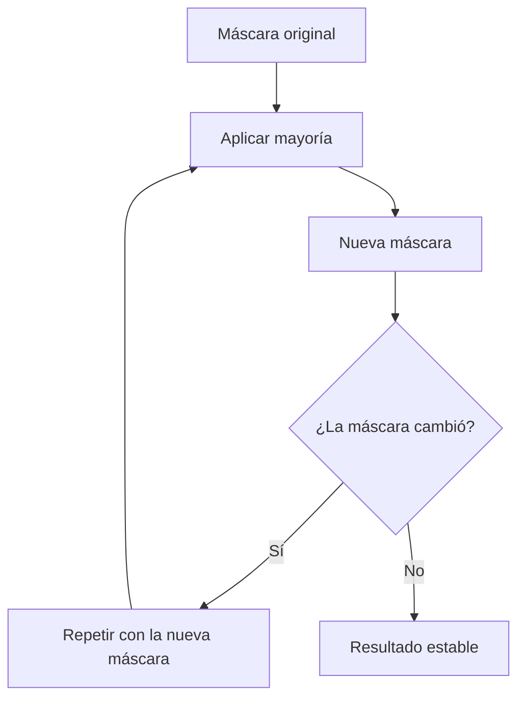

## Introducción  
  
La **morfología matemática** es una técnica de procesamiento de imágenes que permite estudiar y modificar la forma de los objetos utilizando operaciones basadas en conjuntos. Su aplicación resulta especialmente importante después de la segmentación, cuando una imagen ya ha sido convertida en una máscara binaria y únicamente se dispone de información sobre qué píxeles pertenecen al objeto y cuáles corresponden al fondo.  
  
Por ejemplo, una imagen microscópica puede contener 24 células reales, pero una segmentación afectada por ruido puede producir una máscara con más de dos mil componentes conectadas. Aunque la umbralización haya identificado correctamente gran parte de las células, los píxeles aislados y las pequeñas regiones incorrectas dificultan su análisis.  
  
La morfología permite actuar directamente sobre estas máscaras mediante una figura pequeña denominada **elemento estructurante**. Este elemento se desplaza sobre la imagen para examinar la relación geométrica entre sus píxeles y los objetos presentes.  
  
A partir de este mecanismo se construyen dos operaciones fundamentales: la **erosión**, que comprueba si el elemento estructurante cabe completamente dentro de un objeto, y la **dilatación**, que comprueba si existe al menos un punto de contacto. Estas operaciones permiten comprender técnicas más específicas, como la transformada de acierto o fallo y los filtros de mayoría.  
  
Sin embargo, modificar una máscara no garantiza mejorarla. Una operación puede eliminar correctamente el ruido y, al mismo tiempo, destruir objetos pequeños o alterar sus fronteras. Por esta razón, es necesario comprender tanto el funcionamiento matemático de las transformaciones como sus consecuencias sobre la geometría y la calidad de la segmentación.  
  
---  
  
## Representación de imágenes binarias como conjuntos  
  
Una imagen binaria puede representarse mediante una matriz cuyos elementos toman únicamente dos valores:  
  
- **1:** el píxel pertenece al objeto.  
- **0:** el píxel pertenece al fondo.  
  
Por ejemplo, considérese la siguiente máscara:  
  
$$  
A=  
\begin{bmatrix}  
0&0&0&0&0\\  
0&1&1&1&0\\  
0&1&1&1&0\\  
0&1&1&1&0\\  
0&0&0&0&0  
\end{bmatrix}  
$$  
  
Los nueve píxeles centrales forman un objeto cuadrado y los demás representan el fondo.  
  
La interpretación matemática consiste en considerar cada píxel activo como un elemento de un conjunto. Por lo tanto, una máscara puede escribirse como:  
  
$$  
A=\{(r,c)\mid A[r,c]=1\}  
$$  
  
En donde:  
  
- $A$ es el conjunto de píxeles pertenecientes al objeto.  
- $r$ representa el renglón.  
- $c$ representa la columna.  
- $A[r,c]$ es el valor de la máscara en esa posición.  
  
En las imágenes digitales, la posición $(0,0)$ suele localizarse en la esquina superior izquierda. Los renglones aumentan hacia abajo y las columnas hacia la derecha.  
  
De esta manera, la máscara anterior corresponde al conjunto:  
  
$$  
A=  
\left\{  
\begin{aligned}  
&(1,1),(1,2),(1,3),\\  
&(2,1),(2,2),(2,3),\\  
&(3,1),(3,2),(3,3)  
\end{aligned}  
\right\}  
$$  
  
El tamaño de un conjunto se representa mediante barras verticales:  
  
$$  
|A|=9  
$$  
  
Esto significa que el objeto contiene nueve píxeles activos.  
  
Esta representación permite aplicar operaciones de teoría de conjuntos directamente sobre imágenes. En lugar de trabajar con intensidades de gris, el procesamiento se realiza mediante relaciones entre posiciones espaciales.  
  
### Máscara de segmentación y verdad de referencia:  
  
En un problema de segmentación es habitual comparar dos conjuntos:  
  
- $A$: máscara obtenida mediante un algoritmo.  
- $G$: máscara verdadera o *ground truth*.  
  
La máscara $A$ representa los píxeles que el algoritmo considera pertenecientes al objeto, mientras que $G$ contiene las posiciones que realmente deberían estar activas.  
  
Por ejemplo, supóngase que una imagen contiene varias células y que la umbralización identifica correctamente sus regiones principales, pero también clasifica algunos píxeles del fondo como células.  
  
La máscara tendrá entonces dos tipos de errores:  
  
- **Falsos positivos:** píxeles del fondo identificados incorrectamente como objeto.  
- **Falsos negativos:** píxeles reales del objeto identificados incorrectamente como fondo.  
  
Estos errores pueden describirse utilizando operaciones entre conjuntos.  
  
---  
  
## Operaciones fundamentales entre conjuntos  
  
Las operaciones lógicas utilizadas sobre imágenes binarias corresponden directamente a operaciones de teoría de conjuntos.  
  
### Unión:  
  
La **unión** contiene todos los píxeles que pertenecen al menos a uno de los conjuntos.  
  
$$  
A\cup G=\{p\mid p\in A\lor p\in G\}  
$$  
  
Esto significa que un píxel pertenece al resultado cuando está presente en $A$, en $G$ o en ambos.  
  
En operaciones lógicas, la unión corresponde a `OR`.  
  
### Intersección:  
  
La **intersección** contiene únicamente los píxeles compartidos por ambos conjuntos.  
  
$$  
A\cap G=\{p\mid p\in A\land p\in G\}  
$$  
  
Por lo tanto, un píxel debe estar activo en las dos máscaras para pertenecer al resultado.  
  
Esta operación corresponde a `AND`.  
  
### Diferencia:  
  
La diferencia permite identificar los píxeles que pertenecen a un conjunto, pero no al otro.  
  
$$  
A-G=\{p\mid p\in A\land p\notin G\}  
$$  
  
Cuando $A$ representa una predicción y $G$ la verdad, esta expresión identifica los **falsos positivos**.  
  
En cambio:  
  
$$  
G-A  
$$  
  
identifica los **falsos negativos**.  
  
La diferencia es especialmente útil para determinar qué regiones incorrectas introduce una segmentación y cuáles deja de detectar.  
  
### Complemento:  
  
El **complemento** contiene todos los píxeles del dominio de la imagen que no pertenecen al conjunto original.  
  
$$  
A^c=U-A  
$$  
  
En donde $U$ representa el conjunto de todas las posiciones de la imagen.  
  
Por ejemplo, si una imagen contiene 25 píxeles y siete pertenecen al objeto:  
  
$$  
|A^c|=25-7=18  
$$  
  
El complemento representa el fondo de la imagen.  
  
### Diferencia simétrica:  
  
La diferencia simétrica reúne los elementos que pertenecen exclusivamente a uno de los conjuntos.  
  
$$  
A\triangle G=(A-G)\cup(G-A)  
$$  
  
Esta operación permite identificar simultáneamente los falsos positivos y los falsos negativos.  
  

  
Estas operaciones constituyen la base para comparar máscaras y definir las transformaciones morfológicas.  
  
###### Ejemplo:  
  
Supóngase que se tienen dos conjuntos de píxeles:  
  
$$  
|A|=7  
$$  
  
$$  
|G|=9  
$$  
  
Y que ambos comparten cinco posiciones:  
  
$$  
|A\cap G|=5  
$$  
  
Los píxeles presentes únicamente en $A$ son:  
  
$$  
|A-G|=7-5=2  
$$  
  
Mientras que los píxeles presentes únicamente en $G$ son:  
  
$$  
|G-A|=9-5=4  
$$  
  
La unión contiene:  
  
$$  
|A\cup G|=5+2+4=11  
$$  
  
Por lo tanto, la máscara tiene dos falsos positivos y cuatro falsos negativos.  
  
---  
  
## Evaluación de segmentaciones mediante IoU  
  
La métrica **Intersection over Union (IoU)** permite medir qué tanto coincide una máscara obtenida mediante segmentación con una máscara verdadera.  
  
Se define como:  
  
$$  
IoU(A,G)=\frac{|A\cap G|}{|A\cup G|}  
$$  
  
En donde:  
  
- $|A\cap G|$ representa el número de píxeles correctamente compartidos.  
- $|A\cup G|$ representa todos los píxeles que aparecen en alguna de las máscaras.  
  
El resultado se encuentra entre $0$ y $1$, siempre que la unión no esté vacía.  
  
Un valor de $1$ indica que ambas máscaras coinciden perfectamente, mientras que un valor de $0$ indica que no comparten ningún píxel activo.  
  
###### Ejemplo:  
  
Utilizando los conjuntos anteriores:  
  
$$  
IoU=\frac{5}{11}  
$$  
  
$$  
IoU\approx0.455  
$$  
  
Por lo tanto, la coincidencia entre las máscaras es aproximadamente del $45.5\%$.  
  
Esta métrica resulta importante para evaluar las operaciones morfológicas porque una máscara puede tener el número correcto de objetos, pero formas o posiciones incorrectas.  
  
Por ejemplo, si una erosión elimina casi todo el ruido y también reduce considerablemente las células verdaderas, el número de componentes puede mejorar mientras el IoU permanece bajo.  
  
Esto demuestra que **el conteo de objetos y la calidad de la segmentación representan propiedades diferentes**.  
  
---  
  
## Transformaciones geométricas de conjuntos  
  
Las operaciones morfológicas utilizan dos transformaciones geométricas fundamentales: **traslación** y **reflexión**.  

![[Pasted image 20261103080301.png]]
  
### Traslación:  
  
La traslación consiste en desplazar todos los elementos de un conjunto utilizando un mismo vector.  
  
Se define mediante:  
  
$$  
(B)_z=\{b+z\mid b\in B\}  
$$  
  
En donde:  
  
- $B$ es el conjunto original.  
- $z$ es el vector de desplazamiento.  
- $b$ representa un elemento cualquiera de $B$.  
- $(B)_z$ es el conjunto trasladado.  
  
###### Ejemplo:  
  
Supóngase que:  
  
$$  
B=\{(0,0),(0,1),(1,0)\}  
$$  
  
Y que se desea trasladar el conjunto a:  
  
$$  
z=(2,3)  
$$  
  
Cada coordenada recibe el mismo desplazamiento:  
  
$$  
(B)_z=\{(2,3),(2,4),(3,3)\}  
$$  
  
La forma permanece igual y únicamente cambia su posición.  
  
### Reflexión:  
  
La reflexión morfológica consiste en invertir el signo de las coordenadas respecto al origen.  
  
$$  
\hat B=\{-b\mid b\in B\}  
$$  
  
Utilizando el conjunto anterior:  
  
$$  
\hat B=\{(0,0),(0,-1),(-1,0)\}  
$$  
  
Geométricamente, esta transformación equivale a una rotación de $180^\circ$ alrededor del origen.  
  
La reflexión puede parecer innecesaria cuando se utilizan figuras simétricas, como cuadrados o cruces centradas. Sin embargo, resulta fundamental cuando se trabaja con elementos asimétricos.  
  
---  
  
## Elementos estructurantes  
  
Un **elemento estructurante**, representado mediante $B$, es un conjunto pequeño de posiciones que se utiliza como plantilla para examinar la geometría de una máscara binaria.  
  
El elemento se desplaza sobre la imagen y, en cada posición, se comprueba cómo se relacionan sus píxeles con los del objeto.  
  
Su funcionamiento depende de tres propiedades:  
  
- **Forma:** determina qué configuraciones geométricas puede reconocer.  
- **Tamaño:** determina la escala espacial examinada.  
- **Origen:** determina la posición donde se registra cada resultado.  
  
### Formas habituales:  
  
Entre las formas más utilizadas se encuentran el cuadrado, la cruz, el disco y las barras horizontales o verticales.  

![[Pasted image 20261103080343.png]]
  
Por ejemplo, un cuadrado de $3\times3$ se representa como:  
  
$$  
B_{\text{cuadrado}}=  
\begin{bmatrix}  
1&1&1\\  
1&1&1\\  
1&1&1  
\end{bmatrix}  
$$  
  
Una cruz del mismo tamaño se representa mediante:  
  
$$  
B_{\text{cruz}}=  
\begin{bmatrix}  
0&1&0\\  
1&1&1\\  
0&1&0  
\end{bmatrix}  
$$  
  
Aunque ambos ocupan una matriz de $3\times3$, el primero contiene nueve posiciones activas y el segundo solamente cinco.  
  
Por lo tanto:  
  
$$  
|B_{\text{cuadrado}}|=9  
$$  
  
$$  
|B_{\text{cruz}}|=5  
$$  
  
Esta diferencia modifica las condiciones que debe cumplir un objeto durante el procesamiento morfológico.  
  
### El origen del elemento estructurante:  
  
Cada elemento posee una posición denominada **origen**, que actúa como referencia durante su desplazamiento.  
  
Por ejemplo, para una cruz centrada:  
  
$$  
B=\{(-1,0),(0,-1),(0,0),(0,1),(1,0)\}  
$$  
  
El origen corresponde a:  
  
$$  
(0,0)  
$$  
  
Cuando el elemento se coloca sobre una posición $z$ de la imagen, su origen coincide con esa posición.  
  
En elementos simétricos suele utilizarse el centro. Sin embargo, en elementos asimétricos el origen también puede situarse en una esquina.  
  
Cambiar el origen modifica la ubicación de las posiciones obtenidas mediante la operación.  
  
### Influencia de la forma y el tamaño:  
  
Supóngase que una imagen contiene una línea horizontal de dos píxeles de grosor.  
  
Un elemento cuadrado de $3\times3$ no puede colocarse completamente dentro de esa línea porque necesita tres píxeles consecutivos en dirección vertical.  
  
En cambio, una barra horizontal de $1\times3$ sí puede colocarse dentro de ella.  
  
Por lo tanto, **la cantidad de píxeles de un objeto no determina por sí sola si un elemento estructurante puede acomodarse dentro de él**.  
  
La orientación y la forma también influyen directamente.  
  
---  
  
## Conectividad en imágenes binarias  
  
La **conectividad** permite determinar cuándo dos píxeles pertenecen a una misma región.  
  
Esta propiedad es indispensable para identificar componentes conectadas, contar objetos y reconocer agujeros.  
  
Existen dos criterios habituales: conectividad de cuatro vecinos y conectividad de ocho vecinos.  
  
### Conectividad de cuatro vecinos:  
  
En la conectividad 4, un píxel puede conectarse con sus vecinos superior, inferior, izquierdo y derecho.  
  
La vecindad se representa mediante:  
  
$$  
N_4=  
\begin{bmatrix}  
0&1&0\\  
1&1&1\\  
0&1&0  
\end{bmatrix}  
$$  
  
Dos píxeles que solamente se tocan por una esquina no se consideran directamente conectados.  

![[Pasted image 20261103080613.png]]
  
### Conectividad de ocho vecinos:  
  
La conectividad 8 incorpora también las cuatro posiciones diagonales.  
  
$$  
N_8=  
\begin{bmatrix}  
1&1&1\\  
1&1&1\\  
1&1&1  
\end{bmatrix}  
$$  
  
De esta manera, los píxeles pueden pertenecer a una misma región incluso cuando solamente comparten una esquina.  

![[Pasted image 20261103080545.png]]
  
###### Ejemplo:  
  
Considérese:  
  
$$  
A=  
\begin{bmatrix}  
1&0&0\\  
0&1&0\\  
0&0&1  
\end{bmatrix}  
$$  
  
Con conectividad 4 existen tres componentes independientes.  
  
Con conectividad 8 existe una sola componente, porque los tres píxeles forman una cadena diagonal.  
  

  
Esto demuestra que el número de objetos no depende únicamente de los valores de la máscara, sino también de la definición de conectividad.  
  
### La paradoja de conectividad:  
  
La conectividad debe definirse tanto para los objetos como para el fondo.  
  
Sin embargo, utilizar conectividad 8 para ambos puede producir interpretaciones contradictorias.  
  
Por ejemplo, considérese una figura que parece formar un anillo mediante conexiones diagonales.  
  
Con conectividad 8, los píxeles del objeto pueden formar una región cerrada. No obstante, si el fondo también utiliza conectividad 8, el interior del anillo puede conectarse con el exterior a través de las esquinas.  
  
Para evitar estas contradicciones se suelen utilizar conectividades complementarias:  
  
| Objeto    | Fondo     |
| --------- | --------- |
| 8 vecinos | 4 vecinos |
| 4 vecinos | 8 vecinos |
  
Esta elección permite interpretar correctamente las relaciones entre componentes y agujeros.  
  
### Componentes y agujeros:  
  
Una **componente conectada** es un conjunto de píxeles en el que existe un recorrido entre cualquier par de posiciones siguiendo la regla de conectividad.  
  
Un **agujero** es una región del fondo rodeada por el objeto y desconectada del fondo exterior.  
  
La presencia de ruido puede modificar ambas propiedades.  

![[Pasted image 20261103081001.png]]
  
Por ejemplo, algunos píxeles aislados pueden incrementar el número de componentes, mientras que los errores dentro de un objeto pueden crear agujeros artificiales.  
  
Por lo tanto, la limpieza morfológica no solamente modifica la cantidad de píxeles activos, sino también las relaciones topológicas entre las regiones.  
  
---  
  
## Fundamento de la erosión y la dilatación  
  
Las dos operaciones fundamentales de morfología matemática se construyen mediante preguntas geométricas diferentes.  
  
La primera pregunta es:  
  
> ¿El elemento estructurante cabe completamente dentro del objeto?  
  
Esta condición produce la **erosión**.  
  
La segunda pregunta es:  
  
> ¿El elemento estructurante toca al objeto en alguna posición?  
  
Esta condición produce la **dilatación**.  
  

  
Ambas operaciones utilizan el mismo principio de examinar la relación entre un elemento estructurante y la máscara.  
  
La diferencia se encuentra en la condición necesaria para aceptar cada posición.  

![[Pasted image 20261103081128.png]]
  
---  
  
## Erosión morfológica  
  
La **erosión** conserva las posiciones donde el elemento estructurante cabe completamente dentro del objeto.  
  
Se representa mediante:  
  
$$  
A\ominus B  
$$  
  
Su definición matemática es:  
  
$$  
A\ominus B=\{z\mid(B)_z\subseteq A\}  
$$  
  
En donde:  
  
- $A$ representa los píxeles del objeto.  
- $B$ es el elemento estructurante.  
- $z$ es una posición de la imagen.  
- $(B)_z$ representa el elemento trasladado a esa posición.  
- $\subseteq$ indica que todos los píxeles del elemento deben pertenecer al objeto.  
  
La operación comprueba cada posición de la imagen.  
  
Si todos los píxeles del elemento estructurante coinciden con píxeles del objeto, la posición se conserva.  
  
Si uno solo cae sobre el fondo, la posición se descarta.  

![[Pasted image 20261103081509.png]]

![[Pasted image 20261103081527.png]]

  
### Interpretación geométrica:  
  
La erosión tiende a reducir las regiones del objeto porque elimina posiciones cercanas a sus fronteras.  
  
Sus efectos habituales son:  
  
- Eliminar píxeles aislados.  
- Eliminar estructuras pequeñas.  
- Reducir el grosor de los objetos.  
- Romper conexiones estrechas.  
- Separar regiones unidas mediante puentes delgados.  
  
Sin embargo, estos efectos no siempre son deseables.  
  
Una erosión demasiado intensa puede eliminar estructuras válidas de la imagen.  
  
### Erosión de un cuadrado:  
  
Considérese nuevamente:  
  
$$  
A=  
\begin{bmatrix}  
0&0&0&0&0\\  
0&1&1&1&0\\  
0&1&1&1&0\\  
0&1&1&1&0\\  
0&0&0&0&0  
\end{bmatrix}  
$$  
  
Supóngase que el elemento estructurante es un cuadrado de $3\times3$.  
  
El elemento solamente cabe completamente cuando su origen coincide con el centro del objeto.  
  
Por lo tanto:  
  
$$  
A\ominus B=  
\begin{bmatrix}  
0&0&0&0&0\\  
0&0&0&0&0\\  
0&0&1&0&0\\  
0&0&0&0&0\\  
0&0&0&0&0  
\end{bmatrix}  
$$  
  
El objeto original contenía nueve píxeles, pero la erosión conserva solamente uno.  
  
### Desaparición de objetos pequeños:  
  
Supóngase que un objeto tiene dos píxeles de grosor y ocho de longitud.  
  
Su área es:  
  
$$  
|A|=2(8)=16  
$$  
  
Si se utiliza un elemento cuadrado de $3\times3$, este nunca podrá caber dentro del objeto porque necesita tres píxeles de grosor.  
  
Por lo tanto:  
  
$$  
A\ominus B=\varnothing  
$$  
  
El objeto desaparece completamente.  
  
Ahora bien, si se utiliza una barra horizontal de $1\times3$, el elemento sí puede caber dentro de la línea.  
  
El resultado conserva:  
  
$$  
2(8-2)=12  
$$  
  
píxeles.  
  
Esto demuestra que la erosión no elimina objetos utilizando únicamente un criterio de área.  
  
La condición depende de la geometría completa del elemento estructurante.  

![[Pasted image 20261103081807.png]] 

![[Pasted image 20261103081823.png]]
  
---  
  
## Dilatación morfológica  
  
La **dilatación** conserva las posiciones donde el elemento estructurante reflejado toca al objeto al menos en un píxel.  
  
Se representa mediante:  
  
$$  
A\oplus B  
$$  
  
Su definición es:  
  
$$  
A\oplus B=  
\{z\mid(\hat B)_z\cap A\neq\varnothing\}  
$$  
  
En donde:  
  
- $\hat B$ es el elemento estructurante reflejado.  
- $(\hat B)_z$ es el elemento reflejado y trasladado.  
- $\cap$ representa la intersección.  
- $\neq\varnothing$ indica que existe al menos una coincidencia.  
  
A diferencia de la erosión, la dilatación no requiere que todos los píxeles del elemento coincidan con el objeto.  
  
Basta con que exista un único contacto.  

![[Pasted image 20261103081917.png]]

![[Pasted image 20261103081930.png]]
  
### Interpretación geométrica:  
  
La dilatación tiende a expandir las regiones del objeto.  
  
Entre sus efectos habituales se encuentran:  
  
- Aumentar el grosor de los objetos.  
- Conectar regiones cercanas.  
- Reducir pequeños espacios entre regiones.  
- Cubrir determinados agujeros.  
- Expandir máscaras binarias.  
  
Sin embargo, también puede expandir los píxeles incorrectos producidos por ruido.  
  
### Dilatación de un píxel aislado:  
  
Considérese:  
  
$$  
A=  
\begin{bmatrix}  
0&0&0&0&0\\  
0&0&0&0&0\\  
0&0&1&0&0\\  
0&0&0&0&0\\  
0&0&0&0&0  
\end{bmatrix}  
$$  
  
Si se aplica dilatación utilizando un cuadrado centrado de $3\times3$:  
  
$$  
A\oplus B=  
\begin{bmatrix}  
0&0&0&0&0\\  
0&1&1&1&0\\  
0&1&1&1&0\\  
0&1&1&1&0\\  
0&0&0&0&0  
\end{bmatrix}  
$$  
  
El píxel aislado se convierte en un bloque de nueve píxeles.  
  
Esto muestra por qué una dilatación aplicada sobre una máscara con mucho ruido puede empeorar la segmentación.  
  
Los píxeles incorrectos también crecen.  
  
### Comparación entre erosión y dilatación:  
  
| Característica       | Erosión                   | Dilatación                  |
| -------------------- | ------------------------- | --------------------------- |
| Símbolo              | $\ominus$                 | $\oplus$                    |
| Condición            | El elemento cabe completo | Existe al menos un contacto |
| Efecto habitual      | Reduce objetos            | Expande objetos             |
| Píxeles aislados     | Puede eliminarlos         | Puede expandirlos           |
| Conexiones estrechas | Puede romperlas           | Puede crearlas              |
| Agujeros             | Puede agrandarlos         | Puede reducirlos            |
  
Estas operaciones representan dos formas complementarias de analizar la geometría de una máscara.  

![[Pasted image 20261103082307.png]]
  
---  
  
## Dualidad entre erosión y dilatación  
  
La erosión y la dilatación están relacionadas matemáticamente mediante el complemento.  

![[Pasted image 20261103082425.png]]
  
Esta propiedad recibe el nombre de **dualidad morfológica**.  
  
La primera identidad es:  
  
$$  
(A\ominus B)^c=A^c\oplus\hat B  
$$  
  
La segunda identidad es:  
  
$$  
(A\oplus B)^c=A^c\ominus\hat B  
$$  
  
Estas relaciones se interpretan considerando el objeto y su fondo en un dominio con condiciones de frontera consistentes.  
  
### Interpretación geométrica:  
  
La primera identidad establece que el complemento de una erosión equivale a dilatar el fondo utilizando el elemento estructurante reflejado.  
  
La razón es que una posición no pertenece a la erosión cuando el elemento estructurante no cabe completamente dentro del objeto.  
  
Esto significa que al menos una parte del elemento cae sobre el fondo.  
  
Por lo tanto, existe un contacto con el complemento del objeto.  
  
La condición de no caber en el objeto se convierte así en una condición de tocar el fondo.  
  

  
### Importancia de la reflexión:  
  
Cuando el elemento estructurante es simétrico:  
  
$$  
B=\hat B  
$$  
  
Por ejemplo, esto ocurre con un cuadrado centrado de $3\times3$.  
  
Sin embargo, un elemento en forma de L generalmente no es simétrico respecto al origen.  
  
En ese caso:  
  
$$  
B\neq\hat B  
$$  
  
Omitir la reflexión puede desplazar o modificar los resultados.  
  
La dualidad permite comprender que erosión y dilatación no son operaciones completamente independientes, sino dos manifestaciones de una misma relación geométrica.  
  
---  
  
## Efectos de las operaciones sobre objetos de diferentes tamaños  
  
El efecto de una operación morfológica depende de la escala del objeto.  
  
Considérese una imagen que contiene células grandes, medianas y pequeñas.  
  
Al aplicar una erosión utilizando un elemento cuadrado de $3\times3$, los objetos grandes suelen conservar una parte considerable de su interior.  
  
En cambio, los objetos pequeños pueden perder una proporción mucho mayor de sus píxeles.  
  
Por ejemplo, considérese una célula pequeña formada por 30 píxeles.  
  
Si después de aplicar erosión solamente conserva 10:  
  
$$  
\frac{10}{30}=0.333  
$$  
  
Esto significa que conserva aproximadamente el $33.3\%$ de su área.  
  
La pérdida es especialmente importante porque, en objetos pequeños, una gran proporción de sus píxeles se encuentra cerca de la frontera.  
  
### El problema de eliminar demasiado:  
  
Supóngase que una imagen contiene 24 células reales.  
  
Una segmentación afectada por ruido produce 2,142 componentes conectadas.  
  
Después de aplicar erosión, el número de componentes disminuye a 24.  

![[Pasted image 20261103082939.png]]
  
A primera vista, el resultado parece correcto.  
  
Sin embargo, las 12 células más pequeñas pueden desaparecer o quedar tan reducidas que dejan de representar adecuadamente su forma original.  
  
Por lo tanto:  
  
**Obtener el número correcto de componentes no significa necesariamente haber recuperado los objetos correctos.**  
  
Es posible que algunos componentes restantes sean regiones falsas, mientras que ciertas estructuras reales hayan desaparecido.  
  
Este problema demuestra por qué la evaluación de una máscara debe considerar simultáneamente el número de componentes y la coincidencia geométrica con la verdad.  
  
---  
  
## Transformada de acierto o fallo  
  
La **transformada de acierto o fallo**, conocida como *hit-or-miss transform*, permite detectar patrones binarios que requieren condiciones sobre los píxeles del objeto y del fondo.  
  
A diferencia de la erosión convencional, que solamente comprueba si un conjunto cabe dentro del objeto, esta transformación utiliza dos elementos estructurantes:  
  
- $B_1$: posiciones que deben pertenecer al objeto.  
- $B_2$: posiciones que deben pertenecer al fondo.  
  
La operación se define como:  
  
$$  
A\circledast(B_1,B_2)  
=  
(A\ominus B_1)\cap(A^c\ominus B_2)  
$$  
  
La primera erosión localiza posiciones donde el patrón del objeto cabe completamente.  
  
La segunda localiza posiciones donde el patrón del fondo también cabe completamente.  

![[Pasted image 20261103083120.png]]
  
La intersección conserva únicamente aquellas posiciones donde ambas condiciones se cumplen al mismo tiempo.  
  
### Interpretación de las condiciones:  
  
Para reconocer un patrón pueden existir tres tipos de posiciones:  
  
| Tipo             | Condición                |
| ---------------- | ------------------------ |
| Objeto requerido | Debe contener $1$        |
| Fondo requerido  | Debe contener $0$        |
| Indiferente      | Puede contener $0$ o $1$ |
  
Las posiciones indiferentes no pertenecen a ninguno de los dos elementos estructurantes.  
  
Esto permite construir patrones que solamente examinan determinadas posiciones.  
  
### Detección de píxeles aislados:  
  
Supóngase que se desea detectar un píxel activo cuyos ocho vecinos pertenecen al fondo.  
  
El patrón requerido es:  
  
$$  
P=  
\begin{bmatrix}  
0&0&0\\  
0&1&0\\  
0&0&0  
\end{bmatrix}  
$$  
  
El centro debe pertenecer al objeto y las ocho posiciones restantes deben pertenecer al fondo.  
  
Cuando aparece una configuración de este tipo, la transformada registra una coincidencia.  
  
En cambio, el centro de un bloque sólido no cumple las condiciones del fondo, por lo que no se detecta como píxel aislado.  

![[Pasted image 20261103083349.png]] 

![[Pasted image 20261103083404.png]]
  
### Detección de extremos:  
  
También puede utilizarse la transformada para identificar extremos de líneas.  
  
Por ejemplo, para detectar el extremo derecho de una línea horizontal puede exigirse que el centro y su vecino izquierdo pertenezcan al objeto, mientras que los vecinos derechos y determinadas posiciones circundantes correspondan al fondo.  

![[Pasted image 20261103083538.png]]

![[Pasted image 20261103083558.png]]

Este principio puede extenderse para detectar extremos en otras direcciones, esquinas y configuraciones locales.  
  

  
La transformada produce una máscara con las posiciones detectadas.  
  
No elimina automáticamente los píxeles identificados. Para realizar una limpieza, el resultado debe utilizarse posteriormente para modificar la máscara original.  
  
### Limitaciones:  
  
La transformada de acierto o fallo reconoce configuraciones específicas.  
  
Por ejemplo, un patrón diseñado para identificar píxeles completamente aislados no elimina necesariamente parejas o grupos de píxeles conectados.  
  
Por esta razón, puede reducir una parte importante del ruido sin eliminar todas las regiones falsas.  
  
---  
  
## Erosión, dilatación y mayoría mediante conteo de coincidencias  
  
Las operaciones morfológicas pueden expresarse mediante un mecanismo común: contar cuántos píxeles del elemento estructurante coinciden con el objeto.  
  
Para una posición $z$ se define:  
  
$$  
n(z)=|(B)_z\cap A|  
$$  
  
En donde:  
  
- $n(z)$ representa el número de coincidencias.  
- $(B)_z$ es el elemento estructurante trasladado a la posición $z$.  
- $A$ es la máscara binaria.  
  
Supóngase que se utiliza un cuadrado de $3\times3$.  
  
Este elemento contiene nueve píxeles activos, por lo que:  
  
$$  
0\leq n(z)\leq9  
$$  
  
Cada posición de la imagen obtiene una cuenta diferente según la cantidad de píxeles activos que aparecen bajo el elemento estructurante.  
  
### Erosión como coincidencia completa:  
  
La erosión exige que todos los píxeles del elemento estructurante coincidan con el objeto.  
  
Por lo tanto:  
  
$$  
n(z)=|B|  
$$  
  
Con un cuadrado de $3\times3$:  
  
$$  
n(z)=9  
$$  
  
Solamente se conservan posiciones donde las nueve coincidencias están presentes.  
  
### Dilatación como coincidencia mínima:  
  
La dilatación requiere al menos un punto de contacto.  
  
Para elementos simétricos respecto al origen:  
  
$$  
n(z)\geq1  
$$  
  
Por lo tanto, basta con una coincidencia para activar la posición.  
  
Cuando el elemento no es simétrico, debe respetarse la reflexión correspondiente a la definición de dilatación.  
  
### Filtro de mayoría:  
  
El filtro de mayoría conserva una posición cuando más de la mitad de los píxeles examinados pertenecen al objeto.  
  
La condición es:  
  
$$  
n(z)>\frac{|B|}{2}  
$$  
  
Para un cuadrado de $3\times3$:  
  
$$  
n(z)\geq5  
$$  
![[Pasted image 20261103083936.png]]

Por lo tanto, pueden compararse las tres operaciones utilizando sus condiciones de aceptación:  
  
| Operación  | Condición con un cuadrado $3\times3$ |
| ---------- | ------------------------------------ |
| Dilatación | $n(z)\geq1$                          |
| Mayoría    | $n(z)\geq5$                          |
| Erosión    | $n(z)=9$                             |
  

  
Este esquema muestra que las tres operaciones pueden comprenderse mediante una misma cuenta y diferentes criterios de aceptación.  
  
---  
  
## Filtrado por mayoría  
  
El **filtro de mayoría** modifica una máscara binaria según el valor predominante dentro de una vecindad.  
  
A diferencia de la erosión, no exige que todos los píxeles pertenezcan al objeto.  
  
Tampoco activa una posición por una única coincidencia, como sucede con la dilatación.  
  
En su lugar, utiliza un criterio intermedio.  
  
Para un elemento estructurante de nueve posiciones:  
  
$$  
M_B(A)=\left\{z\mid n(z)\geq5\right\}  
$$  
  
En donde $M_B(A)$ representa el resultado de aplicar mayoría sobre la máscara $A$ utilizando el elemento $B$.  
  
### Funcionamiento:  
  
En cada posición de la imagen se realiza el siguiente procedimiento:  
  
1. Se coloca el elemento estructurante.  
2. Se cuentan los píxeles activos dentro de la vecindad.  
3. Se compara la cuenta contra el umbral de mayoría.  
4. Se asigna el valor correspondiente a la posición de salida.  
  
###### Ejemplo:  
  
Considérese:  
  
$$  
\begin{bmatrix}  
0&1&0\\  
1&1&1\\  
0&1&0  
\end{bmatrix}  
$$  
  
La vecindad contiene cinco píxeles activos.  
  
Por lo tanto:  
  
$$  
n(z)=5  
$$  
  
Como cumple la condición de mayoría, el píxel central permanece activo.  
  
Ahora considérese:  
  
$$  
\begin{bmatrix}  
0&0&0\\  
0&1&1\\  
0&0&0  
\end{bmatrix}  
$$  
  
En este caso:  
  
$$  
n(z)=2  
$$  
  
Como no alcanza el umbral, la posición de salida se convierte en fondo.  
  
### Relación con los filtros de orden:  
  
Las tres operaciones pueden relacionarse con filtros estadísticos sobre valores binarios.  
  
- La **erosión** corresponde al mínimo de la vecindad cuando el elemento se aplica como una ventana binaria.  
- La **dilatación** corresponde al máximo.  
- La **mayoría** corresponde a la mediana cuando el número de posiciones es impar.  
  
Esto permite interpretar la mayoría como una alternativa intermedia entre las condiciones extremas de erosión y dilatación.  
  
### Filtrado iterativo:  
  
El filtro de mayoría puede aplicarse repetidamente.  
  
En cada pasada se calcula una nueva máscara utilizando la anterior.  
  
El procedimiento puede representarse como:  
  

  
La repetición permite corregir estructuras que no desaparecen completamente en la primera pasada.  

![[Pasted image 20261103084226.png]]
  
Sin embargo, continuar iterando no garantiza una mejora indefinida. Algunas configuraciones pueden seguir cambiando o incluso alternar entre estados.  
  
Por esta razón, conviene comprobar la estabilidad y establecer un criterio de terminación.  
  
### Influencia del elemento estructurante:  
  
Supóngase que se aplica mayoría con un cuadrado de $3\times3$ sobre un bloque sólido del mismo tamaño.  
  
Las esquinas del bloque tienen solamente cuatro coincidencias dentro de sus vecindades completas.  
  
Como:  
  
$$  
4<5  
$$  
  
las esquinas desaparecen.  
  
El bloque puede evolucionar de la siguiente manera:  
  
$$  
9\rightarrow5\rightarrow1\rightarrow0  
$$  
  
En cambio, al utilizar una cruz de cinco posiciones, el umbral de mayoría es:  
  
$$  
n(z)\geq3  
$$  
  
Las esquinas del bloque encuentran tres coincidencias en sus vecindades con forma de cruz, por lo que pueden permanecer activas.  
  
Por lo tanto, la mayoría tampoco garantiza conservar cualquier objeto pequeño.  
  
**La forma del elemento estructurante modifica directamente las estructuras que sobreviven al filtrado.**  
  
---  
  
## Comparación experimental de las operaciones morfológicas  
  
Considérese una imagen microscópica que contiene 24 células reales distribuidas en tres tamaños:  
  
- 4 células grandes.  
- 8 células medianas.  
- 12 células pequeñas.  
  
La imagen contiene ruido y se segmenta utilizando el método de Otsu.  
  
La máscara resultante contiene 2,142 componentes conectadas, porque muchos píxeles del ruido son interpretados como objetos independientes.  
  
Se aplican diferentes operaciones morfológicas con el objetivo de eliminar el ruido y conservar las células.  
  
### Resultados principales:  
  
| Operación                          | Componentes detectadas |
| ---------------------------------- | ---------------------: |
| Máscara original                   |                  2,142 |
| Erosión con cuadrado $3\times3$    |                     24 |
| Dilatación con cuadrado $3\times3$ |                    654 |
| Mayoría iterativa                  |                     24 |
  
Los resultados muestran que tanto la erosión como la mayoría pueden producir exactamente 24 componentes.  
  
Sin embargo, esto no significa que ambas hayan recuperado correctamente las 24 células.  
  
### Resultado de la erosión:  
  
La erosión elimina numerosos píxeles aislados porque un elemento cuadrado de $3\times3$ no puede caber dentro de regiones demasiado pequeñas.  
  
Esto reduce considerablemente el número de componentes.  
  
Sin embargo, también reduce las células verdaderas y perjudica especialmente a las más pequeñas.  
  
En el experimento, las 12 células pequeñas dejan de conservarse adecuadamente como objetos.  
  
Por lo tanto, el conteo final de 24 componentes no representa necesariamente las 24 células originales.  
  
### Resultado de la dilatación:  
  
La dilatación expande tanto las células como los píxeles de ruido.  
  
Algunas regiones cercanas se unen y el número de componentes disminuye.  
  
Sin embargo, muchas regiones falsas también se expanden, por lo que la máscara puede quedar más alejada de la verdad.  
  
Esto explica por qué una disminución en el número de componentes no es suficiente para afirmar que hubo una mejora.  
  
### Resultado de la mayoría:  
  
La mayoría utiliza un criterio intermedio que permite eliminar numerosos píxeles de ruido sin reducir de manera tan agresiva las regiones principales.  
  
En el experimento, el procedimiento conserva las 24 células, incluidas las 12 pequeñas.  
  
Además, alcanza un IoU cercano a:  
  
$$  
IoU=0.989  
$$  
  
Este resultado muestra una coincidencia muy elevada con la máscara verdadera.  
  
Sin embargo, no significa que mayoría sea siempre la mejor operación. Su desempeño depende de la estructura de los objetos, del ruido y del elemento estructurante elegido.  
  
---  
  
## Evolución del filtrado iterativo  
  
El comportamiento de un filtro puede analizarse observando cómo cambia la máscara después de cada pasada.  
  
Para la imagen de las 24 células, el número de componentes evoluciona aproximadamente de la siguiente manera:  
  
$$  
2142\rightarrow27\rightarrow24\rightarrow24  
$$  
  
La primera pasada elimina la mayor parte del ruido.  
  
La segunda reduce las componentes adicionales restantes.  
  
La tercera permite comprobar que el número de objetos se mantiene.  
  
### Interpretación de las pasadas:  
  
La mejora más importante aparece durante las primeras iteraciones porque muchos errores consisten en estructuras pequeñas que no cumplen el umbral local.  
  
Después de eliminarlas, las pasadas posteriores modifican principalmente pequeñas irregularidades de las fronteras.  
  
No obstante, un número estable de componentes no implica necesariamente que la máscara completa haya dejado de cambiar.  
  
Para comprobar la convergencia debe compararse cada píxel entre dos pasadas consecutivas.  
  
### Comparación de elementos estructurantes:  
  
En el mismo problema pueden obtenerse resultados diferentes al cambiar la forma de la vecindad.  
  
| Elemento estructurante   | Pasadas | IoU final |
| ------------------------ | ------: | --------: |
| Cuadrado $3\times3$      |       3 |     0.989 |
| Cruz $3\times3$          |       3 |     0.991 |
| Disco digital de radio 2 |       5 |     0.983 |
  
La cruz presenta el mayor IoU de esta comparación.  
  
Esto se debe a que cada elemento estructurante examina relaciones espaciales diferentes.  
  
El cuadrado considera las nueve posiciones de su vecindad, mientras que la cruz únicamente utiliza las cinco posiciones centrales en direcciones horizontal y vertical.  
  
El disco digital incorpora una región de mayor alcance espacial.  
  
Por lo tanto, **seleccionar el elemento estructurante es tan importante como elegir la operación morfológica**.  
  
---  
  
## Selección de operaciones según el problema  
  
La elección de una operación morfológica depende de la transformación que se desea realizar sobre la máscara.  
  
| Problema                      | Operación que puede resultar útil | Riesgo principal                      |
| ----------------------------- | --------------------------------- | ------------------------------------- |
| Píxeles aislados              | Erosión o acierto o fallo         | Eliminar objetos pequeños válidos     |
| Agujeros pequeños             | Dilatación o mayoría              | Alterar las fronteras                 |
| Puentes delgados              | Erosión                           | Romper conexiones verdaderas          |
| Regiones cercanas separadas   | Dilatación                        | Unir objetos independientes           |
| Patrones específicos          | Acierto o fallo                   | No detectar patrones diferentes       |
| Ruido disperso en una máscara | Mayoría                           | Suavizar o eliminar detalles pequeños |
  
### La importancia de la geometría:  
  
Supóngase que se tienen dos objetos unidos por un puente de un píxel de grosor.  
  
La erosión puede romper ese puente y separar los objetos.  
  
Sin embargo, si existe una estructura real de un píxel de grosor, también puede eliminarla.  
  
Ahora bien, una dilatación puede conectar dos objetos separados por una pequeña distancia.  
  
Esto puede ser útil si ambos pertenecen a una misma región, pero incorrecto cuando representan objetos diferentes.  
  
Por lo tanto, el mismo efecto geométrico puede ser beneficioso o perjudicial según el problema.  
  
### Operaciones compuestas:  
  
La erosión y la dilatación también pueden combinarse para construir transformaciones más complejas.  
  
Una de ellas es la **apertura morfológica**, que consiste en aplicar primero erosión y después dilatación:  
  
$$  
A\circ B=(A\ominus B)\oplus B  
$$  
  
La apertura suele utilizarse para eliminar estructuras pequeñas que no pueden contener el elemento estructurante.  
  
Otra operación es el **cierre morfológico**, que aplica primero dilatación y después erosión:  
  
$$  
A\bullet B=(A\oplus B)\ominus B  
$$  
  
El cierre puede cubrir pequeños huecos y conectar discontinuidades estrechas.  
  
Estas operaciones se comprenden a partir de los mecanismos de cabe y toca, pero su efecto final depende de la geometría del elemento estructurante.  
  
---  
  
## Evaluación correcta de una máscara procesada  
  
El éxito de una operación morfológica no debe determinarse únicamente por su apariencia visual.  
  
Es necesario considerar diferentes propiedades de la segmentación.  
  
### Número de componentes:  
  
Permite comprobar cuántos objetos independientes se identifican.  
  
Sin embargo, un conteo correcto no garantiza que los objetos verdaderos hayan sido conservados.  
  
### Coincidencia geométrica:  
  
El IoU permite medir la coincidencia entre los píxeles de la máscara procesada y la verdad.  
  
Una operación que conserva las fronteras verdaderas y elimina las regiones falsas suele mejorar esta métrica.  
  
### Conservación de estructuras pequeñas:  
  
Es necesario comprobar si los objetos de menor tamaño permanecen en la máscara.  
  
Este criterio resulta especialmente importante cuando existen objetos de diferentes escalas.  
  
### Falsos positivos y falsos negativos:  
  
La erosión puede eliminar píxeles falsos, pero también perder píxeles verdaderos.  
  
La dilatación puede recuperar regiones faltantes, pero al mismo tiempo añadir píxeles incorrectos.  
  
La comparación entre ambos tipos de error permite comprender qué está ocurriendo.  
  
### Estabilidad del resultado:  
  
En operaciones iterativas debe comprobarse si la máscara alcanza un estado estable.  
  
La estabilidad no debe confundirse con la conservación del número de componentes, porque pueden cambiar algunos píxeles sin modificar el conteo total.  
  
Por lo tanto, la evaluación debe considerar simultáneamente cantidad, geometría, conectividad y coincidencia con la verdad.  
  
---  
  
## Ideas principales  
  
### Las imágenes binarias pueden interpretarse como conjuntos:  
  
Cada píxel activo representa un elemento del conjunto del objeto.  
  
Esta representación permite utilizar operaciones como unión, intersección, diferencia y complemento para comparar máscaras y describir errores de segmentación.  
  
### El IoU permite evaluar la coincidencia de las máscaras:  
  
$$  
IoU(A,G)=\frac{|A\cap G|}{|A\cup G|}  
$$  
  
La métrica compara los píxeles compartidos con el total de píxeles presentes en alguna de las máscaras.  
  
El número correcto de objetos no garantiza un IoU elevado.  
  
### El elemento estructurante define la geometría del procesamiento:  
  
Su forma, tamaño y origen determinan qué estructuras pueden reconocerse o modificarse.  
  
Un cuadrado, una cruz y una barra pueden producir resultados distintos sobre una misma máscara.  
  
### La conectividad modifica el número de componentes:  
  
Con conectividad 4 solamente se consideran vecinos laterales.  
  
Con conectividad 8 también se consideran vecinos diagonales.  
  
Para evitar contradicciones topológicas suelen utilizarse conectividades complementarias entre objeto y fondo.  
  
### La erosión utiliza la condición de cabe:  
  
$$  
A\ominus B=\{z\mid(B)_z\subseteq A\}  
$$  
  
Conserva posiciones donde el elemento estructurante cabe completamente dentro del objeto.  
  
Puede eliminar ruido, pero también destruir estructuras pequeñas.  
  
### La dilatación utiliza la condición de toca:  
  
$$  
A\oplus B=  
\{z\mid(\hat B)_z\cap A\neq\varnothing\}  
$$  
  
Conserva posiciones donde existe al menos un contacto.  
  
Puede expandir objetos y cubrir huecos, pero también aumentar el ruido.  
  
### Erosión y dilatación son duales:  
  
$$  
(A\ominus B)^c=A^c\oplus\hat B  
$$  
  
La dualidad relaciona ambas operaciones mediante el complemento y la reflexión.  
  
### La transformada de acierto o fallo detecta configuraciones específicas:  
  
$$  
A\circledast(B_1,B_2)  
=  
(A\ominus B_1)\cap(A^c\ominus B_2)  
$$  
  
Utiliza condiciones simultáneas sobre el objeto y el fondo.  
  
Permite reconocer píxeles aislados, extremos y otros patrones binarios.  
  
### Erosión, dilatación y mayoría pueden expresarse mediante un conteo:  
  
Para una vecindad cuadrada de $3\times3$:  
  
- Dilatación: al menos una coincidencia.  
- Mayoría: al menos cinco coincidencias.  
- Erosión: nueve coincidencias.  
  
La diferencia principal se encuentra en el umbral utilizado.  
  
### El mejor resultado depende de la estructura de la imagen:  
  
La mayoría puede ofrecer un equilibrio adecuado entre eliminación de ruido y conservación de objetos.  
  
Sin embargo, ninguna operación es universalmente superior.  
  
La selección debe justificarse mediante la geometría de los objetos y métricas de evaluación.  
  
---  
  
## Conclusión  
  
La morfología matemática permite analizar y transformar imágenes binarias utilizando relaciones geométricas entre conjuntos. Su fundamento consiste en desplazar un elemento estructurante sobre una máscara y comprobar las condiciones que cumplen los píxeles del objeto en cada posición.  
  
La erosión y la dilatación representan las dos operaciones fundamentales de este procedimiento. La erosión conserva las posiciones donde el elemento cabe completamente dentro del objeto, mientras que la dilatación conserva aquellas donde existe al menos un punto de contacto. Ambas operaciones están relacionadas mediante la dualidad y permiten comprender transformaciones morfológicas más complejas.  
  
La transformada de acierto o fallo amplía este mecanismo para identificar configuraciones específicas del objeto y del fondo. Por su parte, el filtro de mayoría utiliza el número de coincidencias dentro de una vecindad para decidir si un píxel debe pertenecer al objeto, proporcionando un comportamiento intermedio entre erosión y dilatación.  
  
Los experimentos muestran que una reducción considerable del ruido no garantiza la conservación de las estructuras relevantes. En particular, una erosión puede producir exactamente el número esperado de componentes mientras elimina objetos pequeños o altera sus fronteras.  
  
Por lo tanto, el procesamiento morfológico debe orientarse a conservar la geometría significativa de la imagen. Para ello es necesario seleccionar correctamente la operación y el elemento estructurante, comprender sus efectos sobre la conectividad y evaluar el resultado mediante métricas como IoU, además del número de objetos detectados.  
