## Introducción  
  
La **visión artificial** utiliza diferentes técnicas para extraer información de las imágenes, identificar estructuras y representar sus características. Entre estas técnicas se encuentran la detección de puntos y bordes, la segmentación, el análisis de texturas, la umbralización y las transformaciones multirresolución.  
  
Aunque cada método resuelve un problema diferente, todos comparten una característica importante: **sus resultados dependen de cómo se distribuyen los valores de intensidad y de las relaciones espaciales entre los píxeles**.  
  
Por ejemplo, un detector de bordes puede identificar correctamente una frontera de alto contraste, pero interrumpirla cuando el gradiente disminuye. Del mismo modo, un método de umbralización puede separar dos regiones claramente diferenciadas y fallar cuando el objeto ocupa una proporción muy pequeña de la imagen.  
  
Por esta razón, comprender un algoritmo no consiste únicamente en conocer su fórmula, sino también en identificar qué información utiliza, cómo produce sus resultados y bajo qué condiciones deja de funcionar correctamente.  
  
Los conceptos se organizan en cinco áreas principales: detección de características, segmentación, análisis de texturas, selección de umbrales y transformaciones wavelet. Estas áreas permiten comprender cómo una imagen puede pasar de una matriz de intensidades a una representación compuesta por bordes, regiones, patrones y estructuras de diferentes escalas.  
  
---  
  
## Detección de puntos, bordes y líneas  
  
La detección de características busca identificar posiciones de una imagen que contienen información estructural importante.  
  
No todas las regiones aportan la misma información. Una zona de intensidad uniforme contiene pocos cambios locales, mientras que un borde presenta una transición significativa entre intensidades. Una esquina, por su parte, contiene variaciones importantes en más de una dirección.  
  
Estas diferencias permiten construir detectores especializados.  
  
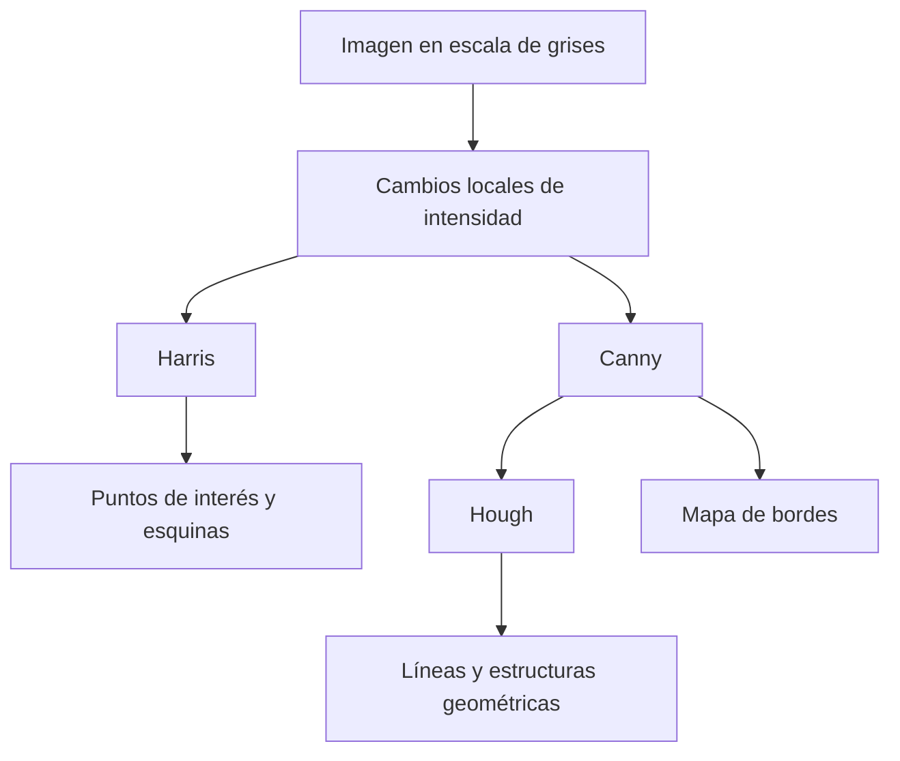
  
Harris utiliza la distribución de los gradientes para detectar esquinas. Canny construye un mapa de bordes a partir del gradiente y su continuidad. Hough utiliza puntos de borde para reconocer estructuras geométricas como líneas.  
  
### Tensor de estructura y detector de Harris:  
  
El detector de **Harris** identifica esquinas analizando cómo cambia la intensidad de una imagen cuando una ventana se desplaza en distintas direcciones.  
  
Una región plana apenas cambia al desplazar la ventana. Un borde produce variaciones importantes principalmente en una dirección, mientras que una esquina genera cambios significativos en dos direcciones independientes.  
  
Para representar este comportamiento se utiliza el **tensor de estructura**:  
  
$$  
M=  
\begin{bmatrix}  
\sum I_x^2 & \sum I_xI_y\\  
\sum I_xI_y & \sum I_y^2  
\end{bmatrix}  
$$  
  
En donde:  
  
- $I_x$ es el gradiente de intensidad en dirección horizontal.  
- $I_y$ es el gradiente en dirección vertical.  
- $\sum I_x^2$ mide la variación horizontal acumulada.  
- $\sum I_y^2$ mide la variación vertical acumulada.  
- $\sum I_xI_y$ representa la relación entre ambos gradientes.  
  
Las sumas se calculan dentro de una ventana local.  
  
Los **eigenvalores** o valores propios de $M$ representan la intensidad de los cambios en las dos direcciones principales de esa ventana.  
  
La interpretación es:  
  
| Eigenvalores | Interpretación |  
|---|---|  
| Ambos pequeños | Región plana |  
| Uno grande y otro pequeño | Borde |  
| Ambos grandes | Esquina |  
  
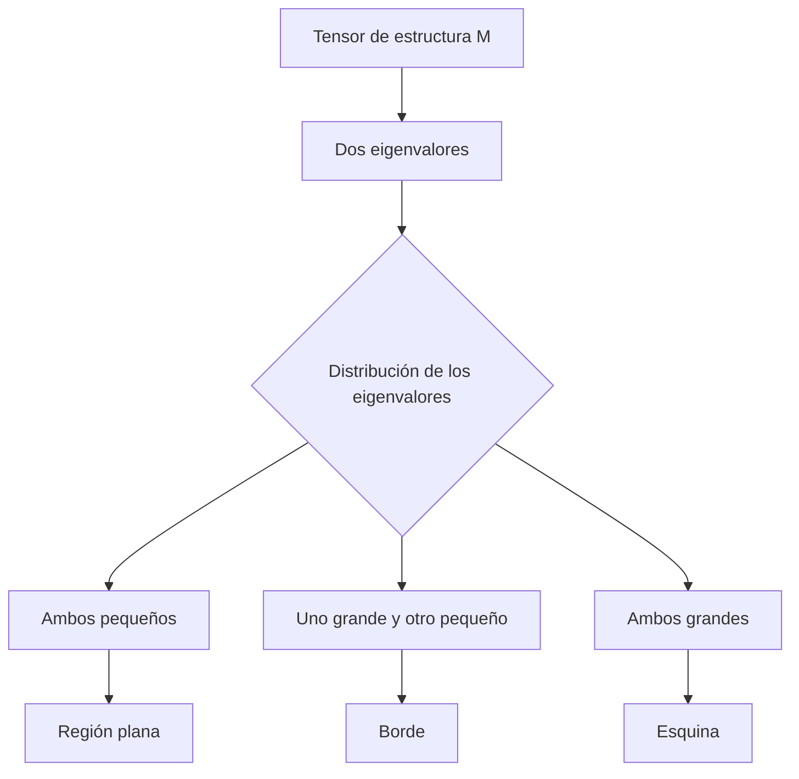
  
La característica importante no es solamente cuánto cambia la imagen, sino **cómo se distribuye ese cambio entre las direcciones principales**.  
  
#### Respuesta de Harris:  
  
En lugar de calcular explícitamente los eigenvalores en cada posición, Harris utiliza:  
  
$$  
R=\det(M)-k[\operatorname{tr}(M)]^2  
$$  
  
En donde:  
  
- $\det(M)$ es el determinante del tensor.  
- $\operatorname{tr}(M)$ es su traza.  
- $k$ es un parámetro de sensibilidad, habitualmente cercano a $0.04$.  
- $R$ es la respuesta de Harris.  
  
Para una matriz:  
  
$$  
M=  
\begin{bmatrix}  
A&C\\  
C&B  
\end{bmatrix}  
$$  
  
se tiene:  
  
$$  
\det(M)=AB-C^2  
$$  
  
$$  
\operatorname{tr}(M)=A+B  
$$  
  
El determinante corresponde al producto de los eigenvalores, mientras que la traza corresponde a su suma.  
  
Por lo tanto, una respuesta positiva elevada favorece regiones donde existen dos cambios importantes, mientras que una respuesta negativa suele asociarse con bordes.  
  
Una respuesta cercana a cero puede indicar una zona plana. Sin embargo, **el signo positivo por sí solo no garantiza que una región sea una esquina importante**, porque también debe considerarse la magnitud de la respuesta.  
  
###### Ejemplo:  
  
Supóngase que se analizan tres ventanas utilizando:  
  
$$  
k=0.04  
$$  
  
Los valores de sus tensores son:  
  
| Ventana | $A$ | $B$ | $C$ |  
|---|---:|---:|---:|  
| W1 | 500 | 20 | 0 |  
| W2 | 300 | 280 | 40 |  
| W3 | 4 | 3 | 1 |  
  
Para W1:  
  
$$  
\det(M)=500(20)-0^2=10000  
$$  
  
$$  
\operatorname{tr}(M)=500+20=520  
$$  
  
Por lo tanto:  
  
$$  
R=10000-0.04(520)^2  
$$  
  
$$  
R=-816  
$$  
  
La respuesta es negativa porque existe una variación dominante en una dirección. W1 corresponde a un **borde**.  
  
Para W2:  
  
$$  
\det(M)=300(280)-40^2=82400  
$$  
  
$$  
\operatorname{tr}(M)=580  
$$  
  
$$  
R=82400-0.04(580)^2  
$$  
  
$$  
R=68944  
$$  
  
La respuesta positiva es muy elevada. W2 corresponde a una **esquina**.  
  
Finalmente, para W3:  
  
$$  
\det(M)=4(3)-1^2=11  
$$  
  
$$  
\operatorname{tr}(M)=7  
$$  
  
$$  
R=11-0.04(7)^2  
$$  
  
$$  
R=9.04  
$$  
  
Aunque esta respuesta también es positiva, su magnitud es extremadamente pequeña en comparación con W2.  
  
Por lo tanto, W3 representa una región prácticamente plana dentro de la escala del problema.  
  
| Ventana | Determinante | Traza | Respuesta $R$ | Clasificación |  
|---|---:|---:|---:|---|  
| W1 | 10000 | 520 | -816 | Borde |  
| W2 | 82400 | 580 | 68944 | Esquina |  
| W3 | 11 | 7 | 9.04 | Plana |  
  
Este ejemplo demuestra por qué no basta con analizar la suma de los gradientes. W1 y W2 presentan trazas relativamente similares, pero sus distribuciones direccionales son completamente diferentes.  
  
### Detector de bordes Canny:  
  
El detector de **Canny** busca producir bordes delgados, bien localizados y relativamente continuos.  
  
Su funcionamiento puede dividirse en cuatro etapas:  
  
1. Suavización de la imagen para reducir ruido.  
2. Cálculo de la magnitud y dirección del gradiente.  
3. Supresión de no máximos.  
4. Doble umbral con histéresis.  
  
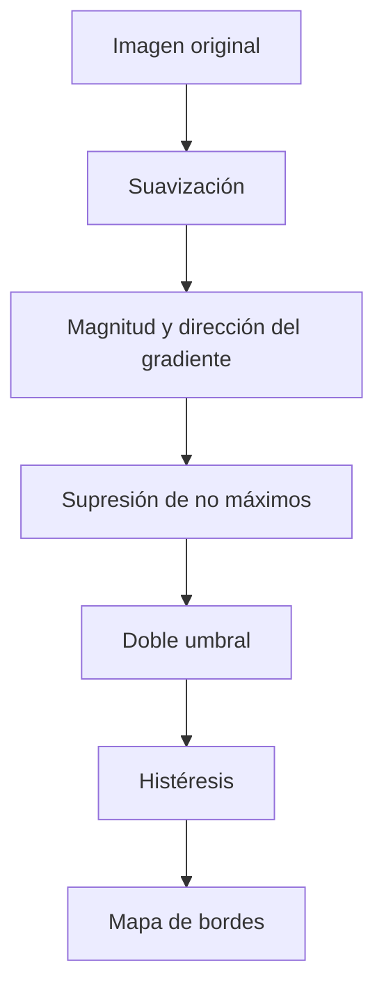
  
#### Gradiente y supresión de no máximos:  
  
El gradiente permite identificar cambios locales de intensidad.  
  
Su magnitud es:  
  
$$  
|\nabla I|=\sqrt{I_x^2+I_y^2}  
$$  
  
En donde $I_x$ e $I_y$ representan las derivadas de intensidad en ambas direcciones.  
  
Una magnitud grande indica una transición importante, aunque no garantiza por sí sola que el píxel corresponda a un borde real.  
  
Posteriormente, la **supresión de no máximos** conserva únicamente los máximos locales de magnitud en la dirección del gradiente.  
  
Esto permite adelgazar las respuestas del detector y aproximar los contornos a líneas de un píxel de grosor.  
  
Sin embargo, esta etapa no determina qué partes débiles de un contorno deben conservarse.  
  
#### Doble umbral e histéresis:  
  
Canny utiliza dos umbrales:  
  
$$  
T_{\text{bajo}}<T_{\text{alto}}  
$$  
  
Los píxeles se clasifican de acuerdo con su magnitud de gradiente:  
  
- **Fuertes:** superan el umbral alto.  
- **Débiles:** se encuentran entre ambos umbrales.  
- **Descartados:** quedan por debajo del umbral bajo.  
  
La histéresis conserva los píxeles débiles únicamente cuando están conectados con un borde fuerte.  
  
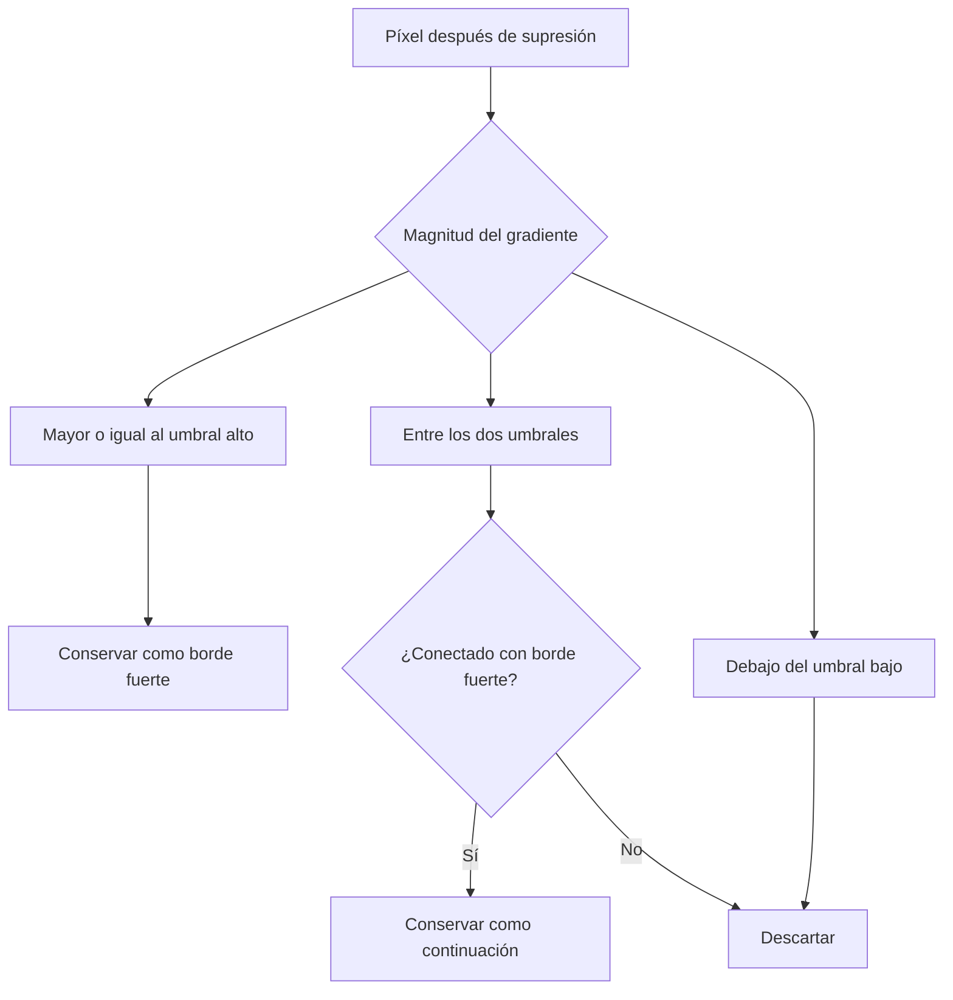
  
###### Ejemplo:  
  
Supóngase que el borde de un objeto presenta diferentes niveles de contraste a lo largo de su recorrido.  
  
Algunas partes tienen un gradiente muy elevado, mientras que otras son más débiles.  
  
Si solamente se utiliza el umbral alto, las partes débiles desaparecen y el contorno queda fragmentado.  
  
En cambio, si solamente se utiliza el umbral bajo, pueden conservarse numerosas respuestas producidas por ruido.  
  
La histéresis permite resolver parcialmente este compromiso: conserva los segmentos débiles que están conectados con bordes confiables.  
  
Por lo tanto, **la supresión de no máximos controla principalmente el grosor del borde, mientras que la histéresis ayuda a conservar su continuidad**.  
  
### Transformada de Hough:  
  
La **transformada de Hough** permite detectar líneas a partir de los píxeles de un mapa de bordes.  
  
Su idea principal consiste en transformar el problema de encontrar puntos alineados en la imagen en un problema de encontrar coincidencias dentro de un espacio de parámetros.  
  
Una recta puede representarse mediante:  
  
$$  
\rho=x\cos\theta+y\sin\theta  
$$  
  
En donde:  
  
- $x$ e $y$ son las coordenadas de un punto de borde.  
- $\rho$ es la distancia firmada de la recta respecto al origen.  
- $\theta$ es el ángulo de la normal a la recta.  
  
Es importante comprender que **$\theta$ representa la orientación de la normal, no directamente la orientación de la recta**.  
  
Cada píxel de borde puede pertenecer a numerosas rectas. Por ello, para cada valor de $\theta$, calcula un valor de $\rho$ y emite un voto en el espacio de parámetros.  
  
Cuando varios puntos pertenecen a una misma recta, sus votos coinciden en una posición $(\rho,\theta)$.  
  
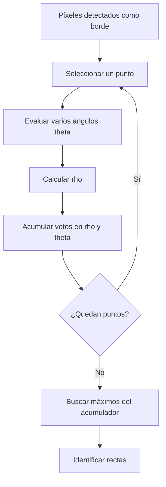
  
###### Ejemplo:  
  
Considérense tres puntos:  
  
$$  
P_1=(1,2)  
$$  
  
$$  
P_2=(3,2)  
$$  
  
$$  
P_3=(5,2)  
$$  
  
Se desea calcular su representación de Hough para cuatro ángulos:  
  
$$  
\theta\in\{0^\circ,45^\circ,90^\circ,135^\circ\}  
$$  
  
Utilizando la ecuación de la recta se obtiene:  
  
| $\theta$ | $(1,2)$ | $(3,2)$ | $(5,2)$ |  
|---|---:|---:|---:|  
| $0^\circ$ | 1.00 | 3.00 | 5.00 |  
| $45^\circ$ | 2.12 | 3.54 | 4.95 |  
| $90^\circ$ | 2.00 | 2.00 | 2.00 |  
| $135^\circ$ | 0.71 | -0.71 | -2.12 |  
  
Cuando:  
  
$$  
\theta=90^\circ  
$$  
  
se cumple:  
  
$$  
\cos90^\circ=0  
$$  
  
$$  
\sin90^\circ=1  
$$  
  
Por lo tanto:  
  
$$  
\rho=y  
$$  
  
Los tres puntos producen:  
  
$$  
\rho=2  
$$  
  
Así, el acumulador presenta un máximo en:  
  
$$  
(\rho,\theta)=(2,90^\circ)  
$$  
  
La recta correspondiente es:  
  
$$  
y=2  
$$  
  
Se trata de una recta **horizontal**, porque su vector normal apunta en dirección vertical.  
  
Este ejemplo muestra por qué no debe interpretarse un ángulo de $90^\circ$ como una recta vertical.  
  
---  
  
## Segmentación y análisis de regiones  
  
La **segmentación** busca dividir una imagen en regiones que representen objetos o estructuras de interés.  
  
Una vez obtenida una máscara, pueden analizarse sus componentes conectadas, contornos y coincidencia con una segmentación verdadera.  
  
A diferencia de la detección de bordes, que identifica principalmente transiciones de intensidad, la segmentación intenta determinar qué píxeles pertenecen a cada región.  
  
### Conectividad de cuatro y ocho vecinos:  
  
La **conectividad** establece cuándo dos píxeles activos pueden considerarse parte de un mismo objeto.  
  
En conectividad 4 solamente se aceptan vecinos que comparten un lado.  
  
$$  
N_4=  
\begin{bmatrix}  
0&1&0\\  
1&1&1\\  
0&1&0  
\end{bmatrix}  
$$  
  
En conectividad 8 también se aceptan vecinos diagonales.  
  
$$  
N_8=  
\begin{bmatrix}  
1&1&1\\  
1&1&1\\  
1&1&1  
\end{bmatrix}  
$$  
  
Una **componente conectada** es un conjunto de píxeles en el que existe un recorrido entre sus elementos siguiendo la regla de conectividad.  
  
###### Ejemplo:  
  
Considérese la máscara:  
  
$$  
A=  
\begin{bmatrix}  
1&0&0&1&1\\  
0&1&0&0&1\\  
0&1&0&1&0\\  
1&0&0&1&0\\  
1&1&0&0&1  
\end{bmatrix}  
$$  
  
Si se utiliza conectividad 4, algunos píxeles que solamente se tocan por una esquina permanecen separados.  
  
El resultado contiene:  
  
$$  
N_4=6  
$$  
  
Con conectividad 8, varias regiones se unen mediante contactos diagonales.  
  
El resultado contiene:  
  
$$  
N_8=2  
$$  
  
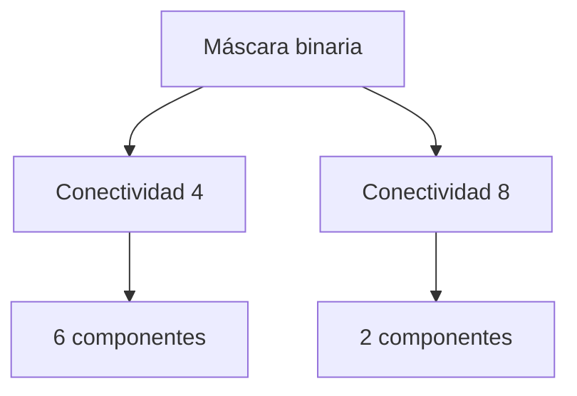
  
Una propiedad importante es:  
  
$$  
N_8\leq N_4  
$$  
  
Esto ocurre porque la conectividad 8 acepta todas las conexiones permitidas por la conectividad 4 y añade las diagonales.  
  
Por lo tanto, al cambiar de conectividad 4 a conectividad 8, las componentes pueden unirse, pero no dividirse en un número mayor de objetos.  
  
### Código de cadena de Freeman:  
  
El **código de cadena de Freeman** representa un contorno mediante una secuencia de direcciones.  
  
En su versión de ocho direcciones, cada desplazamiento recibe un número:  
  
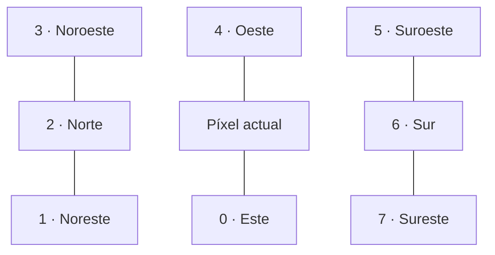
  
La convención utilizada corresponde a coordenadas de renglón y columna, donde los renglones aumentan hacia abajo.  
  
Los desplazamientos son:  
  
| Código | Dirección | Desplazamiento $(\Delta r,\Delta c)$ |  
|---|---|---|  
| 0 | Este | $(0,1)$ |  
| 1 | Noreste | $(-1,1)$ |  
| 2 | Norte | $(-1,0)$ |  
| 3 | Noroeste | $(-1,-1)$ |  
| 4 | Oeste | $(0,-1)$ |  
| 5 | Suroeste | $(1,-1)$ |  
| 6 | Sur | $(1,0)$ |  
| 7 | Sureste | $(1,1)$ |  
  
Las direcciones pares representan desplazamientos horizontales o verticales de longitud $1$.  
  
Las direcciones impares representan desplazamientos diagonales de longitud:  
  
$$  
\sqrt{2}  
$$  
  
Por lo tanto, el perímetro aproximado de un contorno digital puede calcularse como:  
  
$$  
P=n_p+n_i\sqrt{2}  
$$  
  
En donde:  
  
- $n_p$ es el número de desplazamientos pares.  
- $n_i$ es el número de desplazamientos impares.  
  
###### Ejemplo:  
  
Supóngase que un contorno inicia en:  
  
$$  
(0,0)  
$$  
  
Y utiliza el código:  
  
$$  
0,\ 0,\ 7,\ 5,\ 4,\ 4,\ 2,\ 2  
$$  
  
Las posiciones recorridas son:  
  
$$  
(0,0)\rightarrow(0,1)\rightarrow(0,2)  
$$  
  
$$  
\rightarrow(1,3)\rightarrow(2,2)\rightarrow(2,1)  
$$  
  
$$  
\rightarrow(2,0)\rightarrow(1,0)\rightarrow(0,0)  
$$  
  
El recorrido regresa a su posición inicial, por lo que el contorno está cerrado.  
  
La secuencia contiene seis movimientos pares y dos diagonales.  
  
Entonces:  
  
$$  
P=6+2\sqrt{2}  
$$  
  
$$  
P\approx8.828  
$$  
  
El código de Freeman permite representar la geometría de un contorno mediante una secuencia compacta de movimientos.  
  
### Intersection over Union y Dice:  
  
Para evaluar una segmentación se comparan dos conjuntos:  
  
- $A$: máscara predicha.  
- $G$: máscara verdadera.  
  
La métrica **Intersection over Union (IoU)** se define como:  
  
$$  
IoU(A,G)=\frac{|A\cap G|}{|A\cup G|}  
$$  
  
La intersección representa los píxeles compartidos por ambas máscaras, mientras que la unión contiene todos los píxeles presentes en alguna de ellas.  
  
El **coeficiente Dice** se define mediante:  
  
$$  
Dice(A,G)=\frac{2|A\cap G|}{|A|+|G|}  
$$  
  
Ambas métricas miden la coincidencia espacial de las máscaras.  
  
###### Ejemplo:  
  
Supóngase que:  
  
$$  
|A|=20  
$$  
  
$$  
|G|=16  
$$  
  
$$  
|A\cap G|=14  
$$  
  
Primero se calcula la unión:  
  
$$  
|A\cup G|=20+16-14  
$$  
  
$$  
|A\cup G|=22  
$$  
  
Por lo tanto:  
  
$$  
IoU=\frac{14}{22}  
$$  
  
$$  
IoU\approx0.636  
$$  
  
Mientras que:  
  
$$  
Dice=\frac{2(14)}{20+16}  
$$  
  
$$  
Dice=\frac{28}{36}  
$$  
  
$$  
Dice\approx0.778  
$$  
  
La relación matemática entre ambas métricas es:  
  
$$  
Dice=\frac{2IoU}{1+IoU}  
$$  
  
Por ejemplo, cuando:  
  
$$  
IoU=0.60  
$$  
  
se obtiene:  
  
$$  
Dice=\frac{2(0.60)}{1+0.60}  
$$  
  
$$  
Dice=0.75  
$$  
  
Para una misma máscara, Dice siempre es mayor o igual que IoU. Ambos coinciden cuando la coincidencia es nula o perfecta.  
  
Esto no significa que una métrica sea universalmente mejor.  
  
IoU presenta una escala más estricta, lo que puede facilitar la interpretación de errores geométricos en objetos pequeños. Sin embargo, ambas contienen la misma información de coincidencia cuando se calculan sobre los mismos conjuntos.  
  
**La comparación entre métodos debe utilizar una métrica consistente**, porque cambiar entre IoU y Dice puede producir diferencias numéricas que no representan una mejora real.  
  
---  
  
## Crecimiento de regiones  
  
El **crecimiento de regiones** es un método de segmentación que parte de uno o varios píxeles iniciales llamados **semillas**.  
  
A partir de estas posiciones, el algoritmo examina píxeles vecinos y los incorpora cuando cumplen una condición de similitud.  
  
Una regla sencilla consiste en comparar la intensidad de cada candidato contra la intensidad de la semilla:  
  
$$  
|I(p)-I(s)|\leq tol  
$$  
  
En donde:  
  
- $I(p)$ es la intensidad del píxel candidato.  
- $I(s)$ es la intensidad de la semilla.  
- $tol$ es la tolerancia permitida.  
  
La región se expande mientras existan píxeles vecinos que satisfagan la condición.  
  
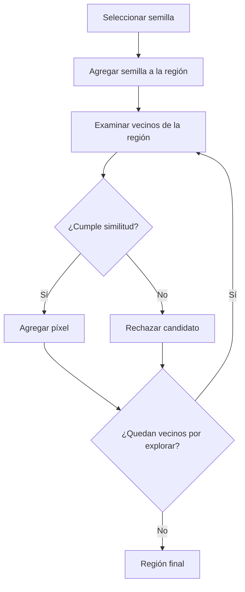
  
### Importancia de la conectividad:  
  
El crecimiento puede utilizar conectividad 4 u 8.  
  
Con conectividad 4, solamente se examinan vecinos laterales.  
  
Con conectividad 8 también pueden incorporarse píxeles que se encuentran en diagonal.  
  
Esto modifica las regiones alcanzables y, por lo tanto, puede cambiar el resultado de la segmentación.  
  
### Importancia de la tolerancia:  
  
Un valor pequeño de $tol$ solamente acepta intensidades muy cercanas a la semilla.  
  
Esto puede producir regiones demasiado pequeñas.  
  
Un valor grande permite incorporar una mayor variedad de intensidades, pero aumenta el riesgo de que la región se extienda hacia el fondo u otros objetos.  
  
###### Ejemplo:  
  
Considérese la siguiente imagen:  
  
$$  
I=  
\begin{bmatrix}  
90&88&140&138&136\\  
117&120&126&131&139\\  
84&118&124&129&85\\  
87&122&121&112&82\\  
80&128&119&89&81  
\end{bmatrix}  
$$  
  
La semilla se encuentra en:  
  
$$  
s=(2,2)  
$$  
  
Con intensidad:  
  
$$  
I(s)=124  
$$  
  
Se utiliza conectividad 4 y se comparan los candidatos contra la intensidad original de la semilla.  
  
#### Tolerancia igual a 8:  
  
La condición de aceptación es:  
  
$$  
|I(p)-124|\leq8  
$$  
  
Por lo tanto, se aceptan intensidades comprendidas entre:  
  
$$  
116\leq I(p)\leq132  
$$  
  
El crecimiento incorpora progresivamente los vecinos que cumplen la condición.  
  
El resultado contiene:  
  
$$  
11\text{ píxeles}  
$$  
  
#### Tolerancia igual a 16:  
  
Ahora la condición es:  
  
$$  
|I(p)-124|\leq16  
$$  
  
El intervalo se amplía:  
  
$$  
108\leq I(p)\leq140  
$$  
  
La región puede alcanzar nuevos píxeles, incluidos algunos pertenecientes a una zona más clara.  
  
El resultado contiene:  
  
$$  
16\text{ píxeles}  
$$  
  
De ellos, cuatro corresponden a la esquina clara de intensidades comprendidas entre 136 y 140.  
  
### El problema de las conexiones débiles:  
  
El crecimiento de regiones depende simultáneamente de la similitud y de la conectividad.  
  
Supóngase que una región contiene numerosos píxeles similares a la semilla y que existe un camino de píxeles aceptables hacia otra zona.  
  
Aunque esa segunda zona represente un objeto diferente, puede incorporarse si existe una conexión que satisface la tolerancia.  
  
Esto significa que el algoritmo no evalúa necesariamente la apariencia global de cada objeto.  
  
En la regla anterior, cada candidato se compara con la semilla y se incorpora si existe un recorrido conectado de píxeles aceptables.  
  
Por lo tanto, **una conexión local puede permitir que la región crezca hacia una estructura que no debería pertenecer al mismo objeto**.  
  
---  
  
## Umbralización de imágenes  
  
La **umbralización** es una técnica de segmentación que clasifica píxeles según sus intensidades.  
  
En su forma más sencilla, utiliza un valor $T$ para separar dos clases.  
  
Por ejemplo, cuando el objeto es más oscuro que el fondo:  
  
$$  
B(x,y)=  
\begin{cases}  
1,&I(x,y)<T\\  
0,&I(x,y)\geq T  
\end{cases}  
$$  
  
En cambio, cuando el objeto es más claro, puede invertirse la comparación.  
  
La selección del umbral es fundamental porque determina qué intensidades pertenecen a cada región.  
  
### Umbral global y umbral local:  
  
Un **umbral global** utiliza el mismo valor $T$ para toda la imagen.  
  
Esto puede funcionar correctamente cuando los objetos y el fondo presentan intensidades claramente separadas.  
  
Sin embargo, puede fallar cuando existe iluminación no uniforme.  
  
El **umbral local o adaptativo** calcula un valor diferente para cada posición utilizando estadísticas de una vecindad.  
  
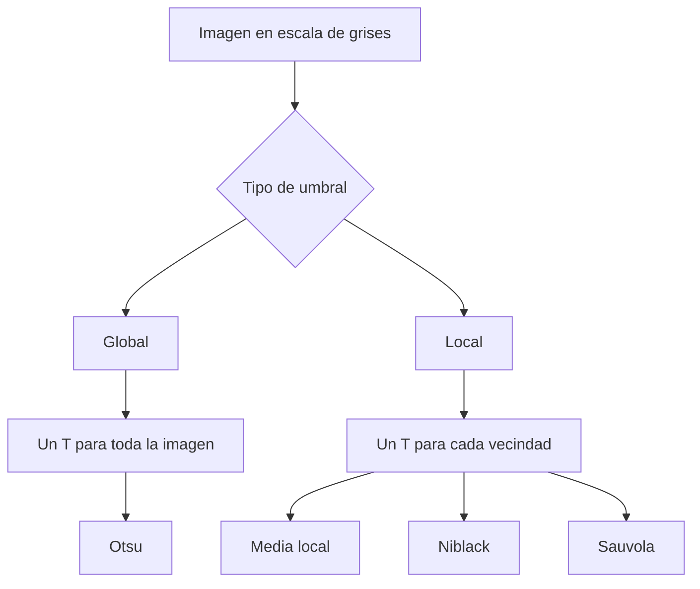
  
La diferencia principal consiste en la información utilizada para establecer el umbral.  
  
Los métodos globales analizan la distribución general de intensidades, mientras que los locales intentan adaptarse a cambios espaciales de iluminación.  
  
---  
  
## Método de Otsu  
  
El método de **Otsu** selecciona automáticamente un umbral global a partir del histograma de la imagen.  
  
Su objetivo consiste en encontrar una partición que separe lo mejor posible dos grupos de intensidades.  
  
La idea es maximizar la **varianza entre clases**.  
  
### Separación del histograma:  
  
Supóngase que el histograma contiene diferentes niveles de gris.  
  
Para un umbral $t$, las intensidades se dividen en dos clases:  
  
- Clase oscura: niveles menores que $t$.  
- Clase clara: niveles mayores o iguales que $t$.  
  
Cada clase tiene un peso estadístico y una media.  
  
Los pesos son:  
  
$$  
\omega_0=\frac{N_0}{N}  
$$  
  
$$  
\omega_1=\frac{N_1}{N}  
$$  
  
En donde:  
  
- $N_0$ es el número de píxeles de la clase oscura.  
- $N_1$ es el número de píxeles de la clase clara.  
- $N$ es el número total de píxeles.  
  
Las medias de ambas clases se representan mediante:  
  
$$  
\mu_0,\quad\mu_1  
$$  
  
### Varianza entre clases:  
  
Otsu calcula:  
  
$$  
\sigma_B^2=\omega_0\omega_1(\mu_0-\mu_1)^2  
$$  
  
El método selecciona el umbral que maximiza esta expresión.  
  
Esto favorece particiones donde las medias de ambas clases están alejadas y los pesos permiten una separación estadística importante.  
  
Sin embargo, un valor máximo de varianza entre clases no garantiza que la partición corresponda exactamente al objeto de interés.  
  
###### Ejemplo:  
  
Considérese un histograma con ocho niveles:  
  
| Nivel | 0 | 1 | 2 | 3 | 4 | 5 | 6 | 7 |  
|---|---:|---:|---:|---:|---:|---:|---:|---:|  
| Frecuencia | 4 | 5 | 2 | 1 | 1 | 1 | 4 | 2 |  
  
La imagen contiene:  
  
$$  
N=20  
$$  
  
píxeles.  
  
La media global es:  
  
$$  
\mu_G=2.95  
$$  
  
Se comparan dos posibles umbrales.  
  
#### Umbral igual a 3:  
  
La clase oscura contiene niveles 0, 1 y 2.  
  
Sus pesos y medias son:  
  
$$  
\omega_0=0.55  
$$  
  
$$  
\omega_1=0.45  
$$  
  
$$  
\mu_0\approx0.818  
$$  
  
$$  
\mu_1\approx5.556  
$$  
  
La varianza entre clases es:  
  
$$  
\sigma_B^2  
=  
0.55(0.45)(0.818-5.556)^2  
$$  
  
$$  
\sigma_B^2\approx5.555  
$$  
  
#### Umbral igual a 4:  
  
La clase oscura incluye ahora los niveles 0 a 3.  
  
Se obtiene:  
  
$$  
\omega_0=0.60  
$$  
  
$$  
\omega_1=0.40  
$$  
  
$$  
\mu_0=1  
$$  
  
$$  
\mu_1=5.875  
$$  
  
Por lo tanto:  
  
$$  
\sigma_B^2  
=  
0.60(0.40)(1-5.875)^2  
$$  
  
$$  
\sigma_B^2\approx5.704  
$$  
  
Como:  
  
$$  
5.704>5.555  
$$  
  
el umbral $t=4$ produce una mayor separación entre clases que $t=3$.  
  
En este histograma también corresponde al máximo al considerar los demás cortes posibles.  
  
### Coeficiente de separabilidad:  
  
La calidad de la separación puede describirse mediante:  
  
$$  
\eta=\frac{\sigma_B^2}{\sigma_G^2}  
$$  
  
En donde:  
  
- $\sigma_B^2$ es la varianza entre clases.  
- $\sigma_G^2$ es la varianza global.  
  
Para el ejemplo:  
  
$$  
\sigma_G^2=6.5475  
$$  
  
Entonces:  
  
$$  
\eta=\frac{5.704}{6.5475}  
$$  
  
$$  
\eta\approx0.871  
$$  
  
El valor representa la proporción de variabilidad total explicada por la separación entre las dos clases.  
  
Una separabilidad elevada indica que la partición distingue grupos estadísticamente diferenciados.  
  
Sin embargo, no implica necesariamente que esos grupos coincidan con el objeto y el fondo que se desean segmentar.  
  
### Umbralización iterativa:  
  
Otra estrategia consiste en seleccionar un umbral inicial y actualizarlo utilizando las medias de las clases obtenidas.  
  
Una regla habitual es:  
  
$$  
T_{\text{nuevo}}=\frac{\mu_0+\mu_1}{2}  
$$  
  
El procedimiento se repite hasta que la partición deja de cambiar o se cumple una condición de convergencia.  
  
En el histograma anterior, comenzando desde la media global:  
  
$$  
T_0=2.95  
$$  
  
El umbral se actualiza aproximadamente como:  
  
$$  
2.95\rightarrow3.19\rightarrow3.44  
$$  
  
La partición termina separando los niveles 0 a 3 de los niveles 4 a 7.  
  
Esta partición coincide con la seleccionada por Otsu en el ejemplo, aunque ambos métodos no necesariamente producen el mismo resultado para cualquier histograma.  
  
---  
  
## Limitaciones de Otsu  
  
Otsu funciona especialmente bien cuando el histograma contiene dos grupos de intensidades suficientemente diferenciados.  
  
Sin embargo, puede fallar cuando el objeto ocupa una proporción muy pequeña de la imagen.  
  
### Objetos pequeños y desequilibrio de clases:  
  
Supóngase que una imagen contiene un objeto claro sobre un fondo oscuro.  
  
Si el objeto ocupa una proporción considerable de la imagen, el histograma puede presentar dos agrupaciones:  
  
- Una correspondiente al fondo.  
- Otra correspondiente al objeto.  
  
Ahora bien, si el objeto ocupa solamente el $1\%$ de los píxeles, su contribución al histograma puede ser demasiado pequeña para formar un grupo claramente distinguible.  
  
En ese caso, Otsu puede encontrar una mayor varianza entre clases dividiendo el ruido del fondo en lugar de separar el objeto.  
  
Esto provoca que el umbral se sitúe dentro de la distribución del fondo.  
  
### Selección de píxeles de borde:  
  
Una alternativa consiste en construir el histograma utilizando únicamente píxeles cercanos a bordes importantes.  
  
La idea es que, cerca de la frontera entre un objeto y el fondo, pueden encontrarse intensidades representativas de ambas regiones.  
  
Así, el histograma utilizado para calcular el umbral deja de estar dominado por la enorme cantidad de píxeles del fondo.  
  
En un ejemplo con un objeto muy pequeño se obtienen:  
  
| Estrategia | IoU |  
|---|---:|  
| Otsu con todos los píxeles | 0.029 |  
| Otsu utilizando píxeles de borde | 0.844 |  
  
La diferencia es considerable.  
  
El primer procedimiento divide principalmente el fondo, mientras que el segundo produce un umbral más representativo de la separación entre objeto y fondo.  
  
No obstante, este resultado depende de que los bordes seleccionados correspondan a las transiciones relevantes. Si predominan bordes producidos por ruido u otras estructuras, la estrategia también puede fallar.  
  
### Separabilidad y calidad de segmentación:  
  
Una idea importante es que:  
  
$$  
\eta\text{ elevado}\not\Rightarrow IoU\text{ elevado}  
$$  
  
La separabilidad evalúa una propiedad del histograma.  
  
El IoU evalúa la coincidencia geométrica entre una segmentación y su verdad.  
  
Por lo tanto, ambas métricas describen propiedades diferentes.  
  
---  
  
## Umbralización adaptativa  
  
La umbralización adaptativa utiliza estadísticas locales para calcular el umbral de cada píxel.  
  
Una regla sencilla para detectar objetos claros consiste en:  
  
$$  
I(x,y)>\mu_{\text{local}}(x,y)+C  
$$  
  
En donde:  
  
- $I(x,y)$ es la intensidad del píxel.  
- $\mu_{\text{local}}(x,y)$ es la media de su vecindad.  
- $C$ es una constante de separación.  
  
Esta estrategia puede adaptarse a variaciones de iluminación porque el umbral cambia junto con la intensidad del fondo.  
  
### El problema del tamaño de la ventana:  
  
Supóngase que una imagen presenta un fondo cuya intensidad aumenta gradualmente de izquierda a derecha.  
  
Sobre ese fondo aparecen dos células más claras que su entorno.  
  
Si se utiliza una ventana suficientemente grande, la media local incluye tanto píxeles del objeto como del fondo.  
  
Esto permite que el píxel central del objeto sea significativamente más claro que la media.  
  
Sin embargo, si la ventana es más pequeña que el objeto, puede quedar completamente dentro de él.  
  
En ese caso:  
  
$$  
I(x,y)\approx\mu_{\text{local}}(x,y)  
$$  
  
La condición:  
  
$$  
I(x,y)>\mu_{\text{local}}(x,y)+C  
$$  
  
deja de cumplirse cuando $C$ es positivo.  
  
Por lo tanto, el interior del objeto puede clasificarse como fondo.  
  
###### Ejemplo:  
  
Considérese una imagen con dos células de 24 y 40 píxeles de ancho, ambas 70 niveles por encima de su fondo local.  
  
Con una ventana de 61 píxeles, la segmentación puede identificar correctamente ambas regiones.  
  
Si la ventana se reduce a 11 píxeles, el interior de cada célula deja de superar su umbral local.  
  
El resultado conserva principalmente los bordes y produce objetos huecos.  
  
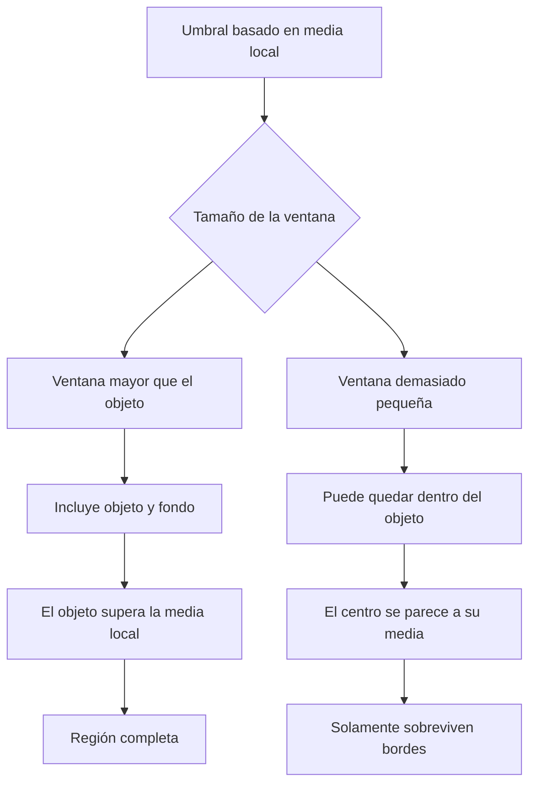
  
Esto demuestra que una estrategia local no es automáticamente superior a una global.  
  
**La ventana debe tener una escala adecuada respecto a los objetos que se desean segmentar.**  
  
---  
  
## Niblack y Sauvola  
  
Los métodos de **Niblack** y **Sauvola** utilizan la media y la desviación estándar locales para calcular umbrales adaptativos.  
  
Ambos son especialmente relevantes en imágenes de documentos y regiones donde aparecen trazos oscuros sobre fondos claros.  
  
La diferencia principal se encuentra en cómo combinan estas estadísticas.  
  
### Método de Niblack:  
  
Una formulación es:  
  
$$  
T_N=m+ks  
$$  
  
En donde:  
  
- $m$ es la media local.  
- $s$ es la desviación estándar local.  
- $k$ controla la influencia de la variabilidad.  
  
Para detectar tinta oscura puede utilizarse:  
  
$$  
k=-0.2  
$$  
  
Por lo tanto:  
  
$$  
T_N=m-0.2s  
$$  
  
El método establece un umbral ligeramente por debajo de la media.  
  
#### Problema en regiones uniformes:  
  
Cuando una región tiene muy poca variabilidad:  
  
$$  
s\approx0  
$$  
  
Entonces:  
  
$$  
T_N\approx m  
$$  
  
Esto significa que pequeñas variaciones de ruido alrededor de la media pueden quedar por debajo del umbral y clasificarse incorrectamente como tinta.  
  
Por lo tanto, Niblack puede producir manchas en regiones de papel aparentemente blanco.  
  
### Método de Sauvola:  
  
Sauvola utiliza:  
  
$$  
T_S=m\left[1+k\left(\frac{s}{R}-1\right)\right]  
$$  
  
En donde:  
  
- $m$ es la media local.  
- $s$ es la desviación estándar local.  
- $k$ controla el ajuste.  
- $R$ es una escala de referencia para la desviación estándar.  
  
En los ejemplos se utilizan:  
  
$$  
k=0.5  
$$  
  
$$  
R=128  
$$  
  
Cuando la desviación local es pequeña, el factor multiplicativo puede reducir considerablemente el umbral.  
  
Esto permite evitar que pequeñas fluctuaciones del fondo se clasifiquen como tinta.  
  
Sin embargo, también puede provocar que un trazo demasiado tenue deje de detectarse.  
  
###### Ejemplo práctico:  
  
Considérese una ventana de $5\times5$ que contiene papel claro y un trazo de lápiz tenue.  
  
Sus estadísticas son:  
  
$$  
m=170  
$$  
  
$$  
s=20  
$$  
  
El trazo tiene intensidad:  
  
$$  
I_{\text{trazo}}=130  
$$  
  
#### Umbral de Niblack:  
  
$$  
T_N=170-0.2(20)  
$$  
  
$$  
T_N=166  
$$  
  
Como el trazo es más oscuro que el umbral:  
  
$$  
130<166  
$$  
  
se clasifica como tinta.  
  
#### Umbral de Sauvola:  
  
$$  
T_S=  
170\left[  
1+0.5\left(\frac{20}{128}-1\right)  
\right]  
$$  
  
$$  
T_S\approx98.28  
$$  
  
Ahora:  
  
$$  
130>98.28  
$$  
  
Por lo tanto, el trazo no cumple la condición para clasificarse como tinta oscura.  
  
En este ejemplo, Sauvola pierde el trazo.  
  
### Comparación de situaciones:  
  
| Situación | Niblack | Sauvola |  
|---|---|---|  
| Papel casi uniforme | Puede detectar ruido como tinta | Tiende a mantener el fondo limpio |  
| Trazo tenue | Puede conservarlo | Puede perderlo |  
| Tinta oscura de alto contraste | Puede detectarla | Puede detectarla |  
| Variación local pequeña | Umbral próximo a la media | Umbral considerablemente reducido |  
  
La diferencia no significa que uno de los métodos sea siempre superior.  
  
Niblack puede conservar estructuras débiles a costa de producir más falsos positivos.  
  
Sauvola puede limpiar mejor el fondo a costa de perder estructuras de contraste reducido.  
  
### Relación entre contraste y errores:  
  
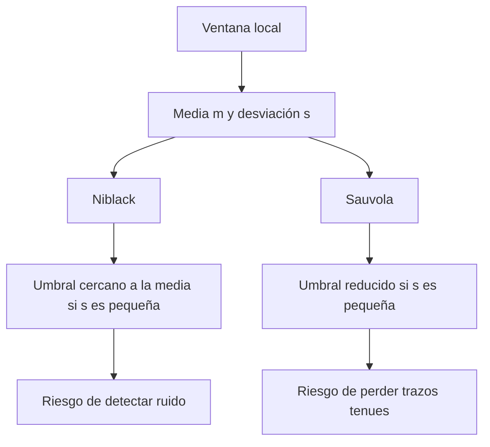
  
La elección del método depende de qué tipo de error resulta más importante evitar.  
  
---  
  
## Análisis de texturas  
  
La **textura** describe patrones espaciales producidos por la distribución de intensidades dentro de una imagen.  
  
Dos regiones pueden contener exactamente las mismas cantidades de píxeles oscuros y claros, pero presentar estructuras completamente diferentes.  
  
Por ejemplo, una región puede contener franjas verticales y otra puede contener los mismos valores distribuidos aleatoriamente.  
  
Aunque sus histogramas sean iguales, sus texturas son diferentes.  
  
Esto permite distinguir dos tipos de información:  
  
- **Estadísticas de primer orden:** describen la distribución de intensidades sin considerar las posiciones.  
- **Estadísticas espaciales:** describen relaciones entre píxeles cercanos o patrones locales.  
  
### Limitaciones del histograma:  
  
El histograma indica cuántos píxeles existen de cada intensidad.  
  
A partir de él pueden calcularse estadísticas como:  
  
- Media.  
- Varianza.  
- Entropía.  
- Uniformidad.  
  
Sin embargo, no conserva la posición espacial de los píxeles.  
  
Supóngase que una imagen contiene franjas verticales y que sus píxeles se mezclan aleatoriamente.  
  
Después de mezclar:  
  
- El histograma permanece igual.  
- La media permanece igual.  
- La varianza permanece igual.  
- Las relaciones entre vecinos cambian.  
- La estructura de las franjas desaparece.  
  
Por lo tanto, el histograma no puede describir por sí solo la organización espacial de una textura.  
  
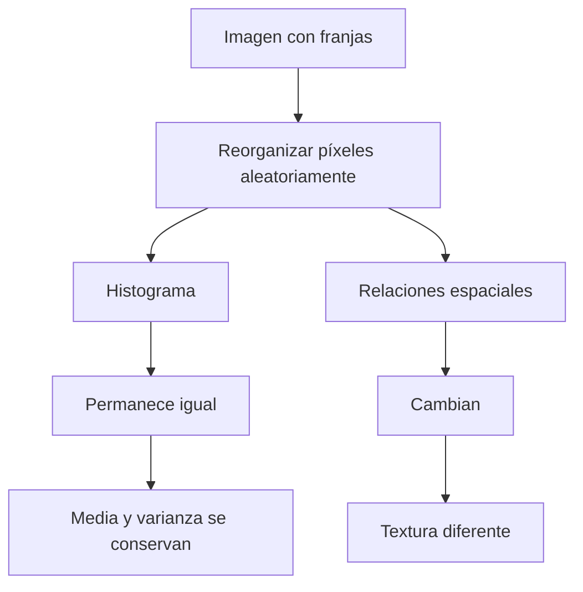
  
Para estudiar estas relaciones se utilizan descriptores como GLCM y LBP.  
  
---  
  
## Gray-Level Co-occurrence Matrix  
  
La **matriz de coocurrencia de niveles de gris**, conocida como GLCM, describe cuántas veces aparece una combinación de intensidades entre dos píxeles separados por un desplazamiento determinado.  
  
Supóngase que se selecciona un píxel con intensidad $i$ y un vecino con intensidad $j$.  
  
La GLCM registra cuántas veces aparece esa pareja.  
  
Su comportamiento depende de:  
  
- Los niveles de gris disponibles.  
- La distancia entre los píxeles.  
- La dirección del desplazamiento.  
- La normalización de la matriz.  
  
### Construcción de la GLCM:  
  
Considérese una imagen con cuatro niveles:  
  
$$  
\{0,1,2,3\}  
$$  
  
La GLCM tendrá tamaño:  
  
$$  
4\times4  
$$  
  
Cada posición $(i,j)$ cuenta cuántas veces un píxel de intensidad $i$ tiene un vecino de intensidad $j$ según el desplazamiento establecido.  
  
Después de contar las parejas, la matriz puede normalizarse:  
  
$$  
p(i,j)=\frac{C(i,j)}{\sum_{i,j}C(i,j)}  
$$  
  
En donde:  
  
- $C(i,j)$ es el número de parejas observadas.  
- $p(i,j)$ es su frecuencia relativa.  
  
La suma de todas las entradas normalizadas es:  
  
$$  
\sum_{i,j}p(i,j)=1  
$$  
  
### Importancia de la dirección:  
  
La GLCM puede construirse utilizando diferentes desplazamientos.  
  
Por ejemplo:  
  
- $(0,1)$: vecino de la derecha.  
- $(1,0)$: vecino inferior.  
- $(1,-1)$: vecino inferior izquierdo.  
- $(1,1)$: vecino inferior derecho.  
  
Una textura con franjas puede tener valores similares a lo largo de una dirección y cambios importantes en otra.  
  
Por lo tanto, la GLCM permite reconocer **direccionalidad o anisotropía de la textura**.  
  
### Medidas obtenidas mediante GLCM:  
  
#### Contraste:  
  
El contraste mide cuánto difieren las intensidades de los píxeles vecinos.  
  
$$  
Contraste=\sum_{i,j}(i-j)^2p(i,j)  
$$  
  
Cuando las intensidades son similares, las diferencias son pequeñas.  
  
Cuando aparecen parejas con intensidades muy diferentes, el contraste aumenta.  
  
#### Energía:  
  
La energía utilizada en estos ejemplos es:  
  
$$  
Energía=\sum_{i,j}p(i,j)^2  
$$  
  
Una matriz concentrada en pocas combinaciones presenta mayor energía.  
  
Una distribución más dispersa presenta menor energía.  
  
#### Homogeneidad:  
  
La homogeneidad mide qué tan cerca se concentran las parejas de la diagonal principal.  
  
$$  
Homogeneidad=  
\sum_{i,j}\frac{p(i,j)}{1+|i-j|}  
$$  
  
Cuando los vecinos tienen la misma intensidad:  
  
$$  
i=j  
$$  
  
el denominador vale $1$, por lo que la contribución es máxima.  
  
Por lo tanto, una matriz concentrada sobre su diagonal presenta homogeneidad elevada.  
  
#### Correlación:  
  
La correlación describe la relación estadística entre las intensidades de ambos píxeles.  
  
Una formulación es:  
  
$$  
Correlación=  
\sum_{i,j}  
\frac{(i-\mu_i)(j-\mu_j)p(i,j)}  
{\sigma_i\sigma_j}  
$$  
  
En donde $\mu_i$, $\mu_j$, $\sigma_i$ y $\sigma_j$ corresponden a las medias y desviaciones estándar marginales.  
  
Esta medida permite estudiar la dependencia entre las intensidades de las parejas.  
  
Debe considerarse que la correlación requiere un tratamiento especial cuando alguna desviación estándar es cero.  
  
###### Ejemplo:  
  
Considérese el parche:  
  
$$  
I=  
\begin{bmatrix}  
0&1&2&3\\  
1&2&3&0\\  
2&3&0&1\\  
3&0&1&2  
\end{bmatrix}  
$$  
  
Se utilizan cuatro niveles de gris y se construyen dos GLCM sin simetrizar.  
  
#### Desplazamiento horizontal $(0,1)$:  
  
Cada píxel se compara con su vecino derecho.  
  
Como existen cuatro renglones y tres parejas por renglón:  
  
$$  
N=12  
$$  
  
Las parejas son:  
  
$$  
(0,1),(1,2),(2,3),(3,0)  
$$  
  
Cada tipo aparece tres veces.  
  
Por lo tanto, las cuatro probabilidades no nulas son:  
  
$$  
p(i,j)=\frac{3}{12}=0.25  
$$  
  
El contraste es:  
  
$$  
Contraste=  
\frac{9(1)^2+3(3)^2}{12}  
$$  
  
$$  
Contraste=3  
$$  
  
La energía es:  
  
$$  
Energía=4(0.25)^2  
$$  
  
$$  
Energía=0.25  
$$  
  
La homogeneidad es:  
  
$$  
Homogeneidad=  
\frac{9}{12}\frac{1}{2}  
+  
\frac{3}{12}\frac{1}{4}  
$$  
  
$$  
Homogeneidad=0.4375  
$$  
  
#### Desplazamiento diagonal $(1,-1)$:  
  
Ahora cada píxel se compara con su vecino inferior izquierdo.  
  
Solamente existen nueve parejas válidas:  
  
$$  
N=9  
$$  
  
Todas las parejas presentan intensidades iguales.  
  
Por lo tanto:  
  
$$  
Contraste=0  
$$  
  
$$  
Homogeneidad=1  
$$  
  
La energía es:  
  
$$  
Energía=\frac{21}{81}  
$$  
  
$$  
Energía\approx0.259  
$$  
  
Los resultados son:  
  
| Desplazamiento | Contraste | Energía | Homogeneidad |  
|---|---:|---:|---:|  
| $(0,1)$ | 3.000 | 0.250 | 0.438 |  
| $(1,-1)$ | 0.000 | 0.259 | 1.000 |  
  
La interpretación es que el parche contiene franjas diagonales.  
  
A lo largo de las franjas, las intensidades permanecen iguales y el contraste es cero.  
  
Al desplazarse horizontalmente, las intensidades cambian y el contraste aumenta.  
  
**La dirección de menor contraste permite reconocer la orientación de estructuras repetitivas dentro de una textura.**  
  
---  
  
## Local Binary Patterns  
  
El descriptor **Local Binary Patterns (LBP)** representa la textura local comparando la intensidad de cada píxel con la de sus vecinos.  
  
Para una vecindad de ocho píxeles, cada comparación produce un bit.  
  
La regla utilizada es:  
  
$$  
b_i=  
\begin{cases}  
1,&g_i\geq g_c\\  
0,&g_i<g_c  
\end{cases}  
$$  
  
En donde:  
  
- $g_c$ es la intensidad del píxel central.  
- $g_i$ es la intensidad del vecino $i$.  
- $b_i$ es el bit obtenido mediante la comparación.  
  
Los ocho bits se combinan para producir un código:  
  
$$  
LBP=\sum_{i=0}^{7}b_i2^i  
$$  
  
### Orden de lectura:  
  
Se utiliza la convención donde:  
  
- $g_0$ es el vecino superior izquierdo.  
- Los vecinos se recorren en sentido horario.  
- Cada bit se multiplica por $2^i$.  
  
Esta convención es importante porque comenzar en otra posición produce un código numérico diferente.  
  
###### Ejemplo:  
  
Considérese:  
  
$$  
I=  
\begin{bmatrix}  
70&50&65\\  
30&60&60\\  
55&80&40  
\end{bmatrix}  
$$  
  
La intensidad central es:  
  
$$  
g_c=60  
$$  
  
Los vecinos en sentido horario son:  
  
$$  
70,\ 50,\ 65,\ 60,\ 40,\ 80,\ 55,\ 30  
$$  
  
Aplicando la comparación:  
  
$$  
g_i\geq60  
$$  
  
se obtiene:  
  
$$  
1,\ 0,\ 1,\ 1,\ 0,\ 1,\ 0,\ 0  
$$  
  
El código es:  
  
$$  
LBP=1(2^0)+1(2^2)+1(2^3)+1(2^5)  
$$  
  
$$  
LBP=1+4+8+32  
$$  
  
$$  
LBP=45  
$$  
  
### Patrones uniformes:  
  
Un patrón LBP se considera **uniforme** cuando presenta como máximo dos cambios entre ceros y unos al recorrer circularmente sus ocho bits.  
  
Por ejemplo:  
  
$$  
00011100  
$$  
  
presenta solamente dos transiciones.  
  
En cambio, el patrón obtenido anteriormente:  
  
$$  
10110100  
$$  
  
presenta seis transiciones.  
  
Por lo tanto, no es uniforme.  
  
Los patrones uniformes suelen representar estructuras locales relativamente sencillas, como regiones planas, bordes o esquinas.  
  
### Invariancia ante cambios de brillo:  
  
LBP compara intensidades relativas.  
  
Si se suma una constante a todos los píxeles:  
  
$$  
g'_i=g_i+c  
$$  
  
$$  
g'_c=g_c+c  
$$  
  
las relaciones de orden permanecen iguales:  
  
$$  
g'_i\geq g'_c  
\iff  
g_i\geq g_c  
$$  
  
Por lo tanto, el código no cambia.  
  
En el ejemplo, sumar 30 a todos los píxeles mantiene:  
  
$$  
LBP=45  
$$  
  
Esta propiedad también se conserva para transformaciones estrictamente crecientes que preserven las comparaciones.  
  
### Rotación de la vecindad:  
  
Cuando el bloque se rota $90^\circ$ en sentido horario, cambia la posición de los vecinos.  
  
Como consecuencia, también cambia el orden de los bits.  
  
En el ejemplo:  
  
$$  
LBP_{\text{original}}=45  
$$  
  
$$  
LBP_{\text{rotado}}=180  
$$  
  
Esto demuestra que el código LBP convencional no es automáticamente invariante a la rotación.  
  
Una alternativa consiste en utilizar el menor código obtenido entre las rotaciones circulares posibles.  
  
En el ejemplo, el código mínimo es:  
  
$$  
LBP_{\text{rotación invariante}}=45  
$$  
  
### Sensibilidad al ruido:  
  
Aunque LBP resiste cambios uniformes de brillo, puede ser sensible a pequeñas variaciones cuando las intensidades de los vecinos son muy similares a la del centro.  
  
Por ejemplo, el vecino derecho tiene intensidad:  
  
$$  
g_i=60  
$$  
  
Como coincide con el centro, produce un bit igual a $1$.  
  
Si una pequeña perturbación reduce su intensidad a:  
  
$$  
g_i=59  
$$  
  
el bit cambia a $0$.  
  
Como ese vecino corresponde al peso $2^3$:  
  
$$  
LBP_{\text{nuevo}}=45-8  
$$  
  
$$  
LBP_{\text{nuevo}}=37  
$$  
  
Una variación de una sola unidad modifica el código.  
  
Por lo tanto, **LBP puede ser robusto frente a cambios de iluminación que conservan el orden relativo, pero sensible al ruido en regiones de intensidades casi uniformes**.  
  
---  
  
## Transformadas multirresolución  
  
Las técnicas de **multirresolución** permiten representar una imagen mediante información correspondiente a diferentes escalas.  
  
Esto resulta útil porque una imagen puede contener estructuras grandes, como regiones completas, y detalles pequeños, como bordes finos o ruido.  
  
Una representación multirresolución intenta separar estas características según su escala espacial.  
  
Entre las herramientas principales se encuentran las pirámides de imágenes y las transformadas wavelet.  
  
### Transformada de Fourier y localización espacial:  
  
La transformada de Fourier permite representar una señal mediante componentes de diferentes frecuencias.  
  
Esta representación resulta útil para identificar comportamientos periódicos y estudiar la distribución de energía entre frecuencias.  
  
Sin embargo, las magnitudes de Fourier no indican directamente dónde aparece una estructura dentro de la señal.  
  
Por ejemplo, un impulso aislado produce magnitudes constantes en todas las frecuencias, aunque su posición modifica la fase.  
  
Por lo tanto, la información espacial no puede recuperarse únicamente a partir de las magnitudes.  
  
Las wavelets introducen una representación que combina información de escala con localización espacial.  
  
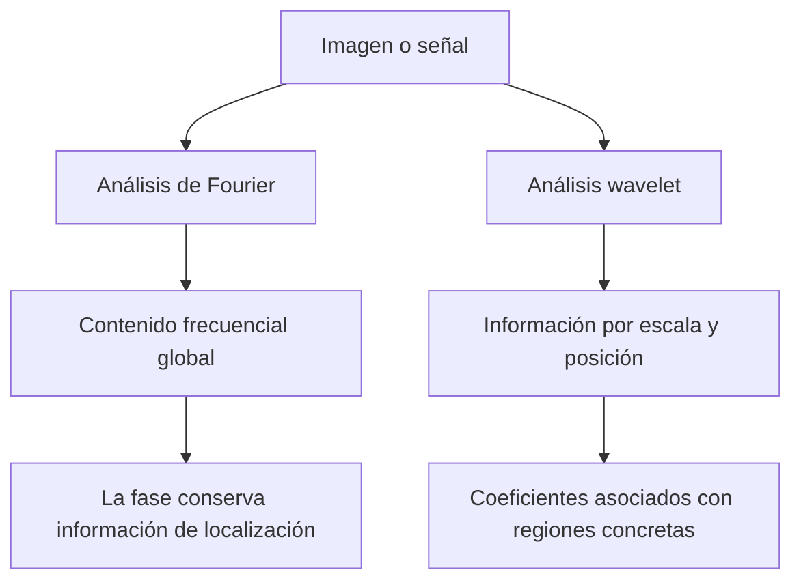
  
Esta diferencia explica por qué las wavelets resultan útiles para localizar cambios y procesar detalles de manera selectiva.  
  
---  
  
## Transformada de Haar  
  
La **transformada de Haar** es una de las transformadas wavelet más sencillas.  
  
Su principio consiste en reemplazar grupos de muestras por coeficientes que describen sus promedios y diferencias.  
  
La parte de promedio representa información de baja frecuencia o estructura general.  
  
La parte de diferencia representa detalles locales.  
  
### Haar unidimensional:  
  
Para dos valores:  
  
$$  
a,\ b  
$$  
  
una versión normalizada por promedio utiliza:  
  
$$  
L=\frac{a+b}{2}  
$$  
  
$$  
H=\frac{a-b}{2}  
$$  
  
En donde:  
  
- $L$ representa la información promedio.  
- $H$ representa la diferencia local.  
  
La reconstrucción se obtiene mediante:  
  
$$  
a=L+H  
$$  
  
$$  
b=L-H  
$$  
  
Por lo tanto, si se conservan ambos coeficientes, las muestras originales pueden recuperarse exactamente.  
  
###### Ejemplo:  
  
Supóngase que:  
  
$$  
a=100  
$$  
  
$$  
b=20  
$$  
  
Entonces:  
  
$$  
L=\frac{100+20}{2}=60  
$$  
  
$$  
H=\frac{100-20}{2}=40  
$$  
  
La reconstrucción produce:  
  
$$  
a=60+40=100  
$$  
  
$$  
b=60-40=20  
$$  
  
La información original no se pierde durante esta transformación.  
  
---  
  
## Transformada de Haar bidimensional  
  
La transformada de Haar 2-D aplica la misma idea a bloques de $2\times2$.  
  
Considérese:  
  
$$  
X=  
\begin{bmatrix}  
a&b\\  
c&d  
\end{bmatrix}  
$$  
  
Cada bloque produce cuatro coeficientes:  
  
- **LL:** promedio de intensidades.  
- **H:** diferencia entre parte superior e inferior.  
- **V:** diferencia entre parte izquierda y derecha.  
- **D:** diferencia diagonal.  
  
Se calculan mediante:  
  
$$  
LL=\frac{a+b+c+d}{4}  
$$  
  
$$  
H=\frac{a+b-c-d}{4}  
$$  
  
$$  
V=\frac{a-b+c-d}{4}  
$$  
  
$$  
D=\frac{a-b-c+d}{4}  
$$  
  
Esta convención utiliza división entre cuatro.  
  
### Interpretación de las bandas:  
  
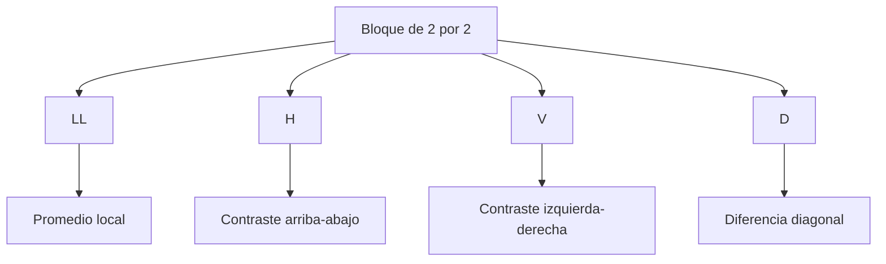
  
Cada coeficiente representa una propiedad distinta del bloque.  
  
La combinación de los cuatro permite reconstruir los valores originales.  
  
### Transformada inversa:  
  
Las fórmulas de reconstrucción son:  
  
$$  
a=LL+H+V+D  
$$  
  
$$  
b=LL+H-V-D  
$$  
  
$$  
c=LL-H+V-D  
$$  
  
$$  
d=LL-H-V+D  
$$  
  
Estas expresiones muestran que Haar es una transformación reversible cuando se conservan todos los coeficientes.  
  
###### Ejemplo:  
  
Considérese:  
  
$$  
X=  
\begin{bmatrix}  
100&20\\  
100&20  
\end{bmatrix}  
$$  
  
El promedio es:  
  
$$  
LL=\frac{100+20+100+20}{4}=60  
$$  
  
El detalle horizontal es:  
  
$$  
H=0  
$$  
  
El detalle vertical es:  
  
$$  
V=\frac{100-20+100-20}{4}=40  
$$  
  
El detalle diagonal es:  
  
$$  
D=0  
$$  
  
El bloque se representa mediante:  
  
$$  
(LL,H,V,D)=(60,0,40,0)  
$$  
  
La única diferencia importante aparece entre las columnas izquierda y derecha.  
  
---  
  
## Haar y su sensibilidad a la posición de los bordes  
  
Una propiedad importante de Haar es que sus bloques se encuentran alineados con una rejilla fija.  
  
Esto significa que la posición de un borde respecto a los bloques puede modificar considerablemente los coeficientes obtenidos.  
  
### Borde entre bloques:  
  
Supóngase que una imagen tiene tamaño:  
  
$$  
32\times32  
$$  
  
Y presenta una región oscura a la izquierda y una región clara a la derecha.  
  
Si el borde se encuentra entre las columnas 15 y 16, coincide con una frontera entre bloques de Haar de nivel 1.  
  
Como los bloques agrupan columnas:  
  
$$  
(0,1),(2,3),\ldots,(14,15),(16,17)  
$$  
  
ningún bloque contiene simultáneamente ambos lados del borde.  
  
Por lo tanto, los coeficientes de detalle vertical de ese nivel pueden ser cero.  
  
Esto no significa que el borde no exista, sino que no aparece como diferencia interna de esos bloques.  
  
### Borde desplazado un píxel:  
  
Ahora supóngase que la región oscura incluye la columna 16 y la clara comienza en la 17.  
  
El borde queda dentro del bloque formado por las columnas 16 y 17.  
  
Si las intensidades son:  
  
$$  
I_{\text{oscuro}}=40  
$$  
  
$$  
I_{\text{claro}}=200  
$$  
  
el bloque correspondiente es:  
  
$$  
X=  
\begin{bmatrix}  
40&200\\  
40&200  
\end{bmatrix}  
$$  
  
Su detalle vertical es:  
  
$$  
V=\frac{40-200+40-200}{4}  
$$  
  
$$  
V=-80  
$$  
  
Como existen 16 parejas de renglones, aparecen:  
  
$$  
16  
$$  
  
coeficientes verticales no nulos.  
  
Esto demuestra que **Haar no es invariante a la traslación**.  
  
Mover una estructura solamente un píxel puede modificar significativamente su representación.  
  
Esta propiedad es importante cuando se utilizan wavelets para eliminar ruido o conservar estructuras pequeñas.  
  
---  
  
## Umbralización de coeficientes wavelet  
  
Una aplicación importante de las wavelets es la reducción de ruido mediante la modificación de los coeficientes de detalle.  
  
La idea consiste en que parte del ruido produce coeficientes pequeños, mientras que determinadas estructuras relevantes producen coeficientes mayores.  
  
Sin embargo, esta separación no siempre es perfecta.  
  
Existen dos estrategias habituales: umbral duro y umbral suave.  
  
### Umbral duro:  
  
El **umbral duro** conserva sin cambios los coeficientes cuya magnitud supera un valor $\lambda$ y elimina los demás.  
  
$$  
T_{\text{duro}}(x)=  
\begin{cases}  
x,&|x|>\lambda\\  
0,&|x|\leq\lambda  
\end{cases}  
$$  
  
Los coeficientes supervivientes mantienen su valor original.  
  
Esto puede conservar contrastes fuertes, aunque introduce una discontinuidad en la función de umbralización.  
  
### Umbral suave:  
  
El **umbral suave** también elimina los coeficientes pequeños, pero reduce la magnitud de aquellos que sobreviven.  
  
$$  
T_{\text{suave}}(x)=  
\operatorname{sign}(x)\max(|x|-\lambda,0)  
$$  
  
Por lo tanto:  
  
- Si $|x|\leq\lambda$, el resultado es cero.  
- Si $x>\lambda$, se resta $\lambda$.  
- Si $x<-\lambda$, se suma $\lambda$.  
  
###### Ejemplo:  
  
Supóngase que:  
  
$$  
\lambda=20  
$$  
  
Los coeficientes originales son:  
  
$$  
-40,\ -15,\ 0,\ 15,\ 40  
$$  
  
Los resultados son:  
  
| Coeficiente original | Umbral duro | Umbral suave |  
|---|---:|---:|  
| -40 | -40 | -20 |  
| -15 | 0 | 0 |  
| 0 | 0 | 0 |  
| 15 | 0 | 0 |  
| 40 | 40 | 20 |  
  
El umbral suave modifica también los coeficientes grandes.  
  
Por lo tanto, aunque una estructura sobreviva, su contraste puede disminuir.  
  
Esta es una diferencia fundamental respecto al umbral duro.  
  
---  
  
## Reconstrucción después de aplicar umbral suave  
  
Considérese el siguiente parche:  
  
$$  
I=  
\begin{bmatrix}  
60&60&100&20\\  
60&60&100&20\\  
30&30&60&60\\  
30&90&60&60  
\end{bmatrix}  
$$  
  
La transformada de Haar de nivel 1 divide la matriz en cuatro bloques de $2\times2$.  
  
Cada bloque produce un coeficiente LL y tres detalles.  
  
En total existen:  
  
$$  
4(3)=12  
$$  
  
coeficientes de detalle.  
  
De ellos, ocho valen cero desde el comienzo.  
  
### Bloque superior derecho:  
  
El bloque es:  
  
$$  
X_1=  
\begin{bmatrix}  
100&20\\  
100&20  
\end{bmatrix}  
$$  
  
Sus coeficientes son:  
  
$$  
LL=60,\quad H=0,\quad V=40,\quad D=0  
$$  
  
Al aplicar umbral suave con:  
  
$$  
\lambda=20  
$$  
  
el detalle vertical pasa de:  
  
$$  
40\rightarrow20  
$$  
  
La reconstrucción produce:  
  
$$  
\hat X_1=  
\begin{bmatrix}  
80&40\\  
80&40  
\end{bmatrix}  
$$  
  
El salto de intensidad original era:  
  
$$  
100-20=80  
$$  
  
Después de aplicar el umbral es:  
  
$$  
80-40=40  
$$  
  
Por lo tanto, el borde permanece, pero su contraste disminuye.  
  
### Bloque inferior izquierdo:  
  
Ahora considérese:  
  
$$  
X_2=  
\begin{bmatrix}  
30&30\\  
30&90  
\end{bmatrix}  
$$  
  
Sus coeficientes son:  
  
$$  
LL=45  
$$  
  
$$  
H=-15  
$$  
  
$$  
V=-15  
$$  
  
$$  
D=15  
$$  
  
Como todos los detalles tienen magnitud menor que 20, el umbral suave los convierte en cero.  
  
La reconstrucción queda:  
  
$$  
\hat X_2=  
\begin{bmatrix}  
45&45\\  
45&45  
\end{bmatrix}  
$$  
  
El píxel de intensidad 90 desaparece como estructura diferenciada.  
  
Esto demuestra que la reducción de ruido mediante wavelets puede eliminar detalles verdaderos cuando sus coeficientes son demasiado pequeños respecto al umbral.  
  
---  
  
## Umbral universal y pérdida de estructuras pequeñas  
  
El **umbral universal** proporciona una regla para seleccionar el valor de umbralización a partir de una estimación del ruido.  
  
Una expresión habitual es:  
  
$$  
\lambda=\sigma\sqrt{2\ln N}  
$$  
  
En donde:  
  
- $\sigma$ representa la desviación estándar estimada del ruido.  
- $N$ representa el número de muestras o coeficientes considerados.  
- $\lambda$ es el umbral utilizado.  
  
El objetivo consiste en eliminar coeficientes que probablemente se deban al ruido.  
  
Sin embargo, si el umbral es demasiado grande, también pueden desaparecer estructuras relevantes.  
  
### Comparación experimental:  
  
Considérese una imagen de células afectada por ruido de intensidad elevada.  
  
Se comparan diferentes estrategias de reducción de ruido antes de aplicar Otsu.  
  
| Método | IoU | Células pequeñas conservadas |  
|---|---:|---:|  
| Suavización con $\sigma=2$ | 0.957 | 11 de 12 |  
| Haar con umbral universal suave | 0.807 | 4 de 12 |  
| Haar por banda con 16 desplazamientos | 0.961 | 12 de 12 |  
  
La estrategia de Haar con umbral universal produce un resultado considerablemente peor que la suavización convencional.  
  
Esto puede explicarse mediante dos mecanismos.  
  
### Umbral demasiado grande:  
  
En el experimento, el umbral universal es aproximadamente:  
  
$$  
\lambda=142  
$$  
  
Algunos detalles producidos por células pequeñas tienen magnitudes cercanas a 80 en el primer nivel y hasta aproximadamente 140 en el segundo.  
  
Como esos valores no superan el umbral, se eliminan.  
  
Por lo tanto, parte de la información necesaria para reconstruir las células pequeñas desaparece.  
  
### Dependencia de la rejilla:  
  
Haar utiliza bloques fijos.  
  
Una estructura puede producir detalles fuertes cuando cae dentro de un bloque, pero detalles pequeños o nulos cuando coincide con sus fronteras.  
  
Esto significa que la posición de la célula puede afectar el resultado.  
  
Una estrategia para reducir esta dependencia consiste en aplicar la transformación sobre diferentes versiones desplazadas de la imagen y combinar las reconstrucciones.  
  
Este procedimiento se relaciona con el **cycle spinning**.  
  
Al utilizar 16 desplazamientos, el resultado mejora hasta:  
  
$$  
IoU=0.961  
$$  
  
y conserva las 12 células pequeñas.  
  
Por lo tanto, un método matemáticamente más sofisticado no necesariamente produce mejores resultados cuando se utiliza con una configuración inadecuada.  
  
---  
  
## Pirámides de imágenes y costo de almacenamiento  
  
Una **pirámide de imágenes** representa una imagen mediante versiones sucesivamente reducidas de resolución.  
  
En una pirámide gaussiana, cada nivel suele obtenerse mediante suavización y reducción de tamaño.  
  
Si la imagen original tiene:  
  
$$  
N\times N  
$$  
  
píxeles, los niveles siguientes pueden tener:  
  
$$  
\frac{N}{2}\times\frac{N}{2}  
$$  
  
$$  
\frac{N}{4}\times\frac{N}{4}  
$$  
  
y así sucesivamente.  
  
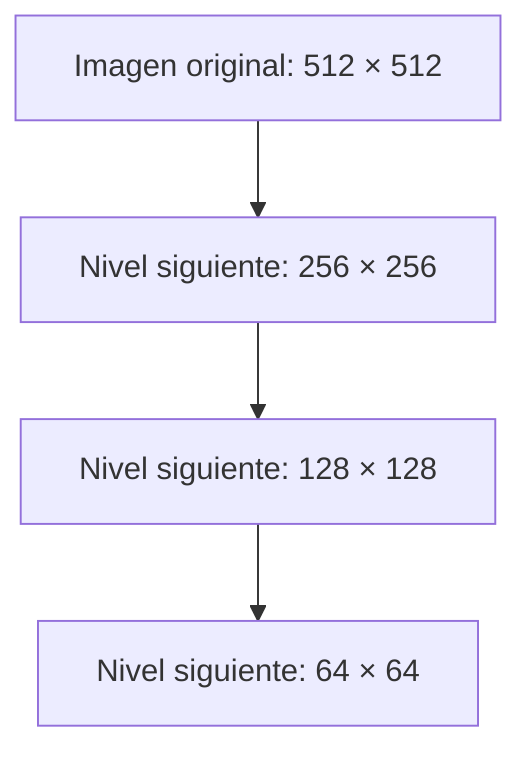
  
### Redundancia de almacenamiento:  
  
Si se almacenan todos los niveles, el número total de valores es mayor que el de la imagen original.  
  
Para cuatro niveles:  
  
$$  
N_{\text{total}}=  
512^2+256^2+128^2+64^2  
$$  
  
$$  
N_{\text{total}}=348160  
$$  
  
La imagen original contiene:  
  
$$  
512^2=262144  
$$  
  
valores.  
  
Por lo tanto:  
  
$$  
\frac{348160}{262144}\approx1.328  
$$  
  
La pirámide almacena aproximadamente 1.33 veces la cantidad de valores de la imagen original.  
  
Si se continúa reduciendo la resolución, la proporción tiende a:  
  
$$  
1+\frac14+\frac1{16}+\cdots=\frac43  
$$  
  
En cambio, una descomposición completa de Haar organiza los coeficientes de aproximación y detalle sin aumentar el número total de valores respecto a la imagen original, suponiendo dimensiones adecuadas y sin almacenamiento auxiliar.  
  
Esto permite distinguir dos enfoques de multirresolución:  
  
- Las pirámides almacenan varias representaciones de la imagen.  
- Haar redistribuye la información original entre coeficientes de distintas escalas.  
  
---  
  
## Interpretación y evaluación de resultados experimentales  
  
Una parte fundamental del análisis de visión artificial consiste en comprender por qué dos métodos producen resultados diferentes.  
  
No es suficiente observar que un algoritmo obtuvo una métrica mayor. Es necesario explicar qué propiedad del método causó esa diferencia.  
  
### Ejemplo de detección de bordes:  
  
Si Canny produce un contorno fragmentado al eliminar la histéresis, la explicación no es simplemente que faltan píxeles.  
  
El mecanismo es que las partes débiles del contorno tienen magnitudes inferiores al umbral alto y dejan de conservarse, aunque estén conectadas con segmentos fuertes.  
  
### Ejemplo de segmentación:  
  
Si el crecimiento de regiones incorpora una zona incorrecta al aumentar la tolerancia, el mecanismo consiste en que aparecen caminos conectados de píxeles que cumplen la condición de similitud.  
  
No es necesario que toda la región incorporada se parezca globalmente al objeto original.  
  
### Ejemplo de textura:  
  
Si dos imágenes tienen el mismo histograma, pero diferentes valores de GLCM, la explicación es que el histograma ignora la posición de los píxeles, mientras que GLCM describe parejas separadas por desplazamientos específicos.  
  
### Ejemplo de umbralización:  
  
Si Otsu falla al segmentar un objeto pequeño, la causa puede ser que la distribución del fondo domina el histograma y resulta estadísticamente más conveniente dividir ese fondo que separar el objeto.  
  
### Ejemplo de wavelets:  
  
Si Haar elimina células pequeñas, la explicación puede encontrarse en la magnitud de sus coeficientes de detalle y en la posición de las estructuras respecto a los bloques de la transformada.  
  
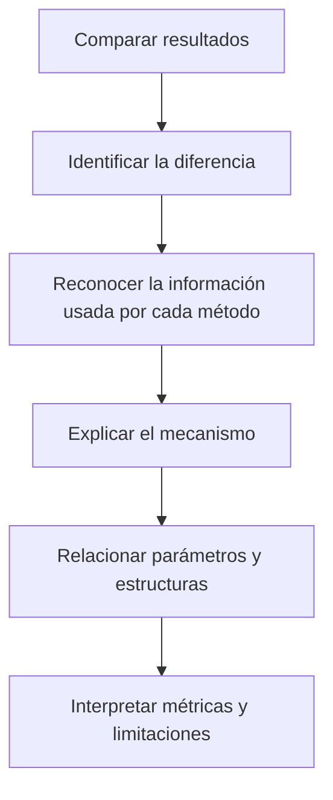
  
Una interpretación correcta debe conectar el resultado observado con la operación matemática que lo produce.  
  
---  
  
## Cómo evaluar afirmaciones técnicas sobre algoritmos  
  
Para analizar una explicación técnica conviene distinguir tres situaciones:  
  
- **Correcta:** la afirmación describe adecuadamente el mecanismo.  
- **Incorrecta:** contradice una propiedad fundamental del método.  
- **Incompleta:** contiene una parte verdadera, pero omite una condición importante.  
  
Esta distinción resulta especialmente útil cuando una explicación parece razonable, pero simplifica demasiado el funcionamiento de un algoritmo.  
  
### Fourier y localización espacial:  
  
La afirmación de que las magnitudes de Fourier indican simultáneamente qué frecuencias existen y dónde se encuentran es incorrecta.  
  
Las magnitudes describen el contenido frecuencial, pero la información de posición depende también de la fase.  
  
Por ejemplo, desplazar un impulso modifica su fase sin alterar las magnitudes de Fourier.  
  
### Reconstrucción con Haar:  
  
La afirmación de que una descomposición Haar 2-D produce cuatro bandas y permite reconstruir exactamente la imagen es correcta cuando se conservan todos los coeficientes y se utiliza la transformada inversa correspondiente.  
  
La reconstrucción se demuestra mediante las ecuaciones inversas de LL, H, V y D.  
  
### Detección de todos los bordes mediante Haar:  
  
La afirmación de que los coeficientes de detalle de Haar detectan todos los bordes desde el primer nivel es incorrecta.  
  
Un borde alineado con las fronteras de los bloques puede producir coeficientes nulos en ese nivel.  
  
Esto se debe a que las diferencias se calculan dentro de bloques definidos por una rejilla fija.  
  
### Umbral suave y conservación de bordes:  
  
La afirmación de que el umbral suave elimina los coeficientes pequeños y deja intactos los bordes supervivientes es incompleta.  
  
Es correcto que los coeficientes cuya magnitud no supera el umbral se convierten en cero.  
  
Sin embargo, los coeficientes que sobreviven también reducen su magnitud en $\lambda$.  
  
Por lo tanto, los bordes pueden perder contraste incluso cuando no desaparecen completamente.  
  
---  
  
## Ideas principales  
  
### Harris distingue bordes y esquinas mediante cambios direccionales:  
  
Un borde presenta un eigenvalor grande y otro pequeño, mientras que una esquina presenta dos eigenvalores grandes.  
  
La respuesta:  
  
$$  
R=\det(M)-k[\operatorname{tr}(M)]^2  
$$  
  
permite detectar estas diferencias sin calcular explícitamente los eigenvalores.  
  
### Canny necesita histéresis para conservar contornos débiles:  
  
La supresión de no máximos adelgaza los bordes.  
  
La histéresis conserva píxeles débiles cuando están conectados con bordes fuertes.  
  
Sin esta etapa, un contorno puede fragmentarse.  
  
### Hough detecta líneas mediante votación:  
  
Cada píxel de borde vota por diferentes combinaciones:  
  
$$  
\rho=x\cos\theta+y\sin\theta  
$$  
  
Los máximos del acumulador indican parámetros compartidos por numerosos puntos.  
  
El ángulo $\theta$ corresponde a la normal de la recta.  
  
### La conectividad modifica el número de objetos:  
  
La conectividad 4 solamente considera vecinos laterales.  
  
La conectividad 8 también considera vecinos diagonales.  
  
Por lo tanto:  
  
$$  
N_8\leq N_4  
$$  
  
### IoU y Dice miden coincidencia geométrica:  
  
$$  
IoU=\frac{|A\cap G|}{|A\cup G|}  
$$  
  
$$  
Dice=\frac{2|A\cap G|}{|A|+|G|}  
$$  
  
Ambas métricas están relacionadas mediante:  
  
$$  
Dice=\frac{2IoU}{1+IoU}  
$$  
  
Dice produce valores mayores o iguales que IoU para una misma coincidencia.  
  
### El crecimiento de regiones depende de similitud y conectividad:  
  
Una región solamente puede incorporar píxeles que sean alcanzables desde la semilla mediante recorridos permitidos y que cumplan la condición de similitud.  
  
Aumentar la tolerancia permite incorporar más píxeles, pero puede provocar que la región invada estructuras incorrectas.  
  
### El umbral adaptativo necesita una ventana adecuada:  
  
Si la ventana queda completamente dentro de un objeto, la media local puede aproximarse demasiado a su intensidad.  
  
En ese caso, el interior del objeto puede desaparecer y sobrevivir solamente sus bordes.  
  
### Otsu maximiza la separación estadística:  
  
$$  
\sigma_B^2=\omega_0\omega_1(\mu_0-\mu_1)^2  
$$  
  
El método puede fallar cuando el objeto ocupa una proporción demasiado pequeña de la imagen.  
  
Una separación estadística elevada no garantiza una segmentación correcta.  
  
### Niblack y Sauvola presentan compromisos diferentes:  
  
Niblack puede producir falsos positivos en regiones uniformes porque su umbral queda cerca de la media.  
  
Sauvola puede perder trazos tenues porque reduce considerablemente el umbral cuando la desviación local es pequeña.  
  
### El histograma no representa la organización espacial:  
  
Reorganizar los píxeles de una imagen conserva su histograma, pero modifica la textura.  
  
GLCM y LBP permiten describir relaciones espaciales que las estadísticas de primer orden no pueden representar.  
  
### GLCM describe relaciones entre parejas de píxeles:  
  
El contraste mide diferencias de intensidad, la energía mide concentración de probabilidades y la homogeneidad favorece parejas de intensidades similares.  
  
Los resultados dependen del desplazamiento utilizado.  
  
### LBP compara vecinos contra el píxel central:  
  
La regla:  
  
$$  
b_i=  
\begin{cases}  
1,&g_i\geq g_c\\  
0,&g_i<g_c  
\end{cases}  
$$  
  
produce un código binario local.  
  
LBP resiste cambios de brillo que conservan el orden, pero puede ser sensible al ruido cuando las intensidades están muy próximas.  
  
### Haar separa promedios y detalles:  
  
La transformada Haar 2-D produce cuatro coeficientes por bloque:  
  
$$  
LL,\ H,\ V,\ D  
$$  
  
Cuando todos se conservan, la imagen puede reconstruirse exactamente.  
  
Sin embargo, su representación depende de la posición de los objetos respecto a la rejilla.  
  
### El umbral suave modifica también los coeficientes supervivientes:  
  
$$  
T_{\text{suave}}(x)=  
\operatorname{sign}(x)\max(|x|-\lambda,0)  
$$  
  
Los coeficientes pequeños desaparecen y los grandes reducen su magnitud.  
  
Por lo tanto, una estructura puede sobrevivir con menor contraste.  
  
### Un método más complejo no siempre obtiene mejores resultados:  
  
Un umbral wavelet demasiado grande puede eliminar estructuras pequeñas.  
  
La selección de parámetros y la posición de los objetos pueden ser más importantes que la complejidad del algoritmo.  
  
---  
  
## Conclusión  
  
Las técnicas de detección, segmentación, textura y multirresolución permiten analizar diferentes propiedades de una imagen. Cada una utiliza información distinta y, por lo tanto, presenta ventajas y limitaciones relacionadas con la distribución de intensidades, la geometría y la escala de las estructuras.  
  
Los detectores de características permiten reconocer cambios locales importantes. Harris distingue entre regiones planas, bordes y esquinas mediante la distribución de los gradientes. Canny utiliza la magnitud del gradiente, la supresión de no máximos y la histéresis para construir contornos delgados y continuos. Hough transforma los puntos de borde en votos dentro de un espacio de parámetros para identificar líneas.  
  
La segmentación permite pasar de características individuales a regiones completas. En este proceso, la conectividad determina cómo se agrupan los píxeles, el crecimiento de regiones utiliza semillas y criterios de similitud, y las métricas IoU y Dice permiten evaluar la coincidencia geométrica con una segmentación verdadera.  
  
Los métodos de umbralización muestran que separar intensidades no siempre equivale a identificar correctamente objetos. Otsu puede encontrar una partición estadísticamente adecuada y fallar cuando el objeto es demasiado pequeño. Los umbrales adaptativos pueden compensar cambios de iluminación, pero dependen del tamaño de sus ventanas. Niblack y Sauvola también presentan compromisos diferentes entre la eliminación de ruido y la conservación de trazos de bajo contraste.  
  
El análisis de texturas introduce una distinción fundamental entre la distribución de intensidades y su organización espacial. Mientras que el histograma ignora las posiciones de los píxeles, GLCM describe relaciones entre parejas y LBP representa patrones locales de comparación.  
  
Finalmente, las transformadas wavelet permiten separar información de diferentes escalas y posiciones. Haar proporciona una representación reversible mediante promedios y detalles, pero su dependencia de la rejilla y la aplicación de umbrales pueden provocar la pérdida de estructuras relevantes.  
  
Por lo tanto, **comprender un método de visión artificial requiere relacionar sus operaciones matemáticas con los cambios que produce sobre los píxeles**. La calidad de un resultado no depende únicamente de la métrica obtenida, sino también de la información que conserva, de los errores que introduce y de las condiciones bajo las cuales el algoritmo funciona correctamente.  