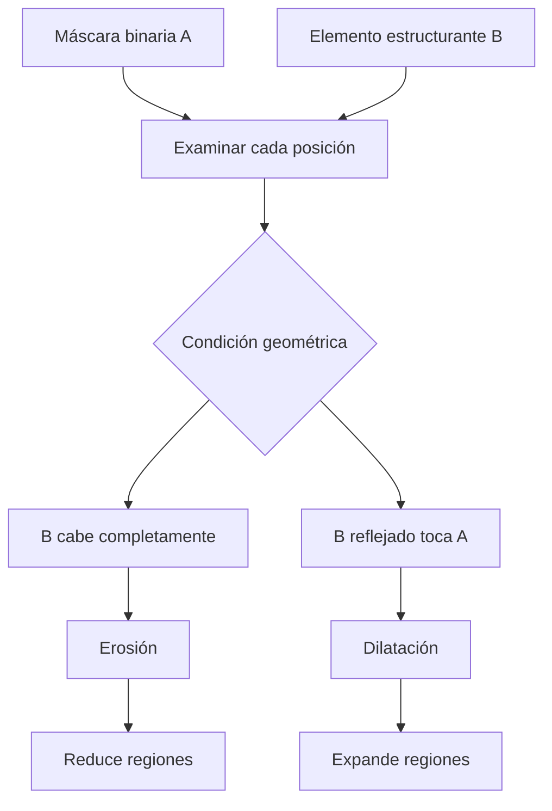
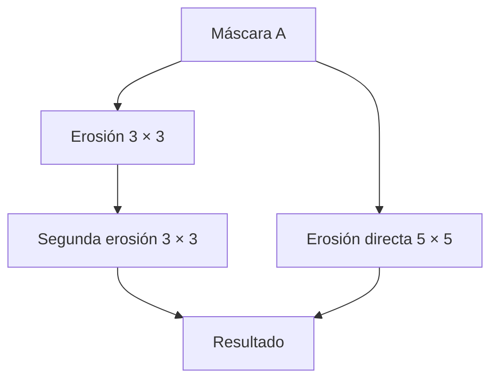
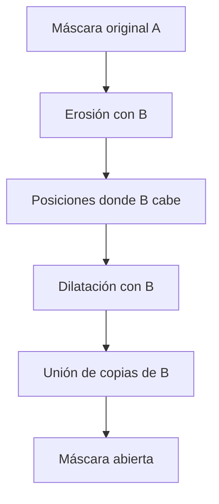
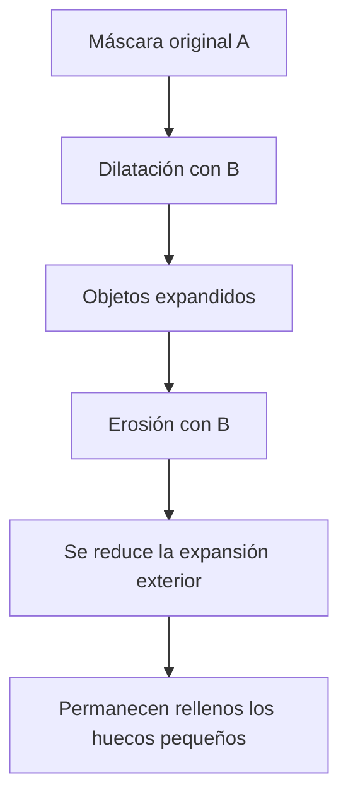
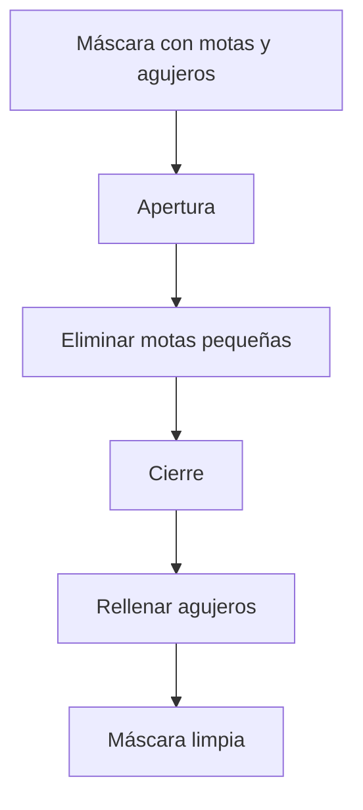
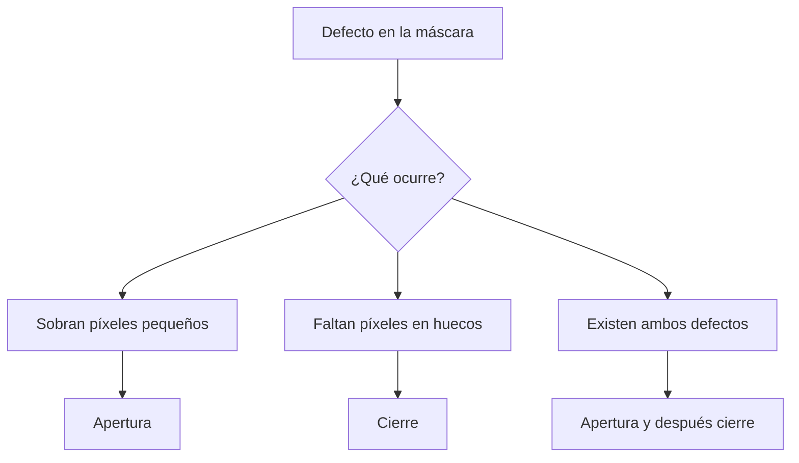
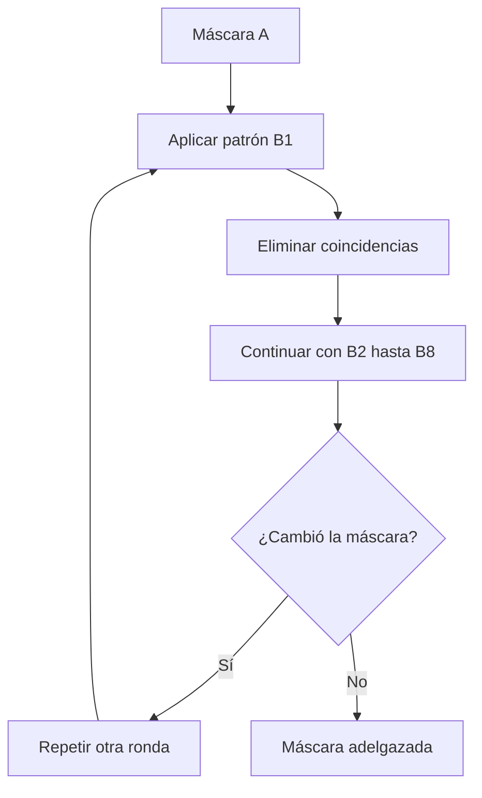
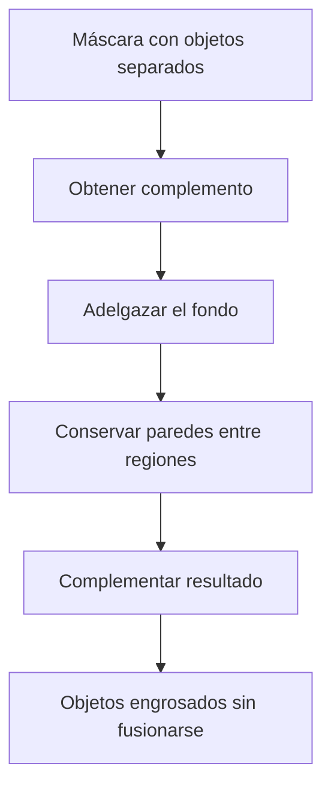
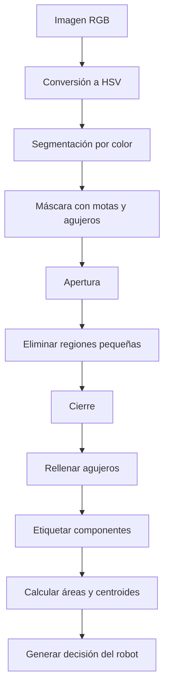

## Introducción  
  
La **morfología matemática** permite modificar la forma de los objetos presentes en una imagen binaria mediante operaciones geométricas. Su utilidad aparece especialmente después de la segmentación, cuando una máscara contiene objetos reales, pero también presenta píxeles de ruido, agujeros, conexiones incorrectas o regiones fragmentadas.  
  
Por ejemplo, un robot encargado de recoger piezas puede detectar correctamente una pieza y, al mismo tiempo, interpretar pequeñas manchas del fondo como objetos independientes. De manera similar, un sistema que sigue una línea puede perder su trayectoria cuando los reflejos producen interrupciones en la máscara.  
  
Estos problemas no siempre pueden resolverse mediante una nueva umbralización. En ocasiones, la información necesaria ya está presente y solamente se requiere corregir la geometría de la máscara.  
  
Las operaciones fundamentales son la **erosión** y la **dilatación**. La primera conserva las posiciones donde un elemento estructurante cabe completamente dentro del objeto, mientras que la segunda conserva aquellas donde existe al menos un contacto.  
  
A partir de ambas se construyen operaciones más específicas:  
  
- **Apertura:** elimina estructuras pequeñas o estrechas sin encoger permanentemente las regiones que sobreviven.  
- **Cierre:** rellena pequeños agujeros y discontinuidades sin eliminar los píxeles originales.  
- **Adelgazamiento:** reduce el grosor de los objetos mediante patrones que permiten conservar su estructura conectada.  
- **Engrosamiento:** expande las regiones utilizando patrones que evitan que los objetos se unan.  
  
La diferencia entre estas operaciones no depende únicamente de sus fórmulas. También importa el tamaño y la forma del elemento estructurante, la geometría de los objetos y, especialmente, **el orden en que se aplican las transformaciones**.  
  
---  
  
## Fundamentos de la erosión y la dilatación  
  
Una imagen binaria puede interpretarse como un conjunto de posiciones activas:  
  
$$  
A=\{(r,c)\mid A[r,c]=1\}  
$$  
  
En donde $r$ representa el renglón, $c$ la columna y $A$ el conjunto de píxeles que pertenecen al objeto.  
  
El **elemento estructurante**, representado por $B$, es una figura pequeña que se utiliza para examinar las regiones de la máscara. Puede tener forma de cuadrado, cruz, disco o barra.  
  
Por ejemplo, un cuadrado de $3\times3$ contiene nueve posiciones:  
  
$$  
B=  
\begin{bmatrix}  
1&1&1\\  
1&1&1\\  
1&1&1  
\end{bmatrix}  
$$  
  
Cuando se desplaza sobre la imagen, se comprueba si sus posiciones coinciden con el objeto.  
  
### Erosión:  
  
La **erosión** conserva una posición cuando el elemento estructurante cabe completamente dentro de la máscara.  
  
Se define mediante:  
  
$$  
A\ominus B=\{z\mid B_z\subseteq A\}  
$$  
  
En donde:  
  
- $A$ es la máscara binaria.  
- $B$ es el elemento estructurante.  
- $z$ es la posición donde se coloca su origen.  
- $B_z$ es el elemento trasladado a esa posición.  
  
La condición $B_z\subseteq A$ significa que todos los píxeles activos del elemento estructurante deben coincidir con píxeles del objeto.  
  
Por lo tanto, la erosión tiende a reducir las regiones de la máscara.  
  
Puede eliminar píxeles aislados, romper conexiones delgadas y separar objetos unidos por regiones estrechas. Sin embargo, también puede eliminar objetos pequeños que deberían conservarse.  
  
### Dilatación:  
  
La **dilatación** conserva una posición cuando el elemento estructurante reflejado tiene al menos un punto de contacto con la máscara.  
  
$$  
A\oplus B=  
\{z\mid \hat B_z\cap A\neq\varnothing\}  
$$  
  
En donde $\hat B$ representa el elemento estructurante reflejado respecto al origen.  
  
Para elementos simétricos, como un cuadrado centrado:  
  
$$  
\hat B=B  
$$  
  
La dilatación expande los objetos, puede cubrir huecos y conectar regiones cercanas.  
  
Sin embargo, también expande los píxeles incorrectos producidos por ruido.  
  
### Interpretación mediante las condiciones de cabe y toca:  
  

  
La erosión exige una coincidencia completa, mientras que la dilatación necesita solamente una coincidencia parcial.  
  
Esta diferencia explica por qué las dos operaciones tienen efectos opuestos sobre las fronteras.  
  
###### Ejemplo:  
  
Supóngase que una máscara de $6\times6$ contiene 15 píxeles activos y que se utiliza una barra horizontal de $1\times3$, centrada en su posición intermedia.  
  
El elemento estructurante cabe únicamente en:  
  
$$  
(0,2),\quad(1,2),\quad(2,2)  
$$  
  
Por lo tanto:  
  
$$  
|A\ominus B|=3  
$$  
  
Al aplicar la dilatación con la misma barra:  
  
$$  
|A\oplus B|=26  
$$  
  
La diferencia se debe a que la erosión necesita tres coincidencias simultáneas, mientras que la dilatación acepta cualquier posición donde exista al menos un contacto.  
  
---  
  
## Efectos geométricos de la erosión y la dilatación  
  
La erosión y la dilatación no se limitan a reducir o aumentar el número de píxeles. También pueden modificar la conectividad y la topología de una imagen.  
  
### Erosión sobre estructuras delgadas:  
  
Considérese una máscara que contiene dos regiones grandes conectadas por un puente estrecho.  
  
Si el puente tiene menos grosor que el elemento estructurante, este no puede colocarse completamente dentro de la conexión.  
  
Por lo tanto, la erosión elimina el puente y puede separar las regiones.  
  
El mismo mecanismo permite eliminar puntos aislados y estructuras pequeñas.  
  
Sin embargo, si una región verdadera también es demasiado pequeña para contener $B$, desaparecerá.  
  
### Dilatación sobre objetos cercanos:  
  
La dilatación extiende cada región utilizando la geometría del elemento estructurante.  
  
Si dos objetos están suficientemente cerca, sus expansiones pueden encontrarse y formar una sola componente conectada.  
  
Esto resulta útil para reparar discontinuidades, pero perjudicial cuando los objetos deben permanecer separados.  
  
### Influencia de la forma del elemento estructurante:  
  
| Elemento | Característica geométrica | Efecto habitual |  
|---|---|---|  
| Cuadrado $3\times3$ | Examina vecinos laterales y diagonales | Modifica fronteras en ambas direcciones |  
| Cruz $3\times3$ | Examina centro y vecinos laterales | Conserva mejor determinadas estructuras pequeñas |  
| Disco | Aproxima una vecindad circular | Produce modificaciones más redondeadas |  
| Barra horizontal | Examina principalmente una dirección | Responde a estructuras horizontales |  
| Barra vertical | Examina principalmente una dirección | Responde a estructuras verticales |  
  
###### Ejemplo:  
  
Considérese una máscara formada por un bloque de $20\times20$ con un agujero de $3\times3$, otro bloque separado por dos píxeles, una línea de dos píxeles de grosor, un punto aislado y un disco de radio 7.  
  
La máscara contiene inicialmente:  
  
$$  
|A|=813  
$$  
  
píxeles, distribuidos en cinco componentes conectadas.  
  
Con un cuadrado de $3\times3$, la erosión produce:  
  
$$  
|A\ominus B|=540  
$$  
  
y conserva tres componentes.  
  
La línea delgada y el punto aislado desaparecen.  
  
En cambio, la dilatación produce:  
  
$$  
|A\oplus B|=1119  
$$  
  
y también deja tres componentes, pero por un motivo diferente: algunas regiones cercanas se unen al expandirse.  
  
El agujero de $3\times3$ no desaparece completamente con esa dilatación, mientras que un elemento de mayor alcance puede cubrirlo.  
  
Por lo tanto, una disminución del número de componentes puede significar que se eliminaron objetos o que se fusionaron regiones. **El conteo por sí solo no identifica cuál de los dos fenómenos ocurrió**.  
  
---  
  
## Regla de composición de erosiones y dilataciones  
  
La erosión y la dilatación poseen una propiedad importante: aplicar varias veces la misma operación puede equivaler a utilizar un elemento estructurante de mayor tamaño.  
  
Esta propiedad se denomina **regla de composición**.  
  
### Composición de erosiones:  
  
Para dos elementos estructurantes $B$ y $C$:  
  
$$  
(A\ominus B)\ominus C  
=  
A\ominus(B\oplus C)  
$$  
  
Esto significa que erosionar primero con $B$ y después con $C$ equivale a erosionar una sola vez utilizando la dilatación de ambos elementos estructurantes.  
  
La razón es geométrica.  
  
La primera erosión selecciona los lugares donde cabe $B$.  
  
La segunda exige que esa condición también se cumpla en todas las posiciones determinadas por $C$.  
  
Juntas, ambas operaciones requieren que el objeto contenga todos los desplazamientos obtenidos al combinar las posiciones de $B$ y $C$.  
  
### Composición de dilataciones:  
  
De manera equivalente:  
  
$$  
(A\oplus B)\oplus C  
=  
A\oplus(B\oplus C)  
$$  
  
Las expansiones sucesivas pueden representarse mediante un elemento estructurante compuesto.  
  
### Crecimiento del elemento estructurante:  
  
Supóngase que $B$ es un cuadrado centrado de $3\times3$.  
  
Sus desplazamientos abarcan:  
  
$$  
-1\leq r\leq1  
$$  
  
$$  
-1\leq c\leq1  
$$  
  
Al combinar dos cuadrados iguales, los desplazamientos resultantes abarcan:  
  
$$  
-2\leq r\leq2  
$$  
  
$$  
-2\leq c\leq2  
$$  
  
Por lo tanto:  
  
$$  
B\oplus B=B_{5\times5}  
$$  
  
La regla produce:  
  
$$  
(A\ominus B_{3\times3})\ominus B_{3\times3}  
=  
A\ominus B_{5\times5}  
$$  
  

  
El tamaño efectivo aumenta de dos en dos:  
  
$$  
3,\ 5,\ 7,\ 9,\ 11,\ldots  
$$  
  
En general, después de $n$ erosiones con un cuadrado centrado de $3\times3$, el elemento equivalente tiene lado:  
  
$$  
L=2n+1  
$$  
  
###### Ejemplo:  
  
Supóngase que se desea aplicar una erosión equivalente a un cuadrado de $9\times9$.  
  
Como:  
  
$$  
9=2n+1  
$$  
  
se obtiene:  
  
$$  
n=4  
$$  
  
Por lo tanto, cuatro erosiones sucesivas con un cuadrado de $3\times3$ equivalen geométricamente a una erosión con un cuadrado de $9\times9$.  
  
Si se considera únicamente el número de posiciones que debe revisar un procedimiento directo, las cuatro pasadas requieren:  
  
$$  
4(9)=36  
$$  
  
comprobaciones por píxel, frente a:  
  
$$  
9(9)=81  
$$  
  
de una ventana directa.  
  
Esta comparación ilustra el ahorro potencial de utilizar elementos estructurantes pequeños y composiciones sucesivas. El costo real también depende de la implementación y de las optimizaciones utilizadas.  
  
---  
  
## Separación de objetos mediante erosión  
  
Una aplicación importante de la erosión consiste en separar objetos que aparecen conectados en una máscara.  
  
Esto puede ocurrir cuando dos monedas, pastillas o semillas se tocan o se superponen parcialmente.  
  
### Separación de objetos unidos por un cuello:  
  
Supóngase que dos monedas forman una única región porque sus máscaras se encuentran conectadas mediante una zona estrecha.  
  
La erosión reduce las fronteras de ambas monedas.  
  
Si el cuello de conexión es suficientemente delgado, desaparecerá antes que los cuerpos principales.  
  
Como consecuencia, una componente puede dividirse en dos.  
  
Sin embargo, el mismo elemento estructurante puede eliminar completamente monedas pequeñas.  
  
### Compromiso entre separación y conservación:  
  
Considérese una máscara que contiene diez monedas reales.  
  
Algunas aparecen en tres pares superpuestos, otras están unidas mediante un puente delgado y una de ellas es considerablemente más pequeña.  
  
La segmentación inicial identifica solamente seis componentes.  
  
Al utilizar un disco de radio $k$ se obtienen diferentes resultados:  
  
| Radio $k$ | Componentes después de erosionar |  
|---|---:|  
| 0 | 6 |  
| 1 | 6 |  
| 2 | 7 |  
| 3 | 8 |  
| 4 | 8 |  
| 5 | 7 |  
| 6 | 8 |  
| 7 | 9 |  
| 8 | 9 |  
| 9 | 9 |  
| 10 | 9 |  
  
La evolución no es monótona.  
  
Al aumentar el radio, algunas conexiones desaparecen y el número de componentes crece. Sin embargo, también pueden desaparecer objetos completos y reducir el conteo.  
  
###### Ejemplo:  
  
Con radio 3:  
  
$$  
N=8  
$$  
  
El puente delgado se rompe y uno de los pares puede separarse.  
  
Con radio 5:  
  
$$  
N=7  
$$  
  
La moneda pequeña desaparece.  
  
Con radio 7:  
  
$$  
N=9  
$$  
  
Los pares superpuestos quedan separados, pero la moneda pequeña ya no existe en la máscara.  
  
Por lo tanto, ningún radio de los considerados permite identificar correctamente las diez monedas.  
  
### Por qué la dilatación posterior puede volver a unir los objetos:  
  
Supóngase que la erosión separa dos monedas superpuestas.  
  
Si después se aplica dilatación con el mismo elemento estructurante, las monedas recuperan gran parte de su tamaño.  
  
Al expandirse, sus regiones pueden volver a encontrarse.  
  
Esto demuestra que **separar mediante erosión y restaurar mediante dilatación no garantiza conservar la separación**.  
  
Para contar monedas superpuestas, puede resultar más útil erosionar y contar las componentes resultantes que aplicar inmediatamente una dilatación.  
  
---  
  
## Apertura morfológica  
  
La **apertura morfológica** es una composición de erosión seguida de dilatación utilizando el mismo elemento estructurante.  
  
Se define como:  
  
$$  
A\circ B=(A\ominus B)\oplus B  
$$  
  
El símbolo $\circ$ representa la apertura y no debe confundirse con una multiplicación.  
  
La operación permite eliminar estructuras pequeñas que no pueden contener $B$, mientras recupera la extensión de las regiones que sí lo contienen.  
  
### Interpretación geométrica:  
  
La apertura puede comprenderse imaginando que el elemento estructurante se desplaza por el interior del objeto sin salir de él.  
  
La erosión determina las posiciones donde el elemento cabe.  
  
Posteriormente, la dilatación coloca una copia completa del elemento en cada una de esas posiciones.  
  
El resultado es la unión de todas las copias de $B$ que caben dentro de $A$.  
  

  
Esta interpretación explica por qué los objetos suficientemente grandes pueden recuperar su tamaño, mientras que los elementos demasiado pequeños desaparecen.  
  
### Propiedades fundamentales:  
  
#### La apertura nunca agrega píxeles:  
  
$$  
A\circ B\subseteq A  
$$  
  
La razón es que solamente se colocan copias del elemento estructurante que caben completamente dentro de la máscara original.  
  
Por lo tanto, ningún píxel del resultado puede encontrarse fuera de $A$.  
  
Esta propiedad se denomina **antiextensividad**.  
  
#### La apertura es idempotente:  
  
$$  
(A\circ B)\circ B=A\circ B  
$$  
  
Después de aplicar una apertura, repetirla con el mismo elemento estructurante no modifica el resultado.  
  
Esto ocurre porque la primera aplicación ya conserva la unión de todas las copias de $B$ que pueden acomodarse dentro de la máscara.  
  
#### La apertura depende del tamaño de B:  
  
Si $B$ es demasiado pequeño, ciertas estructuras incorrectas pueden sobrevivir.  
  
Si es demasiado grande, también pueden desaparecer objetos verdaderos.  
  
Por lo tanto, debe seleccionarse un tamaño que permita eliminar el defecto sin destruir las estructuras importantes.  
  
### Efectos habituales de la apertura:  
  
La apertura puede utilizarse para:  
  
- Eliminar puntos y motas aisladas.  
- Eliminar espigas delgadas.  
- Romper puentes estrechos.  
- Suavizar irregularidades de las fronteras.  
  
Sin embargo, no puede rellenar agujeros porque no agrega píxeles.  
  
Tampoco garantiza separar objetos que se superponen ampliamente, porque sus regiones principales pueden recuperarse hasta volver a tocarse.  
  
---  
  
## Cálculo de una apertura  
  
Considérese una máscara de $7\times10$ formada por:  
  
- Un bloque de $4\times5$.  
- Una espiga horizontal de tres píxeles.  
- Un punto aislado.  
  
La máscara contiene:  
  
$$  
|A|=24  
$$  
  
Se utiliza un cuadrado centrado de $3\times3$.  
  
### Primera etapa: erosión:  
  
El cuadrado cabe completamente en seis posiciones:  
  
$$  
(2,2),(2,3),(2,4)  
$$  
  
$$  
(3,2),(3,3),(3,4)  
$$  
  
Por lo tanto:  
  
$$  
|A\ominus B|=6  
$$  
  
Las posiciones de la espiga y el punto aislado desaparecen porque no pueden contener el cuadrado completo.  
  
### Segunda etapa: dilatación:  
  
Ahora se coloca una copia del cuadrado de $3\times3$ en cada una de las seis posiciones obtenidas.  
  
La unión de estas copias reconstruye el bloque original de $4\times5$.  
  
Como:  
  
$$  
4(5)=20  
$$  
  
el resultado contiene:  
  
$$  
|A\circ B|=20  
$$  
  
La cantidad de píxeles eliminados es:  
  
$$  
24-20=4  
$$  
  
Estos corresponden a las tres posiciones de la espiga y al punto aislado.  
  
La apertura elimina las estructuras incorrectas sin conservar el encogimiento producido por la erosión sobre el bloque principal.  
  
### Diferencia entre erosión y apertura:  
  
| Operación | Píxeles resultantes | Consecuencia |  
|---|---:|---|  
| Máscara original | 24 | Bloque, espiga y punto |  
| Erosión | 6 | Bloque considerablemente reducido |  
| Apertura | 20 | Bloque recuperado, sin espiga ni punto |  
  
La apertura no invierte la erosión en sentido general. Solamente reconstruye las partes de la máscara que pueden cubrirse mediante copias válidas del elemento estructurante.  
  
---  
  
## Conservación de objetos pequeños mediante apertura  
  
Una ventaja importante de la apertura consiste en que puede recuperar objetos pequeños que una erosión había reducido demasiado.  
  
Sin embargo, esto depende de que el objeto todavía pueda contener el elemento estructurante.  
  
### Recuperación de una célula pequeña:  
  
Supóngase que una célula contiene:  
  
$$  
|A|=30  
$$  
  
píxeles.  
  
Al erosionarla con un cuadrado de $3\times3$, quedan:  
  
$$  
|A\ominus B|=10  
$$  
  
Esto representa solamente:  
  
$$  
\frac{10}{30}\approx0.333  
$$  
  
del área original.  
  
Si la detección de células utiliza como criterio un IoU mínimo de $0.5$, la célula erosionada no se considera correctamente encontrada.  
  
Ahora bien, al dilatar las diez posiciones restantes con el mismo cuadrado, las copias reconstruyen toda la célula:  
  
$$  
|A\circ B|=30  
$$  
  
En este caso, el objeto recupera exactamente su área original.  
  
### Importancia de la geometría:  
  
La recuperación ocurre porque cada píxel de la célula pertenece al menos a una copia del elemento estructurante que cabe dentro de ella.  
  
Esto no significa que cualquier objeto de 30 píxeles se recupere.  
  
Una línea muy delgada de la misma área puede desaparecer completamente si el cuadrado no cabe en su interior.  
  
Por lo tanto, **la conservación depende de la forma y no solamente del número de píxeles**.  
  
---  
  
## Comparación de elementos estructurantes en la apertura  
  
Considérese una imagen microscópica con 24 células reales:  
  
- 4 grandes.  
- 8 medianas.  
- 12 pequeñas.  
  
La segmentación mediante Otsu produce 2,142 componentes conectadas por la presencia de ruido.  
  
Se comparan diferentes elementos estructurantes para aplicar apertura.  
  
| Operación | Componentes | IoU | Células pequeñas encontradas | Agujeros |  
|---|---:|---:|---:|---:|  
| Otsu original | 2142 | 0.721 | 12/12 | 75 |  
| Erosión $3\times3$ | 24 | 0.727 | 0/12 | 34 |  
| Apertura cuadrado $3\times3$ | 24 | 0.970 | 12/12 | 48 |  
| Apertura cuadrado $5\times5$ | 13 | 0.890 | 1/12 | 31 |  
| Apertura cruz $3\times3$ | 24 | 0.979 | 12/12 | 63 |  
| Apertura disco de radio 2 | 24 | 0.953 | 8/12 | 57 |  
  
### Interpretación de los resultados:  
  
La erosión reduce drásticamente el número de componentes, pero también elimina una parte considerable de las células pequeñas.  
  
La apertura con un cuadrado de $3\times3$ conserva las 24 células y recupera sus dimensiones con mayor precisión.  
  
Sin embargo, todavía permanecen 48 agujeros.  
  
Esto ocurre porque la apertura no puede agregar píxeles y, por lo tanto, no puede rellenar regiones ausentes del objeto.  
  
### El problema del elemento estructurante grande:  
  
Al aumentar el cuadrado a $5\times5$, solamente una de las doce células pequeñas cumple el criterio de detección.  
  
El número total de componentes disminuye a 13.  
  
Esto demuestra que un elemento estructurante demasiado grande puede destruir estructuras reales.  
  
### Ventajas de la cruz:  
  
La apertura con cruz de $3\times3$ obtiene:  
  
$$  
IoU=0.979  
$$  
  
y conserva las doce células pequeñas.  
  
La cruz utiliza menos posiciones que el cuadrado, por lo que puede acomodarse dentro de algunas estructuras pequeñas donde el cuadrado resulta demasiado restrictivo.  
  
Sin embargo, conserva más agujeros que el cuadrado.  
  
La elección del elemento estructurante representa, por lo tanto, un compromiso entre eliminación de ruido y conservación geométrica.  
  
---  
  
## Cierre morfológico  
  
El **cierre morfológico** consiste en aplicar primero dilatación y después erosión utilizando el mismo elemento estructurante.  
  
Se define mediante:  
  
$$  
A\bullet B=(A\oplus B)\ominus B  
$$  
  
El símbolo $\bullet$ representa el cierre.  
  
Aunque utiliza las mismas operaciones que la apertura, el orden inverso produce un comportamiento diferente.  
  
### Interpretación geométrica:  
  
El cierre puede comprenderse considerando el fondo de la imagen.  
  
La idea consiste en desplazar el elemento estructurante dentro del fondo.  
  
Las posiciones del fondo que pueden cubrirse mediante copias completas del elemento permanecen como fondo.  
  
En cambio, las regiones del fondo demasiado pequeñas o estrechas para contener esas copias pueden convertirse en objeto.  
  
Por esta razón, el cierre puede rellenar agujeros y discontinuidades.  
  

  
### Propiedades fundamentales:  
  
#### El cierre nunca elimina píxeles:  
  
$$  
A\subseteq A\bullet B  
$$  
  
Esta propiedad se denomina **extensividad**.  
  
La máscara original queda contenida en el resultado.  
  
Por lo tanto, el cierre no puede eliminar motas o píxeles aislados de ruido.  
  
#### El cierre es idempotente:  
  
$$  
(A\bullet B)\bullet B=A\bullet B  
$$  
  
Una vez aplicado el cierre, repetirlo con el mismo elemento estructurante no produce cambios adicionales.  
  
#### El cierre puede unir objetos:  
  
Si dos regiones se encuentran separadas por un hueco suficientemente pequeño, la dilatación puede conectarlas.  
  
La erosión posterior no necesariamente restaura la separación original.  
  
Por lo tanto, el cierre puede fusionar objetos que deberían permanecer independientes.  
  
### Dualidad con la apertura:  
  
El cierre y la apertura están relacionados mediante el complemento:  
  
$$  
(A\bullet B)^c=A^c\circ\hat B  
$$  
  
En donde:  
  
- $A^c$ representa el fondo.  
- $\hat B$ es el elemento estructurante reflejado.  
- $\circ$ representa apertura.  
  
La identidad significa que **cerrar el objeto equivale a abrir el fondo**, utilizando el elemento estructurante correspondiente.  
  
Esta relación explica por qué ambas operaciones tienen efectos complementarios.  
  
La apertura elimina estructuras pequeñas del objeto.  
  
El cierre elimina estructuras pequeñas del fondo.  
  
---  
  
## Cálculo de un cierre  
  
Considérese una máscara con dos bloques separados por una columna vacía.  
  
Uno de los bloques contiene además un agujero de un píxel.  
  
La máscara inicial tiene:  
  
$$  
|A|=20  
$$  
  
píxeles distribuidos en dos componentes.  
  
Se utiliza un cuadrado de $3\times3$.  
  
### Primera etapa: dilatación:  
  
Cada píxel del objeto expande su vecindad utilizando el elemento estructurante.  
  
El resultado contiene:  
  
$$  
|A\oplus B|=50  
$$  
  
píxeles en el dominio de cálculo considerado.  
  
La dilatación cubre el agujero interior y conecta los bloques.  
  
También añade una región exterior alrededor de las fronteras.  
  
### Segunda etapa: erosión:  
  
Se aplica erosión sobre la máscara dilatada.  
  
Esta operación elimina la expansión exterior que no puede conservar un elemento estructurante completo.  
  
Sin embargo, el agujero y la separación entre los bloques permanecen rellenados.  
  
El resultado contiene:  
  
$$  
|A\bullet B|=24  
$$  
  
píxeles y una sola componente conectada.  
  
### Píxeles añadidos:  
  
El cierre agrega cuatro posiciones:  
  
$$  
(1,5),\quad(2,2),\quad(2,5),\quad(3,5)  
$$  
  
La posición $(2,2)$ corresponde al agujero interior.  
  
Las otras tres posiciones completan el hueco que separaba los bloques.  
  
Por lo tanto:  
  
$$  
24-20=4  
$$  
  
La máscara original no pierde ningún píxel.  
  
### Comparación de las etapas:  
  
| Etapa | Píxeles | Componentes |  
|---|---:|---:|  
| Máscara original | 20 | 2 |  
| Dilatación | 50 | 1 |  
| Cierre | 24 | 1 |  
  
La dilatación expande considerablemente el objeto, mientras que la erosión posterior retira la expansión exterior y conserva determinadas conexiones internas.  
  
---  
  
## Limitaciones del cierre  
  
El cierre resulta especialmente útil cuando faltan píxeles dentro de un objeto.  
  
Sin embargo, no puede eliminar ruido formado por píxeles activos.  
  
### Mantenimiento de motas aisladas:  
  
Supóngase que una máscara contiene numerosas motas de ruido.  
  
Como:  
  
$$  
A\subseteq A\bullet B  
$$  
  
todos los píxeles originalmente activos permanecen en el resultado.  
  
Por lo tanto, ninguna mota puede desaparecer completamente mediante el cierre.  
  
### Unión de motas cercanas:  
  
Cuando varias motas se encuentran próximas, la dilatación puede conectarlas.  
  
La erosión posterior puede conservar la nueva región conectada.  
  
Por lo tanto, el cierre no solamente puede mantener el ruido, sino también convertir varias motas pequeñas en manchas mayores.  
  
### Comparación experimental:  
  
Considérese nuevamente la máscara de Otsu con 24 células verdaderas y 2,142 componentes detectadas.  
  
Al aplicar cierre con un cuadrado de $3\times3$:  
  
| Medida | Antes del cierre | Después del cierre |  
|---|---:|---:|  
| Componentes | 2142 | 1506 |  
| Agujeros | 75 | 1 |  
| M атotas aisladas originales | 1789 | 1789 conservadas |  
| IoU | 0.721 | 0.640 |  
  
El número de agujeros disminuye considerablemente, pero la calidad global de la segmentación empeora.  
  
Esto ocurre porque el cierre rellena regiones faltantes y también une o expande ruido cercano.  
  
Por lo tanto, **el cierre puede resolver correctamente un tipo de defecto y empeorar otro al mismo tiempo**.  
  
---  
  
## Composición de apertura y cierre  
  
Una máscara puede contener simultáneamente motas de ruido y agujeros.  
  
En ese caso, puede ser necesario utilizar apertura y cierre de manera consecutiva.  
  
Sin embargo, el resultado depende del orden.  
  
### Apertura seguida de cierre:  
  
La composición se representa como:  
  
$$  
(A\circ B)\bullet B  
$$  
  
Primero se aplica apertura.  
  
Esto elimina las motas pequeñas que no pueden contener el elemento estructurante.  
  
Posteriormente, se aplica cierre para rellenar agujeros y discontinuidades pequeñas.  
  

  
### Cierre seguido de apertura:  
  
La composición inversa es:  
  
$$  
(A\bullet B)\circ B  
$$  
  
Primero se aplica cierre.  
  
Esto puede conectar motas cercanas y convertirlas en regiones más grandes.  
  
Posteriormente, la apertura intenta eliminar esas regiones.  
  
Sin embargo, algunas manchas nuevas pueden ser suficientemente grandes para contener el elemento estructurante.  
  
En consecuencia, sobreviven al procesamiento.  
  
### Por qué el orden cambia el resultado:  
  
Supóngase que existen varios píxeles de ruido muy cercanos.  
  
Si se aplica apertura primero, pueden desaparecer mientras todavía son estructuras pequeñas.  
  
En cambio, si se aplica cierre primero, pueden unirse.  
  
La apertura posterior ya no los reconoce como estructuras demasiado pequeñas.  
  
Por lo tanto, el mismo elemento estructurante puede producir resultados diferentes dependiendo de qué operación se aplica primero.  
  
### Comparación experimental:  
  
Sobre la imagen de las 24 células se obtienen:  
  
| Composición | Elemento | Componentes | IoU | Agujeros |  
|---|---|---:|---:|---:|  
| Apertura → cierre | Cuadrado $3\times3$ | 24 | 0.980 | 1 |  
| Cierre → apertura | Cuadrado $3\times3$ | 42 | 0.926 | — |  
| Apertura → cierre | Cruz $3\times3$ | 24 | 0.989 | 0 |  
| Cierre → apertura | Cruz $3\times3$ | 28 | 0.975 | — |  
  
La mejor combinación de esta comparación es:  
  
$$  
(A\circ B_{\text{cruz}})\bullet B_{\text{cruz}}  
$$  
  
con:  
  
$$  
IoU=0.989  
$$  
  
Además, conserva las 24 células y elimina los agujeros.  
  
### Importancia de la cruz:  
  
La cruz contiene menos píxeles activos que el cuadrado.  
  
Por lo tanto, puede conservar mejor las fronteras de células pequeñas.  
  
Al mismo tiempo, sigue siendo suficientemente grande para eliminar determinadas motas de uno o dos píxeles.  
  
Esto muestra que el elemento estructurante debe seleccionarse de acuerdo con el tamaño de los defectos y de los objetos válidos.  
  
---  
  
## Comparación entre apertura y cierre  
  
La apertura y el cierre son operaciones complementarias, pero no equivalentes.  
  
| Propiedad | Apertura | Cierre |  
|---|---|---|  
| Definición | $(A\ominus B)\oplus B$ | $(A\oplus B)\ominus B$ |  
| Primera etapa | Erosión | Dilatación |  
| Segunda etapa | Dilatación | Erosión |  
| Propiedad | Antiextensiva | Extensiva |  
| Puede quitar píxeles | Sí | No |  
| Puede agregar píxeles | No | Sí |  
| Elimina motas pequeñas | Sí, según $B$ | No |  
| Rellena agujeros | No | Sí, según $B$ |  
| Puede romper puentes | Sí | No |  
| Puede unir regiones | No | Sí |  
| Es idempotente | Sí | Sí |  
  
La elección puede resumirse mediante la naturaleza del defecto.  
  

  
Esta regla constituye una orientación útil, pero debe comprobarse que el elemento estructurante no elimine objetos válidos ni una regiones que deberían permanecer separadas.  
  
---  
  
## Transformada de acierto o fallo  
  
La **transformada de acierto o fallo**, conocida como *hit-or-miss*, permite detectar configuraciones binarias específicas.  
  
A diferencia de la erosión convencional, que solamente exige coincidencias con el objeto, esta transformación utiliza simultáneamente condiciones sobre el objeto y el fondo.  
  
Se define mediante:  
  
$$  
A\circledast(B_1,B_2)  
=  
(A\ominus B_1)\cap(A^c\ominus B_2)  
$$  
  
En donde:  
  
- $B_1$ contiene las posiciones que deben pertenecer al objeto.  
- $B_2$ contiene las posiciones que deben pertenecer al fondo.  
- $A^c$ representa el complemento de la máscara.  
  
También pueden existir posiciones indiferentes que no necesitan cumplir una condición específica.  
  
### Patrones de tres estados:  
  
Un patrón puede describirse mediante:  
  
- **1:** debe existir objeto.  
- **0:** debe existir fondo.  
- **Indiferente:** puede existir objeto o fondo.  
  
Por ejemplo:  
  
$$  
P=  
\begin{bmatrix}  
0&0&0\\  
*&1&*\\  
1&1&1  
\end{bmatrix}  
$$  
  
En donde $*$ representa una posición indiferente.  
  
Este patrón reconoce determinadas posiciones de la frontera superior de un objeto.  
  
El fondo debe aparecer arriba, mientras que el renglón inferior debe contener objeto.  
  
La posición central también debe pertenecer al objeto.  
  
### Detección frente a modificación:  
  
La transformada de acierto o fallo solamente identifica las posiciones donde se cumple un patrón.  
  
Para modificar la máscara es necesario utilizar el resultado de esa detección.  
  
Este principio constituye la base del adelgazamiento y del engrosamiento.  
  
---  
  
## Adelgazamiento morfológico  
  
El **adelgazamiento**, denominado *thinning*, reduce el grosor de las regiones mediante la eliminación selectiva de píxeles de sus fronteras.  
  
A diferencia de una erosión convencional, no se pretende eliminar indiscriminadamente toda una capa exterior.  
  
El objetivo es retirar posiciones que cumplen patrones específicos y conservar las relaciones fundamentales entre las regiones.  
  
### Definición:  
  
Para un patrón $B$:  
  
$$  
A\otimes B=A-(A\circledast B)  
$$  
  
En donde:  
  
- $\otimes$ representa el adelgazamiento.  
- $A\circledast B$ identifica las posiciones donde coincide el patrón.  
- $A-(A\circledast B)$ elimina esas posiciones de la máscara.  
  
La expresión muestra que el adelgazamiento utiliza la detección de patrones para decidir qué píxeles retirar.  
  
### Familia de patrones:  
  
En lugar de utilizar un único patrón, pueden emplearse ocho orientaciones:  
  
$$  
\{B^1,B^2,\ldots,B^8\}  
$$  
  
Estos patrones se construyen a partir de configuraciones que examinan las fronteras en diferentes direcciones.  
  
Una familia habitual contiene un patrón y su variante diagonal, junto con sus rotaciones sucesivas de $90^\circ$.  
  
Cada patrón reconoce determinados píxeles exteriores que pueden eliminarse sin producir las alteraciones topológicas que se desean evitar.  
  
### Aplicación iterativa:  
  
Los patrones se aplican uno después de otro.  
  
Después de utilizar $B^1$, la máscara resultante se utiliza como entrada para $B^2$.  
  
El procedimiento continúa hasta aplicar los ocho patrones.  
  
Una secuencia completa se denomina **ronda**.  
  
Las rondas se repiten hasta que una aplicación completa no produce cambios.  
  

  
### Diferencia entre adelgazamiento y erosión:  
  
La erosión elimina posiciones según una condición de ajuste completo del elemento estructurante.  
  
El adelgazamiento utiliza patrones orientados para retirar determinadas posiciones de frontera.  
  
Por lo tanto, puede reducir considerablemente el área de un objeto sin hacerlo desaparecer ni dividirlo, siempre que la familia de patrones y el procedimiento de actualización estén diseñados para preservar esas propiedades.  
  
---  
  
## Cálculo iterativo del adelgazamiento  
  
Considérese un bloque rectangular de:  
  
$$  
5\times11  
$$  
  
Su área inicial es:  
  
$$  
|A|=55  
$$  
  
Se aplica una familia de ocho patrones de adelgazamiento.  
  
### Primera ronda:  
  
Cada patrón elimina un número diferente de píxeles.  
  
| Patrón | Píxeles eliminados |  
|---|---:|  
| $B^1$ | 9 |  
| $B^2$ | 0 |  
| $B^3$ | 2 |  
| $B^4$ | 0 |  
| $B^5$ | 8 |  
| $B^6$ | 0 |  
| $B^7$ | 1 |  
| $B^8$ | 0 |  
  
Se eliminan:  
  
$$  
9+2+8+1=20  
$$  
  
píxeles.  
  
Por lo tanto:  
  
$$  
|A_1|=55-20=35  
$$  
  
### Segunda ronda:  
  
Ahora la máscara contiene 35 píxeles.  
  
Los patrones que producen eliminaciones son:  
  
- $B^1$: siete píxeles.  
- $B^5$: seis píxeles.  
- $B^6$: un píxel.  
  
Se eliminan:  
  
$$  
7+6+1=14  
$$  
  
Por lo tanto:  
  
$$  
|A_2|=35-14=21  
$$  
  
### Tercera ronda:  
  
Ningún patrón encuentra nuevos píxeles que deban eliminarse.  
  
La máscara alcanza un estado estable:  
  
$$  
|A_3|=21  
$$  
  
El resultado conserva una componente conectada y no presenta agujeros.  
  
### Actualización correcta de la máscara:  
  
Durante la aplicación de cada patrón, todas las coincidencias deben determinarse sobre el estado de la máscara al comienzo de esa aplicación.  
  
Posteriormente, las posiciones detectadas se eliminan simultáneamente.  
  
Después se utiliza la nueva máscara para el siguiente patrón.  
  
Esto evita que el resultado dependa del orden en que se recorren individualmente los píxeles dentro de una misma aplicación.  
  
La actualización puede expresarse como:  
  
$$  
A_{\text{nuevo}}  
=  
A_{\text{actual}}  
-  
(A_{\text{actual}}\circledast B^i)  
$$  
  
En cada paso, $B^i$ representa el patrón que se está utilizando.  
  
---  
  
## Adelgazamiento y conservación de la topología  
  
La **topología** de una máscara describe propiedades como su número de componentes conectadas y agujeros.  
  
En el adelgazamiento se busca reducir el grosor de los objetos sin alterar estas relaciones.  
  
Esto resulta especialmente importante al procesar vasos sanguíneos, grietas, letras o estructuras alargadas.  
  
### Comparación con erosión:  
  
Considérese una máscara limpia de 24 células.  
  
La máscara contiene:  
  
$$  
6931  
$$  
  
píxeles activos.  
  
Después de aplicar adelgazamiento mediante una familia de ocho patrones durante 21 rondas, se obtiene:  
  
$$  
716  
$$  
  
píxeles.  
  
El resultado conserva:  
  
$$  
24\text{ componentes}  
$$  
  
y:  
  
$$  
0\text{ agujeros}  
$$  
  
En cambio, una erosión con un cuadrado de $7\times7$ deja:  
  
$$  
3623  
$$  
  
píxeles y solamente:  
  
$$  
12\text{ componentes}  
$$  
  
Las doce células pequeñas desaparecen.  
  
| Operación | Píxeles | Componentes | Agujeros |  
|---|---:|---:|---:|  
| Máscara limpia | 6931 | 24 | 0 |  
| Adelgazamiento | 716 | 24 | 0 |  
| Erosión $7\times7$ | 3623 | 12 | — |  
  
Aunque la erosión conserva más píxeles, pierde la mitad de los objetos.  
  
El adelgazamiento conserva muchas menos posiciones y, aun así, mantiene las 24 componentes.  
  
### El adelgazamiento no equivale necesariamente al esqueleto medial:  
  
Un disco adelgazado mediante patrones orientados puede producir una figura semejante a una X.  
  
Esto sucede porque el resultado depende de los patrones utilizados y del orden de aplicación.  
  
El **esqueleto medial**, en cambio, se relaciona con los centros de discos máximos contenidos dentro de un objeto y con la distancia a sus fronteras.  
  
Por lo tanto, una estructura de un píxel de grosor obtenida mediante adelgazamiento no debe interpretarse automáticamente como el esqueleto medial exacto.  
  
Esta distinción es importante cuando se desea medir formas utilizando criterios geométricos precisos.  
  
---  
  
## Engrosamiento morfológico  
  
El **engrosamiento**, denominado *thickening*, expande las regiones de una máscara utilizando patrones de acierto o fallo.  
  
Se representa mediante:  
  
$$  
A\odot B=A\cup(A\circledast B)  
$$  
  
En donde:  
  
- $\odot$ representa el engrosamiento.  
- $A\circledast B$ identifica posiciones que cumplen el patrón.  
- La unión incorpora esas posiciones a la máscara.  
  
Para agregar píxeles del fondo, los patrones deben establecer correctamente las condiciones que permiten reconocer esas posiciones.  
  
### Relación con el adelgazamiento del fondo:  
  
El engrosamiento puede comprenderse como una operación dual del adelgazamiento.  
  
En términos conceptuales:  
  
$$  
\text{Engrosar objetos}  
\longleftrightarrow  
\text{Adelgazar el fondo}  
$$  
  
El procedimiento reduce determinadas regiones del fondo y permite que los objetos ocupen más espacio.  
  
Cuando el adelgazamiento del fondo conserva sus conexiones esenciales, las regiones del objeto pueden expandirse sin fusionarse.  
  

  
### Diferencia con la dilatación:  
  
La dilatación expande los objetos mediante un criterio de contacto.  
  
Si dos objetos están próximos, pueden unirse.  
  
El engrosamiento basado en patrones que preservan la topología intenta mantener separadas esas regiones mientras ocupan el fondo disponible.  
  
### Comparación experimental:  
  
Considérese nuevamente la máscara limpia de 24 células.  
  
Al aplicar engrosamiento durante 94 rondas, se obtienen:  
  
$$  
24\text{ zonas}  
$$  
  
Cada una contiene una célula original.  
  
Entre las zonas permanecen paredes de fondo de aproximadamente un píxel de grosor.  
  
En el experimento, esas paredes contienen:  
  
$$  
2528  
$$  
  
píxeles.  
  
En cambio, al aplicar cuatro dilataciones sucesivas con un cuadrado de $3\times3$, algunas células se unen.  
  
El número de componentes disminuye a:  
  
$$  
20  
$$  
  
Por lo tanto, el engrosamiento permite repartir el espacio entre regiones sin fusionarlas en este caso, mientras que la dilatación no garantiza conservar la separación.  
  
### Relación con la proximidad espacial:  
  
Las zonas obtenidas mediante engrosamiento pueden interpretarse como una aproximación a la región de influencia de cada objeto.  
  
Sin embargo, no necesariamente corresponden a regiones de Voronoi exactas, porque los patrones de engrosamiento no calculan directamente distancias euclidianas.  
  
Su resultado depende de la familia de patrones y de la regla de actualización.  
  
---  
  
## Aplicaciones prácticas de las composiciones morfológicas  
  
Las operaciones morfológicas resultan especialmente útiles cuando se integran dentro de un sistema completo de visión artificial.  
  
En estos sistemas, la máscara procesada constituye una etapa intermedia entre la adquisición de la imagen y una decisión concreta.  
  
### Localización de piezas mediante un robot:  
  
Supóngase que un robot utiliza una cámara para identificar una pieza roja sobre una banda transportadora.  
  
La segmentación por color también detecta pequeñas manchas rojas del fondo.  
  
Una máscara puede contener 47 componentes aunque solamente exista una pieza relevante.  
  
Al aplicar apertura mediante un disco apropiado, las motas desaparecen y queda una única región principal.  
  
Su centroide puede utilizarse como posición objetivo del robot.  
  
En un ejemplo, el centroide obtenido es:  
  
$$  
(c_x,c_y)=(205,150)  
$$  
  
píxeles.  
  
Para utilizar esta posición en un robot real es necesario transformar las coordenadas de imagen al sistema físico mediante la calibración correspondiente.  
  
### Limpieza de máscaras con varios defectos:  
  
Un procedimiento más completo puede utilizar:  
  

  
En un ejemplo de segmentación por color, la máscara inicial contiene 58 componentes y siete agujeros.  
  
Después de aplicar apertura con una elipse de tamaño 5, se conservan cuatro componentes, pero permanecen los siete agujeros.  
  
Al aplicar cierre con una elipse de tamaño 9, se conservan las cuatro componentes y desaparecen los agujeros.  
  
Por lo tanto, el procesamiento corrige primero el ruido exterior y posteriormente los defectos interiores.  
  
### Seguimiento de una línea:  
  
Considérese un robot que sigue una cinta oscura sobre el piso.  
  
Los reflejos pueden interrumpir la máscara de la cinta y convertirla en varios segmentos independientes.  
  
Un cierre con un elemento estructurante adecuado puede conectar esas interrupciones.  
  
Después puede seleccionarse la componente principal y calcularse su centroide en regiones cercanas y lejanas de la imagen.  
  
Por ejemplo, supóngase que el centro horizontal de la línea en una banda lejana es:  
  
$$  
c_x=139  
$$  
  
Y que el centro de referencia es:  
  
$$  
x_0=200  
$$  
  
El error horizontal es:  
  
$$  
e=c_x-x_0  
$$  
  
$$  
e=139-200=-61  
$$  
  
El signo negativo indica que la línea se encuentra hacia la izquierda del centro de referencia.  
  
Esto puede utilizarse para generar una corrección de dirección.  
  
Sin el cierre, una interrupción puede provocar que la banda lejana no contenga píxeles de la línea. En ese caso, el momento de área puede ser cero y no es posible calcular un centroide mediante división.  
  
Por lo tanto, el cierre no solamente mejora la apariencia de la máscara: también puede evitar que falle la etapa posterior de control.  
  
### Reconocimiento de caracteres:  
  
En documentos impresos mediante puntos, un carácter puede aparecer dividido en numerosas componentes pequeñas.  
  
Un cierre permite unir discontinuidades y formar regiones más continuas.  
  
Por ejemplo, una máscara inicialmente fragmentada en 189 componentes puede reducirse a siete caracteres conectados mediante un elemento adecuado.  
  
Esto facilita el procesamiento posterior mediante reconocimiento óptico de caracteres.  
  
### Medición de grietas:  
  
El adelgazamiento permite transformar una grieta gruesa en una representación delgada que conserva su recorrido principal.  
  
Si se obtiene una longitud aproximada:  
  
$$  
L=399  
$$  
  
píxeles, y el área de la grieta es conocida, puede estimarse su ancho medio mediante:  
  
$$  
w_{\text{medio}}\approx\frac{|A|}{L}  
$$  
  
En un ejemplo se obtiene:  
  
$$  
w_{\text{medio}}\approx6.6\text{ píxeles}  
$$  
  
Esta aproximación relaciona el área de una estructura alargada con su longitud, aunque su precisión depende de cómo se mida el recorrido y de la presencia de ramificaciones.  
  
### Distribución de zonas entre plantas:  
  
El engrosamiento puede utilizarse para expandir regiones pequeñas alrededor de plantas detectadas.  
  
El objetivo es asignar a cada planta una zona de influencia sin fusionarla con las demás.  
  
Esto puede resultar útil para distribuir áreas de inspección o analizar la separación aproximada entre objetos.  
  
---  
  
## Selección de operaciones según el defecto  
  
La elección de una operación debe basarse en qué tipo de estructura incorrecta presenta la máscara.  
  
| Operación | Utilidad principal | Limitación importante |  
|---|---|---|  
| Erosión | Separar objetos y eliminar estructuras estrechas | Reduce todos los objetos y puede borrar los pequeños |  
| Dilatación | Conectar regiones y cubrir huecos | Puede fusionar objetos y expandir ruido |  
| Apertura | Eliminar motas, espigas y puentes delgados | No rellena agujeros ni garantiza separar superposiciones amplias |  
| Cierre | Rellenar agujeros y discontinuidades | Conserva motas y puede unirlas |  
| Adelgazamiento | Reducir grosor conservando estructura conectada | No produce necesariamente el esqueleto medial |  
| Engrosamiento | Expandir regiones sin fusionarlas bajo reglas topológicas | Puede requerir numerosas rondas y produce zonas aproximadas |  
  
### Comparación sobre un mismo conjunto:  
  
Considérese una máscara formada por dos bloques separados por un píxel, un puente delgado hacia otro bloque y una mota aislada.  
  
La máscara original contiene:  
  
$$  
68  
$$  
  
píxeles distribuidos en tres componentes.  
  
Al aplicar diferentes operaciones con un cuadrado de $3\times3$, se obtienen:  
  
| Operación | Píxeles | Componentes |  
|---|---:|---:|  
| Original | 68 | 3 |  
| Erosión | 20 | 3 |  
| Dilatación | 130 | 1 |  
| Apertura | 66 | 3 |  
| Cierre | 76 | 1 |  
| Adelgazamiento | 38 | 3 |  
| Engrosamiento | 150 | 3 |  
  
La erosión reduce considerablemente el área y elimina tanto el puente como la mota.  
  
La dilatación expande las regiones hasta formar una sola componente.  
  
La apertura elimina únicamente las estructuras pequeñas que no pueden contener el elemento estructurante y conserva gran parte de los bloques originales.  
  
El cierre rellena el espacio entre regiones y puede conectarlas.  
  
El adelgazamiento reduce el número de píxeles conservando las componentes, mientras que el engrosamiento expande las regiones sin fusionarlas en este ejemplo.  
  
Esto demuestra que **dos operaciones pueden producir el mismo número de componentes y, aun así, generar geometrías completamente diferentes**.  
  
---  
  
## Consideraciones para resolver problemas de morfología  
  
Los ejercicios de morfología suelen requerir tanto cálculos sobre matrices binarias como explicaciones de los mecanismos involucrados.  
  
### Para calcular erosión:  
  
Debe identificarse cada posición donde el elemento estructurante cabe completamente dentro del objeto.  
  
La salida contiene exactamente esas posiciones.  
  
### Para calcular dilatación:  
  
Debe colocarse el elemento estructurante alrededor de las posiciones activas y formar la unión de las regiones cubiertas, respetando la convención de reflexión y origen.  
  
### Para calcular apertura:  
  
Primero se determinan las posiciones de la erosión.  
  
Después se dilatan esas posiciones utilizando el mismo elemento estructurante.  
  
El resultado contiene la unión de todas las copias que cabían dentro de la máscara original.  
  
### Para calcular cierre:  
  
Primero se dilata la máscara.  
  
Después se aplica erosión sobre el resultado.  
  
Es necesario considerar correctamente el tratamiento de las fronteras de la imagen.  
  
### Para calcular adelgazamiento:  
  
Se identifica la familia de patrones y el orden en que se utilizan.  
  
Cada patrón se compara contra la máscara actual y se eliminan simultáneamente sus coincidencias.  
  
La siguiente orientación trabaja sobre la nueva máscara.  
  
El procedimiento se repite hasta alcanzar estabilidad.  
  
### Para justificar el resultado:  
  
La explicación debe indicar qué condición geométrica produjo la modificación.  
  
Por ejemplo, no basta con afirmar que una apertura eliminó ruido.  
  
La explicación completa consiste en que las motas eran demasiado pequeñas para contener el elemento estructurante y, por lo tanto, desaparecieron durante la erosión sin poder recuperarse en la dilatación posterior.  
  
De manera similar, si el cierre fusiona regiones, debe reconocerse que la dilatación conectó objetos cercanos y la erosión posterior no restauró la separación original.  
  
---  
  
## Ideas principales  
  
### La erosión y la dilatación son operaciones fundamentales:  
  
La erosión conserva las posiciones donde el elemento estructurante cabe completamente dentro del objeto.  
  
La dilatación conserva aquellas donde existe al menos un contacto.  
  
Ambas modifican las fronteras y pueden alterar el número de componentes.  
  
### La composición de erosiones equivale a utilizar elementos mayores:  
  
$$  
(A\ominus B)\ominus C=A\ominus(B\oplus C)  
$$  
  
Dos erosiones con un cuadrado de $3\times3$ equivalen a una erosión con un cuadrado de $5\times5$.  
  
### La erosión puede separar objetos y borrar otros simultáneamente:  
  
Al aumentar el elemento estructurante, las conexiones estrechas pueden desaparecer, pero también pueden eliminarse objetos verdaderos.  
  
Por ello, no siempre existe un tamaño capaz de separar todos los objetos y conservarlos completamente.  
  
### La apertura elimina estructuras pequeñas y recupera regiones válidas:  
  
$$  
A\circ B=(A\ominus B)\oplus B  
$$  
  
La apertura conserva la unión de las copias de $B$ que caben dentro de $A$.  
  
No agrega píxeles y es idempotente.  
  
### El cierre rellena estructuras pequeñas del fondo:  
  
$$  
A\bullet B=(A\oplus B)\ominus B  
$$  
  
El cierre no elimina píxeles originales y es idempotente.  
  
Puede rellenar agujeros y conectar regiones cercanas.  
  
### Apertura y cierre son operaciones duales:  
  
$$  
(A\bullet B)^c=A^c\circ\hat B  
$$  
  
Cerrar un objeto equivale a abrir su fondo con el elemento estructurante reflejado.  
  
### El orden de las operaciones modifica el resultado:  
  
Abrir antes de cerrar elimina las motas mientras todavía son pequeñas.  
  
Cerrar antes de abrir puede unir esas motas y convertirlas en regiones que sobreviven a la apertura.  
  
### La forma de B es tan importante como su tamaño:  
  
Una cruz de $3\times3$ puede conservar estructuras pequeñas que un cuadrado de la misma dimensión modifica demasiado.  
  
No existe un elemento estructurante universal para cualquier máscara.  
  
### El adelgazamiento utiliza acierto o fallo para retirar fronteras:  
  
$$  
A\otimes B=A-(A\circledast B)  
$$  
  
Los patrones se aplican sucesivamente para reducir el grosor y conservar las relaciones estructurales deseadas.  
  
### El engrosamiento agrega posiciones mediante patrones:  
  
$$  
A\odot B=A\cup(A\circledast B)  
$$  
  
Puede comprenderse mediante el adelgazamiento del fondo y permite expandir regiones conservando separaciones bajo reglas apropiadas.  
  
### Adelgazamiento y esqueleto medial no son equivalentes:  
  
Un objeto adelgazado puede conservar ramas producidas por los patrones utilizados.  
  
El esqueleto medial corresponde a una construcción geométrica diferente.  
  
### El mejor procesamiento depende del defecto:  
  
La apertura resulta adecuada cuando sobran estructuras pequeñas.  
  
El cierre resulta adecuado cuando faltan píxeles dentro de regiones.  
  
El adelgazamiento y el engrosamiento permiten modificar el grosor con mayor control sobre la topología.  
  
---  
  
## Conclusión  
  
La morfología matemática permite transformar máscaras binarias mediante operaciones basadas en la geometría de los objetos. La erosión y la dilatación constituyen sus mecanismos fundamentales: una identifica dónde cabe un elemento estructurante y la otra dónde existe contacto con él.  
  
Al combinar estas operaciones aparecen transformaciones más específicas. La apertura elimina estructuras pequeñas que no pueden contener el elemento estructurante y reconstruye las regiones que sobreviven. El cierre utiliza el orden inverso para rellenar agujeros y discontinuidades del fondo. Aunque ambas emplean las mismas operaciones, sus resultados son diferentes porque actúan sobre defectos geométricos opuestos.  
  
El orden también determina la calidad del resultado. Cuando una máscara contiene simultáneamente motas y agujeros, la apertura seguida de cierre puede eliminar primero las regiones falsas y después recuperar los píxeles faltantes. En cambio, aplicar cierre antes de apertura puede unir las motas y dificultar su eliminación posterior.  
  
El adelgazamiento y el engrosamiento introducen un criterio más selectivo mediante la transformada de acierto o fallo. Estas operaciones permiten reducir o expandir regiones utilizando patrones diseñados para conservar relaciones topológicas. Por esta razón, pueden resultar más adecuadas que la erosión y la dilatación convencionales cuando es importante mantener el número de objetos y sus conexiones.  
  
Sin embargo, ninguna operación garantiza una mejora para cualquier máscara. Un elemento estructurante demasiado grande puede eliminar objetos pequeños; una dilatación puede fusionar regiones válidas; una apertura puede no separar objetos superpuestos; y un cierre puede conservar o unir ruido.  
  
Por lo tanto, **la selección de una operación morfológica debe partir de la geometría del defecto que se desea corregir**. Comprender qué elimina, qué conserva, qué agrega y qué puede conectar cada transformación permite construir procedimientos de limpieza más precisos y utilizar las máscaras resultantes para contar objetos, localizar piezas, seguir trayectorias y medir estructuras de manera confiable.  