## Introducción  
  
El procesamiento morfológico permite estudiar las imágenes a partir de la forma, el tamaño y las relaciones espaciales de sus regiones. Una vez que se obtiene una máscara binaria, no solamente interesa eliminar ruido o corregir sus fronteras, sino también **identificar objetos, rellenar agujeros, describir su geometría y contar estructuras que aparecen unidas**.  
  
Por ejemplo, supóngase que una imagen contiene diez monedas de distintos tamaños. Algunas están aisladas y otras se tocan, de manera que la máscara presenta solamente seis componentes conectadas. Una erosión puede separar las monedas, pero también puede eliminar las más pequeñas antes de conseguir separar las que se encuentran muy superpuestas.  
  
Este problema demuestra una limitación importante: **una única escala de procesamiento no siempre permite reconocer objetos de tamaños diferentes**.  
  
Para abordar situaciones como esta se utilizan técnicas que aprovechan la información geométrica de manera más completa. La reconstrucción mediante dilatación condicional permite extraer componentes y rellenar agujeros; el esqueleto morfológico representa las regiones mediante centros y tamaños de elementos estructurantes máximos; la envolvente convexa permite describir irregularidades de forma; y el análisis de núcleos permite contar estructuras a distintas escalas de erosión.  
  
Además, estas ideas pueden extenderse a imágenes en escala de grises. En lugar de trabajar exclusivamente con conjuntos de píxeles activos, la erosión y la dilatación pasan a operar sobre los valores mínimos y máximos de una vecindad.  
  
De esta manera, la morfología conecta el análisis binario de formas con el procesamiento directo de intensidades, permitiendo conservar información que podría perderse mediante una umbralización prematura.  
  
---  
  
## Dilatación condicional y reconstrucción de regiones  
  
La **dilatación condicional** es una operación que permite expandir una región a partir de una semilla, pero sin salir de una máscara determinada.  
  
A diferencia de la dilatación convencional, que puede extender una región hacia cualquier píxel alcanzado por el elemento estructurante, la dilatación condicional restringe el crecimiento a las posiciones permitidas.  
  
Se define mediante:  
  
$$  
X_k=(X_{k-1}\oplus B)\cap A  
$$  
  
En donde:  
  
- $A$ es la máscara que limita el crecimiento.  
- $X_0$ contiene la semilla inicial.  
- $B$ es el elemento estructurante.  
- $X_k$ representa los píxeles alcanzados después de la iteración $k$.  
- $\oplus$ representa la dilatación.  
- $\cap A$ impide incorporar píxeles fuera de la máscara.  
  
La operación se repite hasta que:  
  
$$  
X_k=X_{k-1}  
$$  
  
En ese momento, la región ha alcanzado un estado estable.  
  
### Interpretación del crecimiento:  
  
Supóngase que se selecciona un píxel perteneciente a un objeto.  
  
Primero, la dilatación permite alcanzar los vecinos de la semilla. Después, la intersección con $A$ elimina las posiciones que pertenecen al fondo.  
  
En cada iteración se incorporan nuevos píxeles conectados con la región previamente alcanzada.  
  
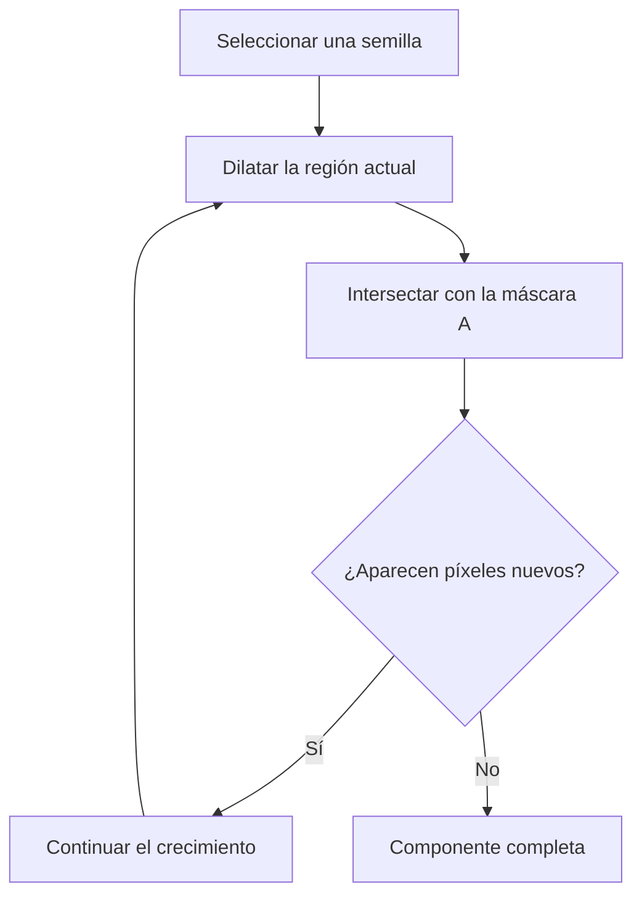
  
La intersección es indispensable. Sin ella, las dilataciones sucesivas podrían extenderse por el fondo hasta ocupar toda la imagen.  
  
### Importancia de la conectividad:  
  
El elemento estructurante establece qué significa que dos píxeles sean vecinos.  
  
Una cruz de $3\times3$ representa conectividad 4:  
  
$$  
B_4=  
\begin{bmatrix}  
0&1&0\\  
1&1&1\\  
0&1&0  
\end{bmatrix}  
$$  
  
Un cuadrado de $3\times3$ representa conectividad 8:  
  
$$  
B_8=  
\begin{bmatrix}  
1&1&1\\  
1&1&1\\  
1&1&1  
\end{bmatrix}  
$$  
  
La cruz solamente permite avanzar horizontal y verticalmente. El cuadrado también permite conexiones diagonales.  
  
Por lo tanto, dos píxeles que solamente se tocan por una esquina pueden pertenecer a componentes diferentes con conectividad 4, pero a una misma componente con conectividad 8.  
  
###### Ejemplo:  
  
Considérese una máscara de $7\times10$ con 21 píxeles activos. Contiene un anillo, algunas regiones aisladas y conexiones diagonales.  
  
La semilla está situada en:  
  
$$  
s=(1,1)  
$$  
  
Si se utiliza el cuadrado de $3\times3$, el número de píxeles alcanzados evoluciona de la siguiente manera:  
  
| Iteración | Píxeles alcanzados |  
|---|---:|  
| 0 | 1 |  
| 1 | 3 |  
| 2 | 7 |  
| 3 | 8 |  
| 4 | 9 |  
| 5 | 10 |  
| 6 | 11 |  
  
La región termina con once píxeles porque el cuadrado permite alcanzar otras estructuras mediante conexiones diagonales.  
  
En cambio, si se utiliza una cruz:  
  
| Iteración | Píxeles alcanzados |  
|---|---:|  
| 0 | 1 |  
| 1 | 3 |  
| 2 | 5 |  
| 3 | 7 |  
| 4 | 8 |  
  
El crecimiento se detiene en ocho píxeles, correspondientes al anillo conectado mediante vecinos laterales.  
  
El mismo algoritmo produce resultados distintos porque cambia la definición de conectividad.  
  
---  
  
## Etiquetado de componentes conectadas  
  
El **etiquetado de componentes conectadas** consiste en asignar una identificación diferente a cada región independiente de una máscara.  
  
La dilatación condicional permite comprender este proceso de manera sencilla.  
  
Primero se selecciona un píxel activo que todavía no tiene etiqueta. A partir de él se obtiene toda su componente mediante crecimiento condicional.  
  
Después se asigna una etiqueta a todos los píxeles alcanzados y se selecciona otra semilla entre los píxeles que todavía no han sido procesados.  
  
El procedimiento termina cuando no quedan píxeles activos sin etiquetar.  
  
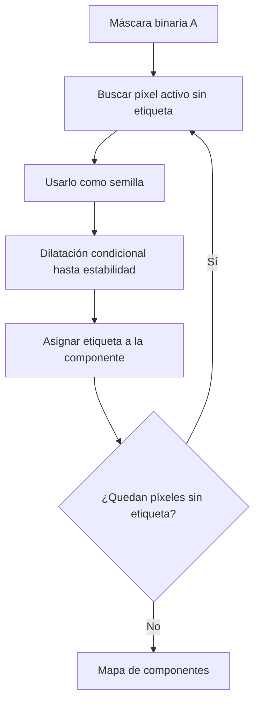
  
###### Ejemplo:  
  
Supóngase que una imagen microscópica contiene 24 células separadas.  
  
Al seleccionar una semilla dentro de la célula más grande y utilizar conectividad 8, la región crece hasta alcanzar:  
  
$$  
1253\text{ píxeles}  
$$  
  
El proceso requiere veinte pasadas para cubrir completamente la célula.  
  
Posteriormente, al repetir la operación desde cada región todavía no etiquetada, se obtienen:  
  
$$  
24\text{ componentes}  
$$  
  
Cada componente representa una célula distinta.  
  
Por lo tanto, el etiquetado puede comprenderse como una sucesión de reconstrucciones a partir de semillas.  
  
Esta interpretación es útil porque muestra que el algoritmo no necesita reconocer previamente la forma de los objetos: solamente necesita una máscara y una regla de conectividad.  
  
---  
  
## Relleno de agujeros mediante reconstrucción  
  
Un **agujero** es una región de fondo completamente encerrada por píxeles del objeto, de acuerdo con una conectividad determinada.  
  
Una manera precisa de rellenar agujeros consiste en identificar primero qué píxeles del fondo pueden alcanzarse desde el borde de la imagen.  
  
Todo fondo que no pueda alcanzarse desde el exterior corresponde a una región encerrada.  
  
### Crecimiento del fondo desde el borde:  
  
Sea $A$ la máscara del objeto y $A^c$ su complemento.  
  
Se define una semilla $X_0$ formada por los píxeles del fondo que pertenecen al borde de la imagen.  
  
Posteriormente se aplica:  
  
$$  
X_k=(X_{k-1}\oplus B)\cap A^c  
$$  
  
En este caso, la dilatación se restringe al fondo.  
  
Cuando el crecimiento termina, $X_\infty$ representa el fondo exterior conectado con los bordes.  
  
La máscara rellenada puede expresarse como:  
  
$$  
A_{\text{rellena}}=(X_\infty)^c  
$$  
  
La operación incorpora al objeto las regiones del fondo que no fueron alcanzadas.  
  
### Diferencia entre rellenar y cerrar:  
  
El relleno de agujeros y el cierre morfológico pueden producir resultados visualmente similares, pero no son operaciones equivalentes.  
  
El relleno identifica regiones de fondo encerradas y agrega solamente esas posiciones.  
  
El cierre utiliza dilatación y erosión con un elemento estructurante de tamaño fijo. Además de cubrir agujeros, puede conectar objetos cercanos y modificar sus fronteras.  
  
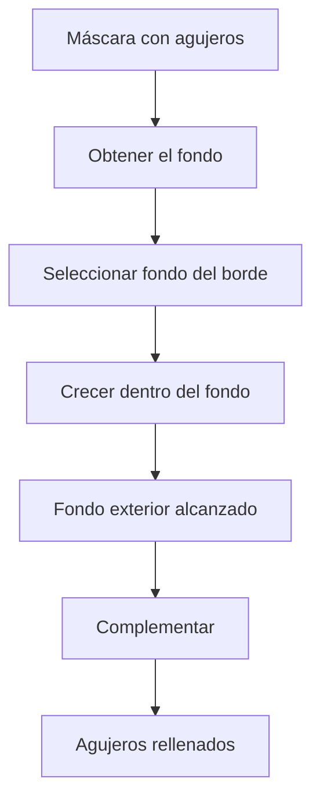
  
### Conectividad complementaria:  
  
Para evitar ambigüedades topológicas, frecuentemente se utilizan conectividades complementarias para el objeto y el fondo.  
  
Por ejemplo, si el objeto utiliza conectividad 8, puede analizarse el fondo con conectividad 4.  
  
Esto evita que una región encerrada se considere conectada al exterior únicamente por contactos diagonales que contradicen la interpretación de las fronteras del objeto.  
  
###### Ejemplo:  
  
Considérese una máscara con 75 agujeros de un píxel.  
  
El procedimiento de relleno utilizando conectividad 4 para el fondo agrega exactamente:  
  
$$  
75\text{ píxeles}  
$$  
  
El número de agujeros cambia de:  
  
$$  
75\rightarrow0  
$$  
  
Mientras que el número de componentes del objeto permanece:  
  
$$  
2142  
$$  
  
Si se utiliza conectividad 8 para el fondo, ocho de los agujeros pueden considerarse conectados al exterior mediante diagonales.  
  
En ese caso solamente se rellenan:  
  
$$  
67\text{ píxeles}  
$$  
  
y permanecen ocho agujeros según la interpretación utilizada.  
  
### Comparación con el cierre:  
  
| Operación | Píxeles agregados | Agujeros restantes | Componentes |  
|---|---:|---:|---:|  
| Máscara original | 0 | 75 | 2142 |  
| Relleno con fondo de conectividad 4 | 75 | 0 | 2142 |  
| Relleno con fondo de conectividad 8 | 67 | 8 | 2142 |  
| Cierre con cuadrado $3\times3$ | 1409 | 1 | 1506 |  
  
El cierre agrega muchos más píxeles porque también modifica otras regiones de la máscara.  
  
Por lo tanto, **cuando el objetivo consiste exclusivamente en rellenar agujeros, la reconstrucción del fondo puede ser más selectiva que el cierre convencional**.  
  
---  
  
## Esqueleto morfológico  
  
El **esqueleto morfológico** representa un objeto mediante un conjunto de posiciones centrales asociadas con el tamaño de los elementos estructurantes que caben en su interior.  
  
A diferencia del adelgazamiento convencional, que busca obtener trazos delgados y conectados, esta representación está diseñada para conservar la información necesaria para reconstruir la forma original.  
  
La idea consiste en encontrar los centros de los elementos estructurantes máximos contenidos dentro del objeto.  
  
### Elementos estructurantes máximos:  
  
Supóngase que $B$ es un cuadrado de $3\times3$.  
  
Cuando se coloca dentro de una máscara, algunas posiciones permiten acomodar cuadrados pequeños y otras permiten acomodar cuadrados mayores.  
  
Un cuadrado se considera **máximo** cuando no existe otro cuadrado mayor, contenido en el objeto, que lo incluya completamente.  
  
Por ejemplo, dentro de un bloque de $5\times5$ cabe un cuadrado de $5\times5$ centrado en el bloque.  
  
Los cuadrados de $3\times3$ que caben dentro de ese bloque no son máximos si están contenidos en el cuadrado mayor.  
  
Por lo tanto, el centro del cuadrado de $5\times5$ representa la estructura completa de manera más compacta.  
  
### Representación mediante centros y tamaños:  
  
El esqueleto conserva:  
  
1. La posición del centro.  
2. La escala o radio morfológico del elemento máximo.  
  
Si el elemento estructurante básico es un cuadrado de $3\times3$, después de $k$ erosiones equivalentes el cuadrado tiene lado:  
  
$$  
L=2k+1  
$$  
  
Por ejemplo:  
  
| Escala $k$ | Lado del cuadrado |  
|---|---:|  
| 0 | 1 |  
| 1 | 3 |  
| 2 | 5 |  
| 3 | 7 |  
| 4 | 9 |  
  
Esta relación permite interpretar el valor de $k$ como una medida discreta del tamaño de la estructura.  
  
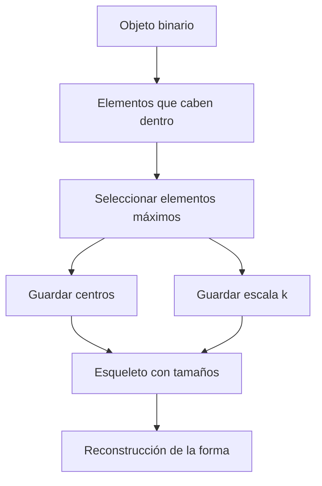
  
---  
  
## Cálculo matemático del esqueleto  
  
El esqueleto puede construirse mediante erosiones sucesivas y aperturas morfológicas.  
  
Se define:  
  
$$  
E_k=A\ominus kB  
$$  
  
En donde $A\ominus kB$ significa aplicar $k$ erosiones sucesivas utilizando $B$.  
  
Para $k=0$:  
  
$$  
E_0=A  
$$  
  
Cada componente del esqueleto se obtiene mediante:  
  
$$  
S_k(A)=E_k-(E_k\circ B)  
$$  
  
En donde:  
  
- $E_k$ es la máscara erosionada $k$ veces.  
- $E_k\circ B$ es la apertura de esa máscara.  
- $S_k(A)$ contiene las posiciones que no pueden reconstruirse mediante la apertura de $E_k$.  
  
El esqueleto completo es:  
  
$$  
S(A)=\bigcup_{k=0}^{K}S_k(A)  
$$  
  
En donde $K$ es la última escala para la cual la erosión todavía contiene píxeles.  
  
### Por qué se utiliza una apertura:  
  
La apertura identifica las posiciones de $E_k$ que pueden cubrirse mediante copias de $B$ contenidas en esa máscara.  
  
Al restarla, permanecen las posiciones que no pueden explicarse mediante estructuras de una escala mayor.  
  
Por lo tanto, cada $S_k$ conserva centros asociados con elementos máximos de tamaño $2k+1$.  
  
### Reconstrucción exacta:  
  
La propiedad fundamental es:  
  
$$  
A=\bigcup_{k=0}^{K}(S_k(A)\oplus kB)  
$$  
  
Cada punto del esqueleto se dilata tantas veces como indica su escala.  
  
La unión de todas las regiones reconstruidas recupera la máscara original.  
  
Esto demuestra que los valores de escala son esenciales.  
  
Si solamente se conservaran las posiciones del esqueleto y se perdieran sus tamaños, no sería posible determinar directamente cuánto debe expandirse cada región.  
  
---  
  
## Ejemplo de construcción del esqueleto  
  
Considérese una máscara de $7\times12$ formada por un bloque de $5\times5$ unido a un brazo de $3\times5$.  
  
El bloque ocupa los renglones 1 a 5 y las columnas 1 a 5.  
  
El brazo ocupa los renglones 2 a 4 y las columnas 6 a 10.  
  
La máscara contiene:  
  
$$  
|A|=40  
$$  
  
píxeles.  
  
Se utiliza un cuadrado centrado de $3\times3$.  
  
### Escala cero:  
  
En la escala inicial:  
  
$$  
E_0=A  
$$  
  
El área es:  
  
$$  
|E_0|=40  
$$  
  
La apertura de $A$ reconstruye toda la figura:  
  
$$  
|E_0\circ B|=40  
$$  
  
Por lo tanto:  
  
$$  
S_0(A)=\varnothing  
$$  
  
No existen posiciones que deban conservarse como elementos máximos de escala cero.  
  
### Primera erosión:  
  
Se calcula:  
  
$$  
E_1=A\ominus B  
$$  
  
El resultado contiene:  
  
$$  
|E_1|=14  
$$  
  
píxeles.  
  
Su apertura contiene:  
  
$$  
|E_1\circ B|=9  
$$  
  
Por lo tanto:  
  
$$  
|S_1(A)|=14-9=5  
$$  
  
Las cinco posiciones de $S_1$ se encuentran en el renglón 3, columnas 5 a 9.  
  
Cada una representa el centro de un cuadrado de $3\times3$.  
  
### Segunda erosión:  
  
Ahora:  
  
$$  
E_2=A\ominus2B  
$$  
  
Solamente sobrevive la posición:  
  
$$  
(3,3)  
$$  
  
Su apertura es vacía:  
  
$$  
E_2\circ B=\varnothing  
$$  
  
Por lo tanto:  
  
$$  
S_2(A)=\{(3,3)\}  
$$  
  
Esta posición representa el centro de un cuadrado de $5\times5$.  
  
### Tercera erosión:  
  
Después de otra erosión:  
  
$$  
E_3=\varnothing  
$$  
  
El procedimiento termina con:  
  
$$  
K=2  
$$  
  
### Resultado:  
  
| Escala | Área erosionada | Área de apertura | Píxeles del esqueleto |  
|---|---:|---:|---:|  
| $k=0$ | 40 | 40 | 0 |  
| $k=1$ | 14 | 9 | 5 |  
| $k=2$ | 1 | 0 | 1 |  
| $k=3$ | 0 | — | Fin |  
  
El esqueleto contiene:  
  
$$  
|S(A)|=6  
$$  
  
píxeles.  
  
Cinco corresponden a cuadrados de lado 3 y uno corresponde a un cuadrado de lado 5.  
  
### Reconstrucción:  
  
El punto $(3,3)$ se dilata dos veces, produciendo el bloque de $5\times5$.  
  
Las cinco posiciones restantes se dilatan una vez, produciendo el brazo de tres píxeles de grosor.  
  
La unión recupera:  
  
$$  
40\text{ píxeles}  
$$  
  
exactamente.  
  
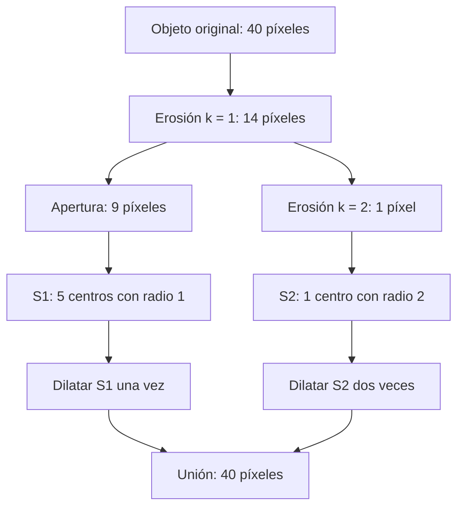
  
Este ejemplo demuestra que el esqueleto no necesita ser una línea continua.  
  
Puede estar formado por grupos de puntos separados, porque su función principal es permitir la reconstrucción mediante centros y tamaños.  
  
---  
  
## Diferencia entre esqueleto y adelgazamiento  
  
El adelgazamiento y el esqueleto morfológico reducen la representación de un objeto, pero conservan información distinta.  
  
El **adelgazamiento** elimina selectivamente píxeles de las fronteras mediante patrones que intentan mantener la conectividad.  
  
El **esqueleto morfológico por erosiones** conserva centros de elementos estructurantes máximos y las escalas necesarias para reconstruir la máscara.  
  
### Comparación de resultados:  
  
Considérese una célula aproximadamente circular que contiene:  
  
$$  
1257\text{ píxeles}  
$$  
  
Al aplicar adelgazamiento mediante patrones orientados se obtiene una estructura semejante a una X.  
  
El resultado contiene:  
  
$$  
89\text{ píxeles}  
$$  
  
y permanece conectado.  
  
Al calcular el esqueleto mediante cuadrados de $3\times3$, se obtiene:  
  
$$  
39\text{ píxeles}  
$$  
  
distribuidos en 21 componentes.  
  
A pesar de estar fragmentado, este último permite reconstruir exactamente los 1257 píxeles de la célula si se conservan las escalas.  
  
| Característica | Adelgazamiento | Esqueleto por erosiones |  
|---|---|---|  
| Objetivo | Obtener trazos delgados | Representar centros y tamaños máximos |  
| Conectividad | Puede conservarse mediante patrones adecuados | No necesariamente se conserva |  
| Información de grosor | No se conserva explícitamente | Se conserva mediante $k$ |  
| Reconstrucción exacta | No está garantizada | Sí, con centros y escalas |  
| Sensibilidad a irregularidades | Puede generar ramas | Puede generar numerosos centros |  
  
El método adecuado depende del objetivo.  
  
Para seguir una trayectoria, puede ser preferible un trazo conectado.  
  
Para representar una forma mediante centros y dimensiones locales, el esqueleto con escalas proporciona información adicional.  
  
---  
  
## Sensibilidad del esqueleto a los defectos  
  
El esqueleto puede cambiar considerablemente cuando se modifica un número pequeño de píxeles.  
  
Esto ocurre porque los elementos máximos dependen de toda la geometría de la región.  
  
### Eliminación de una esquina:  
  
Considérese nuevamente el objeto de 40 píxeles formado por un bloque y un brazo.  
  
Su esqueleto contiene seis centros.  
  
Ahora se elimina únicamente la esquina:  
  
$$  
(1,1)  
$$  
  
La nueva máscara contiene:  
  
$$  
39\text{ píxeles}  
$$  
  
Sin embargo, el cuadrado de $5\times5$ que antes cabía en el bloque deja de ser válido.  
  
Como ya no existe ese cuadrado máximo, varias posiciones correspondientes a cuadrados más pequeños se convierten en centros máximos.  
  
El esqueleto pasa de:  
  
$$  
6\rightarrow13  
$$  
  
píxeles.  
  
Todos los nuevos centros corresponden a escala 1.  
  
La reconstrucción continúa siendo exacta.  
  
### Aparición de una protuberancia:  
  
Si en lugar de eliminar una esquina se añade una protuberancia de un píxel sobre el objeto original, puede aparecer un nuevo centro de escala cero.  
  
El número de centros aumenta de:  
  
$$  
6\rightarrow7  
$$  
  
Este comportamiento muestra que una pequeña modificación puede crear una nueva estructura máxima.  
  
### Consecuencia práctica:  
  
El esqueleto representa fielmente los objetos presentes en la máscara, incluidos sus defectos.  
  
Por lo tanto, si una segmentación contiene ruido, los píxeles aislados y las irregularidades también pueden aparecer como centros esqueléticos.  
  
###### Ejemplo:  
  
En una máscara microscópica sin limpiar, el esqueleto contiene:  
  
$$  
3700\text{ píxeles}  
$$  
  
distribuidos en:  
  
$$  
2403\text{ componentes}  
$$  
  
Después de limpiar la máscara, el esqueleto contiene:  
  
$$  
435\text{ píxeles}  
$$  
  
distribuidos en:  
  
$$  
208\text{ componentes}  
$$  
  
Los 24 objetos originales pueden reconstruirse exactamente.  
  
Esto demuestra por qué resulta conveniente limpiar la segmentación antes de extraer el esqueleto.  
  
---  
  
## Eje medio y distancia a la frontera  
  
El **eje medio**, también llamado *medial axis*, representa una forma mediante los centros de discos máximos contenidos en ella.  
  
La idea es semejante a la del esqueleto morfológico, pero utiliza discos en lugar de cuadrados.  
  
En un punto interior puede calcularse la distancia hasta la frontera más cercana:  
  
$$  
d(p)=\min_{q\in\partial A}\|p-q\|  
$$  
  
En donde:  
  
- $p$ es un píxel interior.  
- $\partial A$ representa la frontera del objeto.  
- $q$ es un punto de esa frontera.  
- $d(p)$ es la distancia mínima hasta el contorno.  
  
Esta distancia puede interpretarse como el radio de un disco centrado en $p$ que cabe dentro del objeto.  
  
El eje medio contiene centros de discos máximos, de acuerdo con la geometría utilizada.  
  
### Utilidad de conservar el radio:  
  
Supóngase que una figura representa una llave.  
  
El eje medio permite identificar su estructura central y asociar a cada posición un radio local.  
  
Al reconstruir los discos correspondientes se aproxima la forma original.  
  
En un ejemplo de una llave se obtiene:  
  
$$  
IoU=0.980  
$$  
  
entre la reconstrucción y la máscara original.  
  
La representación permite conservar información relacionada con el grosor de diferentes partes del objeto.  
  
Por ejemplo, una zona estrecha de la llave presenta radios pequeños, mientras que una zona ancha presenta radios mayores.  
  
El radio máximo observado alcanza aproximadamente:  
  
$$  
26.2\text{ píxeles}  
$$  
  
Esto puede utilizarse para describir objetos alargados con anchuras variables.  
  
---  
  
## Envolvente convexa  
  
La **envolvente convexa** de una región es el conjunto convexo más pequeño que la contiene.  
  
Puede interpretarse imaginando una banda elástica alrededor de todos los puntos del objeto.  
  
Cuando la banda se ajusta, envuelve las partes exteriores y cubre las concavidades interiores.  
  
Se representa mediante:  
  
$$  
H(A)  
$$  
  
En donde $A$ es la región original.  
  
### Qué significa que una región sea convexa:  
  
Un conjunto es convexo cuando el segmento que conecta cualesquiera dos puntos del conjunto permanece completamente dentro de él.  
  
Una figura circular o rectangular es convexa.  
  
En cambio, una herradura, una estrella o dos discos unidos mediante un cuello estrecho pueden presentar concavidades.  
  
### Deficiencia convexa:  
  
La región que agrega la envolvente se denomina **deficiencia convexa**:  
  
$$  
D(A)=H(A)-A  
$$  
  
Esta diferencia permite identificar las zonas que faltan para que la figura sea convexa.  
  
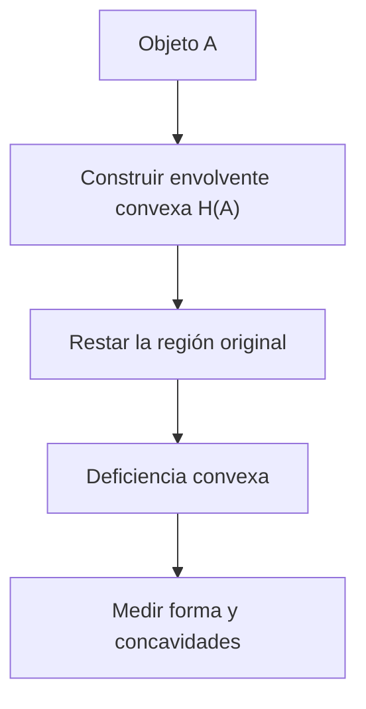
  
En una imagen digital, debe especificarse cómo se rasteriza la envolvente. Una convención consiste en construirla sobre los centros de los píxeles y considerar dentro de ella los centros que pertenecen al polígono o a su frontera.  
  
Esta convención evita confundir la geometría de los centros con el área continua de las celdas de imagen.  
  
---  
  
## Solidez y propiedades geométricas de una región  
  
La **solidez** mide qué proporción de la envolvente convexa está ocupada por el objeto.  
  
Se define mediante:  
  
$$  
Solidez(A)=\frac{|A|}{|H(A)|}  
$$  
  
En donde:  
  
- $|A|$ es el área de la región.  
- $|H(A)|$ es el área de su envolvente convexa digital.  
  
La solidez toma valores entre cero y uno para regiones no vacías.  
  
Cuando:  
  
$$  
Solidez=1  
$$  
  
el objeto coincide con su envolvente convexa.  
  
Cuando la figura presenta concavidades pronunciadas, la envolvente contiene muchos píxeles adicionales y la solidez disminuye.  
  
### Otras propiedades de región:  
  
Además de la solidez, pueden calcularse otras características:  
  
| Propiedad | Qué representa |  
|---|---|  
| Área | Número de píxeles del objeto |  
| Perímetro | Longitud aproximada de su frontera |  
| Centroide | Posición media de los píxeles |  
| Caja delimitadora | Rectángulo mínimo alineado con los ejes |  
| Extensión | Proporción de la caja delimitadora ocupada |  
| Solidez | Proporción de la envolvente convexa ocupada |  
  
La extensión se define como:  
  
$$  
Extension=\frac{|A|}{Area_{\text{caja}}}  
$$  
  
Mientras que el centroide se calcula mediante:  
  
$$  
\bar r=\frac{1}{|A|}\sum_{(r,c)\in A}r  
$$  
  
$$  
\bar c=\frac{1}{|A|}\sum_{(r,c)\in A}c  
$$  
  
Estas características describen aspectos distintos.  
  
El área indica tamaño, el centroide indica ubicación y la solidez permite reconocer irregularidades relacionadas con concavidades.  
  
---  
  
## Cálculo de la envolvente convexa de dos objetos unidos  
  
Considérense dos discos digitales de radio 2.  
  
Sus centros se encuentran en:  
  
$$  
(3,3)  
$$  
  
y:  
  
$$  
(3,7)  
$$  
  
Ambos discos se tocan en la posición:  
  
$$  
(3,5)  
$$  
  
La unión contiene:  
  
$$  
|A|=25  
$$  
  
píxeles.  
  
### Construcción de la envolvente:  
  
La envolvente convexa de los centros forma un hexágono cuyos vértices son:  
  
$$  
(1,3),\ (3,1),\ (5,3)  
$$  
  
$$  
(5,7),\ (3,9),\ (1,7)  
$$  
  
Al considerar los centros de píxeles contenidos dentro del hexágono o sobre su frontera, se obtienen:  
  
$$  
|H(A)|=33  
$$  
  
píxeles.  
  
### Deficiencia convexa:  
  
La cantidad de píxeles que agrega la envolvente es:  
  
$$  
|H(A)-A|=33-25  
$$  
  
$$  
|H(A)-A|=8  
$$  
  
Estas posiciones se encuentran en las concavidades de la unión de ambos discos.  
  
### Cálculo de la solidez:  
  
$$  
Solidez=\frac{25}{33}  
$$  
  
$$  
Solidez\approx0.758  
$$  
  
El valor es considerablemente menor que uno porque la figura presenta concavidades entre los dos discos.  
  
En cambio, un disco digital aislado de radio 2 contiene trece píxeles y su envolvente digital también contiene trece.  
  
Por lo tanto:  
  
$$  
Solidez_{\text{disco}}=1  
$$  
  
Este ejemplo demuestra cómo la solidez permite distinguir una forma aproximadamente convexa de otra formada por objetos conectados.  
  
---  
  
## Detección de objetos fusionados mediante solidez  
  
Cuando dos objetos se tocan, pueden formar una única componente conectada.  
  
Sin embargo, su unión suele presentar concavidades en la zona de contacto.  
  
Estas concavidades pueden identificarse mediante la solidez.  
  
### Comparación en una máscara de monedas:  
  
Considérese una escena con diez monedas, pero solamente seis componentes conectadas.  
  
Las regiones corresponden a varios pares de monedas, una moneda aislada y una moneda pequeña.  
  
Sus valores de solidez son:  
  
| Región | Solidez |  
|---|---:|  
| Primer par | 0.890 |  
| Segundo par | 0.916 |  
| Tercer par | 0.936 |  
| Par unido por puente | 0.565 |  
| Moneda aislada | 1.000 |  
| Moneda pequeña | 1.000 |  
  
Las regiones formadas por pares presentan solidez menor que las monedas individuales.  
  
Si se utiliza un umbral:  
  
$$  
Solidez<0.95  
$$  
  
se identifican las cuatro regiones fusionadas.  
  
### Limitaciones:  
  
La solidez permite detectar concavidades, pero **no determina directamente cuántos objetos componen una región**.  
  
Una figura individual con forma de herradura también puede presentar solidez baja.  
  
Asimismo, dos objetos muy superpuestos pueden formar una región casi convexa.  
  
En ese caso, la solidez se aproxima a uno y la detección resulta más difícil.  
  
Por ejemplo, el par con mayor superposición alcanza:  
  
$$  
Solidez=0.936  
$$  
  
Este valor está relativamente cerca del umbral de 0.95.  
  
Por lo tanto, el criterio debe ajustarse a la geometría de los objetos reales.  
  
---  
  
## Defectos de convexidad y análisis de formas  
  
La diferencia entre un objeto y su envolvente convexa permite identificar concavidades.  
  
Estas concavidades pueden utilizarse para reconocer estructuras características.  
  
Por ejemplo, una mano con los dedos separados presenta regiones cóncavas entre los dedos.  
  
La envolvente convexa conecta las puntas exteriores de los dedos, mientras que los espacios entre ellos quedan como defectos de convexidad.  
  
### Interpretación geométrica:  
  
Un defecto de convexidad puede caracterizarse mediante:  
  
- Los puntos extremos de la concavidad.  
- El punto más profundo respecto al borde de la envolvente.  
- La profundidad de esa concavidad.  
  
Si la profundidad supera un umbral adecuado, puede considerarse una separación relevante entre estructuras.  
  
###### Ejemplo:  
  
Supóngase que una mano presenta cuatro defectos de convexidad profundos entre cinco dedos extendidos.  
  
Si los defectos superan una profundidad de:  
  
$$  
40\text{ píxeles}  
$$  
  
pueden identificarse las cuatro separaciones principales.  
  
En este ejemplo, esas separaciones permiten reconocer cinco dedos.  
  
Sin embargo, el resultado depende de la escala de la mano, su orientación y la calidad de la segmentación.  
  
Por lo tanto, un umbral fijo de profundidad no resulta universal.  
  
---  
  
## Limitaciones de contar objetos mediante erosión fija  
  
La erosión puede separar regiones conectadas, pero utilizar un único número de iteraciones introduce un compromiso entre separar objetos grandes y conservar los pequeños.  
  
### Escena de diez monedas:  
  
Considérese una máscara que contiene diez monedas reales y solamente seis componentes iniciales.  
  
Se utiliza una erosión iterativa con un cuadrado de $3\times3$.  
  
El número de componentes cambia de la siguiente manera:  
  
| Iteraciones $k$ | Componentes |  
|---|---:|  
| 0 | 6 |  
| 1 | 6 |  
| 2 | 7 |  
| 3 | 8 |  
| 4 | 7 |  
| 5 | 7 |  
| 6 | 8 |  
| 7 | 9 |  
| 8 | 0 |  
  
La evolución muestra varios fenómenos.  
  
En la segunda iteración desaparece un puente y aumenta el número de componentes.  
  
En la tercera iteración se separa otro par.  
  
En la cuarta desaparece la moneda pequeña, reduciendo el conteo.  
  
Posteriormente se separan otros pares, hasta alcanzar nueve componentes.  
  
Finalmente, todas las regiones desaparecen.  
  
### Por qué no existe una escala adecuada:  
  
El par más superpuesto necesita aproximadamente siete erosiones para separarse.  
  
Sin embargo, la moneda pequeña desaparece en la cuarta erosión.  
  
Por lo tanto, ningún número fijo de iteraciones permite separar ese par y conservar simultáneamente la moneda pequeña.  
  
### Limitación del conteo mediante área:  
  
Otra alternativa consiste en dividir el área de cada componente por el área de una moneda de referencia.  
  
Si el área de la moneda aislada es:  
  
$$  
448\text{ píxeles}  
$$  
  
se obtienen aproximadamente:  
  
$$  
1.99,\ 1.95,\ 1.89,\ 2.20,\ 1.00,\ 0.18  
$$  
  
Al redondear:  
  
$$  
2+2+2+2+1+0=9  
$$  
  
La moneda pequeña se pierde porque su área es demasiado reducida respecto a la referencia.  
  
Esto demuestra que el conteo basado en un único tamaño también puede fallar cuando existen objetos de diferentes dimensiones.  
  
---  
  
## Conteo de objetos mediante núcleos morfológicos  
  
El **conteo mediante núcleos** utiliza toda la secuencia de erosiones, en lugar de seleccionar una escala fija.  
  
La idea consiste en observar qué componentes desaparecen completamente entre dos iteraciones consecutivas.  
  
Cada componente se cuenta cuando alcanza su última escala antes de desaparecer.  
  
### Procedimiento:  
  
Se generan erosiones sucesivas:  
  
$$  
E_k=A\ominus kB  
$$  
  
En cada escala se identifican las componentes conectadas de $E_k$.  
  
Una componente se considera un núcleo terminal cuando existe en la escala actual, pero ninguno de sus píxeles sobrevive a la siguiente erosión.  
  
En términos de conjuntos, si $C$ es una componente de $E_k$, debe cumplirse:  
  
$$  
C\cap E_{k+1}=\varnothing  
$$  
  
La suma de las componentes terminales detectadas en las diferentes escalas proporciona un conteo multiescala.  
  
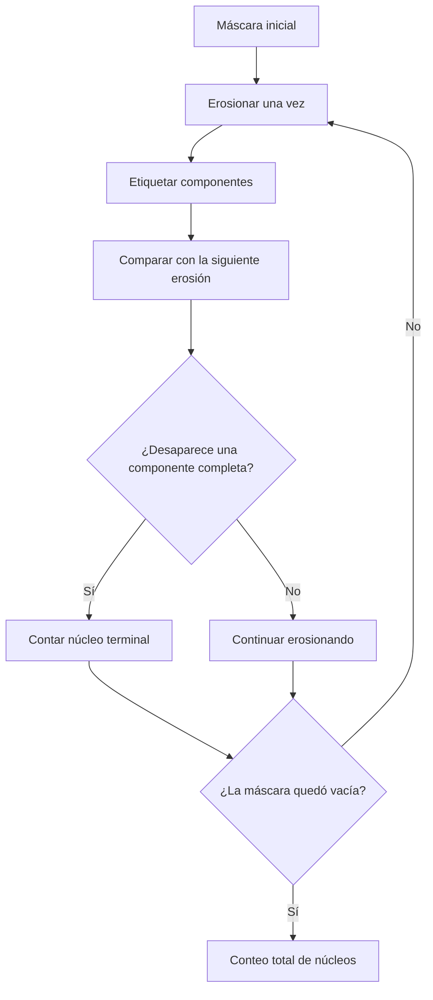
  
El procedimiento no exige seleccionar de antemano un tamaño único para todos los objetos.  
  
Sin embargo, su validez depende de la geometría de las regiones. Un objeto irregular puede generar varios núcleos terminales, mientras que objetos muy superpuestos pueden no separarse antes de desaparecer.  
  
### Ejemplo de las diez monedas:  
  
La moneda pequeña permanece hasta la escala:  
  
$$  
k=3  
$$  
  
En ese momento solamente contiene cuatro píxeles.  
  
La siguiente erosión la elimina completamente.  
  
Por lo tanto, se cuenta un núcleo:  
  
$$  
N_3=1  
$$  
  
Las otras nueve monedas continúan presentes.  
  
Después de siete erosiones aparecen nueve componentes, cada una con doce píxeles.  
  
La siguiente erosión elimina completamente esas nueve componentes.  
  
Por lo tanto:  
  
$$  
N_7=9  
$$  
  
El conteo total es:  
  
$$  
N=N_3+N_7  
$$  
  
$$  
N=1+9=10  
$$  
  
La diferencia respecto al conteo con erosión fija es fundamental.  
  
Una erosión de escala siete encuentra solamente nueve monedas porque la pequeña ya desapareció.  
  
El conteo de núcleos conserva el registro de que esa moneda existió y desapareció en una escala anterior.  
  
---  
  
## Tamaño de los objetos a partir de sus núcleos  
  
Además de permitir contar objetos, la escala de desaparición contiene información relacionada con su tamaño.  
  
Con un cuadrado de $3\times3$, la erosión repetida $k$ veces equivale a utilizar un cuadrado de lado:  
  
$$  
L=2k+1  
$$  
  
Por lo tanto, la última escala en la que un objeto conserva una región indica el tamaño aproximado del mayor cuadrado que cabe en su interior.  
  
### Ejemplo de células de distintos tamaños:  
  
Considérese una máscara con 24 células:  
  
- 12 pequeñas.  
- 8 medianas.  
- 4 grandes.  
  
Al analizar sus núcleos se obtiene:  
  
| Tipo de célula | Cantidad | Última escala $k$ |  
|---|---:|---:|  
| Pequeñas | 12 | 1 |  
| Medianas | 8 | 5 |  
| Grandes | 4 | 13 |  
  
Por lo tanto, el conteo es:  
  
$$  
12+8+4=24  
$$  
  
### Interpretación de los tamaños:  
  
Para las células pequeñas:  
  
$$  
L=2(1)+1=3  
$$  
  
Para las medianas:  
  
$$  
L=2(5)+1=11  
$$  
  
Para las grandes:  
  
$$  
L=2(13)+1=27  
$$  
  
En el caso de una célula aproximadamente circular de diámetro 40, un cuadrado de lado 27 tiene diagonal:  
  
$$  
d=27\sqrt{2}\approx38.18  
$$  
  
Por lo tanto, puede caber dentro de un círculo de diámetro 40 si está correctamente centrado.  
  
En cambio, un cuadrado de lado 29 tiene diagonal:  
  
$$  
d=29\sqrt{2}\approx41.01  
$$  
  
y ya no cabe dentro de ese círculo.  
  
Esto explica por qué el núcleo de una célula grande puede aparecer en escala 13.  
  
La escala de desaparición no proporciona directamente el diámetro exacto del objeto, pero sí una medida geométrica relacionada con su grosor interior.  
  
---  
  
## Relación entre esqueleto, núcleos y envolvente convexa  
  
El esqueleto, los núcleos y la envolvente convexa describen propiedades diferentes de una misma máscara.  
  
El esqueleto identifica centros y tamaños de elementos estructurantes máximos.  
  
Los núcleos terminales permiten reconocer estructuras que desaparecen en diferentes escalas de erosión.  
  
La envolvente convexa describe qué tan cóncava es una región.  
  
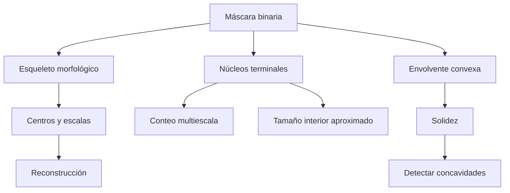
  
Estas representaciones no deben confundirse.  
  
Por ejemplo, una máscara puede contener una sola componente conectada, varios centros esqueléticos y dos núcleos terminales correspondientes a dos objetos superpuestos.  
  
Asimismo, una región puede presentar baja solidez sin contener necesariamente más de un objeto.  
  
Por lo tanto, la selección depende de la pregunta que se desea responder:  
  
| Pregunta | Herramienta |  
|---|---|  
| ¿Cuántas componentes conectadas existen? | Etiquetado |  
| ¿Qué agujeros están encerrados? | Reconstrucción del fondo |  
| ¿Qué centros y tamaños representan la forma? | Esqueleto |  
| ¿Qué tan cóncava es una región? | Envolvente y solidez |  
| ¿Cuántos objetos de diferentes tamaños pueden distinguirse por erosión? | Núcleos terminales |  
  
---  
  
## Morfología en escala de grises  
  
La morfología matemática también puede aplicarse directamente sobre imágenes que contienen diferentes niveles de intensidad.  
  
En una imagen binaria, cada posición representa objeto o fondo.  
  
En una imagen en escala de grises, cada píxel contiene un valor:  
  
$$  
f(r,c)  
$$  
  
que puede interpretarse como una altura dentro de una superficie.  
  
Las regiones claras forman elevaciones y las oscuras forman depresiones.  
  
### Interpretación como relieve:  
  
Supóngase que una imagen microscópica contiene células claras sobre un fondo oscuro.  
  
Las células pueden interpretarse como mesetas elevadas, mientras que el fondo forma una superficie de menor altura.  
  
El ruido puede producir:  
  
- Picos estrechos de intensidad elevada.  
- Pozos estrechos de intensidad baja.  
- Fluctuaciones alrededor del nivel de fondo.  
  
Esta interpretación permite extender las operaciones de erosión y dilatación.  
  
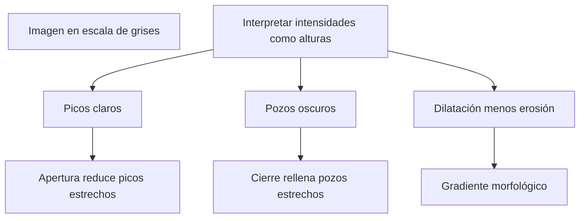
  
---  
  
## Erosión y dilatación en escala de grises  
  
Cuando se utiliza un elemento estructurante **plano**, la erosión toma el mínimo de los valores contenidos en la vecindad.  
  
Se expresa como:  
  
$$  
(f\ominus b)(x)=\min_{u\in b}f(x+u)  
$$  
  
En donde:  
  
- $f$ es la imagen en escala de grises.  
- $b$ representa el soporte del elemento estructurante.  
- $x$ es la posición evaluada.  
- $u$ recorre los desplazamientos de la vecindad.  
  
Para un elemento simétrico, la dilatación toma el máximo:  
  
$$  
(f\oplus b)(x)=\max_{u\in b}f(x+u)  
$$  
  
En una formulación general se debe respetar la orientación o reflexión correspondiente del elemento estructurante.  
  
### Interpretación:  
  
La erosión reduce los valores elevados cuando cerca de ellos existen intensidades menores.  
  
La dilatación aumenta los valores bajos cuando cerca existen intensidades mayores.  
  
Por lo tanto:  
  
- La erosión tiende a reducir las regiones claras.  
- La dilatación tiende a expandir las regiones claras.  
  
### Relación con la morfología binaria:  
  
Si la imagen solamente contiene ceros y unos, el mínimo de una vecindad equivale a exigir que todos sus elementos sean uno.  
  
Esto corresponde a una operación AND.  
  
El máximo equivale a exigir que al menos un elemento sea uno.  
  
Esto corresponde a una operación OR.  
  
Por lo tanto, la morfología binaria es un caso particular de la morfología en escala de grises.  
  
---  
  
## Cálculo de erosión y dilatación en una señal  
  
Considérese una señal de doce muestras:  
  
$$  
f=[2,2,2,8,2,2,6,6,6,1,6,6]  
$$  
  
Se utiliza un elemento estructurante plano de tres posiciones, con el origen en el centro.  
  
En los extremos se repite el valor de la primera o última muestra, según corresponda.  
  
### Erosión:  
  
Cada salida es el mínimo entre la muestra anterior, la actual y la siguiente.  
  
Por ejemplo, en la posición 3:  
  
$$  
f(3)=8  
$$  
  
Su vecindad es:  
  
$$  
[2,8,2]  
$$  
  
Por lo tanto:  
  
$$  
(f\ominus b)(3)=\min(2,8,2)=2  
$$  
  
El pico de intensidad 8 desaparece.  
  
La erosión completa produce:  
  
$$  
f\ominus b=  
[2,2,2,2,2,2,2,6,1,1,1,6]  
$$  
  
### Dilatación:  
  
Ahora cada salida es el máximo de la vecindad.  
  
En la posición 3:  
  
$$  
(f\oplus b)(3)=\max(2,8,2)=8  
$$  
  
La intensidad elevada se conserva y se extiende hacia posiciones vecinas.  
  
El resultado es:  
  
$$  
f\oplus b=  
[2,2,8,8,8,6,6,6,6,6,6,6]  
$$  
  
### Comparación:  
  
| Posición | Original | Erosión | Dilatación |  
|---|---:|---:|---:|  
| 0 | 2 | 2 | 2 |  
| 1 | 2 | 2 | 2 |  
| 2 | 2 | 2 | 8 |  
| 3 | 8 | 2 | 8 |  
| 4 | 2 | 2 | 8 |  
| 5 | 2 | 2 | 6 |  
| 6 | 6 | 2 | 6 |  
| 7 | 6 | 6 | 6 |  
| 8 | 6 | 1 | 6 |  
| 9 | 1 | 1 | 6 |  
| 10 | 6 | 1 | 6 |  
| 11 | 6 | 6 | 6 |  
  
La erosión elimina el pico estrecho y expande la influencia del pozo.  
  
La dilatación rellena el pozo y expande las regiones de intensidad elevada.  
  
---  
  
## Apertura y cierre en escala de grises  
  
La **apertura en escala de grises** utiliza erosión seguida de dilatación:  
  
$$  
f\circ b=(f\ominus b)\oplus b  
$$  
  
El **cierre en escala de grises** utiliza dilatación seguida de erosión:  
  
$$  
f\bullet b=(f\oplus b)\ominus b  
$$  
  
Estas composiciones conservan el comportamiento general de las operaciones binarias, pero trabajan sobre intensidades en lugar de conjuntos.  
  
### Apertura:  
  
La apertura elimina picos claros que son demasiado estrechos respecto al elemento estructurante.  
  
Las regiones claras suficientemente anchas pueden conservarse.  
  
### Cierre:  
  
El cierre rellena depresiones oscuras que son demasiado estrechas respecto al elemento estructurante.  
  
Las regiones oscuras suficientemente amplias pueden permanecer.  
  
### Cálculo sobre la señal anterior:  
  
La apertura produce:  
  
$$  
f\circ b=  
[2,2,2,2,2,2,6,6,6,1,6,6]  
$$  
  
El pico de intensidad 8 desaparece, mientras que el pozo de intensidad 1 permanece.  
  
El cierre produce:  
  
$$  
f\bullet b=  
[2,2,2,8,6,6,6,6,6,6,6,6]  
$$  
  
El pozo desaparece.  
  
También se rellena una depresión de dos muestras situada entre el pico y la meseta de intensidad 6.  
  
### Interpretación:  
  
El cierre no necesita que un pozo tenga solamente una muestra para modificarlo.  
  
Lo importante es que la depresión sea suficientemente estrecha respecto al elemento estructurante.  
  
Por lo tanto, la geometría de la vecindad sigue determinando qué estructuras se conservan y cuáles desaparecen.  
  
---  
  
## Gradiente morfológico  
  
El **gradiente morfológico** permite resaltar las diferencias locales de intensidad.  
  
Se define como:  
  
$$  
g=(f\oplus b)-(f\ominus b)  
$$  
  
En donde:  
  
- $f\oplus b$ representa el máximo local.  
- $f\ominus b$ representa el mínimo local.  
- $g$ mide la diferencia entre ambos.  
  
El resultado es elevado cuando la vecindad contiene valores muy diferentes.  
  
En regiones uniformes, el máximo y el mínimo son similares, por lo que el gradiente es pequeño.  
  
### Cálculo:  
  
Para la señal:  
  
$$  
f=[2,2,2,8,2,2,6,6,6,1,6,6]  
$$  
  
se obtiene:  
  
$$  
g=[0,0,6,6,6,4,4,0,5,5,5,0]  
$$  
  
Por ejemplo, en la posición 3:  
  
$$  
g(3)=8-2=6  
$$  
  
La diferencia elevada indica una transición importante de intensidad.  
  
En la posición 7:  
  
$$  
g(7)=6-6=0  
$$  
  
La vecindad es uniforme.  
  
### Interpretación como detector de cambios:  
  
El gradiente morfológico no calcula derivadas mediante diferencias finitas.  
  
En su lugar, mide el rango local:  
  
$$  
\text{Rango local}=\text{Máximo}-\text{Mínimo}  
$$  
  
Por ello, puede resaltar fronteras y variaciones importantes sin depender directamente de una dirección de derivación.  
  
Sin embargo, también puede responder intensamente a picos aislados y ruido de alto contraste.  
  
---  
  
## Efecto de la morfología en imágenes ruidosas  
  
Las operaciones morfológicas en grises no solamente eliminan estructuras. También modifican las estadísticas generales de intensidad.  
  
### Erosión sobre un fondo con ruido:  
  
Supóngase que el fondo de una imagen tiene media:  
  
$$  
\mu=70  
$$  
  
y dispersión aproximada:  
  
$$  
\sigma=20  
$$  
  
Al aplicar erosión con un cuadrado de $3\times3$, cada posición toma el mínimo de nueve valores.  
  
Debido a que se selecciona el menor valor de cada vecindad, el nivel promedio disminuye.  
  
En un experimento se obtiene:  
  
$$  
\mu_{\text{erosión}}\approx40.3  
$$  
  
### Dilatación:  
  
La dilatación selecciona el máximo de nueve valores.  
  
Por lo tanto, el promedio aumenta:  
  
$$  
\mu_{\text{dilatación}}\approx99.6  
$$  
  
### Apertura y cierre:  
  
La apertura produce:  
  
$$  
\mu_{\text{apertura}}\approx51.6  
$$  
  
Mientras que el cierre produce:  
  
$$  
\mu_{\text{cierre}}\approx88.4  
$$  
  
### Comparación:  
  
| Operación | Media del fondo |  
|---|---:|  
| Original | 70.0 |  
| Erosión | 40.3 |  
| Apertura | 51.6 |  
| Cierre | 88.4 |  
| Dilatación | 99.6 |  
  
La apertura no recupera necesariamente la intensidad media original.  
  
Su propiedad es que no produce valores mayores que los de la imagen original en cada posición, no que conserve el promedio.  
  
De manera complementaria, el cierre no produce valores menores que los originales.  
  
### Reducción de variabilidad:  
  
En el experimento, tanto la apertura como el cierre reducen la dispersión del fondo hasta aproximadamente:  
  
$$  
\sigma=9.7  
$$  
  
Esto indica que las composiciones pueden suavizar fluctuaciones locales.  
  
Sin embargo, también desplazan el nivel medio en direcciones diferentes.  
  
Por lo tanto, una operación puede reducir ruido y modificar simultáneamente el brillo promedio de la imagen.  
  
---  
  
## Procesamiento en grises antes de la umbralización  
  
Una aplicación importante de la morfología en escala de grises consiste en limpiar las intensidades antes de convertir la imagen en una máscara binaria.  
  
Esto permite reducir determinadas irregularidades sin perder inmediatamente la información contenida en los diferentes niveles de gris.  
  
### Comparación de dos procedimientos:  
  
El primer procedimiento utiliza una umbralización inicial y después aplica operaciones binarias:  
  
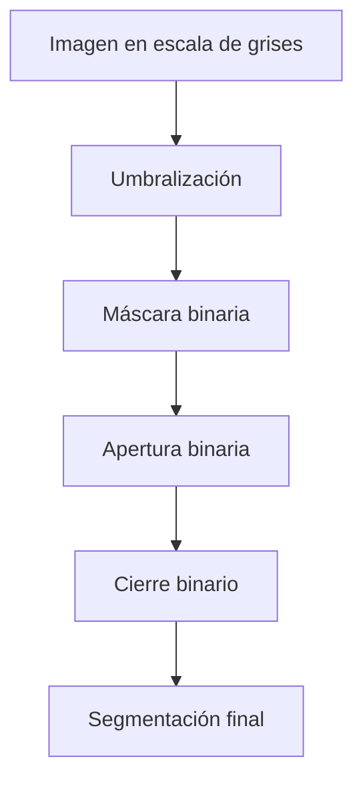
  
El segundo procedimiento limpia primero la imagen en escala de grises:  
  
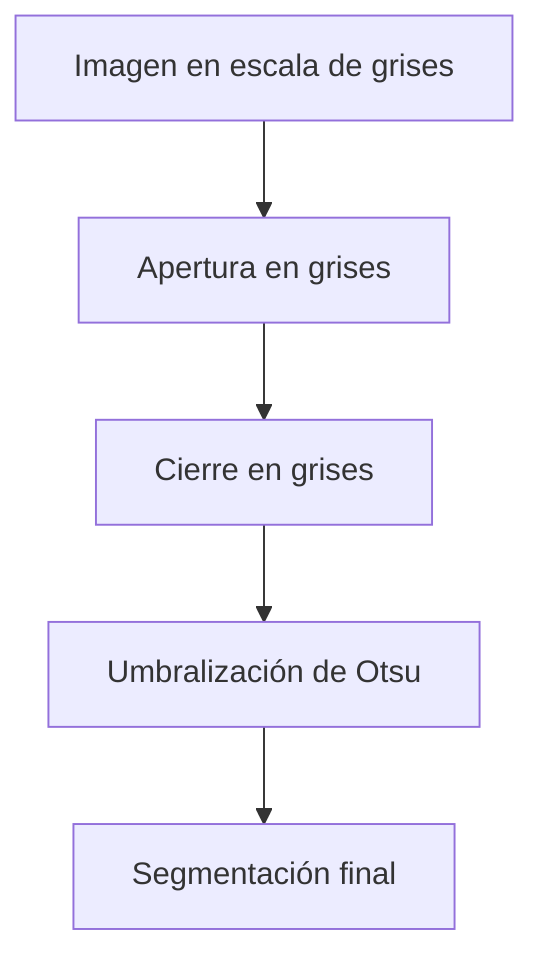
  
La diferencia es el momento en que se pierde la información de intensidad.  
  
En el procedimiento binario, todos los valores quedan reducidos a cero o uno desde el principio.  
  
En el procedimiento en grises, las operaciones trabajan directamente sobre la distribución local de intensidades.  
  
### Resultados experimentales:  
  
Considérese una imagen con 24 células, incluidas doce pequeñas.  
  
Se comparan tres procedimientos:  
  
| Procedimiento | Objetos | IoU |  
|---|---:|---:|  
| Apertura y cierre binarios | 24 | 0.989 |  
| Apertura y cierre en grises con cruz | 24 | 0.991 |  
| Apertura y cierre en grises con cuadrado | 24 | 0.987 |  
  
El procesamiento en escala de grises con cruz obtiene el mayor IoU de esta comparación.  
  
Además, conserva las doce células pequeñas.  
  
### Mejora del contraste estructural:  
  
Al analizar el gradiente morfológico, el contraste promedio de los bordes reales respecto al fondo también cambia.  
  
En la imagen original, la relación es aproximadamente:  
  
$$  
2.0  
$$  
  
Después de limpiar la imagen en escala de grises, aumenta hasta:  
  
$$  
5.5  
$$  
  
Esto indica que las fronteras relevantes se distinguen mejor de las fluctuaciones del fondo.  
  
Sin embargo, la mejora no significa que procesar en grises sea siempre superior.  
  
El resultado depende del tamaño y la forma del elemento estructurante, del ruido y de las estructuras que se desean conservar.  
  
---  
  
## Selección de herramientas según el objetivo  
  
Las técnicas estudiadas permiten responder preguntas diferentes sobre una misma imagen.  
  
| Objetivo | Técnica | Limitación principal |  
|---|---|---|  
| Extraer una región desde una semilla | Dilatación condicional | Depende de la conectividad |  
| Identificar objetos separados | Etiquetado | No distingue objetos que se tocan |  
| Rellenar agujeros | Reconstrucción del fondo | Depende de la conectividad del fondo |  
| Representar centros y tamaños | Esqueleto morfológico | Sensible a ruido e irregularidades |  
| Obtener un trazo conectado | Adelgazamiento | No conserva necesariamente el grosor |  
| Medir concavidades | Envolvente convexa | No cuenta directamente objetos |  
| Identificar regiones fusionadas | Solidez | Depende de la geometría y el umbral |  
| Contar objetos de diferentes tamaños | Núcleos terminales | Puede fallar con formas irregulares |  
| Eliminar picos claros | Apertura en grises | Puede reducir intensidades relevantes |  
| Rellenar pozos oscuros | Cierre en grises | Puede modificar estructuras verdaderas |  
| Resaltar cambios locales | Gradiente morfológico | También responde al ruido |  
  
El criterio principal consiste en identificar qué información debe conservarse.  
  
Si solamente interesa obtener componentes, puede utilizarse crecimiento desde semillas.  
  
Si se necesita reconstruir una forma, debe conservarse la escala de los centros esqueléticos.  
  
Si se desea reconocer concavidades, la solidez proporciona una medida geométrica.  
  
Si se pretende contar objetos de distintos tamaños, resulta útil analizar toda la evolución de las erosiones.  
  
Finalmente, si todavía es importante conservar diferencias de intensidad, puede ser preferible procesar la imagen en escala de grises antes de umbralizar.  
  
---  
  
## Ideas principales  
  
### La dilatación condicional permite extraer componentes:  
  
$$  
X_k=(X_{k-1}\oplus B)\cap A  
$$  
  
La dilatación alcanza nuevos vecinos y la intersección impide salir de la máscara.  
  
El crecimiento termina cuando la región deja de cambiar.  
  
### La conectividad modifica los resultados:  
  
El cuadrado de $3\times3$ representa conectividad 8 y la cruz representa conectividad 4.  
  
Una conexión diagonal puede unir dos regiones con el cuadrado y mantenerlas separadas con la cruz.  
  
### El relleno de agujeros utiliza el fondo exterior:  
  
El fondo se hace crecer desde los bordes de la imagen.  
  
Las posiciones que no pueden alcanzarse corresponden a regiones encerradas.  
  
Este procedimiento puede rellenar agujeros sin conectar objetos adicionales.  
  
### El esqueleto conserva centros y escalas:  
  
$$  
S_k(A)=E_k-(E_k\circ B)  
$$  
  
Cada posición del esqueleto representa el centro de un elemento estructurante máximo asociado con la escala $k$.  
  
### El esqueleto permite reconstrucción exacta:  
  
$$  
A=\bigcup_{k=0}^{K}(S_k(A)\oplus kB)  
$$  
  
La reconstrucción utiliza los centros y sus tamaños correspondientes.  
  
### El esqueleto no necesita estar conectado:  
  
Una región conectada puede producir un esqueleto morfológico fragmentado.  
  
Esto no impide reconstruir exactamente la forma original.  
  
### El adelgazamiento y el esqueleto conservan información diferente:  
  
El adelgazamiento busca obtener trazos delgados y conectados.  
  
El esqueleto por erosiones conserva centros y escalas para representar y reconstruir la región.  
  
### El esqueleto es sensible al ruido:  
  
Una pequeña irregularidad puede crear nuevos elementos máximos y modificar considerablemente la representación.  
  
Por ello, conviene limpiar la máscara antes de calcularlo.  
  
### La envolvente convexa mide concavidades:  
  
$$  
D(A)=H(A)-A  
$$  
  
La diferencia entre la envolvente y el objeto identifica las regiones que faltan para obtener una forma convexa.  
  
### La solidez caracteriza la forma:  
  
$$  
Solidez=\frac{|A|}{|H(A)|}  
$$  
  
Un valor cercano a uno indica una forma aproximadamente convexa.  
  
Valores menores pueden indicar concavidades o regiones fusionadas.  
  
### La solidez no cuenta objetos:  
  
Una región puede tener baja solidez por su propia forma.  
  
Asimismo, dos objetos superpuestos pueden producir una región casi convexa.  
  
### Los núcleos permiten contar a diferentes escalas:  
  
Cada componente terminal se cuenta en la última erosión donde permanece presente.  
  
Esto evita depender de una única escala para todos los objetos.  
  
### La escala de desaparición proporciona información de tamaño:  
  
Con un cuadrado de $3\times3$:  
  
$$  
L=2k+1  
$$  
  
La última escala de supervivencia indica el tamaño aproximado del cuadrado máximo que cabe dentro del objeto.  
  
### La erosión en grises utiliza mínimos:  
  
$$  
(f\ominus b)(x)=\min_{u\in b}f(x+u)  
$$  
  
Reduce picos y puede disminuir el nivel promedio de intensidad.  
  
### La dilatación en grises utiliza máximos:  
  
$$  
(f\oplus b)(x)=\max_{u\in b}f(x+u)  
$$  
  
Expande regiones claras y puede aumentar el nivel promedio.  
  
### La apertura elimina picos claros estrechos:  
  
$$  
f\circ b=(f\ominus b)\oplus b  
$$  
  
No garantiza recuperar la media original de la imagen.  
  
### El cierre rellena depresiones oscuras estrechas:  
  
$$  
f\bullet b=(f\oplus b)\ominus b  
$$  
  
Puede rellenar pozos y valles de tamaño inferior al elemento estructurante.  
  
### El gradiente morfológico resalta cambios locales:  
  
$$  
g=(f\oplus b)-(f\ominus b)  
$$  
  
Representa la diferencia entre el máximo y el mínimo de una vecindad.  
  
### Procesar en grises permite conservar información antes del umbral:  
  
La apertura y el cierre pueden reducir fluctuaciones locales antes de convertir la imagen en una máscara binaria.  
  
La calidad del resultado depende de que el elemento estructurante sea adecuado para las estructuras de interés.  
  
---  
  
## Conclusión  
  
La morfología matemática permite ir más allá de la limpieza de máscaras binarias y utilizar la geometría de las regiones para extraer información sobre su organización, tamaño y estructura.  
  
La dilatación condicional constituye una herramienta fundamental para reconstruir componentes desde semillas. Al limitar el crecimiento mediante una máscara, permite identificar regiones completas sin invadir el fondo. El mismo principio puede aplicarse al complemento de la imagen para identificar el fondo exterior y rellenar agujeros de manera selectiva.  
  
El esqueleto morfológico proporciona una representación compacta basada en los centros de elementos estructurantes máximos. A diferencia del adelgazamiento convencional, conserva información de tamaño que permite reconstruir la forma original. Sin embargo, esta fidelidad también implica sensibilidad a pequeñas irregularidades, por lo que la calidad de la segmentación inicial resulta fundamental.  
  
La envolvente convexa introduce una manera diferente de describir los objetos. Mediante la solidez y las deficiencias convexas es posible reconocer concavidades y detectar regiones que podrían contener objetos fusionados. No obstante, estas medidas describen la geometría y no proporcionan directamente un conteo.  
  
El análisis de núcleos aprovecha las diferentes escalas de erosión para reconocer objetos que desaparecen en momentos distintos. Esto permite superar ciertas limitaciones de los métodos que utilizan un único tamaño de elemento estructurante y ofrece información adicional sobre el grosor interior de las regiones.  
  
Finalmente, la morfología en escala de grises extiende las mismas ideas a las intensidades de la imagen. La erosión utiliza mínimos locales, la dilatación utiliza máximos, la apertura elimina elevaciones estrechas y el cierre rellena depresiones. El gradiente morfológico aprovecha la diferencia entre máximo y mínimo para destacar cambios de intensidad.  
  
Por lo tanto, **la elección de una técnica morfológica depende de qué propiedad se desea conservar o medir**. Las componentes permiten estudiar conectividad; el esqueleto conserva centros y tamaños; la envolvente describe concavidades; los núcleos permiten analizar objetos en diferentes escalas; y las operaciones en grises procesan estructuras antes de perder la información de intensidad mediante una umbralización.  
  
Comprender estas relaciones permite construir sistemas de visión artificial capaces de contar objetos, identificar formas, reconstruir regiones y mejorar segmentaciones de manera más precisa.  