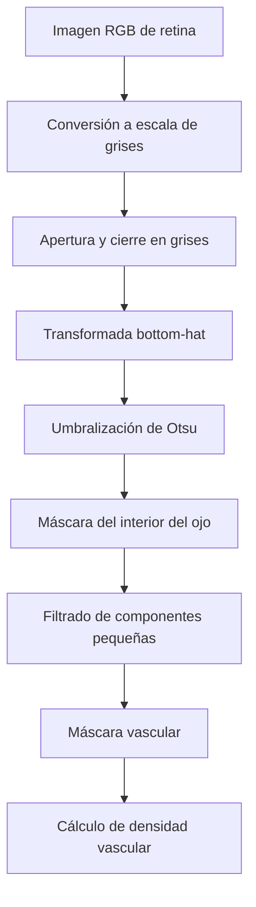
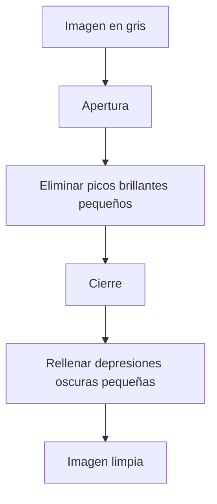
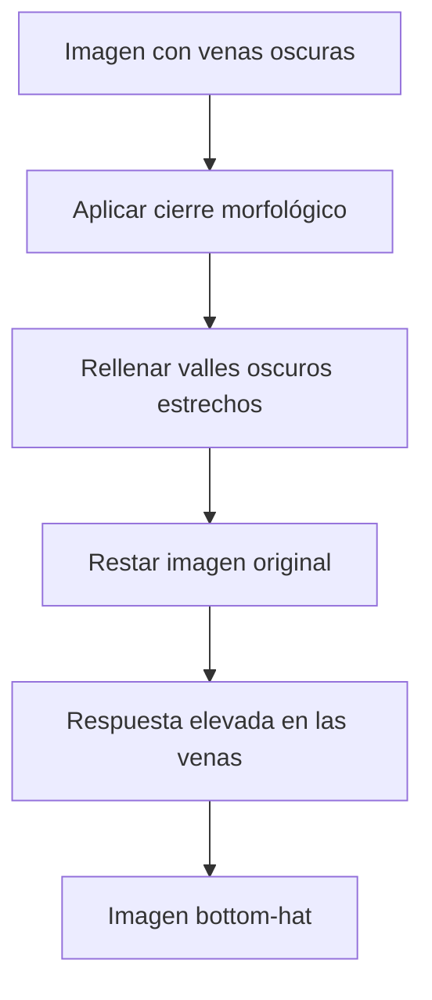
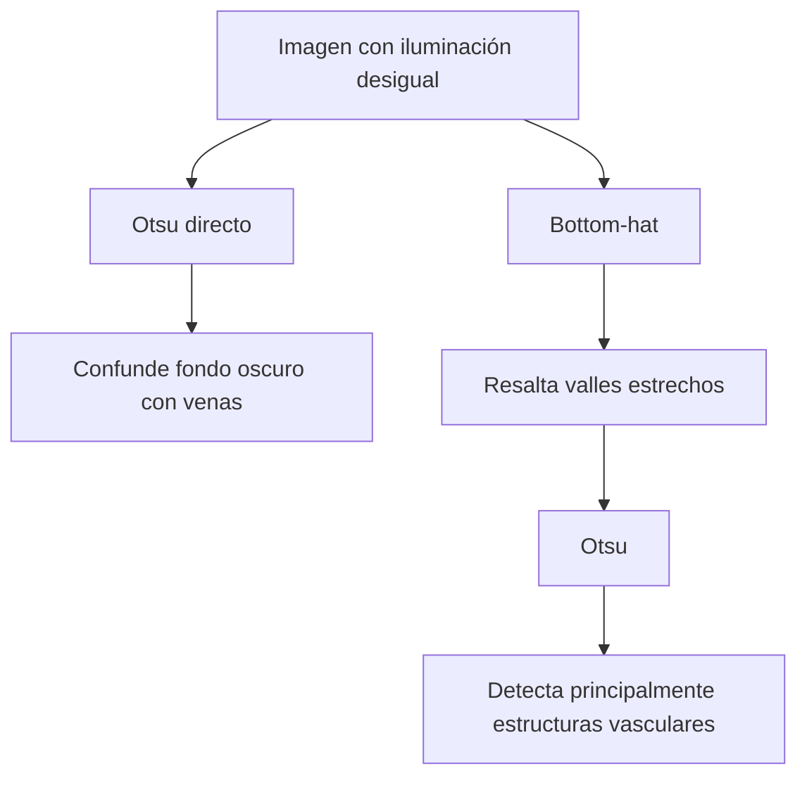
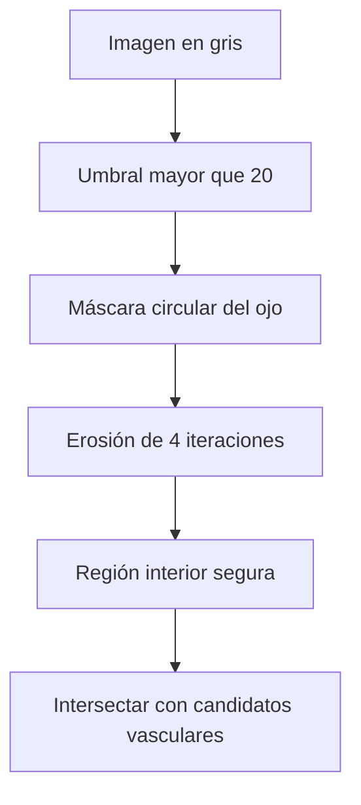
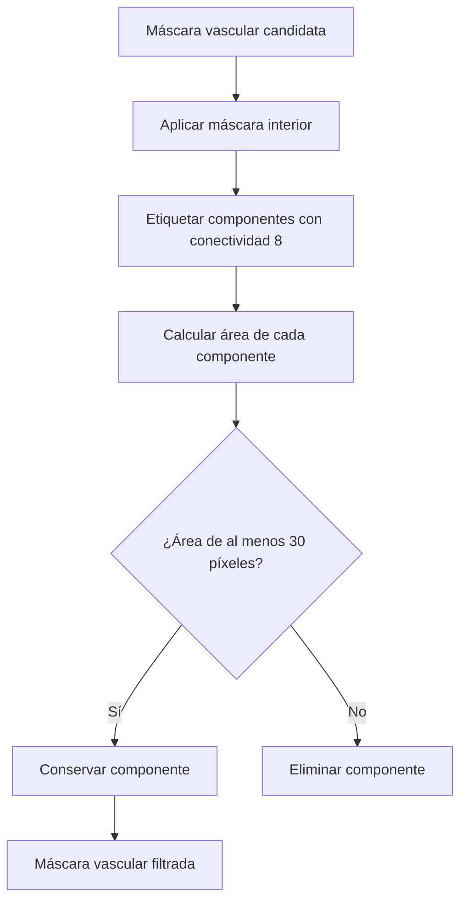

## Introducción  
  
La segmentación de estructuras anatómicas constituye una aplicación importante de la visión artificial. En una imagen de fondo de ojo, los vasos sanguíneos forman una red de líneas oscuras y ramificadas sobre una superficie cuya iluminación no es uniforme. Algunas regiones aparecen más brillantes que otras, por lo que una misma vena puede presentar contrastes diferentes dependiendo de su ubicación.  
  
Este problema demuestra una limitación de la umbralización global: **un valor de intensidad que representa una vena en una región iluminada puede representar fondo en una región oscura**. Por lo tanto, antes de aplicar un umbral es necesario reducir la influencia de la iluminación y resaltar las estructuras que realmente se desean identificar.  
  
La morfología matemática en escala de grises permite realizar este procesamiento mediante operaciones que comparan intensidades dentro de una vecindad. En particular, la **transformada bottom-hat** identifica estructuras oscuras y estrechas a partir de la diferencia entre una imagen y su cierre morfológico.  
  
El procedimiento completo combina conversión a escala de grises, limpieza morfológica, realce mediante bottom-hat, umbralización de Otsu, filtrado de componentes conectadas y cálculo de densidad vascular. Cada etapa resuelve un problema diferente y prepara la información necesaria para la siguiente.  
  

  
El objetivo no consiste simplemente en producir una imagen binaria. Se busca obtener una máscara donde los píxeles activos correspondan principalmente a vasos sanguíneos y donde las variaciones de iluminación, el ruido y las regiones exteriores del ojo tengan la menor influencia posible.  
  
---  
  
## Características de las imágenes de fondo de ojo  
  
Una fotografía de fondo de ojo, también conocida como *fundus photograph*, contiene información visual sobre la retina y sus estructuras.  
  
Los vasos sanguíneos suelen presentar una apariencia alargada y ramificada. En determinadas imágenes, su intensidad es menor que la del tejido circundante, por lo que pueden interpretarse como **valles oscuros** dentro de una superficie de intensidades.  
  
Sin embargo, la imagen también presenta otros elementos que dificultan la segmentación:  
  
- **Iluminación desigual:** el centro puede ser más brillante que las regiones periféricas.  
- **Ruido:** pequeñas fluctuaciones de intensidad pueden confundirse con vasos delgados.  
- **Borde oscuro:** el exterior de la región circular del ojo puede identificarse incorrectamente como una estructura vascular.  
- **Disco óptico:** una región brillante donde convergen vasos puede interrumpir o dificultar su detección.  
- **Variabilidad de grosor:** las venas principales y sus ramificaciones tienen anchuras diferentes.  
  
### Por qué falla un umbral directo:  
  
Supóngase que una vena tiene una intensidad de 65 sobre un tejido de intensidad 110 en una región iluminada.  
  
En otra zona, debido a la iluminación, una vena puede presentar intensidad 35 sobre un fondo de intensidad 60.  
  
Si se selecciona un umbral global de 70 para detectar píxeles oscuros, también se clasificaría como vena gran parte del fondo de la segunda región.  
  
El problema no es que el umbral esté mal calculado, sino que **la intensidad absoluta contiene simultáneamente información sobre los vasos y sobre la iluminación**.  
  
Por lo tanto, resulta conveniente transformar la imagen para que las estructuras vasculares destaquen por su contraste local, no solamente por su valor absoluto.  
  
---  
  
## Conversión de RGB a escala de grises  
  
Una imagen RGB contiene tres valores por píxel:  
  
$$  
I(r,c)=[R(r,c),G(r,c),B(r,c)]  
$$  
  
En donde $R$, $G$ y $B$ representan las intensidades de los canales rojo, verde y azul.  
  
Para aplicar morfología en escala de grises se utiliza una representación con un único valor por posición.  
  
Una conversión habitual de RGB a intensidad utiliza la combinación:  
  
$$  
f(r,c)=0.299R(r,c)+0.587G(r,c)+0.114B(r,c)  
$$  
  
Los coeficientes cumplen:  
  
$$  
0.299+0.587+0.114=1  
$$  
  
Por lo tanto, se obtiene un promedio ponderado de los canales.  
  
### Importancia del canal verde:  
  
El canal verde recibe el mayor peso:  
  
$$  
w_G=0.587  
$$  
  
Esto refleja la mayor contribución de ese canal a la luminancia aproximada utilizada por esta conversión.  
  
En fotografías de retina, además, el canal verde suele ofrecer buen contraste entre los vasos y el tejido circundante. Por esta razón, algunos procedimientos utilizan directamente dicho canal en lugar de una combinación RGB.  
  
Sin embargo, ambos enfoques no producen necesariamente la misma imagen.  
  
La conversión ponderada combina información de los tres canales, mientras que utilizar únicamente el verde descarta los otros dos.  
  
###### Ejemplo:  
  
Supóngase que un píxel tiene:  
  
$$  
R=120,\qquad G=80,\qquad B=50  
$$  
  
Su intensidad en gris es:  
  
$$  
f=0.299(120)+0.587(80)+0.114(50)  
$$  
  
$$  
f=35.88+46.96+5.70  
$$  
  
$$  
\boxed{f=88.54}  
$$  
  
Si se utilizara solamente el canal verde:  
  
$$  
f_G=80  
$$  
  
La diferencia puede modificar el contraste entre el vaso sanguíneo y el fondo.  
  
### Interpretación matricial:  
  
Para una imagen de dimensiones $300\times300$, la representación original tiene forma:  
  
$$  
300\times300\times3  
$$  
  
El vector de pesos es:  
  
$$  
w=  
\begin{bmatrix}  
0.299\\  
0.587\\  
0.114  
\end{bmatrix}  
$$  
  
Al calcular el producto de los tres canales de cada píxel por los pesos, se obtiene una imagen de:  
  
$$  
300\times300  
$$  
  
Esto puede implementarse mediante:  
  
```python  
pesos = np.array([0.299, 0.587, 0.114])  
  
gris = foto.astype(float) @ pesos  
```  
  
La conversión a `float` evita que los cálculos posteriores queden limitados innecesariamente a operaciones enteras sobre los valores originales.  
  
---  
  
## Limpieza morfológica en escala de grises  
  
Antes de resaltar las venas, conviene reducir pequeñas fluctuaciones de intensidad.  
  
Para ello se utilizan la **apertura** y el **cierre morfológico** en escala de grises.  
  
Estas operaciones tienen una interpretación relacionada con el relieve de la imagen:  
  
- Las regiones brillantes corresponden a elevaciones.  
- Las regiones oscuras corresponden a depresiones.  
- Las estructuras muy pequeñas pueden considerarse irregularidades locales.  
  
### Erosión y dilatación en grises:  
  
Con un elemento estructurante plano $b$, la erosión obtiene el mínimo local:  
  
$$  
(f\ominus b)(x)=\min_{u\in b}f(x+u)  
$$  
  
La dilatación obtiene el máximo local, respetando la orientación correspondiente del elemento:  
  
$$  
(f\oplus b)(x)=\max_{u\in b}f(x+u)  
$$  
  
Para un elemento estructurante simétrico, ambas expresiones pueden interpretarse directamente como el mínimo y el máximo de la misma vecindad.  
  
La erosión reduce los picos brillantes.  
  
La dilatación eleva las depresiones oscuras.  
  
### Apertura en escala de grises:  
  
La apertura se define como:  
  
$$  
f\circ b=(f\ominus b)\oplus b  
$$  
  
Primero se aplica erosión y después dilatación.  
  
La operación elimina picos brillantes demasiado pequeños para acomodar el elemento estructurante.  
  
### Cierre en escala de grises:  
  
El cierre se define como:  
  
$$  
f\bullet b=(f\oplus b)\ominus b  
$$  
  
Primero se aplica dilatación y después erosión.  
  
La operación rellena depresiones oscuras estrechas en relación con el elemento estructurante.  
  
### Composición utilizada para limpiar:  
  
Se aplica primero apertura y después cierre:  
  
$$  
f_{\text{limpia}}=(f\circ b)\bullet b  
$$  
  
La apertura reduce pequeñas estructuras brillantes y el cierre reduce pequeñas estructuras oscuras.  
  

  
### Elección del elemento estructurante:  
  
Se utiliza una cruz de $3\times3$:  
  
$$  
b=  
\begin{bmatrix}  
0&1&0\\  
1&1&1\\  
0&1&0  
\end{bmatrix}  
$$  
  
Las posiciones con valor uno indican qué vecinos participan en la operación.  
  
La cruz examina el píxel central y sus cuatro vecinos laterales.  
  
A diferencia de un cuadrado completo, no incluye las posiciones diagonales. Esta diferencia puede ayudar a preservar determinados detalles estrechos.  
  
###### Ejemplo:  
  
Una imagen en grises tiene intensidad media:  
  
$$  
\mu_{\text{gris}}=72.6  
$$  
  
Después de aplicar apertura y cierre con la cruz de $3\times3$, la intensidad media cambia a:  
  
$$  
\mu_{\text{limpia}}=71.1  
$$  
  
Este cambio no debe interpretarse como un error.  
  
Las operaciones morfológicas no están diseñadas para conservar la media de intensidad, sino para modificar estructuras locales de acuerdo con la geometría de su elemento estructurante.  
  
El orden también importa: aplicar cierre antes de apertura puede producir resultados diferentes.  
  
### Implementación:  
  
```python  
def limpiar(f, b):  
sin_brillos = gopen(f, b)  
return gclose(sin_brillos, b)  
  
limpia = limpiar(gris, b=CRUZ)  
```  
  
En este código, `gopen` y `gclose` representan funciones de apertura y cierre en escala de grises definidas previamente.  
  
---  
  
## El problema de la iluminación no uniforme  
  
La limpieza morfológica reduce irregularidades pequeñas, pero no necesariamente elimina las variaciones amplias de iluminación.  
  
Supóngase que una fotografía presenta una iluminación que aumenta progresivamente de izquierda a derecha.  
  
Puede modelarse conceptualmente como:  
  
$$  
f(x,y)=L(x,y)-V(x,y)+n(x,y)  
$$  
  
En donde:  
  
- $L(x,y)$ representa el fondo iluminado.  
- $V(x,y)$ representa la disminución local de intensidad causada por los vasos.  
- $n(x,y)$ representa ruido.  
- $f(x,y)$ es la intensidad observada.  
  
Este modelo es una aproximación aditiva útil para explicar el mecanismo, no una descripción universal de la formación de imágenes retinales.  
  
Si la iluminación cambia lentamente y los vasos son estructuras relativamente estrechas, puede aprovecharse su diferente escala espacial.  
  
El fondo cambia sobre regiones amplias.  
  
Los vasos producen depresiones localizadas.  
  
Por lo tanto, se necesita una transformación que responda principalmente a los valles oscuros estrechos y reduzca la influencia de las variaciones amplias del fondo.  
  
---  
  
## Transformada bottom-hat  
  
La **transformada bottom-hat** es una operación de morfología matemática que permite resaltar estructuras oscuras relativamente pequeñas respecto al elemento estructurante.  
  
También se conoce como *black top-hat*.  
  
Se define mediante:  
  
$$  
BH(f)= (f\bullet b)-f  
$$  
  
En donde:  
  
- $f$ es la imagen original o previamente limpiada.  
- $f\bullet b$ es su cierre morfológico.  
- $b$ es el elemento estructurante.  
- $BH(f)$ es la imagen transformada.  
  
### Interpretación:  
  
El cierre morfológico rellena depresiones oscuras que resultan estrechas respecto al elemento estructurante.  
  
Después se resta la imagen original.  
  
En regiones donde el cierre no modifica significativamente la intensidad:  
  
$$  
(f\bullet b)-f\approx0  
$$  
  
En una depresión oscura que el cierre eleva:  
  
$$  
(f\bullet b)-f>0  
$$  
  
Por lo tanto, **los vasos que originalmente eran oscuros se convierten en respuestas positivas y brillantes**.  
  

  
### Por qué reduce la influencia de la iluminación:  
  
Cuando el fondo varía suavemente y el elemento estructurante es suficientemente pequeño respecto a esa variación, el cierre conserva aproximadamente la tendencia de la iluminación.  
  
En cambio, las depresiones estrechas sí son modificadas.  
  
Al restar la imagen original, se destacan principalmente las diferencias locales causadas por dichas depresiones.  
  
Esto no significa que bottom-hat elimine cualquier iluminación desigual. Su eficacia depende de que exista una separación razonable entre la escala espacial del fondo y la de los vasos.  
  
### Comparación con top-hat:  
  
La transformada **white top-hat** se define como:  
  
$$  
TH(f)=f-(f\circ b)  
$$  
  
Resalta estructuras brillantes pequeñas que desaparecen mediante apertura.  
  
En cambio:  
  
$$  
BH(f)=(f\bullet b)-f  
$$  
  
resalta estructuras oscuras pequeñas que desaparecen mediante cierre.  
  
| Transformada | Fórmula | Destaca |  
|---|---|---|  
| White top-hat | $f-(f\circ b)$ | Detalles brillantes estrechos |  
| Bottom-hat | $(f\bullet b)-f$ | Detalles oscuros estrechos |  
  
La elección depende del contraste de los objetos respecto a su entorno.  
  
---  
  
## Selección del elemento estructurante para bottom-hat  
  
El tamaño del elemento estructurante determina qué depresiones se consideran detalles estrechos.  
  
Si el elemento es demasiado pequeño, puede no rellenar completamente los vasos anchos.  
  
Si es demasiado grande, puede responder también a estructuras oscuras que no corresponden a vasos.  
  
Por lo tanto, su tamaño debe relacionarse con el grosor máximo de las estructuras que se desean detectar.  
  
### Regla utilizada:  
  
Supóngase que la vena más ancha tiene aproximadamente:  
  
$$  
w_{\max}=7\text{ píxeles}  
$$  
  
Se selecciona el radio:  
  
$$  
r=\left\lfloor\frac{w_{\max}}{2}\right\rfloor+2  
$$  
  
En donde el término adicional de dos píxeles proporciona un margen para que el elemento estructurante pueda cubrir depresiones más anchas que la mitad del vaso.  
  
Sustituyendo:  
  
$$  
r=\left\lfloor\frac{7}{2}\right\rfloor+2  
$$  
  
$$  
r=3+2  
$$  
  
$$  
\boxed{r=5}  
$$  
  
Se utiliza un disco de radio 5.  
  
Esta regla es una heurística para el ejemplo; no garantiza un radio óptimo para cualquier fotografía.  
  
### Por qué utilizar un disco:  
  
Un disco no privilegia una única orientación de la misma manera que una barra horizontal o vertical.  
  
Esto resulta conveniente porque los vasos retinales pueden presentar múltiples direcciones.  
  
###### Ejemplo:  
  
Al comparar distintos radios de disco se obtienen los siguientes promedios de respuesta bottom-hat:  
  
| Radio | Media de bottom-hat |  
|---|---:|  
| 4 | 2.78 |  
| 5 | 3.19 |  
| 6 | 3.33 |  
  
Con radio 4, algunas venas anchas no se rellenan completamente durante el cierre y pueden presentar una respuesta incompleta.  
  
Al incrementar el radio, aumenta la cantidad de estructura oscura que puede resaltarse.  
  
Sin embargo, una media más elevada no implica necesariamente una mejor segmentación.  
  
También puede significar que se están detectando otras depresiones del fondo.  
  
### Implementación:  
  
```python  
def bottom_hat(f, radio):  
relleno = gclose(f, DISK[radio])  
return relleno - f  
  
ANCHO_MAX = 7  
  
r = ANCHO_MAX // 2 + 2  
  
bh = bottom_hat(limpia, r)  
```  
  
El operador `//` realiza división entera.  
  
Por lo tanto:  
  
```python  
7 // 2  
```  
  
produce:  
  
```python  
3  
```  
  
---  
  
## Umbralización de Otsu después de bottom-hat  
  
Una vez aplicada la transformada bottom-hat, las venas aparecen como estructuras de respuesta elevada.  
  
Esto modifica la interpretación de la umbralización.  
  
En la imagen original, las venas son oscuras.  
  
En la imagen bottom-hat, las venas son brillantes respecto a muchas regiones del fondo.  
  
Por lo tanto, se buscan los píxeles cuyo valor supera el umbral.  
  
### Método de Otsu:  
  
Otsu selecciona un umbral que maximiza la varianza entre dos clases del histograma.  
  
La varianza entre clases puede expresarse como:  
  
$$  
\sigma_B^2(t)=w_0(t)w_1(t)[\mu_0(t)-\mu_1(t)]^2  
$$  
  
En donde:  
  
- $t$ es el umbral candidato.  
- $w_0$ y $w_1$ son las proporciones de píxeles de cada clase.  
- $\mu_0$ y $\mu_1$ son las medias de intensidad de ambas clases.  
  
El umbral seleccionado es:  
  
$$  
t^*=\arg\max_t\sigma_B^2(t)  
$$  
  
### Aplicación a bottom-hat:  
  
La máscara vascular inicial se define como:  
  
$$  
V(x,y)=  
\begin{cases}  
1,&BH(x,y)>t^*\\  
0,&BH(x,y)\leq t^*  
\end{cases}  
$$  
  
La condición es estrictamente mayor porque las venas corresponden a valores altos de la transformada.  
  
### Importancia del orden:  
  

  
El método de Otsu no cambia entre los dos procedimientos.  
  
Lo que cambia es el significado de las intensidades sobre las que se calcula.  
  
### Comparación experimental:  
  
La umbralización directa presenta una intersección sobre unión aproximada de:  
  
$$  
IoU=0.15  
$$  
  
Después de aplicar bottom-hat y umbralizar, se alcanza:  
  
$$  
IoU\approx0.93  
$$  
  
La mejora se debe a que la transformación previa reduce la influencia de la iluminación amplia y hace que el contraste de los vasos sea más consistente.  
  
### Implementación:  
  
```python  
venas = np.greater(  
bh,  
otsu(bh.flatten())  
)  
```  
  
La función `flatten()` convierte la matriz de intensidades en un vector para calcular el histograma.  
  
La función `np.greater(a, b)` produce `True` donde:  
  
$$  
a>b  
$$  
  
En el ejemplo, la máscara inicial contiene:  
  
$$  
\boxed{5692\text{ píxeles activos}}  
$$  
  
Estos píxeles constituyen candidatos a vasos, pero todavía pueden contener ruido y regiones incorrectas.  
  
---  
  
## Restricción al interior del ojo  
  
Una fotografía de retina suele mostrar una región circular rodeada por un exterior oscuro.  
  
Esa región exterior no debe incluirse al calcular estadísticas vasculares.  
  
Además, las transiciones de intensidad cerca del borde pueden producir respuestas elevadas en bottom-hat y generar detecciones incorrectas.  
  
Por lo tanto, es necesario construir una máscara que represente el interior válido del ojo.  
  
### Umbral para identificar el área visible:  
  
Se utiliza:  
  
$$  
M_0(x,y)=  
\begin{cases}  
1,&f(x,y)>20\\  
0,&f(x,y)\leq20  
\end{cases}  
$$  
  
El valor 20 permite distinguir las regiones visibles de aquellas que son prácticamente negras en esta imagen.  
  
No se trata de un umbral para identificar vasos, sino de una condición para excluir el exterior de la retina.  
  
### Erosión de seguridad:  
  
Después se erosiona la máscara cuatro veces:  
  
$$  
M=M_0\ominus4B  
$$  
  
La erosión retira una franja cercana a la frontera.  
  
Esto reduce el riesgo de conservar respuestas artificiales producidas por la transición entre el ojo y el exterior negro.  
  

  
### Implementación:  
  
```python  
NEGRO = 20  
  
dentro = ndi.binary_erosion(  
gris > NEGRO,  
iterations=4  
)  
  
candidatos = venas & dentro  
```  
  
El operador `&` calcula la intersección lógica.  
  
Por lo tanto, solamente sobreviven los píxeles que cumplen simultáneamente ambas condiciones: ser candidatos vasculares y pertenecer al interior válido del ojo.  
  
### Limitación:  
  
Una erosión demasiado grande puede descartar vasos cercanos a la periferia.  
  
Por lo tanto, las cuatro iteraciones utilizadas constituyen un margen de seguridad específico, no una regla universal.  
  
---  
  
## Filtrado de componentes conectadas  
  
Después de excluir el borde del ojo, todavía pueden permanecer pequeñas regiones detectadas como vasos.  
  
Algunas corresponden a manchas oscuras aisladas o fluctuaciones de intensidad.  
  
Para eliminarlas se utiliza el etiquetado de componentes conectadas.  
  
### Identificación de regiones:  
  
Cada grupo de píxeles conectados recibe una etiqueta:  
  
$$  
L(x,y)\in\{0,1,2,\ldots,n\}  
$$  
  
En donde:  
  
- $L(x,y)=0$ representa el fondo.  
- Los valores positivos identifican componentes conectadas.  
- $n$ es la cantidad de componentes encontradas.  
  
Se utiliza conectividad 8:  
  
$$  
B_8=  
\begin{bmatrix}  
1&1&1\\  
1&1&1\\  
1&1&1  
\end{bmatrix}  
$$  
  
Esto permite que los píxeles de un vaso se mantengan conectados incluso cuando su trayectoria pasa por posiciones diagonales.  
  
### Conteo de píxeles por componente:  
  
Para cada etiqueta $k$, se calcula:  
  
$$  
N_k=|\{(x,y):L(x,y)=k\}|  
$$  
  
El valor $N_k$ representa el área de la componente.  
  
### Criterio de filtrado:  
  
Se conservan las componentes que cumplen:  
  
$$  
N_k\geq30  
$$  
  
Las regiones menores de 30 píxeles se eliminan.  
  
Este valor se selecciona porque las pequeñas manchas de ruido tienen aproximadamente quince píxeles, mientras que las regiones vasculares relevantes suelen ser mayores en el ejemplo.  
  
### Implementación:  
  
```python  
lab, n = ndi.label(  
venas & dentro,  
structure=np.ones((3, 3))  
)  
  
cuenta = np.bincount(lab.ravel())  
  
grandes = cuenta >= 30  
  
grandes[0] = False  
  
venas_ok = grandes[lab]  
```  
  
La función `np.bincount` cuenta cuántas veces aparece cada etiqueta.  
  
La instrucción:  
  
```python  
grandes[0] = False  
```  
  
es importante porque la etiqueta cero representa el fondo.  
  
Sin esa condición, el fondo podría conservarse debido a su gran cantidad de píxeles.  
  
### Interpretación del filtrado:  
  

  
###### Ejemplo:  
  
La máscara candidata contiene dieciocho componentes.  
  
Al aplicar la restricción al interior del ojo y eliminar las regiones menores de treinta píxeles, permanecen:  
  
$$  
\boxed{6\text{ componentes}}  
$$  
  
Esto no significa que existan solamente seis vasos sanguíneos reales.  
  
Una red vascular puede estar formada por múltiples ramas que comparten una misma componente.  
  
Asimismo, el disco óptico puede interrumpir la continuidad de algunos vasos y dividir la red en componentes separadas.  
  
Por lo tanto, **el número de componentes conectadas no equivale necesariamente al número anatómico de vasos**.  
  
---  
  
## Densidad vascular  
  
La **densidad vascular** representa la proporción del área analizada que está ocupada por píxeles clasificados como vasos.  
  
Se calcula a partir de la máscara final y de la región válida del ojo.  
  
Sea:  
  
- $V$ la máscara vascular final.  
- $M$ la máscara del interior válido del ojo.  
  
La densidad se define como:  
  
$$  
D_v=\frac{|V\cap M|}{|M|}\times100  
$$  
  
En donde:  
  
- $|V\cap M|$ representa el número de píxeles identificados como vasos dentro de la región válida.  
- $|M|$ representa el número total de píxeles de dicha región.  
- $D_v$ es el porcentaje de área vascular.  
  
### Interpretación:  
  
Si una imagen contiene 10 000 píxeles dentro de la región de análisis y 900 se clasifican como vasos:  
  
$$  
D_v=\frac{900}{10000}\times100  
$$  
  
$$  
\boxed{D_v=9\%}  
$$  
  
Esto significa que el nueve por ciento del área analizada corresponde a píxeles vasculares.  
  
No indica que existan nueve vasos ni que nueve por ciento de los vasos estén sanos.  
  
La densidad es una medida de ocupación espacial.  
  
### Implementación:  
  
```python  
densidad = venas_ok[dentro].mean() * 100  
```  
  
Esta expresión funciona porque `venas_ok[dentro]` contiene valores booleanos.  
  
Al calcular el promedio:  
  
- `True` contribuye como 1.  
- `False` contribuye como 0.  
  
Por lo tanto, la media corresponde a la fracción de píxeles clasificados como vasos.  
  
### Resultado:  
  
Para la máscara obtenida:  
  
$$  
\boxed{D_v=9.0\%}  
$$  
  
Este valor representa la densidad de la región interior utilizada en el procesamiento.  
  
### Consideración importante:  
  
La densidad depende de la segmentación.  
  
Si el algoritmo clasifica demasiado fondo como vena, la densidad se sobreestima.  
  
Si elimina ramificaciones delgadas, la densidad se subestima.  
  
También depende de la región usada como denominador: excluir más o menos píxeles del borde puede cambiar el porcentaje.  
  
Por lo tanto, las comparaciones entre fotografías requieren criterios consistentes de segmentación y definición de la región de análisis.  
  
---  
  
## Evaluación mediante intersección sobre unión  
  
La calidad de la máscara vascular puede evaluarse comparándola con una segmentación de referencia.  
  
Una métrica utilizada es la **intersección sobre unión**, conocida como IoU.  
  
Se define mediante:  
  
$$  
IoU=\frac{|V\cap G|}{|V\cup G|}  
$$  
  
En donde:  
  
- $V$ es la máscara predicha.  
- $G$ es la máscara de referencia.  
- $V\cap G$ representa los píxeles correctamente identificados como vasos.  
- $V\cup G$ representa todos los píxeles clasificados como vasos por cualquiera de las dos máscaras.  
  
El valor pertenece al intervalo:  
  
$$  
0\leq IoU\leq1  
$$  
  
Un IoU de uno indica coincidencia perfecta.  
  
Un IoU cercano a cero indica una superposición muy reducida.  
  
### Evolución de la calidad:  
  
| Procedimiento | IoU aproximado |  
|---|---:|  
| Otsu aplicado directamente | 0.15 |  
| Bottom-hat seguido de Otsu | 0.93 |  
| Segmentación final | 0.94 |  
  
La mayor mejora ocurre antes del filtrado de componentes, cuando se reduce la influencia de la iluminación mediante bottom-hat.  
  
El filtrado posterior mejora la máscara al eliminar determinadas detecciones incorrectas.  
  
### Interpretación de los errores:  
  
Los errores restantes pueden concentrarse alrededor del disco óptico, donde las características visuales de los vasos cambian.  
  
También pueden aparecer en ramificaciones muy delgadas o regiones de bajo contraste.  
  
Por lo tanto, un IoU elevado no garantiza que todas las ramas se encuentren correctamente conectadas.  
  
La métrica evalúa superposición de áreas, pero no describe directamente la continuidad topológica de la red vascular.  
  
---  
  
## Integración del procedimiento completo  
  
Las etapas pueden combinarse en una única función que recibe una fotografía y devuelve la máscara vascular junto con su densidad.  
  
```python  
def encontrar_venas(foto, r=5, usar_verde=False):  
  
gris = (  
foto[..., 1].astype(float)  
if usar_verde  
else foto.astype(float) @ pesos  
)  
  
limpia = limpiar(gris, CRUZ)  
  
bh = bottom_hat(limpia, r)  
  
venas = np.greater(  
bh,  
otsu(bh.flatten())  
)  
  
dentro = ndi.binary_erosion(  
gris > NEGRO,  
iterations=4  
)  
  
lab, n = ndi.label(  
venas & dentro,  
structure=np.ones((3, 3))  
)  
  
grandes = np.bincount(lab.ravel()) >= 30  
  
grandes[0] = False  
  
venas_ok = grandes[lab]  
  
densidad = venas_ok[dentro].mean() * 100  
  
return venas_ok, densidad  
```  
  
La función representa una cadena de procesamiento donde cada transformación depende de la anterior.  
  
### Relaciones entre las etapas:  
  
| Etapa | Entrada | Operación | Salida |  
|---|---|---|---|  
| Conversión | Fotografía RGB | Promedio ponderado o canal verde | Imagen gris |  
| Limpieza | Imagen gris | Apertura seguida de cierre | Imagen con menos fluctuaciones |  
| Realce | Imagen limpia | Bottom-hat | Vasos oscuros resaltados |  
| Segmentación | Bottom-hat | Otsu y comparación `>` | Máscara candidata |  
| Restricción | Máscara candidata e imagen gris | Máscara interior erosionada | Candidatos válidos |  
| Filtrado | Candidatos válidos | Componentes de al menos 30 píxeles | Máscara vascular |  
| Medición | Máscara vascular e interior | Proporción de píxeles activos | Densidad vascular |  
  
Este procedimiento separa las responsabilidades de cada etapa y facilita comprender por qué cambia el resultado cuando se modifica un parámetro.  
  
---  
  
## Adaptación a fotografías reales  
  
Una configuración que funciona correctamente sobre una imagen determinada no necesariamente funcionará igual sobre fotografías obtenidas con cámaras, condiciones de iluminación o resoluciones diferentes.  
  
Por ello, los parámetros deben interpretarse geométricamente.  
  
### Radio del disco:  
  
El radio del elemento estructurante determina la anchura aproximada de las estructuras oscuras que puede resaltar bottom-hat.  
  
Si los vasos de una fotografía son más gruesos, puede ser necesario aumentar el radio.  
  
Si son más delgados, un elemento demasiado grande puede introducir respuestas no deseadas.  
  
Un intervalo de prueba utilizado para fotografías reales es:  
  
$$  
4\leq r\leq8  
$$  
  
### Selección del canal verde:  
  
Cuando la combinación RGB produce poco contraste, puede utilizarse:  
  
```python  
usar_verde=True  
```  
  
Esto selecciona directamente el canal verde para construir la imagen de trabajo.  
  
### Tamaño mínimo de componente:  
  
El umbral de treinta píxeles depende de la resolución y de la escala de los vasos.  
  
En una imagen más grande, una mota de ruido puede contener más píxeles.  
  
En una imagen de menor resolución, una ramificación verdadera puede tener menos de treinta píxeles y desaparecer.  
  
Por lo tanto, el tamaño mínimo debe ajustarse en función de las características de la imagen.  
  
### Problemas habituales:  
  
| Resultado incorrecto | Posible causa | Ajuste relevante |  
|---|---|---|  
| Se detectan pocas venas | Respuesta bottom-hat insuficiente | Revisar radio y canal |  
| Se detectan muchas motas | Componentes pequeñas conservadas | Aumentar umbral de área |  
| Se detecta el exterior del ojo | Máscara interior inadecuada | Revisar umbral y erosión |  
| Se pierden ramas finas | Filtrado demasiado restrictivo | Reducir umbral de área |  
| La densidad parece excesiva | Fondo clasificado como vaso | Revisar segmentación |  
| Las venas aparecen fragmentadas | Bajo contraste o interrupciones anatómicas | Revisar realce y continuidad |  
  
No debe interpretarse cada parámetro de manera aislada. Modificar el radio puede cambiar el histograma bottom-hat, el umbral de Otsu, el número de componentes y la densidad final.  
  
---  
  
## Limitaciones del análisis vascular  
  
Aunque la combinación de bottom-hat, Otsu y componentes conectadas puede producir una segmentación precisa, existen limitaciones importantes.  
  
### Sensibilidad a la escala:  
  
La anchura de los vasos depende de la resolución de la fotografía.  
  
Un radio adecuado para una imagen de $300\times300$ no necesariamente es apropiado para otra de dimensiones mayores.  
  
### Pérdida de vasos pequeños:  
  
El filtrado por área elimina componentes pequeñas independientemente de su origen.  
  
Por lo tanto, puede borrar ruido, pero también vasos verdaderos cortos o ramificaciones desconectadas.  
  
### Interrupciones en el disco óptico:  
  
Los vasos que atraviesan regiones muy brillantes pueden presentar contrastes diferentes a los del resto de la retina.  
  
Esto puede generar discontinuidades en la máscara.  
  
### Dependencia del contraste:  
  
Bottom-hat funciona especialmente bien cuando las estructuras buscadas son depresiones oscuras relativamente estrechas.  
  
Si los vasos presentan un contraste insuficiente o una apariencia diferente, la transformada puede no resaltarlos adecuadamente.  
  
### Interpretación clínica:  
  
La densidad calculada es una propiedad de la máscara obtenida por el algoritmo.  
  
Por sí sola, no permite establecer un diagnóstico oftalmológico.  
  
Su interpretación requiere considerar la calidad de la imagen, el método de adquisición, la segmentación y los criterios clínicos correspondientes.  
  
---  
  
## Ideas principales  
  
### La iluminación desigual dificulta la umbralización:  
  
Un único umbral sobre la imagen original puede confundir fondo oscuro con vasos sanguíneos.  
  
La solución consiste en reducir primero la influencia de la iluminación.  
  
### La conversión a grises utiliza pesos diferentes:  
  
$$  
f=0.299R+0.587G+0.114B  
$$  
  
El canal verde tiene la mayor contribución y también puede utilizarse directamente cuando ofrece mejor contraste vascular.  
  
### La limpieza utiliza apertura seguida de cierre:  
  
$$  
f_{\text{limpia}}=(f\circ b)\bullet b  
$$  
  
La apertura reduce picos brillantes pequeños y el cierre reduce depresiones oscuras pequeñas.  
  
### Bottom-hat detecta estructuras oscuras estrechas:  
  
$$  
BH(f)=(f\bullet b)-f  
$$  
  
Las venas oscuras producen respuestas elevadas cuando el cierre rellena sus depresiones.  
  
### El tamaño del elemento estructurante determina la escala:  
  
Para una anchura máxima de siete píxeles se utiliza:  
  
$$  
r=\left\lfloor\frac{7}{2}\right\rfloor+2=5  
$$  
  
El radio debe relacionarse con el grosor de los vasos.  
  
### Otsu se aplica sobre la imagen transformada:  
  
$$  
V(x,y)=1\quad\text{si}\quad BH(x,y)>t^*  
$$  
  
La comparación es mayor que el umbral porque las venas aparecen brillantes después de bottom-hat.  
  
### La máscara interior excluye el exterior oscuro:  
  
$$  
M=(f>20)\ominus4B  
$$  
  
La erosión crea un margen de seguridad para reducir respuestas artificiales cerca del borde del ojo.  
  
### El etiquetado permite eliminar motas:  
  
Se utiliza conectividad 8 y se conservan componentes con al menos treinta píxeles.  
  
Este criterio elimina regiones pequeñas, pero también puede descartar vasos verdaderos desconectados.  
  
### El número de componentes no equivale al número de vasos:  
  
Una misma red vascular puede contener múltiples ramas conectadas.  
  
También puede dividirse en varias componentes debido a interrupciones.  
  
### La densidad vascular mide ocupación de área:  
  
$$  
D_v=\frac{|V\cap M|}{|M|}\times100  
$$  
  
En el ejemplo se obtiene:  
  
$$  
D_v=9.0\%  
$$  
  
### La calidad puede evaluarse mediante IoU:  
  
$$  
IoU=\frac{|V\cap G|}{|V\cup G|}  
$$  
  
El procesamiento mejora de aproximadamente $0.15$ con Otsu directo a alrededor de $0.94$ con el procedimiento completo.  
  
### Los parámetros deben adaptarse a la fotografía:  
  
El radio, el canal de intensidad, el margen del borde y el tamaño mínimo de componente dependen de la resolución, el contraste y la geometría de los vasos.  
  
---  
  
## Conclusión  
  
La identificación de vasos sanguíneos en imágenes de retina demuestra la importancia de combinar diferentes operaciones de visión artificial en un procedimiento coherente.  
  
La conversión de RGB a escala de grises proporciona una representación de intensidad adecuada para la morfología matemática. Posteriormente, la apertura y el cierre reducen pequeñas irregularidades, aunque no eliminan necesariamente las variaciones amplias de iluminación.  
  
La transformada bottom-hat constituye el mecanismo principal de realce, porque identifica depresiones oscuras estrechas mediante la diferencia entre el cierre morfológico y la imagen original. De esta manera, los vasos sanguíneos dejan de depender exclusivamente de su intensidad absoluta y pasan a destacar por su contraste estructural respecto al entorno.  
  
Una vez resaltadas estas estructuras, la umbralización de Otsu permite obtener una máscara candidata. Sin embargo, todavía es necesario restringir el procesamiento al interior válido del ojo y eliminar componentes pequeñas que podrían corresponder a ruido.  
  
Finalmente, la máscara vascular permite calcular la densidad como una proporción del área analizada y evaluar la calidad de la segmentación mediante IoU. Ambas medidas son complementarias: la densidad describe ocupación espacial, mientras que IoU compara la segmentación con una referencia.  
  
Por lo tanto, **la calidad del resultado depende de que cada etapa resuelva correctamente un problema específico**. La morfología en grises controla las estructuras locales, bottom-hat reduce la influencia de la iluminación, Otsu separa clases de intensidad y el análisis de componentes elimina regiones no deseadas.  
  
La integración de estas técnicas permite transformar una fotografía con iluminación irregular en una representación vascular más precisa, conservando una estructura de procesamiento interpretable y adaptable a diferentes imágenes.  