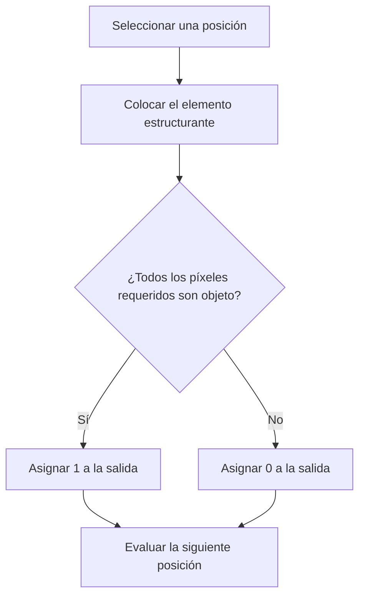
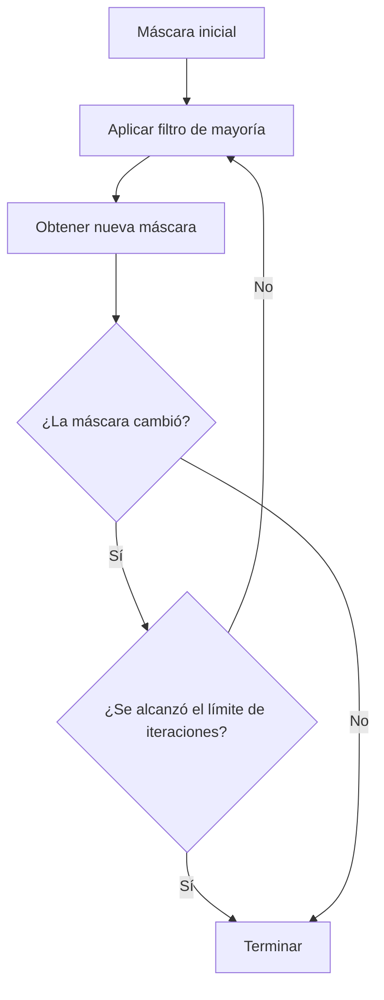
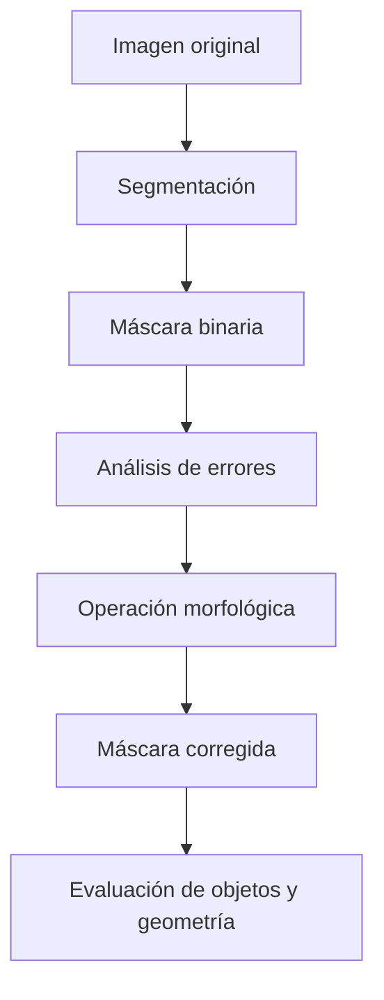

## Introducción

La **morfología matemática** es una rama del procesamiento digital de imágenes que permite analizar y transformar la estructura geométrica de los objetos presentes en una imagen. Su principal interés consiste en estudiar características como la forma, el tamaño, la conectividad, los contornos y la distribución espacial de las regiones.

En el procesamiento convencional de imágenes, muchas operaciones trabajan directamente con los valores de intensidad de los píxeles. Por ejemplo, un filtro gaussiano modifica las intensidades para reducir el ruido, mientras que un método de umbralización, como **Otsu**, permite separar los objetos del fondo.

Sin embargo, una vez que se obtiene una máscara binaria, los errores de segmentación pueden permanecer. Es posible encontrar píxeles aislados incorrectamente clasificados como objeto, pequeños huecos dentro de regiones, conexiones artificiales entre objetos o contornos irregulares.

La morfología matemática permite estudiar y corregir algunas de estas imperfecciones mediante operaciones que consideran la disposición espacial de los píxeles.

Una máscara binaria se representa como:

$$
M(r,c)\in\{0,1\}
$$

En donde:

- $M(r,c)=1$ indica que el píxel pertenece al objeto.
- $M(r,c)=0$ indica que el píxel pertenece al fondo.
- $r$ representa el renglón.
- $c$ representa la columna.

La característica fundamental de esta representación es que permite interpretar la imagen como un **conjunto matemático de coordenadas**.

De esta manera, operaciones como la unión, intersección, diferencia, complemento y traslación adquieren una interpretación geométrica.

La morfología introduce además un concepto fundamental: el **elemento estructurante**, que consiste en una pequeña figura geométrica utilizada para examinar el vecindario de cada posición de la imagen.

A partir de este elemento se construyen dos operaciones principales:

1. **Erosión:** conserva las posiciones donde el elemento estructurante cabe completamente dentro del objeto.
2. **Dilatación:** incorpora las posiciones alcanzadas al colocar copias del elemento estructurante sobre los píxeles del objeto.

Estas operaciones sirven como fundamento para otras transformaciones, como la detección de patrones mediante acierto o fallo, los filtros de mayoría, la apertura, el cierre, el engrosamiento y el adelgazamiento.

El objetivo es comprender cómo funcionan estas transformaciones, cuál es su interpretación matemática, qué consecuencias tienen sobre la geometría de los objetos y cómo pueden utilizarse para mejorar máscaras binarias sin destruir información importante.

---

## La imagen binaria como conjunto matemático

### Representación mediante conjuntos:

Una imagen binaria puede describirse mediante el conjunto de coordenadas que corresponden a los píxeles pertenecientes a un objeto.

Sea $\Omega$ el dominio espacial de una imagen:

$$
\Omega=
\{(r,c)\mid 0\leq r<H,\;0\leq c<W\}
$$

En donde:

- $H$ es la altura de la imagen.
- $W$ es su anchura.
- $(r,c)$ representa una posición válida dentro de la imagen.

El conjunto de píxeles que pertenecen al objeto se define como:

$$
A=\{(r,c)\in\Omega\mid M(r,c)=1\}
$$

Por lo tanto, una posición pertenece al conjunto $A$ cuando el valor correspondiente de la máscara es uno.

###### Ejemplo:

Supóngase que se tiene la siguiente máscara:

$$
M=
\begin{bmatrix}
0&0&0&0\\
0&1&1&0\\
0&1&1&0\\
0&0&0&0
\end{bmatrix}
$$

Los cuatro píxeles centrales representan el objeto.

Si las coordenadas comienzan en cero, el conjunto correspondiente es:

$$
A=\{(1,1),(1,2),(2,1),(2,2)\}
$$

Ambas representaciones contienen la misma información.

La matriz indica visualmente dónde se encuentra el objeto, mientras que el conjunto enumera las posiciones que lo forman.

Esta equivalencia permite aplicar operaciones matemáticas directamente sobre imágenes binarias.

**La morfología binaria trabaja principalmente con la pertenencia espacial de los píxeles y no con sus intensidades originales.**

### Cardinalidad de un conjunto:

La **cardinalidad** es el número de elementos pertenecientes a un conjunto.

Se representa mediante:

$$
|A|
$$

En una imagen binaria, corresponde al número de píxeles que forman parte del objeto.

Para la máscara anterior:

$$
|A|=4
$$

Si cada píxel representa una unidad de área, la cardinalidad permite calcular el área discreta del objeto.

Cuando los píxeles representan dimensiones físicas conocidas, el área puede obtenerse multiplicando la cantidad de píxeles por el área física correspondiente a cada uno.

Por ejemplo, si un píxel representa un cuadrado de lado $0.5$ mm:

$$
a_{\text{píxel}}=(0.5)^2=0.25\text{ mm}^2
$$

Entonces, para un objeto de cuatro píxeles:

$$
a_{\text{objeto}}=4(0.25)=1\text{ mm}^2
$$

En NumPy, la cardinalidad de una máscara booleana puede calcularse mediante:

```python
area = np.sum(mask)
```

Cada valor `True` contribuye con una unidad.

Es importante distinguir dos conceptos:

- **Cantidad de píxeles:** mide el área discreta ocupada por las regiones.
- **Cantidad de objetos:** mide cuántas regiones conectadas independientes existen.

Una imagen puede contener miles de píxeles y representar un solo objeto grande. También puede contener miles de píxeles distribuidos entre cientos de objetos pequeños.

Por lo tanto:

$$
\text{Área de la máscara}
\neq
\text{Número de objetos}
$$

Esta distinción resulta esencial al evaluar las transformaciones morfológicas.

### Unión de conjuntos:

La **unión** contiene todos los elementos que pertenecen al menos a uno de dos conjuntos.

Se define como:

$$
A\cup G=
\{p\mid p\in A\lor p\in G\}
$$

El símbolo $\lor$ representa la operación lógica OR.

###### Ejemplo:

Considérense los conjuntos:

$$
A=\{(0,0),(0,1),(1,0)\}
$$

$$
G=\{(0,1),(1,1)\}
$$

La unión es:

$$
A\cup G=
\{(0,0),(0,1),(1,0),(1,1)\}
$$

El elemento $(0,1)$ aparece únicamente una vez, aunque pertenezca a ambos conjuntos.

En NumPy, para máscaras booleanas:

```python
union = A | G
```

La unión es importante en segmentación porque permite determinar todas las posiciones que fueron consideradas objeto por cualquiera de dos máscaras.

### Intersección de conjuntos:

La **intersección** contiene únicamente los elementos que pertenecen simultáneamente a ambos conjuntos.

Se define mediante:

$$
A\cap G=
\{p\mid p\in A\land p\in G\}
$$

El símbolo $\land$ representa la operación lógica AND.

Utilizando los conjuntos anteriores:

$$
A\cap G=\{(0,1)\}
$$

En NumPy:

```python
intersection = A & G
```

Cuando $A$ representa una máscara predicha y $G$ representa una máscara de referencia, la intersección contiene los píxeles correctamente identificados como objeto.

### Diferencia de conjuntos:

La **diferencia** contiene las posiciones que pertenecen a un conjunto, pero no al otro.

Se define como:

$$
A-G=
\{p\mid p\in A\land p\notin G\}
$$

La diferencia no es conmutativa.

Esto significa que, en general:

$$
A-G\neq G-A
$$

En problemas de segmentación, esta propiedad permite distinguir dos clases de error.

Si $A$ es la máscara predicha y $G$ la máscara de referencia:

$$
FP=A-G
$$

$$
FN=G-A
$$

En donde:

- $FP$ representa los **falsos positivos**, es decir, píxeles incorrectamente clasificados como objeto.
- $FN$ representa los **falsos negativos**, es decir, píxeles que realmente pertenecen al objeto, pero no fueron detectados.

En NumPy:

```python
false_positive = A & ~G
false_negative = G & ~A
```

Esta distinción permite comprender qué problema presenta una segmentación.

Si predominan los falsos positivos, puede ser conveniente eliminar regiones sobrantes.

Si predominan los falsos negativos, puede ser necesario recuperar regiones perdidas.

Sin embargo, ninguna operación morfológica identifica por sí sola qué píxeles son correctos. Por ello, una transformación que elimina falsos positivos también puede eliminar píxeles verdaderos.

### Complemento de un conjunto:

El **complemento** contiene todas las posiciones del dominio que no pertenecen al objeto.

Se define como:

$$
A^c=\Omega-A
$$

En una imagen binaria, el complemento corresponde al fondo.

###### Ejemplo:

Si:

$$
A=
\begin{bmatrix}
0&0&0\\
0&1&0\\
0&0&0
\end{bmatrix}
$$

Entonces:

$$
A^c=
\begin{bmatrix}
1&1&1\\
1&0&1\\
1&1&1
\end{bmatrix}
$$

En NumPy:

```python
background = ~A
```

El complemento debe interpretarse respecto de un dominio definido.

En una imagen digital, el dominio está limitado por sus dimensiones. Sin embargo, en la teoría matemática los conjuntos también pueden estudiarse sobre una rejilla infinita.

Esta diferencia resulta importante cuando se analizan las condiciones de frontera de las operaciones morfológicas.

### Diferencia simétrica:

La **diferencia simétrica** contiene los elementos que pertenecen exactamente a uno de los dos conjuntos.

Puede expresarse como:

$$
A\triangle G=(A-G)\cup(G-A)
$$

También:

$$
A\triangle G=(A\cup G)-(A\cap G)
$$

Esta operación corresponde a XOR.

En NumPy:

```python
difference = A ^ G
```

Cuando se comparan dos máscaras, la diferencia simétrica permite identificar todos los píxeles donde ambas no coinciden.

Por tanto, incluye simultáneamente falsos positivos y falsos negativos.

---

## Evaluación de máscaras binarias mediante conjuntos

Una vez que una imagen ha sido segmentada, resulta necesario determinar qué tan bien coincide con los objetos reales.

Las operaciones de conjuntos permiten construir métricas para evaluar la calidad de una máscara.

### Intersection over Union:

La métrica **Intersection over Union (IoU)** mide el grado de superposición entre una máscara predicha y una máscara de referencia.

Sean:

- $A$: máscara predicha.
- $G$: máscara de referencia.
- $A\cap G$: píxeles compartidos por ambas máscaras.
- $A\cup G$: píxeles que pertenecen al menos a una máscara.

La métrica se define como:

$$
IoU(A,G)=
\frac{|A\cap G|}{|A\cup G|}
$$

Su valor pertenece al intervalo:

$$
0\leq IoU\leq1
$$

Un valor cercano a uno indica una gran coincidencia entre las regiones.

Un valor cercano a cero indica una superposición pequeña.

Cuando la unión es vacía, la expresión presenta una división entre cero y se necesita establecer una convención de evaluación.

Es importante observar que **IoU mide coincidencia espacial, no cantidad de objetos correctamente identificados**.

###### Ejemplo:

Supóngase que se segmenta una imagen que contiene células utilizando el método de Otsu.

Se obtienen los siguientes resultados:

| Conjunto | Píxeles |
|---|---:|
| Máscara predicha $A$ | 9,489 |
| Máscara de referencia $G$ | 6,983 |
| Intersección $A\cap G$ | 6,899 |
| Falsos positivos $A-G$ | 2,590 |
| Falsos negativos $G-A$ | 84 |
| Unión $A\cup G$ | 9,573 |

La intersección contiene los píxeles correctamente identificados como células.

La unión puede obtenerse mediante:

$$
|A\cup G|=|A|+|G|-|A\cap G|
$$

Sustituyendo:

$$
|A\cup G|=9489+6983-6899
$$

$$
|A\cup G|=9573
$$

Por tanto:

$$
IoU=\frac{6899}{9573}
$$

$$
\boxed{IoU\approx0.721}
$$

Esto significa que aproximadamente el $72.1\%$ de la unión entre ambas máscaras corresponde a píxeles compartidos.

Ahora bien, la distribución de errores proporciona información adicional.

Los falsos positivos son:

$$
FP=9489-6899
$$

$$
\boxed{FP=2590}
$$

Mientras que los falsos negativos son:

$$
FN=6983-6899
$$

$$
\boxed{FN=84}
$$

La cantidad de falsos positivos es mucho mayor que la de falsos negativos.

Por lo tanto, el principal problema de esta segmentación consiste en que se identificaron demasiados píxeles como objeto.

Esto sugiere que una transformación destinada a eliminar pequeñas regiones incorrectas podría mejorar el resultado.

Sin embargo, la corrección debe preservar las células verdaderas, particularmente las de menor tamaño.

### Coeficiente Dice:

El **coeficiente Dice** es otra métrica utilizada para evaluar la similitud espacial entre conjuntos.

Se define como:

$$
Dice(A,G)=
\frac{2|A\cap G|}{|A|+|G|}
$$

Para el ejemplo anterior:

$$
Dice=
\frac{2(6899)}{9489+6983}
$$

$$
Dice=
\frac{13798}{16472}
$$

$$
\boxed{Dice\approx0.838}
$$

El resultado indica una similitud aproximada de $0.838$ bajo esta métrica.

Aunque Dice e IoU evalúan superposición, no producen necesariamente el mismo valor.

La relación entre ambas métricas es:

$$
\boxed{
Dice=\frac{2IoU}{1+IoU}
}
$$

Y despejando:

$$
\boxed{
IoU=\frac{Dice}{2-Dice}
}
$$

Esto significa que ambas están matemáticamente relacionadas y permiten ordenar las mismas predicciones de manera equivalente cuando se calculan sobre los mismos conjuntos.

Sin embargo, sus valores numéricos no deben interpretarse como porcentajes directamente intercambiables.

### Relación con falsos positivos y falsos negativos:

La IoU también puede expresarse como:

$$
IoU=
\frac{TP}{TP+FP+FN}
$$

En donde:

- $TP$ representa los verdaderos positivos.
- $FP$ representa los falsos positivos.
- $FN$ representa los falsos negativos.

En el ejemplo:

$$
TP=6899
$$

$$
FP=2590
$$

$$
FN=84
$$

Por lo tanto:

$$
IoU=
\frac{6899}{6899+2590+84}
$$

Esta formulación permite comprender por qué una segmentación empeora cuando aumenta cualquiera de los dos tipos de error.

Si se eliminan falsos positivos sin perder verdaderos positivos, la IoU aumenta.

Sin embargo, si una erosión elimina muchos píxeles verdaderos, puede aumentar considerablemente los falsos negativos y perjudicar la métrica.

---

## Transformaciones geométricas de conjuntos

La morfología matemática necesita desplazar pequeñas figuras geométricas sobre la imagen para determinar qué posiciones cumplen determinadas condiciones.

Para comprender este funcionamiento, primero deben estudiarse la traslación y la reflexión.

### Traslación:

La **traslación** consiste en desplazar un conjunto de coordenadas sin modificar su estructura interna.

Sea $B$ un conjunto y $z$ un vector de desplazamiento.

La traslación se define como:

$$
(B)_z=\{b+z\mid b\in B\}
$$

La expresión indica que el vector $z$ se suma a cada elemento del conjunto $B$.

###### Ejemplo:

Considérese:

$$
B=\{(0,0),(0,1),(1,0)\}
$$

Y un desplazamiento:

$$
z=(2,3)
$$

Cada punto se desplaza dos renglones hacia abajo y tres columnas hacia la derecha.

Las operaciones son:

$$
(0,0)+(2,3)=(2,3)
$$

$$
(0,1)+(2,3)=(2,4)
$$

$$
(1,0)+(2,3)=(3,3)
$$

Por tanto:

$$
\boxed{
(B)_{(2,3)}=
\{(2,3),(2,4),(3,3)\}
}
$$

La forma del conjunto permanece idéntica.

Únicamente cambia su posición.

Esta operación es esencial porque la erosión examina qué ocurre cuando el elemento estructurante se coloca sobre diferentes coordenadas de la imagen.

### Reflexión:

La **reflexión morfológica** consiste en cambiar el signo de todas las coordenadas de un conjunto respecto del origen.

Se define mediante:

$$
\hat B=\{-b\mid b\in B\}
$$

###### Ejemplo:

Sea:

$$
B=\{(0,0),(0,1),(1,0)\}
$$

La reflexión produce:

$$
\hat B=
\{(0,0),(0,-1),(-1,0)\}
$$

Geométricamente, equivale a una rotación de $180^\circ$ alrededor del origen.

No debe confundirse con una reflexión únicamente horizontal o vertical.

La reflexión tiene especial importancia en la dilatación porque permite establecer la correspondencia entre su definición matemática mediante intersecciones y su interpretación geométrica mediante copias del elemento estructurante.

Cuando el elemento es simétrico respecto del origen:

$$
\hat B=B
$$

En cambio, si es asimétrico:

$$
\hat B\neq B
$$

Por lo tanto, ignorar la reflexión puede modificar el resultado de una dilatación.

---

## Elementos estructurantes

### Definición:

Un **elemento estructurante**, representado normalmente mediante $B$, es un conjunto pequeño de desplazamientos que permite examinar la geometría local de una imagen.

Puede interpretarse como una figura que se coloca sobre cada posición para comprobar si ciertos píxeles pertenecen al objeto o al fondo.

A diferencia de un filtro convencional, que utiliza coeficientes numéricos para calcular sumas o promedios ponderados, un elemento estructurante binario establece qué posiciones participan en una prueba geométrica.

Sus tres propiedades principales son:

1. **Forma:** determina la distribución espacial de los píxeles considerados.
2. **Tamaño:** determina la escala de la estructura examinada.
3. **Origen:** determina la posición de referencia utilizada para colocar el elemento sobre la imagen.

Las tres propiedades modifican el resultado de una transformación morfológica.

### Forma del elemento estructurante:

La forma define qué relaciones espaciales se consideran.

#### Cuadrado de 3 × 3:

$$
B=
\begin{bmatrix}
1&1&1\\
1&1&1\\
1&1&1
\end{bmatrix}
$$

Este elemento contiene nueve posiciones activas.

$$
|B|=9
$$

Considera el píxel central y sus ocho vecinos inmediatos.

Es apropiado cuando se desea evaluar una región completa de tres renglones y tres columnas.

#### Cruz de 3 × 3:

$$
B=
\begin{bmatrix}
0&1&0\\
1&1&1\\
0&1&0
\end{bmatrix}
$$

Contiene cinco posiciones activas:

$$
|B|=5
$$

Este elemento considera únicamente el centro y sus vecinos horizontales y verticales.

Los píxeles diagonales no participan en la prueba.

#### Barra horizontal:

$$
B=
\begin{bmatrix}
1&1&1
\end{bmatrix}
$$

Este elemento examina la continuidad horizontal.

Por ejemplo, puede reconocer regiones que contengan al menos tres píxeles consecutivos en esa dirección.

#### Barra vertical:

$$
B=
\begin{bmatrix}
1\\
1\\
1
\end{bmatrix}
$$

Este elemento examina continuidad vertical.

Aunque las barras horizontal y vertical contienen el mismo número de píxeles, su orientación produce resultados diferentes.

###### Ejemplo:

Supóngase que existe una línea horizontal de un píxel de grosor y diez píxeles de longitud.

Una erosión mediante una barra horizontal de tres píxeles puede conservar parte de la línea.

Sin embargo, una erosión mediante una barra vertical de tres píxeles elimina completamente la estructura.

La razón es que la línea no contiene tres píxeles consecutivos verticalmente.

Esto demuestra que **la geometría del elemento estructurante es tan importante como su tamaño**.

### Disco discreto:

Un disco permite examinar regiones aproximadamente circulares.

Por ejemplo, un disco discreto de radio dos puede definirse como:

$$
B=
\{(r,c)\in\mathbb{Z}^2\mid r^2+c^2\leq4\}
$$

Su representación matricial es:

$$
B=
\begin{bmatrix}
0&0&1&0&0\\
0&1&1&1&0\\
1&1&1&1&1\\
0&1&1&1&0\\
0&0&1&0&0
\end{bmatrix}
$$

Tiene trece posiciones activas:

$$
\boxed{|B|=13}
$$

Este elemento resulta útil cuando se busca una operación aproximadamente independiente de la orientación.

Sin embargo, un disco digital no es perfectamente circular debido a que se encuentra representado mediante una rejilla de píxeles.

### Tamaño del elemento estructurante:

El tamaño determina la escala a la que actúa una operación.

Un elemento pequeño examina relaciones locales.

Un elemento grande exige o alcanza estructuras espaciales más extensas.

En una erosión, aumentar el tamaño del elemento estructurante hace más difícil encontrar posiciones donde pueda caber completamente dentro del objeto.

En una dilatación, aumentar su tamaño generalmente produce una expansión más amplia.

###### Ejemplo:

Considérese una región horizontal de dos píxeles de altura y ocho píxeles de longitud.

Su área es:

$$
|A|=2(8)=16
$$

Si se utiliza un cuadrado de $3\times3$, no existe una sola posición donde quepan los tres renglones exigidos.

Por lo tanto:

$$
\boxed{
A\ominus B=\varnothing
}
$$

Aunque el objeto tiene dieciséis píxeles, desaparece por completo.

Este resultado demuestra que la supervivencia a una erosión no depende únicamente del área total, sino de la geometría local del objeto.

### Origen del elemento estructurante:

El origen indica qué posición del elemento estructurante se utiliza como referencia durante su desplazamiento.

En elementos simétricos suele utilizarse el centro.

Por ejemplo, una cruz de $3\times3$ puede representarse como:

$$
B=
\{
(-1,0),
(0,-1),
(0,0),
(0,1),
(1,0)
\}
$$

Su origen es:

$$
(0,0)
$$

Al colocar este origen sobre una coordenada $z$, las demás posiciones quedan distribuidas alrededor de ella.

Sin embargo, el origen no siempre tiene que encontrarse en el centro.

Un elemento con forma de L puede utilizar una esquina como punto de referencia.

Modificar el origen cambia la ubicación espacial en la que se registran los resultados.

Por esta razón, al implementar operaciones morfológicas es importante establecer explícitamente la posición de referencia, especialmente cuando se utilizan elementos asimétricos.

---

## Conectividad entre píxeles

La conectividad determina cuándo diferentes píxeles pertenecen a una misma región.

Es un concepto fundamental porque permite identificar objetos, contar componentes, reconocer huecos y estudiar la estructura topológica de una máscara.

### Vecindad de cuatro píxeles:

En la **conectividad de cuatro vecinos**, un píxel considera únicamente las posiciones que comparten un lado con él.

Para una posición:

$$
p=(r,c)
$$

Sus vecinos son:

$$
N_4(p)=
\{
(r-1,c),
(r+1,c),
(r,c-1),
(r,c+1)
\}
$$

Visualmente:

$$
\begin{bmatrix}
0&1&0\\
1&p&1\\
0&1&0
\end{bmatrix}
$$

Los píxeles diagonales no son vecinos directos.

Dos píxeles pertenecen al mismo componente conectado si existe un camino entre ellos formado exclusivamente por píxeles del objeto que siguen esta regla de vecindad.

###### Ejemplo:

Considérese:

$$
M=
\begin{bmatrix}
1&0\\
0&1
\end{bmatrix}
$$

Los dos píxeles activos se tocan únicamente por una esquina.

Con conectividad de cuatro, forman dos componentes separados.

Por tanto:

$$
\boxed{N_{\text{objetos},4}=2}
$$

### Vecindad de ocho píxeles:

La **conectividad de ocho vecinos** considera también los desplazamientos diagonales.

Se define como:

$$
N_8(p)=
\{
(r+i,c+j)\mid
i,j\in\{-1,0,1\},
(i,j)\neq(0,0)
\}
$$

Visualmente:

$$
\begin{bmatrix}
1&1&1\\
1&p&1\\
1&1&1
\end{bmatrix}
$$

Con esta conectividad, dos píxeles que se tocan diagonalmente pueden pertenecer al mismo objeto.

En el ejemplo anterior:

$$
\boxed{N_{\text{objetos},8}=1}
$$

Esto significa que **una misma máscara puede contener diferentes cantidades de objetos dependiendo de la conectividad utilizada**.

### Relación entre conectividad y cantidad de objetos:

La conectividad de ocho incluye todas las conexiones consideradas por la conectividad de cuatro y agrega las diagonales.

Por lo tanto:

$$
\boxed{
N_{\text{objetos},8}
\leq
N_{\text{objetos},4}
}
$$

La conectividad de ocho puede unir regiones previamente separadas, pero no puede dividir un componente que ya se encontraba conectado mediante cuatro vecinos.

###### Ejemplo:

Considérese una imagen de células segmentada mediante Otsu.

El conteo de componentes produce:

| Conectividad | Objetos |
|---|---:|
| Cuatro vecinos | 2,359 |
| Ocho vecinos | 2,142 |

La diferencia es:

$$
2359-2142=217
$$

Por tanto, al permitir conexiones diagonales, el número de componentes disminuye en 217.

Esto no significa que se hayan eliminado físicamente 217 regiones de la máscara.

La imagen permanece idéntica.

Lo que cambia es el criterio utilizado para decidir qué píxeles pertenecen a un mismo componente.

### Paradoja de la conectividad:

La conectividad también determina cómo se interpretan los huecos.

Un **hueco** es una región de fondo encerrada dentro de un objeto, sin conexión con el exterior según la regla de conectividad utilizada.

En imágenes discretas puede aparecer una contradicción topológica cuando el objeto y el fondo utilizan la misma conectividad.

Por ejemplo, un anillo formado por contactos diagonales podría considerarse cerrado si el objeto utiliza conectividad de ocho.

Sin embargo, si el fondo también utiliza conectividad de ocho, algunas posiciones interiores podrían conectarse diagonalmente con el exterior.

La misma estructura podría interpretarse simultáneamente como una frontera cerrada y una región que no encierra un hueco.

Para evitar estas inconsistencias, normalmente se utilizan **conectividades complementarias**.

Una posibilidad es:

$$
\boxed{
\begin{aligned}
\text{Objeto:}&\quad8\text{ vecinos}\\
\text{Fondo:}&\quad4\text{ vecinos}
\end{aligned}
}
$$

La otra posibilidad es:

$$
\boxed{
\begin{aligned}
\text{Objeto:}&\quad4\text{ vecinos}\\
\text{Fondo:}&\quad8\text{ vecinos}
\end{aligned}
}
$$

No existe una única combinación universalmente superior.

La selección depende de las propiedades topológicas que se necesitan preservar.

### Conteo de huecos:

La conectividad del fondo puede modificar la cantidad de huecos identificados.

En la máscara de células considerada:

| Conectividad del fondo | Huecos |
|---|---:|
| Cuatro vecinos | 75 |
| Ocho vecinos | 65 |

La diferencia es:

$$
75-65=10
$$

Diez regiones que parecían encerradas bajo conectividad de cuatro dejan de contarse como huecos independientes cuando se permiten conexiones diagonales.

La conectividad resulta especialmente importante en:

- Análisis de células y tejidos.
- Reconocimiento de caracteres.
- Inspección industrial.
- Segmentación de poros.
- Conteo de objetos.
- Análisis de estructuras conectadas.

---

## Fundamentos de la erosión

### Definición matemática:

La **erosión** es una operación morfológica que conserva únicamente las posiciones donde un elemento estructurante puede colocarse completamente dentro del conjunto objeto.

Se define mediante:

$$
\boxed{
A\ominus B=
\{z\mid(B)_z\subseteq A\}
}
$$

En donde:

- $A$ es el conjunto de píxeles del objeto.
- $B$ es el elemento estructurante.
- $z$ es la posición evaluada.
- $(B)_z$ es el elemento estructurante trasladado a $z$.
- $\subseteq$ indica que todos los elementos del conjunto trasladado deben pertenecer a $A$.

La idea fundamental es:

**La erosión conserva una posición únicamente cuando todos los píxeles exigidos por el elemento estructurante pertenecen al objeto.**

### Procedimiento de erosión:

Para calcular una erosión se examina cada posición de la imagen.

El procedimiento consiste en colocar el origen del elemento estructurante sobre una posición y revisar todas sus coordenadas activas.

Si cada una coincide con un píxel perteneciente al objeto, la posición se conserva.

Si al menos una posición del elemento estructurante coincide con el fondo, la posición evaluada se elimina.

Este procedimiento puede representarse mediante:



La operación se aplica a todas las posiciones de la imagen.

En los ejemplos considerados, las posiciones fuera de la imagen se tratan como fondo.

### Interpretación mediante lógica booleana:

La erosión puede entenderse como una operación AND sobre las posiciones seleccionadas por el elemento estructurante.

Para un cuadrado de $3\times3$:

$$
E(r,c)=
\bigwedge_{i=-1}^{1}
\bigwedge_{j=-1}^{1}
M(r+i,c+j)
$$

La expresión significa que el resultado es uno únicamente cuando los nueve píxeles de la ventana tienen valor uno.

###### Ejemplo:

Considérese la ventana:

$$
\begin{bmatrix}
1&1&1\\
1&1&1\\
1&1&1
\end{bmatrix}
$$

Todos los valores son uno.

Por lo tanto:

$$
E(r,c)=1
$$

Ahora considérese:

$$
\begin{bmatrix}
1&1&1\\
1&0&1\\
1&1&1
\end{bmatrix}
$$

Existe un píxel de fondo.

La condición de coincidencia completa falla.

Por lo tanto:

$$
E(r,c)=0
$$

La erosión no considera si la mayoría de los píxeles son objeto.

Exige que todos los elementos activos coincidan.

### Efecto geométrico de la erosión:

Cuando el elemento estructurante contiene su origen, la erosión produce un subconjunto del objeto original:

$$
A\ominus B\subseteq A
$$

Esto significa que no incorpora nuevos píxeles de objeto.

Su efecto consiste en conservar únicamente las posiciones que satisfacen la estructura geométrica requerida.

Como consecuencia, suele producir:

- Reducción de regiones.
- Eliminación de píxeles aislados.
- Desaparición de objetos pequeños.
- Ruptura de conexiones delgadas.
- Modificación de contornos.
- Separación de regiones conectadas.

Sin embargo, el resultado depende de la forma del elemento estructurante.

Una barra horizontal puede conservar estructuras delgadas orientadas horizontalmente, mientras que un cuadrado podría eliminarlas.

### Erosión de objetos pequeños:

Una de las limitaciones más importantes de la erosión es que afecta proporcionalmente más a los objetos pequeños.

Considérense tres células aproximadamente circulares de diferentes tamaños.

Al utilizar un cuadrado de $3\times3$ se obtienen:

| Radio del objeto | Píxeles originales | Píxeles conservados |
|---|---:|---:|
| 20 | 1,257 | 1,101 |
| 8 | 197 | 139 |
| 3 | 30 | 10 |

La célula grande conserva una proporción considerable de su área.

La pequeña pierde una proporción mucho mayor.

Para la célula de radio tres:

$$
\frac{10}{30}=0.333
$$

Por lo tanto, únicamente conserva aproximadamente un tercio de sus píxeles.

Si se establece que una célula se considera detectada cuando alcanza un IoU mínimo de $0.5$ respecto de su región original, esta célula deja de considerarse encontrada.

Esto demuestra que **un objeto puede sobrevivir geométricamente a una erosión y, aun así, perder tanta área que deje de considerarse correctamente detectado**.

### Relación entre área y perímetro:

La mayor sensibilidad de los objetos pequeños puede comprenderse mediante la relación entre área y perímetro.

Para un círculo continuo:

$$
A=\pi r^2
$$

Su perímetro es:

$$
P=2\pi r
$$

La relación entre perímetro y área es:

$$
\frac{P}{A}
=
\frac{2\pi r}{\pi r^2}
$$

Simplificando:

$$
\boxed{
\frac{P}{A}=\frac{2}{r}
}
$$

A medida que el radio disminuye, la relación entre perímetro y área aumenta.

Esto significa que los objetos pequeños poseen una mayor proporción de frontera respecto de su superficie.

Como la erosión tiende a eliminar píxeles cercanos a los bordes, los objetos pequeños suelen sufrir pérdidas relativas mayores.

Aunque esta relación procede de geometría continua y no representa exactamente una erosión discreta, permite comprender el comportamiento general.

### Limitaciones de la erosión:

La erosión puede ser útil para eliminar ruido, pero no distingue automáticamente entre ruido y objetos verdaderos.

Si una célula pequeña tiene dimensiones semejantes a las de una región espuria, una erosión suficientemente fuerte para eliminar el ruido también puede eliminar la célula.

Por esta razón, **una reducción en el número de componentes no demuestra por sí sola que la segmentación haya mejorado**.

Es necesario evaluar simultáneamente la superposición espacial y la preservación de las estructuras importantes.

---

## Fundamentos de la dilatación

### Definición matemática:

La **dilatación** es una operación morfológica que incorpora las posiciones donde el elemento estructurante reflejado tiene al menos un punto en común con el objeto.

Se define mediante:

$$
\boxed{
A\oplus B=
\{z\mid(\hat B)_z\cap A\neq\varnothing\}
}
$$

En donde:

- $A$ representa el conjunto objeto.
- $B$ es el elemento estructurante.
- $\hat B$ es su reflexión.
- $z$ es la posición evaluada.
- $\neq\varnothing$ indica que la intersección contiene al menos un elemento.

La condición fundamental es:

**La dilatación activa una posición cuando existe al menos una coincidencia entre el objeto y el elemento estructurante reflejado.**

### Interpretación mediante la suma de Minkowski:

La dilatación también puede expresarse como:

$$
\boxed{
A\oplus B=
\{a+b\mid a\in A,\;b\in B\}
}
$$

Esta expresión se conoce como **suma de Minkowski**.

Su interpretación consiste en colocar una copia del elemento estructurante sobre cada píxel perteneciente al objeto y reunir todas las posiciones alcanzadas.

###### Ejemplo:

Supóngase que el objeto contiene un único píxel:

$$
A=\{(2,2)\}
$$

Se utiliza una cruz:

$$
B=
\{
(-1,0),(0,-1),(0,0),(0,1),(1,0)
\}
$$

La dilatación se calcula sumando cada desplazamiento al píxel original.

Se obtienen:

$$
(2,2)+(-1,0)=(1,2)
$$

$$
(2,2)+(0,-1)=(2,1)
$$

$$
(2,2)+(0,0)=(2,2)
$$

$$
(2,2)+(0,1)=(2,3)
$$

$$
(2,2)+(1,0)=(3,2)
$$

Por tanto:

$$
\boxed{
A\oplus B=
\{
(1,2),(2,1),(2,2),(2,3),(3,2)
\}
}
$$

Un único píxel se convierte en una cruz de cinco píxeles.

### Interpretación mediante lógica booleana:

Cuando el elemento estructurante es simétrico, la dilatación puede interpretarse como una operación OR sobre el vecindario.

Para un cuadrado de $3\times3$:

$$
D(r,c)=
\bigvee_{i=-1}^{1}
\bigvee_{j=-1}^{1}
M(r+i,c+j)
$$

La salida es uno cuando al menos un píxel de la ventana pertenece al objeto.

###### Ejemplo:

Considérese:

$$
\begin{bmatrix}
0&0&0\\
0&1&0\\
0&0&0
\end{bmatrix}
$$

Como existe un píxel activo:

$$
D(r,c)=1
$$

En cambio, para:

$$
\begin{bmatrix}
0&0&0\\
0&0&0\\
0&0&0
\end{bmatrix}
$$

No existe ninguna coincidencia.

Por lo tanto:

$$
D(r,c)=0
$$

### Efecto geométrico de la dilatación:

Cuando el elemento estructurante contiene el origen, la dilatación conserva todos los píxeles originales y puede incorporar nuevos:

$$
A\subseteq A\oplus B
$$

Entre sus consecuencias se encuentran:

- Expansión de objetos.
- Engrosamiento de regiones.
- Conexión de componentes cercanos.
- Relleno de ciertos huecos pequeños.
- Modificación de fronteras.
- Ampliación de regiones de ruido.

La dilatación puede ser útil cuando una segmentación deja pequeños espacios sin detectar dentro de un objeto.

Sin embargo, también puede unir objetos que deberían permanecer separados.

###### Ejemplo:

Supóngase que dos células se encuentran separadas por una pequeña distancia.

Al dilatarlas, cada una se expande.

Si las expansiones llegan a tocarse, ambas regiones pueden convertirse en un solo componente conectado.

Esto puede reducir artificialmente el número de objetos detectados.

Por lo tanto, una disminución en el conteo después de dilatar no necesariamente representa una mejora.

### Importancia de la reflexión:

Cuando el elemento estructurante es simétrico:

$$
\hat B=B
$$

Por ello, su orientación no cambia al reflejarse.

Esto ocurre con cuadrados, cruces y discos centrados.

Sin embargo, una L asimétrica puede satisfacer:

$$
\hat B\neq B
$$

En ese caso, la dirección de expansión depende de la orientación correcta del elemento.

La reflexión es parte de la definición matemática y no debe omitirse al implementar elementos asimétricos.

---

## Comparación entre erosión y dilatación

La erosión y la dilatación utilizan elementos estructurantes, pero aplican condiciones distintas.

La erosión requiere coincidencia completa:

$$
(B)_z\subseteq A
$$

La dilatación requiere al menos una coincidencia:

$$
(\hat B)_z\cap A\neq\varnothing
$$

Esta diferencia explica sus comportamientos geométricos.

| Característica | Erosión | Dilatación |
|---|---|---|
| Condición | Todos los píxeles requeridos | Al menos una coincidencia |
| Operación lógica para elementos simétricos | AND | OR |
| Efecto habitual | Reduce regiones | Expande regiones |
| Ruido aislado | Puede eliminarlo | Puede ampliarlo |
| Huecos pequeños | Puede ampliarlos | Puede reducirlos |
| Conexiones delgadas | Puede romperlas | Puede crearlas |
| Riesgo principal | Perder objetos verdaderos | Unir objetos o expandir ruido |

La elección entre ambas depende del problema.

Si existen muchos falsos positivos aislados, una erosión podría ayudar.

Si existen pequeños falsos negativos dentro de objetos grandes, una dilatación podría resultar útil.

Sin embargo, ninguna de las dos operaciones constituye una solución universal.

Además, deben considerarse las condiciones de borde y la forma del elemento estructurante.

---

## Dualidad entre erosión y dilatación

### Principio de dualidad:

La erosión y la dilatación son operaciones **duales respecto del complemento**.

Una de sus identidades fundamentales es:

$$
\boxed{
(A\ominus B)^c=
A^c\oplus\hat B
}
$$

Esta expresión significa que el complemento de una erosión equivale a dilatar el fondo utilizando el elemento estructurante reflejado.

La identidad correspondiente es:

$$
\boxed{
(A\oplus B)^c=
A^c\ominus\hat B
}
$$

Estas relaciones son exactas cuando las operaciones se interpretan sobre un universo compatible y con condiciones de frontera coherentes.

### Demostración conceptual:

La erosión conserva una posición $z$ cuando:

$$
(B)_z\subseteq A
$$

Por lo tanto, una posición no pertenece a la erosión cuando el elemento estructurante no cabe completamente dentro del objeto.

Esta condición puede expresarse como:

$$
(B)_z\nsubseteq A
$$

Significa que al menos una de las posiciones del elemento estructurante pertenece al fondo.

Por tanto:

$$
(B)_z\cap A^c\neq\varnothing
$$

Ahora bien, la dilatación del fondo mediante el elemento reflejado se define como:

$$
A^c\oplus\hat B=
\{z\mid(B)_z\cap A^c\neq\varnothing\}
$$

Ambas condiciones describen exactamente las mismas posiciones.

Por lo tanto:

$$
\boxed{
(A\ominus B)^c=
A^c\oplus\hat B
}
$$

La identidad queda demostrada.

### Consecuencias de la dualidad:

La dualidad muestra que la erosión y la dilatación no son transformaciones independientes.

Una puede expresarse utilizando la otra junto con el complemento y la reflexión.

Esto permite comprender propiedades compartidas y diseñar implementaciones equivalentes.

###### Ejemplo:

Considérese un elemento estructurante asimétrico con forma de L.

Al comparar:

$$
(A\ominus B)^c
$$

Con:

$$
A^c\oplus\hat B
$$

Se obtiene una coincidencia exacta.

En un experimento sobre una máscara completa, ambas expresiones produjeron cero píxeles diferentes.

Sin embargo, al utilizar:

$$
A^c\oplus B
$$

sin reflejar el elemento estructurante, aparecieron 1,006 píxeles de diferencia.

Esto demuestra que la reflexión es indispensable cuando el elemento no es simétrico.

---

## Transformada de acierto o fallo

### Necesidad de reconocer patrones específicos:

La erosión comprueba si determinadas posiciones pertenecen completamente al objeto.

Sin embargo, existen problemas donde no basta con evaluar píxeles de objeto.

También se necesita establecer qué posiciones deben ser obligatoriamente fondo.

Por ejemplo, para detectar un píxel aislado se necesitan dos condiciones:

1. El píxel central debe pertenecer al objeto.
2. Sus ocho vecinos deben pertenecer al fondo.

Comprobar únicamente que el centro es uno no es suficiente, ya que también coincidiría con un píxel situado dentro de una región grande.

La **transformada de acierto o fallo**, conocida como *hit-or-miss transform*, permite comprobar simultáneamente patrones de objeto y de fondo.

### Definición matemática:

Esta transformación utiliza dos elementos estructurantes.

- $B_1$: especifica posiciones que deben ser objeto.
- $B_2$: especifica posiciones que deben ser fondo.

Se define mediante:

$$
\boxed{
A\circledast(B_1,B_2)=
(A\ominus B_1)
\cap
(A^c\ominus B_2)
}
$$

La primera erosión identifica las posiciones donde coincide el patrón de objeto.

La segunda identifica las posiciones donde coincide el patrón de fondo.

La intersección conserva las coordenadas donde ambas condiciones son verdaderas.

### Plantillas de tres estados:

Una plantilla de acierto o fallo puede representarse mediante tres valores:

| Símbolo | Significado |
|---|---|
| $1$ | Debe existir objeto |
| $0$ | Debe existir fondo |
| $*$ | No importa el valor |

El símbolo $*$ permite representar posiciones que no participan en la comparación.

### Detección de píxeles aislados:

Para identificar un píxel aislado en un vecindario de $3\times3$ puede utilizarse:

$$
T=
\begin{bmatrix}
0&0&0\\
0&1&0\\
0&0&0
\end{bmatrix}
$$

La plantilla exige que el centro sea objeto y los ocho vecinos sean fondo.

###### Ejemplo:

La siguiente región coincide:

$$
\begin{bmatrix}
0&0&0\\
0&1&0\\
0&0&0
\end{bmatrix}
$$

Sin embargo:

$$
\begin{bmatrix}
0&0&0\\
0&1&1\\
0&0&0
\end{bmatrix}
$$

No coincide, porque el píxel derecho es objeto cuando la plantilla exige fondo.

Esta transformación resulta útil para identificar ruido aislado sin utilizar únicamente criterios de tamaño.

### Detección de extremos de línea:

La transformada también puede reconocer extremos de segmentos.

Por ejemplo, una plantilla destinada a identificar el extremo derecho de una línea horizontal es:

$$
T=
\begin{bmatrix}
0&0&0\\
1&1&0\\
0&0&0
\end{bmatrix}
$$

El centro debe pertenecer a una línea que continúa hacia la izquierda.

El píxel derecho debe ser fondo.

También se exige fondo en las demás posiciones indicadas.

Por lo tanto, la plantilla reconoce un extremo derecho que satisface exactamente esas condiciones.

Para detectar extremos con otras orientaciones deben utilizarse plantillas adicionales.

Esto demuestra que una plantilla de acierto o fallo no es necesariamente invariante a rotaciones.

### Limitaciones:

La principal ventaja de acierto o fallo es su especificidad.

Sin embargo, también es su mayor limitación.

Un patrón puede no reconocerse cuando:

- Aparece rotado respecto de la plantilla.
- Tiene píxeles adicionales.
- Le faltan posiciones requeridas.
- El ruido modifica algún píxel.
- Su geometría es diferente de la esperada.

Por lo tanto, esta transformación es especialmente útil cuando se buscan configuraciones espaciales precisas.

No equivale a un filtro genérico de eliminación de ruido.

---

## Unificación mediante conteo de coincidencias

La erosión, la dilatación y los filtros de mayoría pueden comprenderse mediante una misma idea: **contar cuántas posiciones del elemento estructurante coinciden con el objeto**.

### Función de conteo:

Sea:

$$
n(z)=|(B)_z\cap A|
$$

Esta función representa el número de posiciones del elemento estructurante trasladado a $z$ que coinciden con píxeles pertenecientes al objeto.

Para un cuadrado de $3\times3$:

$$
0\leq n(z)\leq9
$$

###### Ejemplo:

Considérese:

$$
\begin{bmatrix}
1&1&0\\
1&1&0\\
0&0&0
\end{bmatrix}
$$

La ventana contiene cuatro píxeles activos.

Por tanto:

$$
n(z)=4
$$

Ahora puede definirse una transformación general:

$$
T_k(A)(z)=
\begin{cases}
1,&n(z)\geq k\\
0,&n(z)<k
\end{cases}
$$

El valor $k$ determina cuántas coincidencias se necesitan para activar la salida.

Al modificar este umbral pueden obtenerse diferentes operaciones.

### Erosión como umbral máximo:

La erosión exige que todas las posiciones activas pertenezcan al objeto.

Por lo tanto:

$$
\boxed{k=|B|}
$$

Para un cuadrado de $3\times3$:

$$
k=9
$$

La posición se conserva únicamente cuando:

$$
n(z)=9
$$

### Dilatación como umbral mínimo:

Para elementos estructurantes simétricos, la dilatación exige al menos una coincidencia.

Por lo tanto:

$$
\boxed{k=1}
$$

La salida es uno cuando:

$$
n(z)\geq1
$$

Si el elemento estructurante es asimétrico, debe utilizarse la orientación apropiada para conservar la definición matemática de dilatación.

### Filtro de mayoría:

El filtro de mayoría exige que más de la mitad de las posiciones activas pertenezcan al objeto.

La mayoría estricta se define mediante:

$$
\boxed{
k=
\left\lfloor\frac{|B|}{2}\right\rfloor+1
}
$$

En donde $\lfloor\cdot\rfloor$ representa la función piso, que devuelve el mayor entero menor o igual que el argumento.

Para un cuadrado de nueve píxeles:

$$
|B|=9
$$

$$
k=
\left\lfloor\frac92\right\rfloor+1
$$

$$
\boxed{k=5}
$$

Por lo tanto:

$$
M'(z)=1
\iff
n(z)\geq5
$$

Para una cruz de cinco píxeles:

$$
|B|=5
$$

$$
\boxed{k=3}
$$

### Comparación de umbrales:

| Operación | Condición | Cuadrado $3\times3$ |
|---|---|---|
| Erosión | Coincidencia completa | $n=9$ |
| Dilatación | Al menos una coincidencia | $n\geq1$ |
| Mayoría estricta | Más de la mitad | $n\geq5$ |

Esta interpretación demuestra que las tres transformaciones pueden utilizar un procedimiento similar de conteo local.

Lo que cambia es el criterio que determina si un píxel debe activarse.

---

## Filtros morfológicos de mayoría

### Funcionamiento:

El **filtro de mayoría** examina los píxeles de un vecindario y asigna al píxel de salida el valor predominante.

En una ventana de $3\times3$, existen nueve posiciones.

Por lo tanto, si al menos cinco contienen objeto, la salida es uno.

En caso contrario, es cero.

Este criterio permite corregir algunos errores sin recurrir a una erosión o dilatación tan agresiva.

### Eliminación de píxeles aislados:

Considérese:

$$
\begin{bmatrix}
0&0&0\\
0&1&0\\
0&0&0
\end{bmatrix}
$$

La cantidad de píxeles activos es:

$$
n(z)=1
$$

Como:

$$
1<5
$$

El resultado es:

$$
M'(z)=0
$$

El píxel central desaparece.

### Relleno de huecos pequeños:

Ahora considérese:

$$
\begin{bmatrix}
1&1&1\\
1&0&1\\
1&1&1
\end{bmatrix}
$$

La ventana contiene ocho píxeles de objeto.

Por lo tanto:

$$
n(z)=8
$$

Como:

$$
8\geq5
$$

El resultado es:

$$
M'(z)=1
$$

El hueco central se rellena.

Esto demuestra que un filtro de mayoría puede actuar sobre dos tipos de error:

- Eliminar pequeñas regiones incorrectamente activadas.
- Rellenar algunas posiciones incorrectamente desactivadas.

### Diferencia frente a erosión y dilatación:

La erosión necesita coincidencia completa.

La dilatación necesita una sola coincidencia.

La mayoría utiliza un criterio intermedio.

Por esta razón, puede resultar más apropiada para máscaras que contienen simultáneamente falsos positivos aislados y pequeños huecos.

Sin embargo, tampoco es universalmente superior.

Puede eliminar detalles finos, modificar esquinas, suavizar contornos y alterar la conectividad.

Su utilidad depende de la geometría de los objetos y de la distribución de los errores.

### Aplicación iterativa:

Un filtro de mayoría puede aplicarse repetidamente.

Sea:

$$
M^{(0)}=M
$$

La siguiente máscara se obtiene mediante:

$$
M^{(t+1)}=
\operatorname{Majority}_B(M^{(t)})
$$

Esto significa que cada iteración utiliza el resultado completo de la anterior.

El procedimiento puede detenerse cuando:

$$
M^{(t+1)}=M^{(t)}
$$

En ese momento, ninguna posición cambia entre dos iteraciones consecutivas.

Este estado se denomina **punto fijo**.

El proceso puede representarse mediante:



Sin embargo, no todas las configuraciones garantizan convergencia.

Algunos patrones pueden presentar oscilaciones cuando las actualizaciones se aplican simultáneamente.

Por ello, una implementación robusta puede utilizar un límite máximo de iteraciones o mecanismos de detección de ciclos.

### Resultados experimentales en un recorte:

En un recorte de una imagen de células se obtuvieron:

| Estado | Objetos | IoU |
|---|---:|---:|
| Inicial | 269 | 0.806 |
| Primera pasada | 6 | 0.990 |
| Segunda pasada | 5 | 0.991 |
| Tercera pasada | 5 | 0.991 |

La primera pasada produjo la mayor parte de la corrección.

El número de componentes disminuyó de 269 a seis y la IoU aumentó considerablemente.

La segunda pasada produjo un ajuste menor.

La tercera no modificó el resultado.

### Resultados en la imagen completa:

En la imagen completa, el número de componentes evolucionó de la siguiente manera:

$$
2142\rightarrow27\rightarrow24\rightarrow24
$$

La IoU evolucionó aproximadamente como:

$$
0.721\rightarrow0.988\rightarrow0.989
$$

Esto indica que el filtro eliminó gran parte del ruido conservando las estructuras relevantes.

Sin embargo, estos resultados corresponden a una configuración específica.

No permiten afirmar que el filtro de mayoría siempre produce mejores segmentaciones.

### Influencia del elemento estructurante:

Al utilizar diferentes elementos estructurantes se obtuvieron:

| Elemento estructurante | Pasadas | IoU final |
|---|---:|---:|
| Cuadrado $3\times3$ | 3 | 0.989 |
| Cruz $3\times3$ | 3 | 0.991 |
| Disco de radio 2 | 5 | 0.983 |

Los tres conservaron los 24 objetos reales y las doce células pequeñas.

Sin embargo, sus resultados geométricos fueron diferentes.

La cruz produjo una IoU ligeramente superior bajo las condiciones evaluadas.

Esto demuestra que la forma del vecindario también importa, incluso cuando se utiliza el mismo criterio general de mayoría.

---

## Evaluación experimental de las transformaciones morfológicas

### Problema inicial:

Considérese una imagen que contiene 24 células reales, distribuidas de la siguiente manera:

- Cuatro células grandes.
- Ocho células medianas.
- Doce células pequeñas.

La imagen contiene ruido y se segmenta mediante el método de Otsu.

La máscara resultante presenta numerosas regiones pequeñas incorrectamente identificadas como objeto.

Utilizando conectividad de ocho, se identifican:

$$
\boxed{
N_{\text{objetos}}=2142
}
$$

Sin embargo, únicamente existen 24 células reales.

La diferencia indica que la máscara contiene una cantidad considerable de regiones espurias.

El problema consiste en eliminar estas regiones sin destruir las células verdaderas.

### Comparación de operaciones:

Los resultados obtenidos fueron:

| Operación | Objetos detectados | IoU | Células pequeñas conservadas |
|---|---:|---:|---:|
| Otsu original | 2,142 | 0.721 | 12 |
| Erosión $3\times3$ | 24 | 0.727 | 0 |
| Erosión $5\times5$ | 17 | 0.485 | 0 |
| Dilatación $3\times3$ | 654 | 0.253 | 1 |
| Acierto o fallo | 353 | 0.895 | 12 |
| Mayoría $3\times3$ | 24 | 0.989 | 12 |

Estos resultados permiten comparar no solamente el conteo de componentes, sino también la calidad de la coincidencia espacial.

### Interpretación de la erosión:

La erosión de $3\times3$ redujo el conteo a 24 componentes.

A primera vista, este resultado podría parecer ideal, ya que coincide con la cantidad de células reales.

Sin embargo, eliminó todas las células pequeñas según el criterio de detección utilizado.

Además, la IoU únicamente aumentó de:

$$
0.721\rightarrow0.727
$$

Esta mejora es mínima.

Por lo tanto, la cantidad correcta de componentes no significa que se hayan conservado los objetos correctos.

La erosión de $5\times5$ fue todavía más agresiva.

Produjo únicamente 17 componentes y redujo la IoU a:

$$
0.485
$$

Esto demuestra que aumentar el elemento estructurante puede destruir una proporción considerable de la información de interés.

### Interpretación de la dilatación:

La dilatación de $3\times3$ produjo:

$$
N_{\text{objetos}}=654
$$

Y:

$$
IoU=0.253
$$

Aunque el número de componentes disminuyó respecto de la máscara original, la coincidencia espacial empeoró considerablemente.

La dilatación expandió regiones que ya estaban incorrectamente clasificadas como objeto.

Además, pudo unir regiones cercanas, modificando la estructura de los componentes.

Este resultado muestra que una reducción del conteo también puede ocurrir por la unión de errores.

### Interpretación de acierto o fallo:

La transformación de acierto o fallo alcanzó:

$$
IoU=0.895
$$

Y conservó las doce células pequeñas.

El conteo resultante fue:

$$
N_{\text{objetos}}=353
$$

Esto indica una mejora espacial importante frente a la máscara inicial.

Sin embargo, permanecieron más componentes que las 24 células reales.

El resultado depende de las plantillas utilizadas y de cómo se hayan empleado las coincidencias para modificar la máscara.

### Interpretación del filtro de mayoría:

El filtro de mayoría de $3\times3$ produjo:

$$
N_{\text{objetos}}=24
$$

Con:

$$
\boxed{IoU=0.989}
$$

Además, conservó las doce células pequeñas.

Esto significa que produjo el conteo esperado y mantuvo una coincidencia espacial muy elevada respecto de la máscara de referencia.

Bajo estas condiciones, fue la alternativa más equilibrada entre eliminación de ruido y preservación de objetos.

### Por qué no basta con contar componentes:

El número de componentes no describe por completo la calidad de una segmentación.

No proporciona información suficiente sobre:

- Área conservada de cada objeto.
- Coincidencia espacial con la referencia.
- Calidad de los contornos.
- Pérdida de estructuras pequeñas.
- Unión incorrecta de objetos.
- Aparición de nuevos huecos.
- Correspondencia entre componentes detectados y objetos reales.

Por ello, la evaluación debe combinar métricas geométricas con información sobre los objetos importantes.

En particular, el experimento demuestra que **dos transformaciones pueden producir exactamente 24 componentes y tener resultados completamente diferentes**.

La erosión produjo 24 componentes, pero perdió las células pequeñas.

La mayoría produjo 24 componentes y conservó todas las células relevantes bajo el criterio utilizado.

---

## Criterios para seleccionar una operación morfológica

### Según el tipo de error:

La elección de una transformación debe comenzar por identificar la naturaleza de los errores presentes en la máscara.

#### Ruido aislado:

Cuando existen píxeles individuales o regiones muy pequeñas incorrectamente identificadas como objeto, una erosión puede eliminarlos.

También puede utilizarse una plantilla de acierto o fallo para reconocer configuraciones específicas de ruido.

Sin embargo, si existen objetos verdaderos de tamaño similar, estos también podrían perderse.

#### Huecos pequeños:

Cuando existen píxeles de fondo dentro de regiones que deberían ser sólidas, una dilatación puede recuperar algunas posiciones.

No obstante, también expande los bordes exteriores.

Un filtro de mayoría puede rellenar determinados huecos utilizando información del vecindario sin expandir todas las regiones indiscriminadamente.

#### Conexiones delgadas:

Una erosión puede romper puentes estrechos entre objetos.

Esto puede ser deseable cuando la conexión es artificial.

Sin embargo, puede ser perjudicial cuando representa una estructura real.

#### Contornos irregulares:

Los filtros de mayoría pueden reducir determinadas irregularidades locales.

Sin embargo, también pueden redondear esquinas o eliminar detalles pequeños.

#### Patrones específicos:

La transformada de acierto o fallo permite detectar configuraciones exactas de objeto y fondo.

Es apropiada cuando interesa reconocer estructuras concretas y no aplicar una corrección general.

### Relación entre el tamaño del ruido y el tamaño del objeto:

Una regla práctica consiste en seleccionar un elemento estructurante suficientemente grande para actuar sobre el ruido y suficientemente pequeño para preservar los objetos importantes.

Conceptualmente:

$$
\text{Escala del ruido}
<
\text{Escala de }B
<
\text{Escala del objeto relevante}
$$

Esta relación es una heurística, no una condición matemática universal.

La orientación, la forma y las condiciones locales también determinan el resultado.

Si el ruido y las estructuras importantes poseen tamaños semejantes, no existe garantía de que una sola operación morfológica pueda diferenciarlos.

En ese caso, puede ser necesario utilizar información adicional o combinar transformaciones.

### Importancia de la referencia:

Cuando existe una máscara de referencia, puede seleccionarse la transformación que produzca mejores métricas sin perder estructuras importantes.

Sin embargo, en aplicaciones reales no siempre se dispone de una referencia exacta.

Por ello, también es necesario considerar el conocimiento del problema.

Por ejemplo, una región pequeña que parece ruido podría representar una célula biológicamente relevante.

Eliminarla únicamente por su tamaño podría generar una máscara visualmente más limpia, pero científicamente menos útil.

---

## Implementación computacional básica

### Representación de máscaras en NumPy:

Una máscara binaria puede almacenarse como un arreglo booleano.

```python
import numpy as np

mask = np.array([
    [0, 0, 0, 0, 0],
    [0, 1, 1, 1, 0],
    [0, 1, 1, 1, 0],
    [0, 1, 1, 1, 0],
    [0, 0, 0, 0, 0]
], dtype=bool)
```

Los valores `True` representan objeto y los valores `False` representan fondo.

La representación booleana permite utilizar directamente operaciones lógicas sobre conjuntos.

### Operaciones entre máscaras:

Si `A` y `G` son arreglos booleanos con las mismas dimensiones:

```python
intersection = A & G
union = A | G

false_positive = A & ~G
false_negative = G & ~A

symmetric_difference = A ^ G
```

Cada operación se realiza posición por posición.

### Cálculo de IoU:

La IoU puede calcularse mediante:

```python
intersection = np.sum(A & G)
union = np.sum(A | G)

iou = intersection / union if union > 0 else 1.0
```

En esta implementación se adopta la convención de asignar IoU igual a uno cuando ambas máscaras están vacías.

Esta decisión debe mantenerse consistente durante la evaluación.

### Erosión y dilatación con SciPy:

SciPy proporciona herramientas para aplicar operaciones de morfología binaria.

```python
from scipy import ndimage as ndi
import numpy as np

B = np.ones((3, 3), dtype=bool)

erosion = ndi.binary_erosion(
    mask,
    structure=B
)

dilation = ndi.binary_dilation(
    mask,
    structure=B
)
```

La erosión comprueba las posiciones donde el elemento estructurante cabe completamente.

La dilatación expande el objeto de acuerdo con el vecindario.

Es importante considerar que las bibliotecas pueden utilizar convenciones particulares para el origen, la orientación de elementos asimétricos y el tratamiento de las fronteras.

### Implementación del filtro de mayoría:

El filtro puede implementarse mediante una correlación que cuente los píxeles activos del vecindario.

```python
import numpy as np
from scipy import ndimage as ndi

B = np.ones((3, 3), dtype=int)

count = ndi.correlate(
    mask.astype(int),
    B,
    mode="constant",
    cval=0
)

majority = count >= 5
```

La función `correlate` calcula una suma local ponderada.

Como el elemento contiene unos en todas las posiciones, el resultado corresponde al número de píxeles activos.

El umbral de cinco aplica la condición de mayoría estricta.

### Implementación general según el elemento estructurante:

El umbral puede calcularse automáticamente utilizando la cantidad de posiciones activas del elemento.

```python
B = np.array([
    [0, 1, 0],
    [1, 1, 1],
    [0, 1, 0]
], dtype=int)

count = ndi.correlate(
    mask.astype(int),
    B,
    mode="constant",
    cval=0
)

k = np.sum(B) // 2 + 1

majority = count >= k
```

Como la cruz contiene cinco posiciones activas:

$$
k=3
$$

Esto permite aplicar la misma lógica con distintas formas geométricas.

### Aplicación iterativa:

```python
current = mask.copy()

B = np.ones((3, 3), dtype=int)

max_iterations = 20

for iteration in range(max_iterations):

    count = ndi.correlate(
        current.astype(int),
        B,
        mode="constant",
        cval=0
    )

    updated = count >= 5

    if np.array_equal(updated, current):
        break

    current = updated
```

Cada iteración utiliza la máscara completa de la anterior.

La función `np.array_equal` permite comprobar cuándo se alcanza un punto fijo.

El número máximo de iteraciones evita continuar indefinidamente.

### Etiquetado de componentes conectados:

Para contar objetos puede utilizarse `ndi.label`.

```python
structure_4 = np.array([
    [0, 1, 0],
    [1, 1, 1],
    [0, 1, 0]
], dtype=bool)

structure_8 = np.ones((3, 3), dtype=bool)

labels_4, count_4 = ndi.label(
    mask,
    structure=structure_4
)

labels_8, count_8 = ndi.label(
    mask,
    structure=structure_8
)
```

La primera operación utiliza conectividad de cuatro vecinos.

La segunda utiliza conectividad de ocho.

Como resultado, los conteos pueden ser diferentes aunque ambas funciones reciban exactamente la misma máscara.

---

## Ejercicios de interpretación morfológica

### Erosión mediante una cruz:

Considérese un elemento estructurante:

$$
B=
\begin{bmatrix}
0&1&0\\
1&1&1\\
0&1&0
\end{bmatrix}
$$

Para que una posición pertenezca a la erosión, deben estar activos:

- El centro.
- El píxel superior.
- El píxel inferior.
- El píxel izquierdo.
- El píxel derecho.

Los vecinos diagonales no afectan la condición.

###### Ejemplo:

Supóngase que el conjunto erosionado contiene:

$$
A\ominus B=
\{
(1,1),
(1,2),
(2,1),
(2,2),
(3,2)
\}
$$

Su cardinalidad es:

$$
\boxed{|A\ominus B|=5}
$$

Esto significa que existen cinco posiciones donde la cruz cabe completamente dentro del objeto original.

### Dilatación mediante una cruz:

Considérese una máscara de $5\times5$ que contiene 14 píxeles activos.

Después de dilatarla con una cruz, se incorporan ocho posiciones nuevas dentro de la rejilla.

Por lo tanto:

$$
|A\oplus B|=14+8
$$

$$
\boxed{|A\oplus B|=22}
$$

Las únicas posiciones que permanecen fuera del conjunto son:

$$
(0,4),(4,0),(4,4)
$$

El resultado se interpreta como la unión de las posiciones alcanzadas por la cruz al colocarse sobre cada píxel original, restringida al dominio de la imagen.

### Detección de extremos:

Para identificar el extremo superior de un segmento vertical, puede diseñarse una plantilla donde:

- El centro debe ser objeto.
- El píxel inferior debe ser objeto.
- El píxel superior debe ser fondo.
- Las demás posiciones deben satisfacer las restricciones establecidas por la plantilla.

En una configuración concreta, las coincidencias pueden encontrarse en:

$$
\boxed{
(0,1)\text{ y }(1,4)
}
$$

La transformación no conserva simplemente todas las posiciones donde existe continuidad vertical.

También comprueba que las posiciones especificadas como fondo estén desactivadas.

Por ello, es más específica que una erosión convencional.

### Interpretación de una erosión con conteo correcto:

Supóngase que una erosión produce exactamente 24 componentes, coincidiendo con la cantidad de células reales.

Sin embargo, la operación elimina todas las doce células pequeñas.

El resultado no debe considerarse satisfactorio.

Aunque el conteo coincide, la transformación no conserva correctamente todos los objetos.

Por lo tanto, es necesario evaluar simultáneamente la cantidad de componentes, la coincidencia espacial y la preservación de estructuras relevantes.

---

## Aplicaciones y operaciones morfológicas compuestas

### Posprocesamiento de segmentaciones:

Las transformaciones morfológicas suelen utilizarse después de que un algoritmo de segmentación ha producido una máscara inicial.

El proceso puede representarse mediante:



La segmentación puede proceder de métodos como:

- Umbralización global.
- Umbralización adaptativa.
- Algoritmos clásicos de aprendizaje automático.
- Redes neuronales.
- Segmentación semántica.
- Procesamiento de documentos.

La morfología permite modificar la estructura de la máscara sin necesidad de volver a ejecutar todo el procedimiento de segmentación.

### Análisis de células y tejidos:

En imágenes biológicas, estas operaciones pueden utilizarse para eliminar regiones espurias, estudiar huecos, medir áreas y preparar máscaras para el conteo de componentes.

Sin embargo, la escala de los objetos es especialmente importante.

Una célula pequeña puede contener información relevante y no debe eliminarse únicamente porque tenga una superficie reducida.

### Inspección industrial:

En inspección de piezas, la morfología puede utilizarse para identificar defectos relacionados con la geometría.

Por ejemplo:

- Huecos inesperados.
- Fragmentos aislados.
- Conexiones incompletas.
- Regiones sobresalientes.
- Diferencias respecto de patrones esperados.

La operación seleccionada depende del tipo de defecto y de sus dimensiones.

### Apertura morfológica:

La **apertura** combina erosión y dilatación utilizando el mismo elemento estructurante.

Se define como:

$$
\boxed{
A\circ B=
(A\ominus B)\oplus B
}
$$

Primero se aplica una erosión.

Después se dilata el resultado.

El propósito no es simplemente reducir el objeto, sino eliminar estructuras que no pueden contener al elemento estructurante y recuperar parcialmente la extensión de las regiones que sí sobreviven.

Por ejemplo, una pequeña región aislada puede desaparecer durante la erosión.

Como deja de existir, la dilatación posterior no puede recuperarla.

En cambio, una región grande que conserva un núcleo después de erosionarse puede volver a expandirse.

La apertura clásica es una operación anti-extensiva:

$$
A\circ B\subseteq A
$$

Esto significa que no incorpora píxeles que estuvieran fuera del objeto original, bajo las definiciones matemáticas habituales.

### Cierre morfológico:

El **cierre** combina dilatación y erosión.

Se define mediante:

$$
\boxed{
A\bullet B=
(A\oplus B)\ominus B
}
$$

Primero se dilata el objeto.

Después se erosiona el resultado.

La dilatación puede cerrar pequeños espacios o conexiones faltantes.

La erosión posterior reduce parte de la expansión exterior.

De esta manera, el cierre puede rellenar huecos pequeños o conectar separaciones estrechas según la geometría del elemento estructurante.

El cierre clásico es extensivo:

$$
A\subseteq A\bullet B
$$

Por lo tanto, conserva los píxeles originales del objeto y puede incorporar otros.

### Diferencia entre apertura y cierre:

| Operación | Secuencia | Efecto habitual |
|---|---|---|
| Apertura | Erosión y dilatación | Eliminar detalles pequeños del objeto |
| Cierre | Dilatación y erosión | Rellenar pequeñas separaciones del fondo |

Aunque ambas utilizan las mismas operaciones fundamentales, el orden modifica el resultado.

En general:

$$
(A\ominus B)\oplus B
\neq
(A\oplus B)\ominus B
$$

Por lo tanto, la erosión y la dilatación no pueden intercambiarse arbitrariamente.

### Engrosamiento y adelgazamiento:

Otras transformaciones morfológicas permiten modificar la representación estructural de los objetos.

El **engrosamiento** incorpora píxeles bajo determinadas condiciones geométricas, mientras que el **adelgazamiento** elimina posiciones de manera controlada para reducir el grosor de una región.

En particular, el adelgazamiento puede utilizarse para obtener estructuras semejantes a esqueletos, conservando propiedades importantes de conectividad cuando el algoritmo está diseñado para ello.

Estas operaciones pueden construirse mediante patrones de acierto o fallo y procedimientos iterativos.

Su estudio requiere comprender primero cómo funcionan las condiciones geométricas de erosión, dilatación y reconocimiento de patrones.

---

## Ideas principales

### La imagen binaria puede interpretarse como un conjunto:

Una máscara binaria representa un conjunto de coordenadas pertenecientes al objeto. Esta interpretación permite utilizar unión, intersección, diferencia y complemento para describir regiones y errores.

### La cardinalidad no equivale al número de objetos:

La cardinalidad mide cuántos píxeles pertenecen a un conjunto. El número de objetos depende de cómo esos píxeles se agrupan en componentes conectados.

### IoU mide coincidencia espacial:

La métrica se define como:

$$
IoU=
\frac{|A\cap G|}{|A\cup G|}
$$

Un conteo correcto de componentes no garantiza un IoU elevado ni una conservación adecuada de los objetos.

### El elemento estructurante determina la geometría de la operación:

Su forma, tamaño y origen modifican los resultados. Un elemento demasiado grande puede destruir objetos pequeños, mientras que una orientación inadecuada puede eliminar estructuras relevantes.

### La conectividad modifica el conteo de objetos y huecos:

La conectividad de cuatro considera vecinos horizontales y verticales. La de ocho incorpora también diagonales.

Para una misma máscara:

$$
N_{\text{objetos},8}
\leq
N_{\text{objetos},4}
$$

Además, utilizar conectividades complementarias para objeto y fondo permite evitar inconsistencias topológicas.

### La erosión exige coincidencia completa:

La erosión conserva una posición cuando todo el elemento estructurante cabe dentro del objeto.

$$
A\ominus B=
\{z\mid(B)_z\subseteq A\}
$$

Puede eliminar ruido, pero también destruir objetos pequeños y conexiones delgadas.

### La dilatación exige al menos una coincidencia:

La dilatación incorpora las posiciones alcanzadas por el elemento estructurante.

$$
A\oplus B=
\{z\mid(\hat B)_z\cap A\neq\varnothing\}
$$

Puede recuperar pequeñas regiones, pero también ampliar ruido y unir objetos cercanos.

### Erosión y dilatación son duales:

La dualidad establece:

$$
(A\ominus B)^c=
A^c\oplus\hat B
$$

La reflexión es indispensable cuando se utilizan elementos estructurantes asimétricos.

### Acierto o fallo reconoce patrones específicos:

Esta transformación combina condiciones sobre el objeto y el fondo.

$$
A\circledast(B_1,B_2)=
(A\ominus B_1)\cap(A^c\ominus B_2)
$$

Es útil para detectar píxeles aislados, extremos y otras configuraciones espaciales precisas.

### Erosión, dilatación y mayoría pueden interpretarse mediante conteos:

Para un cuadrado de $3\times3$:

- Erosión: exige nueve coincidencias.
- Dilatación: exige al menos una.
- Mayoría: exige al menos cinco.

El filtro de mayoría puede corregir simultáneamente determinados píxeles aislados y huecos pequeños.

### El número correcto de objetos no garantiza una segmentación correcta:

En el experimento de células, la erosión de $3\times3$ produjo 24 componentes, pero eliminó las doce células pequeñas.

El filtro de mayoría también produjo 24 componentes, conservó las células pequeñas y alcanzó una IoU de $0.989$.

Por tanto, la evaluación debe considerar tanto la superposición espacial como la preservación de estructuras importantes.

### La operación adecuada depende del problema:

No existe una transformación morfológica universalmente superior.

La elección debe considerar la naturaleza del ruido, la geometría de los objetos, la escala del elemento estructurante y las métricas utilizadas.

---

## Conclusión

La morfología matemática proporciona un marco para comprender y transformar la geometría de los objetos representados mediante imágenes binarias. Su fundamento consiste en interpretar las regiones como conjuntos de coordenadas y utilizar elementos estructurantes para formular pruebas espaciales sobre ellas.

Las operaciones de conjuntos permiten describir la relación entre máscaras, identificar errores y construir métricas de evaluación como IoU y Dice. Por su parte, la conectividad determina cómo se agrupan los píxeles y cómo se interpretan los objetos y huecos, demostrando que el análisis geométrico depende de las reglas utilizadas.

La erosión y la dilatación constituyen las dos operaciones fundamentales. La primera conserva las posiciones donde el elemento estructurante cabe completamente dentro del objeto, mientras que la segunda incorpora las posiciones donde existe al menos una coincidencia con el elemento reflejado. Sus definiciones explican tanto sus aplicaciones como sus limitaciones y permiten comprender la dualidad que existe entre ambas.

La transformada de acierto o fallo amplía estas ideas al reconocer configuraciones simultáneas de objeto y fondo. Los filtros de mayoría, por su parte, muestran que distintas transformaciones pueden interpretarse mediante un conteo local de coincidencias y un umbral.

Los resultados experimentales demuestran que una máscara aparentemente más limpia o con el número correcto de componentes no necesariamente representa mejor los objetos reales. Una erosión puede eliminar ruido y, al mismo tiempo, destruir estructuras pequeñas. Una dilatación puede recuperar regiones, pero también expandir errores. En determinadas condiciones, un filtro de mayoría puede proporcionar un equilibrio más adecuado, aunque sus resultados siguen dependiendo del problema.

Por lo tanto, **la calidad de una transformación morfológica debe evaluarse considerando conjuntamente la coincidencia espacial, la conectividad, la geometría de los objetos y la preservación de estructuras relevantes**.

Finalmente, comprender estos fundamentos permite estudiar operaciones compuestas como apertura, cierre, engrosamiento y adelgazamiento, así como desarrollar procedimientos de posprocesamiento capaces de mejorar una segmentación sin perder la información que se pretende analizar.
